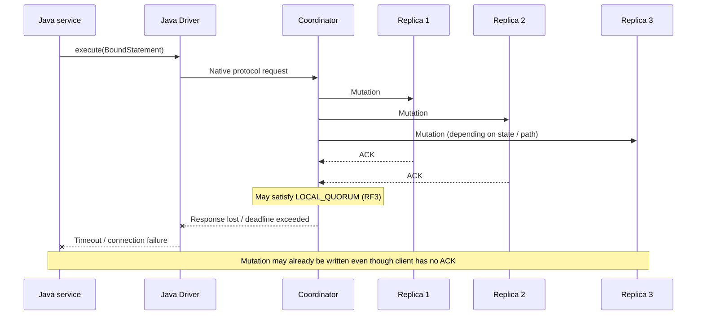
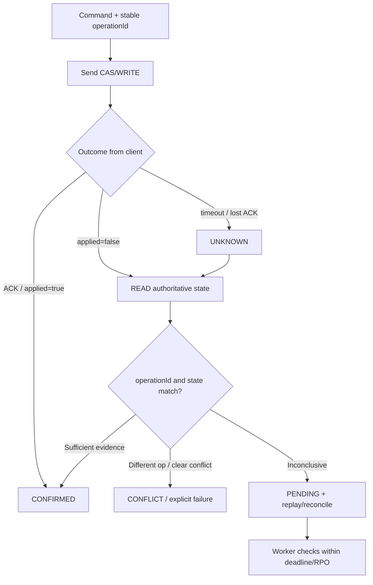
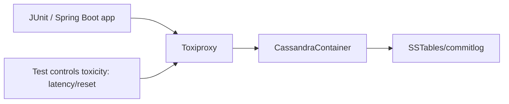
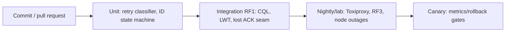

# Testing Retry/Idempotence and Unknown Write Outcomes

## 1. Why Is Testing "Send Succeeded" Not Enough?

A Java application writes order state to Apache Cassandra. In a normal run, `session.execute(boundStatement)` returns a successful result, the test reads back the expected data, and everything turns green. But when the network drops **after the coordinator/replicas have already written but before the client receives the ACK**, the application may receive `WriteTimeoutException` or a connection-loss error. The critical question is not just "was there an error?", but:

> **Did Cassandra already apply the mutation, and if the application resends it, is the business outcome still correct?**

An operation `SET status='PAID'` with a fixed value has different repeatability characteristics than `counter = counter + 1`, `list = list + [event]`, or "charge the card then send a notification." An LWT `UPDATE ... IF status='CREATED'` may win the first time, yet on retry return `[applied]=false` because the condition has already changed. A test that only asserts "the second attempt does not throw an exception" will not protect the business logic.

This lesson belongs to the **Integration Testing** chapter of the `DATABASE_ENGINE_WIDE_COLUMN_CASSANDRA` module. The scenarios are framed in the context of distributed/wide-column Cassandra: partition keys, query-driven tables, tokens/replicas, replication factor (RF), consistency level (CL), CQL, compaction/repair, and Java connectivity.

### Learning Outcomes

After completing this lesson, learners will be able to:

1. Distinguish **safe driver-level retries** from **replaying a business action**.
2. Explain **idempotence at the mutation, statement, and workflow levels**, along with timestamp/TTL/counter/list/LWT exceptions.
3. Build tests for **pre-send errors**, **write applied but ACK lost**, **unknown write outcomes**, **LWT false**, and **retry amplification**.
4. Use Java Driver 4.x, Spring Boot/JUnit 5, Cassandra Testcontainers, and controlled fault injection.
5. Write assertions checking **DB state, operation ID, response contract, attempt counts, CL, and side effects**, rather than testing exceptions alone.
6. Establish retry limits, time budgets, observability, and acceptance/rollback criteria on multi-node clusters.

> **Practical scope:** examples use Apache Cassandra 4.1/5.x, Java Driver 4.18.x, Java 17, Spring Boot 3.x, JUnit 5, and compatible Testcontainers versions. All write-capable DDL/CQL is for **lab/container** environments only. "ACK lost after commit" failures must be simulated **deterministically** at a test seam; cutting the network via a proxy generally cannot prove with certainty that the server committed.

## 2. Diagram of a Single Write: Many Milestones, Yet the Client Sees Only One Response



This diagram is **illustrative** and does not guarantee that the coordinator sends or receives messages in the exact order shown. RF/CL, replica health, hints, commitlog, and background activities affect the actual execution path.

### Three Different Failure Points

| Failure point | What does the client know for sure? | What should be done? |
| --- | --- | --- |
| **Before any network write is attempted** | As far as the driver knows, the request has not been sent | The driver may try another node; internal retries on the pre-send path are typically safe |
| **Sent, but no response received** | **Unknown** whether the mutation arrived or was applied | Treat as an unknown outcome; requires idempotency/reconciliation |
| **ACK received satisfying CL** | The request is confirmed per CL semantics | Do not infer that all DCs/replicas or external side effects are also complete |

**Key fact:** `WriteTimeoutException` means the server reported not receiving enough ACKs within its timeout threshold; `DriverTimeoutException` means the driver did not receive a response in time; a connection reset can happen either before or after server execution. **An exception name alone is not enough to determine whether a mutation committed.**

## 3. Retry Is a Mechanism; Idempotence Is a Property of the Operation

### State-Based Idempotence

A state transformation `f` is called idempotent if applying it twice produces the same final state as applying it once:

\[
f(f(s)) = f(s)
\]

This definition is **relative to the state chosen for observation**. If the application also sends notifications, creates payment history records, extends TTL, or updates timestamps on each retry, looking only at the `status` value can hide that side effects differed.

| CQL / operation | Preliminary assessment | Why |
| --- | --- | --- |
| `SELECT ... WHERE pk=?` | Usually idempotent | Re-reading causes no mutation; returned values can still change due to concurrent writes |
| `UPDATE ... SET status='PAID'` | Can be idempotent **with respect to status state** | Must account for server write timestamp/TTL, conflicts, and auditing |
| `INSERT ... same key / fixed values` | Conditional | Cassandra upserts, but write time/TTL/CDC/side effects may differ |
| `UPDATE ... SET tags = ['x']` | Usually idempotent on the final collection | Overwrites the entire collection with the same value; still consider timestamps |
| `UPDATE ... SET tags = tags + ['x']` | **No** | Retry can append duplicate elements |
| `UPDATE counters SET value=value+1` | **No** | Retry can increment twice |
| `INSERT ... USING TTL 60` | Must be analyzed | A late retry can extend expiration |
| `UPDATE ... IF version=0` | LWT/CAS; **do not assume the whole workflow is idempotent** | Retry may return `[applied]=false` because the first attempt already won |
| "Charge card → insert event → send Kafka" | Not by default | Each system has its own commit/ACK and retry behavior |

**Do not mark `setIdempotent(true)` merely because a CQL statement looks like an UPSERT.** Analyze everything the API advertises: does it emit a unique event, a fixed timestamp, an audit record, or an effect on an external system?

### Mutation Idempotence vs. Business Idempotency

Suppose two executions of `UPDATE orders_by_id SET status='PAID'` both leave `status=PAID`. If the application calls the payment provider **twice**, the business operation is still non-idempotent. A **stable idempotency key/operation ID** carried across retries plus a checkpoint/ledger is part of the solution—not something Driver `setIdempotent(true)` provides.

## 4. Java Driver 4.x: What Does the Default Retry Policy Actually Do?

According to the Apache Cassandra Java Driver 4.18 documentation:

- `basic.request.default-idempotence` defaults to **false**; override per statement via `setIdempotent(true/false)`.
- `DefaultRetryPolicy` is the default policy; it retries **conditionally**, typically at most once for specific error types that have a chance of succeeding.
- Retry policy callbacks depend on the error type and statement **idempotence**; the driver also performs certain **hard-coded retries** when it knows a request was never sent, when repreparing on `UNPREPARED`, or in other pre-execution cases.
- On connection loss **after the request may have been sent**, a non-idempotent request is not blindly retried.
- For **ordinary write timeouts** such as `SIMPLE`, the default policy **does not automatically retry simply because a write timed out**. One documented exception is write type `BATCH_LOG` when idempotent and within retry limits.
- `ConsistencyDowngradingRetryPolicy` can weaken CL and mask errors as success; do not use it in systems required to uphold a strict consistency contract.

### Driver 4.x Example

```java
PreparedStatement find = session.prepare(
    "SELECT status FROM retry_lab_ks.orders_by_id WHERE order_id=?");

BoundStatement read = find.bind(orderId)
    .setConsistencyLevel(DefaultConsistencyLevel.LOCAL_QUORUM)
    .setIdempotent(true);

PreparedStatement increment = session.prepare(
    "UPDATE retry_lab_ks.counter_by_key SET value=value+1 WHERE key=?");

BoundStatement counterWrite = increment.bind("payment-attempts")
    .setConsistencyLevel(DefaultConsistencyLevel.LOCAL_QUORUM)
    .setIdempotent(false);
```

**Do not treat `setIdempotent(false)` as an absolute guarantee that "the driver will never make multiple network attempts"**: pre-send failures, reprepare, pool failover, and safety mechanisms can still trigger activity. Its primary role is to prevent retries **that risk duplicating a mutation** under driver rules.

### Illustrative Configuration

```hocon
datastax-java-driver {
  basic.request {
    timeout = 2 seconds
    default-idempotence = false
  }
  advanced.retry-policy.class = DefaultRetryPolicy
}
```

Java Driver 4.x applies the request timeout across **the entire request including retries/speculative executions** per its configuration, rather than granting an unbounded new time budget with every retry. However, application-level retries (calling `execute` again) create **an entirely new request with a fresh timeout**; you must enforce an overall deadline across the HTTP/message handler.

### Driver Retries and Application Retries Easily Multiply Load

If the service layer allows up to 3 application calls, and each call allows up to 2 driver node attempts on eligible failures, the theoretical bound in that scenario can reach:

\[
\text{Node attempts}_{max} \le 3 \times 2 = 6
\]

This is a **budget illustration**, not a claim that `DefaultRetryPolicy` always tries twice or retries all failures. Enabling speculative execution adds concurrent attempts as well. You must measure **logical operations, driver requests, and node attempts** separately rather than guessing from CQL query counts.

## 5. Lab Data: Distinguishing Status, Counter, List, and Guard

The example targets a lab cluster with a single DC named `dc1`; RF3 only makes sense when enough replicas exist. If you use a **single-node** `CassandraContainer`, define a dedicated RF1 keyspace (Section 15) instead of expecting `LOCAL_QUORUM` on RF3 to tolerate a node failure.

```sql
CREATE KEYSPACE retry_lab_ks
WITH replication = {'class':'NetworkTopologyStrategy', 'dc1':3}
AND durable_writes = true;

CREATE TABLE retry_lab_ks.orders_by_id (
    order_id uuid PRIMARY KEY,
    status text,
    version bigint,
    last_operation_id uuid,
    updated_at timestamp
);

CREATE TABLE retry_lab_ks.operations_by_id (
    operation_id uuid PRIMARY KEY,
    order_id uuid,
    state text
);

CREATE TABLE retry_lab_ks.counter_by_key (
    key text PRIMARY KEY,
    value counter
);

CREATE TABLE retry_lab_ks.tags_by_key (
    key text PRIMARY KEY,
    tags list<text>
);

INSERT INTO retry_lab_ks.orders_by_id
    (order_id,status,version,updated_at)
VALUES (
    11111111-2222-4333-8444-555555555555,
    'CREATED',0,'2026-11-21T08:00:00+0000'
);
```

**Four tables serve four kinds of assertions:**

1. `orders_by_id` holds authoritative state and `last_operation_id` to reconcile a CAS after a timeout.
2. `operations_by_id` has a different partition key (`operation_id`); an `IF NOT EXISTS` here is **not atomic** with `orders_by_id`.
3. `counter_by_key` reveals how non-idempotent retries double counts; counter tables cannot mix regular non-key columns.
4. `tags_by_key` shows how list append can add duplicates; avoid using a list as an unbounded durable event ledger.

In every test, generate **unique** UUIDs/keys, create fixtures beforehand, wait for the approved CL to be satisfied, and delete/expire test data in isolated teardown. Never use production data to prove network failures.

## 6. Four Required Test Categories in a Suite

| Category | Injected fault | Required evidence |
| --- | --- | --- |
| **Pre-send** | Node/pool unavailable **before network send** | Driver/service tries another node if policy permits; DB has no side effect from the unsent attempt |
| **Unknown outcome** | Server may have processed the request, but ACK never reached client | API does not claim "not written"; after recovery, state is compared using operation ID |
| **Post-commit lost ACK (deterministic simulation)** | Real CQL succeeded, then a test seam **deliberately replaces ACK with an error** | DB read confirms the mutation; service does not blindly retry non-idempotent actions |
| **CAS conflict** | Two writers use the same expected version | One LWT wins, one returns false/optimistic conflict; business outcome is valid |

**Do not collapse these into a single "network timeout test."** A proxy that drops the connection before the request cannot prove how your logic behaves when the request was already applied. Conversely, a seam simulating a lost ACK after commit is **not** a measurement of protocol packet loss; it verifies **business decision-making under an ambiguous outcome**.

## 7. Scenario A: Retryable Reads Must Still Preserve Consistency and Deadlines

Primary-key reads are normally idempotent at the CQL layer; transient failures may be retried **when policy permits**, whereas invalid queries, unauthorized errors, or callback mapping bugs must not be retried.

```java
PreparedStatement lookup = session.prepare(
    "SELECT status, version, last_operation_id " +
    "FROM retry_lab_ks.orders_by_id WHERE order_id=?");

BoundStatement request = lookup.bind(orderId)
    .setConsistencyLevel(DefaultConsistencyLevel.LOCAL_QUORUM)
    .setTimeout(Duration.ofSeconds(2))
    .setIdempotent(true);

Row row = session.execute(request).one();
// row == null: order does not exist; completely different from timeout/Unavailable.
```

**Assertions:**

- Given an immutable fixture, returns the exact status/version with no new side effects.
- On a recoverable transient read timeout: retry (if policy is appropriate) preserves `LOCAL_QUORUM` and query shape.
- When insufficient replicas are available: surface an availability/deadline error rather than returning an empty list or HTTP 404.
- On permission errors or bad schema: **do not retry indefinitely**.
- Track attempt counts and end-to-end p99, because retries can be data-correct yet breach the SLA.

### Test-Double Guidance for Decision Policies

Use a repository adapter interface such as `OrderReader.read(UUID)` and stub two calls: the first completes exceptionally with a **classified** transient read error, and the second returns the fixture state. Use a scheduler/fake clock to verify backoff and overall timeout. Write a separate test with `UnauthorizedException`/invalid query asserting a single invocation. Avoid hard-coding test code to driver exception constructors that differ across versions: test against your mapped domain abstraction/classifier.

## 8. Scenario B: Counter Increments Must Not Be Blindly Replayed

Counters are the clearest example: each mutation execution increments the stored value.

```sql
UPDATE retry_lab_ks.counter_by_key
SET value = value + 1
WHERE key = 'operation-123';

SELECT value FROM retry_lab_ks.counter_by_key
WHERE key = 'operation-123';
```

Suppose the first attempt already incremented from 0 to 1, but the client lost the ACK. If the service reruns the same CQL statement, the final result **can become 2** even though only **one business event** occurred.

| What the client observes | Possible DB state | Correct action |
| --- | --- | --- |
| Success ACK | 1 after one increment in fixture | Complete per CL; still verify event contract |
| Timeout/connection loss | 0, 1, or converging | State is unknown; do not blindly retry |
| Test simulating lost ACK after success | **1 already written** | Do not increment again; requires dedup/event ledger or a different design |
| Improper retry after lost ACK | **2** | Test **must FAIL** due to duplicate side effect |

**Do not rely on counters for monetary ledgers or exactly-once actions** simply by flagging `setIdempotent(false)` in the driver; that blocks one retry layer, not HTTP retries, Kafka redeliveries, or cron reruns. When an exactly-once effect is required, design explicit operation IDs, an authoritative source, and proper reconciliation.

## 9. Scenario C: List Append Is Also Non-Idempotent

```sql
UPDATE retry_lab_ks.tags_by_key
SET tags = tags + ['E1']
WHERE key = 'demo-list';

-- If executed twice, the list may contain ['E1','E1'].
SELECT tags FROM retry_lab_ks.tags_by_key
WHERE key = 'demo-list';
```

**Practical testing:** assert that when a request has an unknown outcome, the service does not replay the append; a "retry produces no duplicates" test should pass only if the application layer blocks replay or the data model was changed.

**Alternative design:** model an `events_by_order` table whose primary key includes order ID + a **stable event ID** so retrying the same event writes the same key instead of multiplying list entries. However, upserting the same key is **still not enough** to guarantee external side effects do not repeat; you must still evaluate writetime/TTL/tombstones, downstream delivery, and the idempotency contract.

## 10. Scenario D: LWT Applied on First Attempt, False on Second

An LWT CAS on the authoritative order row uses `last_operation_id` to record the business request:

```sql
UPDATE retry_lab_ks.orders_by_id
SET status = 'PAID',
    version = 1,
    last_operation_id = 99999999-aaaa-4bbb-8ccc-dddddddddddd,
    updated_at = '2026-11-21T08:30:00+0000'
WHERE order_id = 11111111-2222-4333-8444-555555555555
IF status = 'CREATED' AND version = 0;
```

LWT returns the special `[applied]` column. If the first attempt succeeded but the response was lost, a second attempt with the same `version=0` condition can return `[applied]=false` because the row is already at version=1.

| Point in time | Client receives | Authoritative row |
| --- | --- | --- |
| Before CAS | — | CREATED, version=0 |
| Attempt 1 | **Simulated lost ACK / timeout** | PAID, version=1, last_operation_id=op-1 |
| Attempt 2 if resent | `[applied]=false` | PAID, version=1 |
| Reconcile | Read row with proper CL | If last_operation_id=op-1 and state is valid, infer the request was applied |

**Condition for that final inference:** there must be a policy preventing subsequent writes from overwriting `last_operation_id` before reconciliation, or a durable audit/source keyed by operation ID. If the row has already moved on to a later state, reading only the current row is not always enough to reconstruct history.

### Java Driver 4.x

```java
PreparedStatement cas = session.prepare(
    "UPDATE retry_lab_ks.orders_by_id " +
    "SET status=?, version=?, last_operation_id=?, updated_at=? " +
    "WHERE order_id=? IF status=? AND version=?");

BoundStatement stmt = cas.bind(
    "PAID", 1L, operationId, Instant.parse("2026-11-21T08:30:00Z"),
    orderId, "CREATED", 0L)
    .setConsistencyLevel(DefaultConsistencyLevel.LOCAL_QUORUM)
    .setSerialConsistencyLevel(DefaultConsistencyLevel.LOCAL_SERIAL)
    .setIdempotent(false);

ResultSet result = session.execute(stmt);
boolean applied = result.wasApplied();
if (!applied) {
    // Conflict OR already processed: read back state containing operation ID.
}
```

**Do not equate** serial CL `LOCAL_SERIAL` with regular CL `LOCAL_QUORUM` or Spring `@Transactional(isolation=SERIALIZABLE)`. This configuration fits a single-DC example; multi-DC deployments must choose serial CL based on cluster-wide invariants.

## 11. Representing Business Outcomes: Three States, Not a Boolean

A testable API should separate:

1. **APPLIED/CONFIRMED:** received a confirmation response satisfying CL and conditions.
2. **REJECTED/CONFLICT:** received a verified `[applied]=false` result or violated business rule.
3. **UNKNOWN/PENDING_RECONCILIATION:** ACK lost or timed out after the request may have been sent.



Do not have the API return **200 success** just for an uncompleted `CompletableFuture`; nor return "payment failed / definitely not written" merely because the driver timed out. You may return a pending status with the operation ID so the client can **poll/query status**, depending on the API contract; no HTTP status code automatically solves database-side deduplication.

## 12. Test Seam: Separating Business Logic from Real Networking

A **test seam** is an intentional architectural boundary that lets tests swap implementations, for example:

```java
interface OrderMutationPort {
    WriteOutcome attemptMarkPaid(UUID orderId, UUID operationId);
}

enum WriteOutcome {
    APPLIED, CONFLICT
}
```

In the production implementation, the port executes the prepared LWT, reads `wasApplied()`, and **lets timeout errors propagate** according to the error taxonomy. In tests, an adapter can **run the real write** and then deliberately throw an exception simulating a lost ACK:

```java
final class LostAckAfterCommitPort implements OrderMutationPort {
    private final OrderMutationPort delegate;
    private boolean first = true;

    LostAckAfterCommitPort(OrderMutationPort delegate) {
        this.delegate = delegate;
    }

    @Override
    public WriteOutcome attemptMarkPaid(UUID orderId, UUID operationId) {
        WriteOutcome realOutcome =
            delegate.attemptMarkPaid(orderId, operationId);
        if (first && realOutcome == WriteOutcome.APPLIED) {
            first = false;
            throw new SimulatedLostAckException();
        }
        return realOutcome;
    }
}
```

`SimulatedLostAckException` is a test-only exception defined by the suite. **Never** use this adapter in production. It constructs a scenario where **the DB definitely ACKed the delegate**, and then deliberately prevents the caller from **receiving the outcome**; this tests recovery logic, **not true packet-level ACK loss**.

### Oracle for the "Applied but ACK Lost" Test

- The real port was called **once**, and Cassandra already holds `status=PAID`/`last_operation_id=op-1`.
- The caller receives an ambiguous error/pending outcome and does **not** automatically retry counter/payment side effects.
- Reconciliation reads authoritative state at the appropriate CL and recognizes that the same operation ID already applied.
- A client retry with the same operation ID receives an **already processed** result without generating extra events or charges.
- A separate test with a different operation ID must return conflict per the state machine rather than pretending "both payments succeeded."

If a mock test throws an exception **before calling the DB**, it tests pre-send failures—not post-commit ACK loss.

## 13. JUnit 5: Asserting Call Counts and Post-Error Outcomes

The pattern below illustrates a **pure Java** test isolating retry logic before introducing a Cassandra container. It uses `AtomicInteger` and a test port to prove the service **does not call again** when an exception indicates an unknown outcome.

```java
import static org.junit.jupiter.api.Assertions.*;
import java.util.UUID;
import java.util.concurrent.atomic.AtomicInteger;
import org.junit.jupiter.api.Test;

final class RetryDecisionTest {
    @Test
    void unknownOutcomeIsNotBlindlyRetried() {
        AtomicInteger attempts = new AtomicInteger();
        UUID orderId = UUID.randomUUID();
        UUID operationId = UUID.randomUUID();

        OrderMutationPort fake = (id, op) -> {
            attempts.incrementAndGet();
            throw new SimulatedLostAckException();
        };

        // This is a minimal service-level policy, NOT a Driver retry policy.
        OrderMutationPort servicePolicy = (id, op) -> fake.attemptMarkPaid(id, op);

        assertThrows(SimulatedLostAckException.class,
            () -> servicePolicy.attemptMarkPaid(orderId, operationId));
        assertEquals(1, attempts.get());
    }
}
```

**Unit-test limitation:** it only proves the current code **does not auto-retry** a synthetic error; it does **not** prove whether a real mutation took place. Pair it with an integration test using real Cassandra and `LostAckAfterCommitPort` from Section 12 to verify **DB state**.

### Verifying "One Business Delivery" Instead of One Callback

Service tests should assert independent checks:

- Number of **application attempts** orchestrated by the service.
- Number of **driver node attempts** only when trackers/metrics are enabled; these do not necessarily equal application attempts.
- Number of **unique business event IDs** in the ledger/projection.
- Number of **external side effects** (payments, message publishes) per idempotency key.
- Final state read using the right CL and fixture cutoff.

Asserting `verify(repository).save(...)` was invoked once only proves the repository layer was not called repeatedly inside a **mock test**; it does not cover driver retries underneath or Kafka redeliveries in another process.

## 14. Real Integration Testing: Spring Boot 3.x + Testcontainers Cassandra

**Goal:** execute CQL/Java Driver against real Cassandra, verifying serialization, prepared statements, `LOCAL_QUORUM/ONE` matched to fixture RF, LWT `wasApplied()`, and actual post-mutation data.

### Test Dependencies (Maven, Illustrative)

```xml
<dependencies>
  <dependency>
    <groupId>org.springframework.boot</groupId>
    <artifactId>spring-boot-starter-data-cassandra</artifactId>
  </dependency>
  <dependency>
    <groupId>org.springframework.boot</groupId>
    <artifactId>spring-boot-starter-test</artifactId>
    <scope>test</scope>
  </dependency>
  <dependency>
    <groupId>org.springframework.boot</groupId>
    <artifactId>spring-boot-testcontainers</artifactId>
    <scope>test</scope>
  </dependency>
  <dependency>
    <groupId>org.testcontainers</groupId>
    <artifactId>junit-jupiter</artifactId>
    <scope>test</scope>
  </dependency>
  <dependency>
    <groupId>org.testcontainers</groupId>
    <artifactId>cassandra</artifactId>
    <scope>test</scope>
  </dependency>
</dependencies>
```

Manage versions with the appropriate Spring Boot/Testcontainers BOM. **The following code example uses Testcontainers 1.x with `org.testcontainers.containers.CassandraContainer`**; Testcontainers 2.x moved some packages/modules. Do not mix 1.x and 2.x imports or Spring Boot 4.x branches without verifying APIs.

### Single Container, RF1: Functional Testing, Not RF3 Availability Testing

```java
import java.util.UUID;
import com.datastax.oss.driver.api.core.CqlSession;
import com.datastax.oss.driver.api.core.cql.Row;
import org.junit.jupiter.api.BeforeAll;
import org.junit.jupiter.api.Test;
import org.junit.jupiter.api.TestInstance;
import org.springframework.beans.factory.annotation.Autowired;
import org.springframework.boot.test.context.SpringBootTest;
import org.springframework.boot.testcontainers.service.connection.ServiceConnection;
import org.testcontainers.containers.CassandraContainer;
import org.testcontainers.junit.jupiter.Container;
import org.testcontainers.junit.jupiter.Testcontainers;
import org.testcontainers.utility.DockerImageName;
import static org.junit.jupiter.api.Assertions.*;

@Testcontainers
@SpringBootTest(properties = "spring.cassandra.schema-action=none")
@TestInstance(TestInstance.Lifecycle.PER_CLASS)
class CassandraRetryIntegrationIT {
    @Container
    @ServiceConnection
    static CassandraContainer<?> cassandra =
        new CassandraContainer<>(DockerImageName.parse("cassandra:4.1"));

    @Autowired CqlSession session;

    @BeforeAll
    void schema() {
        session.execute(
            "CREATE KEYSPACE IF NOT EXISTS retry_it_ks " +
            "WITH replication = {'class':'SimpleStrategy'," +
            "'replication_factor':1}");
        session.execute(
            "CREATE TABLE IF NOT EXISTS retry_it_ks.orders_by_id (" +
            "order_id uuid PRIMARY KEY, status text, version bigint, " +
            "last_operation_id uuid)");
    }

    @Test
    void preparedWriteAndReadUseRealCassandra() {
        UUID id = UUID.randomUUID();
        session.execute(session.prepare(
            "INSERT INTO retry_it_ks.orders_by_id " +
            "(order_id,status,version) VALUES (?,?,?)")
            .bind(id, "CREATED", 0L));

        Row result = session.execute(session.prepare(
            "SELECT status, version FROM retry_it_ks.orders_by_id " +
            "WHERE order_id=?").bind(id)).one();

        assertNotNull(result);
        assertEquals("CREATED", result.getString("status"));
        assertEquals(0L, result.getLong("version"));
    }
}
```

**Prerequisites to run:** working Docker/container runtime, aligned test dependencies, pullable Cassandra image, schema agreement, and a Spring Boot test context where no other repository eagerly prepares tables in its constructor before creation. When instantiating real repositories, run **fixture migrations before those beans prepare queries** or configure test beans accordingly.

**Fundamental limitation:** a single container only models **RF1**; it cannot validate `LOCAL_QUORUM` reads/writes when a node fails under RF3, streaming/repair, or multi-DC failover. To test availability, build at least a three-node topology following lab guidance without risking production.

### Why Use `@ServiceConnection`?

Spring Boot 3.5 provides a `CassandraConnectionDetails` factory when it detects `CassandraContainer`; those connection details override host/port properties in test configs. It eliminates hard-coded hosts/ports, yet it **does not automatically create CQL tables or test fixtures**. Never enable `spring.cassandra.schema-action: recreate_drop_unused` in production just to simplify test setup.

## 15. LWT Integration Test: One CAS Wins, One CAS Loses

Create a new order fixture in `retry_it_ks`, with two statements sharing expected version=0. You can run the calls sequentially to verify basic correctness, then add a concurrent two-writer test.

```java
UUID orderId = UUID.randomUUID();
UUID operationA = UUID.randomUUID();
UUID operationB = UUID.randomUUID();

session.execute(session.prepare(
    "INSERT INTO retry_it_ks.orders_by_id " +
    "(order_id,status,version) VALUES (?,?,?)")
    .bind(orderId, "CREATED", 0L));

PreparedStatement cas = session.prepare(
    "UPDATE retry_it_ks.orders_by_id " +
    "SET status=?, version=?, last_operation_id=? " +
    "WHERE order_id=? IF status=? AND version=?");

BoundStatement first = cas.bind(
    "PAID", 1L, operationA, orderId, "CREATED", 0L)
    .setIdempotent(false);
BoundStatement second = cas.bind(
    "CANCELLED", 1L, operationB, orderId, "CREATED", 0L)
    .setIdempotent(false);

assertTrue(session.execute(first).wasApplied());
assertFalse(session.execute(second).wasApplied());

Row row = session.execute(session.prepare(
    "SELECT status,version,last_operation_id " +
    "FROM retry_it_ks.orders_by_id WHERE order_id=?")
    .bind(orderId)).one();
assertEquals("PAID", row.getString("status"));
assertEquals(1L, row.getLong("version"));
assertEquals(operationA, row.getUuid("last_operation_id"));
```

**Concurrency testing:** use `CountDownLatch` so two threads issue CAS simultaneously and assert the sum of `applied=true` equals 1, then verify the final row. Do not assert **which** of A or B wins; scheduling order is non-deterministic. With Spring Data `@Version`, a similar test uses two stale entity instances and catches `OptimisticLockingFailureException` per the API.

**Test-math caveat:** after a successful CAS in an RF1 fixture, reading from the same node may pass; that **does not prove** serial CL or multi-DC choices are sound in production.

## 16. Testing Lost ACK *After* Commit: Building a Deterministic Scenario

Design a two-layer integration test:

1. **The real port** calls `CqlSession.execute(cas)` and receives `wasApplied=true`, confirming the data was committed in the test.
2. **The test adapter** throws `SimulatedLostAckException` **after** the real port completes.
3. The service catches the ambiguous result and returns `UNKNOWN/PENDING` instead of `CONFLICT`, or preserves the exception for orchestration to handle.
4. Reconciliation reads `orders_by_id` and compares `last_operation_id` against the requested ID.
5. Assert that no extra increment/list append/external charge occurs while orchestration handles the pending state.

### Test Oracle Pseudocode

```java
UUID id = newOrderFixture();
UUID op = UUID.randomUUID();

OrderMutationPort realPort = new CassandraCasPort(session);
OrderMutationPort lossPort = new LostAckAfterCommitPort(realPort);

assertThrows(SimulatedLostAckException.class,
    () -> lossPort.attemptMarkPaid(id, op));

Row stored = readOrderById(session, id);
assertEquals("PAID", stored.getString("status"));
assertEquals(op, stored.getUuid("last_operation_id"));

// Service recovery:
// assertEquals(CONFIRMED, reconciler.reconcile(id, op));
// assertEquals(1, uniqueBusinessEventCount(op));
```

`newOrderFixture`, `CassandraCasPort`, `readOrderById`, and `reconciler` are **suite-authored helpers**, not Java Driver APIs. The final lines use pseudo-assertions for an external event store. The goal is to force learners to design the seam and test oracle first rather than mistaking a bare snippet lacking infrastructure for a complete integration test.

**If a test merely mocks a timeout before calling `session.execute`, it is invalid for this case**: it fails to prove the code handles **a write that succeeded** while the client reported an error.

## 17. Network Fault Injection: Testcontainers + Toxiproxy

Toxiproxy can introduce network conditions between client and Cassandra container—such as added latency, upstream/downstream cuts, or closed connections—allowing you to test real transport-layer resilience.



**Recommended testing sequence:**

1. Launch Cassandra + Toxiproxy containers inside an **isolated test Docker network**.
2. Create a proxy for native CQL port 9042 and configure Java Driver to connect via the proxy endpoint.
3. Verify traffic **actually flows through the proxy** using a non-destructive fault (e.g., latency) before claiming network behavior is under test.
4. Inject connection drops/latency inside a controlled window; record timestamps, CL, operation ID, driver timeout, and callback outcome.
5. Restore the proxy; **read back real state** and verify idempotency/reconciliation.
6. Clean up all toxins/containers reliably during teardown so other tests are not polluted.

**Critical Cassandra gotcha:** the driver bootstraps from contact points, yet can **discover advertised addresses** of other nodes from topology metadata and connect directly, **bypassing the proxy** if misconfigured. For reliable network failure tests, configure endpoints/routing on all relevant connections so no bypass path exists. With multiple nodes, every target path must be controlled or isolated; never assume proxying one contact point intercepts every coordinator.

### Toxiproxy Alone Cannot Guarantee Commit Timing via Network Cuts

Adding a toxic to the response/downstream direction does not guarantee the cut happens **after commit**. Failure may occur before the request arrives, mid-execution, or after the ACK. Therefore:

- Toxiproxy test → proves timeout/recovery **under non-deterministic timing**, tracking probabilities and logs.
- Post-commit test seam → deterministically proves the service reacts **correctly to a post-write DB state**.
- Multi-node fault test → proves RF/CL and failover inside a genuinely configured topology; it does not replace the two tests above.

Never use firewall/iptables rules to drop production traffic for an exercise; test strictly within authorized containers/labs with clear network boundaries.

## 18. Fault-Injection Matrix: Cover Success, Failure, and Ambiguity

| Test ID | Injection | Possible client-visible outcome | Required evidence |
| --- | --- | --- | --- |
| T01 | No fault | ACK / correct rows | Values, row count, CL, 1 business op |
| T02 | Before network send | Failover or fast failure | No write from failed attempt; attempts match policy |
| T03 | Server returns unavailable | Insufficient-replica error or conditional retry | Preserves CL; never silently weakens consistency |
| T04 | Read timeout, safe retry | Read success or final timeout | No side effects; attempt count/backoff/deadline |
| T05 | Write timeout on ordinary mutation | Unknown outcome | Never assumes DB "definitely did not write" |
| T06 | Lost ACK after successful write (seam) | Unknown at caller | DB wrote; no blind retry |
| T07 | Counter increment T06 + improper retry | Count may become 2 | Test **must catch the double increment** |
| T08 | List append T06 + improper retry | List contains duplicate element | Test **must catch the duplication** |
| T09 | LWT applied first time, ACK lost | Retry returns false | Operation ID resolves outcome when conditions hold |
| T10 | Concurrent LWT writers | 1 wins, 1 returns false | Valid final state; never reports both succeeded |
| T11 | LWT false with no transport error | Business conflict / already processed | Not mapped to 503/timeout |
| T12 | Application cancel / client disconnect | Write may still execute | Recovery independent of HTTP lifecycle |
| T13 | Connection reset/latency via Toxiproxy | Timeout/retry/failed request | Fault demonstrably routed through proxy; DB readback |
| T14 | Invalid query/schema | Immediate failure | No infinite retries, no fake success |
| T15 | Unauthorized | Permission error | Never downgrades CL or returns not-found |
| T16 | Two retry layers enabled together | Attempt count multiplies | Global budget, backoff, and stop thresholds enforced |
| T17 | Crash between order state and event projection | Partial business state | Replayer/ledger yields a single event after recovery |
| T18 | Node outage at RF3 | `LOCAL_QUORUM` may survive depending on topology | Separate RF3 lab test; never extrapolated from RF1 |
| T19 | Paging timeout mid-stream | Full-result API fails or follows explicit partial contract | Never returns missing rows as complete success |
| T20 | Graceful shutdown mid-write | Unknown result / late callback | Never ACKs queue message before CQL completes |

**Name tests after the real hypothesis:** e.g., `afterCommitLostAckDoesNotRepeatCharge` is far better than `timeoutTest`, because failure timing determines what the test case actually proves.

## 19. Multi-Node Testing: RF/CL and Coordinator Failover

With single-DC RF3 and `LOCAL_QUORUM`, two replica responses are typically needed to satisfy local quorum. In a multi-node lab:

- Record an RF3 baseline with all nodes `UN` and the application's agreed CL.
- Disrupt **only one node** per the runbook, inspecting routing/coordinator selection and CQL outcomes.
- Document cases where quorum holds versus where quorum cannot be met, without altering CL.
- Test a slow replica or hot partition and measure p99 alongside retries/speculative executions separately.
- After node recovery, verify consistency/repair per lab procedure; never treat "node is UP again" as proof all data is reconciled.

**A single-node RF1 container cannot test RF3 availability.** You do not need a multi-DC cluster just to run retry-policy unit tests, yet before claiming SLA or multi-DC correctness, you must test on the corresponding topology.

### Do Not Use `ConsistencyDowngradingRetryPolicy` to "Boost Pass Rates"

That policy can lower CL or, in certain write cases, choose to **ignore** the error and return an empty result. If tests only count HTTP 200s, pass rates may rise while the **consistency guarantee is silently weakened**. Assert the statement's CL, active retry policy, and allowed postconditions; never use ignore/downgrade as a production default.

## 20. Retries in Spring Service / Reactor: Each Retry Is New Work

A driver retry **inside** `session.execute(stmt)` differs from a Spring Service retry **calling** `session.execute(stmt)` again. In Reactor, `retryWhen` typically resubscribes upstream, so upstream must create a **fresh request upon each subscription**, rather than wrapping an already-started `CompletableFuture`.

### Example: Retrying Only an Idempotent SELECT

```java
import java.time.Duration;
import java.util.Optional;
import reactor.core.publisher.Mono;
import reactor.util.retry.Retry;

// orderRepository.readAsync(UUID) returns CompletionStage<Optional<Order>>.
Mono<Optional<Order>> result = Mono.defer(() ->
        Mono.fromCompletionStage(() -> orderRepository.readAsync(orderId)))
    .retryWhen(
        Retry.backoff(2, Duration.ofMillis(50))
            .maxBackoff(Duration.ofMillis(250))
            .jitter(0.5)
            .filter(error -> isRetryableTransientRead(unwrap(error))))
    .timeout(Duration.ofMillis(800));
```

`isRetryableTransientRead` and `unwrap` are **application helpers** that must be implemented and tested against real driver error taxonomy; never retry every `RuntimeException` blindly. `Retry.backoff(2,...)` allows at most **two additional retries** after the initial attempt; if a `DriverTimeoutException` or dependency timeout already consumed the deadline, a fresh retry can worsen overload. Maintain an **API-wide budget** and verify the driver policy does not amplify load.

**Apply this same pattern to writes only after business idempotency is proven.** Never copy `retryWhen` onto charge/counter/list-append flows assuming the driver's `setIdempotent(false)` flag protects application-level retries.

### Reactor Timeout Does Not Roll Back Mutations

`Mono.timeout(...)` emits a timeout error and can cancel the subscription. That **does not prove** the server never received or applied the write. For writes with unknown outcomes, return **PENDING/UNKNOWN** or propagate according to the API contract and hand off to a recovery worker—never return `Mono.empty()` to swallow the failure.

### Circuit Breakers and Bulkheads

Retries cannot heal a saturated Cassandra cluster. Add:

- **Bulkhead / concurrency limits:** prevent 10,000 requests from retrying concurrently on a hot partition.
- **Circuit breaker:** stop hammering when failures exceed thresholds; allow controlled recovery per policy.
- **Exponential backoff + jitter:** prevent all clients from retrying in lockstep.
- **Overall deadline:** stop once the SLA budget is exhausted.
- **Conditional read fallback:** serve cached/stale data only if the contract permits and tag freshness explicitly; never use stale fallbacks for consistency-critical financial decisions.

## 21. Testing Timestamps, TTLs, and Tombstones: "Looks Idempotent" Is Not Enough

In Cassandra, every cell carries a write timestamp and some mutations carry a TTL. Seeing the same final value on an immediate read **does not guarantee** a mutation is safe to execute twice.

### 21.1. Server-Assigned Write Timestamps

Two submissions of `UPDATE ... SET status='PAID'` can receive different timestamps. If another legitimate writer intervenes in between, a late retry can **overwrite newer state** under Cassandra's conflict resolution. Never treat a single-point `status == 'PAID'` comparison as proof of business idempotency.

### 21.2. TTLs and Expiration Windows

```sql
-- Lab: retrying this statement later can shift the expiration timestamp.
UPDATE retry_lab_ks.tags_by_key
USING TTL 60
SET tags = ['E1']
WHERE key = 'ttl-demo';
```

If the first write occurs at 10:00:00 and the retry succeeds at 10:00:10, both write the same value yet expire at different times than a single execution would. **Tests must observe expiration against a controlled clock** rather than relying on fragile 60-second sleeps; use short lab TTL policies with explicit tolerance bands.

### 21.3. Tombstones, Repair, and Replica Reads

A `DELETE` or `NULL` write creates tombstones. If replicas diverge, a read at `ONE` does not prove "deleted cluster-wide." In migration/repair tests:

- Verify CL, RF, replica health, and convergence time.
- Do not run a production-scale `nodetool repair` just for a test.
- Use dedicated delete/TTL fixtures and observe tombstone counts/compaction impact.
- Do not treat a read from a single coordinator as an absolute oracle across all replicas.

### 21.4. Mutable Collections and Callback Side Effects

Even when `INSERT` uses a stable event ID key, a Java callback **publishing to Kafka** can execute again after a retry; tests must assert that events/notifications are **processed once per ID** or that downstream deduplicates them. Do not equate consistent Cassandra state with an exactly-once end-to-end workflow.

## 22. Observing Actual Retries via the Java Driver

To count accurately, separate:

1. **Business operation:** one HTTP command or message completing the contract.
2. **Application attempts:** times the service calls the repository / `execute`.
3. **Driver request-level outcomes:** success/failure of each request, including paged logical operations.
4. **Node-level attempts:** coordinators tried by the driver due to initial routing, retries, or speculative executions.
5. **Coordinator–replica traffic:** internal to Cassandra; do not estimate it by multiplying application calls by RF.

### `ExecutionInfo`: Diagnostic Context, Not a Packet Counter

```java
ResultSet rs = session.execute(stmt);
ExecutionInfo info = rs.getExecutionInfo();

int speculativeStarts = info.getSpeculativeExecutionCount();
int priorCoordinatorErrors = info.getErrors().size();
boolean coordinatorKnown = info.getCoordinator() != null;

System.out.printf(
    "specStarts=%d priorErrors=%d coordinatorKnown=%s%n",
    speculativeStarts, priorCoordinatorErrors, coordinatorKnown);
```

**Limitations:** failures before receiving a response may lack an `ExecutionInfo`; `getErrors().size()` is **not** equal to total retry attempts, because speculative executions that succeed or get cancelled and certain paths are absent from the errors list. For paged SELECTs, inspect `result.getExecutionInfos()` **after iterating all rows** to cover every fetched page.

### `RequestTracker`

Driver 4.x supports `RequestTracker` with request-level callbacks (`onSuccess`/`onError`) and node-level callbacks (`onNodeSuccess`/`onNodeError`). Wire it into your test session when counting attempts; counters must be thread-safe and read as deltas over the test window.

```text
businessStarted = 1
applicationExecuteCalls = 1
driverRequestSuccess = 1
nodeSuccess = 1
nodeError = 1

Interpretation: one business operation completed, one app execute call,
and the driver recorded two node-level outcomes via the tracker.
Do not add driverRequestSuccess + nodeSuccess + nodeError to claim 3 operations.
```

Under concurrent workloads, a session-scoped tracker counts traffic across endpoints; tag **query shapes** or use a dedicated session/test window when verifying an exact flow. Never log raw bound values or PII in `RequestLogger`. `RequestTracker` cannot tell you "how many replicas wrote the mutation" from callback events alone.

### Key Metrics

| Layer | Metrics | What it detects |
| --- | --- | --- |
| API/consumer | Business ops/s, duplicate IDs, PENDING count, reconciliation lag | Whether business work actually completed |
| Driver session | Requests, timeouts, retry/speculative starts, p50/p95/p99 latency | Retry amplification |
| Driver node | Connections/in-flight, node request attempts, failures, bytes | Hot coordinators or pool saturation |
| Cassandra coordinator | ClientRequest latency, timeouts, dropped messages | Server-side contention |
| Replica/table | SSTables per read, tombstones, write/read latency | Disk/compaction/repair bottlenecks |
| Host/load generator | CPU/GC, disk await, network, thread pool queues | Whether the test client itself became the bottleneck |
| Workflow | Outbox offsets, dedup events, DLQ, max pending age | Recovery of partial successes |

Do not average per-node p99 values to compute cluster-wide p99; aggregate histograms properly or collect raw samples over the same measurement window.

## 23. Test Reporting: Comparing Pre- and Post-Fault State

A proper test report should include:

| Field | Illustrative example |
| --- | --- |
| Scenario | `T06: afterCommitLostAckDoesNotRepeatCharge` |
| Cassandra | 4.1 lab single node RF1; **not** RF3 |
| Java Driver / Spring Boot | Driver 4.18.x; Boot 3.x |
| Query shape | `UPDATE orders_by_id ... IF version=?` |
| Partition key / operation ID | Synthetic UUID, masked on shared dashboards |
| Regular / serial CL | `ONE/SERIAL` in RF1 lab; production topology requires its own policy |
| Idempotent flag | `false` on LWT; default driver policy |
| Fault stage | **After delegate returned applied=true**, test seam threw error |
| Expected client outcome | UNKNOWN/PENDING, followed by reconciliation |
| DB oracle | status=PAID, version=1, last_operation_id=op ID |
| Application retry count | 0 blind retries |
| Event/charge effects | 1 logical effect, no duplicates |
| Final result | PASS only if state + API + attempts + event ID all match |

**Never present synthetic table numbers as production measurements.** Capture logs, tool versions/configs, UTC timestamps, test case ID, seed, duration, and how the fault differs from production (proxy vs. seam).

### Test Confidence Levels

| Level | What can be concluded | What cannot be concluded |
| --- | --- | --- |
| Pure unit test / mock | Service mapping, error classification, retry budget | Whether DB committed, CQL syntax, or replica consistency |
| Testcontainers Cassandra RF1 | Real CQL, driver binding, single-node LWT behavior | RF3/local quorum fault tolerance, multi-DC behavior |
| Post-commit test seam | Business logic when **write succeeded but caller saw an error** | Exact packet-loss timing |
| Toxiproxy test | Real driver/network failure handling on the test topology | Exact commit point without a DB oracle |
| Multi-node lab RF3 | Quorum, routing, failover, and repair on that topology | Every production topology/version/workload |
| Production canary | Real system behavior within bounded scope | Absolute proof across every failure mode |

## 24. CI Pipeline and Test Isolation

A solid test architecture splits into three tiers:



### Test Isolation

- Create isolated test keyspaces/tables or fresh UUID partitions per case; never share rows that introduce test-order dependencies.
- Teardown by namespace/container; never run `TRUNCATE` against a production keyspace.
- Control seeds and clocks for timeout/TTL tests; avoid non-deterministic `Thread.sleep` waits.
- Do not mix background migration retries into test counters; warm up sessions, prepare caches, and establish schema before measuring.
- Separate fault-injection tests from normal tests so no leftover toxic/proxy state leaks across cases.
- Set CI timeouts and concurrency caps; Cassandra containers start much slower than mock tests.
- When timeouts or flakiness occur, capture driver/Cassandra versions, CI resource pressure, and the fault timeline; never "fix" flakiness by raising every timeout indefinitely.

### Note on Test Scripts Outside This Article

This article provides **code patterns, CQL, and test designs**; it does not scaffold build projects or run Gradle/Testcontainers on its own. When integrating into a real repository, choose exact Testcontainers 1.x/2.x imports, implement stubbed helper classes, run fixture migrations, and align Spring Boot/Driver versions.

## 25. Runbook When Retry/Idempotence Tests FAIL

### Gate 0 — Define the Contract

State the business operation, primary/partition keys, RF/CL, query pattern, idempotent vs. non-idempotent steps, operation ID, and external effects. "Exactly one increment" is fundamentally different from "final status is PAID."

### Gate 1 — Inspect Actual Driver Settings

Read active config and defaults: `default-idempotence`, statement overrides, retry policy, speculative execution, request timeout, and local DC. Never assume `DefaultRetryPolicy` retries all writes.

### Gate 2 — Verify the Environment

Schema/fixtures exist, roles have permissions, containers are healthy, the Testcontainers network cannot bypass the proxy, and all app timeouts/fault delays are recorded. RF3 tests require an actual RF3 topology.

### Gate 3 — Run a Fault-Free Baseline

Read back expected state, CL, timestamps, and operation ID; confirm `SELECT` returns expected rows, LWT true/false behaves as designed, and initial counters/lists start in known states.

### Gate 4 — Inject One Well-Defined Fault

Exercise pre-send failures, server-side write timeouts, lost-ACK seams, Toxiproxy connection drops, and concurrent CAS conflicts **one at a time**. Attach timestamps and fault IDs to separate real DB outcomes from client exceptions.

### Gate 5 — Verify Post-Fault State

Read the authoritative row/operation ID, counter/list or event ledger, CL, and sampled Cassandra traces if permitted; compare against expected state. **Never resend a write before reading the oracle** in a postcondition test, or you destroy causal attribution.

### Gate 6 — Measure Retry Amplification and SLOs

Track app calls, driver requests, node attempts, p99/error rates, pending reconciliations, and CPU/disk/network. Disable outer retry layers when testing driver retries in isolation, then re-enable them together to verify the combined budget.

### Gate 7 — Triage and Remediate

- Duplicated data → block blind retries, fix idempotency design, reconcile/dedup per runbook.
- Timeout caused fake 200/empty → fix error taxonomy and emit UNKNOWN/PENDING where required.
- Quorum unmet → preserve CL and inspect RF/nodes/replicas; never weaken CL just to turn tests green.
- Retry storm → add backoff+jitter, bulkheads, circuit breakers, and attempt/deadline caps.
- Indeterminate outcome → attach operation IDs / durable audit and build a reconciliation path.

### Gate 8 — Close the Change with Evidence

PASS only when **business state**, **return contract**, **side-effect count**, **CL**, and **retry budget** all satisfy requirements. Archive test cases, fault setups, and versions—not merely a "green JUnit" screenshot. Turn off verbose tracing/`RequestLogger`, revoke test credentials, and clean up containers.

## 26. Troubleshooting Table

| Symptom | Common mistake | Fix |
| --- | --- | --- |
| Counter incremented twice after timeout | Blindly retrying `c=c+1` | Use event IDs/ledgers; never directly retry counters |
| List contains duplicate events | Retrying `list=list+[event]` | Model events as rows with stable keys |
| LWT retry returns false | First attempt may have already applied | Compare `last_operation_id` and state |
| Timeout test PASSES yet DB never wrote | Fault injected before send | Add a **post-commit** seam for that scenario |
| Toxiproxy does not slow queries | Driver bypassed proxy via discovered endpoints | Fix wiring and advertised addresses |
| Driver attempts rise while app calls stay flat | Retries, speculative execution, or paging | Measure each layer via tracker/`ExecutionInfo` |
| Client returns 404 when Cassandra is down | `catch / onErrorResume -> empty` | Distinguish not-found, timeout, and unavailable |
| "Idempotent update" overwrites newer state | Different server timestamps, concurrent writer | Use CAS/version or state transition validation |
| TTL extended after retry | Relative expiration recomputed | Design fixed business expiry and test it |
| Test passes only at CL ONE | Quorum requirements unmet | Run proper RF/CL without weakening the contract |
| RF1 Cassandra Testcontainer passes, failover breaks | Test environment lacks replicas | Test in a multi-node RF3 lab |
| Kafka event published twice | No stable event ID/dedup | Durable source + outbox/reconciliation |
| App stops between write and ACK | Unknown outcome during shutdown | Drain requests; run idempotent recovery worker |
| App retry + driver retry overload cluster | Two retry layers without a shared budget | Enforce overall deadline, backoff, max attempts |
| Tracing slows tests severely | Enabling 100% tracing | Sample traces; never benchmark with full tracing on |
| Prepared query raises UNPREPARED | Node restart/eviction | Let driver reprepare; inspect schema changes |
| Unit test only verifies mock call count | Real Cassandra state never checked | Add integration tests + DB oracle |

## 27. Self-Check Exercises

1. Why does `WriteTimeoutException` not prove a mutation never reached any replica?
2. Define `f(f(s))=f(s)` and explain why a business operation can still have side effects.
3. Which retries does `setIdempotent(false)` block, and what does it **not** promise?
4. Does Driver 4.x `DefaultRetryPolicy` retry every `SIMPLE WriteTimeout`?
5. Why does a failure before the network write differ from losing the response after sending?
6. Under RF3/`LOCAL_QUORUM`, what does an ACK signify? Does it mean all replicas received the write?
7. How does a GET returning an empty not-found result differ from a timeout or unavailable error?
8. Why can retrying a counter increment cause it to increase by two?
9. Why does list append behave differently from setting a list to a fixed value?
10. If a 60-second TTL is reapplied 10 seconds later, what can change?
11. If an LWT applied on the first attempt with a lost ACK and returns false on the second, can you conclude another writer caused a conflict?
12. Why must `last_operation_id` be stored alongside authoritative state or in a durable audit record?
13. Is a guard in `operations_by_id` automatically atomic with the row in `orders_by_id`?
14. Why does a unit mock throwing a timeout before reaching the DB fail to test "commit succeeded, ACK lost"?
15. Why does real fault injection via Toxiproxy not guarantee exact knowledge of the commit point?
16. Under what circumstances can the Cassandra Driver bypass a proxied contact point?
17. What can a single-node RF1 Cassandra Testcontainer prove, and what can it not prove about RF3?
18. Distinguish application attempts, driver node attempts, and coordinator–replica messages.
19. Does `ExecutionInfo.getErrors().size()` equal total retry attempts?
20. If the app permits 3 attempts and the driver permits up to 2 attempts per call, what is the retry amplification risk?
21. Why can `ConsistencyDowngradingRetryPolicy` yield misleading "success" test reports?
22. List three postcondition assertions for the post-commit lost-ACK scenario.
23. For a payment POST endpoint, when should the idempotency key be generated and through which layers must it stay stable?
24. Should a test that times out on page three of a SELECT returning partial results PASS or FAIL if the API promises the full result?
25. Name two test-isolation bugs that make a Cassandra test pass in isolation yet fail when the full suite runs.
26. Design a CI pipeline separating unit tests, RF1 Cassandra integration, Toxiproxy RF3 lab, and canary checks.

### Capstone Exercise: A Payment Command Without Double Effects

Design `POST /orders/{orderId}/confirm-payment` with an immutable `operationId`:

- Authoritative row keyed by `order_id`, guarded by CAS `IF status='CREATED' AND version=0`.
- Record `last_operation_id` inside the same guarded mutation so outcomes can be reconciled later.
- Never use a counter without deduplication as the source of truth for payment counts.
- API returns **CONFIRMED / CONFLICT / UNKNOWN** branches with appropriate error mapping.
- Unit-test the retry classifier and deadline; integration-test real Cassandra for LWT, schema/binding, and readback.
- Test seam where **CQL succeeds then throws lost ACK**; subsequent reconciliation must recognize the operation ID and avoid charging a second time.
- Concurrency test: two operations with different IDs targeting the same version result in only one CAS applied.
- Network-fault test via Toxiproxy for transport resilience, confirming traffic actually traverses the proxy.
- Multi-node lab using committed RF3/CL for quorum/failover rather than extrapolating from RF1 Testcontainers.
- Report app calls, driver attempts, final row state, event IDs, retry counts, p99/errors, and unresolved cases.

**Completion criteria:** learners can explain the difference between timeouts, lost ACKs, and `[applied]=false`; build a test suite that reads **real Cassandra state** after faults; prove non-idempotent effects are never duplicated; control retries at both driver and application tiers while upholding consistency contracts; and articulate the limits of mocks, proxies, and RF1 Testcontainers.

## 28. References

- [Apache Cassandra Java Driver 4.18 — Retries](https://apache.github.io/cassandra-java-driver/4.18.1/core/retries/): `DefaultRetryPolicy`, error categories, hard-coded pre-send retries, write timeouts.
- [Apache Cassandra Java Driver 4.18 — Idempotence](https://apache.github.io/cassandra-java-driver/4.18.1/core/idempotence/): default false, statement flags, speculative execution, and retries.
- [Apache Cassandra Java Driver 4.18 — Request Tracker](https://apache.github.io/cassandra-java-driver/4.18.0/core/request_tracker/): request-level/node-level callbacks, value-logging limits.
- [Apache Cassandra Java Driver 4.18 — Request API](https://apache.github.io/cassandra-java-driver/4.18.1/api/com/datastax/oss/driver/api/core/session/Request.html): idempotence, timeouts, and execution options.
- [Apache Cassandra Java Driver 4.18 — Consistency](https://apache.github.io/cassandra-java-driver/4.18.1/core/consistency/): regular/serial CL.
- [Spring Boot 3.5 — Testcontainers Service Connections](https://docs.spring.io/spring-boot/3.5/reference/testing/testcontainers.html): `@ServiceConnection` and `CassandraConnectionDetails`.
- [Testcontainers for Java — Cassandra](https://java.testcontainers.org/modules/databases/cassandra/): `CassandraContainer` and integration testing.
- [Testcontainers for Java — Toxiproxy](https://java.testcontainers.org/modules/toxiproxy/): network toxicity in an isolated environment.
- [Project Reactor — Retry/Error Handling](https://projectreactor.io/docs/core/release/reference/coreFeatures/error-handling.html): `retryWhen`, backoff, and subscriber errors.
- [Apache Cassandra — CQL DML](https://cassandra.apache.org/doc/stable/cassandra/developing/cql/dml.html): CQL UPDATE, TTL, LWT, and batches.
- [Apache Cassandra — Consistency](https://cassandra.apache.org/doc/stable/cassandra/architecture/dynamo.html): replicated writes/reads and consistency semantics.

**Conclusion:** **A write timeout does not prove "not written," and a successful retry does not prove "happened only once."** Testing Cassandra properly requires **fixtures with clear primary keys, preserved RF/CL contracts, separation between pre-send errors and post-write ambiguity, distinction between idempotent mutations and business idempotency, post-fault DB readback, and operation ID reconciliation**. Testcontainers/JUnit verify real CQL, test seams verify post-commit lost-ACK handling, Toxiproxy exercises network resilience, and multi-node labs validate quorum. PASS only when **final state, side effects, return contract, retry budget, error rate, and p99** all hold—never weaken consistency or disguise UNKNOWN as success just to get a green test board.
