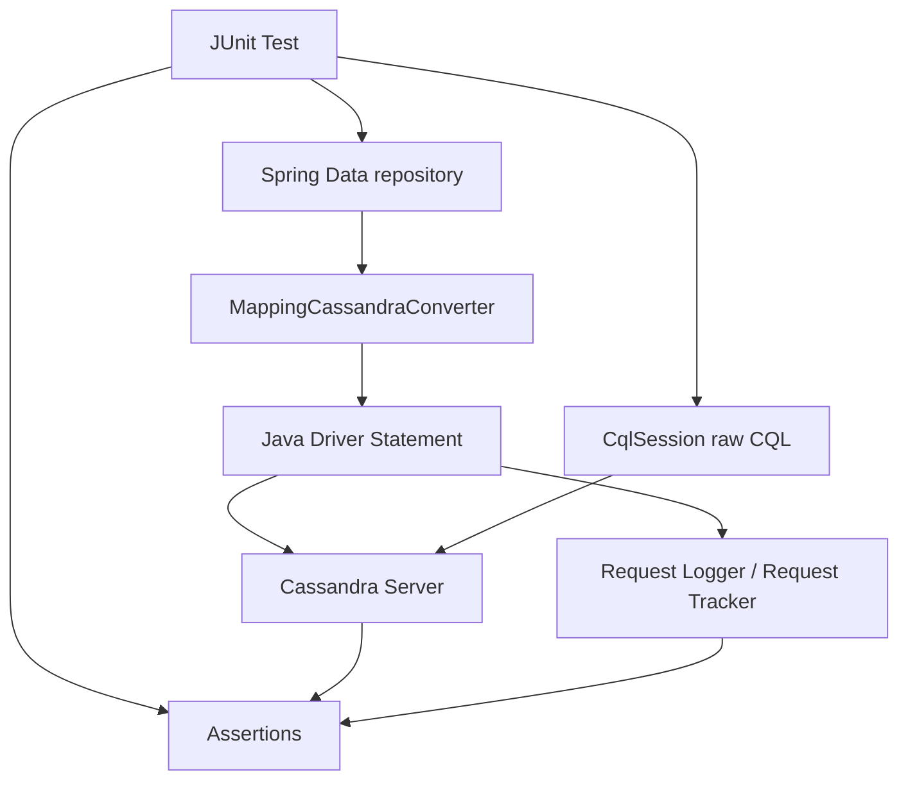

# Testing Mapping/Repository Layers and Actual Generated CQL in Spring Data Cassandra

## 1. Why Can Repository Testing Not Rely on Mocks Alone?

In the **DATABASE_ENGINE_WIDE_COLUMN_CASSANDRA** module, Apache Cassandra is a **distributed wide-column** database: tables are designed around query patterns, **partition keys** govern routing and data distribution, and **replication factor (RF)** and **consistency level (CL)** control read/write requirements. Java applications commonly use the Java Driver directly or Spring Boot with Spring Data Cassandra to work with CQL.

Suppose a service contains this method:

```java
OrderById result = repository.findById(orderId).orElseThrow();
```

In a unit test using Mockito:

```java
when(repository.findById(orderId))
    .thenReturn(Optional.of(expectedOrder));
```

this test **executes no CQL**. It does not verify:

- Whether `@Table("orders_by_id")` matches the real table name.
- Whether `@PrimaryKey("order_id")` matches the CQL partition key.
- Whether `@Column("total_minor")` maps `Long` to `bigint`.
- Whether Spring Data generated `WHERE order_id = ?` or inadvertently queried by another column.
- Whether `save(...)` writes the right columns and values without accidentally wiping other columns.
- Whether collection/UDT/enum converters actually execute inside `MappingCassandraConverter`.
- Whether results remain correct when a row was written by a non-Spring-Data client.
- Whether query derivation produces valid Cassandra CQL rather than an SQL/JPA-style query.

Therefore, this **Integration Testing** lesson focuses on **testing mapping, repositories, and the actual generated CQL** against real Cassandra—rather than merely verifying that a Java method was called.

### Learning Objectives

After this lesson, you will be able to:

1. Build a three-layer test suite: **mapping metadata**, **repository integration**, and **CQL wire/driver observation**.
2. Stand up a Cassandra container, keyspace, and schema before Spring Boot instantiates repositories.
3. Verify both directions: **repository write → raw CQL read** and **raw CQL write → repository read**.
4. Catch mismatched table/column names, data types, partition/clustering keys, and custom converter mappings.
5. Observe the **actual CQL statements sent** via Java Driver logging/tracking and distinguish them from assumptions about code generation.
6. Test `save`, `findById`, `deleteById`, derived queries, paging, and invalid CQL rejection.
7. Manage deterministic fixtures, schema drift, consistency, and parallel tests so CI runs stay reliable.
8. Understand what a single RF=1 container can validate versus what requires a multi-node cluster.

## 2. Three Distinct Kinds of Evidence

A solid test does not rely on a single form of verification.

| Evidence | How it is collected | What it verifies | What it cannot prove alone |
| --- | --- | --- | --- |
| **Mapping metadata** | Inspect annotations, mapping context, and entity properties | Classes, tables, and column mappings are configured | That real Cassandra accepts the query |
| **Repository integration** | Invoke `save/findById/deleteById` and assert | The Spring Data → Driver → Cassandra path works | That the exact right CQL is emitted on every branch |
| **Independent CQL** | Use `CqlSession`/`cqlsh` to read/write raw rows | Wire values and real schema match the contract | That the repository cannot emit bad CQL elsewhere |
| **Driver request log/tracker** | Observe statements executed by the Java Driver | Actual query shape, target table, and predicates sent | That returned data is always business-correct |
| **Cluster/schema metadata** | `system_schema`, driver metadata, agreement | Current keyspace/table/primary key definitions | Absence of races or full mutation convergence |
| **Failure/negative tests** | Bad query, timeout, null, invalid type | Errors are caught instead of silently succeeding | That every production failure mode is simulated |

In particular, **verifying values after reading back through the same mapper** is sometimes insufficient. If the mapper writes and reads with matching symmetrical bugs, the Java round-trip may still pass. You need **independent raw CQL verification**.



## 3. Query-Driven CQL Schema: The Foundation for Proper Testing

### 3.1. Table for Looking Up Orders by ID

Example on a single-node Cassandra container whose datacenter is confirmed as `datacenter1`:

```sql
CREATE KEYSPACE IF NOT EXISTS commerce_it
WITH replication = {
    'class': 'NetworkTopologyStrategy',
    'datacenter1': 1
};

CREATE TABLE IF NOT EXISTS commerce_it.orders_by_id (
    order_id uuid PRIMARY KEY,
    customer_id uuid,
    status text,
    total_minor bigint,
    created_at timestamp,
    updated_at timestamp
);
```

**Choose RF=1 strictly for a single-node lab.** With production RF=3, `LOCAL_QUORUM` requires two replicas; one node does not reproduce three-node availability/quorum behavior. Always verify the actual DC name via:

```sql
SELECT data_center, release_version
FROM system.local;
```

For `orders_by_id`, querying properly by partition key looks like:

```sql
SELECT order_id, customer_id, status, total_minor, created_at, updated_at
FROM commerce_it.orders_by_id
WHERE order_id = ?;
```

By contrast:

```sql
-- Deliberately unsuitable without an index or dedicated table:
SELECT * FROM commerce_it.orders_by_id
WHERE customer_id = ?;
```

Cassandra may reject this query because `customer_id` is neither part of the key nor backed by a supported index structure. Having a repository method named `findByCustomerId` **does not automatically create an index** or optimize the query.

### 3.2. Dedicated Table for Customer Queries

If the application needs to list a customer's orders:

```sql
CREATE TABLE IF NOT EXISTS commerce_it.orders_by_customer (
    customer_id uuid,
    created_at timestamp,
    order_id uuid,
    status text,
    total_minor bigint,
    PRIMARY KEY ((customer_id), created_at, order_id)
) WITH CLUSTERING ORDER BY (created_at DESC, order_id ASC);
```

Query:

```sql
SELECT created_at, order_id, status, total_minor
FROM commerce_it.orders_by_customer
WHERE customer_id = ?;
```

This is a **query-driven table**. Tests must verify that the generated or declared CQL predicates on `customer_id` rather than sneaking in `ALLOW FILTERING` and triggering a full scan.

### 3.3. Test DDL vs. Real Migrations

For simplicity, example snippets may create schema with `CREATE TABLE`. In production projects, tests should use the **same versioned CQL migrations** as production and detect schema drift. `IF NOT EXISTS` only avoids duplicate-name errors; it **does not verify that an existing table has the right primary key, column types, or table options**.

After migrations, inspect tables/columns/keys via metadata and execute real CQL queries. Reaching schema agreement **does not** guarantee the schema matches expectations.

## 4. Java Entities: Annotations Are a Contract with CQL

Example of a simple Spring Data Cassandra entity:

```java
import java.time.Instant;
import java.util.UUID;

import org.springframework.data.cassandra.core.mapping.Column;
import org.springframework.data.cassandra.core.mapping.PrimaryKey;
import org.springframework.data.cassandra.core.mapping.Table;

@Table("orders_by_id")
public class OrderById {

    @PrimaryKey("order_id")
    private UUID orderId;

    @Column("customer_id")
    private UUID customerId;

    @Column("status")
    private String status;

    @Column("total_minor")
    private Long totalMinor;

    @Column("created_at")
    private Instant createdAt;

    @Column("updated_at")
    private Instant updatedAt;

    public OrderById() { }

    public OrderById(UUID orderId, UUID customerId,
            String status, Long totalMinor,
            Instant createdAt, Instant updatedAt) {
        this.orderId = orderId;
        this.customerId = customerId;
        this.status = status;
        this.totalMinor = totalMinor;
        this.createdAt = createdAt;
        this.updatedAt = updatedAt;
    }

    public UUID getOrderId() { return orderId; }
    public void setOrderId(UUID orderId) { this.orderId = orderId; }

    public UUID getCustomerId() { return customerId; }
    public void setCustomerId(UUID customerId) {
        this.customerId = customerId;
    }

    public String getStatus() { return status; }
    public void setStatus(String status) { this.status = status; }

    public Long getTotalMinor() { return totalMinor; }
    public void setTotalMinor(Long totalMinor) {
        this.totalMinor = totalMinor;
    }

    public Instant getCreatedAt() { return createdAt; }
    public void setCreatedAt(Instant createdAt) {
        this.createdAt = createdAt;
    }

    public Instant getUpdatedAt() { return updatedAt; }
    public void setUpdatedAt(Instant updatedAt) {
        this.updatedAt = updatedAt;
    }
}
```

Explanation:

- `@Table("orders_by_id")`: matching table name when the Spring Data session targets keyspace `commerce_it`.
- `@PrimaryKey("order_id")`: Java field `orderId` is the partition key for this table.
- `@Column("total_minor")`: Java `Long` should map to CQL `bigint`; never use `double` for monetary amounts.
- `@Column("created_at")`: `Instant` represents an absolute point in time; CQL `timestamp` has millisecond precision.
- Explicit constructors and getters/setters are shown so tests do not rely on code generation/Lombok.

**Do not infer CQL column order from field declaration order in the class.** Spring Data may generate statements with different column ordering, quoted identifiers, and bind markers across versions. Tests should assert **semantic** invariants and inspect real CQL rather than matching a query string whitespace-for-whitespace.

### 4.1. Standard Repository

```java
import java.util.UUID;
import org.springframework.data.cassandra.repository.CassandraRepository;

public interface OrderByIdRepository
        extends CassandraRepository<OrderById, UUID> {
}
```

With this interface:

- `findById(orderId)` must query by the primary key.
- `save(entity)` uses object mapping to write data (upsert/insert or update semantics depending on the API).
- `deleteById(orderId)` generates a delete mutation by key.
- `existsById`/`count` can issue different queries with different costs; do not assume they are "free" like Java `Map` operations.

### 4.2. Do Not Treat the Repository Like JPA

Spring Data Cassandra does not share JPA's transaction model and persistence context:

- `save` is not an RDBMS transactional `EntityManager.flush()`.
- Cassandra `INSERT`/`UPDATE` are mutations and do not check "row already exists" by default.
- Spring's `@Transactional` **does not provide multi-table ACID rollback** for ordinary Cassandra operations.
- `deleteById` writes a tombstone per Cassandra semantics; replicas do not necessarily purge data physically right away.
- Repository query derivation **cannot create joins** or magically repartition data.

That is why you must verify the **CQL actually sent** and the **raw data afterward**, rather than importing Hibernate/JPA assumptions.

## 5. Dependencies and Test Environment

With Spring Boot managing versions through its corresponding BOM/parent:

```xml
<dependencies>
    <dependency>
        <groupId>org.springframework.boot</groupId>
        <artifactId>spring-boot-starter-data-cassandra</artifactId>
    </dependency>

    <dependency>
        <groupId>org.springframework.boot</groupId>
        <artifactId>spring-boot-starter-test</artifactId>
        <scope>test</scope>
    </dependency>

    <dependency>
        <groupId>org.testcontainers</groupId>
        <artifactId>cassandra</artifactId>
        <scope>test</scope>
    </dependency>
</dependencies>
```

This lesson uses **Testcontainers 1.x APIs** for illustration alongside Java Driver 4.x in a modern Spring Data stack. Pin the **exact compatible versions** of Spring Boot, Spring Data Cassandra, Java Driver, JDK, Testcontainers, and the Cassandra image from the compatibility matrix. Never mix driver core artifacts from different coordinates assuming Maven/Gradle will resolve them cleanly.

**Never use H2 or similar in-memory SQL databases to claim Cassandra has been tested**; CQL syntax, token distribution, UDTs, and query restrictions are Cassandra-specific behaviors that H2 cannot model accurately.

### 5.1. Choosing a Test Environment

| Environment | What it can verify | What it cannot fully verify |
| --- | --- | --- |
| Mockito repository | Service calls the right method and handles `Optional` | CQL, schema, converters, server errors |
| Single-node Testcontainers Cassandra | Mapping, repositories, prepared CQL, UDTs, basic TTLs | RF=3 failover, multi-DC, inter-replica repair |
| Multi-node test cluster | Quorum, node failure, replica behavior | Production performance if hardware/data are unrepresentative |
| Representative staging | End-to-end flows and production-like load | Does not replace deterministic logic tests |

When your goal is catching mapping bugs and inspecting generated CQL, **a single real node** is the right starting point. Do not slow down mapping suites many times over with RF=3 just to test table/column/Java conversions; keep distributed multi-node tests in a separate suite for consistency guarantees.

## 6. Bootstrapping Schema Before Spring ApplicationContext

This is a common pitfall: `@SpringBootTest` needs to create `CqlSession`, repositories, and the mapper **when the ApplicationContext refreshes**. If the keyspace configured in `spring.cassandra.keyspace-name` does not exist yet, context startup can fail **before** `@BeforeAll` ever runs.

A reliable way to control ordering is to **start the container and create the schema in a static bootstrap block** on the test class, then expose dynamic properties to Spring.

### 6.1. Testcontainers + Spring Boot Example Structure

The snippet below is an integration test class; the project must also contain `OrderById` and `OrderByIdRepository` from Section 4, and Docker must be running. Use a compatibility-verified Cassandra image: `cassandra:4.1.6` here is a **pinned illustrative tag**, not a blanket recommendation of the latest version.

```java
import static org.junit.jupiter.api.Assertions.*;

import java.net.InetSocketAddress;
import java.time.Instant;
import java.util.UUID;

import org.junit.jupiter.api.AfterAll;
import org.junit.jupiter.api.BeforeEach;
import org.junit.jupiter.api.Test;
import org.springframework.beans.factory.annotation.Autowired;
import org.springframework.boot.test.context.SpringBootTest;
import org.springframework.test.annotation.DirtiesContext;
import org.springframework.test.context.DynamicPropertyRegistry;
import org.springframework.test.context.DynamicPropertySource;
import org.testcontainers.containers.CassandraContainer;
import org.testcontainers.utility.DockerImageName;

import com.datastax.oss.driver.api.core.CqlSession;
import com.datastax.oss.driver.api.core.cql.PreparedStatement;
import com.datastax.oss.driver.api.core.cql.Row;

@SpringBootTest
@DirtiesContext(classMode = DirtiesContext.ClassMode.AFTER_CLASS)
class OrderByIdRepositoryIT {

    static final UUID ORDER_ID = UUID.fromString(
        "11111111-1111-1111-1111-111111111111");
    static final UUID CUSTOMER_ID = UUID.fromString(
        "22222222-2222-2222-2222-222222222222");
    static final Instant TIME =
        Instant.parse("2025-03-10T09:00:00Z");

    static final CassandraContainer<?> CASSANDRA =
        new CassandraContainer<>(
            DockerImageName.parse("cassandra:4.1.6"));

    // Must run BEFORE Spring creates CqlSession or repositories.
    static {
        CASSANDRA.start();

        try (CqlSession bootstrap = CqlSession.builder()
                .addContactPoint(new InetSocketAddress(
                    CASSANDRA.getHost(),
                    CASSANDRA.getMappedPort(9042)))
                .withLocalDatacenter("datacenter1")
                .build()) {

            bootstrap.execute(
                "CREATE KEYSPACE IF NOT EXISTS commerce_it " +
                "WITH replication = {" +
                "'class':'NetworkTopologyStrategy','datacenter1':1}");

            bootstrap.execute(
                "CREATE TABLE IF NOT EXISTS commerce_it.orders_by_id (" +
                "order_id uuid PRIMARY KEY, " +
                "customer_id uuid, status text, total_minor bigint, " +
                "created_at timestamp, updated_at timestamp)");

            if (!bootstrap.checkSchemaAgreement()) {
                throw new IllegalStateException(
                    "Test schema agreement was not reached");
            }
        }
    }

    @DynamicPropertySource
    static void springCassandra(DynamicPropertyRegistry registry) {
        registry.add(
            "spring.cassandra.contact-points", CASSANDRA::getHost);
        registry.add(
            "spring.cassandra.port",
            () -> CASSANDRA.getMappedPort(9042));
        registry.add(
            "spring.cassandra.local-datacenter",
            () -> "datacenter1");
        registry.add(
            "spring.cassandra.keyspace-name",
            () -> "commerce_it");
        registry.add(
            "spring.cassandra.schema-action",
            () -> "NONE");
    }

    @Autowired
    OrderByIdRepository repository;

    @Autowired
    CqlSession session;

    @BeforeEach
    void clearTable() {
        // Use only because this table/container is exclusive to this class
        // and test methods are not executed in parallel.
        session.execute("TRUNCATE commerce_it.orders_by_id");
    }

    @Test
    void repositoryWriteCanBeReadUsingRawCql() {
        OrderById entity = new OrderById(
            ORDER_ID, CUSTOMER_ID, "CREATED", 120000L, TIME, TIME);

        repository.save(entity);

        PreparedStatement query = session.prepare(
            "SELECT order_id, customer_id, status, total_minor, " +
            "created_at, updated_at FROM commerce_it.orders_by_id " +
            "WHERE order_id = ?");

        Row raw = session.execute(query.bind(ORDER_ID)).one();

        assertNotNull(raw);
        assertEquals(ORDER_ID, raw.getUuid("order_id"));
        assertEquals(CUSTOMER_ID, raw.getUuid("customer_id"));
        assertEquals("CREATED", raw.getString("status"));
        assertEquals(120000L, raw.getLong("total_minor"));
        assertEquals(TIME, raw.getInstant("created_at"));
    }

    @Test
    void rawCqlWriteCanBeReadUsingRepository() {
        PreparedStatement insert = session.prepare(
            "INSERT INTO commerce_it.orders_by_id " +
            "(order_id, customer_id, status, total_minor, " +
            "created_at, updated_at) VALUES (?, ?, ?, ?, ?, ?)");

        session.execute(insert.bind(
            ORDER_ID, CUSTOMER_ID, "PAID", 120000L, TIME, TIME));

        OrderById mapped = repository.findById(ORDER_ID)
            .orElseThrow();

        assertEquals(CUSTOMER_ID, mapped.getCustomerId());
        assertEquals("PAID", mapped.getStatus());
        assertEquals(Long.valueOf(120000L), mapped.getTotalMinor());
        assertEquals(TIME, mapped.getCreatedAt());
    }

    @Test
    void deleteByIdRemovesTargetRow() {
        repository.save(new OrderById(
            ORDER_ID, CUSTOMER_ID, "CREATED", 120000L, TIME, TIME));

        assertTrue(repository.findById(ORDER_ID).isPresent());
        repository.deleteById(ORDER_ID);
        assertTrue(repository.findById(ORDER_ID).isEmpty());
    }

    @AfterAll
    static void closeContainer() {
        CASSANDRA.stop();
    }
}
```

**Execution requirements and boundaries of this example:**

- `OrderByIdRepositoryIT`, `OrderById`, and the repository live in a Spring Boot project with proper package scanning.
- `datacenter1` must match `system.local.data_center` of the image. If another image/configuration differs, update **both** `NetworkTopologyStrategy` and `local-datacenter`.
- `@DynamicPropertySource` **only publishes configuration**; it does not create the keyspace itself. The static bootstrap guarantees DDL runs before context creation.
- The container lifecycle is managed manually via `start()/stop()`; do **not** mix `@Container`/JUnit extension management onto the same field.
- `@DirtiesContext(AFTER_CLASS)` prevents reusing a Spring context pointing at a stopped container. It **does not roll back Cassandra**.
- Ensure **methods/classes sharing a container/table do not run in parallel** when using `TRUNCATE`.
- `TRUNCATE` wipes the entire table; run it strictly against an isolated test instance. Never point tests at staging/production.
- This snippet tests three core paths, not query derivation, custom converters/UDTs, multi-table flows, or failure scenarios; expand per product scope.
- The code uses `Optional.isEmpty()` (Java 11+). If a project targets an older JDK, use `!isPresent()` and verify JDK/Driver/Spring compatibility.

### 6.2. Why Use Static Bootstrap Instead of `@BeforeAll`?

In `@SpringBootTest`, the Spring context is typically initialized before JUnit lifecycle methods. If bootstrap checks repository/session startup, creating the keyspace in `@BeforeAll` can be **too late**.

Equivalent alternatives depending on version:

- A Testcontainers init script that executes and finishes **before** the Spring context starts.
- An `ApplicationContextInitializer` that starts the container/schema and registers properties before refresh.
- An external test harness/fixture runner that prepares the schema prior to running tests.
- Framework-provided service-connection + schema-init integration supported in your specific version.

Pick **one mechanism**—never let an init script and another schema writer race against the same tables.

## 7. One-Way Testing Is Insufficient: You Need Two "Symmetric" Tests

### 7.1. Repository Write → Raw CQL Read

Verification path:

```text
Java entity
  -> Spring Data mapping
  -> CQL INSERT/UPDATE generated by the framework
  -> Cassandra columns
  -> Fixed CqlSession SELECT
  -> Row.getUuid/getString/getLong/getInstant
```

Catches bugs such as:

- Java `totalMinor` mapping to a mismatched `totalMinor` column instead of `total_minor`.
- `Instant` serialized incorrectly or with unexpected precision loss.
- Missing entity fields due to wrong annotations or constructors.
- Repository inadvertently writing defaults or unexpected `null` values.
- Generated CQL rejected by Cassandra due to type mismatch or schema drift.

### 7.2. Raw CQL Write → Repository Read

Verification path:

```text
Prepared INSERT via CqlSession
  -> Real Cassandra row conforming to CQL schema
  -> repository.findById
  -> MappingCassandraConverter
  -> Java entity
```

Catches bugs such as:

- Java reader expecting a different field name from the schema or missing `@Column`.
- Converter registered only for writing and missing on the read path.
- Java enum failing to recognize legacy or newly introduced codes in the database.
- UDT/collection types not mapped cleanly.
- `null` or invalid values breaking the entity constructor.

**Why does bidirectionality matter?** If both write and read share the same buggy yet reversible converter, `repository.save(entity)` followed by `repository.findById(...)` can still pass. Raw CQL provides an **independent check on the wire contract**.

## 8. Observing the Actual CQL Generated by Spring Data

This is the core of the topic. A method named `findById` does not prove the driver sent `WHERE order_id = ?`; to know the **actual CQL**, inspect the statement or request boundary inside the Java Driver.

### 8.1. Three Approaches, From Simple to Precise

| Approach | Pros | Limitations |
| --- | --- | --- |
| **Enable Spring Data Cassandra DEBUG/TRACE** in tests | Shows template, converter, and query-derivation activity | Exact log verbosity/CQL string depends on version; may omit full bound statement |
| **Java Driver Request Logger / Request Tracker** | Observes real requests/statements flowing through the driver, latency, success/error | Config and format vary by driver version; bind values must be protected |
| **Test seam capturing statements before send** | Lets assertions check CQL structure without parsing stderr | Requires wrapper/tracker setup while avoiding mocks that bypass real execution |

**Do not confuse Hibernate/JPA SQL logs with Cassandra CQL logs.** `spring.jpa.show-sql=true` reveals nothing about what Spring Data Cassandra sent.

### 8.2. Enabling Application Logging in the Integration-Test Profile

Example `application-it.yml` in a test project:

```yaml
logging:
  level:
    org.springframework.data.cassandra.core: DEBUG
    org.springframework.data.cassandra.repository: DEBUG
```

Depending on the Spring Data version, loggers format output differently. Treat this as a **starting observation aid**, not a guarantee that every request and bind value appears in logs.

Java Driver 4.x provides **RequestLogger / RequestTracker**. An illustrative HOCON config for the **test profile** (verify syntax against your driver version):

```hocon
datastax-java-driver {
  advanced.request-tracker {
    classes = [RequestLogger]

    logs {
      success.enabled = true
      slow.enabled = true
      error.enabled = true
      show-values = false
    }
  }
}
```

`RequestLogger` logs statements; `show-values = false` avoids leaking CQL bind values. Details vary across driver releases, so consult the reference config/Javadoc for your pinned version. **Never log every successful request in production** because of overhead and sensitive data exposure.

When the test invokes:

```java
repository.findById(ORDER_ID);
```

filter logs by **test case / correlation ID** and check that a request targeted `orders_by_id` with an `order_id` predicate. Logs may show a prepared statement with bind markers rather than printing UUID literals.

### 8.3. Expected CQL Shape, Not a Byte-for-Byte String

Common query shapes (**illustrative only**):

```sql
-- findById:
SELECT ... FROM orders_by_id WHERE order_id = ?;

-- save:
INSERT INTO orders_by_id
    (order_id, customer_id, status, total_minor, created_at, updated_at)
VALUES (?, ?, ?, ?, ?, ?);

-- deleteById:
DELETE FROM orders_by_id WHERE order_id = ?;
```

Spring Data/Driver may:

- Add keyspace qualification `commerce_it.orders_by_id`.
- Quote identifiers or reorder listed columns.
- Use `INSERT` vs. `UPDATE` across different save paths.
- Use prepared statements with `?` or named markers depending on the API.
- Emit metadata/prepare/query option traffic during the request lifecycle.

Therefore, **do not** assert that the string equals this example byte-for-byte. For captured statements, assert invariants:

1. Target table or entity matches.
2. `WHERE` contains the **right partition key**; no unsupported column predicates.
3. No unreviewed `ALLOW FILTERING`.
4. Updates/deletes include required key conditions.
5. Written CQL columns match the intended field set.
6. Consistency level and timeout match the profile/statement if part of the contract.
7. Values are prepared/bound rather than concatenated from untrusted strings.

If business requirements demand a **strictly invariant CQL string**, consider explicit `@Query` or a repository adapter emitting contract-tested CQL instead of relying on internal framework query generation across upgrades.

### 8.4. Turning Logs into Automated Assertions

One pattern in a Spring Boot + Logback suite:

1. Enable `RequestLogger` only in the integration-test profile.
2. In the test, attach an **in-memory appender** to the logger used by your driver version.
3. Before calling the repository, mark the log buffer index or correlation ID.
4. Execute the query against real Cassandra.
5. Collect only events **emitted by this test**, filtering out CQL bootstrap/health checks.
6. Assert query-shape invariants; **never** assert sensitive bind values in logs.
7. Detach the appender in teardown so retained log events do not leak heap.

Pseudocode shown below to avoid coupling to version-specific internal logger names/signatures:

```java
// PSEUDOCODE — implement CqlCapture using RequestTracker or Logback
// matching the exact Java Driver version in use.
// CqlCapture capture = installTestOnlyCapture(sessionConfiguration);
//
// capture.clear();
// OrderById result = repository.findById(orderId).orElseThrow();
//
// List<CapturedCql> statements = capture.newStatements();
// assertTrue(statements.stream()
//     .anyMatch(s -> s.targetsTable("orders_by_id")
//         && s.hasPartitionPredicate("order_id")
//         && !s.hasAllowFiltering()));
```

`CqlCapture`/`CapturedCql` above **are not built-in classes** in Spring Data or the driver. They represent a test seam you implement against a concrete tracker/logging API. Without a capture adapter, **inspect real logs** and verify raw CQL/outcomes first; do not present this pseudocode as copy-paste runnable.

**If you attempt to check "actual CQL" solely by mocking `repository.findById`, the test misses the point.** A mock only proves Java invoked a method, not what statement Cassandra received.

## 9. Derived Queries: Nice Method Names Can Emit Wrong CQL

A repository method:

```java
// DELIBERATELY DANGEROUS if orders_by_id only has PK order_id:
List<OrderById> findByCustomerId(UUID customerId);
```

Spring Data can derive a query from the `customerId` property. Yet `orders_by_id` is not partitioned by `customer_id` and has no index serving that predicate. The result is either a Cassandra query error at startup/execution or an expensive filtering query if filtering is forced on.

**Never "fix" this by adding `@AllowFiltering` or `ALLOW FILTERING`** without explicit data/query design justification. In Cassandra, the right pattern is a **query-driven table** `orders_by_customer`, with a repository mapped to that table.

### 9.1. Cassandra-Compliant Composite Primary Key

For the `orders_by_customer` table in Section 3, the primary key class has three fields:

```java
import java.io.Serializable;
import java.time.Instant;
import java.util.Objects;
import java.util.UUID;

import org.springframework.data.cassandra.core.cql.PrimaryKeyType;
import org.springframework.data.cassandra.core.mapping.PrimaryKeyClass;
import org.springframework.data.cassandra.core.mapping.PrimaryKeyColumn;

@PrimaryKeyClass
public class OrderByCustomerKey implements Serializable {

    @PrimaryKeyColumn(
        name = "customer_id",
        ordinal = 0,
        type = PrimaryKeyType.PARTITIONED)
    private UUID customerId;

    @PrimaryKeyColumn(
        name = "created_at",
        ordinal = 1,
        type = PrimaryKeyType.CLUSTERED)
    private Instant createdAt;

    @PrimaryKeyColumn(
        name = "order_id",
        ordinal = 2,
        type = PrimaryKeyType.CLUSTERED)
    private UUID orderId;

    public OrderByCustomerKey() { }

    public OrderByCustomerKey(
            UUID customerId, Instant createdAt, UUID orderId) {
        this.customerId = customerId;
        this.createdAt = createdAt;
        this.orderId = orderId;
    }

    public UUID getCustomerId() { return customerId; }
    public Instant getCreatedAt() { return createdAt; }
    public UUID getOrderId() { return orderId; }

    public void setCustomerId(UUID value) { customerId = value; }
    public void setCreatedAt(Instant value) { createdAt = value; }
    public void setOrderId(UUID value) { orderId = value; }

    @Override
    public boolean equals(Object value) {
        if (this == value) return true;
        if (!(value instanceof OrderByCustomerKey)) return false;
        OrderByCustomerKey other = (OrderByCustomerKey) value;
        return Objects.equals(customerId, other.customerId)
            && Objects.equals(createdAt, other.createdAt)
            && Objects.equals(orderId, other.orderId);
    }

    @Override
    public int hashCode() {
        return Objects.hash(customerId, createdAt, orderId);
    }
}
```

Entity:

```java
import org.springframework.data.cassandra.core.mapping.Column;
import org.springframework.data.cassandra.core.mapping.PrimaryKey;
import org.springframework.data.cassandra.core.mapping.Table;

@Table("orders_by_customer")
public class OrderByCustomer {

    @PrimaryKey
    private OrderByCustomerKey key;

    @Column("status")
    private String status;

    @Column("total_minor")
    private Long totalMinor;

    // Appropriate constructors and getters/setters must be declared
    // in real source so Spring Data can map the object completely.
}
```

**Verify** `@PrimaryKeyClass` and `@PrimaryKeyColumn` against your Spring Data version: partitioned vs. clustered components, `ordinal`, CQL column names, `equals`/`hashCode`, and constructor binding.

### 9.2. Derived Queries on Nested Keys

Example of a method Spring Data can derive along a nested property path:

```java
import java.util.List;
import java.util.UUID;

import org.springframework.data.cassandra.repository.CassandraRepository;

public interface OrderByCustomerRepository
        extends CassandraRepository<
            OrderByCustomer, OrderByCustomerKey> {

    List<OrderByCustomer> findByKeyCustomerId(UUID customerId);
}
```

For derived queries over nested composite keys, **test the method signature and runtime behavior in your exact Spring Data version**; property-path traversal and generated predicates can depend on version/configuration. If unsupported or when fixed CQL is preferred, use explicit `@Query`:

```java
import java.util.List;
import java.util.UUID;

import org.springframework.data.cassandra.repository.Query;

@Query("SELECT customer_id, created_at, order_id, status, " +
       "total_minor FROM orders_by_customer WHERE customer_id = ?0")
List<OrderByCustomer> findAllByCustomer(UUID customerId);
```

This declaration belongs **inside a repository interface**, not as a standalone Java method. `@Query` supplies explicit CQL, so to test **query derivation**, test a non-`@Query` method separately; both forms are valuable for testing **row mapping**.

### 9.3. Testing Predicates and Clustering Order

Fixture:

```sql
INSERT INTO commerce_it.orders_by_customer (
    customer_id, created_at, order_id, status, total_minor
) VALUES (
    22222222-2222-2222-2222-222222222222,
    '2025-03-10T10:00:00Z',
    11111111-1111-1111-1111-111111111111,
    'PAID', 120000
);

INSERT INTO commerce_it.orders_by_customer (
    customer_id, created_at, order_id, status, total_minor
) VALUES (
    22222222-2222-2222-2222-222222222222,
    '2025-03-09T10:00:00Z',
    33333333-3333-3333-3333-333333333333,
    'CREATED', 60000
);
```

Assertions should verify that the query returns only rows belonging to the requested `customer_id` and preserves `created_at DESC` ordering per the schema. Seed at least one other customer with rows to catch a missing `WHERE` clause. Never assert only `result.size() == 2`, because a broken query can accidentally return two rows from different partitions.

## 10. Testing `save`: Upserts, Nulls, and Overwrite Risks

In Cassandra, `INSERT` and `UPDATE` both behave as upsert mutations. A Java entity "already having an ID" does not automatically imply a conditional update as in JPA.

### 10.1. Testing Inserts

Expectations:

1. `repository.save(entity)` throws no error.
2. Raw `SELECT ... WHERE order_id = ?` finds exactly one row.
3. Raw CQL columns match: `UUID`, `Long`, `Instant`, `String`.
4. Unset columns are not overwritten with unexpected values.
5. If a custom converter is used, raw CQL reflects the designed **wire representation**.

### 10.2. Updating One Field May Write the Whole Entity

Suppose two services edit the same row concurrently:

- Service A updates `status`.
- Service B updates `updatedAt`.
- Both load entities at different times and call `repository.save(entity)`.

If the framework generates a mutation writing all entity columns, Service B **can overwrite** the newer `status` with a stale value. Inspect the **generated CQL** or enable logging/tracking to see which columns are sent instead of assuming ORM-style dirty checking inside `save`.

For targeted updates:

```sql
UPDATE commerce_it.orders_by_id
SET status = ?
WHERE order_id = ?;
```

You can use `CqlSession`, `CassandraTemplate`, or a custom repository method to ensure only intended columns are modified. When competing on version/business state, use LWT/CAS or idempotent design.

### 10.3. `null` Does Not Necessarily Mean "Ignore Field"

When a PATCH DTO omits `totalMinor`, mapping it onto an entity with `totalMinor=null` and calling `save` can write nulls/deletes or handle nulls differently depending on mapping API/version. Test explicitly:

- Does `null` erase the existing value or get skipped?
- Does an empty collection differ from a `null` collection?
- Is `updatedAt` mutated unexpectedly when omitted?
- Is any read-only/derived property written?

**Never assume** Cassandra/Spring Data distinguishes "field omitted" from "deliberately cleared." Build a dedicated PATCH adapter and verify the actual emitted CQL.

## 11. Mapping Collections, UDTs, Enums, and Temporal Types: Test Raw Wire Values

### 11.1. Collections

Create an example table:

```sql
CREATE TABLE IF NOT EXISTS commerce_it.order_tags_by_id (
    order_id uuid PRIMARY KEY,
    tags set<text>,
    history list<text>,
    attrs map<text, text>
);
```

Entity:

```java
@Table("order_tags_by_id")
public class OrderTags {

    @PrimaryKey("order_id")
    private UUID orderId;

    @Column("tags")
    private Set<String> tags;

    @Column("history")
    private List<String> history;

    @Column("attrs")
    private Map<String, String> attrs;

    // Full constructors and getters/setters must be declared.
}
```

Integration assertions:

- `Set<String>` contains no duplicates and tests do not rely on iteration order.
- `List<String>` preserves order; test append separately if the app executes CQL appends.
- `Map<String,String>` stores exact raw keys and values.
- `null`, empty collections, and element removals are tested explicitly for your mapping/version.
- Never model an unbounded 1-to-many relationship as a collection; a test with two tags does not validate scaling to millions of elements.
- Retrying `list = list + [...]` after a timeout can introduce duplicates, requiring dedicated idempotency tests.

### 11.2. User-Defined Types (UDTs)

```sql
CREATE TYPE IF NOT EXISTS commerce_it.shipping_address (
    street text,
    city text,
    postal_code text
);

CREATE TABLE IF NOT EXISTS commerce_it.order_addresses_by_id (
    order_id uuid PRIMARY KEY,
    address frozen<commerce_it.shipping_address>
);
```

With a Java class annotated `@UserDefinedType("shipping_address")` and an entity field annotated `@Frozen`, test:

1. Write a Java object with `street`/`city`/`postalCode`.
2. Read raw `UdtValue` via CQL and verify field names and values.
3. Write the UDT via `CqlSession` and read back via the repository.
4. Test adding a new nullable UDT field in schema evolution; verify whether older/newer app versions still read cleanly.
5. Verify updating a frozen UDT **replaces the entire object** rather than updating individual fields independently.

### 11.3. Stable Enum Codes

If `CustomerStatus.ACTIVE` must be stored as `'A'` instead of the enum name:

- Unit-test both `@WritingConverter` and `@ReadingConverter`.
- Integration-test writing the enum via repository and reading `'A'` via raw CQL.
- Write `'P'` via raw CQL and verify the repository reads `PAUSED`.
- Write an unsupported code via raw CQL and assert error/quarantine handling per policy.
- Verify the converters are **registered with `CassandraCustomConversions`**; merely having converter classes on the classpath is not enough.
- Note that direct `CqlSession` queries **do not automatically invoke** Spring Data custom converters.

### 11.4. Temporal Types

CQL `timestamp` has **millisecond** precision, whereas Java `Instant` holds nanoseconds. Make precision explicit in round-trip test fixtures:

```java
Instant original =
    Instant.parse("2025-03-10T09:00:00.123456789Z");
Instant expected =
    Instant.ofEpochMilli(original.toEpochMilli());
```

If the column type is `timestamp`, do not assert sub-millisecond nanoseconds survive unchanged. Use `LocalDate` for `date` and `LocalTime` for `time`; if a user timezone is required, store `ZoneId` or a timezone code explicitly per contract instead of inferring it from a timestamp.

Avoid `Instant.now()` in tests needing exact millisecond assertions unless clock/precision tolerances are controlled. Fixed fixtures make failures reproducible.

## 12. Deliberately Testing Invalid CQL Execution

Negative tests verify that the application **does not** silently mask Cassandra restrictions.

Example using `orders_by_id` with no index on `customer_id`:

```java
import static org.junit.jupiter.api.Assertions.assertThrows;

import java.util.UUID;
import com.datastax.oss.driver.api.core.servererrors.InvalidQueryException;

UUID customerId = UUID.fromString(
    "22222222-2222-2222-2222-222222222222");

PreparedStatement bad = session.prepare(
    "SELECT * FROM commerce_it.orders_by_id " +
    "WHERE customer_id = ?");

assertThrows(InvalidQueryException.class,
    () -> session.execute(bad.bind(customerId)));
```

**Subtle nuance:** depending on Cassandra version and the prepare/execute path, the error may be thrown **immediately at `session.prepare(...)`** rather than waiting for `execute(...)`. A reliable negative test therefore wraps **both prepare and execute** inside the lambda:

```java
assertThrows(InvalidQueryException.class, () -> {
    PreparedStatement statement = session.prepare(
        "SELECT * FROM commerce_it.orders_by_id " +
        "WHERE customer_id = ?");
    session.execute(statement.bind(customerId));
});
```

If a framework automatically created a secondary index or altered schema, the query might succeed; **freeze/verify schema** before asserting failure. In primary positive tests, always assert that the **partition-key query succeeds** without `ALLOW FILTERING`.

Valuable negative cases:

| Case | Expected behavior |
| --- | --- |
| Wrong table/column name | Schema/query error—never silently returns empty results |
| Wrong bind marker type | Clear conversion/serialization failure |
| Predicate missing partition key | Query error or explicitly declared index design |
| `null` primary key | Rejected by mapping/driver before or during execution |
| Unsupported enum code | Fails/quarantines per business contract |
| Missing UDT definition | Migration/bootstrap fails instead of ignoring |
| Consistency exceeding live replicas | `Unavailable`/error handled properly; CL never silently downgraded |
| Spring context starts before keyspace exists | Test fails clearly at bootstrap rather than silently creating ad-hoc state |

**Never test negative paths against a shared database.** All destructive or schema-error scenarios belong in isolated containers/keyspaces.

## 13. Verifying Generated CQL for Pagination and Consistency

### 13.1. Paging Is Not `LIMIT`

A repository method returning `Iterable` or `Slice`/`Page` carries semantics that vary across Spring Data versions. Java Driver has its own `pageSize`, while CQL has `LIMIT`. Do not assume a repository method named `findTop50...` automatically matches your HTTP pagination semantics.

Tests should check:

- Proper partition key and clustering order.
- That limit/page size is enforced at the intended layer.
- Whether multi-page fetching stops when the consumer stops reading.
- That paging state is bound to the matching query/values and not exposed as an unvalidated token.
- That `ResultSet.all()` is never called on unbounded datasets in production endpoints.
- That mutations occurring between pages can shift results; Cassandra paging is not snapshot-isolated.

### 13.2. Per-Statement Consistency

Suppose production requires `LOCAL_QUORUM` reads/writes at RF=3 inside one DC. An RF=1 integration test configured with the same CL name **does not** prove RF=3 quorum semantics.

When testing Spring Data repositories:

- Explicitly document the execution profile / default CL on `CqlSession`.
- If a method supports custom query options, inspect CL/timeout on the statement or driver request metadata.
- Never quietly switch tests to `LOCAL_ONE` and conclude production `LOCAL_QUORUM` behaves equivalently.
- Use a separate multi-node suite to verify replica failures, repair, and read/write consistency interactions.
- For LWT, also check serial consistency and `[applied]`, not merely whether the entity exists afterward.

### 13.3. Why Statement Logs Alone Do Not Prove End-to-End Correctness

Logged statements show **the intent to send CQL**. If a request times out:

- A write may still have applied on some replicas.
- The client may have retried or speculatively executed.
- Logging a CQL statement does not mean the result achieved CL.
- You still need raw data checks, logical request IDs, and business reconciliation when mutations carry side effects.

Combine request logs with **outcomes/exceptions**, metrics, and real Cassandra state assertions.

## 14. Avoiding False Positives From Fixtures, Resets, and Parallelism

### 14.1. Every Test Must Run Independently

Core rules:

- Create schema once per suite or migration scenario.
- Before each test, data must be in a known state.
- Never rely on `@TestMethodOrder` so Test B depends on Test A's rows.
- If a test writes asynchronously, wait for completion/reconciliation before resetting.
- Cleanup may touch only partitions/tables owned by the test.
- Expected UUIDs/timestamps must match the active test fixture context.

### 14.2. `TRUNCATE`, `DELETE`, and Container Isolation

| Strategy | When to use | Caveat |
| --- | --- | --- |
| Fresh container per class/suite | Strong schema/data isolation needed | Startup RAM/CPU/disk overhead |
| `TRUNCATE` before each method | Class exclusively owns table and runs sequentially | Wipes whole table; unsafe under parallel tests |
| `DELETE WHERE` by ID | Tests share a table while owning distinct partitions | Generates tombstones and risks partial cleanup |
| Unique partition key per test | Independent parallel tests | Must clean up at suite/container end; avoid full scans |
| DROP/CREATE keyspace | Testing migrations from scratch | DDL propagation delay; strictly forbidden on shared instances |

**Cassandra does not provide automatic integration-test transaction rollback** like Spring Data JPA. `@Transactional` or `@DirtiesContext` does not undo committed mutations on the cluster.

### 14.3. Sparse Fixtures Let Broken Queries Pass

Suppose a `findById` test seeds only a single row in the table. A broken query lacking a predicate can still return that lone row and pass unless you inspect CQL shape. Defenses:

1. Seed **multiple rows with distinct IDs and customer IDs**.
2. Assert exact IDs and fields, not merely `isPresent()`.
3. Inspect query predicates via request logger/tracker.
4. Add negative tests for non-existent `order_id` values.
5. Vary seed/test execution order to uncover hidden dependencies.

For customer queries, seed at least **two distinct customers** and multiple clustering rows to test both partition isolation and sort order.

## 15. CI/CD: Reliability Requirements and Artifacts to Preserve

### 15.1. Common Sources of Flakiness

| Symptom | Root cause | Fix |
| --- | --- | --- |
| Context fails with "keyspace missing" | Schema bootstrapped too late | Create keyspace/tables before Spring context starts |
| `Cannot resolve local datacenter` | Wrong DC config | Query `system.local.data_center` and align config |
| `Unavailable` in single-node lab | RF=3 configured with only one replica | Use RF=1 for single-node lab; test quorum on multi-node |
| Query cannot find new column | Schema drift / missing agreement / stale metadata | Run migrations in order, verify agreement and expected schema |
| Passes locally, fails in CI | Unpinned image, scarce CPU/RAM, slow readiness | Pin versions, provision adequate resources, configure Testcontainers wait strategy |
| Passes alone, fails in full suite | Truncate/fixture races or shared context | Isolate containers/keyspaces/partitions |
| Raw CQL is right, repository reads wrong | Java mapping/converter diverges from schema | Add `@Column`/constructor/converter integration tests |
| Repository round-trip passes despite wrong wire format | Symmetric read/write mapping bug | Add bidirectional raw CQL cross-checks |
| Query logs expose secrets | Driver `show-values` enabled | Disable bind-value logging and apply redaction |
| Log assertion breaks after version upgrade | Formatting/quoting/column order changed | Assert query shape/invariants rather than brittle full strings |
| Tests rely on fixed `sleep` | Variable startup/TTL/metadata timing | Poll conditions with explicit deadlines |
| Benchmarking inside small container | Unrepresentative hardware/workload | Benchmark separately in representative staging |

### 15.2. Minimal Test Run Manifest

```yaml
suite: spring-data-cassandra-mapping-cql-it
application:
  spring_boot: "<exact-version>"
  spring_data_cassandra: "<exact-version>"
  java_driver: "<exact-version>"
  jdk: "<exact-version>"
cassandra:
  image: "cassandra:<pinned-version>"
  datacenter: datacenter1
  keyspace: commerce_it
  replication_factor: 1
  native_protocol_port: "<mapped-test-port>"
schema:
  migration_version: "<reviewed-version>"
  expected_tables:
    - orders_by_id
    - orders_by_customer
tests:
  isolation: "container-per-test-class"
  method_parallel: false
  request_logging_values: false
```

This is a documentation manifest template, **not an executable config**. Recording these fields in CI reports helps reproduce failures after framework or driver upgrades.

### 15.3. Diagnostics to Collect on Failure

- Test name and logical fixture IDs (without dumping sensitive data).
- Relevant Cassandra container logs.
- Spring Data mapping errors and driver exceptions.
- Captured query shapes (with bind secrets redacted).
- `system.local`, expected schema snapshot, and migration version.
- Start/ready timestamps, resource limits, and timeouts.
- Retry/`Unavailable`/`ReadTimeout`/`WriteTimeout` counts if errors occurred.
- Mapping diagnostics: class/property/column types without logging PII.

Ensure tests can **never accidentally drop a production keyspace** if CI environment variables are misconfigured. Use ephemeral containers, least-privilege roles, and explicit allowlist guards before any `TRUNCATE` or `DROP`.

## 16. Runbook: Adding a New Repository Method

**Context:** the team is adding an endpoint to list customer orders and wants `findByCustomerId`.

### Phase A — Design and Review

1. Specify predicate, expected row count, sorting, pagination, and CL.
2. Check the existing table's `PRIMARY KEY`. If `customer_id` is not a suitable partition/index column, design a query-driven table.
3. Write the DDL migration for `orders_by_customer` if needed.
4. Map `@PrimaryKeyClass`/`@PrimaryKeyColumn` and entity fields to match CQL.
5. Decide between a derived method and explicit `@Query` based on stability needs and framework support.

### Phase B — Write Integration Tests First

1. Start Testcontainers and apply the corresponding schema.
2. Seed at least two customers, multiple orders each, with fixed timestamps.
3. Invoke the new repository method.
4. Assert matching customer, row count, and clustering order.
5. Capture the actual query shape via request logger/tracker.
6. Assert the predicate includes `customer_id` and omits `ALLOW FILTERING`.
7. Query independently with raw CQL to verify expected rows.

### Phase C — Run Failure and Compatibility Cases

- Non-existent customer returns an empty collection cleanly rather than disguising a timeout as empty.
- Wrong bind types / `null` raise expected errors.
- Mapping still succeeds when a new nullable column is added to schema.
- Verify wire/schema compatibility if old code rolls back.
- On multi-node labs, test CL and replica behavior in a separate suite.

### Phase D — Deploy

- Apply schema migrations before deploying code that depends on the new table.
- Wait for schema agreement and verify expected schema and role permissions.
- Deploy canary; monitor actual CQL shape, p95/p99, and timeout/error rates.
- Never slip `ALLOW FILTERING` onto a hot path to "patch" a failing query under traffic.
- Keep the regression test so future Spring Data/Driver upgrades catch query changes immediately.

## 17. Practice Exercises and Suggested Answers

### Exercise 1 — Bidirectional Mapping

An `OrderById` entity uses `@Column("totalMinor")`, while CQL schema defines `total_minor bigint`.

1. Can a mocked-repository unit test catch this bug?
2. How does repository-save → raw-CQL-read expose it?
3. What errors might raw-CQL-insert → repository-`findById` produce?
4. Where do you fix it, and which tests keep it from regressing?

**Hint:** mocks never check mapping. Fix `@Column("total_minor")`, test both directions and schema migrations, and never rename CQL columns ad-hoc in production just to make a broken test pass.

### Exercise 2 — Derived Query Mismatched to Cassandra Model

`OrderByIdRepository` adds `findByCustomerId`, while the table has partition key `order_id` and no index.

1. What predicate might the framework generate?
2. How might Cassandra respond?
3. Why is `ALLOW FILTERING` not an acceptable default fix?
4. How should you redesign the table/repository and test CQL shape?

**Hint:** create `orders_by_customer` partitioned by `customer_id`; seed multiple customers and verify the query emits `WHERE customer_id = ?` with no filtering.

### Exercise 3 — Right Result, Wrong Query

A test seeds a single row; the service looks up an order by ID by calling `repository.findAll()` and picking the first element. Because the test only checks the returned object, it passes. After enabling `RequestLogger`, you discover a full table scan without `WHERE order_id`.

1. Why was the initial test a false positive?
2. What fixture additions are needed?
3. What assertions validate **actual CQL** without breaking on column order or whitespace?
4. Should logs/assertions include PII bind values?

**Hint:** seed multiple partitions and assert query shape/partition predicates; avoid logging PII or brittle full-string equality.

### Exercise 4 — `save` and `null`

A PATCH request updates only `status`, and the DTO omits `totalMinor`. The service builds a new entity with `totalMinor=null` and calls `save`.

1. What might happen to the existing `total_minor` column?
2. Which test reveals the exact behavior in your Spring Data version?
3. When you only intend to update `status`, what CQL/adapter pattern is clearer?
4. Can you extrapolate from JPA dirty checking?

**Hint:** inspect the generated mutation plus raw read-back; issue an explicit update modifying only target columns instead of relying on JPA assumptions.

### Exercise 5 — Composite Keys

Table `orders_by_customer` defines `PRIMARY KEY ((customer_id), created_at, order_id)`. Java code marks all three fields as partitioned or scrambles `ordinal`.

1. What happens to queries, ordering, and routing?
2. Which mapping annotations must be fixed?
3. How should clustering order be tested?
4. Why do two orders with identical customer and timestamp need `order_id` in the key?

**Hint:** `customer_id` is partitioned while `created_at`/`order_id` are clustered in order; seed rows with both equal and distinct `created_at` values and assert exact partition and ordering.

### Exercise 6 — Enum Converters and Raw Data

`CustomerStatus.ACTIVE` must be persisted as `"A"` in CQL text, yet repository round-trip tests pass even when raw data contains `"ACTIVE"`.

1. Why can round-trip testing miss a broken wire contract?
2. Write the bidirectional assertions.
3. Where do you check that the converter is actually registered?
4. How should rollout proceed if old code encounters newly introduced codes?

**Hint:** verify raw CQL reads `"A"`, and raw CQL inserting `"P"` maps to `PAUSED` in Java; register via `CassandraCustomConversions` and roll out readers before writers.

### Exercise 7 — Bootstrap Lifecycle

`@SpringBootTest` sets `spring.cassandra.keyspace-name=commerce_it`, while the test tries to create the keyspace inside `@BeforeAll`. Context startup fails.

1. What is the root cause?
2. How do you create schema before the context?
3. Does `@DynamicPropertySource` create the schema automatically?
4. Does `@DirtiesContext` roll back CQL changes?

**Hint:** static bootstrap / initializer / init script must complete before Spring context initialization; `@DynamicPropertySource` only supplies properties, and `@DirtiesContext` never erases Cassandra data.

### Exercise 8 — Testing Environment Limits

An integration test runs against one RF=1 node using `LOCAL_QUORUM`, and every CQL query passes. The team concludes production RF=3 can survive one node DOWN.

1. Is that conclusion valid?
2. What environment/tests are actually required?
3. What did the single-node test legitimately prove?

**Hint:** RF=1 quorum only needs one replica. Testing one replica DOWN under RF=3 requires a multi-node cluster; single-node tests remain valuable for mapping, CQL, and converters.

## 18. Pre-Merge Mapping/Repository/CQL Testing Checklist

- [ ] Real Cassandra runs in an isolated test environment; mocked repositories are confined to unit tests.
- [ ] CQL schema comes from versioned migrations or reviewed fixtures rather than assuming `IF NOT EXISTS` validates structure.
- [ ] Keyspace RF/DC fits the test container; single-node RF=1 is never used to claim RF=3 failover safety.
- [ ] Keyspace/table/UDT bootstrap finishes **before** any Spring context needing Cassandra initializes.
- [ ] Entities match CQL table names, column names, and types via `@Table`, `@PrimaryKey`, and `@Column`.
- [ ] For composite keys, `@PrimaryKeyColumn` order (`ordinal`) and `PrimaryKeyType` match CQL.
- [ ] Both **repository save → raw CQL read** and **raw CQL insert → repository read** exist.
- [ ] Raw CQL checks `UUID`, numeric types, timestamp precision, collections/UDTs, and stable enum codes per contract.
- [ ] `findById`/`save`/`deleteById` tests verify both expected records and absence of unintended rows.
- [ ] Derived queries are verified to include the **right partition key** without uncontrolled `ALLOW FILTERING`.
- [ ] Actual CQL is observed via driver request logs/tracker or test seam—never guessed from repository method names.
- [ ] Assertions validate table, predicate, field set, markers, and query options rather than brittle exact strings.
- [ ] Test logging redacts secrets/sensitive bind values and stays disabled in production.
- [ ] Negative tests cover wrong keys, column/type mismatches, unknown enums, and bootstrap/schema failures.
- [ ] Partial/null/full-entity update tests check for unintended overwrites.
- [ ] Fixtures seed multiple partitions and clustering rows to prevent false positives.
- [ ] `TRUNCATE` resets run only on dedicated class-owned tables/containers with sequential tests; parallel suites use separate isolation.
- [ ] Async writes from prior tests finish before cleanup/reset to prevent races.
- [ ] Tests never rely on `@Transactional` or `@DirtiesContext` to roll back Cassandra writes.
- [ ] Pagination, CL, and timeout behavior are tested when required by repository methods.
- [ ] CI pins versions of Spring Boot, Spring Data, Java Driver, Cassandra image, JDK, and Testcontainers and preserves controlled diagnostics.
- [ ] After upgrading frameworks or drivers, suites rerun and changes in query shape or converter behavior are reviewed.
- [ ] Multi-replica RF/CL, repair, and multi-DC behaviors are validated in a dedicated distributed suite.

## 19. Version-Specific Reference Documentation

- [Spring Data Cassandra — Object Mapping](https://docs.spring.io/spring-data/cassandra/reference/object-mapping.html): `@Table`, `@PrimaryKey`, `@Column`, `@PrimaryKeyClass`, `@PrimaryKeyColumn`, mapping context.
- [Spring Data Cassandra — Cassandra Repositories](https://docs.spring.io/spring-data/cassandra/reference/cassandra/repositories.html): repositories, query derivation, and `@Query`.
- [Spring Data Cassandra — Custom Conversions](https://docs.spring.io/spring-data/cassandra/reference/cassandra/converters.html): `CassandraCustomConversions` and bidirectional converters.
- [Spring Boot — Cassandra and NoSQL](https://docs.spring.io/spring-boot/reference/data/nosql.html): `spring.cassandra.*` settings, repositories, and templates.
- [Testcontainers Java — Cassandra](https://java.testcontainers.org/modules/databases/cassandra/): `CassandraContainer`, images, and lifecycle.
- [Testcontainers Java — JUnit 5](https://java.testcontainers.org/test_framework_integration/junit_5/): extension usage when delegating lifecycle management to Testcontainers.
- [Apache Cassandra Java Driver — Request Tracking](https://apache.github.io/cassandra-java-driver/4.18.1/core/request_tracker/): request logging/tracking, metrics, and version-specific settings.
- [Apache Cassandra — CQL](https://cassandra.apache.org/doc/latest/cassandra/developing/cql/index.html): schema, data types, partition keys, CQL restrictions, and consistency.

**Conclusion:** Cassandra mapping/repository testing is meaningful only when it proves **three things together**: (1) Java objects map accurately to the CQL schema; (2) repositories read and write the right data in Cassandra; and (3) the **actual CQL emitted by Spring Data / Java Driver** matches the target table, partition predicates, columns, and options. Mocks, `save → findById` loops, and statement logs **each fall short in isolation**. Combine bidirectional raw CQL integration tests, driver request observation, multi-partition fixtures, proper bootstrap sequencing, and safe isolation. That gives you genuine regression protection across Spring Boot/Spring Data/Driver upgrades and new repository methods—rather than a "green" test suite that never verified what CQL Cassandra actually ran.
