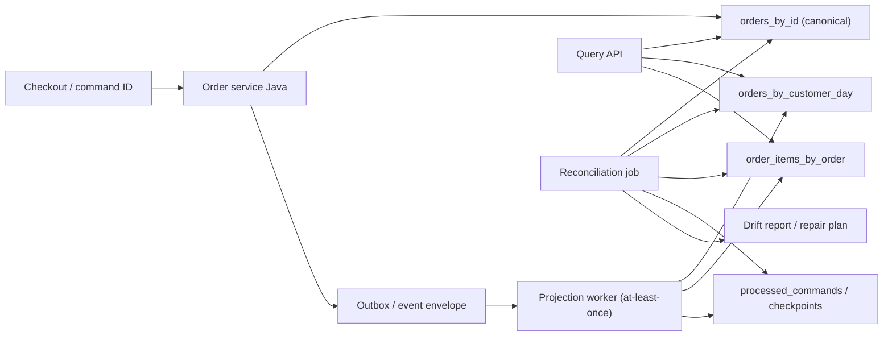
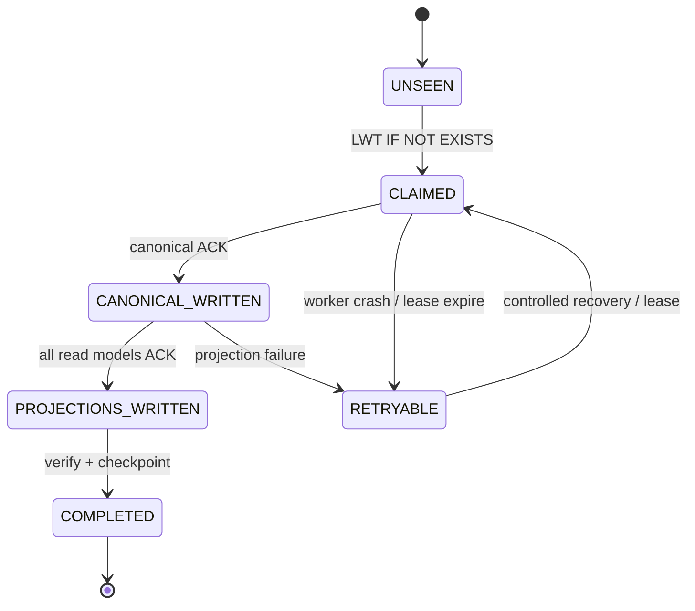
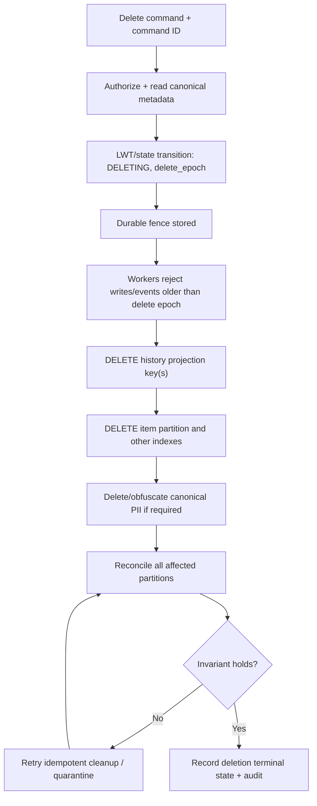

# Reconciling Duplicate Data, Dependent Deletes, and Business Invariants

> **Chapter:** Integration Testing  
> **Module:** `DATABASE_ENGINE_WIDE_COLUMN_CASSANDRA` — understanding Apache Cassandra's distributed architecture and wide-column model, especially partition keys, query-driven table design, read/write consistency levels, CQL, replication, compaction, repair, error handling, and Java application integration.  
> **Direct Goal:** Design integration tests that catch **duplicate data**, **undeleted dependent records**, **out-of-sync read models**, and **broken business invariants** when multiple denormalized Cassandra tables reflect the same entity.  
> **Illustrative Context:** A Java/Spring order-processing system where data is written across multiple query-specific tables, the message broker can redeliver events, retries occur after timeouts, and delete/mask requests must propagate across all read models.  
> **Versions:** Examples use Cassandra 4.x/5.x CQL, Java Driver 4.x, JUnit 5, Testcontainers, and optionally Spring Boot 3.x/4.x. Verify exact server/driver/Testcontainers versions in your stack before running.

An integration test can turn **completely green** while the business state is still broken:

```java
// Only proves that an INSERT did not throw an exception.
// Does not prove the order was not duplicated in a second table.
session.execute(insertOrder);
assertThat(session.execute(
    "SELECT * FROM lab_reconcile.orders_by_id ..."
)).isNotNull();
```

In Cassandra, a single business entity is commonly stored across multiple **query-driven tables**. For example, order `O-42` might appear simultaneously in:

- `orders_by_id` — lookup by order ID.
- `orders_by_customer_day` — a customer's purchase history partitioned by day.
- `order_items_by_order` — line items dependent on the order.
- `processed_commands_by_id` — accepted/processed commands for idempotency tracking.

A successful write to the canonical table **does not** prove the history table was updated. Deleting from `orders_by_id` **does not automatically cascade** to `orders_by_customer_day` or `order_items_by_order`. An event replayed by the message broker with a new ID can create a **duplicate logical record**, even though Cassandra never holds two rows with the same primary key. A write retried after a timeout may already have been applied by the server the first time, and the retry can alter TTL/timestamps or trigger duplicate side effects.

This lesson establishes **testable invariants**, **reference reconciliation datasets**, **dependent deletion workflows**, and a **Java/JUnit test harness running against real Cassandra**. The goal is not "CQL returned success," but "every representation of a business entity reaches its expected state—even after retries, crashes, DELETEs, and concurrent writers."

**Foundational principle:** Cassandra provides no foreign keys, cascading deletes, arbitrary JOINs, or cross-table ACID transactions in the RDBMS sense. Integrity across read models is an **application and operational contract** that must be actively verified and repaired.

## 1. Learning Outcomes

After completing this lesson, you will be able to:

1. Distinguish **duplicate message delivery**, **duplicate command execution**, **duplicate physical rows**, **duplicate logical entities**, and **stale/duplicate projections**.
2. Explain why `INSERT` with the same primary key is an upsert, yet insufficient to make an entire workflow idempotent.
3. Express invariants using **conditional logic, keyspace/tenant scope, timing/watermarks, and versions**, avoiding vague "eventually consistent" assertions.
4. Design query-driven CQL tables and identify every key needed to delete all dependent records.
5. Apply `IF NOT EXISTS`/LWT appropriately, recognizing that **claiming a command differs from completing all business effects**.
6. Separate **canonical sources**, denormalized views, ledgers, and delete fences—never confusing Cassandra repair with application reconciliation.
7. Write integration tests for duplicate delivery, post-timeout retries, out-of-order events, altered payloads, and concurrent updates.
8. Write integration tests that delete dependent rows by full primary key while guarding against "late write resurrection."
9. Understand tombstones, TTLs, `gc_grace_seconds`, compaction, repair, and zombie risks when a replica stays isolated too long.
10. Explain the limits of logged/unlogged `BATCH` and LWT without treating a multi-partition batch as an SQL transaction.
11. Use Java Driver `CqlSession`, `PreparedStatement`, `LOCAL_QUORUM`/`LOCAL_SERIAL`, and JUnit 5.
12. Organize Testcontainers, fixture isolation, deterministic fault injection, and bounded eventual assertions.
13. Reconcile **key sets**, revisions, statuses, monetary totals, timestamps, and tenant scope—not merely `COUNT(*)`.
14. Design idempotent repair/replay and monitor metrics for drift, orphans, stale projections, and duplicate commands.
15. Follow an incident runbook when logical business data diverges even though all Cassandra nodes report `UN`.

## 2. Why Must "Duplicate Data" Be Defined Precisely?

### 2.1. Four Distinct Perspectives

| Phenomenon | Example | Does Cassandra prevent it automatically? | Required testing |
| --- | --- | --- | --- |
| **Redelivered message** | Broker redelivers event E42 because ACK was lost | No | Processing E42 twice yields the same business outcome |
| **Write with same primary key** | Two `INSERT`s targeting the same `(tenant,order_id)` | Cassandra keeps one logical row per key via last-write-wins | Verify payload/version/TTL are not overwritten wrongly |
| **Duplicate logical order** | Two different UUIDs generated for the same checkout command | No | Business dedup key allows only one valid order |
| **Duplicate projection** | Event E42 creates two history rows with different clustering IDs | No | History holds exactly one entry per order/version |
| **Overlapping old/new projection** | Customer changed, yet old customer's history still shows the row | No | Old row deleted and new row present cleanly |
| **Duplicate side effect** | Email/refund sent or counter incremented twice | No | Downstream dedup, ledger, or idempotent consumer |

Key insight: Cassandra guarantees **no two physical rows coexist with the exact same primary key in the same table**, yet that **does not mean** "each business action occurs only once."

### 2.2. A Concrete Example

```text
Checkout command C-17 → generates order UUID A → writes orders_by_id(A)
Message redelivered C-17 → generates order UUID B → writes orders_by_id(B)

Two distinct primary keys: Cassandra cannot know that A and B
originated from the same checkout request.
```

Fix this by assigning a **stable business command ID** and mapping `C-17 → order A` idempotently. Calling `UUID.randomUUID()` on every retry cannot be fixed by turning on `PreparedStatement` or `LOCAL_QUORUM`.

### 2.3. Not Every Copy Is "Bad Duplicate Data"

Cassandra deliberately denormalizes data:

```text
Order O42 in orders_by_id           ← canonical lookup
Order O42 in orders_by_customer_day  ← customer read projection
Items O42 in order_items_by_order    ← dependent line items
```

These are three **intentional representations**, not bugs. A bug is a projection that is missing, extra, mis-owned, stale in state/version, or left behind after a domain delete. Tests must specify **which tables must or must not hold records** at each lifecycle state.

## 3. Architectural Model Requiring Reconciliation

### 3.1. Writing and Reading Across Multiple Projections



This diagram is an **architectural pattern**, not a claim that Cassandra offers built-in multi-table outbox transactions. If the event envelope is published before the canonical write ACKs—or vice versa—you need durable delivery/compensation; integration tests must hit both failure orderings.

### 3.2. Windows When the System Can Temporarily Diverge

```text
T0  No order yet.
T1  orders_by_id written.
T2  Event still in queue; history projection missing.
T3  orders_by_customer_day written.
T4  order_items_by_order written.
T5  Projection worker ACKs message and saves checkpoint.
T6  Reconciliation confirms exact expected row sets.
```

At T1, asserting "history must exist immediately" can be wrong if the contract specifies **eventual convergence**. At T5/T6, if the SLA requires convergence within 10 seconds, missing history is a bug.

Write **conditional state invariants**: before T5 the system may be `PENDING`; once an authoritative `APPLIED`/completion watermark passes, projections must match. Never mistake Cassandra-level consistency for cross-table workflow atomicity.

## 4. Turning Business Invariants Into Testable Contracts

### 4.1. Sample Invariant Catalog

| ID | Invariant | Scope | When it can be asserted |
| --- | --- | --- | --- |
| I-01 | An accepted checkout command maps to **one stable order ID** | `tenant_id, command_id` | After command handling, including retries |
| I-02 | An active order has exactly one canonical row at its PK | `tenant_id, order_id` | Upon creation ACK |
| I-03 | Active order has one history projection with exact customer/day/created_at | Order ID + projection key | When projection watermark ≥ event version |
| I-04 | Item ID set in canonical payload matches `order_items_by_order` | Order ID, revision | Once projection revision is finalized |
| I-05 | Monetary total reconciles at the same revision in **integer cents** | Order ID, version | When order is in a finalized state |
| I-06 | `DELETING/DELETED` orders must not appear active in Query API | Order lifecycle | Immediately after fence commit per contract |
| I-07 | After delete workflow completes, all in-scope projections are absent/tombstoned | Order ID + projections | At terminal delete checkpoint |
| I-08 | Old events/retries post-delete cannot resurrect the order in active read models | Order ID, revision/epoch | Post delete fence; under stress tests |
| I-09 | All reads/queries enforce the authorized tenant scope | Tenant + caller | Every request |
| I-10 | One event ID never triggers business side effects twice | `tenant_id, event_id` | After duplicate-delivery tests |
| I-11 | No "orphan" projections exist past the reconciliation watermark/cutoff | Bounded tenant/day range | Per batch reconciliation SLO |
| I-12 | Failed repair/retry can safely rerun without adding logical duplicates | Repair task ID + entity key | After injected failure/retry |

You need not apply all 12 invariants verbatim to every product. What matters is **stating the authoritative source, expectation, scope, and assertion timing explicitly**.

### 4.2. Key-Set Reconciliation Formulas

Let:

- \(E_v\): the set of *expected* projection keys computed from canonical commands at revision or watermark \(v\).
- \(A_v\): the set of *actual* projection keys observed during reconciliation over the same scope.
- \(M = E_v \setminus A_v\): **missing** projections.
- \(O = A_v \setminus E_v\): **orphan/extra** projections.

Definitions:

\[
\mathrm{Missing} = E_v \setminus A_v
\]

\[
\mathrm{Orphan} = A_v \setminus E_v
\]

\[
\mathrm{DriftRatio} =
\frac{|M| + |O|}{\max(1,|E_v|)}
\]

**Still insufficient alone:** matching keys can carry stale status, amount, or version. Compare a **payload signature**—such as a hash over a normalized canonical representation—at the same revision. Hashing does not replace schema checks, tenant authorization, or data-transformation checks.

### 4.3. Why `COUNT` Is Never Enough

Suppose:

```text
Expected keys: {O1, O2, O3}
Actual keys:   {O1, O2, O4}

COUNT expected = 3
COUNT actual   = 3
Yet O3 is missing and O4 is an orphan.
```

`SELECT COUNT(*)` can also be prohibitively expensive on Cassandra. Tests should read **small bounded partitions by partition key** and compare sets rather than scanning the cluster inside assertions. Production reconciliation needs explicit segmentation, token ranges, or bucketing.

### 4.4. Version-Based Invariants Instead of Sleeping

```text
Event revision 9 emitted
History revision 8 read immediately afterward: temporarily acceptable
History revision 8 after watermark "revisions <=9 processed": BUG
History revision 10: inspect out-of-order handling; do not assume valid
```

Ideally projections store `revision` and consumers expose checkpoints/watermarks. `Thread.sleep(3000)` followed by "must be done within 3s" is flaky and hides why failures occur. Use bounded polling tied to observable state.

## 5. Lab Cassandra Schema Design

### 5.1. Keyspace Scope

In the lab, assume the Cassandra DC name is `dc1` with at least three full replicas if using RF=3. On a single-node Testcontainers setup, adjust RF to `{'dc1':1}` or the container's real DC name—and recognize that test **does not verify RF=3 quorum**.

```sql
CREATE KEYSPACE IF NOT EXISTS lab_reconcile
WITH replication = {
    'class': 'NetworkTopologyStrategy',
    'dc1': 3
};
```

### 5.2. Canonical Lookup: `orders_by_id`

```sql
CREATE TABLE IF NOT EXISTS lab_reconcile.orders_by_id (
    tenant_id uuid,
    order_id uuid,
    command_id uuid,
    customer_id uuid,
    order_day date,
    created_at timestamp,
    status text,
    amount_cents bigint,
    revision bigint,
    PRIMARY KEY ((tenant_id, order_id))
);
```

Each order forms **one small partition** keyed by `(tenant_id,order_id)`. Metadata columns `customer_id`, `order_day`, and `created_at` live here too so the app **knows the full projection keys when deleting**. Knowing only `order_id` without customer/day makes efficient history deletion impossible without a secondary key catalog.

### 5.3. Customer/Day History Projection

```sql
CREATE TABLE IF NOT EXISTS lab_reconcile.orders_by_customer_day (
    tenant_id uuid,
    customer_id uuid,
    order_day date,
    created_at timestamp,
    order_id uuid,
    status text,
    amount_cents bigint,
    revision bigint,
    PRIMARY KEY (
        (tenant_id, customer_id, order_day),
        created_at, order_id
    )
) WITH CLUSTERING ORDER BY (
    created_at DESC, order_id ASC
);
```

Each partition holds **one customer's orders for a single day**, preventing unbounded partition growth over a customer's lifetime. Query:

```sql
SELECT created_at, order_id, status, amount_cents, revision
FROM lab_reconcile.orders_by_customer_day
WHERE tenant_id = ?
  AND customer_id = ?
  AND order_day = ?;
```

All three partition-key components are required. There is no SQL JOIN back to canonical; Java reconciles across bounded key sets.

### 5.4. Dependent Items by Order

```sql
CREATE TABLE IF NOT EXISTS lab_reconcile.order_items_by_order (
    tenant_id uuid,
    order_id uuid,
    item_id uuid,
    sku text,
    quantity int,
    unit_price_cents bigint,
    revision bigint,
    PRIMARY KEY ((tenant_id, order_id), item_id)
);
```

`(tenant_id,order_id)` is the partition key and `item_id` is the clustering key. Cassandra has **no foreign-key constraint** requiring a parent row in canonical, so **orphan items can easily exist** after partial failures or write races.

### 5.5. Command Processing Ledger

```sql
CREATE TABLE IF NOT EXISTS lab_reconcile.processed_commands_by_id (
    tenant_id uuid,
    command_id uuid,
    order_id uuid,
    payload_hash text,
    processing_state text,
    updated_at timestamp,
    PRIMARY KEY ((tenant_id, command_id))
);
```

`INSERT ... IF NOT EXISTS` here can **claim** a command, yet `processing_state='CLAIMED'` does not mean all projections succeeded. If a worker dies right after claiming, the system needs state transitions, leases, or recovery rather than forever skipping the command because a ledger row exists.

### 5.6. Durable Deletion Fence

```sql
CREATE TABLE IF NOT EXISTS lab_reconcile.order_delete_fences_by_id (
    tenant_id uuid,
    order_id uuid,
    delete_epoch bigint,
    deletion_state text,
    requested_at timestamp,
    PRIMARY KEY ((tenant_id, order_id))
);
```

The fence holds the **minimum metadata needed** to distinguish valid orders from deleted ones. It does not automatically enforce itself across other tables: **writers and projectors must check the fence/lifecycle state before writing and be tested under race conditions**.

If privacy regulations require erasing PII, verify the fence contains no personal data and obeys an explicit retention policy—never keep identifying data indefinitely under the label "business tombstone."

### 5.7. Primary-Key Map

```text
orders_by_id
    PK = (tenant_id, order_id)
    1 partition / order; stores metadata needed to delete projections.

orders_by_customer_day
    Partition = (tenant_id, customer_id, order_day)
    Clustering = created_at DESC, order_id ASC.

order_items_by_order
    Partition = (tenant_id, order_id)
    Clustering = item_id.

processed_commands_by_id
    PK = (tenant_id, command_id) — independent command ledger.

order_delete_fences_by_id
    PK = (tenant_id, order_id) — lifecycle deletion marker.
```

Never rely on Cassandra's **internal SSTable layout** to expect foreign-key cascades; deleting canonical never removes history or items automatically.

## 6. CQL Fixtures: One Order, Two Items, One Projection

### 6.1. Fixed Lab Constants

UUIDs used across examples:

```text
tenant_id   = 11111111-1111-4111-8111-111111111111
order_id    = 22222222-2222-4222-8222-222222222222
customer_id = 33333333-3333-4333-8333-333333333333
command_id  = 44444444-4444-4444-8444-444444444444
item_id_A   = aaaaaaaa-aaaa-4aaa-8aaa-aaaaaaaaaaaa
item_id_B   = bbbbbbbb-bbbb-4bbb-8bbb-bbbbbbbbbbbb
order_day   = 2026-11-21
created_at  = 2026-11-21 10:00:00+0000
```

Fixed test constants make runs deterministic. If tests run in parallel against the **same keyspace**, allocate **unique** namespaces/tenants/IDs per test or isolate containers/keyspaces so tests never wipe each other's fixtures.

### 6.2. Writing the Canonical Row

```sql
INSERT INTO lab_reconcile.orders_by_id (
    tenant_id, order_id, command_id, customer_id,
    order_day, created_at, status, amount_cents, revision
) VALUES (
    11111111-1111-4111-8111-111111111111,
    22222222-2222-4222-8222-222222222222,
    44444444-4444-4444-8444-444444444444,
    33333333-3333-4333-8333-333333333333,
    '2026-11-21', '2026-11-21 10:00:00+0000',
    'ACTIVE', 2500, 1
);
```

`2500` is in **cents**; never use floating-point numbers for money. Two items sum to \(2\times 1000+1\times500=2500\).

### 6.3. Writing the History Projection

```sql
INSERT INTO lab_reconcile.orders_by_customer_day (
    tenant_id, customer_id, order_day,
    created_at, order_id, status, amount_cents, revision
) VALUES (
    11111111-1111-4111-8111-111111111111,
    33333333-3333-4333-8333-333333333333,
    '2026-11-21', '2026-11-21 10:00:00+0000',
    22222222-2222-4222-8222-222222222222,
    'ACTIVE', 2500, 1
);
```

If a retry substitutes a **different `created_at`** (e.g., `now()`) instead of reusing the event timestamp, history ends up with **two rows under different clustering keys** for the same logical order. Projection PKs must always derive from **stable canonical event metadata**.

### 6.4. Writing Two Dependent Items

```sql
INSERT INTO lab_reconcile.order_items_by_order (
    tenant_id, order_id, item_id,
    sku, quantity, unit_price_cents, revision
) VALUES (
    11111111-1111-4111-8111-111111111111,
    22222222-2222-4222-8222-222222222222,
    aaaaaaaa-aaaa-4aaa-8aaa-aaaaaaaaaaaa,
    'SKU-A', 2, 1000, 1
);

INSERT INTO lab_reconcile.order_items_by_order (
    tenant_id, order_id, item_id,
    sku, quantity, unit_price_cents, revision
) VALUES (
    11111111-1111-4111-8111-111111111111,
    22222222-2222-4222-8222-222222222222,
    bbbbbbbb-bbbb-4bbb-8bbb-bbbbbbbbbbbb,
    'SKU-B', 1, 500, 1
);
```

### 6.5. Verifying Data After Writes

```sql
SELECT order_id, status, amount_cents, revision,
       customer_id, order_day, created_at
FROM lab_reconcile.orders_by_id
WHERE tenant_id = 11111111-1111-4111-8111-111111111111
  AND order_id = 22222222-2222-4222-8222-222222222222;

SELECT created_at, order_id, amount_cents, revision
FROM lab_reconcile.orders_by_customer_day
WHERE tenant_id = 11111111-1111-4111-8111-111111111111
  AND customer_id = 33333333-3333-4333-8333-333333333333
  AND order_day = '2026-11-21';

SELECT item_id, sku, quantity, unit_price_cents, revision
FROM lab_reconcile.order_items_by_order
WHERE tenant_id = 11111111-1111-4111-8111-111111111111
  AND order_id = 22222222-2222-4222-8222-222222222222;
```

Check **full keys, status, amount, revision**, and the item ID set. Never settle for asserting `SELECT` didn't throw or an arbitrary row exists.

### 6.6. Never Use Table-Wide `COUNT(*)` to Test Invariants

Read one bounded lab partition and assert:

```text
canonical order count for (tenant, order_id) = 1
history with order_id=O under expected (tenant,customer,day) = 1
itemId set = {A,B}
sum(quantity * unit_price_cents) = 2500
revision for all relevant rows = 1
```

Query by partition and assert in Java. **Never** run `SELECT COUNT(*) FROM lab_reconcile.orders_by_customer_day` as a health or invariant check in production because full-table scans are prohibitively expensive.

## 7. `INSERT` with the Same Key: How Idempotent Is It Really?

### 7.1. Same PK Does Not Create a Second Physical Row

Rerunning the **exact same** `INSERT` from Section 6 with identical values and primary key follows CQL upsert semantics and leaves one logical row.

Now try:

```sql
INSERT INTO lab_reconcile.orders_by_id (
    tenant_id, order_id, status, amount_cents, revision
) VALUES (
    11111111-1111-4111-8111-111111111111,
    22222222-2222-4222-8222-222222222222,
    'ACTIVE', 9999, 1
);
```

After this statement, `amount_cents` can silently become `9999` via last-write-wins timestamp resolution even though **business revision remains 1**. That disproves the myth that "same primary key makes every retry safe."

### 7.2. Idempotency Must Cover Command Effects

Event processing is business-idempotent when:

\[
f(f(S,e),e) \equiv f(S,e)
\]

where \(S\) is business state, \(e\) is the same event, and equivalence spans **all read models, external effects, and version semantics** required by the contract.

If the second run changes timestamps, TTLs, statuses, counters, or emits another projection key, equivalence breaks even when canonical shares the same PK.

### 7.3. Replay Generating a Different Event/Entity ID

```text
Event delivery 1:
    command C-17, order_id O-1, created_at 10:00:00
Event delivery 2:
    command C-17, order_id O-2, created_at 10:00:01

Both O-1 and O-2 coexist validly in Cassandra.
The business invariant "1 command = 1 order" is broken.
```

**Derive or map a stable order ID** from the command ID with idempotent handling rather than generating fresh random UUIDs on retry. Test this by sending the same command ID twice with different delivery/network-attempt IDs.

### 7.4. Negative Assertions Must Stay Scoped

Do not scan the entire table to claim "zero duplicates"; in a small fixture, you know the exact command C17, customer/day, and generated order IDs. Assert across the **partitions responsible for holding those records** or query a dedicated command→order lookup ledger.

If you need duplicate detection across arbitrary tenants or days system-wide, design a **dedup index / materialized business key** or dedicated batch reconciliation; Cassandra offers no SQL unique constraints on arbitrary non-PK columns.

## 8. `IF NOT EXISTS` and Ledgers: Claiming ≠ Completing

### 8.1. Claiming via LWT

```sql
INSERT INTO lab_reconcile.processed_commands_by_id (
    tenant_id, command_id, order_id,
    payload_hash, processing_state, updated_at
) VALUES (
    11111111-1111-4111-8111-111111111111,
    44444444-4444-4444-8444-444444444444,
    22222222-2222-4222-8222-222222222222,
    'sha256-demo-001', 'CLAIMED',
    '2026-11-21 10:00:00+0000'
)
IF NOT EXISTS;
```

The first execution typically returns `[applied] = true`; rerunning with the same PK returns `[applied] = false`. In Java Driver 4.x, `ResultSet.wasApplied()` inspects the conditional result.

**Never** assume `applied=true` means history, items, or notifications finished. It only proves a **ledger claim row** was inserted.

### 8.2. Crash Right After Claiming

```text
Worker A  INSERT processed_commands IF NOT EXISTS  → applied=true
Worker A  writes orders_by_id                      → success
Worker A  crashes before writing history projection

Worker B  receives redelivery, INSERT IF NOT EXISTS → applied=false
Worker B  assumes "already processed" and ACKs broker → BUG!
```

This creates a dangerous **at-most-once failure**: the event gets dropped because the claim row exists even though the business flow is half-done.

### 8.3. A Ledger State Machine Must Distinguish Stages



This is a **design pattern**, not an automatic Cassandra feature. Lease-based recovery needs ownership tokens, expiration, conditional CAS transitions, and fencing so two workers cannot finalize the same command simultaneously. `IF state='CLAIMED'` LWTs fit a **single ledger partition**, subject to concurrency, latency, and ambiguous-timeout handling.

### 8.4. Detecting Command-ID Reuse With a Payload Hash

If the same `(tenant_id,command_id)` arrives with a **different** payload:

```text
First:  command C42, amount=2500, hash=AAA
Second: command C42, amount=9999, hash=BBB
```

Never silently drop the second one as a harmless duplicate. Return a conflict, alert, or quarantine it; test that reusing a command ID with two payload hashes fails per contract. Normalize meaningful fields in a canonical format before hashing rather than hashing raw JSON with unstable key order or whitespace.

### 8.5. LWT Enforces Only a Narrow Constraint

`IF NOT EXISTS` uses Paxos, costs more than ordinary writes, and does not create an ACID transaction spanning ledger, canonical order, history, and items. Test separately:

1. Two workers race on the same command ID in **one ledger partition**.
2. Under consistent LWT usage, only one claim applies.
3. The winning worker crashes mid-flight; another worker recovers the workflow.
4. Every command reaches `COMPLETED` with **one business effect**.
5. Side effects outside Cassandra are independently idempotent.

If end-to-end exactly-once across Kafka, Cassandra, and email/payment is required, **never** claim a single LWT claim delivers it on its own.

## 9. Dependent Deletes: Cassandra Has No `ON DELETE CASCADE`

### 9.1. Business Relationships Are Not Enforced by CQL

```text
orders_by_id(O42)                 ← canonical order
    │
    ├── orders_by_customer_day(C1,day,O42)
    │
    └── order_items_by_order(O42,item1,item2)
```

Executing:

```sql
DELETE FROM lab_reconcile.orders_by_id
WHERE tenant_id = 11111111-1111-4111-8111-111111111111
  AND order_id = 22222222-2222-4222-8222-222222222222;
```

deletes **only from the named table**. The history projection and line items remain intact because no foreign keys or cascade triggers exist.

### 9.2. Naive Deletion Order Loses Required Keys

A common mistake:

```text
1. DELETE orders_by_id
2. Query canonical to look up customer_id/order_day/created_at
3. DELETE history by customer/day/created_at
```

Step 2 no longer has the metadata. With a composite history key, there is no efficient point lookup to delete from history knowing only `order_id` without customer/day/created_at.

**Solution:** read and retain key metadata beforehand, or maintain a per-order projection-key catalog with reconciliation and completeness guarantees—noting that a catalog table can itself drift and is not an enforced constraint.

### 9.3. Deleting Using Full Primary Keys

```sql
-- 1. Delete the order's exact history entry.
DELETE FROM lab_reconcile.orders_by_customer_day
WHERE tenant_id = 11111111-1111-4111-8111-111111111111
  AND customer_id = 33333333-3333-4333-8333-333333333333
  AND order_day = '2026-11-21'
  AND created_at = '2026-11-21 10:00:00+0000'
  AND order_id = 22222222-2222-4222-8222-222222222222;

-- 2. Delete the entire items partition for the order.
DELETE FROM lab_reconcile.order_items_by_order
WHERE tenant_id = 11111111-1111-4111-8111-111111111111
  AND order_id = 22222222-2222-4222-8222-222222222222;

-- 3. If policy permits: update canonical lifecycle,
-- or delete canonical last after a durable delete fence.
```

`DELETE` writes **tombstones** rather than immediately erasing bytes from SSTables. Verify logical visibility separately from eventual replica/compaction/repair cleanup.

### 9.4. Why Deleting the Items Partition Is Often Simpler

`order_items_by_order` is partitioned directly by `(tenant_id,order_id)`. `DELETE FROM ... WHERE tenant_id=? AND order_id=?` deletes the partition range under CQL semantics without listing every `item_id`.

However:

- If items are denormalized into **other partitions/tables**, a partition delete touches only that table.
- Writes arriving **after the delete** with newer timestamps can recreate rows.
- Deleting huge partitions generates tombstone bursts that impact reads and compaction.
- Never assume all RF replicas received the delete merely because the coordinator ACKed the requested CL.

### 9.5. Syntactically Valid Deletes Can Still Violate Business Rules

If an order is `PAID` and policy forbids deletion before a refund settles, a valid CQL `DELETE` still **violates a business invariant**. Tests must cover state machines, authorization, and external dependencies—not just missing rows.

## 10. Safer Deletion Workflow: Fence → Cleanup → Verify

### 10.1. Lifecycle Model



This is an **architectural recommendation**, not a built-in ACID protocol. When privacy policies mandate permanent erasure, align scope across backups, exports, search indexes, and external sinks with data owners and retention schedules. Fence markers must store minimal data and never retain the PII slated for deletion.

### 10.2. Marking State via LWT (Illustrative)

```sql
UPDATE lab_reconcile.orders_by_id
SET status = 'DELETING', revision = 2
WHERE tenant_id = 11111111-1111-4111-8111-111111111111
  AND order_id = 22222222-2222-4222-8222-222222222222
IF status = 'ACTIVE';
```

Inspect `[applied]`. If false, read the current state and handle idempotently:

- Already `DELETING` → resume or defer to the owning worker.
- Already `DELETED` → return "already deleted" appropriately and reconcile cleanup.
- Order missing → check whether orphan projections or fences remain.
- `REFUND_PENDING` → block deletion per business policy.

### 10.3. Writing a Separate Fence Against Late Events

```sql
INSERT INTO lab_reconcile.order_delete_fences_by_id (
    tenant_id, order_id, delete_epoch, deletion_state, requested_at
) VALUES (
    11111111-1111-4111-8111-111111111111,
    22222222-2222-4222-8222-222222222222,
    2, 'DELETING', '2026-11-21 11:00:00+0000'
)
IF NOT EXISTS;
```

Consumers must not emit projections from revision `1` once an order carries fence epoch `2`. Yet a two-step **read-check-write** still has a race window:

```text
Worker A reads fence: absent
Worker B writes delete fence epoch 2, deletes history
Worker A writes history from epoch-1 event ← row can reappear
```

"Check fence before write" across **two different partitions** cannot prevent this race atomically. Pair it with ordered serialization per order key, single-partition epoch/LWT gates where modeled together, read-path filtering after deletion, or post-quiescence cleanup/reconciliation. Integration tests must **deliberately provoke this exact interleaving**.

### 10.4. Splitting Delete Invariants into Two Levels

**Level A — immediate logical invisibility after fence:** APIs stop returning the order to end users once state ≥ `DELETING`, backed by an authoritative lifecycle/authorization check (accepting an extra read/latency trade-off).

**Level B — physical/logical projection cleanup by deadline:** history, items, and indexes return zero entries within scope at the verification CL, and tombstones are propagated/repaired. Keep these two levels distinct because there is a window where the entity is **hidden in the API while cleanup is still running**.

### 10.5. Retrying Deletes Must Be Idempotent

Reissuing `DELETE` on the same primary key is generally safe, yet check:

- Projection-key metadata stays available in workflow state until cleanup succeeds.
- Retries do not invent new delete epochs arbitrarily.
- Cleanup cannot accidentally delete a newer order reusing an ID.
- Audits, notifications, and refunds do not fire twice.
- Terminal checkpoints update only after readback/reconciliation.
- Seeing an absent row on retry never implies all other tables are clean without checking them.

## 11. Tombstones, TTLs, Compaction, and Zombie Data

### 11.1. Cassandra `DELETE` Does Not Reclaim Bytes Immediately

`DELETE` writes a timestamped **tombstone** telling replicas the old value is deleted. Tombstones flow through memtables and SSTables until read filtering and eligible compaction purge them. At proper read CLs the row disappears logically, yet **physical bytes remain on disk** until `gc_grace_seconds` elapses and compaction conditions permit purging.

```text
t0: replicas hold row O42
t1: DELETE O42 → replicas store tombstone
t2: SELECT O42 at proper CL → logically absent
t3: repair delivers tombstone to any missed replica
t4: past grace + eligible compaction → old bytes/tombstone purged
```

### 11.2. Time-Based Deletion via TTL

Cells written with `USING TTL 3600` turn into tombstones upon expiry. Retrying `INSERT` with a fresh TTL can **extend data lifetime**, so idempotency tests must inspect TTL / remaining TTL. Expiration in one table **does not synchronize** deletion across projections having different or no TTLs.

### 11.3. `gc_grace_seconds` Is Not a Business Retention SLA

A table's `gc_grace_seconds` governs how long tombstones are retained so replicas can learn about deletes before compaction purges them (commonly 10 days by default, depending on version/table config). It is **not** a guarantee that user bytes disappear from disk right at day 10; compaction must still qualify and run.

Never shrink `gc_grace_seconds` to a few seconds in production just to speed up tests, as prolonged replica outages then risk **zombie data**.

### 11.4. Zombies: Deleted Data Resurrecting

```text
Nodes A, B: receive tombstone for O42
Node C: unreachable, retains old live row O42

Tombstone on A/B gets purged too early
Node C rejoins / repair runs
Old row on C streams back → O42 reappears (zombie).
```

Hence a single "DELETE then SELECT absent once" test is **far too weak** to rule out resurrection. RF3 fault tests must take a node down across a delete, bring it back, and run repair within the grace window while reading at proper CLs—backed by ongoing operational repair, not just Friday integration tests.

### 11.5. Cassandra Repair Is Not Projection Reconciliation

**Replica repair:** anti-entropy syncing **replicas of the same table/token ranges**, helping straggling replicas catch up on missed tombstones.

**Application reconciliation:** comparing **`orders_by_id` against `orders_by_customer_day` / `order_items_by_order` / ledger** to detect missing, extra, or stale business state.

`nodetool repair` **never creates** a missing history row after a worker crash or cleans up an orphan item in another table. Conversely, app reconciliation never replaces `nodetool repair` for preventing replica zombies.

### 11.6. Safe Testing Scope

Single-node integration tests can verify:

- `DELETE` causes logical absence.
- Replaying an `INSERT` after `DELETE` with a newer timestamp recreates the row.
- TTL cells expire on server clock semantics.
- Single-key/sequence CQL behavior.

They **cannot** verify:

- Missed tombstones across RF3 replicas.
- Cross-rack/DC repair.
- Zombie avoidance after outages > `gc_grace_seconds`.
- Physical SSTable byte purging on disk.
- Multi-DC quorum/consistency transitions.

Those require multi-node lab clusters, controlled fault injection, and version-specific operational checks.

## 12. Cassandra `BATCH`: Use Properly Without ACID Illusions

### 12.1. What Does `BATCH` Provide?

CQL `BEGIN BATCH ... APPLY BATCH` groups `INSERT`/`UPDATE`/`DELETE` statements. A **logged batch** ensures mutations eventually apply all-or-none under Cassandra's batchlog atomicity contract, yet **isolation applies only within a single partition**. There is no RDBMS-style multi-partition isolation or rollback.

```sql
BEGIN BATCH
    INSERT INTO lab_reconcile.orders_by_id (
        tenant_id, order_id, status, amount_cents, revision
    ) VALUES (
        11111111-1111-4111-8111-111111111111,
        22222222-2222-4222-8222-222222222222,
        'ACTIVE', 2500, 1
    );

    INSERT INTO lab_reconcile.orders_by_customer_day (
        tenant_id, customer_id, order_day,
        created_at, order_id, status, amount_cents, revision
    ) VALUES (
        11111111-1111-4111-8111-111111111111,
        33333333-3333-4333-8333-333333333333,
        '2026-11-21', '2026-11-21 10:00:00+0000',
        22222222-2222-4222-8222-222222222222,
        'ACTIVE', 2500, 1
    );
APPLY BATCH;
```

**Avoid** multi-partition batches for routine high-throughput ingestion: the coordinator and batchlog coordinate extra replicas, increasing latency and load. Use them only when a specific **batch atomicity contract** justifies them, backed by benchmarks and size bounds.

### 12.2. Logged Batches Do Not Hide Partial In-Flight Reads

An observer reading two partitions while a batch runs—or during transient cluster faults—is **not guaranteed a unified transactional snapshot**. Eventual all-or-none atomicity differs from serializable isolation.

Integration tests should observe:

- After a batch succeeds at proper CL, all target rows exist.
- A batch timeout does not prove zero mutations applied.
- Reading two partitions concurrently does not yield an atomic snapshot.
- External side effects (Kafka, email) sit completely outside CQL batch atomicity.

### 12.3. `UNLOGGED` Batches Can Leave Partial Effects

`BEGIN UNLOGGED BATCH` skips the batchlog; when a multi-partition unlogged batch fails, some mutations can persist while others do not. Never update canonical and history with an `UNLOGGED` batch and write tests claiming "atomic transaction."

### 12.4. Conditional Batches and LWT Boundaries

Conditional statements can be combined only within supported rules, and Paxos/LWT binds to **partition and serial consistency semantics**. Never execute `IF NOT EXISTS` on a separate ledger partition assuming it atomically locks history and item partitions.

To enforce cross-table invariants, combine:

- Canonical state transitions with versions/fences.
- Idempotent projectors.
- Durable events/checkpoints.
- Read masking plus bounded reconciliation.
- Or reconsider the data model/storage engine if the domain truly requires multi-entity ACID isolation.

## 13. Consistency Levels and Assertion Timing

### 13.1. `LOCAL_QUORUM` Under RF3

With `NetworkTopologyStrategy` and RF=3 full replicas in the local DC, `LOCAL_QUORUM` typically requires:

\[
Q_\mathrm{local}=\left\lfloor\frac{RF_\mathrm{local}}{2}\right\rfloor+1=2
\]

If both writes and reads in the same local DC use `LOCAL_QUORUM`, tests observe Cassandra's stronger read-after-write guarantees within their defined assumptions—which still **does not** make multi-table app workflows converge instantaneously together.

### 13.2. LWT Uses a Separate Serial Phase

`INSERT ... IF NOT EXISTS` / `UPDATE ... IF ...` runs Paxos using `SERIAL`/`LOCAL_SERIAL` for the serial phase alongside the regular CL for commit/learn. In `cqlsh`:

```sql
CONSISTENCY LOCAL_QUORUM;
SERIAL CONSISTENCY LOCAL_SERIAL;
```

These two directives are **`cqlsh` commands**, not CQL queries passed to Java `session.execute("CONSISTENCY ...")`. In Java Driver, configure `setConsistencyLevel` and `setSerialConsistencyLevel` on statements.

### 13.3. Single-Node Tests Do Not Verify Quorum Availability

Single-node Testcontainers typically runs RF1, making `LOCAL_QUORUM` equal to 1. Passing there does not predict how RF3 behaves when one replica goes down or how cross-DC failover operates. Use a real 3-node/rack test cluster when asserting HA or CL guarantees.

### 13.4. Do Not Retry Validation Errors as Transient

`UnauthorizedException`, `SyntaxError`, and `InvalidQueryException` reflect permission, syntax, or query-design bugs; retrying the same inputs/schema/role will never succeed. `UnavailableException` and timeouts may be transient, yet still demand **idempotency and unknown-outcome handling**. LWT retries must likewise handle ambiguous outcomes and preserve original command identity.

### 13.5. Testing Cross-DC Consistency Boundaries

`LOCAL_QUORUM` in DC A does not guarantee quorum acknowledgment in DC B. If business invariants require durability across regional failover, integration/fault tests must inspect replication, CL, and workloads across **both DCs** rather than a single `SELECT` in DC A.

## 14. Matrix of Essential Integration Tests

| ID | Scenario | Injection / action | Invariant to assert |
| --- | --- | --- | --- |
| T01 | Standard insert | Canonical + history + items | Read models match PK, status, amount, revision |
| T02 | Command redelivery | Redeliver same ID and payload | One logical order; no duplicate history |
| T03 | Duplicate ID, altered payload | Same command ID, different hash | Conflict/quarantine; no silent overwrite |
| T04 | Two workers race to claim | Concurrent LWT | One claim applied; safe recovery |
| T05 | Crash after claim | Inject fault before canonical | Ledger not `COMPLETED`; replayable |
| T06 | Crash after canonical | Fail before history | Reconciliation flags missing history and repairs |
| T07 | Crash after history | Fail before items | Detects missing items and repairs |
| T08 | Projection key drift | Retry alters `created_at` | Detects extra history row and cleans up |
| T09 | Customer change | Old→new customer/day | Old projection absent; new projection accurate |
| T10 | Duplicate item with new UUID | Replayed item event generates new UUID | Catches duplicate business item/event |
| T11 | Amount invariant | Wrong quantity/price | Sum != canonical amount → test fails |
| T12 | Delete canonical only | Leave dependent rows | Detects orphan history/items |
| T13 | Full delete workflow | Fence + cleanup + verify | API hides at once; projections gone at terminal state |
| T14 | Delete retry | Reissue same command | No collateral deletes or duplicate side effects |
| T15 | Late update post-delete | Inject older event revision | Active read model never resurrects after reconciliation |
| T16 | TTL expiry | Controlled TTL/clock | Logical expiry verified without assuming physical purge |
| T17 | Replica down during delete | RF3 test cluster | Repair/tombstone convergence post-recovery |
| T18 | Write timeout | Drop response / network partition | No logical duplicates upon retry |
| T19 | Unlogged batch failure | Block one partition | Detects partial state rather than assuming atomicity |
| T20 | Cross-tenant isolation | Caller in another tenant | Cannot read or delete other tenant's data |
| T21 | Source mutations during reconcile | Concurrent writers | Watermark/cutoff avoids false snapshot assumptions |
| T22 | Repeated drift repair | Replay same repair plan | Idempotent convergence |
| T23 | Underprivileged CQL role | Lab `CassandraAuthorizer` | Fails fast without privilege escalation |
| T24 | Worker cancel/shutdown | Stop worker mid-delete | Resumes from durable state; never marks DONE prematurely |
| T25 | Backpressure | Reconcile 10k partitions | In-flight/rate budgets prevent overload |

**Tiering:** T01–T16 and T20–T24 can run against app + single-node test Cassandra; T17, T18, T19, and T25 require multi-node clusters, fault tools, or appropriate harnesses—never pretend one container tests every distributed behavior.

## 15. Fixture Isolation and Deterministic Testing Strategies

### 15.1. Never Share Tenant IDs Across Parallel Tests

Fixed example constants aid readability, yet JUnit suites often run in parallel. If every test shares `tenant_id`/`order_id`, a delete test will break a duplicate test. Pick one approach:

- Dedicated Testcontainer/keyspace per test class (heavier, maximum isolation).
- Unique tenant/order IDs created in `@BeforeEach` and scoped to the test context.
- Dedicated table/keyspace prefixes across instances.
- Serialize tests sharing a dataset if isolation isn't practical.
- Never run `DROP KEYSPACE` while another test uses it.

### 15.2. Clocks and Timestamps

Cassandra resolves write conflicts using timestamps. When two tests write the same PK and timestamp, conflict ordering becomes unpredictable. Use unique per-test IDs, deterministic event timestamps, and explicit business revisions; reserve `USING TIMESTAMP` for tests specifically targeting timestamp semantics.

**Never** rely on `Thread.sleep(10)` to force last-write-wins ordering. Use LWT conditional transitions and assert `wasApplied()`.

### 15.3. Targeted Broker/Worker Fault Injection Points

High-value injection points:

```text
after_claim_before_canonical
after_canonical_before_history
after_history_before_items
after_items_before_checkpoint
after_delete_fence_before_cleanup
after_delete_history_before_delete_items
after_sink_ack_before_checkpoint
after_check_fence_before_projection_write
```

Unit/integration tests can inject a test-only `FaultInjector` interface throwing at exact hooks; never expose arbitrary fault-injection endpoints in production. Run against real Cassandra containers to verify persisted partial state.

### 15.4. Separating Outcomes From ACKs

Upon write timeout, a mutation **may already have applied**. Never write tests asserting "timeout → row absent" as an invariant. Instead:

- Inject failure after server processing but before client ACK (when a fault proxy supports it).
- Replay with the same command ID and version.
- Reconcile canonical + projections.
- Assert **one logical business outcome** regardless of attempt count.
- Verify retry metrics and non-duplicated side effects.

### 15.5. Bounded Eventual Assertions

```java
// PSEUDOCODE: Awaitility + project-defined service helpers.
await()
    .atMost(Duration.ofSeconds(10))
    .pollInterval(Duration.ofMillis(100))
    .untilAsserted(() -> {
        assertThat(readProjectionIds(tenant, customer, day))
            .containsExactlyInAnyOrder(orderId);
    });
```

Always specify `atMost`; never wait indefinitely. On timeout, log expected vs. actual keys, revisions, checkpoints, and error categories (without PII) rather than dumping raw rows. For **negative assertions**, brief absence might be replica lag; rely on watermarks/fences and check stability over an appropriate window.

## 16. Java Driver and Testcontainers: Lab Infrastructure Layer

### 16.1. Sample Maven Test Dependencies

```xml
<!-- For a Java project with matching dependency management. -->
<dependency>
  <groupId>org.testcontainers</groupId>
  <artifactId>cassandra</artifactId>
  <scope>test</scope>
</dependency>
<dependency>
  <groupId>org.testcontainers</groupId>
  <artifactId>junit-jupiter</artifactId>
  <scope>test</scope>
</dependency>
<dependency>
  <groupId>org.junit.jupiter</groupId>
  <artifactId>junit-jupiter</artifactId>
  <scope>test</scope>
</dependency>
<dependency>
  <groupId>org.assertj</groupId>
  <artifactId>assertj-core</artifactId>
  <scope>test</scope>
</dependency>
```

Java Driver must already be managed in app dependencies/BOM. Testcontainers **2.x changed some group/package names** relative to 1.x; the code below targets Testcontainers **1.20.x** APIs and may not compile verbatim on 2.x. Align coordinates, imports, and image tags with your version matrix.

### 16.2. Container Lifecycle and Local DC

```java
import java.net.InetSocketAddress;

import com.datastax.oss.driver.api.core.CqlSession;
import org.junit.jupiter.api.AfterAll;
import org.junit.jupiter.api.BeforeAll;
import org.junit.jupiter.api.Test;
import org.testcontainers.containers.CassandraContainer;
import org.testcontainers.junit.jupiter.Container;
import org.testcontainers.junit.jupiter.Testcontainers;

@Testcontainers
class CassandraReconciliationIT {

    @Container
    static final CassandraContainer<?> cassandra =
        new CassandraContainer<>("cassandra:4.1");

    static CqlSession session;

    @BeforeAll
    static void openSession() {
        // Verify the container's actual datacenter via system.local.
        // Standard Testcontainers/Cassandra images use "datacenter1".
        session = CqlSession.builder()
            .addContactPoint(
                new InetSocketAddress(
                    cassandra.getHost(),
                    cassandra.getMappedPort(9042)))
            .withLocalDatacenter("datacenter1")
            .build();

        createSchema();
    }

    @AfterAll
    static void closeSession() {
        if (session != null) session.close();
    }

    static void createSchema() {
        session.execute(
            "CREATE KEYSPACE IF NOT EXISTS lab_reconcile " +
            "WITH replication = {'class':'NetworkTopologyStrategy'," +
            "'datacenter1':1}");

        session.execute(
            "CREATE TABLE IF NOT EXISTS " +
            "lab_reconcile.orders_by_id (" +
            "tenant_id uuid, order_id uuid, command_id uuid, " +
            "customer_id uuid, order_day date, created_at timestamp," +
            "status text, amount_cents bigint, revision bigint," +
            "PRIMARY KEY ((tenant_id, order_id)))"
        );

        // createSchema() should also create projection/items/ledger/fence tables
        // from Section 5; omitted here to keep the snippet concise.
    }
}
```

**Important notes:**

- Run containers in a Docker/CI environment supporting Testcontainers.
- Never aim tests at production Cassandra.
- In the skeleton above, `createSchema()` creates only the **canonical table**, so tests using other tables must create them from Section 5 first—this is an **illustrative frame**, not a standalone full suite.
- Verify `datacenter1` from `system.local`/image; never hardcode `dc1` just because Section 5's CQL lab used `dc1`.
- With Spring Boot 3.x/4.x, use `@ServiceConnection` or `@DynamicPropertySource` to inject contact points into the application context; check Testcontainers 2.x package changes if applicable.
- RF1 tests do not exercise RF3 replication or quorum.

### 16.3. Helper Binding Full Primary Keys

```java
import java.util.UUID;
import com.datastax.oss.driver.api.core.cql.PreparedStatement;

PreparedStatement selectOrder = session.prepare(
    "SELECT status, amount_cents, revision, customer_id, " +
    "order_day, created_at FROM lab_reconcile.orders_by_id " +
    "WHERE tenant_id = ? AND order_id = ?");

UUID tenant = UUID.fromString(
    "11111111-1111-4111-8111-111111111111");
UUID order = UUID.fromString(
    "22222222-2222-4222-8222-222222222222");

var rs = session.execute(selectOrder.bind(tenant, order));
var row = rs.one();
```

`var` requires Java 10+, compatible with modern Boot 3/4 projects; use explicit types if still on Java 8. Bind markers avoid concatenating user input into CQL. In production, reuse `PreparedStatement` instances and create a fresh `BoundStatement` per request.

### 16.4. Statement-Level Consistency Checks

```java
import com.datastax.oss.driver.api.core.DefaultConsistencyLevel;

var stmt = selectOrder.bind(tenant, order)
    .setConsistencyLevel(
        DefaultConsistencyLevel.LOCAL_QUORUM);

var current = session.execute(stmt).one();
```

In RF1 Testcontainers, `LOCAL_QUORUM` requires just one replica. For LWT:

```java
var conditional = session.prepare(
    "INSERT INTO lab_reconcile.processed_commands_by_id (" +
    "tenant_id, command_id, order_id, payload_hash, " +
    "processing_state, updated_at) " +
    "VALUES (?, ?, ?, ?, ?, ?) IF NOT EXISTS"
);

// BoundStatement#setSerialConsistencyLevel configures
// SERIAL/LOCAL_SERIAL on conditional statements.
```

Running this LWT snippet requires creating `processed_commands_by_id` from Section 5 and binding all 6 values—never run `session.execute("SERIAL CONSISTENCY ...")`.

### 16.5. Pre-Test Schema Check

A Testcontainers container may start up before schema is created or visible. Verify beforehand:

```sql
SELECT keyspace_name, replication
FROM system_schema.keyspaces
WHERE keyspace_name = 'lab_reconcile';
```

Then prepare key statements. Never enable drop/recreate schema actions against shared dev/prod keyspaces; restrict them to isolated lab keyspaces.

## 17. JUnit: Testing Real Deduplication and LWT

### 17.1. One Canonical Key Does Not Duplicate via Upsert

```java
@Test
void samePrimaryKeyIsOneLogicalRow() {
    UUID tenant = UUID.randomUUID();
    UUID order = UUID.randomUUID();
    UUID command = UUID.randomUUID();

    PreparedStatement insert = session.prepare(
        "INSERT INTO lab_reconcile.orders_by_id (" +
        "tenant_id, order_id, command_id, status, " +
        "amount_cents, revision) VALUES (?, ?, ?, ?, ?, ?)");

    for (int attempt = 0; attempt < 2; attempt++) {
        session.execute(insert.bind(
            tenant, order, command, "ACTIVE", 2500L, 1L));
    }

    PreparedStatement select = session.prepare(
        "SELECT order_id, amount_cents, revision " +
        "FROM lab_reconcile.orders_by_id " +
        "WHERE tenant_id=? AND order_id=?");

    var rows = session.execute(select.bind(tenant, order))
        .all();

    org.assertj.core.api.Assertions.assertThat(rows)
        .hasSize(1);

    org.assertj.core.api.Assertions.assertThat(
        rows.get(0).getLong("amount_cents")
    ).isEqualTo(2500L);
}
```

This test **only** proves same-PK upsert behavior. It does **not** prove the same command ID cannot yield **two distinct order IDs** or duplicate history rows—those require the command ledger and projections.

### 17.2. Same Command ID Claimed Only Once

```java
@Test
void duplicateCommandClaimMustNotBeAppliedTwice() {
    UUID tenant = UUID.randomUUID();
    UUID command = UUID.randomUUID();
    UUID order = UUID.randomUUID();
    java.time.Instant time = java.time.Instant.parse(
        "2026-11-21T10:00:00Z");

    PreparedStatement claim = session.prepare(
        "INSERT INTO lab_reconcile.processed_commands_by_id (" +
        "tenant_id, command_id, order_id, payload_hash, " +
        "processing_state, updated_at) " +
        "VALUES (?, ?, ?, ?, ?, ?) IF NOT EXISTS");

    var first = claim.bind(
        tenant, command, order, "hash-AAA",
        "CLAIMED", time)
        .setConsistencyLevel(
            DefaultConsistencyLevel.LOCAL_QUORUM)
        .setSerialConsistencyLevel(
            DefaultConsistencyLevel.LOCAL_SERIAL);

    var second = claim.bind(
        tenant, command, order, "hash-AAA",
        "CLAIMED", time)
        .setConsistencyLevel(
            DefaultConsistencyLevel.LOCAL_QUORUM)
        .setSerialConsistencyLevel(
            DefaultConsistencyLevel.LOCAL_SERIAL);

    boolean firstApplied = session.execute(first).wasApplied();
    boolean secondApplied = session.execute(second).wasApplied();

    org.assertj.core.api.Assertions
        .assertThat(firstApplied).isTrue();
    org.assertj.core.api.Assertions
        .assertThat(secondApplied).isFalse();
}
```

**Preconditions:** ledger table from Section 5 exists, and RF1/DC settings match Testcontainers. This verifies only the **LWT claim**, not the full workflow; reconciling `processing_state`, canonical, and history belongs in follow-up tests.

### 17.3. Two Concurrent Claimers

For stress/concurrency tests:

1. Create two workers with the **same tenant/command ID**.
2. Use `CountDownLatch`/`CyclicBarrier` to start them simultaneously.
3. Have both issue `INSERT IF NOT EXISTS` with the same payload hash.
4. Collect outcomes via `CompletableFuture`/thread pool.
5. If both return normally, expect **exactly one `wasApplied=true`**; if one times out, the outcome is **ambiguous** and requires reading the ledger and reconciling rather than asserting false blindly.
6. If the winning worker crashes, test the recovery path to ensure projections complete.
7. Keep iteration counts bounded in the lab; never flood production clusters.

**Never** treat a single RF1 concurrency test as proof against multi-DC failure scenarios.

## 18. JUnit: Proving Canonical `DELETE` Does Not Cascade

### 18.1. Tests Must Populate Dependent Tables Too

A realistic test does not merely check that `orders_by_id` is absent; it **explicitly demonstrates** that deleting only canonical leaves history and items behind, preventing anyone from assuming Cassandra cascades.

```java
// JUnit skeleton; runs inside CassandraReconciliationIT once
// orders_by_id, orders_by_customer_day, and order_items_by_order exist.
@Test
void deletingCanonicalDoesNotCascadeToProjections() {
    UUID tenant = UUID.randomUUID();
    UUID order = UUID.randomUUID();
    UUID customer = UUID.randomUUID();
    UUID item = UUID.randomUUID();
    java.time.LocalDate day =
        java.time.LocalDate.of(2026, 11, 21);
    java.time.Instant created =
        java.time.Instant.parse("2026-11-21T10:00:00Z");

    session.execute(session.prepare(
        "INSERT INTO lab_reconcile.orders_by_id " +
        "(tenant_id,order_id,customer_id,order_day,created_at," +
        "status,amount_cents,revision) VALUES (?,?,?,?,?,?,?,?)")
        .bind(tenant, order, customer, day, created,
              "ACTIVE", 2500L, 1L));

    session.execute(session.prepare(
        "INSERT INTO lab_reconcile.orders_by_customer_day " +
        "(tenant_id,customer_id,order_day,created_at,order_id," +
        "status,amount_cents,revision) " +
        "VALUES (?,?,?,?,?,?,?,?)")
        .bind(tenant, customer, day, created, order,
              "ACTIVE", 2500L, 1L));

    session.execute(session.prepare(
        "INSERT INTO lab_reconcile.order_items_by_order " +
        "(tenant_id,order_id,item_id,sku,quantity," +
        "unit_price_cents,revision) VALUES (?,?,?,?,?,?,?)")
        .bind(tenant, order, item, "SKU-A", 1, 2500L, 1L));

    session.execute(session.prepare(
        "DELETE FROM lab_reconcile.orders_by_id " +
        "WHERE tenant_id=? AND order_id=?")
        .bind(tenant, order));

    var canonical = session.execute(session.prepare(
        "SELECT order_id FROM lab_reconcile.orders_by_id " +
        "WHERE tenant_id=? AND order_id=?")
        .bind(tenant, order)).one();

    var history = session.execute(session.prepare(
        "SELECT order_id FROM lab_reconcile.orders_by_customer_day " +
        "WHERE tenant_id=? AND customer_id=? AND order_day=?")
        .bind(tenant, customer, day)).all();

    var items = session.execute(session.prepare(
        "SELECT item_id FROM lab_reconcile.order_items_by_order " +
        "WHERE tenant_id=? AND order_id=?")
        .bind(tenant, order)).all();

    org.assertj.core.api.Assertions.assertThat(canonical).isNull();
    org.assertj.core.api.Assertions.assertThat(history)
        .hasSize(1);
    org.assertj.core.api.Assertions.assertThat(items)
        .hasSize(1);
}
```

**Prerequisites:** dependent tables from Section 5 exist and the test uses an isolated lab/test keyspace. Running on a single RF1 node tests **absence of cascades** in the data model, not replica repair. Fresh UUIDs keep tests isolated.

### 18.2. Testing Full Dependent Deletion

Once `tenant/customer/day/created/order` metadata is captured, run:

```java
PreparedStatement deleteHistory = session.prepare(
    "DELETE FROM lab_reconcile.orders_by_customer_day " +
    "WHERE tenant_id=? AND customer_id=? AND order_day=? " +
    "AND created_at=? AND order_id=?");

PreparedStatement deleteItems = session.prepare(
    "DELETE FROM lab_reconcile.order_items_by_order " +
    "WHERE tenant_id=? AND order_id=?");

PreparedStatement deleteCanonical = session.prepare(
    "DELETE FROM lab_reconcile.orders_by_id " +
    "WHERE tenant_id=? AND order_id=?");

session.execute(deleteHistory.bind(
    tenant, customer, day, created, order));
session.execute(deleteItems.bind(tenant, order));
session.execute(deleteCanonical.bind(tenant, order));
```

This is a **fixture-dependent snippet building on the prior test**, not a self-contained method. Production requires a deletion fence and idempotent workflow prior to cleanup (Section 10). Post-delete assertions:

```java
assertThat(session.execute(selectCanonical.bind(
    tenant, order)).one()).isNull();

assertThat(session.execute(selectItems.bind(
    tenant, order)).all()).isEmpty();

assertThat(session.execute(selectHistory.bind(
    tenant, customer, day)).all()).isEmpty();
```

`selectCanonical`, `selectItems`, and `selectHistory` correspond to the three prepared SELECTs in Section 6, using AssertJ's `assertThat`. When a test isolates a customer/day, asserting an empty history partition works. When a partition holds multiple orders, **never assert `isEmpty()`** because deleting O42 must preserve sibling orders—assert only that **key O42 is absent** and other orders remain intact!

### 18.3. Why Must You Verify Sibling Records Stay Intact?

A buggy statement:

```sql
-- WRONG when intending to delete only O42.
DELETE FROM lab_reconcile.orders_by_customer_day
WHERE tenant_id = ?
  AND customer_id = ?
  AND order_day = ?;
```

This wipes the **customer's entire daily history partition**, potentially erasing 300 sibling orders. Integration tests must seed **at least two orders under the same customer/day**, delete one, and assert the other still exists.

### 18.4. Testing Repeated Deletes

Resubmit the same `DELETE` and read back all keys. Logical rows remain absent, **no duplicate refunds/emails fire**, and fences/checkpoints stay intact. Idempotent CQL `DELETE`s alone do not make an entire delete workflow idempotent when external side effects exist.

## 19. Reconciling Projections via Key Sets in Java

### 19.1. Do Not Attempt JOINs in Cassandra

Suppose you need to reconcile `orders_by_customer_day` for one customer/day. CQL does not support joins like:

```sql
-- Invalid CQL under Cassandra's model:
SELECT *
FROM orders_by_id o
JOIN orders_by_customer_day h
  ON o.order_id = h.order_id;
```

Instead: compute the **expected order set** from bounded canonical events/changelogs/manifests, SELECT the **single history partition** for actuals, and diff the key sets in Java.

### 19.2. Key Sets Must Include Clustering Attributes

For `orders_by_customer_day`:

```java
import java.time.Instant;
import java.util.UUID;

record HistoryKey(
    Instant createdAt,
    UUID orderId
) {}
```

Comparing only `orderId` misses **a duplicate entry sharing `orderId` with a different `createdAt`**. Because `created_at` belongs to the primary key, two rows with different clustering timestamps are distinct keys—a frequent bug when projectors call `Instant.now()` on retries.

### 19.3. Helper Capturing Actual Keys from a History Partition

```java
import java.time.LocalDate;
import java.time.Instant;
import java.util.HashSet;
import java.util.Set;
import java.util.UUID;

import com.datastax.oss.driver.api.core.CqlSession;
import com.datastax.oss.driver.api.core.cql.PreparedStatement;
import com.datastax.oss.driver.api.core.cql.Row;

public final class HistoryReader {

    private final CqlSession session;
    private final PreparedStatement select;

    public HistoryReader(CqlSession session) {
        this.session = session;
        this.select = session.prepare(
            "SELECT created_at, order_id " +
            "FROM lab_reconcile.orders_by_customer_day " +
            "WHERE tenant_id=? AND customer_id=? AND order_day=?");
    }

    public Set<HistoryKey> keys(
            UUID tenant, UUID customer, LocalDate day) {

        Set<HistoryKey> keys = new HashSet<>();
        for (Row row : session.execute(
                select.bind(tenant, customer, day))) {

            keys.add(new HistoryKey(
                row.getInstant("created_at"),
                row.getUuid("order_id")));
        }
        return keys;
    }
}
```

**Limitation:** this helper targets **small/bounded lab partitions**. Holding the full `Set` on heap does not scale to huge production partitions; production reconciliation requires streaming/paging, row/byte caps, timeouts, and partition bucketing or incremental change tracking.

### 19.4. Diffing Two Key Sets

```java
import java.util.HashSet;
import java.util.Set;

record ProjectionDiff<T>(
    Set<T> missing,
    Set<T> extra
) {
    boolean isClean() {
        return missing.isEmpty() && extra.isEmpty();
    }
}

static <T> ProjectionDiff<T> diff(
        Set<T> expected, Set<T> actual) {

    Set<T> missing = new HashSet<>(expected);
    missing.removeAll(actual);

    Set<T> extra = new HashSet<>(actual);
    extra.removeAll(expected);

    return new ProjectionDiff<>(
        Set.copyOf(missing),
        Set.copyOf(extra));
}
```

Usage:

```java
Set<HistoryKey> expected = Set.of(
    new HistoryKey(createdAt, orderId));

Set<HistoryKey> actual = historyReader.keys(
    tenantId, customerId, orderDay);

ProjectionDiff<HistoryKey> result = diff(expected, actual);

assertThat(result.missing()).isEmpty();
assertThat(result.extra()).isEmpty();
```

**Never** derive `expected` from the same history table under test. `expected` must come from a trusted **authoritative source / canonical version / event manifest**; pulling both from the same broken table creates false passes.

### 19.5. Verify Payloads, Not Just Primary Keys

Two rows with matching `HistoryKey` can still diverge:

```text
Expected: orderId=O42, status=PAID, amount=2500, revision=3
Actual:   orderId=O42, status=NEW,  amount=2500, revision=1
```

Key sets match, yet the projection is stale. After matching keys, compare fields at the **same revision/watermark**:

- `status`.
- `amount_cents`.
- `revision`.
- `customer_id`/partition scope.
- `created_at` matching canonical.
- Domain fields like currency or settlement status.
- Source event hash or normalized payload signature when applicable.

Never substitute hashes for domain validation if values undergo business transformations; define canonical serialization/versioning first.

### 19.6. Temporary Divergence Between Canonical and Projection

Canonical holding `revision=3` while history sits at `revision=2` can be **temporarily acceptable** before the projection worker processes event 3. Wait for a checkpoint/watermark confirming revision 3 has been processed before declaring staleness—or use bounded waiting while explicitly acknowledging eventual consistency instead of assuming instant convergence.

## 20. Monetary Total and Line-Item Invariants

### 20.1. Compare Integer Cents, Never `double`

For two items:

\[
\mathrm{ExpectedAmountCents}
= \sum_{i=1}^{N} (\mathrm{quantity}_i \times
  \mathrm{unitPriceCents}_i)
\]

Example:

\[
2\times1000 + 1\times500 = 2500\ \text{cents}.
\]

Never assert fiat totals with `double` due to floating-point rounding. Use `long` with overflow checks, or `BigDecimal`/money domain types when taxes or promotions apply.

### 20.2. Code Reconciling Canonical With Items at the Same Revision

```java
import java.util.List;

import com.datastax.oss.driver.api.core.cql.Row;

static long sumItemAmount(List<Row> rows) {
    long sum = 0L;
    for (Row item : rows) {
        int quantity = item.getInt("quantity");
        long price = item.getLong("unit_price_cents");

        long line = Math.multiplyExact(
            (long) quantity, price);
        sum = Math.addExact(sum, line);
    }
    return sum;
}
```

If canonical is at `revision=4` and items are still `revision=3`, do not compare them and shout bug. Check finalized watermarks and reconcile only **rows belonging to the same revision**. When replacing an entire item list from v3 to v4, ensure obsolete v3 items are removed via delete/purge/tombstone or versioned keys.

### 20.3. Business Invariant Tests Need Negative Mutation Cases

Illustrative test cases:

```text
Order O42 amount_cents=2500, revision=1
Items: A (2 x 1000), B (1 x 500), both revision=1
→ PASS

Inject error: B.quantity = 2, B.revision = 1
Items sum=3000
→ FAIL I-05

Inject error: B deleted, no replacement item
Items sum=2000
→ FAIL I-04, I-05

Inject error: B overwritten at revision=0 after v1
→ FAIL monotonic version I-04
```

Do not check the sum alone; assert the **exact item ID set** to catch one missing item paired with an extra item of identical price.

### 20.4. Sum Invariants Depend on Policy

Shipping, taxes, discounts, refunds, and FX conversions can make item sums differ from `order.amount_cents`. Model the full formula explicitly:

\[
\mathrm{Total} = \mathrm{Subtotal} + \mathrm{Tax}
  + \mathrm{Shipping} - \mathrm{Discount}
\]

with all components sharing the same currency and exchange-rate snapshot/version. Never hardcode \(Total=\sum items\) when the domain includes charges outside that sum.

## 21. Updating Projections and Out-of-Order Events

### 21.1. Two Events Arriving Out of Order

```text
Event E9  order O42 revision=9, status=SHIPPED
Event E8  order O42 revision=8, status=PAID

Due to retry/network partition:
  Worker receives E9 first
  Worker receives E8 second
```

If the projector issues ordinary `INSERT`/`UPDATE` statements with a fresh write timestamp for E8, history **reverts** to `PAID` even though canonical says `SHIPPED`. Cassandra last-write-wins **knows nothing about business revision order** unless the app enforces it.

### 21.2. Using `IF revision` on a Single Row Can Help

When a history row is at `revision=8` and advances to 9:

```sql
UPDATE lab_reconcile.orders_by_customer_day
SET status = 'SHIPPED', revision = 9
WHERE tenant_id = 11111111-1111-4111-8111-111111111111
  AND customer_id = 33333333-3333-4333-8333-333333333333
  AND order_day = '2026-11-21'
  AND created_at = '2026-11-21 10:00:00+0000'
  AND order_id = 22222222-2222-4222-8222-222222222222
IF revision = 8;
```

If revision 8 arrives after v9 and requires `IF revision=7`, `[applied]` returns false; the worker must recognize a **stale event** instead of retrying endlessly.

Warning: LWT guards only the conditional row/partition—it does **not** advance canonical and every projection atomically together. Check versions at every destination and reconcile.

### 21.3. Changing Customer Changes the Partition Key

Moving an order from customer C1 to C2:

```text
Old history key = (tenant,C1,day,createdAt,O42)
New history key = (tenant,C2,day,createdAt,O42)
```

Merely inserting the new row and updating canonical `customer_id` leaves the old row behind. Tests must:

1. Snapshot the old full projection key.
2. Write the new projection under customer C2 and the new revision.
3. Delete the old projection by exact key.
4. Reconcile **both old partition C1 and new partition C2**.
5. Replay the event and assert the old row stays absent.
6. Guard against races when two workers process v2/v3 concurrently.

Cassandra never updates primary keys in place; changing partition or clustering keys always means **writing a new row + deleting the old one**.

### 21.4. Regression Test for Late Events

Feed E9 first, then E8, and assert:

```text
canonical revision == 9
history revision   == 9
history status     == SHIPPED
no stale duplicate projection row
consumer watermark >= 9
```

If downstream notifications exist, assert "order shipped" is not emitted twice. This tests a **business version invariant**, not merely Java Driver concurrency.

## 22. Delete Fences and Late Writes: Testing the Exact Race

### 22.1. Pausing Right After Fence Check

Use a `CountDownLatch`/test hook in the projector:

```text
Worker A:
  read order_delete_fences_by_id(O42) → absent
  SIGNAL "after fence read"
  WAIT on test latch

Worker B:
  write deletion fence epoch 2
  cleanup history/items
  signal "delete completed"

Test releases Worker A:
  Worker A writes old epoch-1 event into history

Reconcile:
  Detect stale history entry
  Remove it / prevent API exposure
```

A purely sequential "delete then replay" test misses **check-before-delete, write-after-delete** races. You must test the interleaved execution explicitly.

### 22.2. Two-Part Deletion Invariant

- **No-visible-resurrection:** APIs/queries respect the deletion fence and never return deleted data, even if a stale physical projection temporarily reappears.
- **Convergence:** once stale writers are fenced/quiesced and reconciliation completes, no stale projection rows remain.

Never claim an LWT on the fence partition atomically rejects a history write in another partition. If the domain forbids even 1ms of stale physical projection visibility, rethink the data model or transactional boundaries instead of hiding Cassandra's constraints.

### 22.3. Testing Fence Retention

If a short TTL expires a fence while a very old retry event arrives afterward, the projector could recreate the order. Test against the **maximum replay horizon** and recovery windows so fence retention and dedup align. Where privacy restricts holding IDs long-term, combine minimal fields, irreversible compact tokens/epochs, and downstream purging rather than keeping PII forever.

### 22.4. Testing Interrupted Deletions

```text
Delete state DELETING
  1. Fence written
  2. History deleted (success)
  3. Items deletion fails (injected)
  4. Worker crashes

Recovery worker:
  5. Reads durable state/fence
  6. Reissues idempotent delete for history and items
  7. Reconciles all affected keys
  8. Marks DELETED/COMPLETED only if clean
```

**Expectation:** across steps 3–7, the UI must hide the deleted order per contract, yet backend verification still sees physical items proving cleanup is incomplete—never confuse "masked" with "purged."

### 22.5. Testing That Deletes Preserve Sibling Orders

Create O42 and O43 sharing `(tenant,customer,day)` with distinct `created_at`/`order_id`. Delete O42 and assert O43 retains complete canonical, history, and item rows—catching the full-partition over-delete bug from Section 18.3.

## 23. Source Data and Watermarks in Production Reconciliation

### 23.1. Choosing a Genuine Authoritative Source

Options:

- Canonical `orders_by_id` plus a reliable source event log.
- Durable command/outbox log carrying event IDs and revisions.
- Snapshot/export manifest at a defined cutoff.
- CDC stream + checkpoints covering all mutations including deletes.
- Domain ledger tracking state transitions and operation IDs.

**Never** treat a projection table as its own reference oracle. If the ledger itself can miss commands, establish how to detect and recover authoritative truth.

### 23.2. Consistent Cutoffs Are a Design Problem

Cassandra offers no single transactional snapshot across all tables. If new orders keep arriving during reconciliation:

```text
T0  Expected from canonical snapshot: O1,O2,O3
T1  Worker inserts history O4
T2  Actual history scan: O1,O2,O3,O4
T3  Detector flags "orphan O4" — FALSE POSITIVE if O4 is legitimate
```

Avoid false positives by:

- Using an event watermark/cutoff covering only finalized commands.
- Comparing only projections confirmed processed up to that watermark.
- Allowing a **stability window** or pending-state grace interval.
- Re-running the diff after pipelines catch up.
- Never immediately deleting an "orphan" from a single mismatched-cutoff scan.

### 23.3. Using Revision or Event Sequence as a Boundary

A business event envelope may look like:

```json
{
  "event_id": "55555555-5555-4555-8555-555555555555",
  "command_id": "44444444-4444-4444-8444-444444444444",
  "tenant_id": "11111111-1111-4111-8111-111111111111",
  "order_id": "22222222-2222-4222-8222-222222222222",
  "revision": 3,
  "event_type": "ORDER_SHIPPED",
  "occurred_at": "2026-11-21T11:30:00Z"
}
```

`event_id` deduplicates delivery, `command_id` tracks business intent, and `revision` enforces monotonic state. They are **not necessarily one single ID** and should not substitute blindly for each other.

### 23.4. Reconcile Incrementally Instead of Frequent Full Scans

Example cadence:

```text
Every 5 min:
  choose tenant/day buckets with completed event watermark
  list affected orderIds from change/event log
  point-read canonical keys
  select related history partition(s)
  compare expected vs actual in bounded chunks
  emit drift records for actionable repair
  enforce query/in-flight/bytes budgets
```

On a multi-billion-row table, running `SELECT *` on `orders_by_id` does not become safe merely by setting `pageSize=500`. Full token-range reconciliation requires dedicated concurrency caps, checkpoints, read CLs, repair windows, and network/disk budgeting.

### 23.5. Alerting on Reconciliation Lag

```text
reconciliation_watermark_lag_seconds
projection_missing_total
projection_orphan_total
projection_payload_mismatch_total
delete_cleanup_pending_total
delete_cleanup_age_seconds
repaired_drift_total
failed_repair_total
dedup_conflicts_total
```

These are **application-defined metric names**, not built-in Cassandra metrics. Never place tenant/order UUIDs, raw payloads, emails, or secrets inside Prometheus labels (cardinality explosion + privacy risk).

## 24. Idempotent Drift Repair

### 24.1. Classify Drift Before Repairing

| Drift | Verification source | Intended repair | Risk |
| --- | --- | --- | --- |
| Missing history | Active canonical + watermark | Rebuild exact projection key/value | May resurrect if order was just deleted |
| Extra history | Deleted/moved canonical + confirmed watermark | Delete exact stale key | May erase fresh data if source snapshot is stale |
| Stale payload | Newer canonical revision | CAS/version-aware update | Out-of-order LWW overwrites |
| Missing item | Source item manifest + revision | Upsert deterministic item key | TTL/tombstone/version conflicts |
| Extra item | Item absent from authoritative set | Delete exact item | Concurrent update/reconciliation race |
| Duplicate command ID / hash mismatch | Command ledger | Quarantine/conflict | Overwriting a valid newer command |
| Orphan with missing canonical | Delete/cutover metadata | Verify fence then clean up | Canonical may be temporarily unavailable |
| Stale `CLAIMED` ledger entry | Durable lease/checkpoint | Recover/replay | Two active workers; needs fencing tokens |

### 24.2. Repair Is Not "Blindly Copy Canonical"

If `orders_by_id` shows `revision=4` while history shows `revision=5`, causes might include:

- History received a newer event while canonical lagged.
- An out-of-order bug.
- Canonical rollback or timestamp skew.
- Two unserialized writers.

Never blindly overwrite history with v4. Establish the authoritative event sequence/cutoff first, then select the true source version. Run repairs with proper business authorization and audit logging—not an unrestricted superuser script deleting across the cluster.

### 24.3. Repair Plans With Dedicated Task IDs

```json
{
  "repair_task_id": "repair-20261121-0001",
  "scope": {
    "tenant_bucket": "demo-bucket-17",
    "order_id": "22222222-2222-4222-8222-222222222222"
  },
  "expected_revision": 3,
  "drift_type": "MISSING_HISTORY",
  "action": "UPSERT_EXPECTED_PROJECTION",
  "state": "PENDING"
}
```

Every repair task must:

1. Re-read lifecycle/deletion fence before mutating.
2. Verify expected revision/owner.
3. Write using deterministic keys and versions.
4. Read back and verify at the configured CL.
5. Record the outcome and mark completed.
6. Support safe reruns without creating duplicate rows or emails.
7. **Abort/re-plan** if state changed underneath—never retry blindly.

### 24.4. Dry-Run Before Production Repair

A dry run outputs only summary counts:

```text
candidate_missing = 120
candidate_extra = 8
candidate_payload_mismatch = 3
candidate_deleting = 4
proposed_mutations = 131
dry_run = true
```

Enforce filters/cutoffs to avoid deleting in-flight projections, require approval for destructive actions, and rate-limit execution. Never write repair jobs that "load all rows into RAM to diff" on large tables.

### 24.5. Re-Verify Repairs With Invariants, Not Absence of Exceptions

After repair succeeds, rerun the **exact invariant suite** that detected the drift. An exception-free `INSERT` does not prove payload/version alignment; an error-free `DELETE` does not prove all read models and tenant scopes are clean.

## 25. Fault Injection for Timeouts and Partial Writes

### 25.1. Distinguish Failed Responses From Failed Mutations

A coordinator may write a mutation to some or enough replicas before the response drops. When a client throws a timeout, tests cannot assume the database remained untouched. Design retries and backfills to handle **uncertain outcomes** safely.

### 25.2. Controlled Application-Level Failure Points

```java
// PSEUDOCODE: test-only hooks, NEVER a public endpoint.
interface FaultPoint {
    void afterCanonicalWrite();
    void afterHistoryWrite();
    void afterDeleteFence();
    void afterHistoryDelete();
}

final class NoFault implements FaultPoint {
    public void afterCanonicalWrite() {}
    public void afterHistoryWrite() {}
    public void afterDeleteFence() {}
    public void afterHistoryDelete() {}
}
```

A test injector throws at the chosen seam. Workflow steps run sequentially, leaving state non-`COMPLETED` so recovery workers resume cleanly. Never run destructive fault injection in production.

### 25.3. Network Fault Injection Requires Multiple Layers

Simulating timeouts in a **lab** via Toxiproxy/iptables/network policies requires separating:

- TCP connect failures.
- TLS/auth handshake failures.
- Request packets dropped before the coordinator.
- Response packets dropped **after** coordinator processing.
- Replica A down while B/C stay up.
- Inter-datacenter network partitions.
- Delayed responses causing retries to breach deadlines.

Simply killing a client socket does not guarantee you reproduced "write applied, ACK lost." Combine logs, coordinator metrics, and readbacks to confirm what actually happened.

### 25.4. What Should Be Asserted After a Timeout?

Instead of:

```text
assert database row absent  // Wrong assumption on write timeout
```

assert:

```text
retry with same deterministic command/order IDs
read canonical + history + items at intended CL
assert exactly one logical order and projection key
assert business version/amount/status correct
assert external side effects deduplicated
assert no pending ledger state after recovery deadline
```

### 25.5. Mid-Cleanup Failure

Make history `DELETE` succeed and items `DELETE` fail; after recovery assert:

- Terminal state triggers only after both cleanups verify.
- Retrying history delete harms no sibling orders.
- Items eventually read absent.
- No stale projection keys remain under old or new customers if moved.
- Late events never resurrect active views post-fence.
- Repair/task metrics capture the retry and eventual convergence.

## 26. Spring Boot and Spring Data Cassandra in Integration Tests

### 26.1. Separate Repository Methods From Multi-Table Business Workflows

Spring Data `CassandraRepository` and `ReactiveCassandraRepository` handle CRUD and mapping, yet **have no knowledge** that deleting an order touches three tables.

A service might compose stages as:

```java
// PSEUDOCODE: project-defined interfaces and domain services.
public CompletionStage<Void> deleteOrder(DeleteCommand command) {
    return authorize(command)
        .thenCompose(ignored -> writeDeletionFence(command))
        .thenCompose(ignored -> cleanupHistory(command))
        .thenCompose(ignored -> cleanupItems(command))
        .thenCompose(ignored -> eraseCanonicalData(command))
        .thenCompose(ignored -> verifyAndCommit(command));
}
```

This is a **composition illustration**, not a turnkey Spring Data API. Dropping a stage from the chain yields premature completion. With Reactor, chain `then`/`flatMap`/`concatMap` similarly to await all stages.

### 26.2. Testcontainers With Spring Boot

Spring Boot 3.x/4.x supports `@ServiceConnection` on Cassandra containers to wire connection details. Example layout:

```java
import org.junit.jupiter.api.Test;
import org.springframework.boot.test.context.SpringBootTest;
import org.springframework.boot.testcontainers.service.connection
    .ServiceConnection;
import org.testcontainers.containers.CassandraContainer;
import org.testcontainers.junit.jupiter.Container;
import org.testcontainers.junit.jupiter.Testcontainers;

@Testcontainers
@SpringBootTest
class OrderProjectionSpringIT {

    @Container
    @ServiceConnection
    static CassandraContainer<?> cassandra =
        new CassandraContainer<>("cassandra:4.1");

    @Test
    void projectionWorkflowUsesRealCassandra() {
        // @Autowired OrderService + repositories
        // Initialize test schema before beans/repositories require it.
        // Assert business invariants after service completion.
    }
}
```

This skeleton follows **Testcontainers 1.x + Spring Boot `@ServiceConnection`**, omitting init scripts, keys, beans, and assertions. Add `spring-boot-testcontainers`. `@ServiceConnection` injects endpoints, **never creating keyspaces/tables**; if `spring.cassandra.keyspace-name=lab_reconcile` doesn't exist before context startup, the session fails. Prepare schema via init script or controlled startup lifecycle.

### 26.3. Alternative With `@DynamicPropertySource`

```java
// PSEUDOCODE for Spring Boot 3.x/4.x tests.
@DynamicPropertySource
static void cassandraProps(DynamicPropertyRegistry registry) {
    registry.add(
        "spring.cassandra.contact-points",
        () -> cassandra.getHost() + ":" + cassandra.getMappedPort(9042));
    registry.add(
        "spring.cassandra.local-datacenter",
        () -> "datacenter1");
    registry.add(
        "spring.cassandra.keyspace-name",
        () -> "lab_reconcile");
}
```

If already using `@ServiceConnection`, avoid conflicting overrides without knowing property precedence. Spring Boot 2.x used `spring.data.cassandra.*`; adapt prefixes to your version.

### 26.4. Reactive Tests Must Subscribe

```java
// PSEUDOCODE: OrderService returns Mono<DeleteReceipt>.
Mono<DeleteReceipt> planned =
    orderService.deleteOrder(command);

StepVerifier.create(planned)
    .assertNext(receipt ->
        assertThat(receipt.isCompleted()).isTrue())
    .verifyComplete();
```

Calling `orderService.deleteOrder(command)` without subscribing executes **nothing**. If a controller calls `.subscribe()` internally and returns `Mono.just("OK")`, HTTP tests turn green before cleanup finishes. Integration tests must **read back** after the terminal signal across all projections.

### 26.5. Never Rely on RDBMS `@Transactional`

Spring `@Transactional` does not turn Cassandra into a multi-table SQL transaction. A workflow issuing three `repository.deleteById` calls can fail on the second. Always test partial failure and recovery instead of trusting `@Transactional` rollback.

## 27. Property-Based and Metamorphic Testing

### 27.1. A Sequence of Operations Checking Invariants

Define domain operations on an order:

```text
CREATE(order)
APPLY_EVENT(event)
CHANGE_CUSTOMER(newCustomer, revision)
ADD_ITEM(itemId, quantity, price, revision)
REMOVE_ITEM(itemId, revision)
DELETE_ORDER(commandId, deleteEpoch)
RETRY_LAST_EVENT
CRASH_AND_RESTART_WORKER
```

Generate a seeded sequence, execute it against lab Cassandra, and compare final state against an in-memory **reference state machine** built from business rules—not copied from the projector code whose bugs you're hunting.

### 27.2. Properties Worth Testing

**Idempotency:**

\[
\operatorname{apply}(\operatorname{apply}(S,e),e)
\equiv \operatorname{apply}(S,e)
\]

**Out-of-order safety (with a revision gate):**

\[
v_2 > v_1 \Rightarrow
\operatorname{state}(\operatorname{apply}(e_{v_2},e_{v_1}))
\text{ does not regress to } v_1.
\]

**Delete terminal behavior:**

\[
\operatorname{deleted}(S,O)
\land v(e) < \operatorname{deleteEpoch}(O)
\Rightarrow
\operatorname{visible}(\operatorname{apply}(S,e),O)=\text{false}
\]

**Projection exactness after watermark:**

\[
E_v = A_v
\quad\land\quad
\forall k \in E_v:\ \mathrm{payloadExpected}(k)
=\mathrm{payloadActual}(k).
\]

These formulas define **application targets**; Cassandra does not enforce them automatically.

### 27.3. Testing Commutativity Only Where Valid

Two orders in separate partitions sharing no cross-order rules can execute in any order and converge identically per order. Two events on the same order with different revisions are strictly ordered—test both in-order and out-of-order delivery per policy, without assuming arbitrary mutations commute.

### 27.4. Preserving Seeds to Reproduce Failures

When a property-based test fails inside a 2,000-event sequence, archive:

- Random seed.
- **Redacted** event IDs, order IDs, and revisions.
- Cassandra/Testcontainers versions and configs.
- Fault-injection points.
- Attempt/retry/worker concurrency counts.
- First violated invariant.
- Minimal/shrunk failing sequence if supported.

Never archive production PII in test artifacts, and never treat un-reproducible random runs as complete bug reports.

## 28. Common Testing Mistakes

### 28.1. Checking Only HTTP 200

HTTP 200 might only mean a controller accepted a request or scheduled a future. Verify **database readbacks + invariants**; for async `202` jobs, await terminal job status/manifests.

### 28.2. Checking Counts Without Keys

Matching counts can hide missing O3 and orphan O4. Compare exact key sets, partition/clustering attributes, and payload revisions.

### 28.3. Testing `DELETE` Once at `CL ONE`

Skips checking other replicas, tombstones, hints, and repair. RF3 suites must exercise real CL and fault/repair interactions, while application code explicitly deletes all dependent tables.

### 28.4. Seeding One Row per Partition

A single row never catches `DELETE WHERE tenant/customer/day` wiping **the whole daily partition**. Always seed at least two sibling orders in the same history partition to detect over-deletes.

### 28.5. Generating Fresh IDs on Each Retry in Tests

That fails to test idempotency of the same command. Reuse the **same command/event ID** and stable order/item IDs unless specifically demonstrating an ID-regeneration bug.

### 28.6. Negative Assertions After Random `Thread.sleep`

`Thread.sleep(1000)` followed by "assert absent" can pass while a worker lags, only for a late write to resurrect the row afterward. Use fences/watermarks, bounded polling, stability windows, and forced interleavings.

### 28.7. Ignoring TTLs and Write Timestamps

Matching PKs do not ensure matching effective state when timestamps differ, TTLs reset, or tombstones win/lose by timestamp. Assert write metadata whenever semantics depend on it.

### 28.8. Calling Pure Mock Tests "Integration Tests"

Mockito repository fakes never verify CQL schema, codecs, paging, tombstones, CL, LWT, or driver behavior. Use unit tests for pure state machines and **real Cassandra** integration tests for persistence contracts.

### 28.9. Extrapolating RF3 Availability From RF1 Tests

RF1 with `LOCAL_QUORUM` needs only one replica and proves neither fault tolerance nor cross-DC replication. Label coverage scopes honestly.

### 28.10. "Fixing" Broken Partition Queries With `ALLOW FILTERING`

If you cannot query history by order ID directly, do not add `ALLOW FILTERING` to scan every partition. Design a projection-key catalog, source manifest, or dedicated query-driven table.

## 29. Review Checklist for Create/Update/Delete Workflows

### 29.1. Order Creation

- [ ] Command/event IDs remain stable across retries.
- [ ] Canonical primary key contains no per-attempt random component.
- [ ] Same command ID with a different payload hash is detected/rejected.
- [ ] Ledger claim is never equated with business completion.
- [ ] Canonical state/revision is verified.
- [ ] History projection has **exactly one composite key**.
- [ ] Item IDs are deterministic from source events/line identities.
- [ ] Checkpoints advance only after projection ACKs/verification.
- [ ] External effects (email, payment) deduplicate independently.

### 29.2. Order Updates

- [ ] Monotonic revision / event ordering policy is explicit.
- [ ] Out-of-order stale events never overwrite newer state.
- [ ] Changing customer/day/`created_at` deletes the old projection key.
- [ ] All fields are verified at the same canonical revision.
- [ ] Total amount/items invariant matches the business formula.
- [ ] Concurrent writes and LWT contention are tested in the lab.
- [ ] Projection retries never hardcode fresh `Instant.now()` keys.
- [ ] Old projections cannot resurrect unexpectedly.

### 29.3. Order Deletion

- [ ] Authorization and lifecycle rules (refunds/settlements) are checked.
- [ ] Full projection keys are captured before erasing canonical PII.
- [ ] Delete fences/lifecycle markers follow retention and security rules.
- [ ] Items partition and all read models are cleaned up.
- [ ] Sibling orders sharing customer/day stay untouched.
- [ ] Late events and worker races are blocked via gates and reconciliation.
- [ ] Tombstones, TTLs, `gc_grace_seconds`, and repair exceed max outage horizons.
- [ ] APIs stop exposing deleted orders post-fence per contract.
- [ ] Deletion jobs mark `COMPLETED` only after reconciliation, never after the first `DELETE`.
- [ ] Backups, exports, search indexes, and other sinks have defined deletion scope.

### 29.4. Reconciliation

- [ ] Authoritative source, scope, and watermark/cutoff are explicit.
- [ ] Expected and actual key sets come from independent sources.
- [ ] Both keys and payloads/revisions are checked—not just `COUNT`.
- [ ] Queries stay scoped by partition/bucket without unbounded scans.
- [ ] In-flight, row, byte, and rate budgets are enforced.
- [ ] Dry-run/quarantine precedes destructive repair.
- [ ] Repairs are idempotent and re-run the invariant checks afterward.
- [ ] Alerts exist for drift, pending age, retries, failures, and quarantine counts.
- [ ] Cassandra replica repair and app projection reconciliation run as distinct responsibilities.

## 30. Runbook: "Cassandra Is UP Yet Business Data Is Wrong"

### Phase A — Triage Scope

1. Identify affected tenant, order, command, event IDs, and revisions.
2. Classify the anomaly: missing canonical, missing projection, duplicate logical order, stale payload, or lingering dependent rows.
3. Capture app release, CDC/message watermarks, keyspace, local DC, and CL.
4. Check recent retries/timeouts, consumer restarts, schema migrations, role changes, or late events.
5. Halt **destructive automated repairs** until authoritative truth is clear.
6. Archive expected/actual key sets and time windows with PII redacted.

### Phase B — Inspect Cassandra and Workflow State

- [ ] `nodetool status` confirms node and DC health.
- [ ] RF/CL match design without unintended cross-DC reads.
- [ ] `nodetool repair` status/cadence fits `gc_grace_seconds`.
- [ ] Point-query canonical by PK; check `revision` and `status`.
- [ ] Query history by customer/day PK; inspect composite keys.
- [ ] Query items by order PK; verify item IDs and sum.
- [ ] Inspect ledger state, command payload hashes, and processing watermarks.
- [ ] Check delete fences and cleanup task status.
- [ ] Check consumer lag, DLQs, retries, and duplicate deliveries.
- [ ] Remember `nodetool repair` never generates missing projections.

### Phase C — Root-Cause Classification

| Symptom | Likely root cause | Priority action |
| --- | --- | --- |
| Two order IDs for one command ID | Replay generated a new ID | Trace command→order mapping; block new duplicates |
| One order ID has two history rows | Different `created_at` on retry/move | Derive expected key from canonical/event |
| History missing after canonical ACK | Worker crash, lag, or schema error | Check projection checkpoints; replay idempotently |
| Items remain without canonical | Delete touched only canonical | Read fence/metadata; clean up dependents |
| Old row resurfaces after `DELETE` | Late writer or zombie replica | Distinguish app replay vs. replica repair/tombstone |
| Wrong total despite matching keys | Wrong item revision or payload | Compare at matching revision against money formula |
| State reverted `SHIPPED` → `PAID` | Out-of-order LWW overwrite | Add version gates/LWT; repair canonical |
| Drift confined to one DC | Replication/CL/repair gap | Inspect DC replicas, outages, and grace window |
| Entries stuck `CLAIMED` forever | Claim ledger without recovery | Add leases/fencing/replay state transitions |

### Phase D — Controlled Remediation

1. Establish authoritative source and approved cutoff/watermark.
2. Compute missing/extra/mismatch diffs across bounded partitions.
3. Verify delete fences and tenant authorization before mutating.
4. Run dry-run and review destructive deletes and retention impacts.
5. Execute idempotent repair under a tracked repair task ID.
6. Verify full keys, statuses, revisions, amounts, and absences post-mutation.
7. Re-run the diff to confirm zero remaining drift.
8. Watch metrics, alerts, and external side effects.
9. Trigger privacy/security incident protocols and audits if applicable.

### Phase E — Prevent Recurrence

- [ ] Add an integration test reproducing the exact race/interleaving.
- [ ] Enforce deterministic IDs, payload hashes, or revision gates.
- [ ] Add delete fences, multi-stage cleanup, and crash recovery.
- [ ] Defer message ACKs/checkpoints until sink writes succeed.
- [ ] Improve metrics on missing/orphan/stale/late-write anomalies.
- [ ] Revisit partition design, tombstones, and repair schedules.
- [ ] Review CL and failure budgets—never weaken CL just to "look stable."
- [ ] Document explicit ownership per read model and source of truth.

## 31. Scenario Exercises

### Exercise 1 — Two Rows Sharing a Key or Two Logical Orders?

Checkout command C1 runs twice, generating UUID O1 first and O2 second. Cassandra stores both. What kind of duplicate is this, and where is the bug?

### Exercise 2 — Retrying With the Same Primary Key

An `INSERT` with the same PK is retried with `amount_cents` changed from 2500 to 9999. Is that operation idempotent merely because only one row exists?

### Exercise 3 — History Survives Canonical Delete

The app runs only `DELETE orders_by_id`, and the HTTP history endpoint still shows the order. Is this a foreign-key bug in Cassandra?

### Exercise 4 — Missing Keys During Delete

History PK is `((tenant,customer,day),created_at,order_id)`. The service kept only `order_id` and deleted canonical first. Why can it no longer delete history via an efficient point lookup?

### Exercise 5 — Accidentally Wiping an Entire Day

Code executes `DELETE history WHERE tenant=? AND customer=? AND day=?` intending to remove one order. What test catches this over-delete?

### Exercise 6 — Crash Right After Ledger Claim

A worker claims a command with `IF NOT EXISTS`, writes canonical, and crashes before history. A retry gets `applied=false` and ACKs the broker. Which invariant broke, and how do you fix the state machine?

### Exercise 7 — LWT Concurrency

Two workers concurrently claim the same command ID in the same ledger partition via `IF NOT EXISTS`, and both complete normally. What do you expect from `wasApplied()`?

### Exercise 8 — Same Event ID, Different Payload

Two messages share an event/command ID with different amounts. Should the second be silently dropped or quarantined/rejected? What check catches it?

### Exercise 9 — Duplicate History From Shifting Timestamps

Replay of an order originally recorded at 10:00 writes history with `created_at=Instant.now()` = 10:01. Why does the same `orderId` now yield two rows?

### Exercise 10 — `COUNT` Masking Drift

Expected holds {O1, O2, O3}; actual holds {O1, O2, O4}. Why is `COUNT=3` insufficient, and which two set differences must you compute?

### Exercise 11 — Amounts vs. Item IDs

Expected items are {A, B}; actual items are {A, C} with the exact same total 2500. Which invariant catches the bug when `SUM` misses it?

### Exercise 12 — Revision Mismatch

Canonical is v5 and history is v4. If the projection watermark stands at v4, should you immediately flag data corruption? When can you assert staleness?

### Exercise 13 — Out-of-Order Status

E9=`SHIPPED` arrives before E8=`PAID`. If both execute plain upserts, can history revert to `PAID`? How do you prevent it?

### Exercise 14 — Changing Customer

An order moves C1→C2, leaving history rows under both C1 and C2. Does a single `UPDATE` under C2 remove the row under C1?

### Exercise 15 — Are Tombstones Physical Deletion?

`DELETE` succeeds and `SELECT` returns nothing. Have disk bytes in SSTables and tombstones disappeared right away?

### Exercise 16 — Post-Outage Zombie

Node C stays down too long, tombstones on A/B get purged, and C rejoins with the old live row. What is this called, and how do you mitigate it?

### Exercise 17 — Repair vs. Reconciliation

`nodetool repair` finishes cleanly, yet a history projection is still missing. Why, and what application-level work is needed?

### Exercise 18 — Does LWT Replace Multi-Table Transactions?

An LWT claim on ledger `(tenant,command)` succeeds. Does that guarantee canonical, history, and items commit atomically?

### Exercise 19 — `LOGGED BATCH`

A `LOGGED BATCH` writes canonical and history across two partitions. Is a concurrent reader guaranteed to see both tables in sync mid-flight?

### Exercise 20 — `UNLOGGED BATCH`

When an `UNLOGGED BATCH` across two partitions fails halfway, can partial mutations persist? What should tests assert after recovery?

### Exercise 21 — Timeouts and Uncertain Writes

A Java client hits `WriteTimeout`. Can a test assert the row is definitely absent? Which keys must remain stable on retry?

### Exercise 22 — `DELETE` Fence Race

Worker A reads no fence, Worker B writes the fence and deletes history, then Worker A writes an old projection. Why is two-table read-check-write not enough, and what safeguards help?

### Exercise 23 — TTLs and Retries

A cell with TTL 3600 is retried 600s later with a fresh TTL 3600. Can the expiration time shift, and what does that mean for dedup?

### Exercise 24 — RF1 Testcontainers

A single-node RF1/`LOCAL_QUORUM` integration test passes. Does that prove the app survives one node down under RF3?

### Exercise 25 — Watermarks and False Positives

A reconciler takes expected state at T0 and actual state at T2 after new order O4 is written, flagging O4 as an orphan. Why might that conclusion be wrong, and what condition fixes it?

## 32. Suggested Solutions

1. **Duplicate logical entity:** generating a fresh order ID from the same command; fix with deterministic command→order mapping and idempotent business handling.
2. No. Sharing a PK merely avoids creating a second physical row; payload values can still be wrongly overwritten via LWW.
3. No. Cassandra lacks foreign keys/cascades; the app must delete all projections explicitly by key.
4. Customer/day/`created_at` are missing to address the partition/clustering key; retain key metadata, a catalog, or source events before deleting.
5. Seed O1 and O2 under the same customer/day, delete O1, and assert O2 remains intact in history.
6. Ledger `CLAIMED` does not imply `COMPLETED`; introduce staged states, leases/recovery, and idempotent retries.
7. When both LWTs return normally, one gets `applied=true` and the other `applied=false`; on timeout, read the ledger and reconcile.
8. Reject/quarantine as a conflict per policy by comparing normalized payload hashes and ID ownership—never silently overwrite.
9. `created_at` is part of the clustering key; a different timestamp forms a distinct row key.
10. Compute `E \ A` (missing) and `A \ E` (extra) plus payloads/revisions; equal counts still hide drift.
11. **Item ID set** and item-level source manifests; matching totals never prove matching items.
12. Not yet. Assert staleness only once the projection watermark reaches ≥ v5 or a bounded convergence deadline expires.
13. Yes, because write timestamps ignore business revisions. Enforce version gates/LWTs/per-key ordered events plus repair.
14. No. C1 and C2 belong to different partitions; delete the full old key and reconcile both partitions.
15. No. Tombstones persist in SSTables until `gc_grace_seconds` and eligible compaction purge them.
16. Zombie resurrection. Maintain proper `gc_grace_seconds`/repair cadence, track outage windows, and fence stale writers/failovers.
17. Repair syncs replicas **of the same table**; it never writes missing business projections—application reconciliation/replay must.
18. No. LWT protects a conditional mutation within partition/serial-CL scope, not cross-table transactions.
19. No full SQL cross-partition isolation; logged batches offer eventual atomicity, not multi-partition snapshot isolation.
20. Yes. Tests should detect the diff, run idempotent replay/compensation, and assert convergence.
21. No. The mutation may have applied; keep command, event, order, and item IDs, versions, and payload semantics deterministic.
22. Read-before-write races against delete; combine writer-side ordering/epochs, read-path masking, and cleanup reconciliation.
23. Yes, TTL resets and extends lifetime; idempotency must account for remaining TTL or fixed expiry cutoffs.
24. No. RF1 covers neither replica outages, repair, nor multi-DC; use an RF3 lab.
25. Expected and actual used mismatched cutoffs; align via watermarks/source snapshots, pending windows, and re-verification prior to destructive repair.

## 33. Official Reference Documentation

The resources below document CQL/Cassandra semantics and Java tooling; match them against your running versions to avoid mismatches across Cassandra 4.x/5.x, Java Driver 4.x, and Testcontainers 1.x/2.x.

- [Apache Cassandra — CQL Data Manipulation](https://cassandra.apache.org/doc/latest/cassandra/developing/cql/dml.html): `INSERT` upserts, `IF NOT EXISTS`, `DELETE`, logged/unlogged `BATCH`, timestamps, and TTLs.
- [Apache Cassandra — CQL Data Definition](https://cassandra.apache.org/doc/latest/cassandra/developing/cql/ddl.html): primary keys, partition/clustering keys, `NetworkTopologyStrategy`, and table schemas.
- [Apache Cassandra — Tombstones](https://cassandra.apache.org/doc/latest/cassandra/managing/operating/compaction/tombstones.html): tombstones, TTLs, grace periods, compaction, and zombie data.
- [Apache Cassandra — Repair](https://cassandra.apache.org/doc/latest/cassandra/managing/operating/repair.html): anti-entropy, Merkle trees, incremental/full repair, and repair scheduling.
- [Apache Cassandra — cqlsh Commands](https://cassandra.apache.org/doc/latest/cassandra/managing/tools/cqlsh.html): `CONSISTENCY` and `SERIAL CONSISTENCY` as `cqlsh` directives.
- [Apache Cassandra Java Driver 4.19 — Core](https://apache.github.io/cassandra-java-driver/4.19.0/core/): `CqlSession`, prepared statements, request execution.
- [Apache Cassandra Java Driver 4.19 — Idempotence](https://apache.github.io/cassandra-java-driver/4.19.0/core/idempotence/): statement idempotence and automatic retries.
- [Apache Cassandra Java Driver 4.19 — Retries](https://apache.github.io/cassandra-java-driver/4.19.0/core/retries/): retry behavior and hard-coded nonretryable server errors.
- [Apache Cassandra Java Driver 4.19 — Consistency](https://apache.github.io/cassandra-java-driver/4.19.0/core/consistency/): regular/serial consistency levels.
- [Apache Cassandra Java Driver 4.19 — Paging](https://apache.github.io/cassandra-java-driver/4.19.0/core/paging/): paging state, async paging, and result traversal.
- [Testcontainers — Cassandra Module](https://java.testcontainers.org/modules/databases/cassandra/): Cassandra container, lifecycle, and test execution.
- [Testcontainers — JUnit 5](https://java.testcontainers.org/test_framework_integration/junit_5/): `@Testcontainers`/`@Container` lifecycle.
- [Spring Boot — Testcontainers](https://docs.spring.io/spring-boot/reference/testing/testcontainers.html): `@ServiceConnection`, connection details, dynamic properties.
- [Spring Data Cassandra — Mapping](https://docs.spring.io/spring-data/cassandra/reference/object-mapping.html): `@Table`, `@PrimaryKey`, and Spring Data Cassandra entity mapping.
- [Spring Data Cassandra — Repositories](https://docs.spring.io/spring-data/cassandra/reference/repositories.html): repositories, CQL constraints, and Spring Data abstractions.
- [JUnit 5 — User Guide](https://junit.org/junit5/docs/current/user-guide/): lifecycle, assertions, parallel tests.
- [AssertJ — Core Assertions](https://assertj.github.io/doc/): collection/key-set assertions and failure diagnostics.

**Architectural note:** Cassandra documentation covers CQL, replicas, and SSTables. The **dedup ledger, delete fence, outbox, reconciliation, and business-invariant** workflows in this lesson are **application-level designs** filling guarantees Cassandra omits—such as foreign keys, cascades, and cross-table ACID. Always validate them against your domain and runtime versions.

## 34. Conclusion

1. **Same Cassandra primary key never equals exactly-once business effects.** Separate message redelivery, logical duplicates, repeated upserts, and extra projection keys.
2. **Query-driven table design creates responsibility for syncing multiple views.** Canonical, history, items, and ledgers require authoritative truth, key metadata, and state-aware reconciliation.
3. **Deleting one table never cascades to others.** Capture full partition/clustering keys, apply fences/lifecycles, and clean up dependents idempotently.
4. **Tombstone ≠ instant physical erasure.** TTL, `gc_grace_seconds`, compaction, and repair govern replica safety; never shorten grace carelessly.
5. **LWT claim ≠ committed workflow.** `IF NOT EXISTS` guards one conditional decision on one partition; post-claim crashes need recovery and payload-hash conflict checks.
6. **A `BATCH` is not a cross-table SQL transaction.** Logged batches offer eventual atomicity without multi-partition isolation; unlogged batches can leave partial writes.
7. **Express business invariants with scope, state, version, watermark, and timing.** Never settle for exception-free calls or `COUNT(*)`.
8. **Reconciliation must diff exact key sets and payload revisions.** Missing rows, orphans, wrong owners, stale totals, and orphan items happen even while all Cassandra nodes report `UN`.
9. **Retries and timeouts never prove a write didn't apply.** Keep keys deterministic, projectors idempotent, retries bounded, checkpoints post-ACK, and repairs repeatable.
10. **Late writes after delete require explicit race protection.** Checking a fence in one partition before writing another cannot atomically stop resurrection; combine key ordering/epochs, read masking, and cleanup reconciliation.
11. **Integration tests must run real Cassandra**, yet stay honest about limits: RF1 Testcontainers tests CQL, mappings, and workflows without replacing RF3 multi-node repair/failover tests.
12. **Work is done when invariants hold**, not merely when a request or batch ACKs. Verify canonical, history, items, fences, ledgers, and downstream effects before marking `COMPLETED`.

By pairing **partition-key-aligned CQL, Java Driver, Testcontainers/JUnit, deterministic fault injection, operational repair, and watermark-aware application reconciliation**, teams catch subtle distributed bugs early: duplicated logical orders, stale read models, missed dependent deletes, post-retry resurrections, and violated business invariants.
