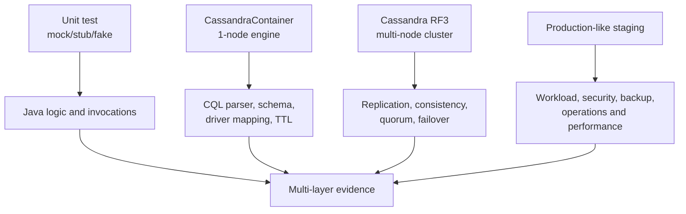
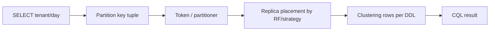
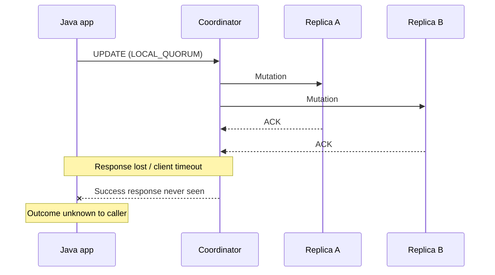
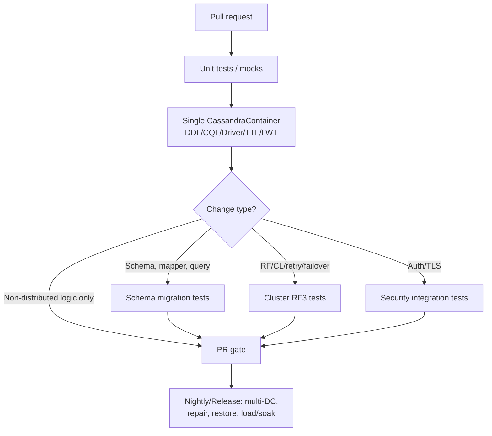

# Limitations of Mocks/Emulators and Evidence Required on the Real Engine

**Chapter:** Integration Testing  
**Module:** `DATABASE_ENGINE_WIDE_COLUMN_CASSANDRA` — Apache Cassandra

A Java unit test can configure Mockito to return `OrderState.PAID` from a repository. A green test proves the service **handles that mocked value as expected**, yet proves nothing about whether Cassandra has the matching table, whether the CQL `WHERE` clause is valid, whether the chosen primary key partitions properly, whether replicas acknowledged the write, or whether a timed-out request wrote nothing. When moving from mocks to the real database, those assumptions can shatter.

**Core lesson:** Before making any claim about Apache Cassandra, always ask **"which component produced the evidence?"**. A mock, fake, emulator, single `CassandraContainer`, and multi-node Cassandra cluster yield **different levels of evidence**; never use the convenience of one tier to claim behavior that only exists in another.

This lesson constructs a verification contract spanning business rules → CQL / wide-column modeling → Java Driver / Spring Data → real Cassandra → replication/consistency levels, repair, and operations. Examples use JUnit 5, Mockito, Testcontainers Java 2.x, Java Driver 4.x, CQL, and an isolated test-cluster blueprint.

> **Scope and safety:** Examples are based on Cassandra 4.1/5.x, Java Driver 4.x, JDK 17+, JUnit Jupiter, Testcontainers Java **2.x**, and compatible Spring Boot 3.x/4.x versions. Testcontainers **1.x packages/artifacts differ from 2.x**; Spring Boot APIs may vary across major releases. Never treat this lesson as a benchmark result or production cluster certification. Only exercise node failures, network partitions, repair, and backup/restore inside an **authorized isolated environment**, never against production data.

## 1. Learning Outcomes

After this lesson, you will be able to:

1. Distinguish **mocks, stubs, fakes, in-memory emulators, CQL-compatible engines**, and **real Apache Cassandra**.
2. Formulate a testable claim: **claim → assumptions → environment → assertion → evidence → limitations**.
3. Decide when unit tests suffice versus when the real Cassandra engine is mandatory.
4. Explain why mocks never validate CQL grammar, partitioning/clustering, TTLs, tombstones, LWTs, counters, or streaming.
5. Launch a `CassandraContainer` for JUnit 5, connect using dynamic endpoints/DCs, and run deterministic CQL schemas.
6. Write integration tests for valid/invalid queries, primary keys, clustering order, LWTs, TTLs, and stable event IDs.
7. Never confuse **a single-node RF=1 real Cassandra** with proof of `LOCAL_QUORUM` RF=3 or replica recovery.
8. Design test matrices covering RF/CL, hinted handoff, anti-entropy repair, failover, and multi-DC behavior.
9. Verify Spring Boot/Spring Data wiring using `@ServiceConnection` or `@DynamicPropertySource`.
10. Organize CI artifacts capturing versions, DDL, topology, logs, assertions, failure conditions, and traceability.
11. Recognize negative evidence: rejected queries, fail-closed invalid CLs, and contract-enforced duplicate blocking.
12. Identify missing evidence gaps when unit/container tests pass yet production suffers data divergence or performance bugs.

## 2. From Test Doubles to the Real Engine

### 2.1. Definitions and Boundaries

| Type | Nature | What it tests well | What it **never** proves alone |
| --- | --- | --- | --- |
| **Stub** | Returns canned values | Branching logic on fixed inputs | Whether the server actually returns those values |
| **Mock** | Stub asserting call counts/order | Interaction contracts | CQL validity, replica ACKs, timeout semantics |
| **Fake repository** | Lightweight implementation, e.g., `Map<UUID,Row>` | Domain logic, fast feedback | Tokens, timestamps, TTLs, paging, consistency |
| **CQL emulator** | Simulates a subset of CQL/protocol | Emulated features within documented scope | Full Apache Cassandra semantics |
| **Other CQL-compatible DB** | Separate DB implementing part of Cassandra's API | Compatibility with that engine | Exact Apache replication, repair, SSTables, and errors |
| **1-node `CassandraContainer`** | Real Apache Cassandra inside a container | CQL, codecs, schemas, basic TTLs/LWTs, paging | Multi-replica quorum, hints, inter-replica repair |
| **Test cluster ≥3 nodes** | Multiple Cassandra nodes sharing a ring | RF3, CL, failover, replica convergence | Every production workload condition |
| **Production-like staging** | Cassandra with similar topology, security, and load | SLOs, backup/restore, upgrades, operations | Proof against every future scenario |

**Never assume a "Cassandra emulator" guarantees full Apache Cassandra semantics.** Always inspect its documentation first: supported versions, CQL/type coverage, exception mapping, TTL/LWT/batch/consistency behavior, and known gaps. Passing on an emulator is **evidence about that emulator only**.

### 2.2. "Green Test" Is a Conditional Conclusion

```text
Claim: "The application reads the 20 latest events of the day."

Mock:
  when(repository.latest20(...)).thenReturn(expectedList)
  -> Only proves the method returns the supplied list.

Single-node Cassandra:
  Real INSERTs + SELECT by exact partition key
  -> Proves DDL, ordering, query, and driver fit at RF1.

Cassandra RF3:
  Lose one replica, then read at LOCAL_QUORUM
  -> Adds availability and CL evidence for that topology.

Production-like load:
  p99 stays under budget at 10k requests/s?
  -> Must be measured with representative config, data, and load.
```

These tiers **complement** rather than replace one another. Keep unit tests for isolated branching logic, engine tests for server contracts, and cluster tests for distributed behavior.

### 2.3. Evidence Boundary Diagram



An RF3 cluster testing a keyspace still configured with RF1 **never** exercises RF3 quorum. Every piece of evidence must explicitly bind to a **keyspace, RF/CL, and execution time**.

## 3. What Mocks Do Well — and Should Keep Doing

### 3.1. Good Uses for Mocks

- Skip repository calls when input lacks a tenant ID.
- Refuse database writes when the authorization gateway denies access.
- Preserve the stable event ID supplied by a trusted client.
- Transition an event to reconciliation-pending when the database layer reports `UnknownOutcome`.
- Choose **not to retry** counter increments or list appends.
- Map overload/unavailable errors to HTTP 503/429 per API contract.
- Drive state transitions in circuit breakers, backoff calculators, and admission controllers.

These branches live in **application logic** and require no CQL engine to prove.

### 3.2. JUnit + Mockito Example

```java
import static org.junit.jupiter.api.Assertions.assertEquals;
import static org.mockito.Mockito.*;

import java.util.UUID;
import org.junit.jupiter.api.Test;

record EventCommand(UUID eventId, String tenantId, String state) {}

interface EventWriter {
    void persist(EventCommand command);
}

final class EventService {
    private final EventWriter writer;

    EventService(EventWriter writer) {
        this.writer = writer;
    }

    UUID accept(EventCommand command) {
        if (command.tenantId() == null ||
            command.tenantId().isBlank()) {
            throw new IllegalArgumentException("tenantId required");
        }
        // Keep eventId; never generate a new ID on every attempt.
        writer.persist(command);
        return command.eventId();
    }
}

class EventServiceUnitTest {
    @Test
    void preservesStableEventIdAndDelegatesOnce() {
        EventWriter writer = mock(EventWriter.class);
        EventService service = new EventService(writer);

        UUID id = UUID.fromString(
            "10000000-0000-4000-8000-000000000011");
        EventCommand command =
            new EventCommand(id, "tenant-a", "CREATED");

        assertEquals(id, service.accept(command));
        verify(writer, times(1)).persist(command);
        verifyNoMoreInteractions(writer);
    }
}
```

This test proves the service **calls `writer` once on the exercised path** and preserves the event ID. It does **not** prove:

- `writer.persist` emits valid CQL.
- The table exists or uses a matching primary key.
- Cassandra ACKed the write at `LOCAL_QUORUM`.
- Two HTTP requests with the same event ID avoid duplicate side effects.
- Crashing after the write but before the ACK avoids duplicates on retry.
- Driver retries/speculative executions avoid multiple query executions.

Never report "events are stored exactly once in Cassandra" from this test. Report "`persist` was invoked once per service call."

### 3.3. A Fake `Map` Can Mask Invalid Access Patterns

```java
// Convenient fake that never checks the partition key:
Map<UUID, EventCommand> fakeDatabase = new HashMap<>();
fakeDatabase.put(command.eventId(), command);
EventCommand loaded = fakeDatabase.get(command.eventId());
```

If the real table defines `PRIMARY KEY ((tenant_id, bucket_day), event_ts, event_id)`, knowing only `event_id` is **not enough** to query that primary key directly. The fake succeeds immediately, whereas the real CQL query is rejected or demands expensive filtering—a false positive caused by an **implicit index in the fake** that Cassandra lacks.

## 4. Behaviors Mocks Cannot Verify

| Claim | Can mock/fake produce a false pass? | Minimum credible evidence |
| --- | --- | --- |
| Valid CQL syntax / existing columns | Yes | Real Cassandra prepare/execute |
| Query supplies full partition key | Fake looks up any field | Real Cassandra accepts/rejects |
| Clustering order matches DDL | Fake sorts in memory | Real Cassandra, single partition |
| Java codecs (`date`/`timestamp`/`uuid`) | Fake bypasses serialization | Java Driver + real server |
| TTL causes logical expiry | Fake runs its own clock | Real Cassandra + bounded polling |
| Tombstones physically compacted | No SSTables exist | Real engine + storage metrics |
| LWT `IF NOT EXISTS` / `[applied]` | Mock returns hardcoded boolean | Real Cassandra |
| Counter `+1` replay duplication | Fake can mis-model counters | Real Cassandra counter |
| List append creates duplicates | Fake might use a `Set` | Real Cassandra collection |
| Paging / multi-page results | Fake returns full `List` | Driver + real Cassandra |
| Batch partial failure | Mock `saveAll` | Real engine + cluster fault |
| `LOCAL_QUORUM` RF3 | Mock returns true | Verified-topology RF3 cluster |
| Hints / repair / streaming | Fake has no replicas | Multi-replica cluster + fault plan |
| DC locality and `EACH_QUORUM` | Fake has no DCs | Isolated multi-DC cluster |
| TLS / RBAC | Mock skips networking/auth | Real Cassandra with auth/TLS on |
| Upgrade compatibility | Fake has no SSTables/protocol | Real engine matrix across versions |
| p99 / throughput under load | Mock is artificially instant | Representative staging/load test |
| Data restore | Fake has no commitlog/disk | Real engine backup/restore |

**Returning identical data does not imply identical semantics.** Cassandra relies on timestamp reconciliation, partition tokens, RF/CL, LSM/SSTables, commitlogs, tombstones, and repair—none of which a `Map` models faithfully.

## 5. Define Evidence Before Writing the Test

### 5.1. Claim–Evidence Contract

```text
CLAIM_ID:
BUSINESS_REQUIREMENT:
CQL_SCHEMA_AND_QUERY:
ASSUMPTIONS:
MINIMUM_ENVIRONMENT:
ASSERTION_OR_ORACLE:
ARTIFACTS_TO_SAVE:
KNOWN_LIMITATIONS:
FAILURE_MODE_UNDER_TEST:
OWNER:
```

Example:

```text
CLAIM_ID: CQL-ORDER-01
BUSINESS_REQUIREMENT: 20 latest events for a tenant/day
CQL_SCHEMA_AND_QUERY:
  PRIMARY KEY ((tenant_id,bucket_day),event_ts,event_id)
  CLUSTERING ORDER BY (event_ts DESC,event_id ASC)
ASSUMPTIONS: Single partition, no competing writers
MINIMUM_ENVIRONMENT: Real Cassandra engine; 1 node suffices
ASSERTION_OR_ORACLE:
  insert events with fixed event_ts values
  SELECT with full partition key
  assert order and row count against timestamps
ARTIFACTS_TO_SAVE: DDL, CQL parameters, test report, server version
KNOWN_LIMITATIONS: Does not prove quorum or production p99
FAILURE_MODE_UNDER_TEST: Query missing partition component is rejected
OWNER: data-access team
```

### 5.2. Oracles Independent of the Code Under Test

A *test oracle* establishes the **ground-truth expected result**:

- Never use `repository.findById` both to construct expected values and fetch actuals.
- A mock returning expected outputs never proves the server produces them.
- For clustering order, seed fixed `Instant` values and derive expected order from DDL—never sort `actual` before asserting.
- For partition keys, deliberately omit `bucket_day` and assert the engine rejects it.
- For LWT, assert `[applied]` and row state on a second attempt—never equate "no exception" with conditional success.
- For RF3, verify live replica counts and keyspace replication metadata before asserting CL guarantees.

### 5.3. Why Negative Tests Matter

```text
Positive test:
  SELECT with tenant_id and bucket_day -> returns rows.

Negative test:
  SELECT with tenant_id but missing bucket_day
  -> engine rejects without silently adding ALLOW FILTERING.
```

If a negative test unexpectedly passes, investigate schema, indexes, `ALLOW FILTERING`, queries, or version changes—never relax expected behavior just to turn CI green.

## 6. Why H2, SQLite, or "CQL Compatible" Is Not Enough

### 6.1. Wide-Column Layout and Replica Placement



An SQL table with `PRIMARY KEY` and `ORDER BY` models none of Cassandra's network topology, SSTables, consistency rules, tombstones, or repair.

### 6.2. Common False Positives

- Fake looks up by `event_id` even though the Cassandra query lacks the partition key.
- Fake sorts by `payload` when the Cassandra table has no clustering column on `payload`.
- Fake permits in-place `PRIMARY KEY` updates like SQL.
- Fake evaluates TTLs via the JVM clock rather than server mutation semantics.
- Fake models counters as plain integers supporting `SET hits=10` instead of Cassandra deltas.
- Fake treats batches as globally rollbackable SQL transactions.
- Fake omits timestamp reconciliation under concurrent writers.
- Fake uses a `Set` instead of a list, erasing duplicates.
- Fake ignores tombstones, compaction, and read amplification.
- Fake ignores CL, returning success when only one replica remains.

A **different database** supporting the Cassandra native protocol can test compatibility with **that database**, not Apache Cassandra's internode protocol, storage formats, or repair behavior.

## 7. Choosing Minimum Environments by Risk

| Test | Unit/mock | 1-node Cassandra | RF3 cluster | Prod-like staging |
| --- | :---: | :---: | :---: | :---: |
| Validate DTOs and branching logic | ✓ | Unnecessary | Unnecessary | Unnecessary |
| CQL grammar / query restrictions | Insufficient | **✓** | Optional | Optional |
| Spring Data mapping / repository | Insufficient | **✓** | Optional | Optional |
| Logical TTL expiry | Insufficient | **✓** | Optional | Optional |
| Simple conditional LWT | Insufficient | **✓** | Optional | Optional |
| Paging / codecs / UDTs | Insufficient | **✓** | Optional | Optional |
| RF3 quorum intersection | No | No | **✓** | **✓** |
| LWT during replica outage | No | No | **✓** | Optional |
| Hinted handoff / repair | No | No | **✓** | Optional |
| `EACH_QUORUM` / DC locality | No | No | Multi-DC only | **✓** if multi-DC |
| Compaction benchmark | No | Insufficient | Unlikely | **✓** if representative |
| TLS / RBAC | No | Yes if enabled | Yes, needs internode | **✓** |
| Backup and restore | No | Smoke only | Better | **✓** per runbook |
| Rolling upgrade | No | Insufficient | **✓** on supported path | **✓** |

A checkmark ✓ only indicates **the environment can produce valid evidence**—starting a container alone proves nothing. Performance SLOs still demand representative workloads and hardware, and staging remains an approximation of production.

**RF is a keyspace property**, not a container count. Three separate Cassandra processes form three single-node clusters unless seeds, networking, and snitch are shared. Even in a three-node ring, an RF1 keyspace still stores one replica per partition. Under RF1, `LOCAL_QUORUM` needs **one ACK**; under single-DC RF3, `LOCAL_QUORUM` needs **two ACKs**.

## 8. Lab: Schema as the Source of Truth

### 8.1. Conditions and Scope

Use **real** Cassandra in one container with one DC assumed to be `datacenter1` and RF1. This lab **does not yet** test node failures or multi-node quorum. If your image uses a different DC name, align the script or container configuration; never assume every distribution names the default DC identically.

Requirements: JDK 17+, Maven/Gradle, JUnit Jupiter, Java Driver 4.x, sufficient Docker/container resources, pinned image tags/digests, and synthetic test data. Never connect to production keyspaces. Allocate unique keys per test; avoid `TRUNCATE` in parallel suites.

### 8.2. Illustrative CQL Init File

In a real project, place this script on the **classpath at `src/test/resources/cql/evidence-schema.cql`**. This Markdown lesson supplies instructions only and **does not generate auxiliary files**.

```sql
CREATE KEYSPACE IF NOT EXISTS it_evidence
WITH replication = {
    'class': 'NetworkTopologyStrategy',
    'datacenter1': 1
}
AND durable_writes = true;

CREATE TABLE IF NOT EXISTS it_evidence.events_by_tenant_day (
    tenant_id text,
    bucket_day date,
    event_ts timestamp,
    event_id uuid,
    kind text,
    payload text,
    PRIMARY KEY ((tenant_id, bucket_day), event_ts, event_id)
) WITH CLUSTERING ORDER BY (event_ts DESC, event_id ASC);

CREATE TABLE IF NOT EXISTS it_evidence.actions_by_id (
    action_id uuid PRIMARY KEY,
    state text,
    version int
);

CREATE TABLE IF NOT EXISTS it_evidence.expiry_by_id (
    item_id uuid PRIMARY KEY,
    ephemeral_value text
);

CREATE TABLE IF NOT EXISTS it_evidence.metrics_by_name (
    metric_name text PRIMARY KEY,
    hits counter
);

CREATE TABLE IF NOT EXISTS it_evidence.history_by_id (
    history_id uuid PRIMARY KEY,
    entries list<text>
);
```

Explanation:

- `(tenant_id,bucket_day)` is the **composite partition key**, hashed to determine tokens/replicas.
- `event_ts` and `event_id` are clustering columns; default partition order is timestamp DESC, event ID ASC.
- `actions_by_id` tests LWT `IF NOT EXISTS`.
- `expiry_by_id` tests TTLs; never mix TTLs into counter tables.
- `metrics_by_name` holds strictly the PK and `counter` column with no ordinary non-PK columns.
- `history_by_id` demonstrates list-append duplicates on replay; keep lab collections tiny.

**Do not turn one table into universal storage:** if you need lookup by `event_id` alone, model a dedicated table for that query instead of scanning/filtering across partitions.

### 8.3. Inspecting Server Schema Metadata

```sql
SELECT column_name, kind, position, clustering_order, type
FROM system_schema.columns
WHERE keyspace_name = 'it_evidence'
  AND table_name = 'events_by_tenant_day';
```

Expect `partition_key` rows containing `tenant_id` and `bucket_day`, and `clustering` rows containing `event_ts` and `event_id` with matching ordering. Notice `position` restarts at 0 per kind rather than matching a single flat Java `ordinal` across the entire key.

## 9. Testcontainers 2.x: Launching the Real Cassandra Engine

### 9.1. Dependencies and Version Alignment

Testcontainers 2.0.x documentation specifies:

```xml
<!-- Maven example: use only when the whole project targets Testcontainers 2.x. -->
<dependency>
    <groupId>org.testcontainers</groupId>
    <artifactId>testcontainers-cassandra</artifactId>
    <version>2.0.5</version>
    <scope>test</scope>
</dependency>

<dependency>
    <groupId>org.testcontainers</groupId>
    <artifactId>testcontainers-junit-jupiter</artifactId>
    <version>2.0.5</version>
    <scope>test</scope>
</dependency>
```

In Testcontainers **1.x**, coordinates are `org.testcontainers:cassandra` and `org.testcontainers:junit-jupiter`, with `CassandraContainer` in `org.testcontainers.containers`. In **2.x**, import `org.testcontainers.cassandra.CassandraContainer`. Align with your Spring Boot BOM and dependency tree; never mix 1.x and 2.x modules. Include JUnit, Mockito, and Awaitility test dependencies if not using `spring-boot-starter-test`.

### 9.2. One Container, One Session per Test Class

```java
import com.datastax.oss.driver.api.core.CqlSession;
import org.junit.jupiter.api.AfterAll;
import org.junit.jupiter.api.BeforeAll;
import org.junit.jupiter.api.Test;
import org.testcontainers.cassandra.CassandraContainer;
import org.testcontainers.junit.jupiter.Container;
import org.testcontainers.junit.jupiter.Testcontainers;

import static org.junit.jupiter.api.Assertions.*;

@Testcontainers
class CassandraEvidenceIT {

    @Container
    static final CassandraContainer CASSANDRA =
        new CassandraContainer("cassandra:4.1.3")
            .withInitScript("cql/evidence-schema.cql");

    private static CqlSession session;

    @BeforeAll
    static void connect() {
        // Static @Container has already been started by the extension.
        session = CqlSession.builder()
            .addContactPoint(CASSANDRA.getContactPoint())
            .withLocalDatacenter(CASSANDRA.getLocalDatacenter())
            .build();
    }

    @AfterAll
    static void disconnect() {
        if (session != null) {
            session.close();
        }
    }

    @Test
    void connectsToRealEngine() {
        var row = session.execute(
            "SELECT release_version, data_center, cluster_name " +
            "FROM system.local"
        ).one();

        assertNotNull(row);
        assertNotNull(row.getString("release_version"));
        assertEquals(CASSANDRA.getLocalDatacenter(),
            row.getString("data_center"));
    }
}
```

This is a **skeleton class**; subsequent test methods belong inside it with merged imports. `withInitScript` works only when `cql/evidence-schema.cql` sits on the test classpath. `getContactPoint()`/`getLocalDatacenter()` avoid hardcoded endpoints/DCs. Container port `9042` maps to a dynamic host port, and remote Docker hosts may not be `localhost`.

### 9.3. Readiness ≠ Container Running

Cassandra must bootstrap, reach schema agreement, and open the CQL native transport. A running Docker container does not guarantee CQL readiness. The Cassandra module includes readiness checks; when startup fails, inspect container logs to distinguish Docker daemon outages, image pull failures, insufficient CPU/RAM, mismatched seed/DC configs, and slow server startup. Never use a fixed `Thread.sleep(60_000)` to mask readiness issues.

### 9.4. JUnit Lifecycle Management

`@Container static` is shared across test methods in **one class** and stopped afterward. The Testcontainers JUnit extension targets sequential execution; parallelizing within the same shared state risks interference. Never call `CASSANDRA.stop()` in `@AfterEach`, and match `CqlSession` lifetime to the container rather than opening a new session per CQL query.

## 10. Real Tests: Partitioning, Clustering, and Invalid Queries

### 10.1. Positive Test With Deterministic Data

This `@Test` belongs inside `CassandraEvidenceIT`:

```java
import com.datastax.oss.driver.api.core.DefaultConsistencyLevel;
import com.datastax.oss.driver.api.core.cql.PreparedStatement;
import com.datastax.oss.driver.api.core.cql.Row;
import com.datastax.oss.driver.api.core.data.CqlDate;

import java.time.Instant;
import java.time.LocalDate;
import java.util.ArrayList;
import java.util.List;
import java.util.UUID;

@Test
void readsEventsInClusteringOrder() {
    String tenant = "it-" + UUID.randomUUID();
    CqlDate day = CqlDate.fromDaysSinceEpoch(
        (int) LocalDate.of(2026, 11, 21).toEpochDay());

    Instant firstTs = Instant.parse("2026-11-21T10:00:00Z");
    Instant lastTs = Instant.parse("2026-11-21T10:05:00Z");
    UUID firstId = UUID.randomUUID();
    UUID lastId = UUID.randomUUID();

    PreparedStatement insert = session.prepare(
        "INSERT INTO it_evidence.events_by_tenant_day " +
        "(tenant_id,bucket_day,event_ts,event_id,kind,payload) " +
        "VALUES (?,?,?,?,?,?)"
    );

    session.execute(insert.bind(
        tenant, day, firstTs, firstId, "OPEN", "home"
    ).setConsistencyLevel(DefaultConsistencyLevel.ONE)
     .setIdempotent(true));

    session.execute(insert.bind(
        tenant, day, lastTs, lastId, "CLICK", "item"
    ).setConsistencyLevel(DefaultConsistencyLevel.ONE)
     .setIdempotent(true));

    PreparedStatement select = session.prepare(
        "SELECT event_ts,event_id,kind " +
        "FROM it_evidence.events_by_tenant_day " +
        "WHERE tenant_id=? AND bucket_day=? LIMIT 20"
    );

    List<Row> rows = new ArrayList<>();
    session.execute(select.bind(tenant, day)).forEach(rows::add);

    assertEquals(2, rows.size());
    assertEquals(lastTs, rows.get(0).getInstant("event_ts"));
    assertEquals(lastId, rows.get(0).getUuid("event_id"));
    assertEquals(firstTs, rows.get(1).getInstant("event_ts"));
    assertEquals(firstId, rows.get(1).getUuid("event_id"));
}
```

Expected order comes directly from DDL `event_ts DESC` and the seeded timestamps—never sort `rows` before asserting. Unique tenants isolate tests. Evidence applies strictly to this query, partition, and row volume at RF1—not production p99 or global ordering.

### 10.2. Negative Test: Missing Composite Partition Component

```java
import com.datastax.oss.driver.api.core.servererrors.InvalidQueryException;

@Test
void rejectsQueryMissingCompositePartitionComponent() {
    assertThrows(InvalidQueryException.class, () -> {
        // Missing bucket_day; no ALLOW FILTERING or secondary index.
        session.execute(
            "SELECT event_id FROM it_evidence.events_by_tenant_day " +
            "WHERE tenant_id = 'tenant-a'");
    });
}
```

Fakes commonly return rows for `tenant_id` alone because they index arbitrarily in memory. The real engine requires the **complete composite partition key** for direct partition routing. Never patch a failing test by adding `ALLOW FILTERING`.

Exact exception classes/messages can vary across wrappers/versions; when using Spring Data, inspect both wrapper and root exceptions rather than asserting brittle release-specific English error strings.

### 10.3. Stable Event IDs and Duplicate Rows

```java
@Test
void replaySameEventKeepsOneLogicalRow() {
    String tenant = "dedupe-" + UUID.randomUUID();
    CqlDate day = CqlDate.fromDaysSinceEpoch(
        (int) LocalDate.of(2026, 11, 21).toEpochDay());
    Instant ts = Instant.parse("2026-11-21T08:00:00Z");
    UUID eventId = UUID.randomUUID(); // generated once

    var insert = session.prepare(
        "INSERT INTO it_evidence.events_by_tenant_day " +
        "(tenant_id,bucket_day,event_ts,event_id,kind,payload) " +
        "VALUES (?,?,?,?,?,?)"
    );
    var statement = insert.bind(
        tenant, day, ts, eventId, "CLICK", "item-7"
    ).setIdempotent(true);

    session.execute(statement);
    session.execute(statement); // intentional replay — LAB ONLY

    var read = session.prepare(
        "SELECT event_id FROM it_evidence.events_by_tenant_day " +
        "WHERE tenant_id=? AND bucket_day=?"
    );

    int count = 0;
    for (var row : session.execute(read.bind(tenant, day))) {
        count++;
        assertEquals(eventId, row.getUuid("event_id"));
    }
    assertEquals(1, count);
}
```

Two writes sharing the **exact full PK** and fixed payload yield **one logical row**. Never extrapolate from this that email/payment/Kafka effects are automatically exactly-once, or that replays with altered TTLs/timestamps behave identically. Calling `UUID.randomUUID()` on every attempt changes the PK and creates duplicate logical rows.

## 11. Real Tests: LWT and Conditional Outcomes

### 11.1. `IF NOT EXISTS` on the Real Cassandra Engine

```java
@Test
void conditionalInsertRejectsReusedActionId() {
    UUID actionId = UUID.randomUUID();

    var insert = session.prepare(
        "INSERT INTO it_evidence.actions_by_id " +
        "(action_id,state,version) VALUES (?,?,?) IF NOT EXISTS"
    );

    var first = session.execute(
        insert.bind(actionId, "CREATED", 1)).one();
    assertNotNull(first);
    assertTrue(first.getBoolean("[applied]"));

    var second = session.execute(
        insert.bind(actionId, "CREATED", 1)).one();
    assertNotNull(second);
    assertFalse(second.getBoolean("[applied]"));

    var read = session.prepare(
        "SELECT state,version FROM it_evidence.actions_by_id " +
        "WHERE action_id=?"
    );

    var stored = session.execute(read.bind(actionId)).one();
    assertNotNull(stored);
    assertEquals("CREATED", stored.getString("state"));
    assertEquals(1, stored.getInt("version"));
}
```

This yields **real Cassandra engine evidence** for `IF NOT EXISTS`, `[applied]`, and single-row state in a healthy lab.

### 11.2. What Remains Unproven

- How LWT tolerates losing one of three replicas under RF3.
- Paxos/CAS behavior when many writers actively contend.
- Real-load LWT latency under production consistency/serial CL settings.
- Whether a timed-out LWT actually applied before the response dropped.
- Whether an LWT on this row is atomic with payments, emails, or other tables.

Those claims require multi-replica topologies, concurrent contention / fault injection, and independent sources of truth.

## 12. Real Tests: TTLs and the Logical/Physical Boundary

### 12.1. Avoid Fixed Sleeps

```java
// FLAKY ANTI-PATTERN:
Thread.sleep(3000);
assertNull(session.execute(read).one());
```

TTLs follow server mutation timestamps while CI introduces variable scheduling/GC delays. Prefer **bounded polling** (e.g., via Awaitility):

```java
import static org.awaitility.Awaitility.await;
import java.time.Duration;

@Test
void ttlEventuallyMakesValueInvisible() {
    UUID id = UUID.randomUUID();

    var insert = session.prepare(
        "INSERT INTO it_evidence.expiry_by_id " +
        "(item_id,ephemeral_value) VALUES (?,?) USING TTL 3"
    );
    session.execute(insert.bind(id, "temporary"));

    var read = session.prepare(
        "SELECT ephemeral_value FROM it_evidence.expiry_by_id " +
        "WHERE item_id=?"
    );

    await()
        .pollInterval(Duration.ofMillis(200))
        .atMost(Duration.ofSeconds(20))
        .until(() ->
            session.execute(read.bind(id)).one() == null);
}
```

This proves only **logical expiry on read**. It does not prove tombstones have been compacted out of SSTables, disk space reclaimed, or `gc_grace_seconds` safely lowered. Storage claims require dedicated compaction/metrics tests.

### 12.2. TTLs and Retries

Replaying an `INSERT/UPDATE USING TTL` shifts the cell's expiration deadline. Two writes producing the same current value are **not** equivalent if business contracts govern retention or freshness—something a naive fake clock can miss or misimplement.

## 13. Real Tests: Counters and List Appends

### 13.1. Counters Are Non-Idempotent

```sql
-- Execute LAB ONLY on an unused metric_name.
UPDATE it_evidence.metrics_by_name
SET hits = hits + 1
WHERE metric_name = 'it-run-unique-metric';

UPDATE it_evidence.metrics_by_name
SET hits = hits + 1
WHERE metric_name = 'it-run-unique-metric';

SELECT hits FROM it_evidence.metrics_by_name
WHERE metric_name = 'it-run-unique-metric';
```

With a fresh counter key and two completed increments, the counter reaches 2. Automated tests must generate a unique `metric_name` per run to avoid stale state—never reset a counter via `DELETE` and reuse the key expecting ordinary integer semantics.

### 13.2. List Appends Create Duplicates

```sql
INSERT INTO it_evidence.history_by_id (history_id, entries)
VALUES (
    10000000-0000-4000-8000-000000000021,
    ['created']
);

UPDATE it_evidence.history_by_id
SET entries = entries + ['paid']
WHERE history_id =
    10000000-0000-4000-8000-000000000021;

UPDATE it_evidence.history_by_id
SET entries = entries + ['paid']
WHERE history_id =
    10000000-0000-4000-8000-000000000021;

SELECT entries FROM it_evidence.history_by_id
WHERE history_id =
    10000000-0000-4000-8000-000000000021;
```

The list holds `['created','paid','paid']`. A fake backed by `Set<String>` silently drops duplicates and masks the bug. For unbounded event histories, store rows in an event table keyed by stable event IDs rather than appending endlessly to a list column.

### 13.3. Post-Timeout Retry Behavior Cannot Be Proven by a Boolean Mock

`WriteTimeoutException` / `DriverTimeoutException` can occur **after enough or some replicas applied the mutation**. Therefore:

- `counter + 1` and list appends must never be blindly retried.
- `setIdempotent(true)` does not magically make deltas/appends idempotent.
- Carry stable event/request IDs across attempts.
- Handle unknown outcomes with reconciliation/authoritative facts whenever accuracy matters.
- Deliberate double-send tests prove non-idempotence, yet **do not cover every real cluster timeout timing**.

## 14. Paging, Async, and Reactive Paths Need the Engine Too

### 14.1. Paging Must Traverse Multiple Pages

A mock returning a 50-item `List<Row>` triggers zero page fetches. Integration tests should insert enough rows **inside one partition**, set `pageSize=2`, iterate every page, and assert exact IDs, ordering, and zero duplicates.

```java
import com.datastax.oss.driver.api.core.cql.SimpleStatement;

// Assumes test already inserted 5 rows with distinct PKs for tenant/day:
var query = SimpleStatement.builder(
    "SELECT event_ts,event_id FROM it_evidence.events_by_tenant_day " +
    "WHERE tenant_id=? AND bucket_day=?")
    .addPositionalValues(tenant, day)
    .setPageSize(2)
    .build();

int count = 0;
for (var row : session.execute(query)) {
    count++;
}
assertEquals(5, count);
```

This **fragment** assumes `tenant`, `day`, and five `INSERT`s exist in the same test method. `pageSize` is a fetch hint, not a strict contract that every page carries two rows. Avoid unbounded full-keyspace scans just to force paging.

### 14.2. Async and Reactive Boundaries

- **Unit tests:** subscriber cancellation, timeout mapping, retry decisions, and app-pipeline backpressure.
- **Single-node engine:** `executeAsync` `CompletionStage` behavior, `executeReactive` page publishers, codecs, and real exception propagation.
- **Multi-node cluster:** coordinator switching, retries, speculative executions, and timeouts under slow/down replicas.
- **Load/staging:** in-flight counts, throttler queues, memory/GC, and p99 under representative producer rates.

Cancelling a future or subscriber **does not roll back a write already sent to the server**. Never treat async/reactive wrappers as changing CQL semantics or granting exactly-once delivery.

## 15. Spring Boot and Spring Data: Testing Real Wiring

### 15.1. Mocked Repositories Do Not Test Mapping

Using `@MockBean` (in some Spring Boot 3.x setups) or `@MockitoBean` (in supporting Spring Framework/Boot versions) replaces the real repository with a mock. Consequently:

- `@PrimaryKey`, `@PrimaryKeyClass`, and `@PrimaryKeyColumn` may never be exercised by the mapper.
- Wrong keyspace/table/column names still pass.
- Broken derived query methods never execute CQL.
- `CassandraTemplate`/Driver sends zero queries to the server.
- `@Query` lacking a partition predicate still returns mocked rows.

To verify mapping, pair **real Spring repositories/templates** with **real Cassandra** and an independent raw-CQL check—never use the repository under test to supply both expected and actuals.

### 15.2. Using `@ServiceConnection` on Supported Spring Boot Versions

With `spring-boot-testcontainers` and a Boot version supporting `CassandraConnectionDetails`:

```java
import org.junit.jupiter.api.Test;
import org.springframework.beans.factory.annotation.Autowired;
import org.springframework.boot.test.context.SpringBootTest;
import org.springframework.boot.testcontainers.service.connection.ServiceConnection;
import org.testcontainers.cassandra.CassandraContainer;
import org.testcontainers.junit.jupiter.Container;
import org.testcontainers.junit.jupiter.Testcontainers;
import com.datastax.oss.driver.api.core.CqlSession;

import static org.junit.jupiter.api.Assertions.*;

@SpringBootTest
@Testcontainers
class SpringCassandraEvidenceIT {

    @Container
    @ServiceConnection
    static final CassandraContainer CASSANDRA =
        new CassandraContainer("cassandra:4.1.3")
            .withInitScript("cql/evidence-schema.cql");

    @Autowired
    CqlSession session;

    @Test
    void bootConnectsToRealCassandra() {
        var row = session.execute(
            "SELECT release_version FROM system.local").one();
        assertNotNull(row);
    }
}
```

Test profile:

```yaml
spring:
  cassandra:
    keyspace-name: it_evidence
    schema-action: none
```

**`@ServiceConnection` supplies connection details**, not keyspaces or tables; use `withInitScript` or migrations for schema. With Testcontainers 2.x, verify your Boot BOM supports the new package names and compatible driver. Never enable `schema-action: recreate` on shared clusters.

### 15.3. `@DynamicPropertySource` as an Alternative

When not using a service-connection factory or needing explicit property control:

```java
import org.springframework.test.context.DynamicPropertyRegistry;
import org.springframework.test.context.DynamicPropertySource;

// Inside a @SpringBootTest class with static container CASSANDRA:
@DynamicPropertySource
static void cassandraProps(DynamicPropertyRegistry registry) {
    registry.add("spring.cassandra.contact-points",
        () -> CASSANDRA.getHost() + ":" +
              CASSANDRA.getMappedPort(9042));
    registry.add("spring.cassandra.local-datacenter",
        CASSANDRA::getLocalDatacenter);
    registry.add("spring.cassandra.keyspace-name",
        () -> "it_evidence");
    registry.add("spring.cassandra.schema-action",
        () -> "none");
}
```

This **fragment** goes inside the test class rather than a standalone file. Avoid casually combining `@ServiceConnection` and `@DynamicPropertySource` without understanding connection-detail precedence.

### 15.4. Essential Mapping Assertions

| Mapping claim | Evidence |
| --- | --- |
| `@Table` targets the right table | Save via real repository; read back via raw CQL |
| Full composite PK matches | Cross-check Java entity fields against `system_schema.columns` |
| Clustering order matches | `INSERT` fixed timestamps; check repository `SELECT` order |
| Java CQL codecs work | Round-trip `LocalDate`/`Instant`/`UUID` |
| `@PrimaryKeyClass` identity works | Query `findById` with full key class |
| `@Query` is valid | Execute against real server plus negative tests |
| Conditional LWT works | Assert `[applied]`, not merely error-free save |
| Schema migrations succeed | Apply versioned DDL and test before/after |
| Exception handling aligns | Map and classify root driver exception types |

**Spring context caching:** A cached `@SpringBootTest` context can outlive one test class's static `@Container`. If the context is reused after the previous container stopped, `CqlSession` points at a dead endpoint. Align container and context lifetimes or isolate contexts per Boot/Testcontainers guidance—never open a fresh session per HTTP request as a "fix."

## 16. Real Consistency Evidence Requires Multiple Replicas

### 16.1. RF1 Never Proves Multi-Replica Quorum

For keyspace `NetworkTopologyStrategy {'datacenter1': 1}`:

\[
LOCAL\_QUORUM = \left\lfloor \frac{1}{2}\right\rfloor+1 = 1
\]

Reads and writes at `LOCAL_QUORUM` succeed on a single `CassandraContainer` with just one replica. That **never** proves the app survives losing a node or achieves read/write quorum intersection under RF3.

In a single DC with RF3:

\[
LOCAL\_QUORUM = \left\lfloor \frac{3}{2}\right\rfloor+1 = 2
\]

If writes wait for W=2 and reads wait for R=2 on the same replica set:

\[
W+R=4>RF=3
\]

The two response sets overlap, supporting read-after-write under Cassandra's assumptions regarding timestamps, ordering, and absence of conflicting concurrent writers. **Never infer general linearizability or ACID transactions** from this inequality alone.

### 16.2. RF3 Matrix

| Replica health | `ONE` | `LOCAL_QUORUM` | `ALL` |
| --- | --- | --- | --- |
| 3/3 healthy | May succeed | May succeed | May succeed |
| 2/3 healthy | May succeed | May succeed | Insufficient |
| 1/3 healthy | May succeed | Insufficient | Insufficient |
| 0/3 healthy | Fails | Fails | Fails |

"May succeed" does not guarantee every query works while nodes report Up: coordinator routing, network partitions, schema disagreement, disk/GC stalls, and timeouts still intervene.

### 16.3. Setting Up an RF3 Keyspace Properly

Only on a **disposable three-node cluster in the same ring** inside DC `dc1`:

```sql
CREATE KEYSPACE IF NOT EXISTS it_evidence_rf3
WITH replication = {
    'class': 'NetworkTopologyStrategy',
    'dc1': 3
}
AND durable_writes = true;

CREATE TABLE IF NOT EXISTS it_evidence_rf3.state_by_id (
    id uuid PRIMARY KEY,
    state text,
    changed_at timestamp
);
```

On the cluster nodes:

```bash
nodetool status
nodetool describecluster
nodetool netstats
```

Mandatory preflight checks:

- Single cluster name with three distinct host IDs.
- All nodes in expected DC/rack with `UN` status.
- Correct token ownership/replica placement; RF3 on `dc1`.
- Stable schema agreement after DDL.
- Healthy CPU/RAM/disk/network with no stalled bootstrap/repair.
- Java contact points strictly targeting the lab, never production.
- Baseline writes ACKed at required CL prior to fault injection.

Three independently started `CassandraContainer`s **do not automatically form a cluster**; you must wire shared networking, seeds, gossip, and snitch and await full bootstrap.

### 16.4. Single-Node Outage Test

1. Write a baseline at `CONSISTENCY ALL` with all three replicas healthy.
2. Stop node C inside the authorized **disposable cluster**.
3. Wait for A/B to detect C Down; confirm via `nodetool status`.
4. Read/write at `LOCAL_QUORUM` on a fresh test partition; the two live replicas should satisfy quorum.
5. Attempt `ALL`; it must fail due to the missing replica.
6. Recover node C and observe hints, logs, `netstats`, and repair requirements.
7. Verify consistency across coordinators and appropriate CLs.
8. Tear down faults and save topology/exception artifacts.

```text
EXPECTED:
  keyspace NTS dc1:3, 3 healthy nodes initially
  node C Down
  LOCAL_QUORUM: can succeed via A+B
  ALL: fails for lack of 3 ACKs
  node C Up: convergence must still be verified

NOT PROVEN:
  ONE reads are always stale
  Write timeout means zero side effects
  Node C holds every mutation the instant it reports UN
```

Never fabricate divergence by deleting SSTables/commitlogs or tampering with `system.local`. Plan repair tests carefully around downtime windows, token ranges, and cleanup.

### 16.5. Multi-DC Claims Need Real Topology

With `NTS {'dc1':3,'dc2':3}` (total RF6), `LOCAL_QUORUM` in `dc1` needs 2 local replicas, `QUORUM` needs 4 across the cluster, and `EACH_QUORUM` writes need quorum in every DC. Mocks or a single node labeled per DC cannot prove locality, data residency, failover, or cross-DC streaming.

Multi-DC tests must verify:

- Real nodes placed in accurate DCs/racks.
- Driver `withLocalDatacenter("dc1")` and load-balancing policies.
- Read/write outcomes when `dc2` loses quorum.
- Routing and replication visibility after network healing.
- Internode security, schema agreement, and repair schedules.
- Whether the business contract forbids cross-DC fallback.

## 17. Negative Evidence: What the System **Must Reject**

### 17.1. When CL Fails, Never Fake Success

Anti-pattern:

```text
try write LOCAL_QUORUM
if unavailable:
    retry write ONE
return HTTP 200 "committed"
```

A mock can easily make that fallback branch pass, yet it never proves a quorum write ACK. For contracts requiring durability or read-after-write guarantees, cluster tests must verify **CL is never silently downgraded** when only one replica survives.

Java Driver 4.x offers distinct retry policies: `DefaultRetryPolicy` does not downgrade CL automatically the way certain legacy/optional policies might. Inspect effective config, custom `RetryPolicy` hooks, statement idempotence, gateway/job retries, and metrics—never glance at `setConsistencyLevel(LOCAL_QUORUM)` and assume every returned success upheld that CL.

### 17.2. Reject Queries Violating the Data Model

Negative CQL example:

```sql
-- Expected to be rejected without an index or ALLOW FILTERING:
SELECT event_id
FROM it_evidence.events_by_tenant_day
WHERE event_id =
  10000000-0000-4000-8000-000000000041;
```

`event_id` is the trailing clustering column; the query omits partition keys `tenant_id, bucket_day`. Fakes commonly permit UUID lookups, hiding broken query-driven modeling.

### 17.3. Additional Valuable Negative Tests

- `INSERT` missing a PK column → rejected by CQL server.
- Wrong column name in CQL → server returns invalid query.
- LWT `IF version=1` when version already advanced → `[applied]=false` (not a network error).
- Insufficient replicas for `ALL` → must not return CL-compliant success.
- Invalid auth/certificates → client access denied.
- Timed-out non-idempotent mutation → service emits `UNKNOWN_OUTCOME` instead of blindly retrying.
- Final page traversal → fetch logic never duplicates rows.
- Missing schema migrations → app fails fast instead of auto-recreating ad-hoc tables.
- Load exceeding admission capacity → returns 429/503 or defers per contract without infinite retries.

**A mock throwing developer-invented exceptions proves only local branch handling**, never that real Cassandra throws those exact exceptions under real conditions.

## 18. Real Failures Differ From Mocked Exceptions

### 18.1. Classify by Failure Origin

```java
// Unit test — tests only local service error-branch handling:
when(repository.save(any()))
    .thenThrow(new RuntimeException("simulated timeout"));
```

That statement reproduces neither coordinator-side `WriteTimeoutException` nor client-side `DriverTimeoutException` under Cassandra semantics. Core errors include:

| Error | Origin / meaning | Evidence required |
| --- | --- | --- |
| `InvalidQueryException` | Server CQL parsing/validation failure | Single `CassandraContainer` suffices |
| `UnavailableException` | Coordinator lacks live replicas for CL | Real RF/CL cluster |
| `ReadTimeoutException` | Server read lacked enough replica responses | Cluster + fault plan |
| `WriteTimeoutException` | Write lacked enough ACKs in time | Cluster + fault plan; outcome ambiguous |
| `DriverTimeoutException` | Client deadline elapsed (may include throttling wait) | Driver/session load/fault setup |
| `AllNodesFailedException` | No node succeeded along query plan | Detailed per-node/connection errors |
| `RequestThrottlingException` | Driver throttler queue/concurrency full | Load test + driver metrics |
| `[applied]=false` | LWT condition unmet (not an exception) | Real engine |

You don't need to trigger every failure on every PR; isolate fault suites on disposable clusters and log exact timelines/conditions.

### 18.2. Timeouts Never Prove a Mutation Did Not Run



This is a **plausible scenario**, not a timing guarantee. If a client retries `counter + 1` after a timeout, the second attempt can increment it again. Combine mocked timeouts (branch coverage) with replays/cluster faults (semantic coverage), documenting **what remains unproven** at each tier.

### 18.3. Audit Idempotence in Every Failure Test

Before allowing retries:

- Are PK and event/request IDs stable across attempts?
- Is the CQL a fixed assignment, counter delta, list append, or LWT?
- Do TTLs or write timestamps shift on replay?
- Are regular and serial CLs preserved per business contract?
- Was the first attempt definitively rejected or ambiguous?
- Are external systems involved (Kafka, payment, email)?
- Is there an authoritative source / reconciliation path for ambiguous cases?

`setIdempotent(true)` merely guides driver retry/speculation policies; it never turns non-idempotent mutations into exactly-once actions.

## 19. Storage, Repair, Security, and Backup Evidence

### 19.1. Logical TTL ≠ SSTable Cleanup

A `SELECT` returning empty after TTL proves **logical visibility** only. Tombstones and expired cells persist in SSTables and still affect reads and compaction. Storage evidence requires:

- Representative data volumes, partition sizes, TTLs, and tombstone rates.
- `nodetool tablestats`, `tablehistograms`, `compactionstats`, and version-appropriate server JMX metrics.
- Read p95/p99, SSTables-per-read, and tombstone scan counts.
- Compaction strategy, time-window config, table options, and GC metrics.
- Never assume disk space frees the moment TTL elapses.
- Never slash `gc_grace_seconds` or force major compactions just to force a green test.

### 19.2. Repair Requires at Least Two Replicas

Running `nodetool repair` on RF1 verifies zero anti-entropy between replicas. Under RF3:

1. Seed baseline rows ACKed at the required CL.
2. Take one replica offline briefly while issuing controlled `LOCAL_QUORUM` writes.
3. Restart the replica; observe hints and streaming.
4. Run scoped repair per your version's plan if required by the test.
5. Reconcile data/ranges and metrics/logs—never just exit code 0.
6. Capture duration, network/disk load, and reset the lab cluster.

Hints or background mechanisms may converge data before a tester inspects for staleness. **Never** demand that `ONE` reads always look stale right after restart.

### 19.3. TLS/RBAC Must Be Enabled on Real Cassandra

Mock repositories cannot prove:

- Invalid certificates, CAs, or hostnames are rejected.
- Roles lacking `SELECT` are genuinely denied.
- Credentials and trust stores pull properly from secret managers.
- Internode TLS works across replicas.
- Security audit logs capture privileged actions.

Default `CassandraContainer` setups **often disable auth and TLS**; a working connection proves zero security compliance. Run dedicated security configs with negative auth/cert tests—never disable security to get tests passing.

### 19.4. Backup Validation Must Include Restore

`nodetool snapshot` returning exit code 0 covers only half of backup. To prove recoverability:

- Restore into a **fresh isolated cluster** matching version and schema.
- Compare partition keys/ranges, row counts, sample payloads, timestamps, TTLs, and counters.
- Test application/Driver reads at target CL rather than checking files on disk alone.
- Measure RPO/RTO against targets; preserve checksums, manifests, and logs.
- Account for data written between snapshot and failure per backup architecture.
- Never practice restores directly onto a production cluster.

### 19.5. Version Upgrades Carry Dedicated Risks

Passing on Cassandra 4.1 never guarantees flawless execution on Cassandra 5.x. For upgrades:

- Run suites on both **source and target versions**.
- Where rolling upgrades apply, test mixed-version clusters per release notes.
- Evaluate schema/feature flags and native protocol / Driver compatibility.
- Do not enable irreversible SSTable format upgrades before passing gates.
- Document version-specific backup/restore and rollback plans.
- Never use emulators to claim data-format upgrade safety.

## 20. Performance Requires Real Workloads

### 20.1. Instant Mocks Cannot Measure Cassandra p99

Mocks bypass partition hashing, coordinator/replica networking, memtables/SSTables, tombstone scans, commitlogs, flush/compaction, GC, disk I/O, retries, CL ACKs, and hot partitions. Benchmarking a fake mainly measures JVM map overhead.

### 20.2. A Single `CassandraContainer` Is Not a Production Benchmark

`CassandraContainer` runs on laptop/CI CPU, RAM, and disk, typically RF1 with tiny datasets. It validates functional correctness, not RF3/multi-DC p99 SLOs. Performance evidence requires documenting:

```text
WORKLOAD:
  read/write ratio
  partition-key distribution and hot keys
  rows/partition size, payload size, TTLs, tombstones
  arrival rates and burst shapes
  read/write CLs, retries/speculation
  app pod count, CqlSession / connection pooling

ENVIRONMENT:
  Cassandra version, RF, DC/rack layout
  CPU/RAM/disk/network/node count
  JVM/GC, compaction strategy, repair posture
  TLS/security settings, dataset scale

EVIDENCE:
  app p50/p95/p99 and error rates
  driver timeouts, retries, throttling queues
  node read/write latency, CPU/GC, disk I/O
  dropped messages / pending tasks
  warm-up/test duration, sampling, confidence bounds
```

Bounded synthetic load helps validate throttlers, admission control, and backpressure—just never run unbounded load or intentionally fill disks/trigger OOMs on shared environments holding important data.

## 21. Archiving Evidence in CI for Reproducibility

### 21.1. Per-Run Integration Manifest

```text
RUN_ID:
COMMIT_SHA:
TEST_SUITE_AND_TEST_CASES:
TEST_CLASSIFICATION: UNIT / ENGINE_1NODE / RF3 / MULTI_DC
START_TIME_UTC:
CASSANDRA_IMAGE_TAG_AND_DIGEST:
CASSANDRA_RELEASE_VERSION:
JAVA_DRIVER_VERSION:
TESTCONTAINERS_VERSION:
SPRING_BOOT_AND_SPRING_DATA_VERSION:
JDK_VERSION:
DOCKER_RUNTIME_AND_RUNNER:
KEYSPACE_SCHEMA_VERSION_AND_DDL_HASH:
REPLICATION_STRATEGY:
DATACENTER_NAMES:
REPLICATION_FACTOR_PER_DC:
READ_CONSISTENCY_LEVEL:
WRITE_CONSISTENCY_LEVEL:
SERIAL_CONSISTENCY_LEVEL_IF_LWT:
NUMBER_OF_LIVE_REPLICAS:
TEST_DATA_NAMESPACE:
TEST_SEED_AND_CLOCK_ASSUMPTIONS:
PASS_FAIL_AND_ASSERTIONS:
NEGATIVE_TEST_RESULTS:
FAULT_INJECTION_DESCRIPTION:
RECOVERY_ACTIONS_AND_RESULTS:
CONTAINER_AND_SERVER_LOGS:
DRIVER_ERROR_CLASSES:
METRICS_ARTIFACTS:
KNOWN_GAPS:
CLEANUP_RESULT:
OWNER_AND_APPROVAL:
```

Mark unrun fields **NOT_TESTED/NOT_APPLICABLE**—never default to PASS. Never store passwords, access tokens, PII, or real customer transactions inside test artifacts.

### 21.2. Minimum Evidence for CQL Correctness

1. CQL DDL/schema version and Cassandra image tag/digest.
2. Output of `SELECT release_version, data_center FROM system.local`.
3. Test case list with traceable synthetic tenant/entity IDs (no PII).
4. Positive tests supplying full partition keys.
5. Negative tests omitting partition keys or indexes.
6. Ordering, codec, and key-identity assertions where used.
7. LWT, TTL, counter, collection, and paging assertions matching workloads.
8. Actual exception classes observed from the Cassandra Driver.
9. Stack traces, container logs on failure, and cleanup verification.
10. Explicit statement that RF3/failover/production SLOs are **unproven** on a single container.

### 21.3. Minimum Evidence for RF3/Failover

1. Pre-fault `nodetool status` showing three nodes sharing ring/DC.
2. Keyspace replication metadata confirming RF3.
3. Baseline writes ACKed at target CL.
4. Fault timeline: which node went down, when, and when recovered.
5. `LOCAL_QUORUM`/`ALL` outcomes and observed exception classes.
6. Driver retry/timeout config; unknown writes flagged.
7. Hints/streaming/repair observations and data reconciliation.
8. SLO/metrics if availability or latency claims apply.
9. Clean teardown leaving zero nodes down.
10. Documented failure modes **not** covered.

### 21.4. Honest Evidence Labeling

| Label | Valid meaning |
| --- | --- |
| `UNIT_PASS` | Java logic branches verified using mocks/fakes |
| `CQL_ENGINE_1NODE_PASS` | CQL/schema/driver semantics passed on 1-node RF1 real Cassandra |
| `CL_RF3_PASS` | CL/failover tests passed on a real RF3 cluster |
| `MULTIDC_PASS` | Verified on real multi-DC topology with accurate RF |
| `PERF_STAGING_PASS` | Workload met defined thresholds on representative staging |
| `SECURITY_CONFIG_PASS` | Real auth/TLS/RBAC verified |
| `RESTORE_PASS` | Backup restored cleanly and data validated |
| `NOT_TESTED` | Unverified; never inferred from another tier |

**Never label CI `CASSANDRA_INTEGRATION_PASS` when it ran only Mockito tests.** Labels must reflect actual test scope; a falsely green badge introduces far greater release risk than transparently reporting missing coverage.

## 22. Pipelines and Gate Ownership

### 22.1. Running Test Tiers by Risk



Not every DTO unit test needs an RF3 cluster. Yet changes touching partition keys, CQL queries, driver retries, replication, CL, schema migrations, or recovery paths must trigger the matching test gate before shipping. If the environment is absent, mark **BLOCKED/NOT_TESTED** instead of substituting mocks.

### 22.2. CI Resources and Security

- Pin Cassandra images and Testcontainers/JDK/Driver versions via BOMs.
- Run Docker/containers with least privilege and sufficient CPU/RAM/disk.
- Cap concurrent Cassandra-heavy CI jobs.
- Never expose CQL `9042` or JMX publicly.
- Supply dedicated test credentials/secrets when enabling auth/TLS.
- Configure clear readiness/init scripts and save logs on startup failures.
- Use unique keys/tenants per test; never `TRUNCATE` shared tables in parallel.
- Avoid reusable containers in standard CI runs to prevent state leakage.
- Clean up containers, volumes, networks, and lab clusters afterward.
- Limit fault injection to authorized disposable environments.
- Never pull real customer data into test fixtures without formal approval/sanitization.

### 22.3. Never "Fix" Flaky Tests by Lowering Evidence Quality

**Don't:**

- Replace real Cassandra reads with mocks and keep the integration badge.
- Auto-retry flaky tests five times and accept one lucky pass.
- Insert giant `Thread.sleep` waits without readiness checks.
- Raise all request timeouts indefinitely.
- Disable TLS/auth/repair to silence exceptions.
- Add `ALLOW FILTERING` to bypass partition-key errors.
- Enable `schema-action: recreate` to wipe shared clusters.

**Do:**

- Capture logs, driver/server versions, and test namespaces.
- Verify Docker port mapping, DC names, token rings, and schema agreement.
- Diagnose CI resource pressure, GC pauses, and startup timing.
- Use bounded polling for TTLs and eventual availability checks.
- Isolate topology/schema-mutating tests from tests expecting stable clusters.
- Enforce clear test deadlines and track flakiness rates and root causes.
- Refuse to trade business correctness for green dashboards.

## 23. Decision Runbook: Mock, Emulator, or Real Cassandra?

### P0 — State a Concrete Claim

Phrase "The system must..." around an observable outcome—e.g., **"Within a tenant/day partition, `SELECT` returns `event_ts` newest-to-oldest"** rather than "the database works."

### P1 — Identify the Claim's Boundary

Validation, DTOs, API error mapping, or retry branches → unit/mocks. CQL syntax, storage behavior, schemas, or codecs → real Cassandra. Replicas or CL → real multi-node cluster.

### P2 — Pick the Minimum Environment

One container for parsers, schemas, TTLs, LWTs, and basic paging. RF3 clusters for quorum/node failures. Multi-DC clusters and staging for regional availability, security, restore, and performance.

### P3 — Build an Independent Oracle

Derive expectations from DDL and fixed inputs (PKs, timestamps, event IDs), never from the method under test. Assert `[applied]` for LWTs, exact exception/HTTP mapping for errors, and real CL/replica counts for availability.

### P4 — Prepare Clean, Reproducible Fixtures

Pin image tags, configure RF/DC, apply versioned init CQL, use dynamic endpoints, and isolate keyspaces/test data. Keep production contact points and credentials completely out of tests.

### P5 — Run Positive and Negative Suites

Look beyond "no exceptions": verify values, ordering, PK restrictions, TTLs/LWTs/paging/replay. In distributed tests, verify invalid CLs fail closed after replica loss per contract.

### P6 — Capture Artifacts

Record versions, DDL, RF/CL/DC, pre/post-fault `nodetool` output, logs, metrics, outcomes, and teardown checks. Flag timeouts as **unknown outcomes** rather than guessing.

### P7 — Classify Evidence Honestly

Tag every claim **PROVEN_WITHIN_SCOPE**, **FAILED**, **NOT_TESTED**, or **BLOCKED**. Never infer RF3 safety from RF1 or Cassandra latency from mock benchmarks.

### P8 — Review and Release

Summarize open gaps and residual risks into merge/release gates. Monitor business invariants, error rates, and divergence in production, with clear owners and rollback plans for schema, CL, retry, or engine changes.

### 23.1. Single-Claim Sign-Off Sheet

```text
CLAIM:
TEST_LEVEL:
TEST_CLASS:
CASSANDRA_VERSION_AND_IMAGE:
RF_AND_DC:
READ_CL_AND_WRITE_CL:
SCHEMA_VERSION:
INPUTS_AND_DATA_NAMESPACE:
EXPECTED_OUTCOME:
ACTUAL_OUTCOME:
NEGATIVE_ASSERTIONS:
ARTIFACTS:
ASSUMPTIONS:
PROVEN_WITHIN_SCOPE:
NOT_TESTED:
RISKS:
REVIEWER:
GO_OR_NO_GO:
```

This is a **sign-off record template**, not automatic tool output. Populate `PROVEN_WITHIN_SCOPE` and `NOT_TESTED` strictly from observed runs—never infer them from a clean compile.

## 24. Common Misconceptions

### A. "Mockito repository tests passed, so the schema is right"

Mocks never prepare or execute CQL. Verify via `system_schema.columns` and `CassandraContainer` round-trips.

### B. "SQLite/H2 `PRIMARY KEY` equals Cassandra"

Partition tokens, clustering, query rules, TTLs/tombstones, and replication differ fundamentally from SQL. Never validate CQL on H2.

### C. "My fake `Map` returned the right row, so we're good"

Fakes sneak in implicit indexes Cassandra lacks. Always add negative tests missing partition keys.

### D. "A CQL emulator is identical to Apache Cassandra"

API compatibility never guarantees identical internals for gossip, repair, or SSTables. Document engine differences explicitly.

### E. "One `CassandraContainer` tests replication"

RF1 has no multi-replica quorum. Use an actual RF3 cluster.

### F. "Three containers automatically mean three replicas"

They may be three isolated clusters. Check ring membership, seeds, DC/snitch, and keyspace replication metadata.

### G. "`LOCAL_QUORUM` on RF1 proves single-node outage tolerance"

RF1 local quorum equals 1; losing the lone node leaves zero replicas. RF3 requires two ACKs.

### H. "LWT `[applied]` gives workflow-wide exactly-once"

Single-row conditional writes are not atomic with payments, emails, or other tables. Pair with event IDs, compensation, and reconciliation.

### I. "Expired TTL means clean disk"

Logical invisibility differs from tombstone compaction. Track storage metrics independently.

### J. "Timeout means the server wrote nothing"

Outcome is unknown; never blindly retry counters or list appends.

### K. "Testing list append with a fake `Set` is close enough"

`Set` deduplicates whereas CQL `list` allows repeats. Test real CQL collections.

### L. "Single-page paging tests suffice"

They never trigger multi-page fetches. Seed more rows than `pageSize` and verify the complete traversal.

### M. "Fast on my laptop means fast on CI"

Cassandra JVM startup, GC, and disk speed depend heavily on runners. Pin images, throttle parallel jobs, and retain logs.

### N. "`@ServiceConnection` creates my schema"

It injects connection properties only; initialize keyspaces and tables explicitly.

### O. "`schema-action=recreate` fixes missing tables safely"

It can drop data. Use explicit migrations/init scripts and `schema-action: none` on persistent environments.

### P. "`repair` exit 0 on RF1 proves convergence"

There are no peer replicas. Convergence requires ≥2 replicas plus baseline and post-repair data checks.

### Q. "Mock handles 10k/s, so Cassandra handles 10k/s"

That measures only JVM/mock speed. Benchmark real Cassandra under representative hardware and workloads.

### R. "`ONE` just returned the newest value, so consistency is fine"

`ONE` can still read fresh data by coincidence without ensuring RF3 quorum intersection.

### S. "`TRUNCATE` isolates parallel tests"

It wipes sibling tests' rows in shared tables. Isolate via unique keys or separate containers/keyspaces.

### T. "Spring context caching is independent of container lifecycle"

Cached contexts can hold sessions to stopped containers. Align lifecycles or isolate test contexts.

## 25. Scenario Exercises

### Exercise A — Fake Queries by the Wrong Key

A fake exposes `findByEventId(eventId)`, yet the CQL table defines `PRIMARY KEY ((tenant_id,bucket_day),event_ts,event_id)`. Write a Cassandra negative test and propose a dedicated read model for lookup by `event_id` alone.

### Exercise B — Single-Node LWT

A mock stubs `[applied]=true`, and a single-node `CassandraContainer` returns `true`/`false` cleanly. Can you certify LWT tolerates losing one replica under RF3? What tests are still required?

### Exercise C — Misconfigured RF

A three-node cluster in one DC has an RF1 keyspace; `LOCAL_QUORUM` passes. Explain why RF3 quorum remains unproven and how to fix the environment.

### Exercise D — Counters and Timeouts

A Kafka consumer runs `counter + 1` and crashes after sending. Mockito verifies `persist` ran once per call. Why can the counter increment twice upon redelivery? Design event IDs and reconciliation.

### Exercise E — Flaky TTL Tests

`Thread.sleep(3000)` after `USING TTL 3` intermittently fails. Rewrite using bounded polling and clarify what remains unproven about tombstones.

### Exercise F — Sort Mismatch With DDL

A mock returns rows pre-sorted `event_ts DESC`, whereas the real table specifies `ASC`. Write an engine test that catches the mismatch without sorting `actual` before asserting.

### Exercise G — Stale Spring Context

Test class A stops its static container after running, and class B reuses the cached Spring application context. Why do connections fail, and how do you fix lifecycle alignment without opening a `CqlSession` per test method?

### Exercise H — Multi-DC Quorum

Mocks return success for `EACH_QUORUM`, and staging runs a single node. Production runs `dc1:3,dc2:3`, and `dc2` loses two replicas. What happens, and what environment proves it?

### Exercise I — Backup and Restore

Unit tests verify `snapshot()` is invoked, and integration tests assert `nodetool snapshot` returns 0. Why does that not guarantee recoverability? Outline a restore test on a fresh cluster.

### Exercise J — Another CQL-Compatible Engine

A team proposes replacing Cassandra in tests with a faster-starting CQL-compatible database. Which tests are acceptable there, and which claims still strictly require real Apache Cassandra?

### Exercise K — Paging Drops Rows

A mock returns 12 rows at once, whereas real Cassandra spans multiple pages. Design a test ensuring every page is fetched in partition order without drops.

### Exercise L — Misleading CI Dashboard

CI runs only mocks yet publishes `CASSANDRA_INTEGRATION_PASS`. Rename the badge accurately and list the artifacts required to claim a genuine engine integration pass.

## 26. Self-Check Questions

1. How do mocks, stubs, and fakes differ?
2. Does a mocked repository prove the server accepts your CQL?
3. Why can a fake `Map` allow queries Cassandra rejects?
4. How does a partition key determine tokens and replica placement?
5. Does clustering order provide global sorting?
6. Why is a CQL-compatible engine not automatically equivalent to Apache Cassandra?
7. Can an RF1 `CassandraContainer` validate simple LWT semantics?
8. How many replicas does RF1 `LOCAL_QUORUM` need?
9. How many replicas does RF3 `LOCAL_QUORUM` need?
10. What does `W+R>RF` establish—and fail to establish—under concurrent writes?
11. Do three standalone containers automatically form an RF3 cluster?
12. Why is `getContactPoint()` preferable to hardcoding `localhost:9042`?
13. Which `CassandraContainer` package do Testcontainers 1.x vs. 2.x use?
14. Where must `withInitScript` locate its script file?
15. What is the lifecycle of a `@Container static` field?
16. When does Spring context caching produce stale sessions?
17. Does `@ServiceConnection` create keyspaces automatically?
18. Why are negative tests omitting partition keys valuable?
19. What does `IF NOT EXISTS` returning `[applied]=false` signify?
20. Which failure modes remain unproven by RF1 LWT tests?
21. How does logical TTL expiry differ from SSTable tombstone purging?
22. Are counter increments idempotent?
23. Why is faking list appends with a `Set` wrong?
24. Which replay scenarios does a stable event ID protect against?
25. Do two `INSERT`s on the same PK guarantee exactly-once workflow execution?
26. Does `setIdempotent(true)` create a transaction?
27. Does a write timeout prove a mutation never reached the server?
28. How does Mockito throwing a timeout differ from real fault injection?
29. What data and assertions belong in a paging test?
30. When is a real multi-DC cluster mandatory?
31. What does `repair` on RF1 prove?
32. Does a clean snapshot prove data can be restored?
33. What must be enabled on the server to test auth/TLS?
34. Can mock benchmarks predict Cassandra p99 latency?
35. Why should test artifacts log image digests, server versions, RF, and DC?
36. What status should untested claims record?
37. When should RF3 fault suites run nightly rather than on every PR?
38. Why avoid `TRUNCATE` on shared tables in parallel tests?
39. What additional tests are required when changing a partition key?
40. Draft a claim–evidence contract for "read-your-writes at `LOCAL_QUORUM` under RF3."

### Pre-Sign-Off Testing Checklist

- [ ] Every claim is concrete and verifiable, never "Cassandra works."
- [ ] Evidence separates unit/mocks, emulators, 1-node Cassandra, and RF3/multi-DC clusters.
- [ ] Each claim names its minimum environment, independent oracle, and known limitations.
- [ ] Mocks validate only app logic/calls—never CQL engine semantics.
- [ ] Any emulator/other engine explicitly documents semantic divergences.
- [ ] Server image, JDK, Driver, and Testcontainers versions are pinned and archived.
- [ ] CQL DDL partition and clustering keys match application usage.
- [ ] `ALLOW FILTERING` is never used to patch an invalid partition query.
- [ ] Positive and negative tests execute on real Apache Cassandra.
- [ ] Entity/repository mappings and Java codecs are verified where applicable.
- [ ] LWT `[applied]`, TTLs, and paging are tested when used by workloads.
- [ ] Counter/list-append replay risks and unknown write outcomes are accounted for.
- [ ] Write timeouts are never treated as proof mutations did not apply.
- [ ] RF/DC/keyspace metadata is verified before reporting quorum passes.
- [ ] RF3 failover tests verify shared ring membership, `UN` status, and schema agreement.
- [ ] Faults, repair, and restore run strictly in isolated environments.
- [ ] Auth, TLS, and RBAC are genuinely enabled for security claims.
- [ ] SLOs come strictly from representative workloads and infrastructure.
- [ ] Test keys are isolated; shared tables are never `TRUNCATE`d in parallel.
- [ ] Spring context cache and container lifetimes align cleanly.
- [ ] CI archives versions, DDL, logs, metrics, assertions, and cleanup status.
- [ ] Untested claims record `NOT_TESTED`, never inferred PASS.
- [ ] Explicit owners and rollback plans exist for schema, CL, retry, and upgrade changes.

**Remember:** Mocks and emulators are **not wrong**—they fit the behaviors they actually simulate. The mistake is mistaking their green runs for proof of **real CQL, partitioning/clustering, storage/TTL/tombstones, LWTs, replication, quorum, or repair**. For Apache Cassandra, **the real engine is the minimum bar for CQL semantics**, and **a real cluster with accurate RF/CL** is required for distributed guarantees. Solid evidence always records **what ran, on which topology, under which assertions, and what remains unproven**.

## Technical Reference Documentation

- [Apache Cassandra — Dynamo, Replication, and Tunable Consistency](https://cassandra.apache.org/doc/stable/cassandra/architecture/dynamo.html).
- [Apache Cassandra — CQL Data Definition and Primary Keys](https://cassandra.apache.org/doc/stable/cassandra/developing/cql/ddl.html).
- [Apache Cassandra — CQL Data Manipulation, TTL, and LWT](https://cassandra.apache.org/doc/stable/cassandra/developing/cql/dml.html).
- [Apache Cassandra — Collection Types](https://cassandra.apache.org/doc/stable/cassandra/developing/cql/collections/collection-create.html).
- [Testcontainers for Java — Cassandra Module](https://java.testcontainers.org/modules/databases/cassandra/).
- [Testcontainers for Java — JUnit 5 Extension and Lifecycle](https://java.testcontainers.org/test_framework_integration/junit_5/).
- [Testcontainers for Java — Networking and Mapped Ports](https://java.testcontainers.org/features/networking/).
- [Testcontainers for Java — Reusable Containers Limitations](https://java.testcontainers.org/features/reuse/).
- [Spring Boot — Testcontainers `@ServiceConnection`](https://docs.spring.io/spring-boot/reference/testing/testcontainers.html).
- [Spring Framework — `@DynamicPropertySource`](https://docs.spring.io/spring-framework/reference/testing/testcontext-framework/ctx-management/dynamic-property-sources.html).
- [Spring Data Cassandra — Object Mapping](https://docs.spring.io/spring-data/cassandra/reference/object-mapping.html).
- [Apache Cassandra Java Driver 4.18.1 — Idempotence](https://apache.github.io/cassandra-java-driver/4.18.1/core/idempotence/).
- [Apache Cassandra Java Driver 4.18.1 — Retries](https://apache.github.io/cassandra-java-driver/4.18.1/core/retries/).

**Note:** All CQL, Java, Docker/cluster commands, and version tags are **guides/lab exercises**, not reports of executed tests. When implementing, select supported versions, review permissions/costs/resources, and execute your own verification. STEP 6 will conduct technical review after the lesson and other assessment components are created.
