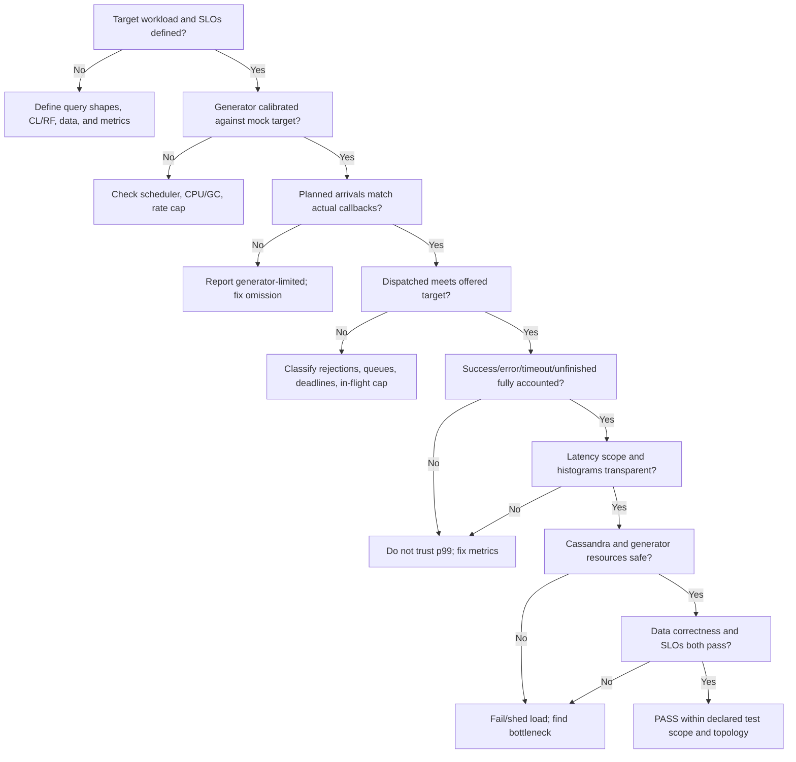

# Concurrency Throttling and Avoiding Load-Generator Bias

> **Chapter:** Load and Distributed Fault Testing  
> **Context:** Apache Cassandra with the *wide-column* model, partition keys, replicas, consistency levels, compaction/repair, and Java applications using **Cassandra Java Driver 4.x**. This lesson explains how to **control the load generator** when evaluating Cassandra or a Cassandra-backed API without mistaking generator artifacts for database performance.
>
> **Objectives:** Distinguish *target/offered/admitted/completed throughput* from concurrent in-flight requests; understand **open-loop** vs. **closed-loop** models and *coordinated omission*; design **in-flight**, rate, queue, and deadline limits; detect CPU/network/GC bottlenecks on the generator; write an asynchronous Java load generator with closed accounting; compare client/server metrics during load ramps and fault injection; and establish go/no-go criteria covering **latency, errors, rejections, resources, and data correctness**.

## 1. Scenario: "p99 Is Only 40 ms" While Production Is Timing Out

An operations team needs to verify that Cassandra can sustain **2,000 reads/second** against a partition-keyed table.

A naive benchmark executes:

```java
// Anti-pattern: sends the next request only after the previous finishes.
for (int i = 0; i < numberOfRequests; i++) {
    session.execute(prepared.bind(tenantId, orderIds[i]));
}
```

Report:

```text
Successful requests: 50,000
Observed p99:        40 ms
Errors:              0
Conclusion:          "Cluster sustains 2,000 QPS steadily"
```

This conclusion is unproven. In that code, **only one request is ever running at a time**. If p99 is low yet actual throughput is only 30 requests/s, the test never even approached the 2,000 QPS target.

Worse, if Cassandra slows from 30 ms to 500 ms, the loop **slows down with it**. The generator eases off right when the cluster struggles, and only dispatched-and-completed requests appear in the latency histogram. This is a classic mechanism behind **coordinated omission**.

**The core question is not "how many loop iterations did the generator run?" but "how much demand was offered, how much did Cassandra actually admit, how much completed, and at what latency and error rate?"**

## 2. Path Model and Measurement Points

```text
  Load schedule / arrival schedule
                 |
                 v
       LOAD GENERATOR CPU / GC
                 |
           admission gate
             /       \
           Reject    Accept
                       |
                       v
          Driver queue / pool / TLS
                       |
                       v
                 Coordinator
                       |
                 Internode RPC
                       |
                 Replica R1/R2/R3
                       |
                 Memtable / SSTable
                       |
                  Response
                       |
                 Driver decode
                       |
                 Application result
                       |
                  Metrics sink
```

Every stage can accumulate time, consume memory, or drop requests. Measuring solely **from when the driver sends a request until it receives a reply** misses:

- Time the generator **fell behind schedule** due to scheduler/CPU/GC stalls.
- Time waiting for a permit or client-side queue slot.
- Requests **never sent due to a concurrency cap**.
- Requests that timed out, were canceled, or returned errors.
- Retries and speculative executions triggered inside the driver.
- API/HTTP serialization time when testing end-to-end from callers.

To measure accurately, bind metrics to **explicit scopes** instead of collapsing everything into one `latency_ms` number.

## 3. Terminology to Align On Before Benchmarking

| Term | Definition | Example |
|---|---|---|
| **Target rate** | Intended demand generation rate | 2,000 logical req/s |
| **Planned arrivals** | Scheduled arrival slots per the plan | 120,000 in 60 s |
| **Offered workload** | User/job demand intended for the system | Includes unserved demand |
| **Dispatched/submitted** | Requests actually initiated at client driver/API | 110,000 |
| **Locally rejected** | Rejected by generator/admission before calling driver | 5,000 |
| **Scheduler missed** | Generator missed schedule or skipped late slots | 5,000 |
| **Completed success** | Completed with a valid result | 105,000 |
| **Completed error** | Completed with error, timeout, or invalid response | 4,800 |
| **In-flight** | Dispatched and not yet finished within scope | E.g., 200 |
| **Queue depth** | Waiting for admission, **not yet** executing | E.g., 40 |
| **Response latency** | From dispatch until client receives reply | 25–500 ms |
| **Scheduled-arrival latency** | From **intended service time** until completion | Includes scheduler lag/queuing |
| **Server latency** | Duration measured at coordinator/server | Excludes client-side time |
| **Attempt amplification** | Execution attempts / logical requests | 1.12 with retries/speculation |

Numbers in this table are **illustrative**, not measured benchmark results.

### Accounting Rules

Over a closed measurement interval once all actually dispatched requests have drained:

\[
\text{Dispatched}=\text{Success}+\text{Error/Timeout}+\text{Unfinished}
\]

Once all requests drain, `Unfinished = 0`. While a test is running, `Unfinished` cannot simply be ignored.

For the arrival schedule:

\[
\text{Planned Arrivals}
=\text{Dispatched}+\text{Locally Rejected}+\text{Missed/Not Emitted}
\]

Define how **missed schedule slots** are counted: a stalled scheduler may fail to invoke callbacks matching the intended schedule. Never treat `numberOfCallbacks` as total planned arrivals when the generator lagged heavily.

**Only by counting un-dispatched requests can you verify whether target demand was truly tested.**

## 4. QPS and Concurrency Are Two Distinct Limits

**QPS (requests/s)** is a rate. **Concurrency (in-flight requests)** is the count of work items active at an instant.

A service can hold QPS nearly constant while concurrency climbs dramatically as Cassandra latency rises.

Steady-state examples:

| Offered / Completed QPS | Mean Response Time | Average In-Flight |
|---:|---:|---:|
| 200 req/s | 20 ms | 4 |
| 1,000 req/s | 20 ms | 20 |
| 1,000 req/s | 100 ms | 100 |
| 1,000 req/s | 400 ms | 400 |

Values follow Little's Law, ignoring variance and rejected queues.

A generator with **only a QPS cap** can pile up thousands of futures when Cassandra slows down. A generator with **only a concurrency cap** automatically slows its emission rate when the server lags, failing to model external arrival demand.

**You need both an arrival schedule and an in-flight cap—and you must count demand exceeding the cap instead of hiding it.**

## 5. Little's Law: Directional Guide, Not an Auto-Cap Formula

In a stable system:

\[
L = \lambda W
\]

Where:

- \(L\): average work items inside the measured boundary.
- \(\lambda\): steady-state arrival/completion rate.
- \(W\): **average** time spent inside that boundary.

Example:

```text
Target: 1,500 requests/s
Mean DB response: 80 ms = 0.080 s

Expected mean in-flight ~ 1500 x 0.080 = 120
```

Setting `maxInFlight = 100` will trigger frequent admission rejections **even when Cassandra is healthy**, because the cap is below the mean concurrency required at target rate.

If Cassandra slows to 300 ms:

```text
1,500 x 0.300 = 450 average in-flight
```

Raising the cap to 450 in response may **overload the cluster further** if the latency jump came from CPU or disk saturation.

**Little's Law helps explain system state; it never guarantees Cassandra can serve that concurrency.**

### When the Formula Should Not Be Applied Directly

- The test has only run a few seconds and is not steady yet.
- The workload is bursty with heavily skewed latency.
- Some queries scan many SSTables/tombstones while others are tiny.
- Retries/speculation make physical attempts differ from logical arrivals.
- Queuing, rejections, or cancellations sit outside the measured boundary.
- The generator itself is failing to sustain the target rate.
- The system is overloaded with unbounded backlog growth; steady state no longer holds.

## 6. Closed-Loop: Request Rate Depends on Prior Responses

A **closed-loop** system typically runs a fixed number of virtual users or workers: each user waits for its request to finish before starting the next.

```text
Virtual user #1:  SEND A ---- wait ---- RESULT
                                |
                                +--> SEND B ---- wait ---- RESULT

Virtual user #2:  SEND C ---- wait ---- RESULT
                                |
                                +--> SEND D ...
```

When Cassandra slows down, virtual users wait longer, so new requests **drop naturally**.

### Advantages

- Accurately models user workflows where step N+1 waits for step N.
- Easy to bound the number of virtual users.
- Unlikely to create runaway backlogs.
- Useful for measuring throughput at fixed concurrency.
- Checks system resource usage under a "waiting users" model.

### Limitations

- Does not model **arrival rates independent of latency**.
- When Cassandra degrades, the generator backs off and can mask overload.
- Latency histograms omit **time during which subsequent requests should have arrived**.
- Any claim of "sustains X QPS" requires **measuring actual QPS**, not inferring from user count.

**Closed-loop is not wrong; it simply answers a different question from open-loop.**

## 7. Open-Loop: Arrival Rate Independent of Prior Requests

In **open-loop** testing, requests are scheduled by wall-clock time or an arrival process independent of Cassandra's responses.

```text
Send schedule (e.g., every 10 ms):
t=0      SEND A ------------ (A is slow)
t=10     SEND B ------- (B is slow)
t=20     SEND C --
t=30     SEND D ---
t=40     SEND E ---------------
...
```

When Cassandra slows down, the generator keeps registering **newly arriving demand**, exposing:

- Rising in-flight counts.
- Concurrency cap hits.
- Growing queue waits and rejections.
- Deadlines expiring while requests wait.
- Degrading tail latency and completed throughput.

### Yet Open-Loop Does Not Mean Unbounded Dispatch

If a generator keeps allocating new `CompletableFuture` instances when 20,000 requests are already in-flight, you are testing **heap and driver-queue exhaustion**, not cleanly measuring Cassandra.

A controlled open-loop harness must:

1. Schedule **offered arrivals** independently of responses.
2. Enforce **max in-flight** and an optional bounded queue.
3. When at capacity, **record rejections/misses** rather than queuing unboundedly.
4. Track scheduler lag and generator health.
5. Report all errors/timeouts and latency measured from planned arrival time.

This bridges **statistical accuracy** and **resource safety**.

## 8. Coordinated Omission: The Most Dangerous Tail-Latency Bias

*Coordinated omission* happens when a harness **omits or delays generating samples whenever the system slows down**, typically because the next request waits for the previous one to complete.

Hypothetical example:

```text
Target arrival: 100 req/s = 1 request every 10 ms

t=0:    send A
t=10:   B should have arrived
t=20:   C should have arrived
...
t=980:  another request should have arrived
t=1000: A finally replies
```

With a single closed-loop worker and no compensation, only A runs during that 1 second. The histogram records **one ~1,000 ms sample** and zero data for the ~100 arrival slots that real demand would have produced.

A tool recording only completed-request durations can report a far rosier p99 than the experience of **real demand queuing for service**.

### Why the Same Bug Appears in "Fake Open-Loop" Code

If your scheduler loop is written as:

```java
// Not truly open-loop if the scheduler waits on the request.
while (running) {
    session.execute(statement);
    Thread.sleep(10);
}
```

The interval between requests is **DB time + 10 ms**, not every 10 ms on the clock.

Even with a separate scheduler thread, if the generator hits a 2-second stop-the-world GC pause and silently skips missed ticks, the histogram of actually sent requests still **omits** demand.

### How to Mitigate This Bias

- Define workloads via an independent offered-arrival schedule.
- Record the **planned timestamp** for every intended arrival.
- Measure scheduler lag and queue wait.
- When arrivals are dropped due to generator lag or cap limits, **count and report them**—never delete them from the denominator.
- Use corrected-latency histograms where appropriate, **labeling corrected vs. raw separately**.
- Include timeouts, rejections, and unfinished work in reports instead of assigning them 0 ms latency.

## 9. What a "Corrected Histogram" Means—and What It Does Not

Some benchmarking histogram tools offer **coordinated-omission correction** using the expected interval. The idea is preventing a long stall from contributing only one sample when scheduled arrivals continued piling up.

**Do not misunderstand:**

- Correction **does not mean those skipped requests actually ran on Cassandra**.
- It does not tell you exactly how the server would have behaved on each dropped request.
- It does not turn 1,000 **intended** req/s into 1,000 **actually sent** req/s.
- It does not replace measuring queue wait, rejections, and generator lag.
- Corrected and raw results must be **labeled separately**, documenting the method and expected interval.
- Never assign arbitrary latencies to rejected requests and blend them into histograms as real server responses.

**Best practice:** prevent omission in the generator design first; then use transparent correction as a secondary lens when stalls or scheduling gaps still occur.

## 10. A Timeline That Can Turn a Benchmark "Falsely Green"

Suppose the target is 1,000 req/s for 60 seconds.

```text
Planned arrivals:        60,000
Actually dispatched:     18,000
Local rejections:        12,000
Missed schedule slots:   30,000

Completed success:       17,600
Completed errors:           400
In-flight after drain:        0
```

Looking only at the 17,600 successes and reporting:

```text
"p99 successful read = 38 ms, error rate 2.2%"
```

and claiming "1,000 QPS passed" is wrong.

The report must state:

- Target rate: 1,000/s.
- Effective dispatch rate: **300/s**.
- Successful completion rate: roughly **293/s**.
- **30,000** planned arrivals were lost to scheduler/generator stalls.
- **12,000** requests were rejected at the admission gate.
- The system was **never actually tested at target load**.
- Error fractions must be published against both dispatched and offered denominators with clear metric names.

### Two Different Denominators

\[
\text{Dispatched Error Fraction}
= \frac{\text{Failed Completed}}{\text{Dispatched}}
\]

\[
\text{Offered Success Fraction}
= \frac{\text{Successful Completed}}{\text{Planned Arrivals}}
\]

Both are meaningful, yet they answer **two different questions**. Never swap denominators to make performance look better.

## 11. Separating Generator, Driver, and Cassandra Delays

"Latency" can be broken into segments:

```text
plannedAt
   |
   | scheduler lag
   v
dispatchAt
   |
   | driver queue/pool/TLS + network
   v
coordinator receives
   |
   | server processing + replica requests
   v
server replies
   |
   | network + driver decode
   v
clientCompleteAt
```

Measure:

\[
L_{\text{dispatch-to-completion}}
= t_{\text{complete}}-t_{\text{dispatch}}
\]

\[
L_{\text{scheduled-to-completion}}
= t_{\text{complete}}-t_{\text{planned}}
\]

\[
L_{\text{generator-lag}}
= t_{\text{dispatch}}-t_{\text{planned}}
\]

In queued tests:

\[
L_{\text{scheduled-to-completion}}
= L_{\text{scheduler-lag}}+L_{\text{queue-wait}}+L_{\text{execution}}
\]

across consistently measured timestamps.

**Never subtract system-clock timestamps from two different machines directly** without verified clock synchronization and uncertainty bounds. Within a single Java process, `System.nanoTime()` is suited for monotonic elapsed durations. Use wall-clock timestamps for logs and correlation, not `Instant.now()` for sub-millisecond latency measurements.

## 12. Two Distinct Limiters: Rate Limiter vs. Semaphore

A **rate limiter** caps arrivals/requests per unit time, usually with a burst budget.

A **semaphore / in-flight limiter** caps how many started requests can be active simultaneously.

| Mechanism | Solves | Does Not Solve |
|---|---|---|
| Rate cap / arrival pacing | Prevents exceeding target arrival rate | Does not prevent backlog when latency climbs |
| In-flight cap | Prevents >N concurrent logical operations | Can cause offered load rejections |
| Bounded queue | Absorbs bounded bursts | Adds queue latency; needs deadlines |
| Deadline | Prevents holding requests indefinitely | Does not roll back server mutations |
| Upstream backpressure | Slows source to match capacity | Alters arrival model if testing open-loop |
| Retry budget | Prevents load amplification on failures | Does not fix partition hotspots or disk bottlenecks |

**The best designs layer multiple controls**, and reports must clearly state what each layer did to requests.

## 13. Choosing a Policy When Permits Run Out

Three common approaches:

### A. Fail Fast

```text
Permit available -> send request
No permit        -> locally_rejected++, do not call driver
```

Ideal for measuring what happens under a **fixed arrival schedule** without blowing up generator RAM.

### B. Bounded Queue

```text
Permit available -> send
No permit, queue not full -> enqueue with deadline
Queue full / deadline expired -> reject / expire
```

Measures **queue latency**, though end-to-end times rise. Reporting only CQL duration after dequeue hides the time users actually waited in queue.

### C. Blocking Threads Waiting for Permits

```java
// Anti-pattern on Netty/Reactor event loops and generator schedulers.
semaphore.acquire();
session.executeAsync(statement);
```

This can block the arrival scheduler itself. When Cassandra slows, the scheduler stalls and **coordinated omission** creeps back in.

**In an open-loop harness, prefer non-blocking `tryAcquire()` or a bounded asynchronous queue.** Exhausted permits must emit a metric event rather than stalling the scheduler.

## 14. How Should the Initial In-Flight Budget Be Chosen?

Suppose:

```text
Target:                   1,200 logical reads/s
Healthy mean latency:        50 ms
Little's Law mean L:         60 in-flight

Canary caps to compare:      80 / 120 / 180
Assumed request deadline:   500 ms
```

These are experimental design examples, not an optimal-limit formula.

How to choose:

1. Measure baseline latency while unsaturated.
2. Estimate mean in-flight from QPS × mean latency.
3. Pick a few caps with **controlled headroom**, never unbounded.
4. Ramp load and inspect offered/dispatched/completed QPS.
5. Watch Cassandra CPU, disk await, GC, and pending/dropped messages.
6. If the cap is hit while the server remains healthy, evaluate raising the cap.
7. If the server is already saturated, **never raise the cap just to reduce `locally_rejected`**.
8. Re-evaluate whenever retry/speculation policies, CL, RF/DC, or app instance counts change.

**A good cap is a safety boundary tested against the workload, not an arbitrary thread count.**

## 15. Java Driver 4.x: What Happens When Calling `executeAsync()`?

With Java Driver 4.x:

```java
CompletionStage<AsyncResultSet> future =
    session.executeAsync(boundStatement);
```

Returning a stage **does not mean CQL execution has finished**. Cost continues across:

- Driver request queues, connection pools, and protocol framing.
- Coordinator and replicas.
- Response decoding and callbacks.
- Retries/speculation if allowed by statement and policy.
- Additional page fetches if the query spans multiple pages.

That is why this loop is dangerous:

```java
for (UUID id : aMillionIds) {
    session.executeAsync(select.bind("tenant-a", id));
}
```

It has **no global in-flight budget** and fails to capture exceptions or timeouts properly.

Equally broken:

```java
semaphore.acquire();
try {
    return session.executeAsync(statement);
} finally {
    semaphore.release(); // Releases the permit as soon as the future is created!
}
```

The permit must be released **only when the protected async operation actually completes**, and synchronous submission exceptions must release it too.

## 16. Illustrative CQL Table for Load Testing

Table queried by full partition key:

```cql
CREATE KEYSPACE IF NOT EXISTS load_lab
WITH replication = {
    'class': 'NetworkTopologyStrategy',
    'datacenter1': 1
};

CREATE TABLE IF NOT EXISTS load_lab.orders_by_id (
    tenant_id text,
    order_id uuid,
    status text,
    total decimal,
    PRIMARY KEY ((tenant_id, order_id))
);
```

This example fits a **single-node lab** whose DC is actually named `datacenter1`. RF=1 and `LOCAL_ONE` do not substitute for a production `RF=3`/`LOCAL_QUORUM` setup.

Seed data **before warm-up and measurement**:

```cql
INSERT INTO load_lab.orders_by_id
    (tenant_id, order_id, status, total)
VALUES (
    'bench-tenant',
    11111111-1111-4111-8111-111111111111,
    'PAID',
    125.00
);
```

Standard query:

```cql
SELECT status, total
FROM load_lab.orders_by_id
WHERE tenant_id = ?
  AND order_id = ?;
```

When benchmarking reads, prepare a **set of existing keys** with a controlled distribution. Never silently query random nonexistent UUIDs: read misses can behave very differently from read hits and distort the workload.

### Never Write a Single-Hot-Key-Only Benchmark

If every request queries the same partition, cache and hot-partition behavior will diverge completely from production. Include workload profiles for uniform, hot-key skew, and realistic active keyspace sizes. Reports must state hit/miss ratios, row/partition sizes, and keyset cardinality.

## 17. Bounded Open-Loop Load Generator in Java 17

The example below enforces critical invariants:

- **Schedule independent** of Cassandra response timing.
- **Non-blocking scheduler** when permits are exhausted.
- Requests are constructed **only after** acquiring a permit.
- Separates **missed schedule**, **locally rejected**, **dispatched**, **succeeded**, **not-found**, and **failed**.
- Measures both **planned-to-completion** and **dispatch-to-completion** using a monotonic clock.
- Releases permits **exactly once** on completion, even on exceptions.
- Never accumulates an unbounded list of futures.

> Targets Java 17 and Cassandra Java Driver 4.x. `MetricsSink` is a **thread-safe, non-blocking** histogram extension point that should be backed by a real metrics library. This code illustrates core mechanics, not a production load-test suite with distributed coordination, HDR histograms, retry accounting, or full hardening.

```java
import java.time.Duration;
import java.util.Objects;
import java.util.UUID;
import java.util.concurrent.CompletionStage;
import java.util.concurrent.Executors;
import java.util.concurrent.ScheduledExecutorService;
import java.util.concurrent.ScheduledFuture;
import java.util.concurrent.Semaphore;
import java.util.concurrent.TimeUnit;
import java.util.concurrent.atomic.AtomicLong;
import java.util.concurrent.atomic.LongAdder;

import com.datastax.oss.driver.api.core.CqlSession;
import com.datastax.oss.driver.api.core.DefaultConsistencyLevel;
import com.datastax.oss.driver.api.core.cql.AsyncResultSet;
import com.datastax.oss.driver.api.core.cql.BoundStatement;
import com.datastax.oss.driver.api.core.cql.PreparedStatement;

public final class BoundedOpenLoopLoad implements AutoCloseable {

    public interface MetricsSink {
        // Must not block or throw back into driver callbacks.
        // Implementations must be thread-safe.
        void recordNanos(String metric, long value);
    }

    public record Snapshot(
        long plannedCallbacks,
        long generatorMissed,
        long locallyRejected,
        long dispatched,
        long succeeded,
        long notFound,
        long failed,
        long observerFailures,
        int inFlight
    ) {}

    private final CqlSession session;
    private final PreparedStatement read;
    private final UUID[] knownKeys;
    private final MetricsSink metrics;
    private final Semaphore slots;
    private final int maxInFlight;
    private final long intervalNanos;
    private final long maxSchedulingLagNanos;

    private final ScheduledExecutorService scheduler =
        Executors.newSingleThreadScheduledExecutor();

    private final AtomicLong callbacks = new AtomicLong();
    private final LongAdder missed = new LongAdder();
    private final LongAdder rejected = new LongAdder();
    private final LongAdder dispatched = new LongAdder();
    private final LongAdder succeeded = new LongAdder();
    private final LongAdder notFound = new LongAdder();
    private final LongAdder failed = new LongAdder();
    private final LongAdder observerFailures = new LongAdder();

    private volatile ScheduledFuture<?> ticker;
    private volatile long startNanos;
    private volatile long stopNanos;

    public BoundedOpenLoopLoad(
        CqlSession session,
        UUID[] existingOrderIds,
        long targetQps,
        int maxInFlight,
        Duration maxSchedulingLag,
        MetricsSink metrics
    ) {
        this.session = Objects.requireNonNull(session);
        this.metrics = Objects.requireNonNull(metrics);
        this.knownKeys = Objects.requireNonNull(
            existingOrderIds).clone();

        if (knownKeys.length == 0) {
            throw new IllegalArgumentException("No known keys");
        }
        if (targetQps <= 0 || maxInFlight <= 0) {
            throw new IllegalArgumentException("Invalid load budget");
        }

        this.intervalNanos = 1_000_000_000L / targetQps;
        if (intervalNanos == 0) {
            throw new IllegalArgumentException(
                "QPS exceeds single-ticker resolution");
        }

        this.maxSchedulingLagNanos =
            maxSchedulingLag.toNanos();

        if (maxSchedulingLagNanos < 0) {
            throw new IllegalArgumentException("Negative lag");
        }

        this.maxInFlight = maxInFlight;
        this.slots = new Semaphore(maxInFlight);
        this.read = session.prepare(
            "SELECT status, total " +
            "FROM load_lab.orders_by_id " +
            "WHERE tenant_id = ? AND order_id = ?"
        );
    }

    public synchronized void start(Duration duration) {
        if (ticker != null || duration.isNegative()
            || duration.isZero()) {
            throw new IllegalStateException("Invalid start");
        }

        startNanos = System.nanoTime();
        stopNanos = startNanos + duration.toNanos();

        ticker = scheduler.scheduleAtFixedRate(
            this::tick, 0, intervalNanos, TimeUnit.NANOSECONDS
        );
    }

    private void tick() {
        final long now = System.nanoTime();

        // Stop emitting once past the measurement window.
        if (now >= stopNanos) {
            return;
        }

        final long index = callbacks.getAndIncrement();
        final long plannedAt =
            startNanos + index * intervalNanos;
        final long lag = Math.max(0L, now - plannedAt);

        record("generator_scheduler_lag_ns", lag);

        // Do not catch-up burst requests that are already too late.
        if (lag > maxSchedulingLagNanos) {
            missed.increment();
            return;
        }

        // Admission check before calling the Java Driver.
        if (!slots.tryAcquire()) {
            rejected.increment();
            return;
        }

        final long dispatchAt = System.nanoTime();
        dispatched.increment();

        try {
            int keyIndex = (int) (index % knownKeys.length);

            BoundStatement statement = read
                .bind("bench-tenant", knownKeys[keyIndex])
                .setConsistencyLevel(
                    DefaultConsistencyLevel.LOCAL_ONE)
                .setIdempotent(true)
                .setPageSize(16);

            CompletionStage<AsyncResultSet> stage =
                session.executeAsync(statement);

            stage.whenComplete((result, error) -> {
                final long finishedAt = System.nanoTime();

                try {
                    record("dispatch_to_result_ns",
                        finishedAt - dispatchAt);
                    record("planned_to_result_ns",
                        finishedAt - plannedAt);

                    if (error != null) {
                        failed.increment();
                    } else if (result == null ||
                               result.one() == null) {
                        notFound.increment();
                    } else {
                        succeeded.increment();
                    }
                } catch (RuntimeException mappingError) {
                    failed.increment();
                } finally {
                    slots.release();
                }
            });

        } catch (RuntimeException sendError) {
            failed.increment();
            record("dispatch_to_result_ns",
                System.nanoTime() - dispatchAt);
            slots.release();
        }
    }

    private void record(String name, long elapsed) {
        try {
            metrics.recordNanos(name, Math.max(0L, elapsed));
        } catch (RuntimeException metricError) {
            // Metrics failures must never leak a permit.
            observerFailures.increment();
        }
    }

    public synchronized void stop() {
        if (ticker != null) {
            ticker.cancel(false);
        }
        scheduler.shutdown();
    }

    // Call ONLY from the test/control thread, NEVER inside an event loop.
    public boolean awaitDrain(Duration timeout)
        throws InterruptedException {

        long deadline = System.nanoTime() + timeout.toNanos();
        while (System.nanoTime() < deadline) {
            if (slots.availablePermits() == maxInFlight) {
                return true;
            }
            Thread.sleep(10);
        }
        return slots.availablePermits() == maxInFlight;
    }

    public Snapshot snapshot() {
        return new Snapshot(
            callbacks.get(),
            missed.sum(),
            rejected.sum(),
            dispatched.sum(),
            succeeded.sum(),
            notFound.sum(),
            failed.sum(),
            observerFailures.sum(),
            maxInFlight - slots.availablePermits()
        );
    }

    @Override
    public void close() {
        stop();
        // CqlSession is owned by the caller; do not close it here.
    }
}
```

### Example Test Orchestration

```java
// Snippet for a test runner / main that already created the session.
// orderIds must be keys with pre-seeded data.
BoundedOpenLoopLoad.MetricsSink sink =
    (name, nanos) -> histogramRecorder.record(name, nanos);

try (BoundedOpenLoopLoad load =
         new BoundedOpenLoopLoad(
             session,
             orderIds,
             200,                         // Target 200 req/s
             50,                          // Max 50 in-flight
             Duration.ofMillis(30),       // Max scheduler lateness
             sink)) {

    load.start(Duration.ofSeconds(60));
    Thread.sleep(Duration.ofSeconds(60).toMillis());
    load.stop();

    boolean drained = load.awaitDrain(Duration.ofSeconds(10));
    System.out.println(load.snapshot());
    System.out.println("drained=" + drained);
}
```

`histogramRecorder` is a project-supplied metrics collector, not defined in this snippet. Use `HdrHistogram` `Recorder` or an equivalent thread-safe metrics backend using **exact nanosecond units**.

### This Is Illustrative Code, Not a Production-Ready Load Generator

Intentional limitations:

1. `scheduleAtFixedRate` uses a single scheduler thread; at very high QPS, the ticker itself cannot keep up.
2. `intervalNanos = floor(1e9/QPS)` introduces quantization error; at high QPS, use multiple workers or a dedicated load generator and verify actual rate.
3. If the scheduler lags, invoked callbacks **may be fewer than wall-clock arrival slots**; always compare against `expectedArrivals = duration / interval` in reports.
4. Overly late callbacks are counted as `generatorMissed`; no silent "catch-up bursts" are emitted to fake on-time dispatch.
5. On `stop()`, in-flight requests must still drain and be accounted for; if the drain deadline expires, **report unfinished count**.
6. The test uses a single tenant and round-robin keys; simulating hot keys or Zipfian distributions requires a controlled workload model.
7. `MetricsSink` must never block or throw; a slow sink stalls callbacks/schedulers and skews results.
8. `result.one()` only inspects the first row, fitting single-row PK lookups; do not benchmark multi-page queries this way.
9. `LOCAL_ONE` in the snippet is for an RF1 lab; production profiles must match contract CL.
10. Synchronous failures in `executeAsync` vs. async completions should be classified separately in operational reports.
11. Never create a new `CqlSession` per request; share one session with driver-managed pooling per appropriate load worker.
12. Multi-machine coordination, TLS negative tests, and automated server metric scraping are omitted.
13. **Never call `sleep` inside the scheduler or callbacks**; `Thread.sleep` here is strictly on the test-controller thread.
14. During `stop()` and `awaitDrain()`, do not close `CqlSession` prematurely or in-flight requests will abort artificially.
15. Histograms do not store rejected/missed items as latencies; report them as **separate outcomes**.

**The goal of this example is closed accounting and load control, not winning a speed benchmark.**

## 18. A Subtle Bug: Scheduled Callbacks ≠ Planned Arrivals

Suppose a 60-second test targets 1,000/s. Scheduled slots should be approximately:

\[
N_{\text{expected}} \approx 60 \times 1{,}000 = 60{,}000
\]

Yet `callbacks.get()` only reaches 45,000 because the JVM scheduler suffered GC/CPU contention.

If across those 45,000 callbacks:

```text
missed     =  5,000
rejected   = 10,000
dispatched = 30,000
```

there are still:

```text
expected - callbacks = 15,000 arrival slots
```

missing because the scheduler **never even fired callbacks on schedule**.

Report both kinds of misses:

- **Observed late callback skipped:** callback fired, but too late, so it was skipped.
- **Unobserved intended slots:** scheduled slots that never produced a callback within the measurement window.

A complete report can compute:

\[
\text{Total Schedule Omission}
=\text{Late-Skipped}+\max(0,N_{\text{expected}}-N_{\text{callbacks}})
\]

Carefully handle interval rounding, warm-up, and mid-tick shutdowns; these are **test-harness accounting formulas**, not Cassandra metrics.

**Never call `plannedCallbacks` total real demand if the scheduler fell short.**

## 19. Do Not Use a Million Futures as a Load Generator

Anti-pattern:

```java
List<CompletionStage<AsyncResultSet>> all =
    new ArrayList<>();

for (UUID id : oneMillionIds) {
    all.add(session.executeAsync(
        prepared.bind("tenant-a", id)));
}
```

Problems:

- Fires requests in a tight burst rather than at a steady QPS.
- Heap fills with futures, callbacks, and large buffers.
- Driver queues and connection pools overflow.
- Server sees a burst dictated by loop speed.
- Planned-arrival latency is never measured.
- Calling `CompletableFuture.allOf` afterward **only waits**; it does not limit concurrency.

**Alternative:** admission control before `executeAsync`, max in-flight limits, lag-aware rate schedulers, or properly bounded reactive demand.

For bulk data imports, use checkpoints and producer backpressure; for open-loop benchmarks, track rejections and misses. The two problems have different goals.

## 20. Distinguishing Direct CQL Load Tests from API Load Tests

Both test targets are valid:

### A. CQL / Native Protocol Benchmark

```text
Load generator (Java Driver) -> Cassandra cluster
```

Useful for:

- Measuring DB capacity in isolation for a query shape.
- Observing request latency, CL, and partition placement.
- Tuning compaction, storage, coordinators, and replicas.
- Evaluating driver retries, speculation, or paging.

**Does not measure** HTTP auth, JSON parsing, business logic, service-to-service calls, or API queuing.

### B. End-to-End API Benchmark

```text
HTTP load generator -> API/gateway -> Java service
                    -> Cassandra -> response
```

Useful for:

- Evaluating real user experience and API SLOs.
- Measuring auth, rate limiters, queues, and server thread pools.
- Observing 429/503 responses, backpressure, and cross-layer retry policies.
- Testing service scaling and tenant fairness.

**Never equate HTTP request count with CQL attempt count.** One API call can trigger multiple CQL queries or driver retries.

### When Running Both

Use CQL benchmarks to establish a DB-layer baseline and API benchmarks to measure app overhead and end-to-end impact. Report them as **distinct paths and workloads**, never comparing their p99s directly as equivalent variants of the same test.

## 21. Cassandra Query-First: Generators Must Send Representative Queries

Cassandra partitions data by partition key and token. For a table with:

```cql
PRIMARY KEY ((tenant_id, order_id))
```

A `SELECT` providing both `tenant_id` and `order_id` is a typical query shape.

Anti-pattern:

```cql
-- Never use as a production baseline for a large table:
SELECT * FROM load_lab.orders_by_id
WHERE status = 'PAID'
ALLOW FILTERING;
```

Broad scan/filter queries carry completely different costs and do not reflect real application traffic.

A workload profile must specify:

- Table name and CQL template.
- Partition key binding.
- Data distribution, partition count, and hot-key ratio.
- Row size, partition size, and tombstone density.
- Paging/`LIMIT` and clustering order.
- Read vs. write mix.
- Consistency level by RF/DC.
- Retry and speculative policies.
- Node/coordinator locality.

**If the query shape differs from production, pretty charts do not solve the production problem.**

## 22. Uniform, Hotspot, and Zipfian: Document the Key Distribution

A Cassandra cluster may sustain 5,000 reads/s when requests spread evenly, yet collapse if 70% of traffic hammers a handful of partitions.

### Common Models

| Workload | Key Selection | Meaning |
|---|---|---|
| **Uniform** | Every key roughly equally likely | Distributed baseline |
| **Hot-key** | Small group receives most QPS | Exposes hot partitions/replicas |
| **Zipfian** | Few keys far more popular than the tail | Approximates many real workloads |
| **Sequential** | Sweeps key ranges in order | Alters cache/working-set dynamics |
| **Random misses** | Keys mostly absent | Measures miss path, not hit path |
| **Mixed** | Defined hit/miss/TTL/delete proportions | Exercises storage lifecycle |
| **Tenant skew** | Tenant A generates far more requests than B | Tests fairness and bulkheads |

### Example Profile

```yaml
workload:
  table: load_lab.orders_by_id
  operations:
    read: 90
    write: 10
  key_distribution: hot-key
  hot_key_fraction: 0.01
  hot_request_fraction: 0.70
  expected_hit_ratio: 0.95
  row_size_bytes_p50: 512
  ttl_data_fraction: 0.20
  consistency_read: LOCAL_QUORUM
  consistency_write: LOCAL_QUORUM
```

This is a **benchmark descriptive manifest**, not a native config file for a specific tool. Derive numbers from aggregated/sanitized operational telemetry rather than guessing.

**A 100%-miss read benchmark cannot substitute for a 95%-hit live-data benchmark.**

## 23. Paging: Each Page Can Be a Separate Request

Suppose an application lists 50 records per view from `orders_by_customer_day`:

```cql
SELECT created_at, order_id, status
FROM load_lab.orders_by_customer_day
WHERE tenant_id = ?
  AND customer_id = ?
  AND day_bucket = ?
LIMIT 50;
```

This is an **illustrative query template**; the matching table must exist with the appropriate partition/clustering keys. `LIMIT 50` caps total returned rows, while `setPageSize(20)` controls protocol page size.

In Java Driver 4.x:

- `AsyncResultSet.currentPage()` returns only the current page's rows.
- `hasMorePages()` indicates whether more pages exist.
- `fetchNextPage()` issues the next page request.
- Synchronous `ResultSet` iteration can auto-fetch subsequent pages as you iterate.

If the generator times only the **first `executeAsync` call** while the application subsequently fetches multiple pages, physical CQL requests and CPU/I/O are underreported.

### Lock Down What "Logical Operation" Means

A benchmark can define:

1. **One CQL page fetch = one logical request**; or
2. **One API query reading all N pages = one logical operation**.

Both are valid, yet **cannot be compared directly** without stating the boundary.

Never call `ResultSet.all()` on a huge query and count it as "1 request" as if it were a lightweight single-page read.

## 24. Consistency Level, Replication, and Topology Alter Cost

Assume a keyspace uses `NetworkTopologyStrategy` with RF=3 in `dc1`.

| CL | Conceptual Requirement | Load-Testing Consequence |
|---|---|---|
| `LOCAL_ONE` | One local replica responds | Often faster, fewer required ACKs |
| `LOCAL_QUORUM` | Two local replicas at RF=3 | Depends on quorum latency and replica headroom |
| `QUORUM` | Quorum across RF/replication | Can span multiple DCs |
| `ALL` | Every replica required by CL | Sensitive to any slow or offline node |
| `LOCAL_SERIAL` | Serial phase of LWT | Does not replace regular CL for normal ops |

**Never drop CL from `LOCAL_QUORUM` to `LOCAL_ONE` just to "pass p99"** if the real application requires quorum. That alters the correctness contract.

### Single-Node Benchmarks Have Clear Limits

An RF=1 container can validate code and measure basic CQL cost. It **cannot measure**:

- RF3 inter-node request amplification.
- 2/3 quorum behavior.
- Multi-replica compaction and repair interference.
- Node failures and unavailable replicas.
- Cross-DC replication and routing.
- Multi-node production tail latency.

Conclusions about RF3 require an actual multi-node test cluster.

## 25. Separate Data Seeding from Primary Measurement

If a benchmark requires 10 million rows, **do not measure read p99 while seeding unless production truly combines bulk ingest with reads**.

Typical workflow:

```text
1. Create schema and replication per test plan
2. Seed data with target partition-size distribution
3. Verify row counts, key samples, schema, and CL
4. Wait for cluster stabilization per explicit criteria
5. Warm up query caches and driver session
6. Start measurement window
7. Run steady-state reads/writes at target rate
8. Cool down and drain
9. Verify correctness and data reconciliation
10. Record resource metrics and conclusions
```

Avoid running full-table `SELECT COUNT(*)` to verify large datasets if it triggers costly full scans; use a manifest of seeded keys/partitions, sample queries, and dedicated reconciliation.

### What Proves the Cluster Has Stabilized?

- Pending compactions/repairs match the test plan.
- CPU, GC, and disk I/O return to acceptable baseline ranges.
- No residual in-flight seeding requests remain.
- Schema agreement and RF/DC placement verified.
- Required replicas are healthy and reachable.
- Application sessions and connection pools are warm.
- No ad-hoc manual compaction/repair run just to polish charts if production does not run it.

## 26. Warm-Up, Ramp-Up, Steady-State, and Cool-Down

A 60-second test should not treat every second as statistically equivalent.

### Warm-Up

- Containers, JVM, and driver initialize.
- Prepared statements, connections, and TLS handshakes complete.
- JIT compilation, caches, and metadata refresh settle.
- Cassandra memtable and SSTable caches warm up.

### Ramp-Up

- Target QPS increases gradually to avoid unrepresentative shocks.
- Record transient behavior, but **exclude ramp-up from steady-state histograms** when measuring sustained capacity.

### Steady-State

- Offered QPS holds steady per plan.
- Long enough to observe p95/p99 and compaction windows.
- Measure resources and throughput in time buckets, not only test-wide aggregates.

### Cool-Down / Drain

- Stop generating new arrivals.
- Wait for in-flight requests within a bounded deadline.
- Report unfinished/canceled requests if drain times out.
- Close `CqlSession` only after capturing required metrics.

**If the test ends before the backlog drains**, a success-only histogram drops the slowest in-flight requests. This **right-censoring** must be reported separately, never counted as success.

## 27. Controlling Multiple Load Generators and Scaling Factors

A single load generator can bottleneck before Cassandra. You may need multiple generator workers or machines.

Example:

```text
Total test target:     6,000 logical req/s
Generator workers:     3
Target per worker:     2,000 req/s

Machine A: actual offered 2,000
Machine B: actual offered 1,450 (CPU/GC saturation)
Machine C: actual offered 2,000

Actual total dispatched is NOT 6,000.
```

Aggregate **across every worker**:

- Intended arrivals.
- Scheduler misses / late callbacks.
- Dispatched and locally rejected counts.
- In-flight counts and queue depths.
- CPU/heap/GC/event-loop saturation.
- NIC/TCP/TLS bandwidth.
- Errors, timeouts, and coordinator selections.

Never average worker p99s to produce a system p99. To compute overall workload p99, **merge histograms or samples properly**, keeping units and time windows identical.

### Synchronizing Test Start

Workers can use an orchestrator/start barrier or synchronized start schedules. However, **never subtract timestamps from different machines to compute cross-host durations** without verified clock synchronization and offset bounds.

Each worker measures latency using its own monotonic clock; use synchronized wall clocks solely to align time series and fault events.

## 28. Calibrate the Load Generator Against a Fast Mock Target

Before stressing Cassandra, **benchmark the load generator itself**.

Replace `session.executeAsync` with a fast mock asynchronous operation completing immediately or after a controlled delay to measure:

- Whether the scheduler emits all intended arrivals.
- Late/missed callback rate at target QPS.
- Latency instrumentation overhead.
- Whether semaphores or counters leak or race.
- Rate accuracy at 100 / 1,000 / 10,000 req/s.
- Generator CPU, GC, and heap footprint.
- Harness tracing, histogram, and logging costs.

### Required Conclusion

If a generator cannot sustain 5,000 planned arrivals/s against an ultra-fast mock target, **it cannot be used to claim Cassandra tops out at 4,000 QPS**.

If the mock target passes cleanly while real Cassandra falls short, inspect networking, driver, coordinators, and replicas for the root cause.

**A generator with "negligible overhead" at 100 req/s can become the bottleneck at 20,000 req/s.**

## 29. Generator CPU, GC, Network, TLS, and Connection Pools

Typical symptoms:

| Symptom | Possible Generator Issue | Evidence to Inspect |
|---|---|---|
| Scheduler lag surges | CPU saturation or GC pauses | Process CPU, GC logs, scheduler histogram |
| Dispatched QPS < target | Ticker falling behind or gate rejecting | Planned vs. actual accounting |
| p99 spikes while Cassandra nodes sit idle | Client queues, TLS, or network | Driver metrics, socket stats, thread dumps |
| Memory climbs continuously | Unbounded futures or queues | Heap usage, GC, in-flight/queue sizes |
| Single CPU core pegged at 100% | Single-thread scheduler bottleneck | Per-thread CPU profile |
| Frequent TLS handshakes | Creating sessions/connections too often | Connection metrics, session lifecycle |
| Errors cluster on one host | Driver routing/pool/host health | Per-host errors, coordinator DC |
| Packet retransmits | NIC or network path issue | TCP stats, interface utilization |
| Slow metrics exporter | Instrumentation blocking | Collector queues/drops, callback timing |
| Logging every request | Logging overhead and disk I/O | Logger throughput, disk usage |

### Never Open a `CqlSession` Per Request

`CqlSession` is a heavyweight abstraction managing connection pools and cluster metadata. Opening sessions repeatedly benchmarks **connection establishment**, not steady-state read/write latency (unless connection churn is explicitly the test target).

Separate **connection startup benchmarks** from **steady-state CQL benchmarks**.

## 30. Driver Retries and Speculative Execution Amplify Load

One logical read from the generator can trigger multiple driver attempts:

```text
Planned logical read
    |
    +--> Attempt A to Coordinator N1
    |
    +--> Attempt B (speculative if A is slow)
    |
    +--> Retry attempt (if policy/error permits)
    |
    v
Replica reads (potentially overlapping)
```

Suppose 1,000 logical reads/s see 10% speculative attempts and 5% retries (assuming no cascading duplicates):

```text
~1,000 primary CQL attempts/s
~  100 speculative attempts/s
~   50 retry attempts/s

Total ~1,150 coordinator attempts/s
Amplification ~1.15
```

These numbers are **illustrative**, not a general formula when retries and speculation interact.

### Separate These Metrics

- Logical operations at the API / load generator.
- Driver execution attempts.
- Retry decisions and reasons.
- Speculative attempts and wins.
- Server-side speculative replica reads (if enabled).
- Internode replica messages.
- Final error and timeout counts.

**Driver speculation and server speculative retry operate at two different layers** and can compound load. Never treat 1,000 logical requests/s as proof of only 1,000 replica RPCs/s.

### Idempotency in Write Benchmarks

Do not enable retries or speculation on counter increments, list appends, LWTs, or business writes unless safe replay is proven. A write timeout does not prove the mutation was not applied. For write benchmarks, use stable event IDs, separate ingest correctness from throughput, and run reconciliation.

## 31. Calculations to Perform Before Running

Suppose:

```text
Target rate:                 2,000 logical requests/s
Steady-state test:           180 seconds
Max in-flight per worker:    150
Workers:                     4
Expected total arrivals:     360,000

Yet if each worker sets 2,000 QPS:
  Cluster-wide target becomes 8,000 QPS, NOT 2,000.
```

Dividing evenly:

```text
Target per worker   = 2,000 / 4 = 500 QPS
Expected per worker = 90,000 arrivals in 180 s
```

Total system-wide max in-flight with 150 per worker is **at most 600 logical in-flight**. That does **not** mean Cassandra sees only 600 physical RPCs, due to retries, paging, and replica fan-out.

### Formulas

\[
\text{Total Target QPS}
=\sum_{i=1}^{N}\text{Worker Target QPS}_{i}
\]

\[
\text{App/Generator Logical In-Flight Limit}
\le \sum_{i=1}^{N}\text{Worker Max In-Flight}_{i}
\]

Per-worker limits hold only if every worker enforces its limiter and no code path bypasses the gate.

## 32. Stepping Load Up to Find the Breaking Point

A load test should step the arrival rate upward under control, for example:

| Phase | Offered Target | Illustrative Duration | Goal |
|---|---:|---:|---|
| Baseline | 200/s | 5 min | Verify generator and DB health |
| Step 1 | 500/s | 5 min | Measure headroom |
| Step 2 | 800/s | 5 min | Measure p95/p99 and rejections |
| Step 3 | 1,200/s | 5 min | Near SLO target |
| Step 4 | 1,600/s | 5 min | Probe saturation |
| Recovery | 200/s | 5 min | Observe backlog/disk/GC recovery |

These numbers are illustrative only, not recommended targets for any specific cluster.

### How the Breaking Point Appears

- Offered rate climbs while **completed throughput stops rising**.
- p95/p99 and deadline timeouts steepen sharply.
- In-flight hits its cap.
- Queue waits and rejections rise.
- CPU/GC/disk await or replica pending/dropped counts climb.
- Client scheduler lag may also climb—determine whether it is a **generator bottleneck** or downstream backpressure.

**Never measure "max throughput" by driving unbounded concurrency until OOM.** That causes severe instability and non-reproducible numbers.

## 33. Reading Only Success p99 Is Wrong When Timeouts Climb

Consider this snapshot:

```text
Target offered:     1,000 req/s
Completed success:    700 req/s
Timeout/error:        200 req/s
Rejected/missed:      100 req/s

p99 of SUCCESSFUL requests: 65 ms
```

You cannot conclude a 100 ms SLO passed because:

- 20% of requests timed out or errored.
- 10% were never served on schedule.
- 700 successes/s falls short of the 1,000/s target.
- The slowest requests were likely excluded from the latency sample via timeouts.

### Report at Least Four Axes

1. **Demand:** offered/planned arrivals.
2. **Delivery:** admitted/dispatched, completed successes.
3. **Failure:** errors, timeouts, rejected, missed, and unfinished.
4. **Latency:** p50/p95/p99, queue wait, scheduled-to-completion, plus window and percentile method.

With only a success latency histogram, **you lack sufficient evidence to claim an SLO pass**.

## 34. Percentile Calculation and Statistical Traps

Percentile `p99` means roughly 99% of samples in the dataset have latency at or below that threshold (per the chosen percentile method).

### What Must Be Declared

- Which samples enter the histogram? Successes only, or error responses with latencies too?
- Are timeouts recorded as outcomes or synthetic latency values?
- Does it measure `dispatch-to-completion` or `planned-to-completion`?
- Is the time window 10 s, 1 minute, or the entire steady-state phase?
- Does the histogram apply omission correction or raw counts?
- What are the precision and units (ms/µs/ns)?
- Were multi-worker histograms merged properly?
- Were warm-up, ramp-up, and cool-down excluded?
- Are there enough samples for tail percentiles?

### Never Average p99s

Wrong:

```text
Worker A p99 = 40 ms
Worker B p99 = 180 ms
Overall p99 = (40 + 180) / 2 = 110 ms  <-- Incorrect
```

If workers handled different request counts, the error worsens dramatically. Merge underlying distributions/histograms or aggregate samples consistently.

### Never Compute p99 from Dozens of Requests

With tiny sample counts, tail percentiles fluctuate wildly. Choose durations and arrival rates yielding meaningful sample sizes, and report variance or confidence intervals where helpful. Never delete outliers just to clean up charts.

## 35. Inspect Time Windows to Avoid Hiding Spikes

A 60-minute overall report can show a decent aggregate p99 even while a 5-minute incident suffered massive error rates.

Emit:

- **Time series at 1–10 s or 1-minute resolution** depending on traffic.
- Offered/dispatched/completed QPS per bucket.
- p95/p99 latency per bucket alongside denominators.
- Scheduler lag, rejections, and timeouts per bucket.
- Cassandra CPU/GC/disk/network per bucket.
- Fault events with timestamps and known clock skews.

Never blend all phases together and announce "steady-state p99 = ...".

**During fault injection, compare baseline → fault onset → degraded window → recovery**, rather than just 5-minute averages before and after.

## 36. A Load Generator Can Trigger a Self-Inflicted "Retry Storm"

If the generator performs app-level retries, Java Driver also retries, and an HTTP gateway retries too:

```text
1 offered logical request
   |
   +--> HTTP attempt 1
   |      +--> Driver attempt A
   |      +--> Driver speculative B
   |
   +--> HTTP retry 2
          +--> Driver attempt C
          +--> Driver retry D
```

One logical request can multiply work across coordinators and replicas—especially when Cassandra is already slow.

### Benchmark Configuration Must Declare

- Generator retries: enabled/disabled, max attempts, backoff/jitter.
- HTTP client/gateway retries.
- Java Driver retry policy.
- Speculative execution policy and idempotency flags.
- Request timeouts/deadlines at each layer.
- Circuit breaker and rate-limiter conditions.
- Success rate per **logical operation**, never counting retries as new users.

When finding Cassandra's raw capacity limit, consider **disabling retries/speculation for a clean baseline**, then re-testing with full production resilience policies as a separate scenario. This separates server limits from policy amplification.

## 37. Fault Injection: Keeping Offered Rate Measured When a Node Fails

A distributed fault test may simulate:

- Controlled coordinator restart in lab.
- Slow network to one replica.
- Throttled disk I/O on one node.
- Long GC/JVM pause.
- Network partition within the test cluster.
- Losing one node under RF3/`LOCAL_QUORUM`.
- Resource contention from repair, compaction, or streaming.

### Key Measurements

Before the fault:

```text
Offered:    800 req/s
Success:    795 req/s
p99:         60 ms
```

During the fault, **do not let a closed-loop harness silently drop offered load to 100/s without reporting it**. A controlled open-loop harness reveals:

```text
Target offered:     800 req/s
Dispatched:         500 req/s
Success:            350 req/s
Timeout/errors:     150 req/s
Rejected/missed:    300 req/s
```

These figures are illustrative. They depict degraded service capacity far more honestly than a success-only histogram.

### Why Not Raise In-Flight Unboundedly When a Node Goes Down?

If RF/CL lacks healthy replicas, extra requests and retries only deepen queues and multiply timeouts. Tests need **safety limits** and fail/abort triggers instead of forcing target rates at all costs onto an overloaded cluster.

**Run fault injection only on approved lab/staging clusters—never kill production nodes to test a theory.**

## 38. RF, CL, and Availability Under Failures

For RF=3 in `dc1`, read/write `LOCAL_QUORUM` requires two local replicas.

| Scenario | What to Verify |
|---|---|
| All three replicas healthy | Baseline QPS and latency |
| One replica temporarily lost | Do the remaining two replicas serve CL properly? |
| Two replicas lost | Do `Unavailable`/timeouts occur rather than false successes? |
| Coordinator restarted | Does driver failover to another host within retry budget? |
| One replica slow | Read p99, speculative replica reads, and queues |
| Cross-DC link degraded | Local CL routing and replication lag |
| Repair running | Resource headroom, compaction/streaming impact |

Do not treat a single RF1 node at `LOCAL_QUORUM` as simulating a 2/3 quorum; under RF1, local quorum requires only one replica.

### When the Client Times Out, the Server May Still Be Processing

In write tests, a timeout does not prove the mutation was not applied. If the generator retries non-idempotent writes, data becomes corrupted even if throughput looks high.

Verify **actual logical events persisted**, deduplication/versioning/counter semantics, and reconciliation—never just ACK counts.

## 39. Server Telemetry to Separate Generator vs. Cassandra Bottlenecks

A test requires **two-sided telemetry**:

### Client / Load Generator

- Planned, scheduled-callback, dispatched, completed, rejected, missed, and unfinished counts.
- Scheduler lag, queue wait, and latency histograms.
- Generator CPU/GC/heap/network/TLS.
- Driver timeout, retry, speculation, and connection metrics.
- Per-host coordinator selection and local DC.
- Result correctness and miss rates.

### Cassandra Cluster

- Read/write request rates and p95/p99 per node/coordinator where available.
- CPU, heap/off-heap, and GC.
- Disk utilization/await and SSTable read/write amplification.
- Thread pools/stages pending and dropped (`nodetool tpstats` per release).
- Compaction pending/throughput, repair, and streaming.
- Internode messaging and network drops.
- Tombstone and partition read patterns.
- Availability by RF/DC and CL errors.

### Common Diagnostic Patterns

| Generator | Cassandra | Initial Hypothesis |
|---|---|---|
| CPU 100%, high missed | Low server CPU/disk | Generator is the bottleneck |
| Rejections climb, server healthy | Low server CPU/disk | Concurrency cap too tight or misconfigured |
| Dispatch hits target, high p99 | High disk await and pending | Cassandra I/O / read-path bottleneck |
| Retries/speculation spike | Replica/coordinator load climbs | Resilience policy amplification |
| One node overloaded | Other nodes healthy | Partition skew or coordinator routing |
| HTTP p99 bad, CQL p99 good | DB healthy | Gateway/app queue, CPU, or serialization |
| CQL success p99 good, high timeouts | Errors present | Success-only histogram masking failures |
| Low QPS during fault | Server not actually pushed | Closed-loop throttling or scheduler omission |

These are **signals to investigate**, never definitive proof from a single metric.

## 40. Mapping Generator Resources and Network Topology

Placing the generator right next to Cassandra can **artificially shrink network latency** compared to production. Placing it far away may benchmark WAN links instead of disk/CPU.

Document:

- Generator region, availability zone, and DC.
- Network path, baseline RTT, and bandwidth.
- Firewalls, NATs, proxies, and load balancers.
- Host CPU architecture and core count.
- JDK, GC, and container CPU/memory limits.
- Driver session and pool settings.
- TLS/mTLS matching production.
- Number of generator pods/workers.
- OS socket and file-descriptor limits.
- DNS resolution and certificate SANs.

**Never add artificial network delay and call it production topology** without real network measurements. Fault injection may use network emulation, provided reports state the profile, tool limits, and precision.

## 41. Data Correctness Is Also a Load-Test SLO

A Cassandra benchmark can hit 20,000 writes/s while producing corrupt final state due to:

- Retried counter increments double-counting.
- Duplicate events from client timeout replays.
- Partition keys routing to the wrong tenant.
- LWW timestamps masking newer writes.
- Premature TTL expiration.
- Unconverged multi-table projections.
- Queries reading the wrong CL/DC or stale replicas.
- Clients swallowing exceptions and counting successes.

### Quantitative Verification

Write workloads require:

1. A **unique logical operation ID** or stable event ID.
2. An expected key/value manifest (and write timestamps where relevant).
3. Post-cool-down read-back reconciliation at the proper CL.
4. Separation of ACKs, timeouts/unknown outcomes, and actual persisted state.
5. Idempotency and reconciliation checks under retries.
6. Avoiding full-table `COUNT(*)` on large production-scale datasets as a casual assertion.
7. Never claiming exactly-once semantics just because a batch or logged batch succeeded.

**Requests/s mean nothing unless business invariants hold.**

## 42. Incident A: Generator at 100% CPU, Cassandra at 20% CPU

### Symptoms

- Very high target QPS.
- `generator_scheduler_lag` climbs continuously.
- Planned arrivals far exceed invoked callbacks.
- Cassandra CPU/disk stay low, achieved rate falls short.
- Success p99 may still look great.

### Actions

1. Profile CPU and threads on the load generator.
2. Check time spent in JSON/codecs/logging/metrics.
3. Disable per-request console logging.
4. Cut collector overhead or switch to an optimized thread-safe histogram.
5. Shard target load across multiple workers if appropriate.
6. Check NIC, TLS, and pool contention.
7. Calibrate against a fast mock endpoint to prove generator capacity.
8. Re-run the benchmark; never claim Cassandra capped out at a rate the generator failed to emit.

## 43. Incident B: Tight Concurrency Cap Makes the Benchmark "Not Load"

### Symptoms

- Target 2,000 req/s.
- In-flight cap is only 20.
- Healthy mean latency is 40 ms.
- Little's Law requires ~80 in-flight for 2,000 req/s.
- Generator continuously records local rejections.

### Actions

1. Separate local rejections from server errors.
2. Check server CPU, disk, and GC: is it healthy or saturated?
3. Test higher caps **under control** in staging.
4. Retain request deadlines and a hard max-concurrency safety limit.
5. Report offered/dispatched/rejected QPS at each cap.
6. Never interpret low success p99 under a cap of 20 as "meeting target".

## 44. Incident C: Huge Cap Swells Driver Queues

### Symptoms

- Concurrency raised from 100 to 10,000.
- Completed QPS barely grows.
- Client heap/GC and pending driver requests surge.
- Server disk await and replica queues spike alongside timeouts.

### Actions

1. Lower max in-flight or offered rate.
2. Enforce admission control before `executeAsync`.
3. Eliminate unbounded future lists and unbounded queues.
4. Inspect query shapes, hot keys, and compaction.
5. Check retry and speculative execution amplification.
6. Measure recovery after shedding load.
7. Raise caps only when both throughput and SLOs demonstrably improve.

## 45. Incident D: Low p99 After Dropping All Timeouts

### Symptoms

```text
Success-only p99:    50 ms
Timeout ratio:       30%
Rejected ratio:      10%
```

### Actions

1. Never publish success-only p99 as overall SLO compliance.
2. Report errors, timeouts, rejections, and unfinished counts with clear denominators.
3. Measure planned-to-completion latency and schedule lag.
4. Check for right-censored requests stuck at window end.
5. Inspect raw and corrected histograms with methods separated.
6. Require both success rate and latency in go/no-go gates.
7. If offered target was not achieved, mark capacity testing **`INCONCLUSIVE`**.

## 46. Incident E: When a Node Dies, the Generator Slows Down Too

### Symptoms

- 1,000 req/s before the fault.
- 120 req/s during the fault.
- p99 barely moves.
- Loop dispatches the next request only after the previous completes.

### Actions

1. Identify whether the harness is closed-loop or open-loop.
2. If testing fixed offered demand during faults, use an open-loop schedule.
3. Enable max in-flight with recorded fail-fast rejections.
4. Compare target arrivals against callbacks and dispatched counts.
5. Report time series across both fault and recovery windows.
6. Never enable unbounded retries to "make up" the missing 880 req/s.

## 47. Incident F: Hot-Cache Benchmark Does Not Match Production

### Symptoms

- Queries only a handful of keys repeatedly.
- Very low read latency after warm-up.
- Production has millions of partitions and a random/hot-key mix.
- Production disk I/O is far higher.

### Actions

1. Define working-set size and hit/miss ratios.
2. Generate synthetic data matching production distributions.
3. Separate cache-hot scenarios from cold / SSTable-read scenarios.
4. Match production page sizes, `LIMIT`, CL, and row sizes.
5. Measure tombstone counts and compaction impact.
6. Never use a hot-cache-only run as proof of overall capacity.

## 48. Incident G: Multi-Pod Generators Miscompute Aggregate p99

### Symptoms

- Dashboard averages p99 across generator pods.
- Pod A has 1,000 samples while Pod B has 100,000 samples.
- Combined percentile misrepresents the true distribution.

### Actions

1. Merge histograms properly with matching units and precision.
2. Record sample counts and exact time windows.
3. Check clock skew for cross-pod event alignment.
4. Never take the mean of p99 values as system-wide p99.
5. Report per-pod scheduler lag and missed arrivals.
6. Verify whether target QPS was actually split evenly.

## 49. Test Matrix for the Load Generator and Cassandra

| Case | Setup | Verification Criterion |
|---|---|---|
| T1 | Mock target, 100 req/s | Scheduler matches target with negligible misses |
| T2 | Mock target, 1,000 req/s | Generator CPU/GC keeps ample headroom |
| T3 | Mock target, 10,000 req/s | Establishes generator ceiling without blaming DB |
| T4 | Single worker, `maxInFlight=1` | Never more than 1 active request concurrently |
| T5 | `maxInFlight=N`, all stages pending | Request N+1 is locally rejected |
| T6 | Stage completes normally | Permit released exactly once |
| T7 | Stage completes exceptionally | Permit still released |
| T8 | `executeAsync` throws synchronously | No permit leak |
| T9 | Scheduler pauses/stalls | Missed callbacks/slots reported |
| T10 | Callback exceeds lag threshold | No silent catch-up burst emitted |
| T11 | Measurement window ends | Stops emitting; bounded drain runs |
| T12 | Drain times out | Reports unfinished; never counts as success |
| T13 | QPS split across N workers | Sum of offered targets matches intended total |
| T14 | Worker fails to sustain QPS | Run flagged as generator-limited |
| T15 | Closed-loop with fixed request count | Throughput drops naturally as latency rises |
| T16 | Open-loop with steady target | Offered rate stays independent of response time |
| T17 | Success-only vs. all outcomes | Errors and rejections never hidden |
| T18 | Raw vs. corrected latency | Method and denominators documented |
| T19 | Multi-pod histograms | Merge distributions; never average p99 |
| T20 | Single Cassandra node RF1 | Claims scoped strictly to local CQL performance |
| T21 | Three nodes RF3 | Accounts for quorum and replica budgets |
| T22 | `CL=LOCAL_ONE` vs. `LOCAL_QUORUM` | Never compared as equivalent correctness |
| T23 | Uniform keys | Distributed baseline |
| T24 | Hot 1% keys, 70% requests | Measures hot-partition impact |
| T25 | 95% hits, 5% misses | Matches target workload shape |
| T26 | TTLs and tombstones | Measures read-path and compaction costs |
| T27 | Multi-page reads (>1 page) | Accurate request and page accounting |
| T28 | Retries/speculation enabled | Attempt amplification clearly exposed |
| T29 | Counter write retries | Duplicate-effect safeguards tested |
| T30 | API HTTP 429/503 | Rejections included in offered outcomes |
| T31 | One slow replica | Latency and server resource spikes captured |
| T32 | One node down in RF3 | CL, timeout, and availability behavior verified |
| T33 | Repair/compaction active | Headroom and p99 measured realistically |
| T34 | Generator network bottleneck | TCP/NIC and per-worker metrics reveal it |
| T35 | TLS enabled | Realistic overhead, valid CA/SANs |
| T36 | Write workload | Post-cool-down read-back/reconciliation passes |
| T37 | Driver version upgrade | Regression check on retries, paging, codecs |
| T38 | RF/DC change | Re-calibrate caps and coordinator locality |
| T39 | Test ends with in-flight work | Unfinished count and drain state reported |
| T40 | Generator autoscales | Cassandra stays within safety budgets |

### Test Harness PASS Criteria

Verify at minimum:

- Never exceeds `maxInFlight` in the target scope.
- Zero unbounded accumulation of futures or queues.
- `planned = callbacks + unobserved slots` within documented schedule/rounding tolerance.
- `callbacks = dispatched + locallyRejected + lateSkipped` per implementation accounting.
- `dispatched = completedSuccess + completedError + outstanding` at consistent snapshots.
- Metrics sink never blocks the scheduler or driver callbacks.
- Target QPS is sustained across the steady-state window before drawing DB capacity conclusions.

**If accounting does not balance, never trust benchmark percentiles.**

## 50. Six-Part Dashboard Design

### 1. Workload Demand

```text
target_qps
expected_arrivals
scheduled_callbacks
generator_missed_schedule
locally_rejected
```

### 2. Delivery

```text
dispatched_qps
completed_success_qps
completed_error_qps
in_flight
queue_depth
unfinished_at_stop
```

### 3. Latency

```text
generator_schedule_lag_p95_p99
queue_wait_p95_p99
dispatch_to_result_p50_p95_p99
planned_to_result_p50_p95_p99
client_timeout_rate
```

### 4. Generator Health

```text
generator_process_cpu
generator_gc_pause
generator_heap_used
generator_network_bytes
generator_tcp_retransmits
histogram_recorder_drops
```

### 5. Cassandra Health

```text
coordinator_read_write_rate
server_read_write_latency
replica_pending_dropped
node_cpu_gc
disk_await_utilization
compaction_repair_streaming
```

### 6. Consistency / Correctness

```text
read_hit_ratio
unexpected_not_found
write_readback_mismatch
logical_duplicate_events
retry_speculation_amplification
projection_convergence_lag
```

Metric names above are **semantic proposals for dashboard design**, not guaranteed pre-built series in every Java Driver or Cassandra exporter. When implementing with Micrometer/Prometheus/OTel, standardize names and labels, bound cardinality, and exclude PII and bind values.

## 51. Reporting an Auditable Benchmark Result

Minimum report template:

```yaml
benchmark:
  name: orders-by-id-read-open-loop
  goal: "1,000 logical reads/s, p99<150ms, failures<0.1%"
  environment:
    cassandra_release: "<observed>"
    driver_release: "<resolved>"
    rf_by_dc: {"dc1": 3}
    consistency: LOCAL_QUORUM
    generator_workers: 3
    network_region: "<documented>"
    schema_revision: "<hash>"
  workload:
    query_shape: "SELECT by full partition key"
    hit_ratio: 0.95
    distribution: "Zipfian/weighted hot keys"
    page_size: 50
    retry_policy: "<exact>"
    speculation_policy: "<exact>"
  schedule:
    model: open-loop
    duration_seconds: 180
    target_arrivals: 180000
    actual_callbacks: "<observed>"
    dispatched: "<observed>"
    rejected: "<observed>"
    missed: "<observed>"
    completed_success: "<observed>"
    completed_error: "<observed>"
    unfinished_at_stop: "<observed>"
  results:
    latency_scope: planned_to_result
    p50_ms: "<observed>"
    p95_ms: "<observed>"
    p99_ms: "<observed>"
    server_cpu_p95: "<observed>"
    disk_await_p95: "<observed>"
    generator_cpu_p95: "<observed>"
    conclusion: "<PASS/FAIL/INCONCLUSIVE>"
```

This is a **report manifest**, not a benchmark tool config file. Replace all placeholder fields with real measurements rather than cherry-picking to force a PASS.

### When Should a Result Be Marked `INCONCLUSIVE`?

- The generator failed to emit the intended offered arrivals.
- Histograms dropped samples, or the metrics sink blocked.
- Nodes, topology, or CL differed from the target environment without documentation.
- Error, timeout, or rejection counts are missing.
- Workload data shape was wrong or seeding failed.
- The test ran too briefly to observe meaningful resource saturation.
- Fault injection deviated from the planned scenario.

**`INCONCLUSIVE` is a valid engineering outcome**—far better than a false PASS.

## 52. Pre-Flight Checklist Before Running Load on Staging

1. Test goals and SLOs approved; never unilaterally stress production.
2. Authorized environment with no unnecessary sensitive data.
3. Cassandra server, driver, and JDK versions inventoried.
4. RF/DC/CL match verification requirements.
5. Schema and query-first partition model reviewed.
6. Dataset has sufficient keys/rows and verified distributions.
7. Cache, hot-key, TTL, and tombstone profiles documented.
8. Generator calibrated against a mock target.
9. Per-worker target QPS divided properly, not multiplied by mistake.
10. Max in-flight, queue, and deadline limits configured.
11. Backoff, retry, and speculation policies declared.
12. Histograms, arrival accounting, and server metrics verified.
13. Stop thresholds set for CPU, disk, and timeouts exceeding safety budgets.
14. Owner/on-call and rollback/reset plan designated.
15. No competing un-accounted load jobs running simultaneously.
16. Verified way to stop the generator and drain in-flight requests.
17. Write rate limits enforced to prevent runaway disk/compaction growth.
18. Safeguards preventing `TRUNCATE` or destructive chaos on production.
19. Read access to metrics/logs granted without unnecessary broad superuser privileges.
20. Archival process ready for reproducible reports.

## 53. Execution Procedure During Measurement and Faults

### Before the Fault

- Run a steady baseline for sufficient duration.
- Record offered/dispatched/completed rates, p99, errors, and resources.
- Confirm generator lag is not a bottleneck.
- Verify true coordinator/DC/replica topology.

### During the Fault

- Record exact fault type and timestamps.
- Keep the target arrival model constant while within safety budgets.
- Track local rejections, timeouts, and missed schedules.
- Do not add unbounded retries.
- Observe Cassandra stage queues, CPU/disk, and CL availability.
- Document if the generator or network itself was affected by the fault.

### During Recovery

- Clear the fault while keeping telemetry active long enough.
- Watch backlogs/in-flight drain and successful throughput recover.
- Reconcile persisted data if the test included mutations.
- Check whether repair, compaction, or streaming still contend for resources.
- Never delete unfinished requests from reports to beautify p99.
- Archive incident notes alongside raw and corrected measurement definitions.

**A cluster is not "recovered" merely because p99 drops; throughput, error rate, and data correctness must all recover.**

## 54. Common Misconceptions

**"Setting target 10,000 QPS means we sent 10,000 QPS."** False. Measure actual dispatched and missed counts.

**"Spawning 1,000 threads produces 1,000 QPS."** False. Threads/concurrency differ from arrival rate.

**"100 virtual users means the system handles 100 req/s."** False. Rate depends on response time and user pacing.

**"Closed-loop benchmarks are always wrong."** False. They fit completion-dependent workflows; they are wrong only when used to claim fixed open-loop arrival capacity.

**"Open-loop means sending unlimited requests until OOM."** False. Enforce caps, rejections, and closed accounting.

**"`Semaphore.acquire()` on the scheduler is safe because DB calls are async."** False. It can stall arrival generation.

**"Ignoring failed `tryAcquire()` calls is fine."** False. Local rejections are a critical outcome.

**"`CompletableFuture.allOf` limits concurrency."** False. It only waits on futures already launched.

**"Java Driver provides infinite built-in backpressure."** False. Driver pools/queues/limits do not replace workload admission control.

**"Success p99 proves SLO compliance even with 30% timeouts."** False. Timeouts and rejections must be reported alongside latency.

**"If p99 looks good, the generator cannot be the bottleneck."** False. The generator may simply be missing scheduled ticks.

**"30,000 scheduler callbacks prove only 30,000 arrivals were planned."** False when the target schedule called for 60,000.

**"Averaging worker p99s gives system p99."** False. Percentiles do not aggregate by simple averaging.

**"A corrected histogram means the DB actually executed missed requests."** False. Correction only models statistical bias.

**"Enabling retries improves resilience without affecting load tests."** False. Retries multiply physical attempts.

**"Speculative execution is free if the faster attempt wins."** False. The slower attempt still consumed cluster work.

**"An RF1 node at `LOCAL_QUORUM` behaves like RF3."** False. Replica counts differ.

**"Switching to `LOCAL_ONE` for higher QPS does not affect data."** False. It alters the consistency contract.

**"One hot partition represents every workload."** False. Key distribution governs replica load.

**"100% nonexistent-key reads accurately test a 95%-hit workload."** False. Miss paths differ completely.

**"A `LIMIT 20` query is always cheap even with millions of tombstones."** False. The read path can scan massive tombstone ranges.

**"A driver timeout guarantees the server stopped processing."** False. The server may still apply the operation.

**"Increasing `maxInFlight` increases completed QPS forever."** False. Every system has a saturation point.

**"When the test stops, in-flight requests automatically count as successes."** False. Drain and report them explicitly.

**"API load tests and native CQL load tests share the same latency boundary."** False. APIs add multiple extra layers.

**"Only Cassandra CPU matters; generator CPU does not."** False. Either side can bottleneck.

**"Low Cassandra CPU means every node is healthy."** Not necessarily. One node may be hot, disk/network may be choked, or traffic may not be arriving.

**"All metrics come pre-wired from driver/server with zero instrumentation."** Not necessarily. Names and availability depend on releases and exporters.

**"The more errors a load test causes, the better."** False. Fault and overload tests require safety budgets and clear goals.

**"Zero errors reported after filtering exceptions."** Not quality proof; that is a measurement bug.

**"One passing benchmark proves all workloads pass."** False. You need representative query mixes, data distributions, and fault conditions.

## 55. Exercises and Discussion Questions

1. Distinguish offered QPS, dispatched QPS, and completed success QPS.
2. Why is a target rate insufficient to prove the intended load was generated?
3. A test has 60,000 planned arrivals but only 30,000 dispatched. Which conclusions are invalid?
4. Distinguish in-flight count from queue depth.
5. At 800 req/s and 50 ms mean latency, what average in-flight does Little's Law predict?
6. At constant QPS, if latency quadruples, how does steady-state in-flight change?
7. Why is Little's Law not an automatic formula for picking `maxInFlight`?
8. How does closed-loop differ from open-loop?
9. When a coordinator stalls for 2 seconds, how can a closed-loop generator throttle workload?
10. What is coordinated omission? Sketch a brief timeline.
11. Why can a success-only p99 histogram conceal overload?
12. Does open-loop require concurrency caps? Why?
13. How does fail-fast admission differ from a bounded queue?
14. Why does `Semaphore.acquire()` on the scheduler distort the arrival schedule?
15. Explain why `CompletableFuture.allOf` does not bound concurrency.
16. When must you measure `scheduled-to-completion` instead of `dispatch-to-completion`?
17. Why use `System.nanoTime()` for elapsed durations?
18. When aggregating timestamps across multiple generators, what clock-skew caveats apply?
19. In the Java example, is the permit acquired before or after `executeAsync`?
20. Why must the permit be released only inside the completion callback?
21. If `executeAsync` throws synchronously, what must happen to the permit?
22. A scheduler expects 60,000 ticks, yet the callback runs only 45,000 times. Where did the 15,000 slots go?
23. Distinguish late-skipped callbacks from unobserved intended slots.
24. After a 2-second generator GC pause, why avoid firing an unbounded "catch-up" burst?
25. What does a corrected histogram help with, and what does it not solve?
26. Why must rejected requests never be recorded with 0 ms latency?
27. If 20% of requests time out while success p99 is 40 ms, does the service meet its SLO?
28. Why must `unfinished_at_stop` be reported?
29. How does a rate limiter differ from an in-flight semaphore?
30. When scaling generators from 3 to 10 workers, which budgets must be recalculated?
31. Why must you never average generator p99s?
32. Why monitor generator CPU, GC, and network?
33. How do you verify a generator sustains target rate before pointing it at Cassandra?
34. Why does opening a `CqlSession` per request fail to represent steady state?
35. Which layers differ between direct CQL tests and API tests?
36. What causes one API request to generate multiple CQL attempts?
37. How can driver retries and server speculative reads compound read amplification?
38. With RF=3 in the local DC, how many responses does `LOCAL_QUORUM` require?
39. Why can changing CL in a benchmark alter data correctness?
40. Which parameters must a hot-key workload specify?
41. Can 100% read misses substitute for 95% read hits?
42. How does multi-page paging affect logical request counting?
43. With heavy tombstones, why is `LIMIT 20` not guaranteed to be cheap?
44. When a node fails, how must offered load be reported separately from completed QPS?
45. Name five Cassandra-side metrics used to identify bottlenecks.
46. A test shows low Cassandra CPU alongside high generator lag—what is a plausible hypothesis?
47. When enabling a retry policy, why track logical-attempt amplification?
48. Does a write timeout prove the mutation was not persisted?
49. How do you reconcile data after a write load test with retries?
50. At what safety thresholds should a load test stop?
51. Design four phases: warm-up, ramp-up, steady-state, and cool-down.
52. When should a benchmark be marked `INCONCLUSIVE` instead of `PASS`?
53. Describe a minimal benchmark report including error and latency denominators.
54. Why must unapproved fault injection never run directly on production?
55. Design an experiment isolating a worker CPU bottleneck from a Cassandra I/O bottleneck.

## 56. Runbook for Executing Trustworthy Load Tests

### Phase A — Define What Needs to Be Proven

1. Lock query/API shapes, partition keys, and read/write ratios.
2. Lock Cassandra server release, driver, JDK, RF/DC/CL, and cluster topology.
3. Define SLOs: offered target, success fraction, timeout/rejection budgets, and p95/p99.
4. Decide whether the test is CQL-native or API end-to-end, closed-loop or open-loop.
5. Lock data distributions: hit/miss, hot keys, partition sizes, and TTL/tombstones.
6. Select measurement windows and histogram methodology.
7. Declare retries, speculation, timeouts, page sizes, and target coordinator DC.

### Phase B — Calibrate the Load Generator

8. Pin tool versions and verify generator resources.
9. Test the generator against a fast mock target to confirm target arrival scheduling.
10. Configure max in-flight, bounded queues, or fail-fast admission.
11. Ensure nothing blocks the scheduler or driver callbacks.
12. Implement counters for planned, callbacks, dispatched, rejected, missed, and completed.
13. Measure scheduler lag, CPU/GC/heap/network, and histogram recorder overhead.
14. If the generator misses its rate, scale out workers or fix the harness before testing Cassandra.

### Phase C — Measure Baseline and Saturation

15. Seed representative data and verify schema and RF/DC.
16. Warm up and confirm cluster stabilization using quantitative criteria.
17. Ramp offered rate in steps without accidental bursts.
18. Capture p50/p95/p99 per time bucket within the defined scope.
19. Track errors, timeouts, rejections, misses, and unfinished work separately.
20. Collect Cassandra CPU/GC/disk/compaction/repair/replica queues.
21. Trigger safety stops whenever SLOs or resource budgets breach thresholds.
22. Identify the offered rate **satisfying throughput, latency, errors, and correctness together**.

### Phase D — Fault Injection and Recovery

23. Run only on approved clusters with an explicit recovery plan.
24. Log fault timestamps, affected nodes/replicas, and expected RF/CL behavior.
25. Never silently lower open-loop targets when a fault begins.
26. When caps/rejections climb, record and report them instead of adding unbounded retries.
27. Monitor node health, coordinator routing, and amplification.
28. After clearing the fault, await drain and measure recovery.
29. Reconcile written data, especially unknown-outcome and retried mutations.
30. Document test limitations that were not reproduced.

### Phase E — Reporting and Decisions

31. Report offered vs. actual throughput per phase.
32. Report raw/corrected latencies with scope, sample counts, and time windows.
33. Report errors, rejections, schedule misses, unfinished work, and unknown outcomes.
34. Report load-generator utilization **alongside** Cassandra resource utilization.
35. If generator-limited or missing data, mark **`INCONCLUSIVE`**.
36. If SLOs or correctness fail, mark **`FAIL`** and preserve evidence.
37. If **`PASS`**, archive exact configs, artifacts, and datasets for reproducibility.
38. Retain the runbook, stop conditions, and owner whenever workloads change.

## 57. Decision Flowchart: Can You Trust the Load Test Result?



## 58. Conclusion

**Concurrency throttling protects the system; controlling the arrival schedule measures load accurately.** Neither substitutes for the other.

- **Closed-loop** fits workloads where the next request genuinely depends on prior completion; using it to claim a **fixed arrival rate** can hide overload via coordinated omission.
- **Open-loop** models independent demand, but requires **max in-flight caps, queues/deadlines, and rejection/miss accounting**—never unbounded futures.
- **Success-only p99 latency is insufficient** when errors, timeouts, unfinished work, or planned arrivals are dropped.
- **The load generator is itself a distributed system component** with CPU, GC, network, schedulers, and connection pools requiring separate calibration and telemetry.
- In Cassandra, results also hinge on **partition keys, key distributions, partition sizes, tombstones, RF/DC, CL, paging, retries/speculation, compaction, and repair**.
- During faults, measure **offered → dispatched → completed → recovered** while protecting the cluster with hard resource limits.
- A **`PASS`** conclusion is valid only within the verified scope. When the generator misses its schedule or accounting fails to close, the honest verdict is **`INCONCLUSIVE`**, not "Cassandra is fast".

**Remember:** A trustworthy benchmark must prove **it generated the right load, counted every outcome, and measured the right boundary** before interpreting Apache Cassandra's capacity.
