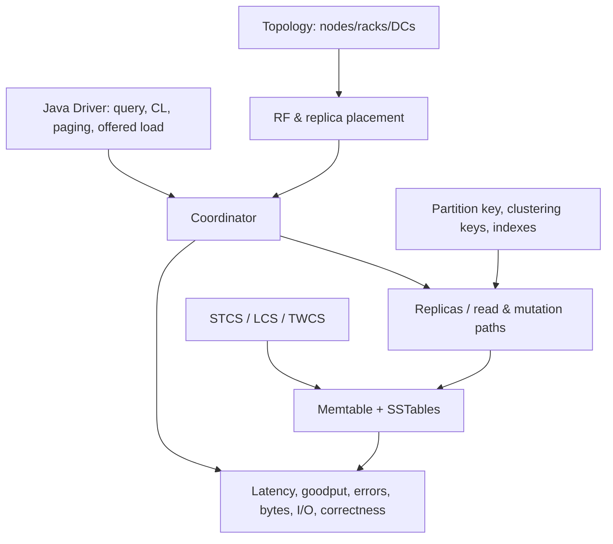
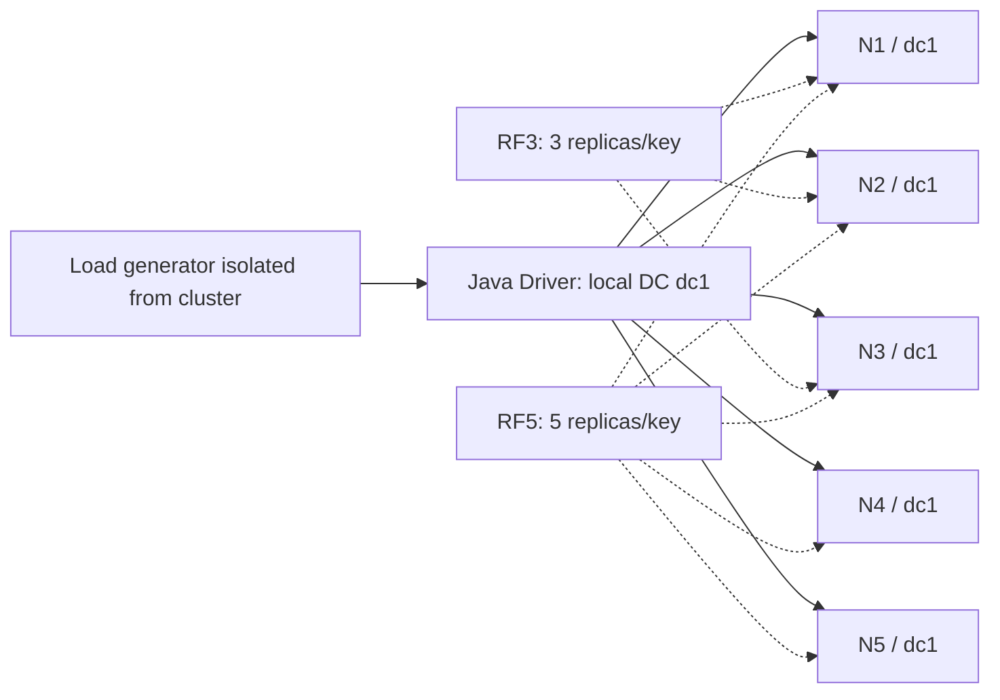

# Comparing CL, RF, Indexing, and Compaction Under Controlled Conditions

## 1. The Problem: What Actually Makes Cassandra Faster, Slower, or More Available?

An operations team observes a Java query at `LOCAL_QUORUM` with p99 around 80 ms while `LOCAL_ONE` is around 35 ms. They also see timeout rates shift after raising the replication factor (RF) from 3 to 5, a table with a secondary index running slower than a partition-keyed table, and a table using Leveled Compaction Strategy (LCS) reading fewer SSTables than Size-Tiered Compaction Strategy (STCS). **Can you conclude which configuration is better?**

Not yet. If two measurements differ in node count, dataset, partition size, tombstone volume, workload, compaction timing, or consistency level, **observed differences cannot be attributed solely to the target variable**. For instance, testing RF3 on three nodes and RF5 on five nodes changes total CPU/disk capacity simultaneously; you cannot credit throughput changes to RF alone. Similarly, benchmarking LCS immediately after switching compaction strategies measures migration overhead rather than steady state.

**Lesson goal:** build a **controlled experiment** in which the same read/write contract is evaluated across RF, CL, index-based vs. query-table access, and compaction strategies. Results must cover **correctness, latency, successful throughput, fault tolerance, and resource cost**, never just peak QPS.

This lesson belongs to the **Load and Distributed Fault Testing** chapter of the `DATABASE_ENGINE_WIDE_COLUMN_CASSANDRA` module: distributed wide-column architecture, partition keys, query-driven table design, read/write consistency, CQL, replication, compaction, repair, error handling, and the Java Driver.

### After This Lesson, Learners Will Be Able To

1. Formulate hypotheses and separate **independent, fixed, and observed variables** for RF, CL, secondary indexes, and compaction.
2. Design topology and fixtures to compare **RF3 vs. RF5 on identical hardware capacity**, avoiding conflating scale-out with RF changes.
3. Explain trade-offs among `ONE`, `LOCAL_QUORUM`, and `ALL` by RF, replica health, and single-node failures.
4. Compare queries using **partition keys**, 2i / Storage-Attached Indexes (SAI), and **query-driven denormalized tables** against the same result oracle.
5. Measure STCS/LCS/TWCS across matching write patterns, TTLs, data ages, and post-compaction states.
6. Use CQL, Java Driver 4.x, metrics/`nodetool`, and lab fault injection to build reproducible before-and-after reports.

> **Safety scope:** All DDL changes, index creation, RF changes, compaction changes, and fault injections belong **strictly on an isolated, authorized lab cluster**. Never alter `RF`, run bulk `nodetool repair`, drop indexes, or induce node failures on production to "run a benchmark". Numbers in this lesson are **hypothetical values for practicing analysis**, not actual Cassandra measurements for any specific setup.

## 2. Four Variable Groups Operating at Different Layers



| Variable to Compare | Layer Affected | Changeable Per Request? | Common Confounders |
|---|---|---|---|
| **CL**: `ONE`, `LOCAL_QUORUM`, `ALL` | Read/write acknowledgment threshold; request options | **Yes**, where driver/API supports it | Replica health, RF, coordinator, retries |
| **RF**: 3, 5 | Replica count and placement per keyspace/DC | **No**: alters schema and data sync | Node count, streaming/repair, disk usage, cluster health |
| **Index**: none, 2i, SAI | Query plan and node-local index structures | **No**: index build and maintenance | Incomplete index backfill, selectivity, write amplification |
| **Compaction**: STCS, LCS, TWCS | SSTable organization/merging; read/write/space amp | **No**: background and transition cost | Backlogs, tombstones, TTLs, disk headroom, caches |

**Never change all four variables at once and claim you isolated the root cause.** Vary one variable per experiment set (one-factor-at-a-time) for clean attribution, then test **interactions** via controlled matrices (e.g., RF × CL, index × compaction).

## 3. What Does "Controlled Conditions" Mean?

### 3.1. Variables That Must Be Held Fixed or Fully Recorded

| Group | What to Hold Fixed | Why |
|---|---|---|
| **Hardware** | Node count, CPU, RAM/heap, disk type, network, rack/DC topology | Different node counts change total serving capacity |
| **Versions** | Cassandra, Java Driver, Java, OS/kernel, JVM flags | Engine/driver updates alter read and compaction behavior |
| **Logical schema** | Primary key, clustering, types, TTL, GC grace, compression | Changing row shape alters the workload |
| **Data** | Total rows/partitions, rows/partition, payload bytes, hot-key skew, tombstones | Small/cached datasets do not represent large ones |
| **Queries** | Key/field contract, LIMIT/paging, hot/cold mix, selectivity | A test returning fewer rows is artificially faster |
| **Load** | Offered ops/s, concurrency, read/write ratio, seed, arrival pattern | Closed-loop throttles load when the server slows |
| **Client** | Connections, retry/speculation policy, control CL, page size, pool sizing | Can inflate attempts/QPS without increasing goodput |
| **Cluster state** | Hints, repair, compaction, streaming, snapshots, GC, backup jobs | Background I/O creates misleading p99 spikes |
| **Measurement window** | Warm-up, timing, run duration, repetitions, clock sync | Misaligned windows skew histograms and error rates |

Every measurement run needs a **manifest**: source revision, versions, config name, schema, data seed, run ID, UTC start/end, cluster state, node count, RF/CL, query shape, workload seed, driver retry config, and fault schedule. When testing CL, change **only CL**; when testing RF, keep **topology and total cluster capacity fixed** before and after.

### 3.2. Observing Effects vs. Controlling Confounders

An LCS table naturally exhibits different disk amplification from STCS even on identical data; that is a **legitimate effect of the compaction variable**, not something to force equal. However, measuring LCS while large pending compactions remain while STCS is settled introduces **transient-state noise**. Explicitly declare whether you are measuring **steady state** or **migration/rebuild cost**.

## 4. Formulate Hypotheses Before Starting

Examples of testable hypotheses:

| ID | Hypothesis | Primary Metric | Guardrail |
|---|---|---|---|
| H1 | `LOCAL_ONE` has lower read latency than `LOCAL_QUORUM` when all replicas are healthy | Full-result read p99 | Correct results, stale-read risk per contract |
| H2 | RF5 consumes more storage and write traffic than RF3 on 5 nodes | Disk bytes, node write bytes, goodput | Identical dataset and specified write CL |
| H3 | RF5 tolerates replica failures differently from RF3 at the same CL | Availability / error rate under fault | Identical node count and failure domains |
| H4 | Partition-keyed query table is steadier than cluster-wide index scan at low selectivity | p99, rows examined / bytes | Must return identical business ID sets |
| H5 | SAI (where supported) outperforms legacy 2i for a specific filter query | p99, successful QPS, index bytes | Index build complete, immutable dataset |
| H6 | LCS lowers SSTables/read for read-heavy workloads under certain distributions | SSTables per read, read p99 | Write amplification and disk headroom |
| H7 | TWCS fits time-ordered TTL time-series better than random upserts | Compaction bytes, space reclaimed | Equivalent dataset and TTL cycles |

Never assume H1–H7 always hold. For example, `ALL` may be too fragile for availability; SAI can shine at high selectivity yet incur heavy overhead when returning huge row sets; TWCS struggles under frequent updates to historical records.

## 5. Standard Lab Cluster for Comparing RF3 and RF5

To avoid mixing RF with scale-out, use **one DC with 5 nodes**, arranged across racks per lab topology with identical CPU/RAM/SSD specs. Compare **RF3 and RF5 on the exact same five nodes**, never "3-node RF3" vs. "5-node RF5".



**Note:** Under RF3, the three actual replicas for any token/partition are determined by replication strategy, token assignment, and rack topology—**not fixed to N1–N3 for all partitions**. The diagram illustrates replica count across five nodes, not a substitute for `nodetool getendpoints` or real token placement.

### 5.1. Two Ways to Reset the Environment Cleanly

**Option A — Rebuild lab from identical images/automation:** Run RF3 and save metrics; re-provision **the same 5 nodes**, load the exact same seed at RF5, let it stabilize, and measure. This offers the cleanest attribution at higher setup cost.

**Option B — Alter RF in the lab cluster:** Keep topology identical, change replication from RF3 to RF5 via `ALTER KEYSPACE`, run the appropriate replica sync/repair procedure, wait for streaming/repair/compaction to settle, and then measure. Run a control/cool-down cycle so caches, repair state, and historical SSTable layout do not skew results; **lowering RF back does not immediately delete old replicas either**.

In both options, record **usable logical volume and actual disk footprint**. You cannot force RF3 and RF5 to use identical disk bytes: that difference is part of the **RF cost** the test must report.

### 5.2. RF and CL Are Orthogonal Parameters, Not Four Arbitrary Modes

| Single DC, NTS | RF | `LOCAL_ONE` Needs | `LOCAL_QUORUM` Needs | `ALL` Needs |
|---|---:|---:|---:|---:|
| Setup A | 3 | 1 replica | 2 replicas | 3 replicas |
| Setup B | 5 | 1 replica | 3 replicas | 5 replicas |

**Quorum = `floor(RF / 2) + 1`** within the target DC. The `LOCAL_QUORUM` threshold differs between RF3 and RF5, and RF5/`ALL` requires all five replicas healthy to succeed. On a 5-node RF3 cluster, losing **any one node** does not mean every partition loses a replica; inspect actual replica placement and test across many keys.

### 5.3. Read/Write CL and the `W + R` Condition

In a stable environment, the theoretical rule `W + R > RF` ensures **the write-ACK replica set and read-response replica set overlap**; e.g., at RF3, `W = LOCAL_QUORUM = 2` and `R = LOCAL_QUORUM = 2` sum to 4 > 3. This is an **overlap condition**, **not a promise of linearizability for multi-step CQL read-modify-writes**:

- Cassandra resolves concurrent writes via timestamps / last-write-wins, without RDBMS row locks.
- TTLs, tombstones, out-of-sync replicas, repairs, and client timeouts affect contract visibility.
- When operations span **multiple DCs** with `LOCAL_*`, analyze each DC separately; never apply local arithmetic blindly globally.
- To prevent two concurrent writers from both winning a compare-and-set, use LWT / serial consistency where supported.

## 6. Creating Test Data and Schemas

All IDs, tenants, and payloads are synthetic. The first table uses partition key `job_id` for point lookups; the other query tables model the exact same business task ("find jobs by status") to compare indexing against denormalized tables.

```sql
CREATE KEYSPACE load_lab_ks
WITH replication = {'class': 'NetworkTopologyStrategy', 'dc1': 3}
AND durable_writes = true;

CREATE TABLE load_lab_ks.jobs_by_id (
    job_id uuid PRIMARY KEY,
    tenant_id text,
    bucket_day date,
    status text,
    payload text,
    updated_at timestamp
) WITH compaction = {
    'class': 'SizeTieredCompactionStrategy'
};

-- Illustrative query table. Production requires bucketing and bounded partition sizes.
CREATE TABLE load_lab_ks.jobs_by_status_day (
    status text,
    bucket_day date,
    job_id uuid,
    tenant_id text,
    payload text,
    updated_at timestamp,
    PRIMARY KEY ((status, bucket_day), job_id)
);

INSERT INTO load_lab_ks.jobs_by_id
    (job_id, tenant_id, bucket_day, status, payload, updated_at)
VALUES (
    11111111-2222-4333-8444-555555555555,
    'tenant-lab-001', '2026-11-21', 'READY', 'synthetic-a',
    '2026-11-21T08:00:00+0000'
);

INSERT INTO load_lab_ks.jobs_by_status_day
    (status, bucket_day, job_id, tenant_id, payload, updated_at)
VALUES (
    'READY', '2026-11-21',
    11111111-2222-4333-8444-555555555555,
    'tenant-lab-001', 'synthetic-a',
    '2026-11-21T08:00:00+0000'
);
```

**Never benchmark with a single row.** Generate a large fixture using a deterministic seed, load enough volume to exceed trivial caches, and match partition sizes across runs. Example data profile (**illustrative, not mandatory defaults**):

| Property | Example Value | Rule |
|---|---|---|
| Seed | 20261121 | Identical seed across all configurations |
| Total jobs | 1,000,000 | Recount accurately after loading |
| Distinct tenant IDs | 10,000 | Fixed tenant distribution |
| Status distribution | `READY` 40%, `RUNNING` 35%, `DONE` 20%, `FAILED` 5% | Intentional index selectivity |
| Day buckets | 20 days | Fixed time span |
| Payload | 256 B and 2 KiB in published proportions | Unchanged between A and B |
| Hot keys | 5% of keys receive 50% of traffic in hot phase | Same workload trace/seed |
| TTL | No TTL for baseline; dedicated TTL phase | Do not mix expiry into basic read tests |
| Tombstones | None in baseline; dedicated delete/tombstone phase | Avoid random compaction history drift |

Deterministically map sequential integers + seed to valid `job_id` UUIDs so repeated loads produce the **exact same logical dataset**. Record **insert order, row counts, and manifest hash**; unseeded randomness can shift a few hot partitions and flip conclusions.

## 7. Query Contract: Compare the Same Business Question

### 7.1. Point Lookup by Full Partition Key

```sql
SELECT job_id, tenant_id, status, bucket_day, updated_at
FROM load_lab_ks.jobs_by_id
WHERE job_id = 11111111-2222-4333-8444-555555555555;
```

This is the standard query for comparing **CL, RF, and compaction**, since the full partition key is supplied with no index involved. Verify exact `job_id`, all fields, `null` semantics, and consistency. Never switch to `SELECT *` on RF5 while RF3 only reads five columns.

### 7.2. Querying by Status: Three Design Approaches

1. **Secondary index** on `jobs_by_id.status` for `WHERE status = ?`. Cassandra indexes live locally on each node; filtering without a partition key can scatter requests across many nodes/partitions. For low-selectivity values like `status='READY'` (40% of rows), the index must process huge match sets.
2. **SAI** on the same column **if supported by your distribution**; compare against 2i by loading **identical cloned tables** and running the exact same projection/status query.
3. **Query-driven table** `jobs_by_status_day` keyed by `(status, bucket_day)`; requires knowing `bucket_day` from the API contract, and may require querying multiple buckets if the API asks for "all days".

Never compare "an index returning all `READY` jobs across 20 days" against "a query table reading `READY` for one day" and declare the second faster. To compare fairly, enforce the **exact same business result set**—for instance, `listReadyJobs(day)` filtering by `bucket_day` on the index or another supported predicate; if one design reads wider and filters client-side, count that full cost.

### 7.3. Mandatory Result Oracle per Query

- **Exact `job_id` set:** consume every page, not just page 1.
- **Payloads/fields, nulls, and data versions** must match.
- **Ordering:** a cross-partition secondary index query does not guarantee global sort order; if the API requires sorting, include client-side sort/pagination cost or change the table model.
- **`LIMIT` and paging:** `LIMIT` caps total rows returned, while page size is a server hint; compare actual row counts and full-operation latency.
- **Concurrently mutating datasets:** pause writes for the correctness oracle or use explicit event-version cutoffs; Cassandra does not provide cross-table snapshots across denormalized tables over multiple `SELECT`s.

If an index query cannot satisfy the contract without massive scanning/filtering, mark it **unsuitable for the workload** instead of forcing `ALLOW FILTERING` onto production plans.

## 8. Testing CL: Changing Exactly One Variable in the Java Driver

Using `jobs_by_id` at RF3, run separate trials:

| ID | Write CL | Read CL | Workload | Question |
|---|---|---|---|---|
| C1 | `LOCAL_ONE` | `LOCAL_ONE` | Point read/write, all replicas healthy | Minimum local-DC acknowledgment cost |
| C2 | `LOCAL_QUORUM` | `LOCAL_QUORUM` | Same ratios and key set | Cost of quorum reads/writes |
| C3 | `ALL` | `ALL` | Same offered load, safe limits | Cost and sensitivity to slow replicas |
| C4 | `LOCAL_QUORUM` | `LOCAL_ONE` | Defined read-after-write | Read performance vs. freshness risk |
| C5 | `LOCAL_ONE` | `LOCAL_QUORUM` | Read after write with explicit checks | Can stale records or replica state be observed? |

Never lump C4/C5 into "quorum math always holds" across failure or concurrent-write scenarios. Standard CQL CL does not make multi-step read-modify-write sequences linearizable transactions.

### Manual CQL Verification

```sql
CONSISTENCY LOCAL_ONE
SELECT status, updated_at
FROM load_lab_ks.jobs_by_id
WHERE job_id = 11111111-2222-4333-8444-555555555555;

CONSISTENCY LOCAL_QUORUM
SELECT status, updated_at
FROM load_lab_ks.jobs_by_id
WHERE job_id = 11111111-2222-4333-8444-555555555555;

CONSISTENCY ALL
SELECT status, updated_at
FROM load_lab_ks.jobs_by_id
WHERE job_id = 11111111-2222-4333-8444-555555555555;
```

CQL `CONSISTENCY` applies only to statements issued within that `cqlsh` session. In Java applications, set CL on `BoundStatement` or execution profiles. In multi-DC topologies, `ALL` requires all replicas per CL scope, whereas `LOCAL_ONE`/`LOCAL_QUORUM` stay within the local DC per coordinator/replication settings.

### Do Not Assume "Higher CL Is Always Slower"

In a healthy cluster, `ALL` typically tracks the slowest replica and suffers p99 spikes when any node hits GC or compaction. Yet read-path optimizations, hints, scheduling, and data locality all matter; measure **p50/p95/p99 distributions**, **timeouts**, and **successful ops/s** rather than guessing from a single stopwatch check. Under node failures, `ALL` goodput can drop near 0 for affected partitions; **success-only** p99 then completely misrepresents application availability.

## 9. Testing RF: Change Replication First, Measure After Data Converges

In a **lab** already running all five nodes:

```sql
-- Initial Setup A (RF3):
ALTER KEYSPACE load_lab_ks
WITH replication = {'class':'NetworkTopologyStrategy','dc1':3};

-- Only with capacity headroom and 5 nodes verified:
ALTER KEYSPACE load_lab_ks
WITH replication = {'class':'NetworkTopologyStrategy','dc1':5};
```

**This is a schema operation, not an "instant consistency boost".** Before measuring RF5:

1. Verify all five nodes, DC/rack placement, cluster version, and disk headroom.
2. Alter keyspace replication via CQL on the lab cluster and check schema agreement.
3. Run the **data synchronization procedure to new replicas** appropriate for your version/topology—typically full repair / repair workflows per your Cassandra release's runbook; never assume `ALTER KEYSPACE` automatically copies existing SSTables to new replicas.
4. Wait for streaming/repair to finish, verify replica placement across sample keys, and inspect network/disk/compaction backlogs.
5. Let the cluster stabilize and match warm-up/cache state before starting the measurement window.
6. Verify source counts and run read-after-write/query oracles at the target CL.

### Read-Only Monitoring Commands

```bash
nodetool status
nodetool describecluster
nodetool netstats
nodetool compactionstats
nodetool tpstats
nodetool tablestats load_lab_ks.jobs_by_id
```

These commands alone do not prove **every partition** satisfies the new RF and replica consistency. After an RF change, validate via repair/verification procedures, sampled data checks, error metrics, and logs. Never blindly run `nodetool cleanup` or `repair -full` on production without a runbook and disk/bandwidth headroom; exact flags vary by version and scenario.

### Note on Lowering RF

Reducing RF can leave physical data on nodes that no longer own those tokens for some time. Expecting "disk bytes drop right after `ALTER KEYSPACE`" is wrong; measure **steady-state cost after safe cleanup** separately from the transition phase. Always have snapshots/backups/rollback plans before altering RF.

## 10. RF × CL Matrix and Replica Failures

Below is **theoretical CL achievability for one partition** assuming surviving replicas respond properly—excluding network partitions, timeouts, coordinator failures, repairs, or stale data:

| RF | Live Replicas for Partition | `ONE` / `LOCAL_ONE` | `QUORUM` / `LOCAL_QUORUM` | `ALL` |
|---:|---:|---|---|---|
| 3 | 3 | Achievable | Achievable (2/3) | Achievable |
| 3 | 2 | Achievable | Achievable (2/3) | **Fails** |
| 3 | 1 | Achievable | **Fails** | **Fails** |
| 5 | 5 | Achievable | Achievable (3/5) | Achievable |
| 5 | 4 | Achievable | Achievable (3/5) | **Fails** |
| 5 | 3 | Achievable | Achievable (3/5) | **Fails** |
| 5 | 2 | Achievable | **Fails** | **Fails** |

In the **single-DC** example, `LOCAL_QUORUM` matches that DC's quorum. In **multi-DC** clusters, evaluate RF **per DC** and distinguish local vs. global CLs. Real survivability of **a given partition** depends on its token replicas; multi-rack clusters must account for failure domains and rack placement.

### Simulating Node Failures Properly

- Run a healthy baseline at steady load.
- Verify which nodes actually hold replicas for your test partitions (via token/placement).
- Stop a node or isolate its network **in the lab** per an explicit plan.
- Measure request success/failure rates, timeouts, p99, coordinator failover, retries, and queues.
- Restore the node, monitor hints/streaming/repair as needed, and verify row sets and consistency.

**Never conclude from "one node died" that all requests fail or all survive:** token-aware routing picks different coordinators and each partition maps to a different replica set.

## 11. Comparing Legacy 2i, SAI, and Query-Driven Tables

### 11.1. Secondary Indexes Do Not Eliminate Distributed Execution

Legacy secondary indexes (commonly **2i**) store index entries locally on each replica; queries lacking a partition key can make the coordinator scatter requests across many nodes/partitions. On low-selectivity columns like `status='READY'` matching 40% of rows, the index processes huge match sets. **SAI (Storage-Attached Indexing)** improves storage integration and multi-predicate filtering, yet still incurs index maintenance/read costs and does not turn Cassandra into a search engine or relational query planner.

**Version availability:** Apache Cassandra OSS **5.0** includes SAI; do not assume Cassandra 4.1 OSS has SAI. Some distributions include backports or variants; verify your exact version and index implementation before comparing. Never assume vendor-specific index syntax works on every Cassandra cluster.

### 11.2. Create Schema Clones to Compare on Identical Datasets

In the lab, create tables with **identical columns, primary keys, compaction, and RF/keyspace**, differing only in name:

```sql
CREATE TABLE load_lab_ks.jobs_by_id_2i (
    job_id uuid PRIMARY KEY,
    tenant_id text,
    bucket_day date,
    status text,
    payload text,
    updated_at timestamp
) WITH compaction = {'class':'SizeTieredCompactionStrategy'};

CREATE TABLE load_lab_ks.jobs_by_id_sai (
    job_id uuid PRIMARY KEY,
    tenant_id text,
    bucket_day date,
    status text,
    payload text,
    updated_at timestamp
) WITH compaction = {'class':'SizeTieredCompactionStrategy'};

-- Legacy 2i; lab must verify the exact index implementation created on its release:
CREATE INDEX jobs_status_2i
ON load_lab_ks.jobs_by_id_2i (status);

-- On Apache Cassandra OSS 5.0 supporting SAI:
CREATE CUSTOM INDEX jobs_status_sai
ON load_lab_ks.jobs_by_id_sai (status)
USING 'StorageAttachedIndex';
```

**Execute the SAI DDL only after verifying syntax and index type on your actual release.** Index class names and syntax can vary by release/distribution. Fully populate the SAI table with the **exact same rows** and wait for index build/backfill to finish before benchmarking; if an index build fails or stays incomplete, record an **availability/operational failure** rather than silently folding it into steady-state p99.

### 11.3. Two Distinct Comparisons to Measure Separately

**Task A: Identical index-query semantics**

```sql
SELECT job_id, tenant_id, status, bucket_day, updated_at
FROM load_lab_ks.jobs_by_id_2i
WHERE status = 'FAILED';

SELECT job_id, tenant_id, status, bucket_day, updated_at
FROM load_lab_ks.jobs_by_id_sai
WHERE status = 'FAILED';
```

Read **all pages** on an immutable fixture, collecting the same key set/histogram regardless of row order. Then test deliberate status selectivities (e.g., `FAILED` 5%, `READY` 40%) and compare p99, throughput, response bytes, CPU/index size, and write overhead. If a query is invalid or unsupported due to index limits, mark it **unsupported** rather than forcing `ALLOW FILTERING` into the plan.

**Task B: Index vs. query-table data model**

```sql
SELECT job_id, tenant_id, payload, updated_at
FROM load_lab_ks.jobs_by_status_day
WHERE status='READY' AND bucket_day='2026-11-21';
```

This table uses partition key `(status, bucket_day)` so queries can route token-awarely; ensure reasonable partition sizes and that the API **already supplies `bucket_day`**. An index query `WHERE status='READY'` across 20 days **does not share the same contract** as a single-day query. To compare fairly, give the index query the matching day filter (if supported by the index path) or include client-side filtering bytes/rows explicitly.

### 11.4. Write Impact

Indexes add work on `INSERT`/`UPDATE`/`DELETE`, increase disk usage, and add compaction/index maintenance. Benchmark both **selective reads** and **write/mixed** workloads, not just the fastest `SELECT`. A denormalized table accelerates reads at the cost of writing multiple tables per business event—which also creates write amplification and requires **replay/reconciliation** if one table write succeeds while another fails.

### 11.5. Do Not Assume Every Filter Fits SAI

| Workload Characteristic | Index May Fit When | Revisit the Data Model When |
|---|---|---|
| High-selectivity filter | Small result sets, version-supported predicates | High-QPS strict single-partition p99 SLAs |
| Low-selectivity filter | Bounded key sets and modest row counts | Millions of matches / cluster scatter-gather |
| Exact key lookup | No index needed | Always use the partition key directly |
| Multiple `AND` predicates | Explicit SAI/index support on your version | Query planner unsupported or wide fan-out |
| Global time-sorted order | Cannot rely on default index ordering | Design bucketed clustering tables |
| Frequent status updates | Monitor index maintenance cost | High transition rates cause heavy index write amp |

**Index benchmark conclusions** need two views: read latency/goodput across selectivities, and write latency/throughput/resource cost for maintaining the index. Measuring only 5% `FAILED` cannot extrapolate to 40% `READY`.

## 12. Compaction: No Strategy Wins Every Workload

Cassandra writes to memtables and flushes immutable SSTables. **Compaction** merges SSTables, purges obsolete versions and tombstones when safe, and alters how many SSTables a read inspects. Compaction strategy governs read amplification, write amplification, and disk space amplification.

| Strategy | Typical Optimization Goal | Workloads to Test | Trade-Off |
|---|---|---|---|
| **STCS — SizeTieredCompactionStrategy** | Groups similarly sized SSTables; suits write-heavy | Continuous ingest and upserts with relaxed read tails | More SSTables/read in some states; needs disk headroom for large compactions |
| **LCS — LeveledCompactionStrategy** | Bounds SSTable overlap; often improves reads | Point/range read-heavy with strict p99 SLAs | Higher write amplification and background I/O on some workloads |
| **TWCS — TimeWindowCompactionStrategy** | Buckets SSTables by time window for time-series/TTL | Time-ordered append-only with uniform TTLs | Out-of-order writes/updates to older data cause overlap and delay expiry/tombstone purge |

**Newer strategies exist by Cassandra version**, such as Unified Compaction Strategy (UCS) in supporting releases. Never lump them into the same "family" as STCS/LCS/TWCS when benchmarking; verify exact server/driver versions and effective configs.

### 12.1. Compaction Comparisons Need at Least Two Phases

**Bulk load / ingest phase:** measure successful writes/s, write p99, disk bytes, compaction bytes, pending compactions, and time-to-settle—not just the final `INSERT` duration.

**Steady-state phase:** once workload and compaction stabilize, measure point/range read p99, SSTables/read, tombstones, write amplification, and disk headroom. For continuous 24/7 traffic, define "steady state" over a repeatable representative window rather than demanding zero pending compactions every second.

### 12.2. Run on Cloned Tables

```sql
CREATE TABLE load_lab_ks.jobs_stcs (
    job_id uuid PRIMARY KEY, status text,
    payload text, updated_at timestamp
) WITH compaction = {
    'class': 'SizeTieredCompactionStrategy'
};

CREATE TABLE load_lab_ks.jobs_lcs (
    job_id uuid PRIMARY KEY, status text,
    payload text, updated_at timestamp
) WITH compaction = {
    'class': 'LeveledCompactionStrategy',
    'sstable_size_in_mb': '160'
};

CREATE TABLE load_lab_ks.jobs_twcs (
    job_id uuid PRIMARY KEY, status text,
    payload text, updated_at timestamp
) WITH compaction = {
    'class': 'TimeWindowCompactionStrategy',
    'compaction_window_unit': 'DAYS',
    'compaction_window_size': '1'
};
```

In the TWCS table, the CQL column `updated_at` **does not control compaction windows**; TWCS buckets by **SSTable/cell write timestamps**. Never populate historical dates in `updated_at` and assume TWCS organizes old writes ideally—examine actual write timestamps / `USING TIMESTAMP`, TTLs, and out-of-order writes.

### 12.3. Two Workloads to Avoid Unfair Conclusions

- **Workload A: write-heavy + random upserts** into older partitions without TTL. STCS/LCS are natural candidates; TWCS should not be expected to win.
- **Workload B: append / time-bucketed writes + uniform TTL**, with minimal updates to old rows and daily windows. Here TWCS is evaluated under the conditions it was designed for.

A sound conclusion might be: "LCS delivered the best read p99 on Workload A at higher write I/O than STCS," while "TWCS suited Workload B's expiry-reclamation goal." Never force a single overall winner across fundamentally different workloads.

### 12.4. Switching Strategies Mid-Run Is a Different Experiment

```sql
-- LAB ONLY; this is a config migration, NOT a steady-state benchmark:
ALTER TABLE load_lab_ks.jobs_by_id
WITH compaction = {
    'class': 'LeveledCompactionStrategy'
};
```

After `ALTER TABLE`, existing SSTables are not instantaneously rewritten into the new strategy's layout. Transition backlogs, rewrite I/O contention, and elevated temporary disk usage can occur. **Report migration cost and steady state separately**, never treating transition p99 as long-term behavior.

**Do not** force a manual major compaction "to make things fair" if it alters SSTable history and induces massive I/O; major compaction carries disk-headroom and tombstone risks and belongs only in justified lab runbooks.

## 13. Designing the Workload: Equal Offered Load, Not Just Equal Concurrency

A closed-loop benchmark sends the next request **after** the previous response arrives; when Cassandra slows down, the send rate drops automatically and masks backlogs (**coordinated omission**). For capacity/SLO validation, include an **open-loop** phase emitting at a fixed schedule, while bounding in-flight requests and explicitly reporting **drops/rejections** if the generator falls behind.

| Phase | Offered Load | Goal | Observations |
|---|---|---|---|
| Warm-up | Low → target | Connections, prepared cache, JIT, reasonable cache warming | Excluded from final KPIs |
| Read-only | E.g., 200, 400, 800 ops/s | p99, hit/miss, CL/index behavior | Successful ops/s, errors, bytes |
| Write-only | Matching target rates | CL/RF/compaction/index write cost | Disk/network, compaction debt |
| Mixed | 80% read, 20% write | Product-like workload | Hot-key distribution, retries |
| Hot partition | 5% of keys receive most load | Expose contention and skew | Token/replica hotspots |
| Soak | Target rate over extended window | Sustainable compaction/GC/disk debt | p99 drift, pending tasks |
| Fault | Hold offered rate, inject node/network fault | Availability, retry amplification, recovery | Error rate, recovery time, correctness |

These rates are **planning examples only**: size them to your lab's resources rather than applying 800 ops/s universally. Every phase needs explicit duration, repetitions, and stop criteria.

### 13.1. Throughput Metrics to Capture

\[
\text{Goodput} = \frac{\text{Successful and data-correct business operations}}{\text{Observation duration}}
\]

\[
\text{Error rate} = \frac{\text{Operations violating the contract}}{\text{Total emitted operations}}
\]

**Offered QPS** is the scheduled demand from the generator, **achieved QPS** is requests actually sent/processed, and **successful goodput** counts only valid, data-correct completions. Under heavy errors or deep client queues, 10,000 "request attempts/s" does not mean the system served 10,000 business ops/s.

### 13.2. Keep Workloads Equivalent Across Index and Query-Table Comparisons

When an index query returns multiple rows and a point lookup returns one row, never compare **per-CQL-request p99** and declare a winner. Compare **full business-operation p99**, including all pages, object mapping, any required sorting, retries, extra projection writes, and **the exact same job set**. If a contract allows top-K without a defined sort order, document it clearly because changing `LIMIT` can change the returned set.

## 14. Java Driver 4.x: A Timed Probe with Data Verification

Java 17 example reusing a `CqlSession` bean created and warmed outside the measurement window; never create a new `CqlSession` per request. Reuse one `PreparedStatement` per CQL shape, binding IDs and CL per request.

```java
import java.util.UUID;
import java.util.concurrent.CompletionStage;
import com.datastax.oss.driver.api.core.CqlSession;
import com.datastax.oss.driver.api.core.DefaultConsistencyLevel;
import com.datastax.oss.driver.api.core.cql.*;

public final class JobReadProbe {
    private final CqlSession session;
    private final PreparedStatement prepared;

    public record Probe(
        boolean correct, long durationNanos,
        String errorClass, int speculativeStarts
    ) {}

    public JobReadProbe(CqlSession session) {
        this.session = session;
        this.prepared = session.prepare(
            "SELECT job_id, status, updated_at " +
            "FROM load_lab_ks.jobs_by_id WHERE job_id=?");
    }

    public CompletionStage<Probe> read(
            UUID id, DefaultConsistencyLevel cl) {

        BoundStatement stmt = prepared.bind(id)
            .setConsistencyLevel(cl)
            .setIdempotent(true);

        long startedNanos = System.nanoTime();

        return session.executeAsync(stmt).handle((page, failure) -> {
            long elapsed = System.nanoTime() - startedNanos;
            if (failure != null) {
                return new Probe(false, elapsed,
                    failure.getClass().getSimpleName(), 0);
            }
            Row row = page.one();
            boolean correct = row != null
                && id.equals(row.getUuid("job_id"));
            int specs = page.getExecutionInfo()
                .getSpeculativeExecutionCount();
            return new Probe(correct, elapsed, "", specs);
        });
    }
}
```

**Reading the code:**

- `startedNanos` is captured right before `executeAsync`, measuring from submission until the first page arrives and is mapped. For **single-row point lookups**, that matches query latency; for multi-page queries, fetch **all pages** to capture **full-result latency**.
- `correct` checks UUID match, which is **not yet enough to verify `status` or `updated_at`**; full test suites need a complete fixture oracle.
- `failure` maps into a `Probe` error rather than dropping the future; error statistics should separate timeouts, unavailable errors, auth failures, and driver mapping exceptions.
- `getSpeculativeExecutionCount()` counts speculative starts for this request, **not** coordinator→replica messages.
- Never put response sizes, coordinator IPs, bound tenant IDs, or real payloads into metric labels.

### 14.1. Bounding Concurrency in a Trial

The snippet below is a **closed-loop concurrency-limited** runner suitable for smoke checks and exploratory tests; it is **not** an open-loop offered-rate generator.

```java
import java.util.*;
import java.util.concurrent.*;
import com.datastax.oss.driver.api.core.DefaultConsistencyLevel;

JobReadProbe probe = new JobReadProbe(session);
Semaphore capacity = new Semaphore(32);
List<CompletableFuture<JobReadProbe.Probe>> results = new ArrayList<>();

// ids is a bounded fixture list generated from a fixed seed.
for (UUID id : ids) {
    capacity.acquire(); // Runs on the load-generator thread, NEVER inside a driver I/O callback.
    CompletableFuture<JobReadProbe.Probe> f =
        probe.read(id, DefaultConsistencyLevel.LOCAL_QUORUM)
            .toCompletableFuture();
    f.whenComplete((value, error) -> capacity.release());
    results.add(f);
}

CompletableFuture.allOf(
    results.toArray(new CompletableFuture<?>[0])).join();

long success = results.stream()
    .map(CompletableFuture::join)
    .filter(JobReadProbe.Probe::correct)
    .count();
System.out.println("correct=" + success + "/" + ids.size());
```

**Never run this verbatim over millions of IDs**, because `results` retains every future in RAM; this is a lab snippet capped at a few thousand IDs. For long benchmarks, use bounded aggregation/histograms and discard completed futures. For open-loop runs, use an independent rate scheduler with an **explicit queuing/dropping policy**, and never block driver event-loop threads.

### 14.2. Verifying Full CQL Results

In an immutable fixture, a point lookup returns one exact job or none. Correctness checks must verify **expected row values** by UUID (`status`, `tenant_id`, `bucket_day`, `updated_at`), not merely `row != null`. For multi-row index queries, collect returned UUIDs across **all pages** into a set, compare against the oracle, validate payloads where required, and account for client-side sorting costs if the API mandates ordering.

## 15. Paging, Retries, and "Round-Trip Counts"

The Java Driver may send extra requests to fetch subsequent pages or retry/speculate when a node slows down. Measurement layers:

| Layer | Example | Measurement Instrument |
|---|---|---|
| Business operation | "Find READY jobs for day X" | Successful ops/s, exact ID set match |
| Logical CQL requests | One query shape + each page | `ResultSet.getExecutionInfos()` or async per-page execution info |
| Node attempts | Initial, retry, speculation | Driver `RequestTracker` / metrics |
| Coordinator–replica messages | Read/data/digest/mutation per RF/CL | Selective Cassandra tracing and node metrics |
| TCP frames/bytes | TLS/network implementation | Network counters, transport metrics |

**Never** multiply 3 pages × RF5 and claim 15 TCP packets. Coordinators send different messages depending on read path and CL; TCP/TLS coalesce or fragment payloads, and page retries add extra node attempts.

### Driver Retry and Speculative Policies Must Be Declared

Use `setIdempotent(true)` only on queries safe to replay; retries and speculation can keep goodput flat while increasing backend traffic. When comparing CL or compaction, hold **retry and speculative policies constant** across runs. If comparing policies themselves, treat them as an **independent variable** in a separate experiment. Never use consistency-downgrading retries to turn contract-violating timeouts into "successes".

## 16. Collecting Metrics from Three Perspectives

### 16.1. Application / Driver

| Metric | Question |
|---|---|
| Offered business ops/s | How much work did the generator intend to submit? |
| Goodput ops/s | How many operations succeeded **with accurate data**? |
| Errors / timeouts / unavailable | How many requests breached the contract? |
| p50/p95/p99 latency | What tail latency do users experience? |
| First-page vs. full-operation | Are we undercounting subsequent pages? |
| Retry / speculative / node attempts | Did the driver amplify traffic under faults? |
| In-flight / queue / dropped load | Did the client saturate and shed work? |
| Request / response bytes | Impact of projections, paging, and indexes |
| Prepared statement cache / `UNPREPARED` | Any startup or re-prepare noise? |

Reporting only **success** p99 misleads when many requests fail fast; always track **latency of failed/timed-out requests**, error budgets, and goodput. With a 2-second timeout cap, the success histogram omits all slower requests that timed out.

### 16.2. Cassandra Coordinator / Replica

| Metric / Observation | Issue Diagnosed |
|---|---|
| `ClientRequest` Read/Write latency, timeouts | Which coordinator node is slow or returning unavailable |
| SSTables per read | Read amplification shaped by compaction |
| Bloom filter false positives | Nonexistent-partition reads causing disk I/O |
| Tombstones scanned | TTL/delete workloads causing read latency |
| Pending compactions / bytes compacted | Compaction debt and write amplification |
| Memtable flushes / commitlog / disk await | Which resource bottlenecks the write path |
| Network bytes / dropped messages | RF and retries driving network load |
| GC pauses / CPU utilization | Tail latency caused by heap or CPU |
| Active repair / streaming / hints | Background noise or failure/recovery impact |
| Index disk bytes / index query metrics (if exposed) | Evaluating 2i/SAI build, read, and maintenance costs |

Metric names and MBeans vary by Cassandra and driver release. Use version-matched telemetry (JMX/Prometheus/driver metrics) and document **metric definitions** in your report instead of copying stale blog metric names.

### 16.3. Read-Only Operational Commands

```bash
nodetool status
nodetool describecluster
nodetool tpstats
nodetool compactionstats
nodetool netstats
nodetool proxyhistograms
nodetool tablestats load_lab_ks.jobs_by_id
nodetool tablehistograms load_lab_ks jobs_by_id
```

These reflect the **queried node's view** (and sometimes node-local aggregates), not complete cluster-wide replica statistics. Collect from multiple nodes with synchronized UTC clocks, and align CPU/disk/network dashboards to the exact driver p99 window.

**Never benchmark with full-traffic tracing enabled:** tracing and querying `system_traces` add overhead and extra requests. Sample traces selectively only when diagnosing coordinator→replica paths, and treat trace data carefully since it can contain sensitive keys or bind values.

## 17. Reproducible Measurement Workflow: Baseline → Steady State → Fault

```mermaid
flowchart LR
    Inventory["Inventory/version/topology"] --> Schema["Schema & deterministic fixture"]
    Schema --> Warm["Warm-up / verify all rows"]
    Warm --> Quiet["Wait for streaming/index/compaction settle"]
    Quiet --> Measure["Measure at fixed offered rates"]
    Measure --> Fault["Inject one controlled failure"]
    Fault --> Recover["Restore + repair/reconcile if required"]
    Recover --> Verify["Verify data + collect metrics"]
    Verify --> Report["Paired analysis / guardrails"]
```



### A Standard Run Includes

1. **Preflight topology:** verify nodes, DC/rack, RF, schema agreement, disk/CPU headroom, and tool versions.
2. **Data loading:** identical seed, counts, payload distribution, TTL/tombstones, and insert order; zero production data.
3. **Data verification:** sample keys, total rows, and digests/canonical checks against the same snapshot/conditions.
4. **Warm-up:** driver sessions/prepared statements, JIT, caches, and pools; exclude warm-up from steady-state KPIs.
5. **Quiescence gate:** index build, streaming, and repair completed; compaction within scenario bounds.
6. **Load schedule:** hold offered rates, query mix, and seed across repeated runs; alternate run order or use matched runs to detect drift.
7. **Fault gate:** inject one clear failure while holding workload, measuring detection time, errors, goodput, and recovery—never alter RF or rebuild indexes concurrently.
8. **Read-back correctness:** verify key sets, field values, and business invariants, auditing any retry/timeout side effects.
9. **Report:** configs, latencies/errors/goodput/resource costs, observations, limitations, and go/no-go decision.

### Fair Comparisons Do Not Always Run Simultaneously

When testing index or compaction strategies, two tables on the same cluster share disks and caches; running A and B simultaneously makes them **contend for resources**. Run **sequentially** with warm-up/cool-down windows, alternate order (`A/B/B/A`) across independent trials, and log background activity. For RF3/RF5, topology/data resets and repairs make alternating harder; if running each once, explicitly disclose **drift risk**.

## 18. Fault Injection: One Fault Variable at a Time

| Scenario | Injected Variable | What to Measure | What Not to Conclude |
|---|---|---|---|
| F0 | Healthy cluster | Baseline p99/goodput | Does not represent failure behavior |
| F1 | One target-key replica slowed | Tail latency by CL, speculation | Do not assume all partitions hit the same replica |
| F2 | One replica lost | Success/errors by RF/CL, coordinator failover | Do not assume `ALL` remains available |
| F3 | Coordinator reset mid-request | Driver retries, unknown write outcomes | Timeout does not confirm write failed |
| F4 | Inter-rack network cut in lab | Latency/availability, replica placement | Do not generalize to all DC partitions |
| F5 | Simulated compaction/GC pressure | p99, CPU/disk, pending tasks | Do not mix with healthy RF/CL steady state |
| F6 | Incomplete index build | Read errors/latency, build progress | Do not compare as a settled index |
| F7 | Concurrent TTL/deletes during reads | Tombstone scans and correctness | Do not mistake expected mutations for query bugs |
| F8 | Post-failure bulk repair/streaming | Recovery time and service SLOs | Do not lump into initial steady-state p99 |

**Never inject faults with real tenants present or without a rollback plan.** Stopping one node does not prove "RF5 fault tolerance" if partition placement was misconfigured or streaming was still running; verify placement and recovery state before and after.

### 18.1. Illustrative Fault Schedule

| Phase | Example Duration | Action |
|---|---|---|
| Healthy baseline | 10 minutes | Steady run; record goodput and p99 |
| Fault injection | 1 minute | Stop one node **in lab** or throttle network |
| Fault sustained | 5 minutes | Maintain offered load; track errors and goodput |
| Recovery | Until defined criteria met | Restore node; monitor queues and replicas |
| Post-recovery | 10 minutes | Compare to baseline; measure lingering compaction/backlog |

Durations are **examples**, sized so the cluster yields enough p99 samples and captures real recovery costs. Never declare recovery complete solely because `nodetool status` shows `UN`: verify request success rates, p99, data correctness, and background tasks.

## 19. Analyzing Results Tables: Hypothetical Example

Assume an identical 5-node topology, fixed dataset, 90% point reads / 10% writes, 500 business ops/s offered, all nodes healthy. **These are hypothetical exercise numbers**, not real Cassandra measurements:

| Run | RF | Read / Write CL | Goodput (ops/s) | Success p99 (ms) | Errors (%) | Logical Disk Overhead |
|---|---:|---|---:|---:|---:|---|
| A1 | 3 | `LOCAL_ONE` / `LOCAL_ONE` | 499 | 18 | 0.2 | RF3 reference |
| A2 | 3 | `LOCAL_QUORUM` / `LOCAL_QUORUM` | 498 | 31 | 0.4 | Same RF3 data |
| A3 | 3 | `ALL` / `ALL` | 492 | 60 | 1.6 | Same RF3 data |
| B1 | 5 | `LOCAL_ONE` / `LOCAL_ONE` | 497 | 22 | 0.6 | More replicas |
| B2 | 5 | `LOCAL_QUORUM` / `LOCAL_QUORUM` | 494 | 42 | 1.2 | More replicas |
| B3 | 5 | `ALL` / `ALL` | 480 | 83 | 4.0 | More replicas |

**How to read this table properly:**

- Conclude only that **under these assumptions**, `ALL` had higher success p99; never extrapolate universally across all workloads or versions.
- Higher errors in B3 may reflect `ALL` requiring every replica; inspect traces, metrics, and node latencies rather than blaming RF alone.
- Goodput never exceeds offered 500. Any error-rate discrepancies must reconcile against **completed/failed/dropped counts** and the measurement window.
- RF5 incurs higher disk/network cost even though the table only labels it qualitatively. Real reports must state **GiB, IOPS, MiB/s, and per-node cost**, not just "more replicas".
- Success p99 **excludes timeouts** dropped from success latency samples; supplement with failure/deadline-exceedance metrics.

### 19.1. Separate Fault Table — Never Merge with Healthy Runs

| Configuration | Partition Replica Failure | Theoretical CL Achievability | What Must Be Measured |
|---|---|---|---|
| RF3, `LOCAL_ONE` | 1/3 replicas lost | 2 left; usually succeeds | Routing/retries/p99 and stale-data risk |
| RF3, `LOCAL_QUORUM` | 1/3 lost | 2 left; satisfies quorum | p99 and errors if surviving replicas slow |
| RF3, `ALL` | 1/3 lost | Fails `ALL` | Goodput/errors, not just latency of rare successes |
| RF5, `LOCAL_QUORUM` | 2/5 lost | 3 left; satisfies quorum | Fault domains and hot-key distribution |
| RF5, `ALL` | 1/5 lost | Fails `ALL` | Failure rate across partitions/cutoffs |

**Never say "RF5 survives two dead nodes" without specifying CL:** under `ALL`, losing a single replica breaks CL. Real fault tolerance also depends on rack/DC placement, remaining node capacity, and actual liveness.

### 19.2. Index Comparison (Separate Hypothetical Example, Same Selectivity)

| Read Path `WHERE status='FAILED'` | Selectivity | Full-Result p99 (ms) | API Goodput/s | Costs to Include |
|---|---:|---:|---:|---|
| Legacy 2i | 5% | 180 | 45 | Scatter-gather, index maintenance |
| SAI (supporting version) | 5% | 100 | 70 | Index storage/build, write maintenance |
| Query table by `status` + `day` | Not equivalent if reading only 1 day | Not directly comparable | Not directly comparable | API/data-model change |

This table **does not prove** SAI always wins. Test `READY=40%` separately; for query tables, align on the exact same day/filter and result set before drawing a direct comparison.

### 19.3. Compaction Comparison: Present the Trade-Off Curve

| Option | Read p99 | Write p99 | SSTables/Read | Disk Bytes / Compacted Bytes |
|---|---|---|---|---|
| STCS | _measure_ | _measure_ | _measure_ | _measure_ |
| LCS | _measure_ | _measure_ | _measure_ | _measure_ |
| TWCS for TTL time-series | _measure_ | _measure_ | _measure_ | _measure_ |

Fill in **real measurements** under Workloads A and B; never guess numbers from configs. If TWCS retains tombstones longer due to out-of-order writes, that is a critical finding even if point-read p99 looks fine.

## 20. Operational Cost: Better Speed Does Not Guarantee Lower Total Cost

### RF

Increasing replicas from 3 to 5 raises storage and replication traffic for identical logical data. Actual disk usage also reflects SSTable metadata, indexes, compaction, repairs, and compression—not strictly `5/3`. Higher RF improves failure tolerance for **quorum CLs** at the price of extra write work and maintenance cost.

### CL

Higher CLs typically wait on more replicas and increase tail latency or failures when a node slows. Lower CLs reduce latency by relaxing consistency guarantees; never "optimize" financial or critical state transitions by lowering CL without explicit approval.

### Indexes

Secondary indexes avoid building new tables for certain queries, yet add index reads/writes/storage and schema/rebuild complexity. Query tables optimize read paths by multiplying writes and requiring backfills, CDC, or reconciliation across views.

### Compaction

LCS trades write I/O for read predictability. STCS lowers overhead on write-heavy paths at the cost of higher read amplification. TWCS shines when data and TTLs align chronologically, **not** on random-update workloads. Always evaluate **disk headroom during compaction**, not just final byte totals.

**A strong conclusion** reads like: "For a point-read SLA of p99 < 50 ms at 500 ops/s offered, RF3/`LOCAL_QUORUM`/LCS met correctness and goodput with disk headroom ≥ threshold, sustaining target success rates when one replica died. RF5 improved availability only in the defined two-node scenario at an extra X% write/disk cost and Y% latency." Fill X and Y strictly from real measurements, never guesses.

## 21. Troubleshooting Unexpected Metric "Inversions"

| Symptom | Hypothesis | How to Verify |
|---|---|---|
| RF5 suddenly faster than RF3 | Node count increased or caches were warmer | Check node count/CPU/RAM, data seed, run order |
| RF5 abnormally slow right after `ALTER KEYSPACE` | Streaming/repair/compaction still running | `netstats`, `compactionstats`, repair logs |
| `LOCAL_ONE` fails while `LOCAL_QUORUM` passes on some keys | Selected replica stale/down or routing skew | Token placement, read traces, driver errors |
| `ALL` has great p99 yet low goodput | Only a few fast requests succeeded; failures dropped | Success/error histograms, deadlines, total attempts |
| Index query crawls on `READY` | Low predicate selectivity, huge match set | Key set, results/page, bytes, coordinator fan-out |
| SAI looks "fast" yet rows are missing | Index still building or test did not read all pages | Index build state, full-result oracle |
| 2i looks "faster" than SAI on tiny row sets | Cache/warm-up or version-specific index behavior | Repeated randomized runs and profiling |
| Query table looks suspiciously fast | Reading one day bucket instead of full business set | Compare all IDs, fields, and contract |
| LCS write throughput drops | Compaction write amplification / I/O saturation | Bytes compacted, disk await, CPU |
| TWCS disk usage does not drop after TTL | Out-of-order writes/overlap, tombstone/TTL/GC rules | SSTable timestamps, window layout, repair state |
| Compaction Run A has high p99 | Lingering background compaction backlog | Pending tasks, disk metrics over time |
| One node down times out all requests | Hot partition concentrated on that replica/coordinator | Per-key traces, RF/CL, driver topology |
| Node comes back up, p99 stays bad | Hints, cold caches, streaming/repair, compaction debt | Recovery timeline and load replay |
| High achieved QPS, low goodput | Retries/timeouts/errors or incorrect data | Business success counters and oracle |
| Offered QPS not reached | Load generator CPU/GC/queue saturation | Client CPU, async queues, emitted vs. scheduled |
| p99 irreproducible across runs | Clock/load interference, GC, background repair | UTC windows, seeds, warm-up, run order |
| Trace shows no index path | Query optimized differently or missing instrumentation | CQL shape, version-specific trace events |
| Java `prepare` takes long | Session startup, `UNPREPARED`/re-prepare, schema agreement | Warm-up, driver logs, coordinator changes |

**Investigation rule:** before changing compaction, indexes, or CL because of an ugly chart, verify **returned data correctness, actual active configs, and whether test conditions truly matched**.

## 22. Controls and Statistical Analysis

### 22.1. Repeat Runs and Measure Variance

One run is a single observation. To reach solid conclusions:

1. Run multiple independent repetitions per configuration with identical data, query, and workload definitions.
2. Alternate run order (`A/B/B/A`) when feasible to expose cache or cluster thermal drift.
3. Report **variance/range** across runs, not just a cherry-picked median.
4. Hold the seed fixed for paired comparisons, then test additional seeds to confirm results are not tied to one key distribution.
5. Keep warm/cold cache and healthy/fault groups separated; never merge distinct distributions.
6. Declare a "winner" only when **the difference exceeds natural run-to-run variance without breaching correctness/SLO guardrails**.

### 22.2. Statistical Metadata to Retain

```text
run_id: RF3-LQ-STCS-read-20261121T0900Z
cassandra_version: <actual version from cluster>
java_driver_version: <actual dependency version>
nodes: 5
local_dc: dc1
replication: {dc1: 3}
read_cl: LOCAL_QUORUM
write_cl: LOCAL_QUORUM
table: load_lab_ks.jobs_by_id
index: none
compaction: STCS
workload_seed: 20261121
offered_ops_per_second: 500
query_mix: {read: 0.9, write: 0.1}
warmup_seconds: <measured plan>
measurement_seconds: <measured plan>
successful_ops: <actual>
failed_ops: <actual>
timeout_ops: <actual>
goodput_ops_per_second: <actual>
latency_p50_ms: <actual>
latency_p95_ms: <actual>
latency_p99_ms: <actual>
disk_used_bytes: <actual>
network_bytes_per_second: <actual>
pending_compactions: <actual>
fault: none
correctness_oracle: PASS/FAIL
```

This is a **report template**, not a file created in this lesson. Populate fields from real measurements. `query_mix` records **business operation** shares, not post-retry native protocol attempt shares.

### 22.3. Never Average Per-Node p99 Values

If Node A has p99 = 20 ms and Node B has 100 ms, `(20 + 100) / 2 = 60 ms` is **not** the true p99 across requests. Use properly mergeable histograms or raw latency samples from identical sampling windows, and never mix read and write p99s across different contracts. Under faults, always pair latency shifts with goodput and error rates.

## 23. Safety Checklist Before Generating Load or Faults

| Gate | Question to Answer | If Not Met |
|---|---|---|
| Authorization | Is this an approved lab cluster? | **Do not run** |
| Isolation | Are test data, roles, and networks isolated from production? | Provision isolated environment |
| Data hygiene | Zero PII or customer credentials? | Use synthetic fixtures |
| Capacity | Does SSD headroom cover RF5, index builds, and compaction? | Reduce scope or add capacity |
| Backups | Is there a rollback/reset/restore plan for schema changes? | Do not alter RF/index/compaction |
| Time budget | Are timeouts, max duration, max QPS, and max in-flight set? | Add kill switch |
| Routing | Are driver local DC, racks, and contact points verified? | Fix config before testing |
| Correctness | Are the data oracle and full-page read-backs ready? | Do not benchmark yet |
| Repair | Is the post-RF-change/post-fault repair procedure clear? | Do not inject faults |
| Observability | Are driver, app, and node metrics UTC-synchronized? | Set up telemetry first |
| Incident policy | Who halts the test if disk, network, or CPU breaches limits? | Assign owner and gates |
| Cleanup | Can we stop load, restore nodes, and clean test artifacts? | Write teardown steps |

**Example kill switch:** stop load immediately if error rates breach thresholds, free disk drops below minimum headroom, coordinator queues grow unrecoverably, an unplanned node leaves the cluster, or traffic leaks to the wrong environment. Numeric thresholds must be set by the lab owner based on capacity—never copy arbitrary numbers across clusters.

## 24. Runbook for Comparing CL, RF, Indexing, and Compaction

### P0 — Lock Business Contract and SLOs

Define a partition-key point lookup, a status/day query, a write/update, and a TTL workload if applicable. Lock fields, row counts, freshness, consistency, p99 target, error budget, successful throughput, and disk/network budgets.

### P1 — Lock the Environment

Record Cassandra/driver versions, node count/topology/hardware, network, JVM heap/GC, storage class, auth/TLS, disk headroom, and clock sync. Ensure no unscheduled backups, repairs, or streaming are running.

### P2 — Prepare Data and Keys

Use a seeded data generator with fixed row/partition counts and hot-key distributions. Recount rows, save expected IDs/values, and ensure identical datasets across compared options.

### P3 — Test CL at Fixed RF

Holding RF3, STCS, and partition-key queries constant, test `LOCAL_ONE`, `LOCAL_QUORUM`, and `ALL` separately at identical offered rates. Verify correctness/timeouts before accepting results. Document both regular CL and serial CL if LWTs are included.

### P4 — Test RF on Identical Topology

Use the 5-node lab for both RF3 and RF5. Change only RF, run proper sync/repair, wait for streaming and stabilization, and re-run the **exact same CL and workload**. Record storage, network, and per-partition availability costs.

### P5 — Test Indexes on Schema Clones

Load identical data into 2i and SAI tables; test SAI only on supporting versions after index builds finish. Run low- and high-selectivity predicates, comparing full-result correctness, p99, index storage, and write overhead. When including query tables, enforce an equivalent API contract.

### P6 — Test Compaction per Write Pattern

Create cloned STCS/LCS/TWCS tables, testing random upserts and time-windowed TTLs separately. Record both ingest/build cost and steady-state cost—never mixing `ALTER TABLE` SSTable-rewrite transitions into steady results.

### P7 — Controlled Fault Injection

In the lab, inject slow nodes, lost nodes, and coordinator failures across configurations. Measure goodput, errors, deadline breaches, CL achievement, recovery, repair, and checksum/row oracles. Never claim one dead node impacts all partitions equally.

### P8 — Analyze Correctness, Cost, and Reliability

Aggregate paired runs; require correctness PASS, p99 and error budgets met, sufficient goodput, remaining resource headroom, and acceptable recovery times. Where data is insufficient, mark **`INCONCLUSIVE`** rather than picking a winner by gut feel.

### P9 — Handoff

Archive manifests, CQL shapes, configs, versions, metrics, chart snapshots, fault timelines, assumptions, and limitations. Restore the lab to a clean state, disable debug/tracing, revoke temporary credentials, and leave zero nodes intentionally failed.

## 25. Common Misconceptions

| Misconception | Correction |
|---|---|
| "Raising RF from 3 to 5 means scaling nodes from 3 to 5." | RF is replica count; node count is an independent capacity variable to hold fixed. |
| "RF5/`ALL` survives two dead nodes." | `ALL` fails if even one owning replica is missing. |
| "Quorum means always linearizable." | Quorum overlap does not replace Paxos/LWT for concurrent CAS. |
| "`LOCAL_QUORUM` always needs 2 ACKs." | At RF5 in a DC, quorum is **3**. |
| "RF5 immediately has all data after `ALTER`." | Changing replication requires proper replica sync/repair. |
| "Indexes don't change how data is stored." | Indexes add dedicated structures, maintenance overhead, and query/version constraints. |
| "With SAI, every `WHERE` and `ORDER BY` is fast." | Predicate support, selectivity, partition design, and sorting still govern cost. |
| "Comparing a 20-day index query to a 1-day query table is fair." | Different result sets and byte volumes. |
| "Query tables have no write overhead." | Denormalization multiplies writes and demands cross-table consistency/reconciliation. |
| "Page size 100 guarantees 100 rows/page." | Page size is a hint; check actual rows and pages returned. |
| "Measure query latency by first-page time alone." | Full-result APIs require full-operation latency. |
| "LCS is always better than STCS." | LCS trades higher write amplification and resources for read predictability, depending on workload. |
| "TWCS uses the `updated_at` column to pick windows." | TWCS uses SSTable/cell write timestamps and ingestion order. |
| "`ALTER TABLE compaction` finishes into steady state immediately." | Existing SSTables and backlogs may still be rewriting. |
| "Low compaction backlog means all tombstones are gone." | Retention, GC grace, and repair state determine safe tombstone purging. |
| "Node UP means recovery test PASSED." | Verify goodput, p99, row correctness, and background tasks. |
| "500 `execute` calls/s equals 500 business ops/s." | Retries, errors, and partial results can make goodput much lower. |
| "Low p99 with 30% errors is still good." | Correctness, goodput, and error budgets must be evaluated together. |
| "Averaging per-node p99s gives cluster p99." | Statistically invalid; merge raw samples or compatible histograms. |
| "Optimize benchmarks by dropping CL during faults." | Alters the consistency contract instead of addressing the failure. |

## 26. Questions and Practice Exercises

1. Why do RF3 on 3 nodes and RF5 on 5 nodes fail to isolate the effect of RF?
2. Explain the difference between replication factor, consistency level, and node count.
3. For RF3 and RF5 within a single DC, calculate the ACKs required for `LOCAL_QUORUM`.
4. One replica in RF3 dies: what happens to `ONE`, `LOCAL_QUORUM`, and `ALL`?
5. With RF5 and only three surviving replicas, can `LOCAL_QUORUM` succeed? If so, what extra conditions affect practice?
6. Why does `W + R > RF` not automatically guarantee two concurrent writers execute business CAS safely?
7. After `ALTER KEYSPACE` increases RF, what must be verified before measuring?
8. Why compare disk bytes after data and compaction stabilize rather than right after modifying the schema?
9. Define offered QPS, achieved QPS, and successful business goodput with a numerical example where they diverge.
10. If success p99 drops while error rate jumps from 0.1% to 20%, which conclusions are invalid?
11. Why can a secondary index query without a partition key involve many nodes?
12. Give one low-selectivity status predicate and one high-selectivity predicate in the fixture.
13. When is SAI unavailable, and why must you check Cassandra version and distribution?
14. Do reading one day of `READY` from a query table and reading all days of `READY` from an index share the same contract?
15. If an index query returns the exact IDs in a different order, is that a bug when the API makes no ordering guarantee? What if the API does guarantee order?
16. Why include multi-table denormalized write costs when comparing against indexes?
17. What do STCS, LCS, and TWCS optimize for? Give one workload unsuitable for TWCS.
18. Does the `updated_at` column automatically determine TWCS windows? Why or why not?
19. Why should you not measure LCS steady state immediately after an `ALTER TABLE` switch?
20. Why run a dedicated TTL/tombstone phase instead of mixing heavy deletes into the baseline?
21. Explain coordinated omission in closed-loop benchmarks.
22. Does a load generator with concurrency 32 guarantee a fixed offered QPS?
23. What does `ExecutionInfo.getSpeculativeExecutionCount()` measure, and what does it omit?
24. Why must you not multiply page count by RF to count TCP packets?
25. One node is stopped, yet only certain partitions time out. Explain via replica placement.
26. List the verification steps required before declaring a cluster recovered from a fault.
27. Why must per-node p99 latencies never be averaged?
28. How can comparing two runs with identical data but different query seeds go wrong?
29. Design an `A/B/B/A` run schedule and explain how to analyze run-to-run variance.
30. Design a kill switch based on disk headroom, errors, and in-flight backlog.

### Capstone A — CL × RF on the Same Five Nodes

Design a report with at least six runs: `RF3`/`RF5` × `LOCAL_ONE`/`LOCAL_QUORUM`/`ALL`. For each run:

- Use the exact same five nodes, DC/racks, and hardware; identical schema and seeded synthetic data.
- Run the exact same partition-key query, read/write ratio, payload, offered load, and driver settings.
- Wait for RF synchronization/repair and background tasks to stabilize before measuring.
- Capture goodput, p50/p95/p99, errors/timeouts, disk bytes, network, and coordinator latency.
- Inject failure on a replica owning target partitions; observe quorum loss across CL settings.
- Post-fault, verify data correctness, recovery time, and remaining compaction/repair work.
- Draw evidence-backed conclusions on SLAs and cost without picking a winner on p99 alone.

### Capstone B — 2i / SAI / Query Table × Compaction

With `status='FAILED'` at 5% selectivity and `status='READY'` at 40%:

- Verify SAI support, build indexes on cloned tables, and wait for completion.
- Compare 2i vs. SAI with identical projections, key sets, pagination, and CL.
- Place the query table under an **equivalent day-bucket and result contract**, accounting for projection write overhead.
- Test STCS/LCS under random upserts and TWCS under time-bucketed TTLs, separating ingest from steady state.
- Report read p99, write p99, successful throughput, SSTables/read, disk/network, and error rates.
- Explain why an option that improves reads can degrade writes or disk usage.

**Completion criterion:** learners can design experiments where **changing CL does not alter RF, changing RF does not alter node count, changing indexing does not alter business results, and changing compaction does not mix transition states with steady state**. Reports must separate **correctness, latency, goodput, errors, resource cost, and failure recovery**, with enough detail for another engineer to reproduce.

## 27. References

- [Apache Cassandra — Configuring replication](https://cassandra.apache.org/doc/stable/cassandra/developing/cql/ddl.html): keyspaces, `NetworkTopologyStrategy`, RF, and schemas.
- [Apache Cassandra — Data Modeling](https://cassandra.apache.org/doc/stable/cassandra/data_modeling/): partition keys, clustering keys, and query-driven modeling.
- [Apache Cassandra — Tunable Consistency](https://cassandra.apache.org/doc/stable/cassandra/architecture/dynamo.html): replica placement, quorums, and read/write behavior.
- [Apache Cassandra — Storage Engine](https://cassandra.apache.org/doc/stable/cassandra/architecture/storage-engine.html): commitlog, memtables, SSTables, and compaction.
- [Apache Cassandra — Compaction](https://cassandra.apache.org/doc/stable/cassandra/managing/operating/compaction/index.html): STCS/LCS/TWCS and operational procedures.
- [Apache Cassandra — Storage-Attached Indexing (SAI)](https://cassandra.apache.org/doc/stable/cassandra/developing/cql/indexing/sai/sai-overview.html): release support for SAI and index query trade-offs.
- [Apache Cassandra — Secondary Indexes](https://cassandra.apache.org/doc/stable/cassandra/developing/cql/indexing/2i/2i-overview.html): legacy 2i and query limitations.
- [Apache Cassandra — Nodetool](https://cassandra.apache.org/doc/stable/cassandra/managing/tools/nodetool/nodetool.html): `status`, `netstats`, `compactionstats`, `tablestats`, and version-specific repair workflows.
- [Apache Cassandra — Monitoring and Metrics](https://cassandra.apache.org/doc/stable/cassandra/managing/operating/metrics.html): coordinator, table, and compaction JMX metrics.
- [Apache Cassandra Java Driver 4.18 — Consistency](https://apache.github.io/cassandra-java-driver/4.18.1/core/consistency/): regular and serial consistency levels.
- [Apache Cassandra Java Driver 4.18 — Paging](https://apache.github.io/cassandra-java-driver/4.18.1/core/paging/): counting full-result requests and page-size hints.
- [Apache Cassandra Java Driver 4.18 — Retries](https://apache.github.io/cassandra-java-driver/4.18.1/core/retries/): retry policies and node attempts.
- [Apache Cassandra Java Driver 4.18 — Metrics](https://apache.github.io/cassandra-java-driver/4.18.1/core/metrics/): driver session/node metrics and telemetry.
- [Apache Cassandra — Cassandra Stress](https://cassandra.apache.org/doc/stable/cassandra/managing/tools/cassandra_stress.html): load-generation tool and custom profiles for equivalent workload definitions.

**Conclusion:** Comparing **CL, RF, indexing, and compaction** is not running four setups and picking the lowest p99. CL changes **acknowledgment thresholds**, RF changes **replica placement and resource usage**, indexes change **access paths and maintenance costs**, and compaction changes **read/write/space amplification over time**. A trustworthy experiment holds **topology, dataset, query contract, offered load, driver settings, and observation phases** equivalent; reads **full results**, verifies actual RF/CL, waits for index builds, repairs, and compaction to converge, and measures **goodput, errors, p99, disk/network usage, and failure recovery**. Declare an option better only when it **meets correctness, consistency contracts, and resource limits**, reproduces under identical conditions, and clearly discloses unverified boundaries.
