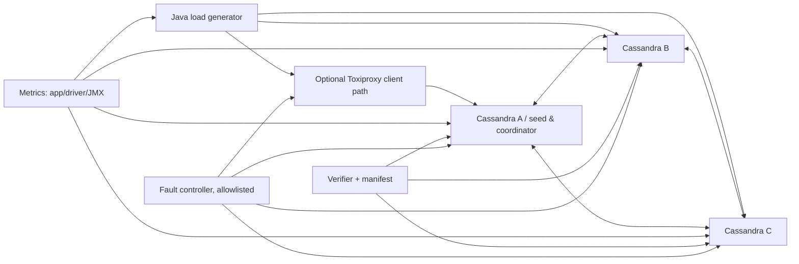
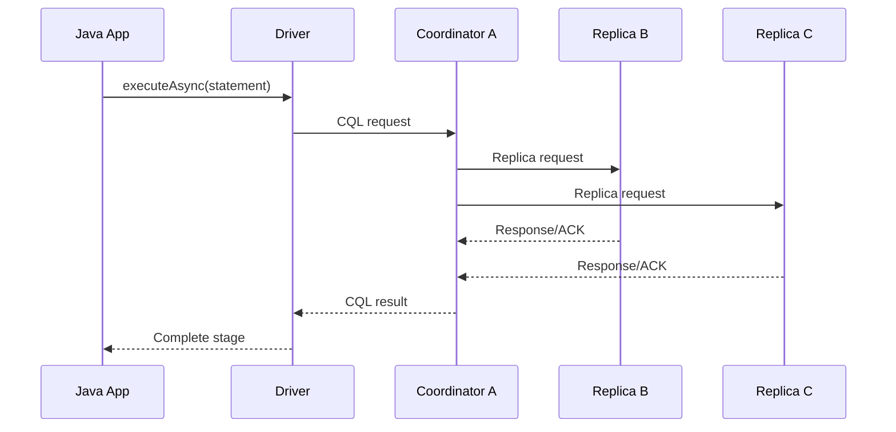
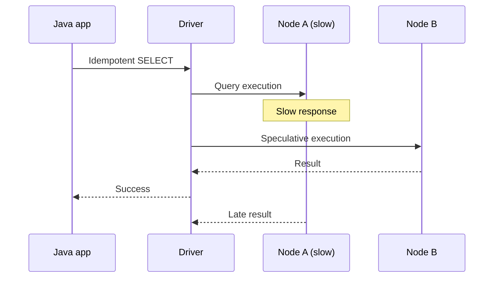

# Node Stops, Partial Network Loss, and Slow Responses

> **Chapter:** Load and Distributed Fault Testing  
> **Module:** `DATABASE_ENGINE_WIDE_COLUMN_CASSANDRA` — understanding distributed architecture and the wide-column model of Apache Cassandra, especially partition keys, query-driven table design, and consistency levels; practicing CQL, replication, compaction, repair, error handling, and Java application connectivity.  
> **Focus:** Designing, executing, and interpreting **controlled fault tests** when a Cassandra node stops, network links fail partially, coordinators/replicas respond slowly, or responses are lost; measuring availability, latency, retries, correctness, and recovery.  
> **Version scope:** Cassandra 4.1/5.x, Java Driver 4.19, JUnit 5, Testcontainers/Toxiproxy per your running releases. Snippets explicitly mark **PSEUDOCODE** where multi-node infrastructure, proxies, or harnesses must be supplied by the learner.

## 1. The Problem: The Service Is Still Running, Yet a Request Has an Unclear Outcome

Suppose a Java application writes payment events to Cassandra:

```sql
INSERT INTO payments_by_id (
    tenant_id, payment_id, state, amount_cents, revision
) VALUES (?, ?, ?, ?, ?);
```

The app uses consistency level `LOCAL_QUORUM` on a cluster with three full replicas in the local DC. During the write, one node stops, one network link slows down, and the first request loses its reply. What can happen?

- **Request still succeeds:** if the coordinator receives two local-DC replica acknowledgments and returns an ACK on time.
- **`UnavailableException`:** the coordinator determines too few replicas **currently considered alive** exist to satisfy CL right at coordination time.
- **`WriteTimeoutException`:** the coordinator forwarded the write but did not receive enough ACKs before the server-side deadline.
- **`DriverTimeoutException`:** the driver did not receive a complete response from the coordinator before the **client request timeout**, leaving it unknown whether the write was applied.
- **Connection errors / `AllNodesFailedException`:** the driver found no viable node/connection, or failed across all attempted nodes.
- **Late response:** the server completed the write, yet the reply arrived after the client deadline; the app may treat the request as failed even though the mutation applied.
- **Non-instantaneous recovery:** a node coming back up, driver reconnecting, and gossip converging do not mean the replica already caught up on missed mutations; hinted handoff and repair still need to run.

A good load/fault test does not ask only **"did it throw an exception?"**. It measures simultaneously:

1. **Availability:** fraction of requests meeting the contract within allowed deadlines.
2. **Latency:** p50/p95/p99 and tail degradation under fault.
3. **Correctness:** acknowledged writes and timed-out writes do not corrupt business data under retries.
4. **Blast radius:** how many partitions, nodes, DCs, and users are affected.
5. **Recovery:** how the system returns to SLOs and how replicas/hints/repairs are verified once the fault clears.
6. **Safety:** tests never impact environments outside the lab, with strict load caps and rollback plans.

**Success in "fault tolerance" is a quantitative contract, not a blanket claim that Cassandra always survives a node Down.**

## 2. Learning Objectives

After this lesson, you will be able to:

- Explain the roles of coordinators, replicas, token rings, driver load balancing, and local DCs in fault behavior.
- Predict CQL outcomes with RF=3 across `ONE`, `LOCAL_QUORUM`, and `ALL` when one or two replicas are Down.
- Distinguish **planned node shutdown**, abrupt crash, disabling the native CQL port, and internode network loss.
- Describe partial partitions: `client → A` failing while `A ↔ B` works, or `A ↔ B` failing while apps still reach A.
- Distinguish upstream (request) from downstream (response) slowness or drops.
- Distinguish `UnavailableException`, `ReadTimeoutException`, `WriteTimeoutException`, `ReadFailureException`, `WriteFailureException`, `DriverTimeoutException`, and connection errors.
- Understand why a client timeout **does not prove a write was not applied**.
- Understand the limits of hinted handoff and repair requirements after a node outage.
- Use statement idempotence, retry policies, and speculative execution safely under control.
- Design a fault matrix with a **hypothesis**, expected error envelope, duration, and invariants.
- Use CQL and the Java Driver to seed data, measure request latency, classify errors, and verify results.
- Use Testcontainers/Toxiproxy or lab container networks to simulate latency/disconnects within strict bounds.
- Build mixed read/write fault tests using open-loop/closed-loop pacing and bounded concurrency.
- Avoid mistaking "cheaper because dropped requests disappeared from p99" for a faster system.
- Document fault rollback steps and recovery evidence, including replica data state.
- Write diagnostic runbooks for "node Up yet p99 climbed", "gossip hasn't marked Down yet", and "retry storms".

## 3. Testing Safety: Isolation Zones and Stop Authority Are Mandatory

Actions like stopping containers, severing networks, `nodetool drain`/`disablebinary`, or inducing timeouts can **disrupt service and cause cascading slowdowns**. Execute them strictly inside an **isolated lab cluster** or owner-approved chaos engineering environment with pre-defined blast radius, rollback, and monitoring. This lesson presents **example commands for controlled learning**; never run them against production Cassandra.

### 3.1. Mandatory Guardrails

- Cluster name, keyspace, and contact points must belong to **lab/test**.
- Never use production credentials or shared production VPCs.
- Designate a node/cluster owner, test window, duration cap, and rollback switch.
- Faults must affect **a single endpoint/link** at a time in baseline scenarios.
- Keep test-data backups/snapshots when verifying recovery.
- Never shrink `gc_grace_seconds` or delete hint files to speed up tests without understanding the consequences.
- Never configure unbounded retries or unbounded speculative executions.
- Never crank CL to `ALL` or alter RF on live traffic clusters to "induce failures".
- Arm alerts for CPU, heap/GC, disk, thread pools, network, queues, p99, and retries.
- Verify the test **actually injected the intended fault**, rather than just toggling a flag in code.
- Abort if RF/CL safety margins collapse, data loss occurs, or out-of-scope systems feel impact.

### 3.2. Recommended Test Architecture



**Critical warning:** Because Java Driver 4.x uses topology discovery, placing **a single Toxiproxy in front of one contact point does not automatically proxy all traffic**. The driver discovers peer addresses and connects directly to nodes, **bypassing the proxy**. To test a path reliably, configure network/address translation or endpoint policies forcing test traffic through the proxy, or inject faults directly in the scoped network namespace/server link.

### 3.3. Test Tiers Do Not Substitute for One Another

| Tier | What It Tests | What It Cannot Prove |
|---|---|---|
| Unit test with mocked `CqlSession` | Retry decisions, business idempotency | Gossip, replica CL, real networking |
| Single-node Testcontainers | Single-node CQL/codec/timeouts, proxied response drops | RF3 quorums, internode splits, multi-replica hints |
| Three-node Cassandra lab cluster | Single replica Down, CL, gossip, hints, restarts | Multi-DC WAN links if single-DC |
| Two-DC lab topology | `LOCAL_QUORUM`/`EACH_QUORUM`, cross-DC links | Production SLA/capacity if undersized |
| Production-like staging load test | Near-real p99, capacity, and recovery | Absolute production behavior if topology/workload differ |
| Approved production chaos engineering | Real behavior at production scale | Unsuitable for unguarded ad-hoc experiments |

## 4. Refresher on How Cassandra Resolves Fault Outcomes

### 4.1. Tokens and Replica Placement

When a client sends a query, the driver selects a **coordinator**. The coordinator determines the partition's replicas from the **partition key** token and keyspace replication strategy, then dispatches requests to the appropriate replicas.

```text
Client
  │
  ▼
Coordinator B  ── hash(tenant_id,event_day) ──► token
  │                                           │
  └────► Replica A     Replica B    Replica C◄┘
          RF=3 full replicas in local DC
```

The contact point need not be the coordinator for every request, and the coordinator need not belong to the partition's replica set. A node Down in a large cluster affects different **token ranges** differently; never assume every partition loses a replica equally when RF is smaller than the DC node count.

### 4.2. RF, Quorum, and ACK Counts

With `NetworkTopologyStrategy` and three full replicas in one DC:

\[
Q_{\mathrm{local}} =
\left\lfloor \frac{RF_{\mathrm{local}}}{2}\right\rfloor+1
=2
\]

Local-DC request outcomes:

| Available Replicas | `ONE` | `LOCAL_QUORUM` (2/3) | `ALL` (3/3 if single-DC keyspace) |
|---|---|---|---|
| A, B, C | Can succeed | Can succeed | Can succeed |
| A, B | Can succeed | Can succeed | Usually unavailable/timeout |
| Only A | Can succeed | Insufficient | Insufficient |
| None | Insufficient | Insufficient | Insufficient |

"Can succeed" rather than "always succeeds" because surviving replicas may **respond slowly**, links may partition, coordinators may go Down, or client deadlines may expire. In multi-DC keyspaces, `ALL` requires all replicas within that CL's scope, not just three local nodes; the table above assumes **one DC only**.

### 4.3. One Node Down ≠ Any Arbitrary Partition Down

In a **3-node RF3** single-DC cluster, nearly every partition has replicas on all three nodes. In a **12-node RF3** cluster, one Down node affects only the **token ranges it owns**; other partitions remain completely untouched. For deterministic tests, run `nodetool getendpoints` on the partition key or inspect the Java Driver token map metadata. Never assume "Node C holds every partition" on larger topologies.

### 4.4. Local DC in Multi-DC Deployments

Example:

```sql
CREATE KEYSPACE lab_fault
WITH replication = {
    'class': 'NetworkTopologyStrategy',
    'dc-east': 3,
    'dc-west': 3
};
```

An East app configured with `local-datacenter = dc-east` and `LOCAL_QUORUM` typically needs 2/3 full replicas in East. It does **not** verify West ACKed 2/3. Multi-DC writes using `EACH_QUORUM` require a majority in every DC, so an inter-DC WAN cut breaks write availability even when local quorums are healthy. Never slap `EACH_QUORUM` onto every hot path to feel "safer" if WAN latency and business contracts do not support it.

### 4.5. CL Does Not Shrink Write Fan-Out

At RF3, coordinators generally send writes to all three replicas (when available) and **wait for enough ACKs to meet CL**; `ONE` does not mean only one replica receives the mutation. A Down replica catches up later via **hints** and/or repair. Lowering CL trades read visibility and reliability for lower latency depending on the workload.

### 4.6. Read Quorum and Write Quorum Intersection

Absent conflicting concurrent writes or special TTLs, at local RF3 with local quorum for both reads and writes:

\[
R=2,\quad W=2,\quad RF=3,\quad R+W>RF
\]

The two replica sets share at least one overlapping node, letting reads observe ACKed writes under Cassandra's consistency model. **However**, this does not create cross-partition/cross-table snapshot transactions, guarantee remote-DC convergence, or prevent timestamp-based last-write-wins overwrites among racing writers.

## 5. How the Three Main Fault Classes Differ

### 5.1. Node Stop

A Cassandra process, VM, or container halts; sockets close immediately or time out, and gossip/failure detection gradually marks the node Down. The cluster stays up while temporarily losing a coordinator candidate and replica copies.

### 5.2. Partial Network Loss

The node need not crash completely. Examples:

- Client App1 cannot reach Node A, while App2 still can.
- Node A sees B, while C does not see B.
- App sends requests to A, while A cannot reach certain replicas.
- TCP requests arrive, yet responses are dropped.
- Cross-DC WAN fails while local-DC internode links stay healthy.

These faults are **asymmetric by perspective**; `nodetool status` queried on two different nodes may temporarily disagree while failure detection and gossip converge.

### 5.3. Slow Responses

The node stays Up in gossip, yet CQL responses breach SLOs due to:

- Long GC pauses or CPU saturation.
- Compaction, flushes, or repair saturating disk I/O.
- SSTable or tombstone read amplification.
- Overloaded coordinator queues and thread pools.
- Network jitter, packet loss, or bandwidth throttling.
- Slowness along **client → coordinator** or **coordinator → replica**.
- TLS/auth/connection churn when errors affect only new connections.
- Client backpressure, driver stream-ID exhaustion, or pool saturation.

**Node Up does not mean queries finish on time.** Fault tests must measure request-level deadlines and correctness, not just pings or gossip.

## 6. Node Stop: Planned Shutdown, Abrupt Crash, and Disabling Native Transport

### 6.1. Planned Shutdown

`nodetool drain` stops accepting new writes and flushes memtables before shutdown; it is **not** a command to "remove the node from the token ring". After draining, stopping/restarting the service or container follows your distribution's runbook.

```bash
# Illustrative lab command only; never run ad-hoc on production.
nodetool drain
# Then stop the Cassandra service/container per lab tooling.
```

Planned-maintenance test goals:

- Node drained and flushed cleanly.
- Cluster sustains requests when the node leaves coordinator/replica duty.
- Application errors stay within budget.
- Node rejoins cleanly.
- Hints and repairs are tracked post-restart.

### 6.2. Abrupt Crash

Example on **a single dedicated container in a three-node lab cluster**:

```bash
# ONLY if cassandra-b is an isolated lab container.
docker kill cassandra-b
# To restore:
docker start cassandra-b
```

`docker kill` differs from `docker stop` in signal delivery and grace period. Never assume the container is always named `cassandra-b`; verify exact target identity first and never use wildcards that could hit unrelated containers.

What to check on crash:

- Driver may hold broken sockets briefly before detecting the failure.
- Gossip/failure detection takes time—marking Down is not instantaneous.
- Some in-flight requests end with uncertain outcomes.
- Load increases on surviving nodes.
- Restarting the node does not automatically prove hints finished replaying.

### 6.3. Disabling Only the Native CQL Transport Port

`nodetool disablebinary` disables client native transport on a node (`--force` may drop active connections depending on Cassandra version); `nodetool enablebinary` re-enables it. This simulates a node **no longer serving CQL clients directly**, which is not identical to a node being Down in gossip or replication.

```bash
# Lab Node A, after verifying the exact JMX target.
nodetool disablebinary
# Restore:
nodetool enablebinary
```

Even when Node A refuses client CQL connections, if A owns a partition replica, Coordinator B still sends internode messages to A. Thus `disablebinary` **does not test** a completely Down replica.

### 6.4. Distinguish `decommission`/`replace` from `stop`

`nodetool decommission` and node replacement/bootstrap are **topology and token-ownership changes** involving streaming and strict prerequisites. Never use them to "simulate a 30-second node outage". Temporary node-stop fault tests should preserve and **restore the same node identity and data volume**.

### 6.5. Before–During–After Measurement Steps

```text
5–10 min baseline under bounded workload
→ Verify RF/CL and candidate nodes
→ Inject stop on Node B at t0
→ Observe detection, availability, p99, errors
→ Hold fault for a bounded window
→ Restore Node B at t1
→ Observe reconnection, gossip, hints, repair
→ Reconcile data and confirm recovery complete
```

5–10 minutes is illustrative for lab workloads; production-like tests may need longer. Never equate "node came back Up" with "cluster fully recovered".

## 7. Partial Network Loss: Document Who Can Reach Whom

### 7.1. Pre-Fault Connectivity Matrix

In a 3-node lab (A, B, C) with App X, there are two distinct traffic planes:

1. Native CQL: App X → A/B/C, typically port 9042.
2. Internode: A ↔ B ↔ C, gossip/replication/streaming on configured internal port(s).

```text
Baseline:
 X → A = OK   X → B = OK   X → C = OK
 A ↔ B = OK   B ↔ C = OK   A ↔ C = OK
```

### 7.2. Case P1: X Cannot Reach A

```text
Fault P1:
 X -X→ A       X → B = OK   X → C = OK
 A ↔ B = OK    B ↔ C = OK   A ↔ C = OK
```

Expectations:

- If the driver already discovered B and C as coordinator candidates, requests reroute to B/C.
- If the app starts up with **only contact point A** unreachable before bootstrapping, session startup fails even though B/C are healthy.
- A still serves internode replica traffic from B and C.
- Query availability may stay higher than when A actually crashes.

Do not call this "losing a replica" merely because the app lost reachability to A's native port.

### 7.3. Case P2: Internode A ↔ B Blocked While App Reaches Both

```text
Fault P2:
 X → A/B/C = OK
 A -X→ B, B -X→ A
 A ↔ C = OK, B ↔ C = OK
```

Nodes A and B can hold **divergent views** of cluster membership/failure detection temporarily. Queries coordinated by A may fail to gather replica ACKs for CL, while queries coordinated by C succeed via a different path. `Unavailable` and timeout distributions depend on coordinator selection and gossip state.

**Do not** assume "cutting link A–B cleanly splits the cluster into two fixed halves"; with paths remaining through C, gossip and internode messages behave in version- and topology-specific ways that must be tested explicitly.

### 7.4. Case P3: 1–2 Cluster Split

```text
Partition:
  Island I = {A}       Island II = {B, C}
  Zero internode links between I and II.
  Client X can still reach A/B/C over separate client routes.
```

In single-DC RF3:

- Coordinators in **Island {B, C}** can satisfy `LOCAL_QUORUM` (2/3).
- Coordinator in **Island {A}** cannot satisfy `LOCAL_QUORUM` without reaching B/C; it returns `Unavailable` or `Read/WriteTimeout` depending on failure-detector/gossip convergence.
- `ONE` can succeed on either side with at least one reachable replica, risking divergent reads and writes across islands.
- `ALL` fails on split reads/writes.
- Driver coordinator selection and timing can produce different error rates across App X and App Y.

**Important:** Using `ONE` on both islands with concurrent writes to the same key resolves via timestamp last-write-wins upon healing; it is not a linearizable state machine. Check your business-domain invariants.

### 7.5. Case P4: Asymmetric Connectivity

```text
A → B blocked
B → A allowed
A → C allowed
C → A allowed
```

While TCP connections are bidirectional, packet filters, NATs, asymmetric routing, and directional toxics can cause **requests to arrive while responses vanish**. Never rely on a one-way `ping OK` from one node to prove bidirectional CQL and internode health.

Tests must specify:

- Packet direction, interface, port, and protocol.
- Existing established connections vs. new connections.
- Whether existing TLS sockets are affected.
- Which node acts as coordinator vs. replica.
- Whether the fault sits on the CQL client path or internode path.
- DC/rack names and RF of the tested partitions.

### 7.6. Healing the Link Does Not Finish Repair

After removing the partition:

- Gossip and failure detection must converge.
- Driver connections and pools must reconnect.
- Missed mutations may arrive via hints if within window; **hints are best-effort**.
- Token-range repair must run per operational procedures to re-synchronize replicas.
- Tombstones, TTLs, and `gc_grace_seconds` must be protected against zombie resurrection.
- App denormalized projections require **application-level reconciliation** if multi-table workflows partially failed.

## 8. Where Is It Slow? Separating Request Path and Response Path

### 8.1. Execution Flow



Approximate total latency:

\[
T_{\mathrm{observed}}
\approx T_{\mathrm{clientQueue}}+
T_{\mathrm{driverSend}}+
T_{\mathrm{coordinator}}+
T_{\mathrm{replicaWait}}+
T_{\mathrm{returnPath}}+
T_{\mathrm{decode/callback}}
\]

Do not simply sum components linearly: replica calls run in parallel, overlap occurs, and retries/speculation create multiple paths. Use this breakdown for **diagnostic isolation**, not as an exact performance formula.

### 8.2. Slow Coordinator

Node A is Up yet slow due to GC, CPU, or compaction while B and C are healthy; routing via Coordinator C would be faster. Driver speculative execution (if enabled and statement is idempotent) can trim tail latency by sending a backup execution elsewhere—at the cost of **extra traffic**, and without fixing underlying disk load or hot partitions.

### 8.3. Slow Replica

Coordinator A waits on B or C for quorum. If B stalls while C replies quickly and CL is satisfied, the request succeeds. If A receives too few ACKs before server timeout, it returns `ReadTimeout`/`WriteTimeout`. Read cases receiving only digests without full data also have specific timeout semantics.

### 8.4. Slow Return Path

Node A processed the write and B/C ACKed, yet the CQL response packet `A → Driver` is dropped or delayed. The driver hits `basic.request.timeout` and throws a **client timeout**. At that point:

- The write **may already have succeeded** at CL.
- The app **cannot** treat `DriverTimeout` as "definitely not written".
- Retrying a counter or non-idempotent mutation can cause double effects.
- Tests need independent read-back by deterministic key to inspect outcome, keeping in mind read-back limits under CL, timestamps, and concurrent writes.

### 8.5. Client-Side Queueing Slowness

Excessive concurrency swells `pool.in-flight`, exhausts stream IDs, or backs up the request throttler. p99 can spike **before a single CQL packet leaves the client**. Never blame Cassandra disks when coordinator CPU is normal while client queues and connection pools are saturated.

### 8.6. Distinguishing Failures on Page N

`executeAsync` may succeed for **page 1** of a multi-row query while `fetchNextPage()` fails later due to node or network shifts. Load tests claiming "SELECT succeeded" must **consume every page per contract**. First-page completion does not prove a full export succeeded.

## 9. Error Taxonomy and Diagnostic Signals

| Exception / Symptom | Common Source | Was Mutation Applied? | What Else to Inspect |
|---|---|---|---|
| `UnavailableException` | Coordinator sees too few live replicas for CL | Request may not have been sent to enough replicas; do not generalize blindly | Required/alive counts, node/DC, gossip |
| `ReadTimeoutException` | Coordinator waited past timeout for replica reads | Reads do not mutate data, but result is incomplete | Received vs. required, `dataPresent`, slow replicas |
| `WriteTimeoutException` | Coordinator waited past timeout for write ACKs | **Uncertain**; some replicas may have written | `WriteType`, received/blockFor, idempotency |
| `ReadFailureException` | Replica/coordinator reported a read failure | No valid read result per contract | Failure reasons, disk/codec/exception logs |
| `WriteFailureException` | Write path reported an internal failure | Must not assume write did not apply | Replica failures, hints/commitlog path |
| `DriverTimeoutException` | Client received no complete reply before driver deadline | **Uncertain**, even if server succeeded | Client/coordinator queues, network return path |
| `ClosedConnectionException` | Socket closed before reply arrived | Uncertain if request was already sent | TCP resets, node restarts, heartbeats |
| `AllNodesFailedException` | All attempted query paths/connections failed | Inspect **per-node causes**; multiple attempts may exist | `getAllErrors()`, contact points, local DC |
| `NoNodeAvailableException` | Driver has no eligible node | Query was usually never sent | Driver metadata / load balancing policy |
| `OverloadedException` | Server signaled overload | Request-specific outcome | Server queues, load generator |
| `UnauthorizedException` / `InvalidQueryException` | Permissions or invalid CQL/schema | Not a transient network fault | Roles, tables, PKs, CQL |
| Late reply after client failed | Network/jitter/timeout/GC | May have fully processed | Server traces, read-back + command ID |

**Never** collapse everything into one generic "exception" counter. Separate **coordinator-returned errors** from **driver receiving no reply**; they occur at different points on the path and drive different retry decisions.

### 9.1. When Can `Unavailable` Turn into `Timeout`?

During a network partition, a coordinator may **not yet know** a replica is Down until gossip/failure detection converges, so initial requests go out and time out. Once the replica is marked Down, subsequent requests fail fast with `Unavailable`. Tracking error distribution over time reveals **detection delay**, not just CL behavior.

### 9.2. `AllNodesFailedException` Has No Single Root Cause

If A closed its native port, B has an invalid TLS cert, and C is unroutable, `AllNodesFailedException` wraps **three distinct node errors**. In the Java Driver, inspect `getAllErrors()` and traces to classify per-node causes rather than logging only the wrapper message. Never expose internal hostnames or credentials in public HTTP responses.

### 9.3. Server and Client Timeouts Run on Different Clocks

Illustrative example:

```text
Cassandra server write_request_timeout = 2s
Java Driver basic.request.timeout      = 1s

0ms    driver sends request
900ms  coordinator still waiting on replicas
1000ms driver deadline expires → DriverTimeout
1400ms server receives enough ACKs and finishes mutation
```

A client timeout never implies the server aborted execution. Per Java Driver 4.x docs, `basic.request.timeout` spans retries and speculative executions combined; do not add per-retry delays while forgetting the overall deadline.

## 10. Hinted Handoff, Repair, and Long-Outage Consequences

### 10.1. When A Is Down While B and C Serve `QUORUM`

Coordinators on B or C can store hints to replay missed mutations once A returns. Apache Cassandra docs describe hints as **best-effort**, not a 100% delivery guarantee.

```text
A Down (RF3)
B, C accept write W1 → LOCAL_QUORUM ACK
B or C stores hint for A (policy and capacity permitting)
A Up
Hint delivery runs; A may receive W1
Anti-entropy repair required for long-term convergence
```

### 10.2. `max_hint_window` and Outage Horizons

In Cassandra 5.x docs, `max_hint_window` defaults to **3 hours** (depending on version/config). Once a node stays Down past this window, hints do not buffer missed mutations indefinitely. Hints also depend on disk limits, throttling, and DC rules. Tests that only wait for a node to come back Up miss verifying hint delivery and repair.

### 10.3. Hints Do Not Replace Anti-Entropy Repair

`nodetool repair` compares replicas across token ranges using Merkle trees and streams discrepancies. Cassandra does not run full repairs automatically due to I/O and network cost. Recovery tests should verify:

- How many hints are stored or pending replay?
- Did Node A receive all missed mutations?
- Were any hinted handoffs failed or dropped?
- Which repair scope is needed per operational runbook?
- Are tombstones retained long enough to prevent zombies?

### 10.4. `gc_grace_seconds` and Deletes

When `DELETE`/TTL creates a tombstone, a node Down too long retains the old live value. If the tombstone purges before that stale replica learns of the delete, **zombie data** can resurrect. Never shorten `gc_grace_seconds` just to "speed up recovery tests", and keep fault durations safely inside your repair cadence.

### 10.5. Cassandra Replica Repair ≠ Application Projection Repair

If a Java projector writes `orders_by_id` successfully but fails before writing `orders_by_customer_day`, `nodetool repair` **will not** magically create the missing row in the second table. Business-workflow fault tests require **application reconciliation / idempotent replay** in addition to Cassandra replica convergence checks.

## 11. Idempotency and Retries: Core of Fault Testing

### 11.1. A Lost ACK Means Unknown State

Example:

```text
Client sends INSERT id = P42
Cassandra executes write and gets enough replica ACKs
Response is dropped
Client times out
Client retries INSERT
```

With identical primary keys, values, and timestamps where semantics allow, retrying may be idempotent. Yet if each retry generates `UUID.randomUUID()`, increments a counter, appends to a list, or fires an external payment call, retries cause **duplicate business side effects**.

### 11.2. Setting Statement Idempotence Accurately

Driver 4.19 defaults `basic.request.default-idempotence = false`. For full-partition-key reads:

```java
import com.datastax.oss.driver.api.core.DefaultConsistencyLevel;
import com.datastax.oss.driver.api.core.cql.SimpleStatement;

SimpleStatement read = SimpleStatement.newInstance(
    "SELECT state, amount_cents, revision " +
    "FROM lab_fault.payments_by_id " +
    "WHERE tenant_id=? AND payment_id=?",
    tenantId, paymentId)
    .setConsistencyLevel(DefaultConsistencyLevel.LOCAL_QUORUM)
    .setIdempotent(true);
```

Driver 4.x statements are **immutable**: `setIdempotent(...)` returns a new instance that you must assign. For writes:

```java
// ONLY setIdempotent(true) WHEN you have proven replaying
// the exact command is safe—never just because "it's an INSERT".
BoundStatement insert = preparedInsert.bind(
        tenantId, paymentId, "AUTHORIZED", 2500L, 1L)
    .setConsistencyLevel(DefaultConsistencyLevel.LOCAL_QUORUM)
    .setIdempotent(false);
```

`false` is the safe default until business idempotency is proven. Only consider `true` once deterministic keys/versions/timestamps and external side effects are verified safe under policy. This flag tells the driver **retrying is permitted**—it does not implement a deduplication ledger for you.

### 11.3. `DefaultRetryPolicy` Never Silently Downgrades Consistency

Java Driver 4.19's `DefaultRetryPolicy` retries only in specific cases where another attempt may succeed. It **never** silently downgrades `LOCAL_QUORUM` to `ONE` when replicas are missing. `ConsistencyDowngradingRetryPolicy` can weaken CL and **break business invariants**; avoid it without an explicit contract.

### 11.4. There Is No Magic "Exactly-Once"

Claiming "exactly once" requires:

- Immutable business command IDs across attempts.
- Durable sink/keyspace upserts or an idempotency ledger.
- Deduplicated or compensated external side effects.
- Outcome reconciliation after timeouts.
- LWT recovery after ambiguous `CLAIMED` outcomes if LWTs are used.
- Never treating a request timeout as "guaranteed failed".

A failed `CompletionStage` does not prove the mutation is absent from Cassandra; a succeeded `CompletionStage` at `LOCAL_QUORUM` does not prove remote-DC replicas already received the write.

### 11.5. Multi-Layer Retry Amplification

```text
HTTP gateway retries 2 times
  × Service retries 3 times
  × Driver may retry each request per policy
  × Speculative executions (if enabled)
→ Total CQL executions can far exceed one HTTP request.
```

Never guess a fixed multiplier when driver retries depend on error classes; **measure actual executions/attempts** via metrics, tracing, and `RequestTracker`. Enforce **one shared retry budget and overall deadline** per business request.

## 12. Speculative Execution: Trims Tail Latency at a Cost

### 12.1. Mechanism

When an execution sent to A stalls, the driver can launch **another execution** to B per policy. If B replies first, the app gets B's result. Cassandra **does not cancel an in-flight server CQL request** simply because the driver discarded A's late response.



### 12.2. Disabled by Default, Strictly for Idempotent Statements

Java Driver 4.19 defaults to `NoSpeculativeExecutionPolicy`. When enabled, only idempotent statements qualify. Before enabling, measure p99.9 baselines and capacity headroom; never set a 0 ms delay across all requests as a crutch for timeouts.

### 12.3. Illustrative Test-Only HOCON

```hocon
datastax-java-driver {
  advanced.speculative-execution-policy {
    class = ConstantSpeculativeExecutionPolicy
    max-executions = 2
    delay = 200 milliseconds
  }
}
```

`max-executions = 2` means the initial attempt plus at most one speculative attempt. These values are **lab assumptions only**, not production recommendations. Compare p99, CQL requests/s, stream IDs, CPU, network traffic, and error budgets before and after.

### 12.4. Side Effects and Stream-ID Exhaustion

An execution logically "abandoned" by the driver may still keep executing inside Cassandra, and its TCP stream ID cannot be reused until the late response returns or the connection resets. Excessive speculation spikes `pool.orphaned-streams`, drains `pool.available-streams`, and forces connection recycling.

Never enable speculation on counter increments, non-idempotent read-modify-writes, or payment side effects. Even for read-only queries, weigh the extra replica load—especially if the bottleneck is a **hot partition or slow disk** where B may be slow too.

## 13. Deadlines, Backpressure, and Proper Load Testing

### 13.1. Multiple Timeouts Must Align

| Deadline | Configured At | What It Bounds |
|---|---|---|
| Connect timeout | Driver connection layer | TCP/handshake establishment |
| Driver `basic.request.timeout` | Java Driver per request | Total execution including retries and speculation |
| Cassandra read/write timeout | Coordinator config | Replica wait time per operation |
| Web/request timeout | Gateway / HTTP framework | How long the caller waits |
| Job deadline | Background worker | Full workflow including paging and sinks |
| Test timebox | Fault controller | Prevents faults from running indefinitely |

A 1 s client timeout over a 2 s server timeout makes the app fail before the server decides the outcome. Raising every timeout to 60 s usually just piles up in-flight requests and worsens incidents.

### 13.2. Little's Law for Estimating Concurrency

With arrival rate \(\lambda\) (req/s) and mean latency \(W\) (seconds):

\[
L \approx \lambda W
\]

For example, 5,000 req/s at 20 ms:

\[
L \approx 5000 \times 0.020 = 100\ \text{in-flight}.
\]

If a fault raises mean latency to 300 ms while the generator keeps sending 5,000 req/s:

\[
L \approx 5000 \times 0.300 = 1500.
\]

**15×** the steady-state in-flight concurrency. Without bounded queues and pool budgets, feedback collapse follows: slow → backlog → timeout → retry → even slower.

### 13.3. Open-Loop vs. Closed-Loop Load Generators

**Closed-loop:** each worker sends the next request only after the current one completes. When the server slows, total send rate **drops automatically**, misleadingly suggesting the cluster is fine when throughput actually collapsed.

**Open-loop:** emits on a target schedule/arrival rate; when the server slows, queues grow and faults show clearly. Without queue caps, however, open-loop tests generate unbounded load and can crash the lab.

Measure all of:

- Offered load (intended requests/s).
- Sent load (requests actually dispatched/s).
- Completed load (successful and failed requests/s).
- Rejected/shed load (429/503/queue full).
- Queue wait latency (before driver).
- End-to-end request latency from **scheduled arrival**, not just from when the driver started.

### 13.4. Coordinated Omission

If a generator records only completed requests, periods where the system stalled can **drop out of the histogram**, making p99 look artificially clean. Record scheduled arrival timestamps, timeouts/cancellations, and unfinished requests at window end. With tools like `cassandra-stress`, custom Java harnesses, or k6, verify how histograms are computed and apply correction transparently when needed.

### 13.5. Never Measure p99 via the Mean

Example:

```text
99% of requests: 10–30 ms
1% of requests:  3,000 ms or timeout
Mean may look acceptable depending on shape
p99 and timeout rate reveal a severe problem
```

Capture latency histograms (p95/p99/p99.9), timeouts, and **errors by node**—never averages alone. Under a p99 < 200 ms SLO, a 1% timeout rate breaches the SLO even if throughput looks nearly intact.

### 13.6. Keep Workloads Query-First

A fault test measuring `SELECT` p99 by full partition key differs completely from full-table `COUNT(*)`. Cassandra is not an OLAP engine; query shape, clustering ranges, tombstone density, row sizes, compaction/backpressure, and RF placement govern outcomes.

## 14. CQL Lab: Keyspace and Verification Data

### 14.1. Assumed Cluster Topology

The main lab assumes **one DC named `dc1` with three full nodes A/B/C** able to communicate. When running single-node Testcontainers to verify Java/CQL APIs, **set RF to 1** and skip RF3/node-fault assertions. Never spin up three separate `CassandraContainer` instances and assume they automatically form a cluster—configure seeds, cluster name, snitch, broadcast addresses, ports, racks, and startup sequencing explicitly.

### 14.2. Create the Keyspace Matching Your DC

```sql
CREATE KEYSPACE IF NOT EXISTS lab_fault
WITH replication = {
  'class': 'NetworkTopologyStrategy',
  'dc1': 3
};
```

Replace `dc1` with the real DC name from `nodetool status` or `system.local`. On an RF1 lab cluster, use a separate test keyspace so results are never confused with RF3.

### 14.3. Point-Lookup Table

```sql
CREATE TABLE IF NOT EXISTS lab_fault.payments_by_id (
    tenant_id uuid,
    payment_id uuid,
    state text,
    amount_cents bigint,
    revision bigint,
    updated_at timestamp,
    PRIMARY KEY ((tenant_id, payment_id))
);
```

Partition key `(tenant_id, payment_id)` supports deterministic point lookups. Use `amount_cents bigint` instead of floating point; `revision` is a business version, not auto-incremented by Cassandra.

### 14.4. Events Table for Paging Tests

```sql
CREATE TABLE IF NOT EXISTS lab_fault.events_by_tenant_day (
    tenant_id uuid,
    event_day date,
    event_time timestamp,
    event_id uuid,
    event_type text,
    payload text,
    PRIMARY KEY ((tenant_id, event_day), event_time, event_id)
) WITH CLUSTERING ORDER BY (
    event_time DESC, event_id DESC
);
```

Use this table to test page #N failing after page #1 succeeds. Never run cluster-wide `SELECT *` during resilience tests, which conflates network faults with scan amplification.

### 14.5. CQL Fixture with Fixed IDs

```sql
-- cqlsh shell:
CONSISTENCY LOCAL_QUORUM;

INSERT INTO lab_fault.payments_by_id (
    tenant_id, payment_id, state, amount_cents, revision, updated_at
) VALUES (
    11111111-1111-4111-8111-111111111111,
    22222222-2222-4222-8222-222222222222,
    'AUTHORIZED', 2500, 1, '2026-11-21 08:00:00+0000'
);

SELECT payment_id, state, amount_cents, revision
FROM lab_fault.payments_by_id
WHERE tenant_id = 11111111-1111-4111-8111-111111111111
  AND payment_id = 22222222-2222-4222-8222-222222222222;
```

`CONSISTENCY` is a **`cqlsh` command**; never pass `"CONSISTENCY ..."` into Java `session.execute(...)` as a CQL statement. Never share hardcoded fixture IDs across concurrent tests in the same keyspace; isolate per test with unique tenant/payment IDs or separate clusters.

### 14.6. Two Controls to Maintain

**Expected data:** manifest recording `payment_id`, `amount_cents=2500`, `revision=1`, and expected post-sequence state.

**Actual data:** `SELECT` by full PK at the specified CL, using properly DC-configured sessions when reconciling across nodes/DCs. Verify **exact business ID and version**, not merely `row count == 1`.

## 15. Designing a Testable Fault Matrix

| ID | Fault | Scope | Hypothesis / Expected | Invariant |
|---|---|---|---|---|
| F01 | Planned stop of Node B | One replica/node | `LOCAL_QUORUM` RF3 continues via A/C | ACKed writes read back accurately |
| F02 | Abrupt kill of Node B | One replica/process | Brief in-flight errors, reconnect/retry | Zero duplicate business IDs |
| F03 | Kill B and C | Two full replicas | `LOCAL_QUORUM` RF3 cannot succeed | No silent CL downgrade |
| F04 | Disable A's native port | Client → coordinator only | Driver routes to B/C if reachable | Do not treat A's replica as Down |
| F05 | Client cannot reach sole seed at startup | Bootstrap path | Session startup fails | Clear alert; no fallback to prod |
| F06 | Client cannot reach one discovered node | Client → node | Requests can reroute | Per-node errors/recovery measurable |
| F07 | A ↔ B blocked only | Internode link | Some coordinator calls slow/fail | CL and fault scope verified |
| F08 | Split A | A \| B, C internode | A loses local quorum; B/C can meet it | Error distribution matches coordinator |
| F09 | Client request blocked upstream | Upstream proxy | Server may never receive request | Never infer outcome from timeout alone |
| F10 | Client response delayed downstream | Downstream proxy | Driver times out even when server writes | Idempotent retry/reconciliation |
| F11 | Coordinator A slow + B/C healthy | A CPU/GC or proxy | p99 rises; speculation may trim tail | Extra traffic measured |
| F12 | Replica B slow | A ↔ B path | Quorum waits or picks faster pair | CL, read/write timeouts |
| F13 | High latency jitter | Single link | Tail/error budget rises | Bounded timeouts, no retry storm |
| F14 | Node Down > hint window | Long replica outage | Hints alone insufficient | Repair/reconcile must run |
| F15 | Restart during `DELETE` | Replica missed tombstone | No zombies after grace/repair | Logical delete invariant |
| F16 | LWT conditional update under fault | Paxos quorum | Applied flag vs. ambiguous timeout | Monotonic domain state |
| F17 | Paging page #N fails | Multi-page query | Page 1 success ≠ full scan | No false export completion |
| F18 | Recovery traffic burst | Hint replay | p99 may climb during recovery | Hints drain + SLO returns |
| F19 | Speculation enabled | Idempotent `SELECT` | Tail may improve as traffic rises | Zero pool stream exhaustion |
| F20 | App retries + gateway retries | Cross-layer | Amplification possible | Attempts ≤ budget |
| F21 | One DC link down | Inter-DC | Local `LOCAL_QUORUM` differs from `EACH_QUORUM` | Explicit RPO/DR constraints |
| F22 | Client cancels before ACK | HTTP/async | Server may still apply mutation | No unsafe compensation |
| F23 | Driver queue throttling | Client saturation | Backpressure/rejections | Bounded memory |
| F24 | TLS reconnect failure on new sockets | Security | Existing sockets may keep working | Detect auth/TLS drift |
| F25 | Fault cleared; reconcile | Recovery | Throughput, p99, and convergence restored | End-to-end PASS |

**Never try running all F01–F25 on a single node.** Specify topology/injection layer, pass/fail assertions, rollback triggers, and confidence bounds per case. Run long-duration F14/F15 tests only in labs with repair policies—never take a production node Down past `gc_grace_seconds` to "watch zombies".

## 16. Java Driver 4.x: Shared Sessions and Standard Statements

### 16.1. Maven Dependencies (Sample)

Snippets target Java Driver 4.19.x and JUnit 5; manage versions via your project BOM rather than ad-hoc mixing:

```xml
<dependencies>
    <dependency>
      <groupId>org.apache.cassandra</groupId>
      <artifactId>java-driver-core</artifactId>
    </dependency>
    <dependency>
      <groupId>org.junit.jupiter</groupId>
      <artifactId>junit-jupiter</artifactId>
      <scope>test</scope>
    </dependency>
    <dependency>
      <groupId>org.assertj</groupId>
      <artifactId>assertj-core</artifactId>
      <scope>test</scope>
    </dependency>
</dependencies>
```

**Dependency note:** Older Java Driver 4.x releases used groupId `com.datastax.oss`; driver 4.18/4.19 uses Apache coordinates `org.apache.cassandra` per Apache Driver docs. Check your BOM and exact artifact coordinates, and never mix two conflicting core drivers. This snippet only illustrates dependencies—do not run Maven while authoring docs.

### 16.2. `CqlSession` Is Application-Scoped

```java
import java.net.InetSocketAddress;
import java.util.List;

import com.datastax.oss.driver.api.core.CqlSession;

public final class CassandraConnection {
    public static CqlSession connectLab() {
        return CqlSession.builder()
            .addContactPoint(new InetSocketAddress(
                "cass-a.lab.internal", 9042))
            .addContactPoint(new InetSocketAddress(
                "cass-b.lab.internal", 9042))
            .withLocalDatacenter("dc1")
            .withKeyspace("lab_fault")
            .build();
    }
}
```

Hostnames above are **examples only**; they must resolve in your lab with valid TLS SANs/routes when TLS is enabled. `withLocalDatacenter("dc1")` must match Cassandra snitch/metadata. Create one session per process/cluster identity, share across workers, and close on shutdown—never per request in load tests.

### 16.3. Prepared Statements and Idempotence

```java
import java.util.UUID;

import com.datastax.oss.driver.api.core.DefaultConsistencyLevel;
import com.datastax.oss.driver.api.core.cql.PreparedStatement;
import com.datastax.oss.driver.api.core.cql.BoundStatement;

PreparedStatement select = session.prepare(
    "SELECT state, amount_cents, revision " +
    "FROM lab_fault.payments_by_id " +
    "WHERE tenant_id=? AND payment_id=?");

BoundStatement read = select.bind(tenantId, paymentId)
    .setConsistencyLevel(
        DefaultConsistencyLevel.LOCAL_QUORUM)
    .setIdempotent(true)
    .setTimeout(java.time.Duration.ofMillis(800));
```

`session` is the shared `CqlSession`, and `tenantId`/`paymentId` are fixture UUIDs. `setTimeout` sets the **per-request** timeout; 800 ms is illustrative for observing faults, not a production optimum. Driver 4.x statements are immutable—never ignore setter return values.

### 16.4. Avoid Ruining Load Tests with Session-Per-Request

Wrong:

```java
for (int i = 0; i < 1000; i++) {
    try (CqlSession s = CqlSession.builder()
            .addContactPoint(node)
            .withLocalDatacenter("dc1")
            .build()) {
        s.execute(query);
    }
}
```

This mostly benchmarks **session/connection bootstrap, TLS/auth, and metadata** rather than steady CQL speed. Share one session for steady-state load tests, and benchmark **cold-start/reconnect** in its own dedicated test.

## 17. Java: Classifying Request Outcomes Accurately

### 17.1. Bounded `CompletionStage` Unwrapping

```java
import java.util.concurrent.CompletionException;
import java.util.concurrent.ExecutionException;

static Throwable unwrap(Throwable error) {
    Throwable current = error;
    for (int i = 0; i < 8; i++) {
        if ((current instanceof CompletionException ||
             current instanceof ExecutionException) &&
            current.getCause() != null) {
            current = current.getCause();
        } else {
            return current;
        }
    }
    return current;
}
```

Guard against cycles on untrusted exception graphs, though causal chains are normally finite. Never write an unbounded `while(true)` when normalizing errors for metrics.

### 17.2. Sample Taxonomy Code

```java
import com.datastax.oss.driver.api.core.DriverTimeoutException;
import com.datastax.oss.driver.api.core.AllNodesFailedException;
import com.datastax.oss.driver.api.core.NoNodeAvailableException;
import com.datastax.oss.driver.api.core.servererrors.ReadTimeoutException;
import com.datastax.oss.driver.api.core.servererrors.WriteTimeoutException;
import com.datastax.oss.driver.api.core.servererrors.UnavailableException;
import com.datastax.oss.driver.api.core.servererrors.ReadFailureException;
import com.datastax.oss.driver.api.core.servererrors.WriteFailureException;
import com.datastax.oss.driver.api.core.servererrors.OverloadedException;
import com.datastax.oss.driver.api.core.servererrors.QueryValidationException;

enum FaultOutcome {
    SUCCESS,
    UNAVAILABLE,
    READ_TIMEOUT,
    WRITE_TIMEOUT_AMBIGUOUS,
    DRIVER_TIMEOUT_AMBIGUOUS,
    READ_FAILURE,
    WRITE_FAILURE_AMBIGUOUS,
    OVERLOADED,
    VALIDATION_NO_RETRY,
    NO_NODE,
    ALL_NODES_FAILED_INSPECT_CAUSES,
    OTHER_FAILURE
}

static FaultOutcome classify(Throwable thrown) {
    Throwable e = unwrap(thrown);
    if (e instanceof UnavailableException)
        return FaultOutcome.UNAVAILABLE;
    if (e instanceof ReadTimeoutException)
        return FaultOutcome.READ_TIMEOUT;
    if (e instanceof WriteTimeoutException)
        return FaultOutcome.WRITE_TIMEOUT_AMBIGUOUS;
    if (e instanceof DriverTimeoutException)
        return FaultOutcome.DRIVER_TIMEOUT_AMBIGUOUS;
    if (e instanceof ReadFailureException)
        return FaultOutcome.READ_FAILURE;
    if (e instanceof WriteFailureException)
        return FaultOutcome.WRITE_FAILURE_AMBIGUOUS;
    if (e instanceof OverloadedException)
        return FaultOutcome.OVERLOADED;
    if (e instanceof QueryValidationException)
        return FaultOutcome.VALIDATION_NO_RETRY;
    if (e instanceof NoNodeAvailableException)
        return FaultOutcome.NO_NODE;
    if (e instanceof AllNodesFailedException)
        return FaultOutcome.ALL_NODES_FAILED_INSPECT_CAUSES;
    return FaultOutcome.OTHER_FAILURE;
}
```

`FaultOutcome` is written for **test-metric classification**, not an exhaustive list of every driver exception. Verify exact packages and exception hierarchies in your Driver version. On `AllNodesFailedException`, inspect `getAllErrors()` to group per-node causes (TLS vs. auth vs. network) instead of treating the wrapper as the root cause.

### 17.3. Counting Errors by Operation and Fault Phase

```text
phase       = baseline | fault_injection | fault_active | recovery
operation   = point_read | idempotent_upsert | lwt | paged_scan
outcome     = success | unavailable | read_timeout | write_timeout | ...
coordinator = logical node label or obfuscated ID
consistency = LOCAL_QUORUM
```

Never put raw `tenantId`, `paymentId`, or session/user credentials in metric labels. Do not blindly mix **success** latency histograms with fixed-deadline timeouts; keep error distributions and scheduled-arrival latencies separately.

### 17.4. `DriverTimeout` vs. Server Timeout in Tests

Intentionally delaying responses **after server ACK** should trigger `DriverTimeoutException` at the client. If your test only sees `ReadTimeoutException`, you are likely slowing the replica/coordinator path rather than the response path. Log actual exception classes to verify the fault injected matched expectations.

## 18. Java: Bounded Async Point-Read Runner

### 18.1. Purpose of the Example

This **minimal harness** demonstrates:

- One shared `CqlSession` and `PreparedStatement`.
- Non-blocking driver I/O threads.
- Bounded **maximum in-flight** concurrency.
- Per-request success/error latency tracking.
- No automatic retries inside the test loop.
- Finite-capacity admission control.

It is not a full benchmark framework: it is **closed-loop-style**, submitting work only while permits remain. Measuring true open-loop arrival rates requires a dedicated scheduler recording scheduled-arrival timestamps.

### 18.2. Java Class Recording Per-Request Outcomes

```java
import java.time.Duration;
import java.util.UUID;
import java.util.concurrent.CompletableFuture;
import java.util.concurrent.CompletionStage;
import java.util.concurrent.Semaphore;
import java.util.concurrent.atomic.LongAdder;

import com.datastax.oss.driver.api.core.CqlSession;
import com.datastax.oss.driver.api.core.DefaultConsistencyLevel;
import com.datastax.oss.driver.api.core.cql.PreparedStatement;

public final class BoundedPointReader {
    private final CqlSession session;
    private final PreparedStatement prepared;
    private final Semaphore inFlight;
    private final LongAdder succeeded = new LongAdder();
    private final LongAdder failed = new LongAdder();
    private final LongAdder rejected = new LongAdder();

    public BoundedPointReader(CqlSession session, int maxInFlight) {
        if (maxInFlight <= 0) {
            throw new IllegalArgumentException("maxInFlight must be > 0");
        }
        this.session = session;
        this.inFlight = new Semaphore(maxInFlight);
        this.prepared = session.prepare(
            "SELECT state, amount_cents, revision " +
            "FROM lab_fault.payments_by_id " +
            "WHERE tenant_id=? AND payment_id=?");
    }

    public CompletionStage<Boolean> tryRead(
            UUID tenantId, UUID paymentId) {

        if (!inFlight.tryAcquire()) {
            rejected.increment();
            return CompletableFuture.completedFuture(false);
        }

        long startedNanos = System.nanoTime();
        try {
            var statement = prepared.bind(tenantId, paymentId)
                .setConsistencyLevel(
                    DefaultConsistencyLevel.LOCAL_QUORUM)
                .setIdempotent(true)
                .setTimeout(Duration.ofSeconds(2));

            return session.executeAsync(statement)
                .handle((rs, error) -> {
                    long elapsedNanos =
                        System.nanoTime() - startedNanos;

                    if (error != null) {
                        failed.increment();
                        recordLatency(elapsedNanos, false);
                        recordError(classify(error));
                        return false;
                    }

                    // Point lookup: full partition key, at most one row.
                    rs.one();
                    succeeded.increment();
                    recordLatency(elapsedNanos, true);
                    return true;
                })
                .whenComplete((ok, error) ->
                    inFlight.release());
        } catch (RuntimeException e) {
            inFlight.release();
            throw e;
        }
    }

    public long successes() { return succeeded.sum(); }
    public long failures() { return failed.sum(); }
    public long rejected() { return rejected.sum(); }

    private static void recordLatency(long nanos, boolean success) {
        // Connect to a thread-safe HDRHistogram/Micrometer Timer.
        // Do not perform blocking network I/O on driver callback thread.
    }

    private static void recordError(FaultOutcome outcome) {
        // Increment thread-safe counter by finite outcome enum.
    }
}
```

`classify(...)` and `FaultOutcome` come from section 17. This illustrative class hooks into your metrics library—place helpers in the appropriate package or class in your project.

**Snippet boundaries:** When permits are exhausted, `tryRead` returns `false` as a **load-shed/rejected request**, not a Cassandra read failure. When computing availability, **separate rejected** from failed per your entrypoint SLO. While `whenComplete` releases permits even if `handle` or metrics throw, keep metric callbacks lightweight and exception-free.

### 18.3. Never Fire Futures Without Awaiting

Wrong:

```java
for (int i = 0; i < 100000; i++) {
    session.executeAsync(statement); // No await, cap, or tracking.
}
System.out.println("test done");    // Possibly zero requests finished.
```

Right at orchestration level:

```java
// PSEUDOCODE: load scheduler holding a bounded list of futures.
List<CompletableFuture<Boolean>> futures = new ArrayList<>();
for (UUID payment : testPaymentIds) {
    futures.add(reader.tryRead(tenantId, payment)
        .toCompletableFuture());
}

CompletableFuture.allOf(
    futures.toArray(new CompletableFuture[0])
).join();
```

Still, holding futures for all `testPaymentIds` does not scale to millions of requests—use windowed schedulers or streaming result writers instead of huge lists. When `tryRead` returns `false` due to exhausted permits, count it as **rejected**, never silently drop it.

### 18.4. `LongAdder` Is Not a Latency Histogram

`LongAdder` works for counters. For p99, use `HdrHistogram` or a Micrometer `Timer` with verified histogram/reservoir settings, timing durations via `System.nanoTime()` rather than `System.currentTimeMillis()` (which jumps on NTP adjustments).

### 18.5. Load Runners Must Export Complete Metrics

At minimum:

```text
scheduled_requests
accepted_requests
completed_success
completed_failure_by_category
rejected_due_to_budget
still_inflight_at_end
success_latency_p50_p95_p99
error_latency_p50_p95_p99
coordinator_by_node
retry_attempts_and_speculations
observed_requests_per_second
```

Never compute availability solely over requests that succeeded; compute **against offered load** including error budgets, rejections, and cancellations per contract.

## 19. Java: Reconciling Write Outcomes After Lost Responses

### 19.1. Prepare a Deterministic Command

Test data:

```text
tenant_id    = T1 (fixed UUID for scenario)
payment_id   = P1 (fixed UUID for scenario)
state        = AUTHORIZED
amount_cents = 2500
revision     = 1
```

Never generate a fresh UUID on each retry. If a workflow includes counter increments or external payment calls, never assume "re-issuing the same `INSERT`" automatically deduplicates everything.

### 19.2. Write Using the Same Logical Identity

```java
import com.datastax.oss.driver.api.core.cql.PreparedStatement;
import com.datastax.oss.driver.api.core.DefaultConsistencyLevel;
import java.util.UUID;

PreparedStatement insert = session.prepare(
    "INSERT INTO lab_fault.payments_by_id " +
    "(tenant_id,payment_id,state,amount_cents,revision) " +
    "VALUES (?,?,?,?,?)");

var bound = insert.bind(
    tenantId, paymentId, "AUTHORIZED", 2500L, 1L)
    .setConsistencyLevel(
        DefaultConsistencyLevel.LOCAL_QUORUM)
    .setIdempotent(false); // Retry safety not yet proven.

try {
    session.execute(bound);
} catch (RuntimeException outcomeUnknown) {
    // Do not conclude "not written".
    // Classify outcome and reconcile by request ID.
}
```

### 19.3. Verify via an Independent Path When Needed

Once the fault clears and enough replicas are healthy, query by full PK at the expected CL and check version:

```sql
SELECT state, amount_cents, revision
FROM lab_fault.payments_by_id
WHERE tenant_id = ?
  AND payment_id = ?;
```

Three possibilities:

1. Row exists with expected version/values: write applied even though client lost the ACK.
2. Row missing: request may not have arrived/applied, **yet** still check replicas, tombstones, visibility, and CL.
3. Row has different values/version: concurrent writer, non-idempotent replay, or timestamp ordering issue.

Strong business idempotency tests must verify the **state machine**, not just row counts. To guarantee single-execution semantics for a command, use an idempotency ledger or CAS/LWT where appropriate—not driver retries alone.

### 19.4. Read-Back Does Not Automatically "Replace an ACK"

After a write timeout, a read at `ONE` can return a stale replica; a read at `LOCAL_QUORUM` provides stronger local-RF/CL evidence yet remains exposed to concurrent updates and topology transitions. Determining a payment command's outcome requires command/event IDs, versions, and external processing records—never fire another charge based solely on an ad-hoc read.

## 20. Toxiproxy: Simulating Slowness or Blackholes on a TCP Path

### 20.1. What Can the Tool Do?

Toxiproxy inserts a TCP proxy between two endpoints and applies **toxics**:

- `latency`: delay + jitter.
- `bandwidth`: caps throughput; `0` cuts traffic completely.
- `timeout`: blocks traffic and closes sockets after a deadline or holds until removed.
- `slicer`: fragments TCP streams into small chunks.
- `slowClose`: delays socket closing.
- `limitData`: closes connection after transferring N bytes.

It works well for **client → Cassandra paths** or **internode paths** when networking is configured so traffic genuinely flows through the proxy.

### 20.2. Java / Testcontainers Skeleton

```java
import org.testcontainers.containers.Network;
import org.testcontainers.containers.CassandraContainer;
import org.testcontainers.containers.ToxiproxyContainer;

import eu.rekawek.toxiproxy.ToxiproxyClient;
import eu.rekawek.toxiproxy.Proxy;
import eu.rekawek.toxiproxy.model.ToxicDirection;

// PSEUDOCODE harness setup; requires proper lifecycle and wait strategies.
Network network = Network.newNetwork();

CassandraContainer<?> cassandra =
    new CassandraContainer<>("cassandra:4.1")
        .withNetwork(network)
        .withNetworkAliases("cass-under-test");

ToxiproxyContainer toxiproxy =
    new ToxiproxyContainer("ghcr.io/shopify/toxiproxy:2.5.0")
        .withNetwork(network);

cassandra.start();
toxiproxy.start();

ToxiproxyClient api = new ToxiproxyClient(
    toxiproxy.getHost(), toxiproxy.getControlPort());

Proxy proxy = api.createProxy(
    "cql-proxy",
    "0.0.0.0:8666",
    "cass-under-test:9042");

// Proxied contact point (single path):
String host = toxiproxy.getHost();
int port = toxiproxy.getMappedPort(8666);
```

**Important reminder:** The driver discovers nodes from metadata; if it connects directly to `cass-under-test` or peer addresses bypassing the proxy, the test **fails to inject the expected fault**. Correctness depends on forcing all target traffic through the proxy with proper SSL hostname/address translation. On multi-node clusters, place **one proxy per target link** and verify the network graph.

Manage closing `CqlSession`, Cassandra containers, Toxiproxy containers, and Docker networks in your test framework lifecycle; this skeleton is **not** CI-complete as written.

### 20.3. Delaying Downstream Responses

```java
// Add ~1.1s delay on the DOWNSTREAM path.
proxy.toxics()
    .latency(
        "late_response",
        ToxicDirection.DOWNSTREAM,
        1_100)
    .setJitter(100);

// Measure driver client timeouts and read-backs during fault phase.
// Remove toxic in finally / @AfterEach.
proxy.toxics().get("late_response").remove();
```

1,100 ± 100 ms is illustrative. **Do not** hardcode assertions on one exact exception class unless server deadlines, driver deadlines, connection reuse, and proxy bypass are tightly controlled. Validate actual packet/connection paths and observed latency before checking business behavior.

### 20.4. One-Way Cuts

```java
proxy.toxics().bandwidth(
    "cut_up",
    ToxicDirection.UPSTREAM,
    0);

proxy.toxics().bandwidth(
    "cut_down",
    ToxicDirection.DOWNSTREAM,
    0);

// ... run test workload, collect errors ...
proxy.toxics().get("cut_up").remove();
proxy.toxics().get("cut_down").remove();
```

For **asymmetric tests**, enable only `UPSTREAM` or `DOWNSTREAM` and compare outcomes. Cutting upstream prevents the server from receiving requests; cutting downstream lets the server execute while dropping replies. TCP flow control and socket state can make both look similar from the app, so **never** infer server outcome merely from the toxic name.

### 20.5. Do Not Misuse Server Metrics to Prove Client-Path Faults

If Toxiproxy drops responses from coordinator to client, Cassandra server metrics record **success** while Java throws timeouts. That discrepancy is precisely what the test validates. Correlate client event IDs with controlled server traces/logs and read-backs instead of watching only one dashboard.

### 20.6. Can Toxiproxy Test Internode Links?

Yes, if all internode `A ↔ B` traffic genuinely routes through proxies with valid broadcast endpoints, ports, TLS, and `nodetool` alignment. Setting that up is **harder** than proxying client port `9042`. Never put a proxy in front of `9042` and claim you simulated a gossip/internode partition—internode ports are a separate plane.

### 20.7. Guarantee Toxic Cleanup

Every test adding toxics must remove them in `try/finally` or JUnit `@AfterEach`. Add independent cleanup policies for Docker networks/containers in case CI runners crash, so stale proxies never poison subsequent tests.

## 21. Testcontainers and Multi-Tier Topology Testing

### 21.1. What Is a Single Container Enough For?

One `CassandraContainer<?>` works well for:

- Verifying CQL schemas, prepared statements, and codecs.
- Testing startup when contact points are unreachable.
- Testing driver timeouts through a single-node proxy.
- Testing app cancellation and retry classification.
- Basic integration tests for paging and business idempotence.

It **cannot** prove RF3 `LOCAL_QUORUM` survives a replica Down or multi-node hints/repair. Never configure RF3 on a single node and treat every `Unavailable` as production behavior—that topology is invalid.

### 21.2. Three Nodes Must Share One Ring

A 3-node lab cluster must guarantee:

- Identical `cluster_name`.
- Valid seeds and gossip discovery.
- Valid snitch, DC, and rack metadata.
- Bidirectional routability on internode addresses and ports.
- Consistent partitioner, `num_tokens`, and host IDs.
- Bootstrap/streaming completed before benchmarking.
- RF=3 verified after all nodes reach `UN`.
- Test data seeded only after schema agreement and ring stabilization.

Three standalone containers booted with three distinct cluster names **do not** form an RF3 cluster. Use verified multi-node operator or container orchestration scripts rather than ad-hoc guesswork.

### 21.3. Checking Up Nodes and Token Ownership

```bash
# Run on a test node with JMX permissions.
nodetool status
nodetool describecluster

# For a specific partition key, locate current replicas
# per your nodetool version's syntax:
nodetool getendpoints lab_fault payments_by_id '<partition-key-literal>'
```

**Warning for `getendpoints`:** With composite partition keys like `(tenant_id, payment_id)`, key-string formatting depends on version/serializer—never pass `'<partition-key-literal>'` literally. Use Java Driver token-map metadata or a single-column partition key test table if formatting composite keys is awkward.

### 21.4. Preparing a Real Baseline

Before injecting faults:

1. Wait for Cassandra nodes `UN` and schema agreement.
2. Confirm NTS RF3 in the local DC.
3. Verify full-PK reads/writes at target CL.
4. Warm up prepared statements and driver connections.
5. Run a bounded warm-up to eliminate cold-cache/TLS startup artifacts.
6. Record baseline latency, errors, saturation, CPU, disk, and hints.
7. Identify replica sets for sample keys.
8. Ensure the fault controller targets only allowlisted containers/nodes.

### 21.5. When Multiple DCs Are Needed

A 2-DC topology test must have enough replicas for the declared RF in **every DC**. If DC East has 3 nodes while DC West has 1 node yet the keyspace declares `dc-west: 3`, you cannot evaluate `EACH_QUORUM` as in production. Separate **functional failure tests** from **capacity tests**, because tiny labs cannot represent real WAN bandwidth, disk I/O, or GC.

## 22. JUnit: Verifying Node Stops Do Not Break Business Invariants

### 22.1. Proposed Test Sequence

**Descriptive scenario** requiring a 3-node cluster fault controller:

```text
Given:
  RF3 in dc1, CL LOCAL_QUORUM
  nodes A, B, C are UN
  point-lookup fixture P42 revision=1

When:
  stop node B in isolated lab
  wait until failure injection confirmed
  send bounded read/write workload

Then:
  accepted writes at LOCAL_QUORUM are visible in verified reads
  no single business command is created twice
  completed requests recorded, failed/timeout separated
  no silent CL downgrade
  p99 + error rate compared against configured thresholds

Restore:
  start B with same host identity/data
  verify gossip/driver reconnect and hint replay
  execute planned repair/reconcile as required
  verify recovery SLO and zero stale/tombstone resurrection
```

### 22.2. Do Not Assert 100% Success During the Detection Window

Right when B is killed, in-flight requests may time out or hit closed sockets before the driver detects B is Down. A resilience SLO may allow a **bounded error budget during a brief detection window**, provided data correctness holds and errors stay within budget. Base assertions on real contracts—never assert "zero requests ever fail instantly" and blame Cassandra for a few in-flight failures.

### 22.3. JUnit 5 Test Skeleton

```java
import org.junit.jupiter.api.Test;
import java.util.UUID;

import static org.assertj.core.api.Assertions.assertThat;

class NodeFailureScenarioIT {

    @Test
    void keepsQuorumWithOneReplicaUnavailable() {
        // PSEUDOCODE: fixture.cluster has 3 FULL replicas in dc1.
        faultController.verifyAllowedLabCluster();

        faultController.assertAllNodesUp();
        try {
            faultController.stopNode("cass-b");
            faultController.waitForFaultConfirmation();

            var summary = loadRunner.runBounded(
                250, "LOCAL_QUORUM", "point_read");

            assertThat(summary.getUnrecoverableDataLoss())
                .isZero();
            assertThat(summary.getSilentConsistencyDowngrades())
                .isZero();

            // Availability/p99 thresholds must come from the test SLO
            // locked BEFORE running.
        } finally {
            faultController.restoreNode("cass-b");
            faultController.waitForNodeReady();
            reconciliation.verifyAllAcceptedWrites();
        }
    }
}
```

`faultController`, `loadRunner`, and `reconciliation` are **test-harness abstractions**, not Testcontainers or Cassandra APIs. The snippet shows the **`try/finally` + verify** pattern and will not compile without implementations. Notably, if `restoreNode` fails, `verifyAllAcceptedWrites` must still have a fallback via a cleanup controller or separate job rather than swallowing cleanup errors.

### 22.4. "Insufficient Quorum" Tests Must Fail Properly

Stop B and C in RF3 `dc1`. A `LOCAL_QUORUM` request when only A is reachable **must never succeed with one replica** if policy enforces CL. Depending on failure detection/gossip, it may throw `UnavailableException` or timeout. Assert **zero acknowledged successes below required CL**, rather than locking onto one exact exception class at every instant.

### 22.5. Restoring a Node ≠ Replacing a Node

In stop/start fault tests, keep the same data volume and host ID when testing missed hints and repair. Deleting the container and booting a fresh one with a new host ID turns the scenario into **node replace/bootstrap**, not "Replica B went Down then Up". Keep topology-change tests in a separate suite.

## 23. JUnit: Response Delays and Ambiguous Writes

### 23.1. Controlled Scenario

- Use a fixed `paymentId` inside the command.
- Choose an idempotent logical upsert or a write backed by an idempotency ledger.
- Configure the proxy to delay/drop **downstream responses** on the client path.
- Set the driver deadline shorter than the injected delay.
- Record error categories rather than merely `isInstanceOf`.
- After restoring the link, read back the same `paymentId` and `revision`.
- Retry the same command ID per policy and verify **zero duplicates**.

### 23.2. "Timeout → Absent" Is a Broken Assertion

```java
// WRONG:
assertThrows(DriverTimeoutException.class,
    () -> session.execute(writeStatement));

assertThat(readPayment(paymentId)).isNull();
```

Attempts can succeed inside Cassandra even when the reply is lost. Proper tests store fixed `paymentId`/`commandId` pairs, inspect outcomes across sources, and assert business invariants **after retries and reconciliation**. If a test expects the server never received the request, inject and **verify** an upstream block before the coordinator.

### 23.3. Distinguish Read/Write Timeouts by Error Source

`WriteTimeoutException` means the coordinator **returned an error** for missing write ACKs. `DriverTimeoutException` means the **client received no reply** before its deadline. Applying "slow network" at different hops yields different exceptions and recovery paths. Catching a generic `TimeoutException` everywhere obscures the fault model.

### 23.4. Async Scenarios Must Not Drop `CompletionStage`s

```java
import java.util.concurrent.CompletionStage;

CompletionStage<AsyncResultSet> write =
    session.executeAsync(boundWrite);

CompletionStage<Void> verified = write
    .handle((result, error) -> {
        // Never treat an error as proof the mutation is absent.
        if (error != null) recordError(classify(error));
        return null;
    })
    .thenCompose(ignored -> reconcileCommandOutcome(
        tenantId, commandId, paymentId));
```

`reconcileCommandOutcome` is an **application helper** returning `CompletionStage<Void>` that marks a command complete only after verifying the contract. If it swallows errors, `verified` reports false success. Under high attempt rates, bound reconciliation concurrency and deadlines instead of endlessly retrying reads while the cluster is down.

### 23.5. Separate Failure Windows from Recovery Windows

Never assert immediate `LOCAL_QUORUM` read-backs while the cluster sits in a 1–2 split and expect availability; that violates the CL model. Wait for the fault to clear and hints/repairs to run before verifying eventual convergence. During the fault window, assert only behaviors permitted by the surviving topology.

## 24. Slowness Caused by the Cassandra Server, Not TCP

### 24.1. A Node Is Up Yet Overloaded

Node B may show `UN` in gossip while suffering:

- Long GC pauses.
- CPU saturation.
- Commitlog `fsync` stalls.
- Slow memtable flushes.
- Compaction backlogs and high SSTables-per-read.
- Repair/streaming saturating disk or network.
- Large partitions or tombstone scans.
- Full executor or transport queues.

Injecting Toxiproxy latency on the CQL client path only tests **network delay**, not server CPU/GC/disk contention. Build dedicated load scenarios with server telemetry and capacity controls.

### 24.2. Isolate Read Tail Latency Caused by Tombstones

A point query on a tombstone-heavy partition costs far more than the same live row count on a clean table. Keep dataset shapes fixed before and after fault tests—or at least log tombstone counts, SSTables-per-read, and compaction state; comparing p99 across shifting datasets cannot isolate causality.

### 24.3. Never Induce GC Stop-the-World on Production

To simulate stop-the-world pauses, use a lab JVM/container with controlled CPU quotas/cgroup pressure or a proper fault-injection framework with strict timeboxes and rollback. Never send `kill -STOP` to production Cassandra and wait for an outage. For learning, proxy delays often suffice before simulating real JVM GC pauses.

### 24.4. Why Do Healthy Replicas Slow Down During Recovery?

When Node A returns from an outage, hints and repairs consume disk and network I/O. During recovery, p99 can actually be worse than during the steady fault window due to resource contention. Measure all five milestones:

1. Time to detect failure.
2. Time to resume serving CL.
3. Time to drain hints/repairs.
4. Time to restore baseline p99 and error budgets.
5. Time to confirm data consistency / anti-entropy convergence.

**Never** treat node `UN` as the end of the recovery cycle.

## 25. Metrics and Observability: Client, Driver, Coordinator, and Replicas

### 25.1. Four Recovery Timings with Distinct Meanings

| Metric | Measured Across | Purpose |
|---|---|---|
| Time to failure detection | From fault `t0` until driver/gossip marks node unavailable | Unstable request-routing window |
| Time to successful rerouting | From `t0` until requests route through healthy nodes | Availability recovery |
| Time to replica convergence | From restore `t1` until hints/repair/read-backs confirm data | Correctness recovery |
| Time to SLO recovery | From restore `t1` until p99/errors/queues return within bounds | Performance recovery |

These can differ by minutes or hours. Never report "recovery time = 3 s" if that only timed driver reconnect without checking hints.

### 25.2. Built-In Server Metrics

Apache Cassandra JMX metrics include (exact names and availability depend on version):

- `ClientRequest.Read.Timeouts`, `ClientRequest.Write.Timeouts`.
- `ClientRequest.Read.Unavailables`, `ClientRequest.Write.Unavailables`.
- `ClientRequest.*.Latency`, `Failures`.
- `DroppedMessage.*` by type such as `READ`, `MUTATION`, `HINT`.
- Hints Service pending/succeeded/failed/delivery latency.
- Commitlog, pending compactions, table SSTables-per-read, tombstone warnings.
- JVM heap/GC pauses, CPU, disk, and network.

Dashboard metric names depend on your JMX exporter / Prometheus bridge. Never write PromQL against an arbitrary name assuming it exists by default.

### 25.3. Driver Metrics

Java Driver 4.19 includes a metrics framework that is **disabled by default** unless enabled in config and wired to a metrics library. Useful groups:

```hocon
datastax-java-driver {
  advanced.metrics {
    session.enabled = [ connected-nodes, cql-requests ]
    node.enabled = [
      pool.open-connections,
      pool.in-flight,
      pool.available-streams,
      pool.orphaned-streams
    ]
  }
}
```

Pair this with Micrometer/Dropwizard bindings and an exporter. Track reconnects, retries/speculation, in-flight/stream IDs, and query latencies. Never export full host addresses or tenant IDs to uncontrolled public metrics.

### 25.4. Application-Level Metrics by Business Outcome

```text
test_offered_requests_total
test_sent_requests_total
test_completed_requests_total{outcome="success"}
test_completed_requests_total{outcome="write_timeout"}
test_rejected_requests_total
test_deadline_exceeded_total
test_inflight_requests
test_application_retry_attempts_total
test_idempotency_conflicts_total
test_reconciled_unknown_outcomes_total
test_row_mismatch_total
test_fault_active_seconds
test_recovery_to_slo_seconds
```

These are **illustrative harness-defined metric names**, not built-in Apache Cassandra or driver metrics.

### 25.5. Mark Every Fault Phase on the Timeline

```text
t0 baseline_start
t1 fault_injection_begin
t2 fault_confirmed
t3 fault_stop_requested
t4 fault_removed
t5 driver_path_restored
t6 hints/repair_checked
t7 business_reconciliation_clean
t8 SLO_stable_window_complete
```

Overlay these markers onto p99 charts. If a fault-injection script exits 0 without actually affecting the data path, never mark "test passed"—it is an **invalid experiment**.

## 26. Calculating Pass/Fail from SLOs

### 26.1. Define Availability Explicitly

An example definition for a point-lookup workload:

\[
A =
\frac{\text{Successful requests within deadline}}
     {\text{Offered requests}}
\]

Requests rejected by a full app queue, timed out before sending, tripped by a circuit breaker, or arriving past deadline all impact the **user-facing SLO**. Never count only normal `executeAsync` completions among requests that made it onto the wire.

### 26.2. Illustrative Calculation

During a 5-minute fault window:

```text
Offered requests       = 300,000
Succeeded within 500ms = 296,100
Timed out / failed     =   2,900
Rejected before driver =   1,000
```

\[
A = \frac{296{,}100}{300{,}000}
= 98.7\%.
\]

If the fault-window SLO requires ≥ 99.5% availability, the test **FAILS** even though Cassandra processed most requests. Compute p99 per SLO latency policy rather than dropping censored timeouts.

### 26.3. Error Budgets and Recovery Time

Assume a 99.9% SLO over a 30-day month:

\[
\mathrm{ErrorBudget}
= (1-0.999)\times 30\times 24\times 60
= 43.2\ \mathrm{minutes}.
\]

This is a **time-equivalent calculation under uniform traffic**, not universal across all systems (many use request-based SLOs). A 30-second 100%-error fault during peak traffic burns far more budget than 30 quiet seconds.

### 26.4. Tail Latency and Sample Size

With 1,000 successful requests, p99 rests on roughly 10 tail samples, and p99.9 confidence is very weak. Ensure sufficient sample counts, histogram resolution, and repeated runs before comparing baseline to fault. Never quote `p99 = 23.456 ms` as exact precision from 50 samples.

### 26.5. PASS Criteria Table

| Criterion | Hypothetical Example Threshold | Notes |
|---|---|---|
| Availability in fault window | ≥ 99.0% | Must be locked before running |
| Read p99 latency | ≤ 4× baseline, 500 ms ceiling | Same query mix |
| Retry amplification | ≤ 1.3 executions/request | Count actual executions |
| Max in-flight | ≤ 512 / app instance | Per capacity budget |
| No unbounded queues | Queue cap never exceeded | Rejections tracked as metrics |
| Business data duplication | 0 | Deterministic command IDs |
| Confirmed write loss | 0 | For acknowledged writes per contract |
| Unknown write outcomes | 100% reconciled | Never treat timeouts as absent |
| No CL downgrade | 0 | Keep `LOCAL_QUORUM` per policy |
| Recovery to SLO | ≤ 90 s post-restore | Hypothesis, not default |
| Replica convergence | Clean per repair/hint checks | May take longer than driver recovery |
| Fault cleanup | 100% toxics/routes restored | Safety invariant |

Thresholds are **examples only**, dependent on topology, RF, traffic, and SLOs. Never treat these numbers as production SLAs without capacity testing.

## 27. Troubleshooting Runbook for Failures During Testing

### Scenario A — Node Dies, Request Timeouts Spike

**Check:**

1. Is Node B truly Down or only its CQL port?
2. Did the driver discover A/C and select the right local DC?
3. Does `nodetool status` on both A and C show B Down?
4. Do the queried partitions actually place replicas on A/C?
5. What do `pool.in-flight`, `connected-nodes`, and connection errors show?
6. Was in-flight concurrency already high before the fault, saturating queues?
7. Are timeouts server-side or client-side?

**Action:** fix routing, shed load/retries, and verify quorum. Never auto-downgrade CL or restart the whole cluster for a single-node fault.

### Scenario B — Node Is Up, Yet `Unavailable` Occurs

**Check:** What says it is "Up"? A node may be Up at the OS/container level yet Down in coordinator gossip. It may be client-reachable while internode links are severed. RF/DC snitch or coordinator locality may differ from assumptions. Inspect `required/alive` inside `UnavailableException` and check membership from multiple nodes.

**Never** conclude "`Unavailable` fired erroneously because ping worked".

### Scenario C — Client Sees `DriverTimeout`, Server Reports Write Success

This indicates **response-path delay or loss**. Inspect downstream proxies, client deadlines, and server CQL metrics. Read back by deterministic `paymentId`/version to reconcile. Never retry with a new UUID or increment counters, and never accuse Cassandra of "false successes".

### Scenario D — p99 Rises After Enabling Speculative Execution

Inspect speculative executions per real request, `pool.orphaned-streams`, `pool.available-streams`, CPU/network/disk, and query idempotence. Speculation sends extra executions; if the bottleneck is a hot partition, it can **worsen p99**. Disable the policy if load climbs.

### Scenario E — Node Is Up, Yet Data Remains Divergent

Check `max_hint_window`/hint delivery, anti-entropy repair status, tombstones/`gc_grace_seconds`, and app-level denormalized projections. `nodetool status UN` does not prove replica data converged. If the node stayed Down past the hint window, best-effort hints are insufficient.

### Scenario F — `WriteTimeout` Occurs Yet Payment Was Written

`WriteTimeout` means ACK uncertainty. Never create a new payment for the same command. Check the business command ledger/revision, reconcile the primary key and external side effects, and run idempotent retries only where policy allows.

### Scenario G — HTTP Requests Fail While Server Read Latency Looks Great

Inspect client queue wait, connection pools, heartbeats/reconnects, gateway timeouts, TLS renegotiation/new connections, and address discovery. Server histograms see only requests reaching coordinators, **omitting requests rejected or timed out upstream**.

### Scenario H — Throughput Drops Yet p99 Looks Good

With a closed-loop generator, workers stall waiting on slow replies and offered rate drops automatically. Measure scheduled/offered load, not just completed load. Switch to bounded open-loop generation to test capacity at fixed arrival rates.

## 28. Rollback and Recovery Checklist

### 28.1. Before Injection

- [ ] Verified isolated lab cluster and allowlisted node/container IDs.
- [ ] Recorded RF/DC/CL/schema and replica candidates.
- [ ] Confirmed keyspace/table fixtures are disposable test-only data.
- [ ] Captured baseline metrics, latency, and throughput.
- [ ] App and Cassandra health/readiness telemetry active.
- [ ] Fault timebox and rollback owner assigned.
- [ ] No overlapping migrations, topology repairs, or critical backups.
- [ ] Load runner enforces max-in-flight, rate caps, queue caps, and a stop switch.

### 28.2. During Injection

- [ ] Verified the fault actually hit the target link/node via packet/connection evidence.
- [ ] Zero errors outside the approved blast radius.
- [ ] Tracking p99 and errors by coordinator and phase.
- [ ] Timed-out/unknown-outcome requests logged for reconciliation.
- [ ] No unbounded retries or surprise consistency downgrades.
- [ ] CPU, GC, disk, compaction, hints, and queues remain within safety bounds.
- [ ] If any stop criterion breaches, clear the fault immediately per runbook.

### 28.3. After Removing the Fault

- [ ] Toxics, `iptables`, and network policies restored to baseline.
- [ ] Stopped/restarted containers/nodes restored with original host IDs and data volumes.
- [ ] Gossip membership converged and node statuses match expectations.
- [ ] Driver connected nodes, control connection, and pools stabilized.
- [ ] CQL point reads/writes succeed at target CL.
- [ ] Hint delivery, backlogs, disk headroom, and repairs verified.
- [ ] All ACKed writes hold expected values/versions.
- [ ] Unknown write outcomes reconciled by command IDs.
- [ ] `DELETE`/tombstone tests show no policy-violating zombie resurrection.
- [ ] p99, error rates, and throughput returned to baseline over a steady window.
- [ ] Experiment report documents hypothesis vs. actual observation.

### 28.4. Do Not Stop at "`docker start` Succeeded"

A Running container may not yet accept CQL, may still be bootstrapping, lack gossip convergence, hold un-replayed hints, or suffer disk pressure. Mark **`RECOVERED`** only after verifying **readiness + data correctness + SLOs** within scope.

## 29. Practice Exercises and Self-Check

### Exercise 1 — RF3, One Node Stopped

Single-DC cluster A/B/C, RF3. Stop B. Under `LOCAL_QUORUM`, how many ACKs are needed? If A and C can still communicate, can requests succeed?

### Exercise 2 — RF3, Two Nodes Stopped

Stop B and C. Is a `LOCAL_QUORUM` request via A returning success from one replica valid? Why or why not?

### Exercise 3 — Contact Point Down at Startup

An app configures only seed A; A is Down while B and C are healthy. Why might the session fail to start even though RF3 still has quorum?

### Exercise 4 — Driver Reroute

An already-connected app discovered A, B, and C. A is killed. Why can subsequent requests route via B/C without changing contact points?

### Exercise 5 — `disablebinary` vs. Down

`nodetool disablebinary` runs on A while internode `A ↔ B/C` stays healthy. Is this identical to "replica A is Down"? Explain.

### Exercise 6 — Partial Network Partition

App X cannot reach A while B/C work fine. App Y still reaches A. Should you declare A Down cluster-wide?

### Exercise 7 — 1–2 Split

Internode links split Island {A} from Island {B, C}; Client X still reaches A. Why can a `LOCAL_QUORUM` query fail via Coordinator A yet succeed via Coordinator B?

### Exercise 8 — Asymmetric Link

A request reaches the coordinator, yet the response is delayed past the driver timeout. Can you tell whether the write applied? What must you check?

### Exercise 9 — `Unavailable` Followed by `Timeout`

During the first few seconds errors are `ReadTimeout`, then after gossip converges they become `Unavailable`. Is that contradictory?

### Exercise 10 — `ReadTimeout` vs. `DriverTimeout`

Distinguish both exceptions by detection point and response path. When can the coordinator time out before the driver's deadline?

### Exercise 11 — RF3 + `ALL`

With one replica Down in single-DC RF3, can `CL=ALL` succeed? If an app needs availability during a single-node outage, is `ALL` appropriate?

### Exercise 12 — Multi-DC `LOCAL_QUORUM`

East RF3 / West RF3 cluster loses the West WAN link. An East app uses `LOCAL_QUORUM`. Does it automatically lose write availability? How does `EACH_QUORUM` differ?

### Exercise 13 — Hints Past Window

Node A stays Down for 5 hours while default `max_hint_window` is 3 hours. After A comes back Up, can you assume hints recovered every missed mutation?

### Exercise 14 — Repair vs. Hints

State the roles of hinted handoff and `nodetool repair` in protecting consistency after outages. How do they differ from application projection repair?

### Exercise 15 — Tombstone Zombies

A node stays Down past `gc_grace_seconds` and misses a `DELETE`. If the tombstone purges, what is the risk? Why should you never shrink `gc_grace_seconds` for faster tests?

### Exercise 16 — Idempotence Flag

What is Java Driver 4.19's default idempotence value? When should you `setIdempotent(true)` for `SELECT` vs. never for counter updates?

### Exercise 17 — Speculation

Is speculative execution enabled by default? When enabled, why does it apply only to idempotent statements? Does it actually cancel the in-flight server request?

### Exercise 18 — Retry Amplification

Gateway retries twice, service retries 3 times, and the driver also retries and speculates. Can you assume at most 3 CQL attempts per HTTP request?

### Exercise 19 — Latency / In-Flight

At 2,000 req/s and 50 ms mean latency, estimate in-flight count via Little's Law. What happens if latency rises to 400 ms?

### Exercise 20 — Closed-Loop Tests

A generator runs 20 workers that always wait for responses before sending next. When Cassandra slows, what happens to the offered rate? Why can this mask capacity failures?

### Exercise 21 — Coordinated Omission

If a histogram records only completed requests, are requests waiting on timeouts fully represented in p99? What else must be measured?

### Exercise 22 — Toxiproxy Bypass

You add a latency toxic to Seed A, yet p99 barely changes. Give two reasons involving driver topology discovery and path validation.

### Exercise 23 — Toxiproxy Upstream/Downstream

Compare blocking one-way requests vs. one-way responses. In which case can a client time out even though the server applied the mutation?

### Exercise 24 — First-Page Success

A `SELECT` returns page 1 fast, then `fetchNextPage` stalls or drops. Can an export job report `DONE`?

### Exercise 25 — Node Up Yet p99 Is Bad

After restarting B, `nodetool status` shows `UN`, p99 doubled, and hint backlogs remain high. Can you mark the cluster recovered right away?

### Exercise 26 — CL Downgrade

After losing 2 RF3 replicas, a team wants to auto-downgrade `LOCAL_QUORUM` → `ONE` to keep the API green. Which invariants can break?

### Exercise 27 — Unknown Write Outcome

A payment write hits `DriverTimeout`. What risk does retrying with a new UUID create? How should identifiers be designed?

### Exercise 28 — Minimum Metrics

List at least six app/driver/server metrics needed to explain a node fault over time.

### Exercise 29 — Single-Node Testcontainers

You stop a single-node RF1 Testcontainers container and every request fails. Can you use that to evaluate RF3 fault tolerance?

### Exercise 30 — Recovery Criteria

Define three distinct milestones: reconnect, hints/repair convergence, and performance SLO recovery. Why need they not occur simultaneously?

## 30. Suggested Solutions

1. `LOCAL_QUORUM` needs 2 local full replicas; A and C can satisfy it if paths and deadlines allow.
2. No. Only one full replica remains, failing 2/3; requests must fail or time out at that CL.
3. The driver needs a reachable seed to bootstrap and discover topology; healthy B/C nodes unknown to the driver cannot help initial startup.
4. Once bootstrapped, the driver holds cluster metadata and query plans for local nodes, routing to B and C.
5. No. A stops native CQL client transport while still participating in internode replication and gossip if running normally.
6. No. Reachability is perspective-dependent; check internode gossip and other client paths.
7. A cannot reach 2 replicas; B and C can coordinate 2/3 together. Exact error class depends on gossip/detection convergence.
8. Uncertain. The write may have committed enough ACKs before the reply was lost; use deterministic IDs, read-backs, and business reconciliation.
9. No. Initially coordinators assume the replica is alive and wait; once detection marks it Down, coordinators fail fast with `Unavailable`.
10. Server `ReadTimeout` is returned by the coordinator when replicas stall; `DriverTimeout` means the client received no reply before its total deadline.
11. Usually no, since `ALL` requires 3/3. If surviving a node Down is required, `ALL` is generally unsuitable.
12. East local quorum continues if East replicas suffice; `EACH_QUORUM` requires quorum in every DC for writes, so a WAN outage causes failures.
13. No. Hints are best-effort and bounded by `max_hint_window`; verify and run repair per runbook.
14. Hints replay missed mutations best-effort; anti-entropy repair reconciles replicas of the same table; app projection repair synchronizes **separate denormalized business tables**.
15. Zombie data: stale live values can resurrect. `gc_grace_seconds` and repair cadence are safety guards, not knobs to speed up tests.
16. Default is `false`. PK-based `SELECT`s are typically idempotent; counter increments and list appends generally are not.
17. Disabled by default. Speculation sends backup attempts to cut tail latency, risking multiple executions; client cancellation does not abort running server queries.
18. No. Layered retries and speculation multiply executions; track actual attempts and enforce a shared budget.
19. \(L \approx 2000 \times 0.05 = 100\); at 400 ms, \(2000 \times 0.4 = 800\) in-flight (8× higher).
20. Offered load and throughput drop as workers block; use controlled open-loop load and record scheduled arrivals.
21. No. Track scheduled-to-completion/deadline histograms, outstanding counts, timeouts, and rejections.
22. The driver discovered and connected directly to B/C, or the proxy was bypassed on the traffic/seed path. Verify traffic flows and metrics.
23. Blocking downstream responses easily creates ambiguous writes: the coordinator commits and ACKs never reach the client.
24. No. Consume all pages and wait for sink commits/manifests before completing the export.
25. No. `UN` indicates gossip health only, not hint replay, repair, or p99 recovery.
26. Read-your-write, local durability/visibility, and business CL contracts can break; never downgrade silently.
27. It risks creating a duplicate logical payment; use fixed command/payment IDs, an idempotency ledger, and reconciliation.
28. Offered/success/error rates, p99, per-node in-flight, connected nodes, server read/write timeouts, dropped messages, pending hints, and recovery markers.
29. No. RF1 lacks redundancy to model RF3.
30. Driver reconnect is transport only; hints/repair are data convergence; SLO recovery is performance/availability, which can lag due to replay and compaction.

## 31. Experiment Report Template for Reproduction and Comparison

### 31.1. Minimal Form

```yaml
# Team-designed report example; NOT a Cassandra config file.
experiment_id: cassandra-fault-20261121-008
environment: isolated-chaos-lab
owner: database-resilience-team
cluster:
  cassandra_version: "4.1.x"
  driver_version: "4.19.x"
  topology: "dc1: 3 full nodes; three distinct racks"
  keyspace: lab_fault
  replication: "NetworkTopologyStrategy, dc1:3"
  consistency:
    read: LOCAL_QUORUM
    write: LOCAL_QUORUM

workload:
  scope: "point lookup + deterministic upsert"
  offered_rate_per_second: 2000
  max_inflight_per_app_instance: 128
  duration_seconds: 300
  measured_latency_start: "scheduled arrival"
  statement_idempotence: "SELECT=true, upsert=reviewed separately"

fault:
  type: "node_stop"
  target: "cass-b"
  control: "allowlisted lab container"
  injected_at: "2026-11-21T08:30:00Z"
  removed_at: "2026-11-21T08:32:00Z"
  blast_radius_verified: true

hypothesis:
  quorum_read_write_available: true
  silent_cl_downgrade_allowed: false
  duplicate_business_events_allowed: false
  target_fault_window_availability: 0.990
  target_recovery_to_slo_seconds: 90

observations:
  actual_fault_confirmed: true
  offered_requests: 0        # Fill in real measurements.
  successful_within_deadline: 0
  timed_out: 0
  rejected: 0
  p99_latency_ms: 0
  extra_driver_attempts: 0
  unknown_write_outcomes: 0
  unknown_write_outcomes_reconciled: 0
  hint_backlog_checked: false
  repair_convergence_checked: false
  restoration_verified: false

result:
  status: NOT_EVALUATED
  blocker: "Replace zero placeholders with measured values"
```

This template holds placeholder values, not an executed test. Never mark `PASS` with zeroed measurements; results are **valid only** once fault injection is verified in scope, real metrics exist, and invariants pass pre-locked thresholds.

### 31.2. What to Archive for Future Comparisons

- Cassandra, Driver, Java, Testcontainers, and Toxiproxy versions.
- Node topology (DC/rack/RF/vnodes), token allocations, and schema hashes.
- Workload mix, row sizes, partition sizes, TTL/tombstones, and sufficiently large data distributions.
- Contact points, local DC, CL, and statement idempotence flags.
- Effective retry/speculative policies and timeouts.
- Fault link direction/ports, duration, loss/latency/jitter profiles.
- Generator arrival model and offered/sent/completed/rejected counts.
- Per-phase histograms, errors by category, and pool/stream-ID metrics.
- Server metrics/hints/repairs and timestamped change events.
- Business correctness: acknowledged writes and reconciled unknown outcomes.
- Rollback records and post-recovery SLO measurements.

### 31.3. Limitations on Conclusions

Suppose a test passes with:

```text
Three nodes in one VM
RF3 across containers sharing the same physical disk
100 KiB of test data
No compaction, no concurrent production-like workloads
```

That result **does not** prove production has three independent failure domains or meets p99 under real WAN or cross-rack load. Reports must clearly separate what **was verified** from what **lacks evidence**.

### 31.4. Evidence-Based Conclusion Frame

```text
Hypothesis:     RF3 LOCAL_QUORUM survives one replica Down.
Fault verified: cass-b Cassandra process Down for 120s,
                driver continued routing via cass-a/cass-c.
Observation:    ...
Data integrity: acknowledged writes reconciled,
                unknown outcomes classified and reconciled.
Recovery:       driver connected, hints/repair checked,
                business read-backs and p99 SLO stable.
Decision:       PASS / FAIL / INVALID TEST / INCONCLUSIVE.
Next action:    ...
```

Never force a run into PASS/FAIL when fault injection did not occur or external interference corrupted measurements. **`INVALID TEST`** is also a valuable result.

## 32. Official Reference Documentation

Use the documents below to cross-check semantics. Option, metric, and API names can change across Cassandra 4.1, 5.x, Java Driver 4.19, and Testcontainers 1.x/2.x; always consult docs for your exact running versions.

- [Apache Cassandra — Dynamo architecture, token ring, and tunable consistency](https://cassandra.apache.org/doc/stable/cassandra/architecture/dynamo): how coordinators/replicas, `ONE`, `LOCAL_QUORUM`, `ALL`, `EACH_QUORUM`, and replica ACKs work.
- [Apache Cassandra — CQL DDL and NetworkTopologyStrategy](https://cassandra.apache.org/doc/latest/cassandra/developing/cql/ddl.html): keyspace RF, primary keys, and partition/clustering semantics.
- [Apache Cassandra — CQL DML](https://cassandra.apache.org/doc/latest/cassandra/developing/cql/dml.html): reads/writes, TTLs, timestamps, and conditional operations.
- [Apache Cassandra — Hints](https://cassandra.apache.org/doc/stable/cassandra/managing/operating/hints.html): best-effort hinted handoff, `max_hint_window`, and hint delivery monitoring.
- [Apache Cassandra — Repair](https://cassandra.apache.org/doc/stable/cassandra/managing/operating/repair.html): anti-entropy, Merkle trees, incremental/full repair, and cadence.
- [Apache Cassandra — Compaction overview](https://cassandra.apache.org/doc/latest/cassandra/managing/operating/compaction/overview.html): tombstones, grace periods, compaction, and zombie data.
- [Apache Cassandra — Monitoring](https://cassandra.apache.org/doc/stable/cassandra/managing/operating/metrics.html): `ClientRequest`, `DroppedMessage`, hints, and compaction/repair metrics.
- [Apache Cassandra — nodetool drain](https://cassandra.apache.org/doc/latest/cassandra/managing/tools/nodetool/drain.html): stopping writes and flushing tables before shutdown.
- [Apache Cassandra — nodetool disablebinary](https://cassandra.apache.org/doc/latest/cassandra/managing/tools/nodetool/disablebinary.html): disabling native CQL transport, distinct from killing a node or gossip down.
- [Apache Cassandra — nodetool enablebinary](https://cassandra.apache.org/doc/latest/cassandra/managing/tools/nodetool/enablebinary.html): restoring native CQL transport.
- [Apache Cassandra Java Driver 4.19 — Idempotence](https://apache.github.io/cassandra-java-driver/4.19.0/core/idempotence/): `setIdempotent`, default `false`, retry/speculation eligibility.
- [Apache Cassandra Java Driver 4.19 — Retries](https://apache.github.io/cassandra-java-driver/4.19.0/core/retries/): default retry verdicts, coordinator vs. client errors, consistency-downgrading hazards.
- [Apache Cassandra Java Driver 4.19 — Speculative execution](https://apache.github.io/cassandra-java-driver/4.19.0/core/speculative_execution/): disabled by default, non-cancellation of server queries, stream IDs.
- [Apache Cassandra Java Driver 4.19 — Pooling](https://apache.github.io/cassandra-java-driver/4.19.0/core/pooling/): per-node connection pools, `pool.in-flight`, `pool.orphaned-streams`, and heartbeats.
- [Apache Cassandra Java Driver 4.19 — Metrics](https://apache.github.io/cassandra-java-driver/4.19.0/core/metrics/): session/node metrics and Micrometer integration.
- [Apache Cassandra Java Driver 4.19 — Throttling](https://apache.github.io/cassandra-java-driver/4.19.0/core/throttling/): `ConcurrencyLimitingRequestThrottler`, bounded concurrency/queues.
- [Apache Cassandra Java Driver 4.19 — Reconnection](https://apache.github.io/cassandra-java-driver/4.19.0/core/reconnection/): control connection and reconnection strategies.
- [Apache Cassandra Java Driver 4.19 — Paging](https://apache.github.io/cassandra-java-driver/4.19.0/core/paging/): first-page completion, `fetchNextPage`, and page N failures.
- [Apache Cassandra Java Driver 4.19 — Driver Core](https://apache.github.io/cassandra-java-driver/4.19.0/core/): Maven artifact `org.apache.cassandra:java-driver-core`, `CqlSession`.
- [Testcontainers — Cassandra module](https://java.testcontainers.org/modules/databases/cassandra/): containerized Cassandra and API versions.
- [Testcontainers — Toxiproxy module](https://java.testcontainers.org/modules/toxiproxy/): downstream/upstream toxics, latency, bandwidth/timeout, and container networking.
- [Testcontainers — JUnit 5](https://java.testcontainers.org/test_framework_integration/junit_5/): `@Testcontainers` / `@Container` lifecycle.

**Note:** Some `/latest/` URLs may point to newer versions in the future. When diagnosing real incidents, check your **deployed `cassandra.yaml`/Java Driver HOCON and release changelogs** rather than treating defaults from another version's docs as absolute truth.

## 33. Conclusion: Fault Tolerance Must Be Proven by Behavior and Data

1. **Stopping a node, severing one network link, and slowing responses are three distinct failure modes.** A `UN` node, a reachable native port, and a healthy internode replica path are not the same thing.
2. **With RF=3 in a local DC, `LOCAL_QUORUM` requires two full replicas to reply on time**; losing one replica may stay available, losing two usually fails. Never rely solely on `nodetool status` during unconverged network partitions.
3. **Contact points are only for bootstrapping**; the driver chooses other coordinators afterward. Severing one seed path does not automatically mark a node Down or split internode links.
4. **Partial network failures depend on perspective and traffic direction.** Document who can reach whom, request/response direction, exact ports, and discovered endpoints.
5. **`Unavailable`, server-side `Read/WriteTimeout`, and client-side `DriverTimeout` mean different things.** A client write timeout never proves Cassandra did not persist the write.
6. **Retries and speculative executions require proven idempotency**, not just toggling a flag. Never generate a fresh business ID after response loss, never blindly retry counters/side effects, and never silently downgrade CL.
7. **Speculative execution is disabled by default**; it can trim p99 when coordinators stall, yet increases traffic and orphaned stream IDs—load-test before enabling.
8. **Hints are best-effort and time-bounded**, while anti-entropy repair drives convergence; a node returning Up does not guarantee converged data.
9. **Tombstones and repair cadences protect delete semantics.** Never shrink `gc_grace_seconds` recklessly, and remember app read-model reconciliation is separate from replica repair.
10. **Run tests with fault timeboxes, rollback plans, in-flight/rate caps, and RF/CL-aligned expectations.** Never run chaos tests on production without approval and guardrails.
11. **Measure offered/sent/completed/rejected load, p99, errors, and recovery**; avoid closed-loop masking and coordinated omission.
12. **For multi-page queries, page-1 success is not full-scan success.** If page N fails, an export job must fail or recover rather than reporting `DONE`.
13. **Final verification must include business data correctness.** Reconcile ACKed writes, classify timed-out writes, and retry safely by command IDs.
14. **Recovery SLOs have multiple milestones:** driver reconnect, replica hint/repair convergence, clean application invariants, and p99/error rates returning to target. One milestone does not replace another.

A trustworthy Cassandra fault test does more than prove "the service didn't crash". It proves **which requests succeeded accurately, which failed properly, which records remain uncertain, how the system recovers, and whether business invariants stay intact** when nodes stop, networks partition, or responses arrive too late.
