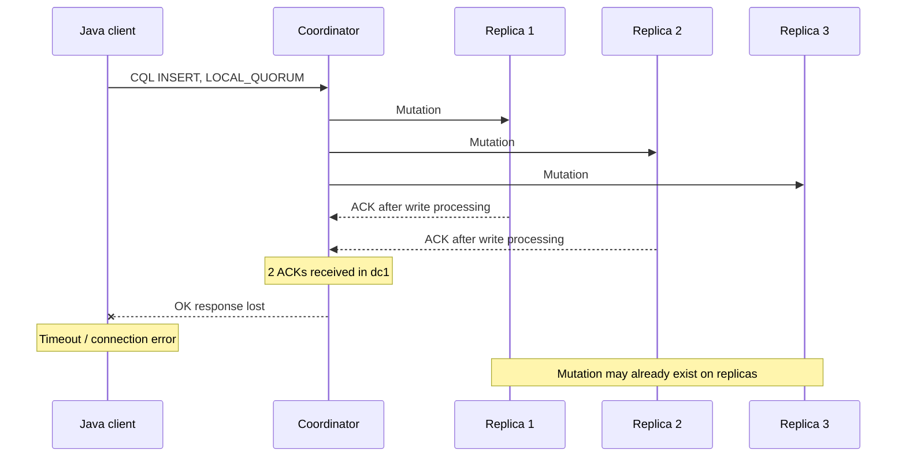
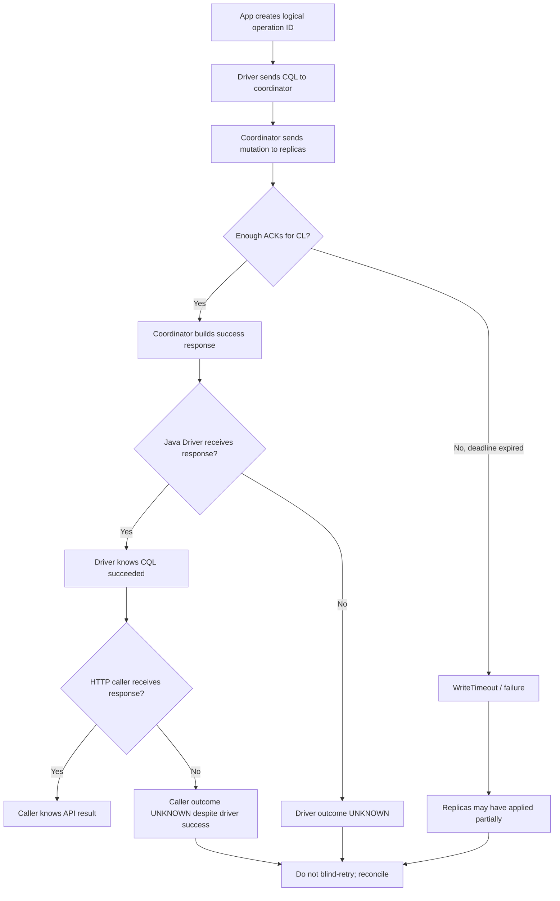
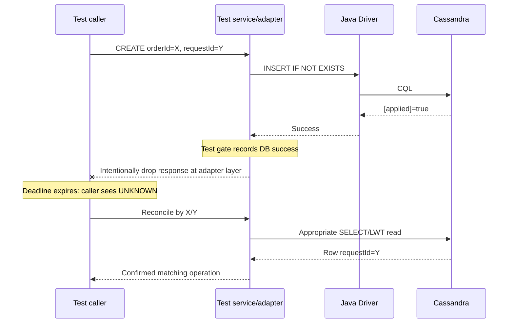
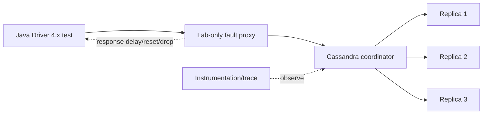
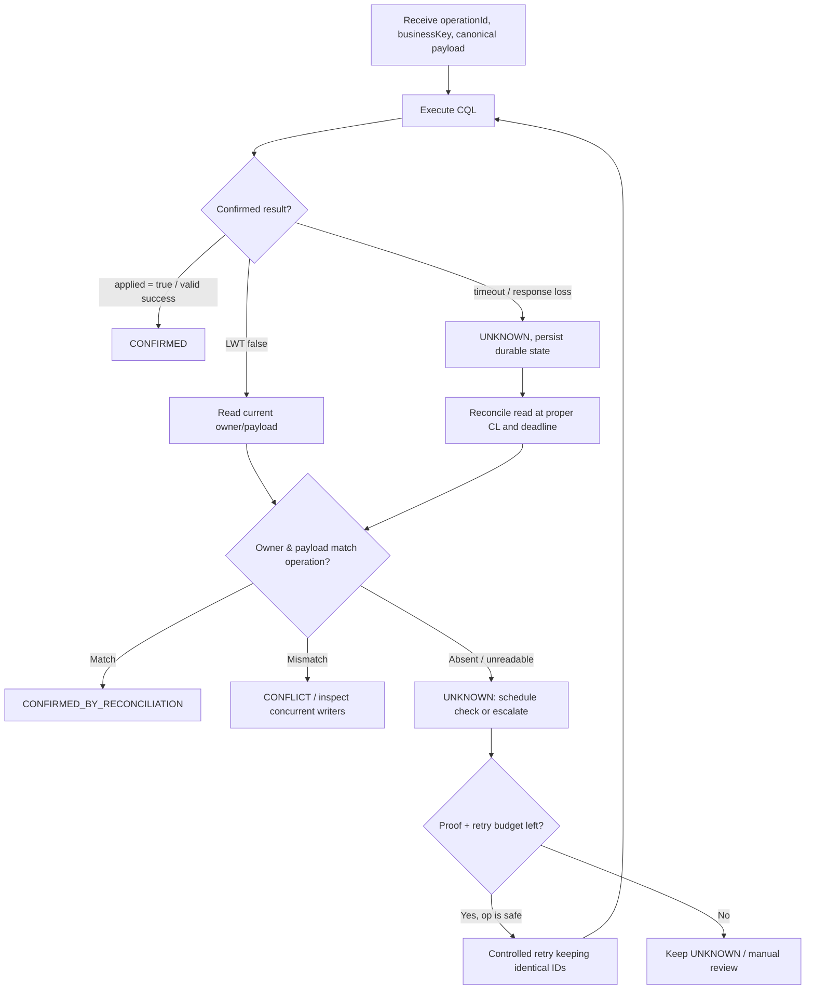

# Write Applied Yet Response Lost in Cassandra: Testing and Handling Unknown Outcomes

## 1. A Write Already Happened—Why Does the Application Still Report an Error?

Apache Cassandra is a distributed **wide-column** database: an application sends CQL to a **coordinator**, the coordinator forwards the mutation to **replicas** determined by partition key, replication factor (RF), and topology, and waits for responses matching the **consistency level (CL)**. Both the application-to-coordinator path and the coordinator-to-replica path can lose packets, drop connections, or stall past timeouts.

Consider order creation:

```text
POST /orders
requestId = 8d1e... (immutable for the same logical request)
orderId   = 51a3...

1. The application issues an INSERT/CAS to Cassandra.
2. The mutation is applied on replicas per the write path.
3. The coordinator finishes and prepares the response.
4. The response is lost or the connection drops before the caller sees it.
5. The caller receives a timeout / connection reset.
6. The caller resends the same request: will it create a second order?
```

The most dangerous moment is step 5. **A client-side timeout does not prove the mutation was not applied.** Even after the server satisfies CL success conditions, the client can miss the final ACK. Blindly "retrying to be safe" can corrupt data—especially with **counter increments, list appends, TTLs, conditional mutations (LWT)**, and side effects outside Cassandra.

**Goal:** design reproducible experiments for **write succeeded yet reply lost**, classify outcomes from each participant's perspective, and build data-correct verification and reconciliation in Java Driver 4.x, Spring Boot, and multi-replica systems.

### Learning Outcomes

1. Distinguish **mutation applied on one replica**, **CL satisfied at the coordinator**, and **client received result**.
2. Explain where responses can be lost along the write path, both at the CQL layer and at HTTP/gateway layers.
3. Classify `WriteTimeout`, `WriteFailure`, `DriverTimeout`, `Unavailable`, and connection drops without over-inferring.
4. Identify when retries preserve business semantics and when they duplicate effects.
5. Design immutable `operation_id`/`request_id`, LWT `IF NOT EXISTS`, and **post-`UNKNOWN` reconciliation**.
6. Practice CQL + Java Driver, a deterministic test simulating **lost response after server success**, and a lab proxy fault scenario.
7. Measure `UNKNOWN` counts, duplicates, elapsed time, CL, attempts, and recovery—with guardrails preventing impact outside the test environment.

> **Core takeaway:** *An unclear outcome at the client is a distinct state requiring dedicated handling, not a business `false`.* Safe retries require proven idempotency and a way to identify **the same logical operation**.

## 2. Three Distinct Events: APPLY, QUORUM ACK, CLIENT OBSERVE

With an RF3 keyspace in `dc1` and writes at `LOCAL_QUORUM`, a coordinator typically needs ACKs from **two local replicas** to return success for a standard write. Yet the client still depends on receiving the coordinator's response over the network connection.



This illustrates **one possible execution**, not a claim that every message arrives in this exact order. LWTs, counters, and batches execute differently internally from simple writes. The common truth is that **the client missing an ACK never proves replicas did nothing**.

| Event | Who Knows? | What It Proves | What It Does **Not** Prove |
|---|---|---|---|
| R1 applied mutation | R1 and reliable server-side observation | At least one replica processed the mutation | Write met CL, synced all replicas, or client received reply |
| Coordinator got enough ACKs for CL | Coordinator and reliable traces | Confirmation threshold for that write was met at that instant | HTTP caller got success, or all DCs converged |
| Java Driver received success | Java process / driver | CQL attempt succeeded at CL | Entire HTTP / business side-effect chain finished |
| HTTP caller received 2xx | Caller / gateway | Endpoint reported success per contract | No downstream actions failed after 2xx |
| Client timeout | Client | No response arrived within client deadline | Mutation was rolled back or never sent |

**Cassandra does not run a distributed rollback transaction just because a coordinator or client timed out.** Replicas may already have appended to commit logs and memtables, and data may be readable even though the caller saw an error.

### Do Not Equate "Written on One Replica" with "Write Succeeded at CL"

Suppose under RF3/`LOCAL_QUORUM`, only one replica sends an ACK before timeout. The mutation **may exist** on R1, yet the coordinator **did not confirm `LOCAL_QUORUM` success** to the client. Afterward, anti-entropy, hints, repair, and subsequent operations govern convergence. Never mark business success based on a weak partial observation.

Conversely, if two ACKs reached the coordinator and the final reply vanished on the wire, **CL completed on the server** while the client remains unaware. That is the classic scenario of this lesson.

## 3. Timeline and Uncertainty Windows



Break down failure locations:

1. **Before sending the request:** clear validation errors prove code never called the driver. That is app-level proof, unlike assuming "any network error means unsent".
2. **After sending, before enough ACKs:** some replicas wrote; coordinator times out or fails.
3. **After enough ACKs, before Java receives success:** response dropped/blocked or coordinator died right as it replied; client does not know CL succeeded.
4. **Java received success, before HTTP 2xx reaches the caller:** Spring Boot, gateway, or network fails; caller is unaware even though the driver succeeded.
5. **After HTTP 2xx:** asynchronous event/notification publishers can still fail; API success needs explicit contracts for those steps.

Across windows 2–4, the accurate initial answer is **`UNKNOWN` until reconciled**, not "guaranteed `FAILED`".

### Naming States Cleanly

An application-layer state machine:

```text
PENDING
  ├── CONFIRMED        sufficient evidence received per contract
  ├── CONFLICT         another operation owns the business key
  ├── REJECTED         clear evidence the operation never executed
  └── UNKNOWN          reply lost or insufficient evidence
         ├── CONFIRMED_AFTER_RECONCILIATION
         ├── CONFLICT_AFTER_RECONCILIATION
         └── NEEDS_MANUAL_REVIEW / RETRY_SCHEDULED_UNDER_POLICY
```

Never return HTTP `409 Conflict` for every write timeout. Never return `201 Created` just because **some row** exists with that order ID without proving it belongs to the current request.

## 4. RF, CL, and Satisfying ACKs

Example keyspace:

```sql
CREATE KEYSPACE IF NOT EXISTS lost_ack_lab
WITH replication = {
    'class': 'NetworkTopologyStrategy',
    'dc1': 3
}
AND durable_writes = true;
```

With RF3 in one DC:

| Normal Write CL | Required ACKs in Example | One Replica Down Before Request |
|---|---|---|
| `ONE` | 1 replica responds | Can succeed if an owning replica remains |
| `LOCAL_QUORUM` | 2 replicas in `dc1` | Achievable if the remaining two replicas are healthy |
| `QUORUM` | 2 of RF3 in single DC | In a single DC, matches local quorum count here |
| `ALL` | 3 replicas | Cannot succeed with only two replicas |

With multiple DCs, `LOCAL_QUORUM` checks only the local DC's RF; `QUORUM` spans the replication factor globally, and writes at `EACH_QUORUM` require quorums in every DC. Never carry a single-DC table into multi-DC setups without recalculating RF.

**Never "solve" lost ACKs by downgrading CL from `LOCAL_QUORUM` to `ONE`.** Weaker CL may return more responses at the cost of breaking the consistency contract—and still leaves `UNKNOWN` outcomes unresolved when replies vanish.

### Once CL Is Satisfied, Is Data "100% Safe"?

No. CL specifies how many replicas acknowledged per protocol for that call. It does **not** prove:

- All replicas in all DCs share identical state.
- All SSTables flushed to disk across all replicas.
- Historical backups/snapshots contain the mutation.
- All denormalized tables or external systems updated atomically.
- No concurrent writer or tombstone with a higher timestamp overwrites it afterward.

Distinguish **durable write path**, replica acknowledgment, replication convergence, backups, and business workflows.

## 5. Classifying Timeouts and Transport Errors

Common error signals in Java Driver 4.x:

| Signal | Information Available to Client | Inference About the Write |
|---|---|---|
| `WriteTimeoutException` | Coordinator lacked enough ACKs within timeout (with write type/CL) | **Outcome may be `UNKNOWN`**; some replicas may have written |
| `WriteFailureException` | Server reported replica write failures with write type/ACKs | Never assume zero replicas wrote |
| `UnavailableException` | Coordinator saw too few live replicas for CL at dispatch | Usually rejected for lack of quorum; classify by **specific request**, logs, and cause |
| `DriverTimeoutException` | Client driver exceeded request timeout | Coordinator may still be running or already finished |
| Connection drop after send | No complete reply received | **`UNKNOWN`**, especially when unsure whether the request reached the server |
| `AllNodesFailedException` | Driver failed across all tried nodes; holds per-node root causes | Never infer solely from the exception name that the request never reached a coordinator |
| Clear `InvalidQueryException` / unauthorized | Rejected by validation or authorization | Fix query/permissions; do not retry as transient |
| LWT result `[applied]=false` | Condition unmet on **this attempt** | Never claim the initial logical operation failed if an earlier attempt timed out |

**Never write `catch (Exception e) { retry(); }`.** An `INSERT ... IF NOT EXISTS` can return `false` after the first attempt already succeeded; a counter increment can double-apply; an authorization error will not heal after sleeping.

### Does `WriteType` Reveal Exact Data State?

`WriteTimeoutException` includes `WriteType` such as `SIMPLE`, `BATCH`, `COUNTER`, or `CAS`. Use it to **categorize investigations and retry rules**, never to conclude "a `CAS` timeout definitely didn't apply" or "a `SIMPLE` timeout definitely applied".

`received` and `blockFor` reflect acknowledgments known to the server at timeout—**not** how many replicas ultimately persisted the mutation if ACKs arrived late or dropped.

### Why Raising Timeouts Is Not Enough

Longer timeouts let more slow replies arrive, yet:

- Hold in-flight requests and resources longer.
- Do not heal network partitions or coordinator crashes.
- Do not fix non-idempotent retry bugs.
- Can worsen API SLOs even when Cassandra eventually persists the write.

Any timeout tuning must be evaluated under **identical offered load, CL, RF, key distribution, and retry policy**, tracking in-flight queues and server health.

## 6. Idempotency Must Be Defined at the Business Level

An **idempotent** request produces no new business side effects when the same logical operation runs again under defined assumptions. In Cassandra, the CQL keyword `INSERT` or `UPDATE` **is not enough to prove safety**.

| Mutation | Safe to Blind-Retry After Lost Reply? | Why |
|---|---|---|
| `SET status='CREATED'` on same key | **Conditional** | Concurrent updates/timestamps can let a late retry overwrite a newer state |
| `INSERT` with full PK and immutable payload | Conditional on LWW/TTL/concurrency | Same key will not add a second row, yet timestamps, TTL, and side effects matter |
| `counter = counter + 1` | **No** | Every applied attempt increments again |
| `list = list + ['sku-A']` | **No** | Retries can append duplicate elements |
| `list = ['sku-A'] + list` | **No** | Retries can prepend duplicates and reorder |
| `USING TTL 600` | **Not by default** | Replays can shift expiration timestamps |
| `INSERT ... IF NOT EXISTS` | Do not blind-retry after timeout | Retry may return `[applied]=false` because the first attempt already created it |
| `UPDATE ... IF version=?` | Do not blind-retry after timeout | Version may already have advanced on attempt 1, causing retry rejection |
| Calling a payment gateway after Cassandra write | Cannot rely on CQL idempotence alone | Requires external deduplication / exactly-once policy |

### 6.1. Same-Key Upserts Still Need Concurrency Checks

Writing the same `order_id` and `status` twice yields one row in a static test. Yet if another worker transitions `status` to `PAID` in between, a delayed retry writing `status='CREATED'` with a newer timestamp makes state **regress backward**.

Thus **identical values and primary key** help, yet are insufficient for every workflow—use explicit versions, immutable ownership, LWTs, or state-machine guards where needed.

### 6.2. TTL Is Time-Sensitive

```sql
UPDATE lost_ack_lab.session_flags
USING TTL 600
SET state = 'ACTIVE'
WHERE session_id = 55555555-5555-4555-8555-555555555555;
```

Retrying one minute later **shifts expiration**. When sessions must expire at a fixed deadline chosen at login, store `expires_at` as an explicit business field checked by the app, using TTL solely for background cleanup rather than as the sole authority for access expiry.

### 6.3. "No Response" Does Not Give the Client Transaction Rollback

A client cannot roll back a Cassandra write just because a socket dropped. Nor can it fire an immediate `DELETE` to "undo" without knowing who read or updated the row meantime: deleting creates tombstones and introduces concurrency and replica-consistency hazards.

**Business compensation** requires a dedicated, stateful compensating operation—never ad-hoc deletes or retries until a row vanishes.

## 7. LWT Lost-Response Scenario: Second Attempt Returns `[applied]=false`

One way to guard business uniqueness is storing the **logical request ID** and an immutable payload fingerprint directly in the row created via `IF NOT EXISTS`.

Suppose:

```sql
CREATE TABLE IF NOT EXISTS lost_ack_lab.orders_by_id (
    order_id uuid PRIMARY KEY,
    request_id uuid,
    payload_hash text,
    status text,
    amount_cents bigint
);
```

First attempt:

```sql
INSERT INTO lost_ack_lab.orders_by_id (
    order_id, request_id, payload_hash, status, amount_cents
) VALUES (
    11111111-1111-4111-8111-111111111111,
    22222222-2222-4222-8222-222222222222,
    'sha256:canonical-order-payload-v1',
    'CREATED', 125000
) IF NOT EXISTS;
```

If the first attempt succeeded on the server while the response vanished, re-sending **the exact same statement** typically returns:

```text
[applied] = false
current row.request_id = 22222222-2222-4222-8222-222222222222
```

This is **not a business failure** when the same operation already created the row. Compare **`request_id` + `payload_hash` + immutable invariants** and classify as `ALREADY_APPLIED`. If the row belongs to a different request, classify as `CONFLICT`, never success.

### What If the First Attempt Actually Never Wrote?

Then the retry becomes the first successful write and returns `[applied]=true`. That is another reason never to treat `[applied]=false` after a timeout as proof the logical operation failed. Reconcile by identity and state, not client attempt number.

### Serial Consistency and Scope

LWTs are conditional mutations using Paxos with a **serial consistency** (`SERIAL`/`LOCAL_SERIAL`) alongside a regular CL for commit/read phases. In a single RF3 DC, apps commonly pair `LOCAL_QUORUM` with `LOCAL_SERIAL` after validating semantics on their topology.

LWTs do not provide exactly-once guarantees across **two separate partitions** or an external payment API. Storing `request_id` inside the row enables clear reconciliation for **that single row**, not proof that all external side effects completed.

## 8. Operation-ID Table: Tight Enough to Reconcile

A server can deal with distinct IDs:

| ID | Purpose | May Change on Retry? |
|---|---|---|
| `order_id` | Business order identifier | **No**, if retrying the same order |
| `request_id` / `operation_id` | Identifies the same logical command | **No**, even across gateways/queues |
| HTTP attempt trace ID | Traces a single transport hop | May differ per attempt |
| Driver request/attempt ID | Traces a single CQL send | May differ per attempt |

Never use a **fresh** trace ID on each HTTP retry as an idempotency key. Nor call `UUID.randomUUID()` inside `createOrder` whenever the caller resends the same order.

### Bind the Payload Too

If a client reuses `request_id` while changing `amount_cents` in the body, it is not "the same operation". Compute a versioned canonical payload fingerprint over `order_id`, `tenant_id`, amount, currency, immutable fields, and rule version.

**Avoid** using the illustrative placeholder `'sha256:canonical-order-payload-v1'` as a real checksum: in labs, compute a real hash or deterministic test fixture value. Never log payloads containing PII or raw idempotency keys on every request.

### Never Fake Transactions with Check-Then-Write

Dangerous anti-pattern:

```text
if (!seen(request_id)) {
    UPDATE counter SET total = total + 1
    INSERT processed_requests(request_id)
}
```

A crash between those two statements double-counts or drops the event. Checking first and writing two tables does not create a cross-partition ACID transaction. For strong guarantees, design an **atomic claim + bounded side effect**, or a durable event ledger with idempotent projections that can rebuild and reconcile.

## 9. CQL Lab: Test Fixtures Covering Regular Writes, LWTs, Counters, and TTLs

**Run only on an isolated lab cluster.** `dc1`/RF3 requires at least three live replicas; on a single-node RF1 lab, adjust keyspace replication/CL accordingly and **never** cite RF1 results as proof of RF3 quorum resilience.

```sql
CREATE KEYSPACE IF NOT EXISTS lost_ack_lab
WITH replication = {
    'class': 'NetworkTopologyStrategy',
    'dc1': 3
}
AND durable_writes = true;

CREATE TABLE IF NOT EXISTS lost_ack_lab.orders_by_id (
    order_id uuid PRIMARY KEY,
    request_id uuid,
    payload_hash text,
    status text,
    amount_cents bigint
);

CREATE TABLE IF NOT EXISTS lost_ack_lab.counter_by_tenant (
    tenant_id text PRIMARY KEY,
    completed_orders counter
);

CREATE TABLE IF NOT EXISTS lost_ack_lab.session_flags (
    session_id uuid PRIMARY KEY,
    state text,
    expires_at timestamp
);

CREATE TABLE IF NOT EXISTS lost_ack_lab.events_by_order (
    order_id uuid,
    event_id uuid,
    event_type text,
    PRIMARY KEY ((order_id), event_id)
);
```

Note: `events_by_order` provides an immutable `event_id` to record each event as its own row, **not** atomic coupling with `orders_by_id` or counters. It demonstrates an identity-bearing data model, not a complete transactional outbox.

### Setting CL in `cqlsh`

```text
CONSISTENCY LOCAL_QUORUM;
```

This is a **`cqlsh` shell command**, not CQL DDL syntax. On single-node RF1 labs, `LOCAL_QUORUM` behaves differently; note that explicitly in test reports.

### Exercise A — Identical Primary Key Creates No Extra Row

```sql
INSERT INTO lost_ack_lab.orders_by_id
    (order_id, request_id, payload_hash, status, amount_cents)
VALUES (
    11111111-1111-4111-8111-111111111111,
    22222222-2222-4222-8222-222222222222,
    'payload-v1', 'CREATED', 125000
);

INSERT INTO lost_ack_lab.orders_by_id
    (order_id, request_id, payload_hash, status, amount_cents)
VALUES (
    11111111-1111-4111-8111-111111111111,
    22222222-2222-4222-8222-222222222222,
    'payload-v1', 'CREATED', 125000
);

SELECT request_id, payload_hash, status, amount_cents
FROM lost_ack_lab.orders_by_id
WHERE order_id = 11111111-1111-4111-8111-111111111111;
```

Expect one logical row due to the identical full primary key, **not** two rows. This is a tightly scoped example; with concurrent writers, TTLs, or differing timestamps, replays can behave differently.

### Exercise B — LWT with Same Request ID After Creation

Use a **different `order_id`** so Exercise A does not interfere:

```sql
INSERT INTO lost_ack_lab.orders_by_id
    (order_id, request_id, payload_hash, status, amount_cents)
VALUES (
    33333333-3333-4333-8333-333333333333,
    44444444-4444-4444-8444-444444444444,
    'payload-v2', 'CREATED', 200000
) IF NOT EXISTS;

-- Re-run the exact INSERT above with identical IDs and payload.
SELECT request_id, payload_hash, status, amount_cents
FROM lost_ack_lab.orders_by_id
WHERE order_id = 33333333-3333-4333-8333-333333333333;
```

First run returns `[applied]=true`; second run returns `false` because the row exists. If the first response was lost, **the second run returning `false` never proves the order was not created**.

### Exercise C — Repeated Counter Increments Accumulate

```sql
UPDATE lost_ack_lab.counter_by_tenant
SET completed_orders = completed_orders + 1
WHERE tenant_id = 'tenant-01';

UPDATE lost_ack_lab.counter_by_tenant
SET completed_orders = completed_orders + 1
WHERE tenant_id = 'tenant-01';

SELECT completed_orders
FROM lost_ack_lab.counter_by_tenant
WHERE tenant_id = 'tenant-01';
```

Two successful mutations increment by two. If the logical event should count only once, **blindly retrying counters is wrong**, even when the client timed out on attempt 1.

### Exercise D — TTL Replay

```sql
UPDATE lost_ack_lab.session_flags
USING TTL 600
SET state = 'ACTIVE'
WHERE session_id = 55555555-5555-4555-8555-555555555555;

SELECT state, TTL(state), WRITETIME(state)
FROM lost_ack_lab.session_flags
WHERE session_id = 55555555-5555-4555-8555-555555555555;
```

After a controlled lab delay, re-run the `UPDATE` and observe remaining TTL: the expiration time **shifts forward**. `WRITETIME` is the mutation timestamp, distinct from expiration time; check TTL semantics for your target server version.

## 10. Java Driver 4.x: Never Turn Timeouts into "Order Was Not Created"

A Spring Boot service or plain Java app injects/reuses a `CqlSession` configured with contact points, local datacenter, TLS, auth, and request timeouts. The repository below performs **one** conditional insert per order ID; if the reply is lost, it returns **`UNKNOWN`** for ambiguous failure classes.

Key points:

- Generate `order_id` and `request_id` **before** calling the repository, keeping them immutable across all HTTP/queue retries.
- Use `LOCAL_QUORUM` and `LOCAL_SERIAL` in this RF3/DC1 lab.
- Set `setIdempotent(false)` so the driver's retry policy never assumes unconditional replay safety on the LWT.
- On `[applied]=false`, inspect the existing row's **owner `request_id`** and payload hash.
- On timeouts/transport errors, return a dedicated `UNKNOWN` outcome—**never claiming success or failure**.
- Re-throw clear validation/auth errors for caller handling; never label definitively rejected requests as `UNKNOWN`.

### 10.1. Repository with Classified Outcomes

```java
import java.util.Iterator;
import java.util.UUID;
import java.util.concurrent.CompletionException;
import java.util.concurrent.CompletionStage;
import java.util.concurrent.ExecutionException;

import com.datastax.oss.driver.api.core.AllNodesFailedException;
import com.datastax.oss.driver.api.core.CqlSession;
import com.datastax.oss.driver.api.core.DefaultConsistencyLevel;
import com.datastax.oss.driver.api.core.DriverTimeoutException;
import com.datastax.oss.driver.api.core.cql.AsyncResultSet;
import com.datastax.oss.driver.api.core.cql.BoundStatement;
import com.datastax.oss.driver.api.core.cql.PreparedStatement;
import com.datastax.oss.driver.api.core.cql.Row;
import com.datastax.oss.driver.api.core.servererrors.ReadFailureException;
import com.datastax.oss.driver.api.core.servererrors.ReadTimeoutException;
import com.datastax.oss.driver.api.core.servererrors.UnavailableException;
import com.datastax.oss.driver.api.core.servererrors.WriteFailureException;
import com.datastax.oss.driver.api.core.servererrors.WriteTimeoutException;

public final class LossAwareOrderRepository {
    public enum Kind {
        APPLIED,
        ALREADY_APPLIED,
        CONFLICT,
        UNKNOWN
    }

    public record CreateResult(Kind kind, String detail) {}

    private final CqlSession session;
    private final PreparedStatement insertIfAbsent;
    private final PreparedStatement selectById;

    public LossAwareOrderRepository(CqlSession session) {
        this.session = session;
        this.insertIfAbsent = session.prepare(
            "INSERT INTO lost_ack_lab.orders_by_id " +
            "(order_id, request_id, payload_hash, " +
            "status, amount_cents) VALUES (?, ?, ?, ?, ?) " +
            "IF NOT EXISTS");
        this.selectById = session.prepare(
            "SELECT request_id, payload_hash, status, " +
            "amount_cents FROM lost_ack_lab.orders_by_id " +
            "WHERE order_id = ?");
    }

    public CompletionStage<CreateResult> create(
            UUID orderId, UUID requestId,
            String payloadHash, long amountCents) {
        BoundStatement write = insertIfAbsent.bind(
                orderId, requestId, payloadHash,
                "CREATED", amountCents)
            .setConsistencyLevel(
                DefaultConsistencyLevel.LOCAL_QUORUM)
            .setSerialConsistencyLevel(
                DefaultConsistencyLevel.LOCAL_SERIAL)
            .setIdempotent(false);

        return session.executeAsync(write).handle((result, error) -> {
            if (error != null) {
                Throwable root = unwrap(error);
                if (isAmbiguousWriteFailure(root)) {
                    return new CreateResult(
                        Kind.UNKNOWN, "CQL outcome not confirmed");
                }
                // Let service layer classify other errors explicitly.
                throw new CompletionException(root);
            }

            Iterator<Row> rows = result.currentPage().iterator();
            if (!rows.hasNext()) {
                throw new IllegalStateException(
                    "LWT returned no applied result");
            }
            Row row = rows.next();
            if (row.getBoolean("[applied]")) {
                return new CreateResult(
                    Kind.APPLIED, "Condition applied");
            }

            UUID owner = row.isNull("request_id")
                ? null : row.getUuid("request_id");
            String existingHash = row.getString("payload_hash");
            Long existingAmount = row.isNull("amount_cents")
                ? null : row.getLong("amount_cents");

            if (requestId.equals(owner)
                    && payloadHash.equals(existingHash)
                    && Long.valueOf(amountCents).equals(existingAmount)) {
                return new CreateResult(
                    Kind.ALREADY_APPLIED,
                    "Same operation already owns the row");
            }
            return new CreateResult(
                Kind.CONFLICT, "Different owner or payload");
        });
    }

    public CompletionStage<CreateResult> reconcile(
            UUID orderId, UUID requestId,
            String payloadHash, long amountCents) {
        BoundStatement read = selectById.bind(orderId)
            .setConsistencyLevel(
                DefaultConsistencyLevel.LOCAL_QUORUM)
            .setIdempotent(true);

        return session.executeAsync(read).handle((result, error) -> {
            if (error != null) {
                Throwable root = unwrap(error);
                if (root instanceof DriverTimeoutException
                        || root instanceof AllNodesFailedException
                        || root instanceof ReadTimeoutException
                        || root instanceof ReadFailureException
                        || root instanceof UnavailableException) {
                    return new CreateResult(
                        Kind.UNKNOWN, "Cannot reconcile yet");
                }
                throw new CompletionException(root);
            }

            Iterator<Row> rows = result.currentPage().iterator();
            if (!rows.hasNext()) {
                // ABSENT on this read does not prove a prior
                // mutation did not or cannot still complete.
                return new CreateResult(
                    Kind.UNKNOWN, "Row not visible; retry check later");
            }
            Row row = rows.next();
            UUID owner = row.isNull("request_id")
                ? null : row.getUuid("request_id");
            String hash = row.getString("payload_hash");
            Long cents = row.isNull("amount_cents")
                ? null : row.getLong("amount_cents");

            if (requestId.equals(owner)
                    && payloadHash.equals(hash)
                    && Long.valueOf(amountCents).equals(cents)) {
                return new CreateResult(
                    Kind.ALREADY_APPLIED,
                    "Matching immutable row is visible");
            }
            return new CreateResult(
                Kind.CONFLICT, "Row belongs to a different operation");
        });
    }

    private static boolean isAmbiguousWriteFailure(Throwable root) {
        return root instanceof WriteTimeoutException
            || root instanceof WriteFailureException
            || root instanceof DriverTimeoutException
            || root instanceof AllNodesFailedException;
    }

    private static Throwable unwrap(Throwable failure) {
        Throwable current = failure;
        while ((current instanceof CompletionException
                 || current instanceof ExecutionException)
                && current.getCause() != null) {
            current = current.getCause();
        }
        return current;
    }
}
```

### 10.2. Guarantee Boundaries of the Java Code

1. **No automatic retry loop:** even on `Kind.UNKNOWN`, the repository simply reports status so the service layer decides reconciliation.
2. `isAmbiguousWriteFailure` conservatively treats `AllNodesFailedException` as ambiguous, even though specific per-node root causes might prove nothing was sent; **never lump all node failures together**.
3. Different `WriteTimeout` `WriteType`s carry different ACK semantics; inspect exception details and topology, not just exception class names.
4. `reconcile` reads at `LOCAL_QUORUM` and verifies identity/payload. It does not create a global snapshot and cannot see an in-progress LWT commit phase; **an absent row does not prove rollback**.
5. `ALREADY_APPLIED` means **the existing row matches the same logical operation**, trustworthy only while `request_id`, hash, and amount **are never mutated by another workflow** or order IDs reused.
6. If `status` transitions from `CREATED` to `PAID` afterward, reconciliation checks must verify immutable ownership and valid state-machine transitions rather than requiring `status` to still equal `CREATED`.
7. `setIdempotent(false)` informs the driver's retry policy only; it **does not stop** HTTP gateways, message brokers, or callers from invoking `create()` again.
8. Cross-table atomicity, snapshots, and event trails belong at the application/architecture level; a single-table repository does not supply them automatically.

### 10.3. Why Not Read at CL `ONE` and Conclude Written or Not?

If the replica that applied the mutation was not queried by a `ONE` read, the row may appear missing. `LOCAL_QUORUM` at RF3 improves local-quorum visibility, yet after an **unconfirmed write** under concurrency, a single read still cannot prove the operation will not finish later.

Never treat an empty `SELECT ... LIMIT 1` as license to generate a new order ID. Where strong certainty is required, use a durable idempotency ledger, appropriate LWT/serial reads, and bounded reconciliation with clear termination rules.

## 11. Spring Boot / API: Turning `UNKNOWN` into an Inspectable State

A well-designed API defines outcomes **by what can be proven**, rather than forcing every call into 200 or 500:

| Backend Situation | Suggested API Contract | What the Client Does |
|---|---|---|
| LWT `[applied]=true` | `201 Created` (or equivalent success) | Proceeds with `order_id` |
| `[applied]=false`, matching request/payload | `200 OK` / `201` per idempotency contract | Does not create a new order |
| `[applied]=false`, different owner/payload | `409 Conflict` | Fixes request or investigates |
| CQL `UNKNOWN`, service still controls response | `202 Accepted` with status endpoint **if durable tracking exists**, or transient error with operation ID | Polls by ID without changing payload/ID |
| HTTP response lost completely | Caller receives no status code | Caller retries **with identical ID**, or checks status via separate endpoint |
| Clear validation/auth failure | `400` / `403` / appropriate status | Fixes input/permissions; never blind-retries |

**Never return a fake `202 Accepted`** if the service lacks durable workflow state or a status endpoint for follow-up reconciliation. On `UNKNOWN`, returning a clear transient error instructing the caller to retain the idempotency key is valid—the critical rule is **never asserting the write definitely did not happen**.

### Example Status-Check Endpoint

```text
POST /orders
Idempotency-Key: 22222222-2222-4222-8222-222222222222
Body: {"orderId":"33333333-3333-4333-8333-333333333333",
       "amountCents":200000}

GET /operations/22222222-2222-4222-8222-222222222222
→ PENDING / CONFIRMED / CONFLICT / UNKNOWN / NEEDS_REVIEW
```

This is an **illustrative HTTP contract**, not a built-in Cassandra API. Authenticate callers on **every request**, bind operation IDs to the tenant/principal and canonical payload, and enforce retention/expiry on idempotency records so users cannot probe other tenants' operations.

### Multi-Layer Retries


A single `setIdempotent(false)` flag **does not disable all retry arrows** in this diagram. If gateways, services, and drivers each hold separate retry budgets, attempts multiply exponentially. Design an end-to-end policy: **immutable operation IDs, a primary retry authority, total deadlines, backoff/jitter, quotas, and telemetry**.

## 12. Deterministic Experiment: Write Succeeds, Then Suppress the HTTP ACK

The cleanest experiment proving "written yet caller never saw it" controls the **application response boundary** after confirming Cassandra write success. This simulates **HTTP/API response loss**, not direct Cassandra wire-level TCP packet loss.

### Experiment Mechanics



This sequence yields clear evidence:

- The test harness observed **server success** before suppressing the reply.
- The caller experienced **timeout / no response**.
- Reconciliation found the exact row with matching request ID and payload hash.

However, **never label this "wire-level CQL ACK loss testing"**. To test the driver itself when coordinator replies vanish, use proxy/network faults as in section 13.

### JUnit 5 Code: Simulating Lost Response Channel After Success

The test below assumes an injected `CqlSession session` connected to a real Cassandra integration-test fixture with section 9's tables created. It intentionally leaves a `CompletableFuture` representing the **caller response** uncompleted after CQL succeeds. Use unique order IDs to avoid interfering with other tests:

```java
import static org.junit.jupiter.api.Assertions.*;

import java.util.UUID;
import java.util.concurrent.CompletableFuture;
import java.util.concurrent.CompletionException;
import java.util.concurrent.TimeUnit;

import org.junit.jupiter.api.Test;

import com.datastax.oss.driver.api.core.CqlSession;
import com.datastax.oss.driver.api.core.DefaultConsistencyLevel;
import com.datastax.oss.driver.api.core.cql.BoundStatement;
import com.datastax.oss.driver.api.core.cql.Row;

public final class LostHttpResponseIT {
    // Injected from @BeforeAll / Testcontainers / staging fixture.
    private CqlSession session;

    @Test
    void databaseAcceptedButCallerLostResponse() {
        UUID orderId = UUID.randomUUID();
        UUID requestId = UUID.randomUUID();

        BoundStatement create = session.prepare(
            "INSERT INTO lost_ack_lab.orders_by_id " +
            "(order_id, request_id, payload_hash, " +
            "status, amount_cents) VALUES (?, ?, ?, ?, ?) " +
            "IF NOT EXISTS"
        ).bind(orderId, requestId, "payload-test", "CREATED", 1000L)
         .setConsistencyLevel(
             DefaultConsistencyLevel.LOCAL_QUORUM)
         .setSerialConsistencyLevel(
             DefaultConsistencyLevel.LOCAL_SERIAL)
         .setIdempotent(false);

        Row applied = session.execute(create).one();
        assertNotNull(applied);
        assertTrue(applied.getBoolean("[applied]"));

        // Simulates ONLY the service/gateway response to the caller;
        // does NOT touch the CQL response already received by driver.
        CompletableFuture<String> responseToCaller =
            new CompletableFuture<>();
        assertThrows(CompletionException.class, () ->
            responseToCaller
                .orTimeout(50, TimeUnit.MILLISECONDS)
                .join());

        Row stored = session.execute(
            session.prepare(
                "SELECT request_id, payload_hash, " +
                "amount_cents FROM lost_ack_lab.orders_by_id " +
                "WHERE order_id=?")
                .bind(orderId)
                .setConsistencyLevel(
                    DefaultConsistencyLevel.LOCAL_QUORUM)
                .setIdempotent(true)
        ).one();

        assertNotNull(stored);
        assertEquals(requestId, stored.getUuid("request_id"));
        assertEquals("payload-test",
            stored.getString("payload_hash"));
        assertEquals(1000L, stored.getLong("amount_cents"));
    }
}
```

**Code scope:** `session` must actually be injected by a test fixture; this snippet does not compile/run standalone without Testcontainers/bootstrap wiring. `orTimeout(50 ms)` tests an **intentionally uncompleted future**, not real network behavior or Cassandra performance. Name the test clearly so reports never confuse synthetic HTTP loss with packet loss.

### Extending into an End-to-End Integration Test

Place a **test adapter** with a barrier between the HTTP controller and transport:

1. Caller sends a request with a fixed `Idempotency-Key`.
2. Service executes Cassandra write and confirms success.
3. Test adapter receives `DB_SUCCESS` signal.
4. Adapter **drops/closes the response** after that barrier on the return path to the client.
5. Caller times out and retries with the same key or polls the operation status endpoint.
6. Assert only one logical order exists with zero duplicate side effects, and all `UNKNOWN` states are classified.

The test adapter can live in a separate proxy or test harness; **never ship a "drop response" switch inside production code** or affect real user traffic.

## 13. Testing Response Loss on the CQL Path with Proxy / Network Faults

To test the Java Driver itself when the coordinator → client socket breaks, use a lab topology with a **client-facing TCP proxy** or controllable network-fault layer:



Unlike section 12's HTTP ACK test, the exact moment a response drops here **can be non-deterministic**. Placing network delay before replica execution might prevent the request from even arriving; resetting too early might abort before the coordinator processes the mutation. Therefore, **never write tests assuming every CQL timeout guarantees the row exists**.

### Experiment Sequence

1. Set up an **isolated** Cassandra lab with full control, driver routed through the proxy, and explicit schema/CL/seed data.
2. Run a fault-free baseline: verify read/write success, p99, retries, and baseline network exceptions.
3. Pick a **unique `request_id`** to trace, storing the operation identity in a safe test store.
4. Activate the scoped fault on the client connection for a **bounded test window**, logging activation/deactivation timestamps.
5. Send the CQL mutation through the proxy and record the driver's response (success/timeout/connection error).
6. Read back over an **unfaulted path** at the proper CL, verifying operation ID and payload.
7. **Never assert the write applied** based solely on a timeout; require trustworthy read/trace/ACK evidence.
8. Clear the fault, confirm cluster/client recovery, reconcile data, and archive artifacts.

### How to Confirm Quorum Was Met Before Losing the Response?

Seeing the row later proves **the row exists at the read's CL**, not necessarily that the coordinator **received full ACKs before the response dropped**. When your goal is proving the exact "after quorum ACK, before Java receives" boundary:

- Use appropriate driver/coordinator test instrumentation recording server-side ACK events.
- Use barriers/test hooks in a controlled test environment instead of relying on lucky network timing.
- Without server-side instrumentation, report honestly that the test confirmed **client timeout + visible row**, **not the exact server ACK boundary**.

**This requires honest evidence classification, not modifying Cassandra internals or running heavy tracing on production.** Tracing and packet captures must obey access controls, PII policies, and overhead budgets—never run fault configs on shared clusters.

### Response Loss Differs from Request Loss

Cutting **client → server** prevents the coordinator from receiving the request. Cutting **server → client** after server work drops the reply after execution. With TLS, proxies usually cannot inspect CQL frames unless authorized to terminate/decrypt; endpoint instrumentation may be required instead of guessing boundaries from a TCP reset.

## 14. Test Matrix: What Evidence Does Each Layer's Fault Produce?

| Scenario | Injected Fault | Caller Observation | Evidence Needed to Conclude |
|---|---|---|---|
| A. Baseline | None | Success | CL/result + matching row/payload |
| B. Lost HTTP response after DB success | Adapter drops HTTP reply after seeing driver success | HTTP timeout | `DB_SUCCESS` gate + row matching request ID |
| C. CQL response loss after server work | Controlled server → client proxy drop | Driver timeout / reset | Server trace or reconciliation read; never infer ACK from row alone |
| D. `WriteTimeout` before CL satisfied | Lab replica/network slowed | `WriteTimeout` | `received`/`blockFor` + row visibility; outcome still needs checking |
| E. One replica Down, RF3/`LOCAL_QUORUM` | Controlled stop of one replica | May still succeed; tail climbs | Other two local replicas healthy, p99 and errors |
| F. Coordinator dies right while replying | Controlled test hook or fault window | Transport error / timeout | Reconciliation and traces; do not assume unsent |
| G. LWT retry after lost reply | Identical ID/payload with prior timeout | `[applied]=false` or success | Compare identity/payload; never equate `false` with business failure |
| H. Counter two attempts | Two increments sent intentionally in lab | May increment twice | Event ledger proving two attempts shared one logical event |
| I. TTL replay | Re-send same TTL after delay | Column values may look identical | `TTL()` / `expires_at` and expiry drift |
| J. Client overloaded | Blocking callbacks / deep queues | Driver timeouts climb | Thread dumps, in-flight counts, generator scheduling lag |

**Mandatory stop conditions:** if an unplanned node goes Down, CL loses quorum, disk/GC saturates, test data corrupts without reconciliation, or faults leak beyond scope—**stop injecting, halt load growth, and restore baseline**.

## 15. Measuring Response-Loss Failures Without Skewing Benchmarks

Separate at least four metric streams:

| Metric | Definition | Why |
|---|---|---|
| `logical_ops_started` | Business operations initiated with an operation ID | Prevents counting retries as new orders |
| `cql_attempts` | Actual CQL sends across driver and app | Exposes retries and speculative executions |
| `caller_acknowledged` | Callers receiving API success per contract | Measures outer user experience |
| `confirmed_after_reconcile` | Initially `UNKNOWN`, later proven matching row | Measures self-healing after lost replies |
| `unknown_outcomes` | Lacking sufficient proof | Prevents forcing `UNKNOWN` into failed |
| `duplicate_business_effects` | Same logical op took effect >1 time | Measures correctness, not just availability |
| `reconciliation_latency` | From timeout until evidence-backed resolution | Evaluates workflow RTO |
| `timeout_by_layer` | HTTP, driver, server, queue | Pinpoints where failures originate |
| `request_p95_p99` | Tail latency by class and layer | Tracks load impact as retries rise |
| `retry_attempts_per_logical_op` | Attempts per logical operation | Detects retry storms |

### Illustrative Example — Not Measured Data

```text
logical_ops_started = 1000
caller_acknowledged = 940
caller_unknown      = 60

Out of 60 UNKNOWN:
  confirmed_after_reconcile = 45
  still_unknown             = 10
  conflict                  = 5

Never report "60 writes failed".
At least 45 were proven to have taken effect per contract.
```

Never drop those 60 `UNKNOWN`s from the error-budget or percentile denominator and announce "100% success". Conversely, never count the 45 `confirmed_after_reconcile` as **45 brand-new logical orders**.

### Time Boundaries

An application typically has:

- `driver-request-timeout`: how long Java Driver waits for a CQL reply.
- `server write_request_timeout`: how long the coordinator waits for ACKs per write type.
- `HTTP deadline`: how long the user or gateway waits.
- `reconciliation deadline`: how long the service investigates `UNKNOWN` before escalating.

None of these deadlines automatically rolls back server mutations upon expiry. Evaluate timeout changes under **identical offered load, CL, RF, key distribution, and retry policy**, tracking in-flight/queue counts and server health.

## 16. Reconciling `UNKNOWN` Outcomes: A Non-Duplicating Workflow

Systems need an explicit workflow for uncertain outcomes:



### 16.1. Never Treat One "Absent" Read as Absolute Negative Proof

If a write missed quorum ACKs while a replica is still applying it, an early `SELECT` can return empty right before the row appears. A weak read CL can hit an un-updated replica. Even an LWT can still be mid-protocol recovery.

Distinguish:

- **`VISIBLE_MATCH`:** row exists with matching request ID and immutable payload → evidence the operation took effect.
- **`VISIBLE_CONFLICT`:** row belongs to another operation → inspect business-key ownership and concurrent writers.
- **`NOT_VISIBLE_YET`:** row absent on this read → insufficient to prove "never applied" in all cases.
- **`READ_FAILED`:** read timed out or returned unavailable → remains `UNKNOWN`.

For strict linearizability requirements, design LWT/serial-consistent reads and version-appropriate identity boundaries instead of dropping CL to `ONE` for faster reads.

### 16.2. What About Multiple Query-Denormalized Tables?

An order may span:

```text
orders_by_id(order_id)
orders_by_customer_day(customer_id, day, created_at, order_id)
order_events_by_order(order_id, event_id)
```

If write A succeeds while write B's reply is lost, A's existence never proves **B succeeded too**. Reconcile every projection using the same immutable order ID. When a projection is missing:

1. Consult the source-of-truth / event ledger.
2. Recompute the missing projection row.
3. Write the missing row **with stable IDs and concurrency rules**.
4. Track correction lag and reconciliation counts.

**CQL `BATCH` does not automatically provide cross-partition ACID transactions or cover external APIs.** Evaluate batch types, replication topology, and failure modes separately—never use `BATCH` as a substitute for a durable workflow.

### 16.3. Should You Ever Re-Send an LWT?

A **controlled retry** is possible when the app holds immutable request/payload values and handles `[applied]` interpretation cleanly:

- Retry returns `true`: it may have executed the mutation for the first time.
- Retry returns `false` with matching `request_id`: the earlier attempt likely succeeded.
- Retry returns `false` with different `request_id`: real conflict or mutated state.
- Retry times out: remains `UNKNOWN`.

**Never treat a single post-timeout `[applied]` result as the complete truth of all prior attempts** if side effects extend beyond that LWT row—use deduplication/ledgers at each side-effect boundary.

## 17. When Responses Vanish Mid-Counter or Mid-List Write

LWTs help identify which request ID claimed a row. For **counters**, recovery is harder:

```text
Initial completed_orders = 100
Logical event E = "order 42 completed"

Attempt 1: counter +1 applied, ACK lost.
Attempt 2: counter +1 retried, succeeded.
Observed completed_orders may equal 102.
Business expectation: 101.
```

You cannot simply `SELECT completed_orders` and subtract 1 if valid concurrent completions are occurring. A bare counter holds no record of which increment was a duplicate without an event ledger.

### Better Design Using Event Identity

Illustrative event table:

```sql
INSERT INTO lost_ack_lab.events_by_order (
    order_id, event_id, event_type
) VALUES (
    11111111-1111-4111-8111-111111111111,
    66666666-6666-4666-8666-666666666666,
    'COMPLETED'
) IF NOT EXISTS;
```

If the same `event_id` is re-sent, the LWT detects the existing row (still verify ownership/payload and handle timeouts). An aggregator process can then compute projections from confirmed events with checkpoints and reconciliation. **Never call this an atomic transaction between event insertion and counter update**: carefully design crash recovery so updates are neither missed nor double-counted.

### Why List Appends Suffer Similarly

```text
items = items + ['sku-A']
```

If attempt 1 appended without the caller seeing the reply, attempt 2 appends `'sku-A'` a second time. When the domain means "one row per cart item", a table keyed by `PRIMARY KEY ((cart_id), item_id)` with deterministic IDs preserves identity far better than an un-keyed list append.

### TTL Creates Another Subtle Risk

Retrying a TTL write does not add extra rows or counter increments; instead, it shifts `expires_at` on storage relative to policy. A test asserting only `state='ACTIVE'` misses timing drift. For strict expiry rules, store an immutable business `expires_at` and validate `TTL(state)`/observed expiry within tight test tolerances.

## 18. Incident Runbook for Lost ACKs on Live Production Traffic

**Goal:** curb duplicate side effects and restore outcome visibility—never inject live network faults to "confirm the root cause".

### Step 1 — Identify the Signal Type

Record:

- Query template and mutation kind (upsert, counter, list, TTL, LWT).
- `order_id`/`operation_id` inside secure audit stores, never exposing raw PII in metric labels.
- Driver error class, root cause, and `WriteType`/CL/`received`/`blockFor` where available.
- Datacenter, coordinator/contact point, timestamps, and timeout budgets.
- Retries and speculative executions across driver, gateway, service, queues, and callers.
- Sample attempts known to have succeeded vs. lost responses.

**Never merge** `WriteTimeout` and `InvalidQuery` into one "DB errors" chart. Validation errors need code/schema fixes; `UNKNOWN` writes need reconciliation.

### Step 2 — Inspect Cassandra and Client Health

Read-only checks on authorized nodes/clusters:

```bash
nodetool status
nodetool describecluster
nodetool tpstats
nodetool compactionstats
nodetool tablestats lost_ack_lab.orders_by_id
nodetool tablehistograms lost_ack_lab orders_by_id
```

Monitor in parallel:

- Pending/dropped tasks, read/write timeouts, GC pauses, disk latency, and compaction backlogs.
- JVM driver request latencies/attempts, pool saturation, and reconnects.
- Proxy/gateway connection resets, HTTP timeouts, and callback/scheduler blocking.
- Per-DC/rack network RTT and packet loss where permitted telemetry exists.
- Real quorum health per RF/CL, not merely total `UN` nodes.

A `UN` node does not guarantee healthy p99; two healthy local replicas can still saturate disks or queues during peak hours.

### Step 3 — Prevent Duplicate Effects During Mitigation

1. If unguarded retries hit counters, lists, TTLs, or LWTs, **disable blind replays via change control**.
2. Preserve operation IDs for all timed-out requests.
3. Cap gateway/service/driver retry budgets and concurrent reconciliation workers.
4. Never lower CL, reset counters, delete rows, or raise RF ad-hoc just to quiet lost-ACK errors.
5. Under overload, enforce backpressure and load shedding matching API contracts.
6. Separate definitive validation failures from `UNKNOWN` outcomes.

### Step 4 — Reconcile and Recover

1. Prioritize operations with financial or inventory impact.
2. Read owner/payload by business key at proper CL, using ledgers/versions/snapshots/event logs where needed.
3. Classify `CONFIRMED`, `CONFLICT`, `UNKNOWN`, and partial projections.
4. Execute corrective retries only for proven-safe operations within budget.
5. Track **reconciliation lag**, remaining `UNKNOWN` count, and duplicates detected.
6. Confirm retry storms subsided and request latencies and replica backlogs returned to baseline.
7. Publish the incident report citing verified evidence only and explicitly marking unknowns.

### Step 5 — Post-Incident Verification

Reproduce the scenario in an **isolated lab/staging cluster** with full instrumentation. Test:

- HTTP reply lost **after driver success**.
- CQL reply lost where server may or may not have completed.
- Caller retrying with identical logical ID and payload.
- Client altering payload while reusing ID → conflict.
- Counter/list retries blocked without duplication.
- Quorum latency spikes and coordinator failures.

Never run `nodetool repair`, `flush`, or major compaction as a way to "undo duplicate retries"; those are storage/anti-entropy tools with zero awareness of logical operation IDs.

## 19. Collecting Sufficient Evidence to Prove "Applied Yet Caller Unaware"

Reports should include a **layered evidence table**:

| Evidence | What It Reflects | Limitation |
|---|---|---|
| Driver got `[applied]=true` before adapter dropped HTTP reply | Server confirmed LWT; HTTP client lost reply | Not wire-level CQL lost ACK |
| Driver `WriteTimeout` followed by visible row | Mutation existed at reconciliation time | Does not prove coordinator reached CL ACKs before timing out |
| Server trace/instrumented quorum ACK before socket reset | Stronger proof of attempt ACK boundary | Tracing adds overhead and requires clock alignment |
| `LOCAL_QUORUM` read sees matching request ID/payload | Row matching operation is visible locally | Does not verify remote DCs or external side effects |
| Retry returns LWT `[applied]=false` with same owner | Row existed by the time of retry | Cannot tell which attempt wrote without server traces |
| Lab counter rose by 2 after two confirmed increments | Two mutations applied twice | Insufficient to trace duplicates in prod without event IDs |

### Sample Investigation Timeline

```text
2026-11-20T10:00:00.000Z  opId=Y  HTTP request accepted
2026-11-20T10:00:00.010Z  driver sends CQL request
2026-11-20T10:00:00.025Z  server ACK threshold reached (if instrumented)
2026-11-20T10:00:00.030Z  adapter suppresses response
2026-11-20T10:00:02.000Z  caller deadline exceeded
2026-11-20T10:00:02.100Z  reconcile reads row opId=Y
2026-11-20T10:00:02.130Z  opId=Y classified CONFIRMED
```

Timestamps are **hypothetical**. Never fabricate a "server ACK threshold reached" entry if you only have client logs and a post-timeout read. Synchronize host clocks and account for skew; use monotonic elapsed clocks inside each process for latencies.

### Safe Metrics and Logs

Include `query_template`, `mutation_kind`, `consistency_level`, `dc`, `fault_scenario`, `outcome_class`, and `reconcile_result`. Avoid using `order_id`, `request_id`, or raw tenant/customer IDs as high-cardinality metric labels. Store operation IDs needed for audit/reconciliation in access-controlled, TTL-bounded storage.

Never leave full-volume tracing enabled indefinitely on production; use approved sampling windows and sanitize exported artifacts.

## 20. Multi-Datacenter Scenarios

Suppose `dc1` and `dc2` both have RF3, and a service in `dc1` writes at `LOCAL_QUORUM`. Local `dc1` replicas reach two ACKs and the coordinator succeeds, yet the reply is lost. Meanwhile `dc2` replicas may not have received the mutation yet if WAN links lag.

If the app fails over to `dc2` and immediately reads at `LOCAL_QUORUM` in `dc2`:

- The row may not yet be visible in `dc2`.
- A negative read in `dc2` **does not** prove the `dc1` write failed.
- Never change the operation ID to create a new order.
- Understand cross-DC consistency contracts, WAN health, and convergence/reconciliation rules.

For LWTs and global uniqueness, `LOCAL_SERIAL` has a different scope from `SERIAL`. **Never assume independent local LWTs across two DCs protect a single global uniqueness invariant.** Design write ownership, serial consistency, and failover rules for your exact Cassandra version and topology.

### Questions to Answer Before Failover

1. Does the client preserve the same `request_id` and canonical payload across DCs?
2. Which DC received the original request, and did it achieve CL success there?
3. What is the LWT serial consistency scope?
4. Could retrying from the new DC race with the original operation?
5. How are events/rows reconciled from the old DC once WAN heals?
6. How long can callers stay `UNKNOWN` before manual review?

Never treat "both DCs are Up" as proof data converged. Analyze per keyspace RF, CL, serial CL, and domain rules.

## 21. Anti-Patterns Causing Data Corruption After Lost ACKs

### 21.1. `catch timeout → create new order ID`

One purchase creates two orders. Keep logical ID and `request_id` immutable and check ownership.

### 21.2. Treating `[applied]=false` as "First Attempt Failed"

Attempt 1 may have created the row while its reply vanished; attempt 2 sees the existing row. Check `request_id` and payload hash.

### 21.3. `SELECT` at `ONE` Returns Empty → Retry Non-Idempotent Write

An un-updated replica can serve a `ONE` read. Never use a negative read as proof of rollback.

### 21.4. Retrying Counter/List Appends Because "Network Blipped"

These mutations accumulate. Adding backoff delays does not change semantics—use event IDs, deduplication, and ledgers.

### 21.5. Retrying `USING TTL` Repeatedly and Checking Only Column Values

Values look unchanged while expiration drifted. Tests must assert business expiry contracts.

### 21.6. Setting `setIdempotent(true)` on Every `INSERT`

Driver metadata cannot substitute for concurrency, TTL, LWT, and side-effect analysis. Never enable auto-retries on faith.

### 21.7. Reading a Row and Claiming the Coordinator Received Quorum ACKs

Visibility during reconciliation does not pinpoint whether quorum ACKs completed before the response dropped. Proving the ACK boundary requires server-side instrumentation.

### 21.8. Using `BATCH` to Call Two Tables an "ACID Transaction"

Batches have specific semantics and overhead; they do not solve multi-partition workflows, retries, external payments, or `UNKNOWN` states.

### 21.9. Dropping CL from `LOCAL_QUORUM` to `ONE` on Timeouts

Weakens consistency to hide symptoms while leaving the first attempt's outcome unknown. Keep the contract, fix network/load root causes, and reconcile.

### 21.10. Treating `UNKNOWN` as Total Failure and Dropping It

Without persisting operation IDs and state, users keep retrying or lose verification paths. Build durable workflows, bounded reconciliation, and manual-review queues.

### 21.11. Treating a Fault Proxy Reset as Proof of Post-Commit Loss

A reset can occur **before** the request reaches the server or before quorum ACKs. Require evidence rather than guessing from client timeout timing.

### 21.12. Running Fault Injection on Production

Faults can break quorum, trigger retry storms, and harm users. Use approved lab/staging environments with bounded blast radius and kill switches.

## 22. Case Exercises and Guided Answers

### Scenario A — Two ACKs Received, Client Saw Nothing

RF3 in `dc1`, write at `LOCAL_QUORUM`; coordinator got R1/R2 ACKs, then reply to Java vanished. Can the client conclude failure?

**Answer:** No. The server met CL in this model, yet the client remains `UNKNOWN`. Never auto-retry non-idempotent mutations; reconcile by operation ID and CL.

### Scenario B — Only One Replica Wrote

RF3/`LOCAL_QUORUM`; one replica ACKed before timeout. Later a `ONE` read on that exact replica finds the row. Did the write succeed at CL?

**Answer:** Unproven. One replica applying differs from the coordinator receiving two ACKs for `LOCAL_QUORUM`; seeing the row on one replica does not prove quorum was met at write time.

### Scenario C — HTTP Timeout Despite Driver Success

Spring Boot logs `[applied]=true`; the reverse proxy drops the response and the mobile client errors. The client resends the same `request_id` and `order_id`.

**Answer:** The server must recognize the matching operation/payload and return the appropriate idempotent response without creating a new order ID. This is HTTP reply loss, not CQL ACK loss.

### Scenario D — LWT `false` After Prior Timeout

Attempt A (`INSERT IF NOT EXISTS`) timed out. Attempt B with identical IDs returns `[applied]=false`, with matching `request_id` and payload hash on the row. Should you return `409`?

**Answer:** Not by default. If the row is immutable and matches the same logical operation, classify as `ALREADY_APPLIED`/success per contract. Reserve `409` for differing owners or payloads.

### Scenario E — Counter Jumped from 10 to 12

The client processed one business event, yet sent the counter increment twice due to a lost reply. Should it immediately subtract 1?

**Answer:** Not without a ledger confirming no valid concurrent event occurred. Use event IDs, reconciliation, and controlled corrections—never guess from the raw counter value.

### Scenario F — Empty Reconciliation Read

After `DriverTimeoutException`, the service reads once at `ONE` and finds no order. Can it generate a new order ID?

**Answer:** No. That read is neither strong enough nor guaranteed timely; keep the same operation ID, continue checking per policy, and never convert `UNKNOWN` into failed.

### Scenario G — Cross-DC Empty Read

A `LOCAL_QUORUM` write in `dc1` succeeded yet lost its response. The client fails over to `dc2` and reads `LOCAL_QUORUM`, finding nothing.

**Answer:** Insufficient to declare the `dc1` write failed. WAN replication may simply lag; design failover rules, serial consistency, and cross-DC reconciliation explicitly.

### Scenario H — TTL Replay One Minute Later

A session expires 10 minutes after login. After a timeout, the service resends `USING TTL 600` one minute late. Is asserting `state='ACTIVE'` sufficient?

**Answer:** No. Expiration may have been extended. Store an immutable `expires_at` per business operation and test the expiry contract.

### Scenario I — Fault Proxy Cuts Response

A test observes a client socket reset; 3 seconds later a read finds the row. The team writes "proved quorum ACK was lost after commit". Is that evidence sufficient?

**Answer:** Not yet. It proves the client saw a socket error and the row became visible afterward. Proving the coordinator reached quorum ACKs **before the reset** requires server instrumentation or a corresponding test barrier.

### Scenario J — `UnavailableException` vs. `WriteTimeout`

An RF3/`LOCAL_QUORUM` cluster has only one healthy replica left; writes fail with `Unavailable`. The team wants to reuse the same "probably already written" logic as `WriteTimeout`.

**Answer:** Those failures have different mechanics. `Unavailable` typically signals insufficient live replicas to even satisfy CL; inspect the specific request and coordinator decision. Never lump exceptions together or auto-downgrade CL; classify with evidence.

### Scenario K — Second Projection Missing

`orders_by_id` holds the order; `orders_by_customer_day` is empty after a timeout, while the event ledger shows `CREATE`. Does the order not exist?

**Answer:** Likely projection drift. Reconcile each table against the source of truth and immutable IDs, repair the projection per policy, and never create a new logical order.

### Scenario L — Lost ACKs During Peak Traffic

During a 1,000 ops/s burst, driver retries double. App success rate stays high while server pending tasks climb and p99 degrades. Should you raise retry limits further?

**Answer:** No. Retries amplify load on an already congested cluster. Inspect offered/admitted/attempts/latency metrics and cap retry budgets; prioritize backpressure, fixing the root bottleneck, and reconciling `UNKNOWN`s.

## 23. Checklist for Designing "Write Applied, Response Lost" Tests

**Semantics and Data**

- [ ] Immutable `businessKey`, `operation_id`/`request_id`, and canonical payload hash preserved across retries.
- [ ] Separate replica applied, CL satisfied, driver success, and HTTP caller success.
- [ ] Never treat timeouts or socket resets as proof of rollback.
- [ ] Explicit rules defined for `APPLIED`, `ALREADY_APPLIED`, `CONFLICT`, and `UNKNOWN`.
- [ ] Idempotency analyzed individually for counters, lists, TTLs, and LWTs—no blind retries.
- [ ] Policies cover concurrent writers, timestamps, TTLs, and state transitions.
- [ ] Cross-table/external side effects use ledgers/reconciliation rather than trusting batches as general ACID transactions.

**Lab / Fault Scenarios**

- [ ] Run on an authorized lab/staging cluster isolated from production and production credentials.
- [ ] RF, CL, DC/rack, and timeouts match the scenario; never extrapolate RF3 from RF1.
- [ ] Fault-free baseline captured with unique seeded IDs per test.
- [ ] Tested deterministic **HTTP response loss after driver success**, clearly labeled by layer.
- [ ] If testing CQL response loss via proxy, capture server/row evidence and state quorum-ACK proof limits.
- [ ] Tested LWT second attempt `[applied]=false` with matching request ID, plus differing ID/payload → conflict.
- [ ] Included tests for counter/list/TTL replays and post-timeout state.
- [ ] Never inject multiple faults simultaneously before understanding each fault individually.
- [ ] Guardrails, kill switches, rollback/recovery, and fault-infrastructure teardown in place.

**Java Driver and API**

- [ ] Reuses `CqlSession`, prepared CQL, and business-contract `LOCAL_QUORUM`/serial CLs.
- [ ] `setIdempotent` matches true semantics, never toggled `true` to "fix timeouts".
- [ ] Parses exception root causes plus `WriteType`/CL/`received`/`blockFor` where available.
- [ ] Never calls `join/get` on driver callbacks or retries infinitely.
- [ ] HTTP/gateway/queue retries preserve identical operation IDs and payloads.
- [ ] Status endpoints / tracking workflows exist if the API returns `202` / polling contracts.
- [ ] Bounded reconciliation with deadlines, backoff, and manual-review paths.
- [ ] Authorization and tenant binding verified on every operation-status query.

**Observation and Verification**

- [ ] Track logical ops, CQL attempts, caller-acknowledged, `UNKNOWN`, conflicts, and duplicates separately.
- [ ] Reconcile row owner/hash at proper CL; never treat a negative read as absolute proof of non-execution.
- [ ] Report p95/p99, timeouts, retries, coordinator/replica health, and backlogs.
- [ ] Record timestamps for faults, server ACKs, and caller timeouts strictly per real evidence.
- [ ] Never log credentials, sensitive CQL bind values, or operation IDs as high-cardinality labels.
- [ ] Conclude only once remaining `UNKNOWN`s are classified or explicitly disclosed.
- [ ] Reports clearly separate synthetic HTTP loss, CQL wire-level faults, and production behavior.

**Remember:** When a Cassandra write **already applied or even met CL** yet the reply vanished, **the client can remain completely unaware**. Never interpret timeouts or subsequent `[applied]=false` results by guesswork. Correct systems preserve **immutable operation IDs**, separate **replica ACKs, coordinator CL success, and client-visible success**, implement **idempotency and reconciliation** per mutation class, and test response loss at the exact boundary with clear evidence and guardrails.
