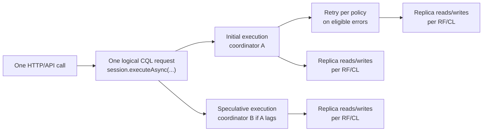
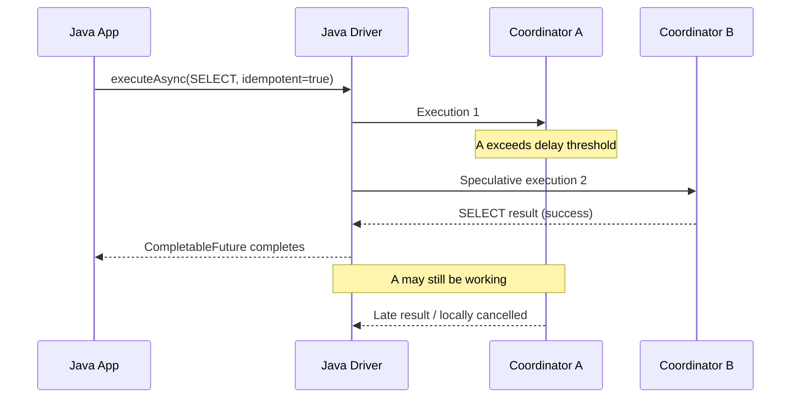
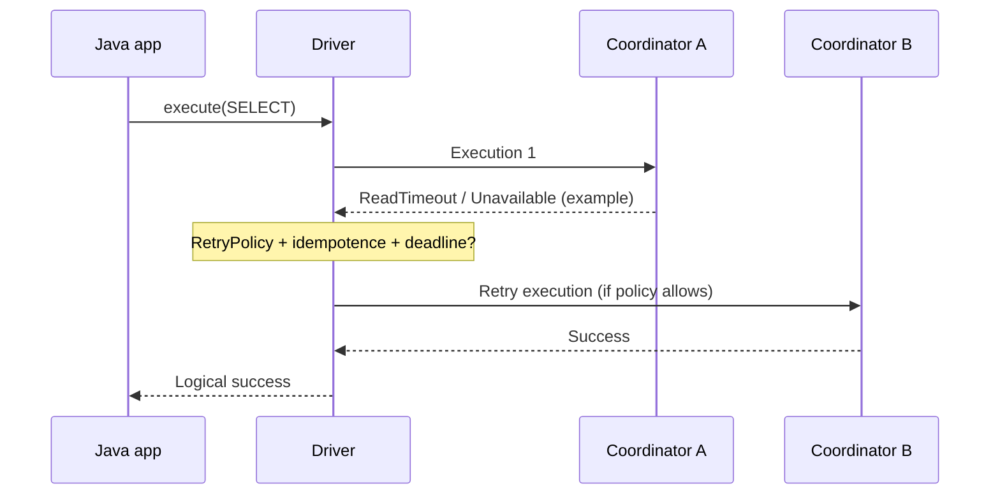
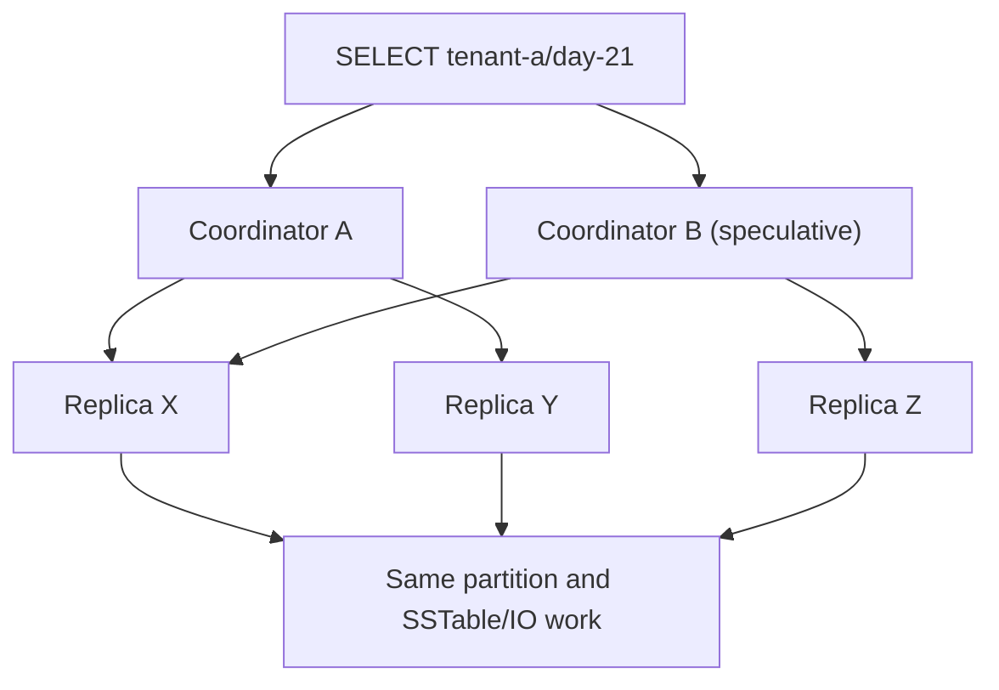
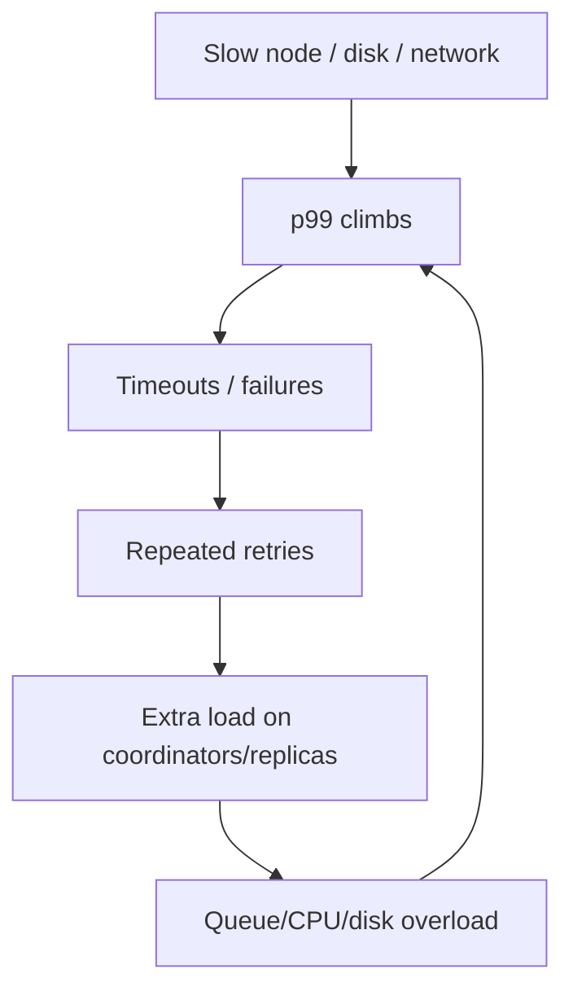
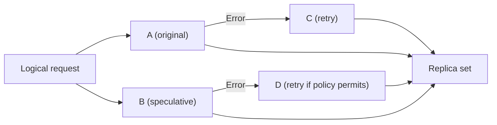

# Verifying the Impact of Speculative Execution and Retries

**Chapter:** Load and Distributed Fault Testing  
**Module:** `DATABASE_ENGINE_WIDE_COLUMN_CASSANDRA` — Apache Cassandra

A Java API reads order information from Apache Cassandra at `LOCAL_QUORUM`. Under normal conditions, 99% of requests return quickly, yet a few slow down because a coordinator or replica exhibits high tail latency. An operator enables **speculative execution** to send an extra execution to another coordinator while the first is still waiting. The p99 graph immediately looks nicer in a small test. Under heavier traffic, however, request volume per node rises, queues grow longer, retries climb, and p99 can end up worse than before enabling it.

Another change—allowing retries on every timeout—can help ride out brief network glitches, yet it **does not create extra replicas, does not increase true cluster throughput, and does not guarantee a write was not already applied**. For counters, list appends, LWTs, or operations with side effects outside Cassandra, bad retries can violate business contracts.

This lesson walks through **verifying the impact** of both mechanisms using controlled experiments, not just toggling configuration flags. Bringing together Cassandra's distributed architecture, partition keys, query-driven table design, RF/CL, compaction/repair, CQL, distributed faults, and the Java Driver, the goal is finding policies that **reduce latency without breaking correctness or amplifying overload**.

> **Scope:** Apache Cassandra 4.1/5.x; Java Driver 4.x (option names follow the Driver 4.18.x line); **single-DC RF3** environment for replica fault tests (a disposable single-node setup suffices only for basic API checks). Verify HOCON/CQL/Java examples against your exact API and deployed version. Timing, load, and threshold numbers are **illustrative assumptions**, not production recommendations. Never intentionally induce overload, block networks, stop nodes, or alter replication in production. Lab execution is not performed while authoring this lesson content.

## 1. Learning Objectives

After this lesson, you can:

1. Distinguish **logical request**, **execution/attempt**, **speculative execution**, **retry**, and **replica subrequest**.
2. Explain why speculation can lower p99 when **one coordinator is unusually slow** yet typically harms the cluster when **the whole cluster is overloaded**.
3. Describe how retries handle failures based on `RetryPolicy`, deadlines, consistency level, and idempotence.
4. Contrast `NoSpeculativeExecutionPolicy`, `ConstantSpeculativeExecutionPolicy`, and a percentile-based policy (where supported by the version).
5. Build four controlled arms: **no retry / no speculation; retry only; speculation only; both**.
6. Explain why speculative execution should only apply to **truly idempotent** statements.
7. Never treat `DriverTimeoutException` or `WriteTimeoutException` as proof that a mutation definitely did not apply.
8. Design workloads with uniformly distributed partition keys, partition-scoped queries, and identical RF/CL/timeouts across arms.
9. Establish a baseline, inject controlled latency/failures on an **isolated cluster**, record timelines, and roll back faults.
10. Measure **logical success**, p50/p95/p99/p99.9, retry/speculation counts, actual coordinator attempts, queue wait, node/replica load, and correctness.
11. Recognize signs of retry storms, speculative amplification, hotspots, and head-of-line blocking.
12. Use Java Driver 4.x with prepared statements, `setIdempotent`, `CompletionStage`, and bounded admission control.
13. Separate experiments for `SELECT`, stable `INSERT`, counters, LWTs, and operations requiring fail-closed handling.
14. Produce an experiment report containing configuration, raw measurements, limitations, stop conditions, and a rollout/canary plan.

## 2. Request Model: One Java Call Is Not Necessarily One CQL Execution

### 2.1. Layers to Distinguish



A **logical request** represents the application's intent, such as “read state for device X.” The driver may launch multiple executions across **different coordinators** if retry or speculation policies allow it. **Each coordinator** may contact multiple replicas to satisfy the consistency level. Hence **1 logical request ≠ 1 network message ≠ 1 replica read**.

Key terms:

| Term | Meaning | Example |
| --- | --- | --- |
| Logical request | CQL call from the application | `executeAsync(boundStatement)` |
| Execution / coordinator attempt | One execution attempt via a chosen coordinator | A handles `SELECT` |
| Speculative execution | An **additional concurrent execution** launched when an earlier one lags | B receives the same `SELECT` after delay |
| Retry | Policy decision to try again **after a classified error/timeout** | Retry read on another node |
| Replica subrequest | Coordinator querying replicas to meet CL | A reads from B, C |
| Winning response | Whichever execution returns a valid result first | B responds before A |
| Late / in-flight loser | Non-winning execution not cancelled mid-flight, still burning resources | A continues CPU/I/O |
| Unknown write outcome | Client cannot know for sure if the mutation applied | ACK lost after write |

**Speculation does not wait for the initial attempt to fail**, whereas retry reacts to an **error signal**. Both can occur within a single logical request, yet they **must never be lumped together as one mechanism**.

### 2.2. Timeline of a Speculative Read



**Lower client latency does not mean less backend work.** B executes the `SELECT` and may query replicas while A is still burning CPU and reading SSTables. “Winning” at the logical request layer does not roll back work already dispatched over the network.

### 2.3. Timeline of a Retry



Retries generate extra work **after an error**, helping bypass a temporarily unavailable node. However, if all coordinators hit the same slow replicas or disk bottleneck, retries trigger a loop: **slowness → timeouts → retries → higher load → slower**.

### 2.4. Counting Amplification

Let:

- `N_started`: number of logical requests **admitted that started at least one coordinator execution** in the window. Distinguish from `N_offered`, which includes requests rejected at application/driver admission before starting.
- `A`: total **coordinator execution attempts actually started**, including initial attempts, retries, and speculative executions.
- `R`: executions started due to retries.
- `S`: speculative executions actually started.
- `C`: number of successful logical requests; `F=N-C` represents failures per SLA definition.

When every execution maps cleanly to one bucket, the accounting identity is:

\[
A=N_{\mathrm{started}}+R+S
\]

Amplification factor:

\[
\text{attempt amplification}=\frac{A}{N_{\mathrm{started}}}
=1+\frac{R+S}{N_{\mathrm{started}}}
\]

This is an **accounting model**, not a guarantee that every driver metric counts attempts identically. Requests rejected **before** the initial execution are excluded from `N_started`; report them separately under offered/admission rejection rate. Speculative executions may not fire before a response arrives; retries may be blocked by deadlines or policies. To apply the formula accurately, **collect counters/attempt tracing directly on both clients and nodes**, explicitly defining any excluded samples.

Illustrative example:

| Variable | Value |
| --- | ---: |
| Started logical requests `N_started` | 10,000 |
| Actually launched retry executions `R` | 500 |
| Actually launched speculative executions `S` | 1,500 |
| Total coordinator attempts `A` | 12,000 |
| Attempt amplification | **1.20×** |

This tells you only that **coordinator attempts** rose 20%. Since each coordinator can query multiple replicas, **replica reads and disk work** may grow differently—even more than 20%; measure server-side directly.

## 3. Why Retries and Speculation Directly Affect Consistency and Data Modeling

### 3.1. Another Coordinator Is Not a “Free” Copy of Data

Cassandra places partitions using the **partition key token** and `NetworkTopologyStrategy`/RF. Whether the driver hits coordinator A or B, a full partition-key query still needs the replica set holding that partition. Inside an RF3 DC, different coordinators can fan out to the very same replicas. When a partition is hot, speculating to another coordinator **does not spread a hot partition across all nodes**.



The diagram illustrates **one possible** subrequest routing, not a fixed rule about which two replicas a coordinator chooses; the driver, server, and topology determine selection. Key takeaway: **adding coordinators does not change token ownership**.

### 3.2. RF3 and `LOCAL_QUORUM`

With RF3 in one DC:

\[
LOCAL\_QUORUM=\left\lfloor\frac{3}{2}\right\rfloor+1=2
\]

A write at `LOCAL_QUORUM` requires quorum replica responses per write semantics; a `LOCAL_QUORUM` read also gathers enough responses to satisfy CL. Quorum intersection (`W=2`, `R=2`) supports visibility under valid assumptions, yet **is not** a linearizable SQL transaction across arbitrary concurrency patterns.

When one replica is down, a read can still succeed from the remaining two live replicas. If original and speculative attempts hit the same slow replica or disk bottleneck, dispatching extra queries **does not conjure up a cheaper second quorum**.

### 3.3. CQL Shape Determines Replay Safety

| CQL / workflow | Potentially idempotent? | Risk on retry / speculation |
| --- | --- | --- |
| Pure `SELECT` by PK, no side effects | Usually yes | Extra backend reads, higher p99/queues; concurrent writes can shift observed state |
| `INSERT` with same full PK + deterministic values/timestamp | Yes under clear assumptions | Minting fresh IDs/TTLs/timestamps alters semantics |
| `UPDATE SET state = 'PAID'` with fixed PK | Potentially | Concurrent writers/timestamps can alter last-write-wins |
| `UPDATE counter = counter + 1` | **No** | Double increment on repeated attempt |
| `UPDATE list = list + ['x']` | **No** | Duplicate list elements |
| `DELETE` with exact full PK | Usually idempotent if timestamps/retention hold | Tombstones and races with concurrent updates |
| `IF NOT EXISTS` / LWT | Needs dedicated handling | Second attempt may return `[applied]=false` after first succeeded; timeout leaves unknown outcome |
| External payment + Cassandra write | Not a single CQL operation | Speculation/retries cannot guarantee exactly-once side effects |
| Multi-partition `BATCH` | Not equivalent to a SQL transaction | Partial failure / unknown outcomes; retries highly risky |

**Setting `setIdempotent(true)` does not convert counters, LWTs, or business workflows into idempotent operations.** It is a **statement-level semantic declaration** telling the driver whether retries/speculative executions are permitted; misdeclaring it shifts correctness risk onto the application.

### 3.4. A Timeout After a Write Means “Unknown Outcome”

A write can reach some or all required replicas while the response drops or the client times out. `WriteTimeoutException` and `DriverTimeoutException` never prove “nothing was written.” For money, inventory, permissions, counters, or list appends, enforce **stable event IDs, a source of truth, reconciliation, and fail-closed policies**. Never lower consistency level or enable automatic blind retries just to make tests pass.

## 4. Speculative Execution Policies in Java Driver 4.x

### 4.1. Default Behavior: No Speculation

In Driver 4.x, when no speculation policy is active, slow queries do not trigger extra speculative attempts. This can be written explicitly:

```hocon
datastax-java-driver {
  advanced.speculative-execution-policy {
    class = NoSpeculativeExecutionPolicy
  }
}
```

This serves as an **essential baseline** for comparison. Never assume “no speculation means no retries”: retries belong to a separate policy.

### 4.2. Constant Delay

Lab example: if no response arrives within `100 ms`, the policy can launch an additional speculative execution when eligible coordinators remain:

```hocon
# Illustrative LAB config, NOT a production recommendation.
datastax-java-driver {
  advanced.speculative-execution-policy {
    class = ConstantSpeculativeExecutionPolicy
    max-executions = 1
    delay = 100 milliseconds
  }
}
```

**Clarification:** `max-executions` in the speculative policy config caps the **extra speculative executions** per your Driver version's semantics—not “total retries plus executions” or replica count. With `max-executions=1`, one logical request can have its initial execution plus **at most one** speculative execution if eligible. `RetryPolicy` can still trigger further attempts upon eligible failures; measure actual attempts via instrumentation.

### 4.3. Fixed Delay Does Not Fit Every Query

- A 5 ms point-lookup `SELECT` and a wide-partition range `SELECT` do not share the same latency distribution.
- Setting `delay=5 ms` when p50 is 8 ms triggers unnecessary speculation on healthy requests.
- Setting `delay=2 s` against a 1 s API deadline makes speculation largely useless.
- When p99 spikes come from cluster-wide disk/compaction saturation, extra copies only make things worse.

Base `delay` on **baseline p95/p99, request timeout, and remaining latency budget**, never copied numbers from blog posts. If your driver version offers a percentile-based adaptive policy, evaluate sample sizes, volatility, per-node vs per-query tracking, warm-up period, and behavior under load; never assume “adaptive” needs zero tuning.

### 4.4. Speculation Requires Idempotence

Statements marked **idempotent** are eligible for speculative execution when the policy is enabled. Statements marked **non-idempotent** are never speculatively re-sent solely for slowness. Tests should verify both cases:

```java
import com.datastax.oss.driver.api.core.cql.BoundStatement;

// Partition-key SELECT with no side effects:
BoundStatement read = readPrepared.bind(tenantId, deviceId)
    .setIdempotent(true);

// Counter +1: NOT idempotent; DO NOT allow blind speculation/retry:
BoundStatement increment = counterPrepared.bind(metricId)
    .setIdempotent(false);
```

Never flip `basic.request.default-idempotence=true` across an application with mixed queries without classifying every statement. Even for same-PK `INSERT` statements, examine generated timestamps/TTLs, LWTs, triggers, and external side effects.

### 4.5. Managing via Execution Profiles

When workloads differ, apply appropriate profiles: interactive reads might use speculation while ledger/billing writes do not. Which options **can be overridden per execution profile** versus **session-level** depends on Driver API/version. Never assume a profile setting in HOCON took effect merely because startup threw no exception.

Inspect effective config and bind `ExecutionProfile` per statement; if you require **full isolation** of resources and policies, separate sessions/deployments after accounting for connection-pool overhead.

## 5. RetryPolicy: What Happens on Failure?

### 5.1. Default Policy Does Not Mean Retry Everything

Driver 4.x ships `DefaultRetryPolicy`, deciding based on **error type, retry count, idempotence, and state**. Never interpret default as “retry three times on any error.” Certain timeout scenarios retry under specific conditions; write timeouts in particular cannot safely retry unconditionally.

```hocon
datastax-java-driver {
  advanced.retry-policy {
    class = DefaultRetryPolicy
  }
}
```

Never use `ConsistencyDowngradingRetryPolicy` simply to pretty up timeout rates when business contracts require `LOCAL_QUORUM`: it alters read/write consistency guarantees. In the “retry OFF” experimental arm below, use a **true no-retry policy** or verified test setup rather than just disabling speculation.

### 5.2. Errors Worth Classifying

| Signal | Primary layer | Policy decision to check |
| --- | --- | --- |
| `UnavailableException` | Coordinator/replica availability for CL | Can another node succeed? Never silently drop CL |
| `ReadTimeoutException` | Coordinator missed enough read responses in time | Retry may make sense in narrow cases; check policy |
| `WriteTimeoutException` | Write missed required ACKs in time | Unknown outcome; retrying non-idempotent writes is dangerous |
| `ReadFailureException` / `WriteFailureException` | Replica failure during request | Inspect succeeded/failed counts, CL, and policy |
| `OverloadedException` | Server reports overload | Immediate retries amplify overload |
| `DriverTimeoutException` | Client-side request deadline | Request may have been sent or still sitting in throttler queue |
| `AllNodesFailedException` | No coordinator could complete the request | Inspect per-node errors, pool, network, and DC |
| `RequestThrottlingException` | Client throttler queue saturated | Shed incoming rate; never tight-loop retry |
| `InvalidQueryException` / `UnauthorizedException` | CQL/schema/permissions | Fix query/role; retrying wastes load |

Even a successful retry does not mean the root cause vanished. If node A remains degraded, subsequent requests will keep hitting it.

### 5.3. Retry Budgets and Request Deadlines

The driver request timeout spans client throttling plus all attempts inside one logical request per Driver 4.x semantics. Consequently, retry and speculative attempts **do not get a brand-new full timeout budget each**.

```text
T0       +100 ms       +180 ms          +450 ms
|-----------|--------------|----------------|
execution A  \ timeout?                 |
             speculative B   \ success?  |
                         retry C?       |
<------ Single request-level deadline --->

Never assume each new attempt gets another full 2 s budget.
```

Wall-clock intervals overlap, and if the deadline expires before a planned attempt launches, it may not even start. Measure actual send/receive timestamps instead of inferring timing from config alone.

### 5.4. Retry Storms



To stay stable:

- Bound retries, enforce deadlines/budgets, and apply backoff + jitter at the **application layer** where appropriate.
- Avoid stacking uncoordinated retries for the same failure across Driver, API gateway, queue consumer, and job scheduler without a shared budget.
- Never sleep synchronously or call `join` inside Netty I/O callbacks.
- Enforce statement idempotence and unknown-outcome handling.
- When every node slows due to disk/compaction saturation, **shedding source load** beats adding attempts.
- Keep RF/CL intact; high timeouts never justify silently weakening consistency.

## 6. Interaction Between Speculation and Retries

### 6.1. Not Resource-Independent

Speculation fires **when an execution is slow**; retries fire after **eligible errors**. Enabling both lets a single logical request spawn an initial execution, a speculative execution, and retries. Even if they target different coordinators, they still pull from the same replica set, **multiplying work right when the cluster is hurting**.



This diagram shows **what is possible**, not a claim that the Driver always sends four attempts or retries every speculative branch. Count actual attempts from metrics/events instead of assuming theoretical diagrams reflect runtime counts.

### 6.2. Preconditions Before Expecting Improvement

1. Queries are **genuinely idempotent**, typically full-partition-key point reads.
2. Slowness is **localized/uncorrelated** across coordinators and spare capacity exists.
3. Paths through alternate coordinators genuinely finish faster.
4. `delay` sits below remaining request deadline yet comfortably above normal baseline tail latency to avoid wasteful launches.
5. Observability covers **speculative launches, retry attempts, and server work**, not just client p99.
6. No shared hot partition, compaction, or disk bottleneck slows every attempt equally.
7. Retry policy and max speculative executions carry explicit budgets guarded by rate/concurrency admission.

### 6.3. Scenario Decision Matrix

| Scenario | Can retries help? | Can speculation help? | Primary risk |
| --- | --- | --- | --- |
| Coordinator A briefly drops | Yes, per failure/policy | Yes if eligible and coordinator B healthy | Extra attempts / routing cost |
| One coordinator A has outlier tail latency | After timeout | **Potentially before timeout** | Extra replica work |
| All nodes slow on disk I/O | Unlikely | Usually no | Retry storms and overload |
| Large hot partition | Usually no | Cannot alter token ownership | Same replica set hit multiple times |
| API deadline very tight vs delay | Little room | Often fires too late | Extra waiting / timeouts |
| Counter increment | Unsafe on unknown outcome | **No** | Double counting |
| LWT / CAS | Needs custom logic | Caution; never enable blindly | `[applied]` / unknown outcome |
| `ONE` read across diverged replicas | May pick a different replica | May pick a fast yet stale copy | Stale reads |
| Healthy RF3 `LOCAL_QUORUM` read | Potentially | Potentially for clear outliers | Fan-out and tail disk cost |
| Server reports overload | Immediate retry harms | Speculation harms | Positive feedback loop |

**Principle:** The goal is **not zero exceptions at any cost**. The goal is satisfying **latency, availability, consistency, and correctness** within a bounded resource budget.

## 7. Controlled A/B/C/D Experiment Design

### 7.1. Four Required Arms

Hold **cluster, CQL, RF/CL, query distribution, load generator, timeouts, and measurement window constant**; change only the two policies.

| Arm | Retry policy | Speculative policy | Question to answer |
| --- | --- | --- | --- |
| **A — baseline** | `FallthroughRetryPolicy` | `NoSpeculativeExecutionPolicy` | How do latency/errors look with one un-replayed execution? |
| **B — retry only** | `DefaultRetryPolicy` | `NoSpeculativeExecutionPolicy` | How much do error retries lower failures vs add work? |
| **C — speculation only** | `FallthroughRetryPolicy` | `ConstantSpeculativeExecutionPolicy` | Does hedging slow requests improve p99 or waste capacity? |
| **D — both** | `DefaultRetryPolicy` | `ConstantSpeculativeExecutionPolicy` | Does combining both cause amplification/overload? |

**Never label Arm A “retry OFF” if you only set `NoSpeculativeExecutionPolicy`.** You must configure an actual **no-retry policy** such as `FallthroughRetryPolicy` in your Driver version or a reviewed custom no-retry policy. Likewise, since `DefaultRetryPolicy` does **not** retry every exception, collect actual retry counts to verify whether A and B differ in practice.

### 7.2. Minimal HOCON Per Arm

The four blocks below are **mutually exclusive alternatives**, one config per run; do not concatenate all four into one `application.conf`.

**Arm A — no retry, no speculation:**

```hocon
datastax-java-driver {
  basic.request.timeout = 1500 milliseconds
  basic.request.default-idempotence = false

  advanced.retry-policy.class = FallthroughRetryPolicy

  advanced.speculative-execution-policy {
    class = NoSpeculativeExecutionPolicy
  }
}
```

**Arm B — retry only:**

```hocon
datastax-java-driver {
  basic.request.timeout = 1500 milliseconds
  basic.request.default-idempotence = false

  advanced.retry-policy.class = DefaultRetryPolicy

  advanced.speculative-execution-policy {
    class = NoSpeculativeExecutionPolicy
  }
}
```

**Arm C — speculation only:**

```hocon
datastax-java-driver {
  basic.request.timeout = 1500 milliseconds
  basic.request.default-idempotence = false

  advanced.retry-policy.class = FallthroughRetryPolicy

  advanced.speculative-execution-policy {
    class = ConstantSpeculativeExecutionPolicy
    max-executions = 1
    delay = 100 milliseconds
  }
}
```

**Arm D — both:**

```hocon
datastax-java-driver {
  basic.request.timeout = 1500 milliseconds
  basic.request.default-idempotence = false

  advanced.retry-policy.class = DefaultRetryPolicy

  advanced.speculative-execution-policy {
    class = ConstantSpeculativeExecutionPolicy
    max-executions = 1
    delay = 100 milliseconds
  }
}
```

Policy names and option paths match Driver 4.x; during execution, **log/inspect the effective config and confirm loaded classes**. Never merely assume a mounted file took effect; Spring Boot or multi-profile setups can override keys. For other driver versions or shaded BOMs, check `advanced.speculative-execution-policy` and `advanced.retry-policy` in the release reference first.

### 7.3. Control Variables Table

| Group | Hold fixed | Why |
| --- | --- | --- |
| Cassandra topology | 3 nodes in one DC, RF3, matching racks/versions | Keeps quorum/replica placement comparable |
| Schema | Identical keyspace/table/options/compaction | Avoids differing read/write paths |
| Workload | Query templates, key distribution, payloads, read/write mix | Prevents workload drift from masking policy effect |
| CL | `LOCAL_QUORUM` for reads and tested writes | Prevents inflating metrics via weaker guarantees |
| Driver | Same version, contact points, pool, timeouts, metrics setup | Isolates policy impact |
| App | Pod/session count, JVM/GC, concurrency/rate | Autoscaling multiplies global attempt volume |
| Data | Same rows/partition, TTL/tombstone density | Storage tail heavily shapes query p99 |
| Time | Warm-up, measurement window, sample count, fault timeline | p99 needs ample samples without cold-start bias |
| Network | Inject only the targeted fault | Compares exact fault behavior, not random storms |
| Metrics | Same exporter/sampling, clocks, and tags | Supports accurate amplification accounting |

**Important:** Retries and speculation change dynamic server load. When Arm D generates extra work, that extra load is **the effect under measurement**, not a reason to give D bigger servers. Still, allow the cluster to recover cleanly between arms so prior backlog does not taint later runs.

### 7.4. Never Run All Four Arms Concurrently on One Cluster for Isolated Measurement

Running A/B/C/D simultaneously on shared replicas/disks lets D slow down A, muddying attribution. Run **sequentially**, across randomized/balanced rounds starting from clean state, or across identical isolated clusters with verified baseline parity.

Example 4-round schedule:

```text
Round 1: A → B → C → D
Round 2: C → A → D → B
Round 3: D → C → B → A
Round 4: B → D → A → C

Each run:
  warm-up → clean interval → measured interval → cooldown
  assert cluster recovered and metrics stabilized before next arm
```

A 30-second run with 200 requests is too small to judge p99. Never cherry-pick one low p99 snapshot; collect adequate samples, intervals/replicates, and report variance.

## 8. Preparing the Isolated Test Cluster and CQL Schema

### 8.1. Safety Preconditions

Run latency/network fault experiments only when you have:

- A disposable **three-node Cassandra** cluster in one ring, illustrative DC `dc1`, and an RF3 keyspace.
- Test dataset snapshots (if needed), ample CPU/RAM/disk, and fast reset/recreation.
- Keyspaces/tables containing zero user data or production credentials.
- Clear operator authority: who may stop nodes, apply network shaping, roll back, and verify post-test health.
- Out-of-band node access to recover if CQL clients lose connectivity.
- Stop conditions for p99, timeouts, CPU/GC, disk I/O, and `Unavailable`.
- Working `nodetool status`/JMX/logs and UTC-synchronized clocks across app and servers.
- Zero concurrent schema changes, repairs, or upgrades during measurement.

A **single node** with RF1 suffices to test Java wiring, HOCON parsing, and metric counters, yet is **insufficient** to validate speculation or CL under replica failure/failover.

### 8.2. Verify Topology Before Testing

```bash
# Run on each node in the test cluster, NEVER production:
nodetool status
nodetool describecluster
nodetool info
nodetool tpstats
nodetool compactionstats
```

Preflight checks must confirm:

1. All three nodes `UN`, none joining/leaving/moving.
2. Expected DC/rack/host IDs and identical cluster name.
3. Matching server/schema versions and schema agreement.
4. RF3 keyspace genuinely maps three replicas per tested token.
5. No large pre-existing repair/streaming/compaction backlog.
6. Java endpoints do not accidentally point at any other cluster.
7. Enough capacity headroom to measure amplification without pushing the cluster into uncontrolled failure.

**Never assume** “three started containers” form a cluster: seeds, gossip, snitch, and networking must align. If `nodetool status` shows each node seeing only itself, preflight **FAILS**.

### 8.3. Lab CQL Schema

On a verified disposable `dc1` cluster:

```sql
CREATE KEYSPACE IF NOT EXISTS lab_spec_retry
WITH replication = {
    'class': 'NetworkTopologyStrategy',
    'dc1': 3
}
AND durable_writes = true;

CREATE TABLE IF NOT EXISTS lab_spec_retry.status_by_device_id (
    device_id uuid PRIMARY KEY,
    state text,
    updated_at timestamp
);

CREATE TABLE IF NOT EXISTS lab_spec_retry.events_by_device_day (
    device_id uuid,
    bucket_day date,
    event_ts timestamp,
    event_id uuid,
    event_type text,
    payload text,
    PRIMARY KEY ((device_id, bucket_day), event_ts, event_id)
) WITH CLUSTERING ORDER BY (event_ts DESC, event_id ASC);

CREATE TABLE IF NOT EXISTS lab_spec_retry.counters_by_id (
    counter_id uuid PRIMARY KEY,
    hits counter
);

CREATE TABLE IF NOT EXISTS lab_spec_retry.once_by_event_id (
    event_id uuid PRIMARY KEY,
    state text,
    created_at timestamp
);
```

| Table | Query shape | Role in experiment |
| --- | --- | --- |
| `status_by_device_id` | Point read `WHERE device_id=?` | Read-only, idempotent statement |
| `events_by_device_day` | Timeline with full partition key and `LIMIT` | Measures clustering/partition cost and hot keys |
| `counters_by_id` | Increment by ID | Negative control: non-idempotent mutation |
| `once_by_event_id` | `IF NOT EXISTS` | LWT / unknown outcome / collision control |

**Never** use `ALLOW FILTERING` on queries missing a partition key just to generate load. Table scans do not represent point lookups and can topple a small test cluster.

### 8.4. Seed Bounded Baseline Data

Smoke-test CQL examples:

```sql
CONSISTENCY LOCAL_QUORUM

INSERT INTO lab_spec_retry.status_by_device_id (
    device_id, state, updated_at
) VALUES (
    10000000-0000-4000-8000-000000000101,
    'ONLINE',
    '2026-11-21T00:00:00Z'
);

INSERT INTO lab_spec_retry.events_by_device_day (
    device_id, bucket_day, event_ts, event_id, event_type, payload
) VALUES (
    10000000-0000-4000-8000-000000000101,
    '2026-11-21',
    '2026-11-21T10:00:00Z',
    20000000-0000-4000-8000-000000000101,
    'DEVICE_ONLINE', 'lab'
);

SELECT state, updated_at
FROM lab_spec_retry.status_by_device_id
WHERE device_id = 10000000-0000-4000-8000-000000000101;

SELECT event_ts, event_type
FROM lab_spec_retry.events_by_device_day
WHERE device_id = 10000000-0000-4000-8000-000000000101
  AND bucket_day = '2026-11-21'
LIMIT 20;
```

Real benchmarks need **many evenly distributed device IDs** (thousands or tens of thousands per capacity) generated deterministically; a single ID above only shows syntax. Never measure throughput against one hot partition and extrapolate cluster-wide.

If a lookup key **does not exist**, Cassandra still executes negative lookups along the read path, yet cost differs from hits, tombstones, or wide partitions. Keep **hit ratios identical** across arms.

### 8.5. Two Workloads to Prevent False Assumptions

**Workload 1 — read-only point lookup:** sample randomly from preloaded IDs with fixed hit ratio at `LOCAL_QUORUM`; ideal for testing tail-latency improvements without mutation side effects.

**Workload 2 — idempotent full-PK writes:** `INSERT` events using stable `event_id`/`event_ts`/payload while preserving timestamp/TTL semantics; proves row counts and unknown-outcome tracking. **Never** test speculation first on money, permissions, inventory, or counter mutations.

A **separate hot-partition workload** helps prove speculation **does not fix poor partition modeling**. Keep it in its own scenario—never mix it silently into uniform runs.

## 9. Controlled Fault and Latency Injection Scenarios

### 9.1. Separate Three Root-Cause Groups

| Group | What is injected? | Hypothesis |
| --- | --- | --- |
| **H0: healthy** | Zero fault injection | What overhead does speculation add without outliers? |
| **H1: one slow coordinator** | Add network latency/queuing toward one coordinator | Does speculating to healthy nodes cut p99? |
| **H2: one node Down** | Stop one node in RF3 lab | How well do retries/driver routing preserve availability? |
| **H3: shared bottleneck** | Raise arrival rate or bounded cluster-wide load | Do extra attempts worsen p99/CPU/GC? |
| **H4: hot partition** | Concentrate keys onto one disposable partition | Does speculation cure a read hotspot? |
| **H5: network jitter** | Add variable latency on proxy/network path | Is the `delay` threshold properly tuned above p95? |

**Never run H1/H2/H3/H4/H5 in production.** For H3, never intentionally trigger disk-full or OOM; scale load only to pre-defined stop gates with instant throttle-down capability.

### 9.2. Slowing One Coordinator Is Not the Same as Slowing All Replicas

Lab options:

- Toxiproxy / traffic shaping **on the client → coordinator path**, ideal when connections are clearly controlled and healthy coordinators remain.
- Linux `tc netem` inside a container/network namespace **with `NET_ADMIN` capability** and `tc` installed, paired with explicit `qdisc` rollback.
- Test-harness fault injection logging exact target host, port, and window.
- Bounded temporary CPU pressure on one disposable node—carefully distinguishing coordinator work from replica work.

To verify speculation meaningfully, prove **the initial execution actually hit the slowed node**, while the speculative execution could pick an alternate healthy coordinator. Token-aware routing and pools shift coordinator order; never assume slowing “node 1” guarantees every query starts on node 1. Capture **per-node coordinator attempts** or sampled driver events/traces to prove routing.

### 9.3. `tc netem` Blueprint for Disposable Linux Containers (Not a Production Command)

Illustrative example when container `lab-cass-2` already has `tc`, interface `eth0`, and `NET_ADMIN`. Verify interface and permissions upfront, since default Cassandra images often omit `tc`:

```bash
# ONLY in disposable labs: verify exact node/interface names first.
docker exec lab-cass-2 tc qdisc show dev eth0

# Inject 120ms +/- 20ms outbound latency; may also hit internode traffic!
docker exec lab-cass-2 tc qdisc replace dev eth0 \
  root netem delay 120ms 20ms

# Always roll back immediately after the measured window.
docker exec lab-cass-2 tc qdisc del dev eth0 root

# Verify no netem rule remains.
docker exec lab-cass-2 tc qdisc show dev eth0
```

**Critical warning:** `tc qdisc` on `eth0` affects **all outbound node traffic**, potentially slowing internode gossip and replica ACKs alongside coordinator responses. Results are **no longer purely “one slow coordinator.”** If H1 requires isolating client → coordinator latency, shape traffic on a **client-side proxy path** and confirm replica links stay untouched. Never run `tc` without rollback automation and out-of-band access. Any H1 run lacking verified routing must be marked **INCONCLUSIVE** rather than claiming speculation worked or failed.

### 9.4. Stopping One Node: Miscounting Replicas Causes Wrong Conclusions

In RF3, when one node goes Down:

- `LOCAL_QUORUM` needs two replicas; the remaining two nodes can still serve it.
- `ALL` fails for any partition owned by the down replica.
- `ONE` stays available yet breaks stronger consistency contracts.
- Speculative execution does not create extra healthy replicas.
- Retries may find a different coordinator, yet cannot overcome missing replica quorums.

After recovery, wait for `UN`, inspect hints/streaming/repair, and reconcile data. **Never** treat “node reports `UN`” as proof missed mutations synced immediately.

### 9.5. Stop Conditions and Rollback

Define stop criteria beforehand (numbers below are illustrative only):

| Condition | Action |
| --- | --- |
| Client p99 exceeds 2× baseline for ≥2 windows | Stop ramping arrival rate and assess |
| Retry/spec attempts climb while success rate drops | Abort current arm and shed load |
| `RequestThrottlingException`/timeouts breach error budget | Fail fast and roll back |
| Node free disk nears safety floor or pending tasks climb steadily | Halt test and stop injecting faults |
| Excessive JVM GC pauses or CPU saturation | Stop or throttle rate immediately |
| ≥2 replicas lost in RF3 when scenario permits only one | Abort fault and restore cluster |
| Rising un-reconciled unknown write outcomes | Stop mutation load and preserve evidence |
| Control plane loses access to nodes | Recover from console/orchestrator; issue no new commands |

The 2× factor is merely a guardrail example; production/lab runs must align with real SLOs, capacity, and authority. Assign explicit owners for **rolling back both fault injection and driver configuration**.

## 10. Running a Reproducible Experiment

### 10.1. Execution Phases

```text
1. PRECHECK
   - nodetool status: 3 UN; RF3 keyspace
   - CQL schema, driver config, clocks, metrics, load generator

2. WARMUP
   - representative reads/writes excluded from steady latency stats
   - sufficient to populate prepared statements, pools, caches, and JVM JIT

3. HEALTHY MEASUREMENT
   - hold arrival rate X, query mix, and key distribution fixed
   - capture per-arm healthy baseline

4. FAULT WINDOW
   - inject exactly one fault, record UTC start
   - change zero other variables
   - capture steady/transition behavior and error classes

5. RECOVERY WINDOW
   - remove fault, record UTC stop
   - measure time back to baseline and backlog drain

6. COOLDOWN/RESET
   - verify 3 UN and stable metrics/queues
   - clean state if needed; never TRUNCATE shared tables

7. NEXT ARM
   - swap HOCON policy, open fresh session
   - repeat with equivalent seed and data policy
```

**Never fold warm-up into steady-state p99**; still save warm-up and recovery data separately when cold caches or restarts matter operationally.

### 10.2. Open-Loop vs Closed-Loop Load

| Load model | Description | Risk |
| --- | --- | --- |
| **Closed-loop** | Dispatches next request after previous finishes; fixed concurrency | Server slowness auto-throttles arrivals → **coordinated omission** and deceptively good p99 |
| **Open-loop** | Dispatches along a target arrival schedule regardless of completion | Unbounded queues/overload if uncapped |
| **Bounded open-loop** | Fixed arrival schedule **plus** in-flight/queue/deadline caps | More realistic signal, provided rejected arrivals are reported |

For retry/speculation tests, **bounded open-loop** reveals system behavior under constant offered demand far more clearly. Always report **offered RPS**, **admitted RPS**, **completed RPS**, and **rejected/deferred RPS**—reporting only completed throughput hides client throttling.

### 10.3. Load Must Not “Auto-Adjust” When Arm D Slows Down

If a synchronous loop runs `for { execute(); }`, Arm D generates **fewer logical requests** than Arm A whenever it slows down, invalidating p99 and server-load comparisons at the same offered rate. Conversely, if D responds faster, it dispatches **more requests**, potentially driving saturation itself. Use proper arrival pacing or explicitly report and interpret closed-loop behavior.

### 10.4. Statistical Accuracy of p99

At `N=1000`, only ~10 samples fall in the top 1%, making p99 swing wildly across runs. Even at `N=100,000`, include confidence intervals, split fault vs steady windows, and inspect the full tail distribution. Never discard “outliers” arbitrarily—tail latency is the very phenomenon under study.

Always record:

- UTC timestamps, fault windows, and clock synchronization.
- True p50/p95/p99/p99.9 histograms/measurements.
- Sample counts **per window**.
- Logical failure counts and exception classes.
- Full attempts-per-logical-request distribution, not just averages.
- Arrival/completion rates alongside CPU/GC/disk/network/queue telemetry.
- Per-replicate results and variance, not merely average p99 across runs.

## 11. Java Driver 4.x: Bounded Logical Request Measurement Code

### 11.1. Prerequisites

Example assumes Java 17+, Apache Java Driver 4.x, a pre-created `lab_spec_retry` keyspace with seeded `status_by_device_id` rows, and **one** arm HOCON config. This code shows a **measurement wrapper and guardrail**, not a complete open-loop load generator.

Use prepared statements binding the **full partition key**. Starting with `SELECT` prevents accidentally testing speculation on unsafe mutations first.

### 11.2. A Safe Probe Class Without Unbounded Futures

```java
import com.datastax.oss.driver.api.core.CqlSession;
import com.datastax.oss.driver.api.core.DefaultConsistencyLevel;
import com.datastax.oss.driver.api.core.cql.AsyncResultSet;
import com.datastax.oss.driver.api.core.cql.BoundStatement;
import com.datastax.oss.driver.api.core.cql.PreparedStatement;
import com.datastax.oss.driver.api.core.cql.Row;

import java.time.Duration;
import java.util.UUID;
import java.util.concurrent.CompletableFuture;
import java.util.concurrent.CompletionException;
import java.util.concurrent.CompletionStage;
import java.util.concurrent.Semaphore;
import java.util.concurrent.atomic.LongAdder;

public final class BoundedCassandraReadProbe {
    public record Outcome(
        UUID deviceId,
        boolean accepted,
        boolean success,
        boolean found,
        long latencyMicros,
        String errorType
    ) {}

    private final CqlSession session;
    private final PreparedStatement read;
    private final Semaphore slots = new Semaphore(32);

    public final LongAdder completed = new LongAdder();
    public final LongAdder failed = new LongAdder();
    public final LongAdder rejectedByApplication = new LongAdder();

    public BoundedCassandraReadProbe(CqlSession session) {
        this.session = session;
        this.read = session.prepare(
            "SELECT state, updated_at " +
            "FROM lab_spec_retry.status_by_device_id " +
            "WHERE device_id = ?"
        );
    }

    public CompletionStage<Outcome> read(UUID deviceId) {
        // Application-level admission cap. Never block inside Netty callbacks.
        if (!slots.tryAcquire()) {
            rejectedByApplication.increment();
            return CompletableFuture.completedFuture(
                new Outcome(deviceId, false, false, false, 0,
                    "APPLICATION_ADMISSION_REJECTED")
            );
        }

        long startNanos = System.nanoTime();

        try {
            BoundStatement statement = read.bind(deviceId)
                .setConsistencyLevel(
                    DefaultConsistencyLevel.LOCAL_QUORUM)
                .setTimeout(Duration.ofMillis(1500))
                .setIdempotent(true);

            CompletionStage<AsyncResultSet> result =
                session.executeAsync(statement);

            return result.handle((page, failure) -> {
                // Keep callback tiny so it never skews driver p99.
                long latencyMicros =
                    (System.nanoTime() - startNanos) / 1_000;
                slots.release();

                if (failure != null) {
                    failed.increment();
                    Throwable t = unwrap(failure);
                    return new Outcome(
                        deviceId, true, false, false, latencyMicros,
                        t.getClass().getSimpleName());
                }

                Row row = page.one();
                completed.increment();
                return new Outcome(
                    deviceId, true, true, row != null,
                    latencyMicros, "");
            });
        } catch (RuntimeException ex) {
            slots.release();
            failed.increment();
            long latencyMicros =
                (System.nanoTime() - startNanos) / 1_000;
            return CompletableFuture.completedFuture(
                new Outcome(deviceId, true, false, false,
                    latencyMicros, ex.getClass().getSimpleName())
            );
        }
    }

    private static Throwable unwrap(Throwable t) {
        while (t instanceof CompletionException &&
               t.getCause() != null) {
            t = t.getCause();
        }
        return t;
    }
}
```

**Reading the code accurately:**

- Caps concurrency at **32 accepted in-flight logical requests** per probe instance; exhausted slots trigger immediate application rejection. This sits at the **application layer**, distinct from the Driver's request throttler and connection pool.
- `setIdempotent(true)` fits pure `SELECT`; never copy it onto `counter +1` or list appends.
- `setTimeout(1500ms)` bounds the **logical driver request**; speculative attempts do not get an extra 1500 ms each.
- `latencyMicros` measures from successful admission to `CompletionStage` completion; **exclude rejected requests from success histograms** and report rejection rate separately.
- The callback pulls one row and bumps lightweight adders; never call `Thread.sleep`, `join`, or blocking database APIs inside it.
- For multi-page queries, this example measures only **first-page retrieval**; paging benchmarks must measure complete streams separately.
- This class **cannot tell coordinator attempt count from its boolean flags**. Use driver metrics/instrumentation and server counters to observe retries/speculation.
- With 20 application pods × 32 slots, total in-flight ceiling reaches 640—never assume that fits a cluster safely by default.
- Application admission rejection differs from Driver `RequestThrottlingException`; record both counters separately.

### 11.3. Opening a Session with the Target Arm's HOCON

Lab entrypoint example—never open one session per request:

```java
import com.datastax.oss.driver.api.core.CqlSession;
import com.datastax.oss.driver.api.core.config.DriverConfigLoader;

import java.io.File;
import java.net.InetSocketAddress;

public final class ProbeBootstrap {
    public static CqlSession openSession(
            String host, int port, String configFile) {

        DriverConfigLoader loader =
            DriverConfigLoader.fromFile(new File(configFile));

        return CqlSession.builder()
            .addContactPoint(new InetSocketAddress(host, port))
            .withLocalDatacenter("dc1")
            .withConfigLoader(loader)
            .build();
    }
}
```

Usage from the harness **main thread**:

```java
try (CqlSession session = ProbeBootstrap.openSession(
        "127.0.0.1", 9042, "driver-arm-a.conf")) {
    BoundedCassandraReadProbe probe =
        new BoundedCassandraReadProbe(session);

    // Separate scheduler/load generator:
    // 1) dispatch at target offered RPS
    // 2) invoke probe.read(deviceId) using pre-seeded IDs
    // 3) count rejected/admitted/completed/failed
    // 4) feed outcomes into bounded/streaming histograms
    // 5) stop after fixed seconds and drain within deadline
}
```

**Never hardcode `127.0.0.1:9042` for remote Docker/Testcontainers hosts**; this example assumes native local host binding. With Testcontainers, use `getContactPoint()`/`getLocalDatacenter()` post-startup; multi-node clusters typically take multiple contact points. This shows session bootstrapping only—never fabricate missing `driver-arm-a.conf` files without creating them explicitly.

### 11.4. Scheduling Arrivals Without Unbounded Backlogs

The aim is **fixed offered RPS** plus an **in-flight cap**. You can use Gatling/k6 (driving the Java app API), a custom harness, or coordinated-omission-aware generators. When testing **Java Driver** policies, traffic must flow through the **exact Driver/session/config** under test; standalone `cassandra-stress` uses different client mechanics and cannot validate Java `RetryPolicy` behavior.

Contract pseudocode:

```text
for each scheduled arrival in [T0, T_end]:
    if test aborted:
        stop
    choose deviceId from predefined seeded set
    call probe.read(deviceId) without waiting for completion
    if application admission rejects:
        record REJECTED, never silently drop
    else:
        record start/deadline
        on completion:
            record success/error class/latency
    never hold unbounded List<CompletableFuture>
    honor max in-flight and max queued scheduled tasks

after T_end:
    stop new arrivals
    drain outstanding requests up to bounded deadline
    mark uncompleted requests TIMEOUT/UNKNOWN in report
```

If the generator fails to sustain offered RPS as the cluster slows, **it has degraded into closed-loop behavior**; report it honestly rather than labeling it open-loop.

### 11.5. Never Distort Tail Latency with Heavy Callbacks

```java
// COUNTEREXAMPLE: callback can run on a Netty I/O thread.
session.executeAsync(statement).thenApply(rs -> {
    Thread.sleep(500);                 // even if compiled, bad design
    return expensiveSynchronousWork(rs);
});
```

This snippet illustrates an **anti-pattern** (using hypothetical helpers/checked exceptions, not compilable code). Never put blocking or CPU-heavy transforms on driver I/O threads during tail-latency testing. Offload heavy work to a bounded executor and time application processing separately.

## 12. What to Measure on Each Logical Request

### 12.1. Minimum Metric Set

| Layer | Metric | Units / interpretation |
| --- | --- | --- |
| App | Offered logical requests | Scheduled requests/s |
| App | Admitted, completed, rejected | Requests/s, separating app admission vs driver rejections |
| App | Success/errors by class | Ratios and counts; never collapse all failures into timeouts |
| App | Caller latency p50/p95/p99/p99.9 | Histogram from logical start to completion |
| Driver | Retry executions | Actual retry attempts (per node/request if available) |
| Driver | Speculative executions | Extra attempts launched |
| Driver | CQL requests/latency | Check whether metric is logical or per-attempt |
| Driver | `throttling.delay` / queue / errors | Throttler wait latency, queue size, rejections |
| Driver/node | `pool.available-streams` | Remaining stream IDs (distinct from throttler queue) |
| Cassandra | Read/write latency per node | Microseconds/milliseconds per operation |
| Cassandra | Read/write request rate | Never infer purely from client RPS |
| Cassandra | Coordinator/replica CPU, GC, disk I/O | Work amplification and saturation |
| Cassandra | `nodetool tpstats` dropped/pending | Evidence of internal queue pressure |
| Cassandra | Compaction backlog, SSTables, tombstones scanned | Storage-layer causes of tail spikes |
| Business | Duplicate/missing events, stale/unknown outcomes | Correctness cannot be traded for p99 |

In Java Driver 4.x documentation, common **metric identifiers** include `cql-requests`, `cql-messages`, `retries`, `speculative-executions`, `throttling.delay`, `throttling.queue-size`, `throttling.errors`, and `pool.available-streams`. **Verify exact enum/metric names for your installed Driver version and metrics exporter** before copying config, and never assume every metric is enabled by default.

### 12.2. Enabling Metrics Requires Matching Integration

Illustrative HOCON for driver metrics:

```hocon
datastax-java-driver {
  advanced.metrics {
    session.enabled = [
      cql-requests,
      cql-client-timeouts,
      throttling.delay,
      throttling.queue-size,
      throttling.errors
    ]

    node.enabled = [
      cql-messages,
      retries,
      speculative-executions,
      pool.available-streams
    ]
  }
}
```

**Note:** This list shows **instrumentation targets**; exact names and session/node placement vary by version. The driver needs a metrics module/exporter (such as Micrometer or Dropwizard per release) wired appropriately; enabling keys in HOCON does not auto-publish to Prometheus. If your version rejects a metric name, adjust per release docs and log any difference across arms rather than guessing it is active.

### 12.3. Counting Actual Attempts at the Right Layer

Counterexample:

```text
HTTP succeeded = 1
Driver retry = 1
Driver speculative = 1
=> "3 replicas processed it"            # WRONG
```

That represents **3 coordinator executions hypothetically**, not 3 replica reads. Each coordinator may query multiple replicas. Keep these distinct:

- `A/N`: coordinator attempts per logical request.
- `RPC_to_replicas/N`: replica subrequests per logical request, when tracing/metrics expose it.
- `CPU/GC/disk read IO`: actual server resource consumption.
- `C/N`: logical success rate.
- `p99_client`: user-visible tail latency.

Some driver metrics attach to the chosen **node**, while server metrics may merge coordinator and replica operations. If full attribution isn't visible, report **metric proxies** and their limits rather than presenting estimates as exact counts.

### 12.4. Rate of Wasted Speculative Attempts

Let:

\[
p_{\mathrm{spec}} = \frac{S}{N_\mathrm{started}}
\]

\[
p_{\mathrm{retry}} = \frac{R}{N_\mathrm{started}}
\]

These ratios quantify amplification. High `p_spec` is **not automatically bad** if most hedged requests save tail timeouts; conversely, low `p_spec` can still hurt if speculation hammers hot partitions during overload.

For speculative launches, try to determine:

- When did it fire relative to the request deadline?
- Did it win the race and avoid a timeout?
- Once another execution won, did the loser keep burning server resources?
- How much did CPU/disk/queues rise during that window?
- Did it trigger extra read repair, tombstone scans, or network load?

Drivers rarely expose a ready-made “useful speculative attempts” counter; you may need sampled tracing or app instrumentation, marking indirect values as **estimated**.

### 12.5. Sample Report (Purely Hypothetical Numbers)

| Metric under fault H1 | A: no/no | B: retry | C: speculate | D: both |
| --- | ---: | ---: | ---: | ---: |
| Offered logical RPS | 200 | 200 | 200 | 200 |
| Completed success (%) | 96.0 | 97.0 | 99.0 | 99.0 |
| Client p99 (ms) | 720 | 660 | 390 | 410 |
| Avg attempts/logical | 1.00 | 1.06 | 1.21 | 1.27 |
| Peak node CPU (%) | 45 | 48 | 61 | 65 |
| Throttler errors | 0 | 0 | 0 | 0 |
| Data correctness violations | 0 | 0 | 0 | 0 |

**These are not real measurements.** They illustrate interpretation: C lowers p99 **while** raising attempts and CPU; D adds extra work without beating C. Under H3 (shared bottleneck), the p99 ranking can invert—inspect every scenario.

### 12.6. When Can You Declare a Policy Better?

A defensible conclusion requires:

1. Comparison at **identical offered RPS, CL, dataset, and fault windows**.
2. Enough replicates and sample counts for p99, rather than one lucky curve.
3. SLO/error-budget compliance with zero business semantic drift.
4. Zero unreconciled duplicate, missing, or unknown outcomes.
5. Attempt amplification and CPU/GC/disk overhead within capacity headroom.
6. Post-fault recovery time does not degrade sharply.
7. Meaningful p99 improvement beyond baseline variance and resource cost.
8. Results segmented across healthy, isolated outlier, and correlated slowdown scenarios.

If a small test cuts p99 while CPU/queue growth goes unmeasured, the honest conclusion is **“latency improved inside tested scope; backend cost remains unverified”**—not “enable speculation in production.”

## 13. Numerical Trade-Off Analysis

### 13.1. Speculation Only Helps Certain Latency Shapes

Suppose a `SELECT` exhibits:

- 99% of coordinator responses around ~20 ms.
- 1% around ~700 ms due to one outlier coordinator.
- `delay=100 ms`, with healthy headroom on alternate coordinators.

If most of that slow 1% finishes via a second speculative attempt ~40 ms after launch (~140 ms total), client p99 improves. Still, other requests may trigger speculation too whenever latency crosses 100 ms, and coordinator A may keep scanning SSTables. Inspect **p95/p99.9, extra I/O, and collateral impact on sibling workloads**, not one percentile alone.

### 13.2. Modeling a Retry Storm

Suppose offered load is **500 logical reads/s**. During slow windows each request has a 30% retry probability (at most one retry):

\[
A_{\mathrm{retry}}\approx 500\times(1+0.30)=650
\text{ coordinator executions/s}
\]

Adding 20% speculative launches (assuming disjoint classification):

\[
A_{\mathrm{combined}}\approx500\times(1+0.30+0.20)=750
\text{ executions/s}
\]

A **50% jump in coordinator executions** while backends are already slow pulls far more replica reads behind it. This is an **illustrative average model**, not a `RetryPolicy` quota or forecast. Once timeout rate scales with queue length, the loop can self-amplify.

### 13.3. Little's Law and In-Flight Concurrency

With throughput `λ` and mean latency `W`:

\[
L\approx\lambda W
\]

At 500 logical requests/s, if mean latency rises from 40 ms to 200 ms:

\[
L_{\mathrm{old}}\approx20,\quad L_{\mathrm{new}}\approx100
\]

Even with unchanged offered RPS, average in-flight requests quintuple. Adding retries and speculation pushes **in-flight coordinator executions** higher still. Raising client queues or timeouts never restores server capacity—it only delays errors.

### 13.4. Lower p99 Yet Worse User Experience

Suppose Arm C serves 99% faster, yet:

- The remaining 1% time out and return HTTP 503.
- Application admission rejections climb.
- Post-fault recovery drags out.
- Low-priority workloads or sibling tenants degrade from extra reads.
- Fast `ONE` reads return stale records, violating freshness.
- Billing writes replay and double-charge.

Here, **success-only median/p99** looks prettier while real SLOs worsen. Measure latency across **all logical requests**, including failures and rejections, and define percentiles clearly.

## 14. Reconciling Correctness with Retries and Speculation Enabled

### 14.1. `SELECT` May Return Different Versions Under Concurrent Writes

Speculative executions hit another coordinator and may read different replicas at slightly different instants. Pure `SELECT` has no side effects, yet that **does not** mean two executions must return byte-identical rows while concurrent writes update the partition. Distinguish:

- **Correctness contract:** “Bounded staleness allowed” vs “must observe `LOCAL_QUORUM`”?
- **Test setup:** Are concurrent writers active?
- **Version/timestamp:** Do results obey timestamp reconciliation?
- **CL:** Was consistency downgraded silently?
- **Result mapping:** Does the API tolerate read-timing skew?

In static read baselines, freeze state to isolate latency without mixing correctness races. Test concurrent read/write races in a separate dedicated scenario.

### 14.2. Same-Full-Key `INSERT`

```sql
INSERT INTO lab_spec_retry.events_by_device_day (
  device_id, bucket_day, event_ts, event_id, event_type, payload
) VALUES (
  10000000-0000-4000-8000-000000000101,
  '2026-11-21',
  '2026-11-21T10:30:00Z',
  20000000-0000-4000-8000-000000000201,
  'CHECKIN', 'stable-data'
);

-- Intentional replay with identical CQL logical key:
INSERT INTO lab_spec_retry.events_by_device_day (
  device_id, bucket_day, event_ts, event_id, event_type, payload
) VALUES (
  10000000-0000-4000-8000-000000000101,
  '2026-11-21',
  '2026-11-21T10:30:00Z',
  20000000-0000-4000-8000-000000000201,
  'CHECKIN', 'stable-data'
);

SELECT event_ts, event_id, event_type
FROM lab_spec_retry.events_by_device_day
WHERE device_id =
  10000000-0000-4000-8000-000000000101
  AND bucket_day = '2026-11-21';
```

Two writes sharing an identical full PK normally leave **one logical row**. Still, replays can shift write timestamps/TTLs, race concurrent writers, or repeat external side effects. Generating a fresh `event_id` per retry inserts two distinct rows. Keep **event IDs stable** across load-test attempts.

### 14.3. Counters — Negative Control

```sql
-- Only against a fresh counter ID in a disposable lab:
UPDATE lab_spec_retry.counters_by_id
SET hits = hits + 1
WHERE counter_id =
  30000000-0000-4000-8000-000000000301;

-- Resend once to simulate a duplicate request:
UPDATE lab_spec_retry.counters_by_id
SET hits = hits + 1
WHERE counter_id =
  30000000-0000-4000-8000-000000000301;

SELECT hits FROM lab_spec_retry.counters_by_id
WHERE counter_id =
  30000000-0000-4000-8000-000000000301;
```

Starting from a fresh key with two successful increments yields 2. Never set `setIdempotent(true)` on delta mutations just to “see speculation run faster”; that experiment proves nothing safe for production.

### 14.4. LWT — Inspect `[applied]`, Not Just HTTP Status

```sql
INSERT INTO lab_spec_retry.once_by_event_id (
  event_id, state, created_at
) VALUES (
  40000000-0000-4000-8000-000000000401,
  'CREATED',
  '2026-11-21T11:00:00Z'
) IF NOT EXISTS;
```

The first attempt may return `[applied]=true`, while a replay returns `[applied]=false` because the row already exists. That is **not a network error** and does not mean the original write failed. When an LWT times out, the outcome is ambiguous; inspect state using the request/event ID before proceeding. Never enable blind speculation/retries on LWTs like ordinary `SELECT` queries just for p99.

### 14.5. Correctness Contracts for Sensitive Domains

| Workload | Correctness question | Preferred handling |
| --- | --- | --- |
| Analytics dashboard reads | Are a few seconds of staleness tolerable? | Explicitly labeled stale fallback within staleness budget if permitted |
| Authorization / access checks | Can stale permissions ever be served? | Fail closed with strict consistency; never downgrade |
| Inventory / orders | Could replay oversell or duplicate? | Idempotency keys plus reconciliation/guardrails |
| Billing / payments | Could an event double-charge? | Source-of-truth tracking, deduplication, transactional workflows |
| Event ingestion | Do replays alter rows/TTLs? | Stable event IDs, PKs, explicit timestamp/TTL rules |
| Counter metrics | Can `+1` increments duplicate? | No blind retries; consider immutable event facts + aggregation |
| Audit logs | Can records vanish or reorder? | Durable source / append-only design per compliance needs |

Never put sensitive business writes under speculative execution without proven idempotence and sign-off. An experiment that trims p99 while corrupting data is a **FAIL**, never an acceptable default trade-off.

## 15. Indicators to Distinguish Root Causes

### 15.1. Speculation Genuinely Mitigates an Outlier Coordinator

Expected signals:

- H1 confirms one slowed coordinator via per-node telemetry.
- Arms C/D beat A/B on client p99 at identical offered load.
- Speculative execution count > 0 with evidence hitting alternate coordinators.
- CL and data correctness stay intact; error rate does not climb.
- CPU/network/disk overhead stays **within headroom**.
- Metrics return cleanly to baseline after fault removal.

If `speculative-executions` climbs yet p99 barely moves, `delay` may be too late, alternate nodes share the bottleneck, or tail latency stems from replicas/storage rather than the coordinator.

### 15.2. Correlated Slowdown from Shared Replica/Disk Bottleneck

Signals:

- H3 or hot partition: multiple coordinators slow down together.
- Enabling speculation/retries drives p99 and attempts/logical upward.
- Per-node `ReadLatency`, disk await, pending tasks, tombstones, and compactions rise together.
- Client timeouts and throttler queues start filling.
- Recovery lags due to residual backlog after the fault ends.

Action: cut arrival rate/concurrency, address hot partitions, compaction, disk I/O, and data modeling. Never bump `max-executions` when lacking cluster capacity.

### 15.3. Pool / Stream IDs Exhaust Before Policy Limits

Signals:

- `AllNodesFailedException` wrapping per-node `BusyConnectionException`.
- `pool.available-streams` plunges near zero.
- Client throttler queue looks empty while active network streams saturate.
- Retries and speculation drain stream IDs even faster.

Inspect pool sizing, open connections, in-flight limits, server health, and per-session bounds. Widening the throttler queue will not cure exhausted stream IDs.

### 15.4. Zero Speculative Attempts Despite Enabling Policy

Possible reasons:

- Statement wasn't marked idempotent (defaults to false).
- No alternate coordinator available per query plan, DC, or health checks.
- Requests finish faster than the `delay` threshold.
- Remaining request deadline is too short.
- Policy failed to load or got overridden by a profile.
- `max-executions` equals 0.
- Metrics instrumentation/exporter didn't capture it (not proof zero attempts occurred).

**Never** slash `delay` to 1 ms just “to watch the counter go up”; that doubles normal healthy load.

### 15.5. Zero Retries Despite Timeouts

Possible causes:

- `DriverTimeoutException` fired at the overall request deadline, leaving zero retry budget.
- `RetryPolicy` declined that exception class or hit max attempts.
- Statement is non-idempotent.
- `UnavailableException` cannot succeed on any alternate coordinator under current CL.
- Active config still uses `FallthroughRetryPolicy`.
- The application cancelled or timed out before the driver retried.

Gather **effective policy, exact exception class, attempt timeline, and metrics** before claiming driver retries are “broken.”

## 16. Diagnostic and Troubleshooting Scenarios

### A. p99 Drops Under Speculation While Cassandra CPU Jumps 35%

Neither metric alone declares win or loss. Inspect **attempt amplification**, disk I/O, sibling workload p99, queue wait, and error budgets. With ample headroom, the trade-off may pass; near saturation, tighten `delay`, cap launches, or turn speculation off. Measure cost per **successful logical request**, not per coordinator attempt.

### B. Healthy Baseline Triggers Speculation on 20% of Requests

`delay` is probably too aggressive relative to p90/p95, or inherently slow queries are mixed into the same profile. Segment query classes, measure baseline distributions first, and verify idempotence and profile config. The goal is rescuing **true outliers**, not doubling routine traffic.

### C. Enabling Retries Lowers `UnavailableException` Yet Raises `ReadTimeoutException`

Retries shift load onto surviving coordinators/replicas, lengthening queues when headroom is tight. Check RF/CL, healthy replica count, retry counts, disk/CPU/GC, and per-node latency. Never downgrade CL silently; some failures cannot be masked by hopping coordinators.

### D. Only Arm D Hits `RequestThrottlingException`

Extra retries/speculation increase pressure on the session, yet throttler saturation remains **client-side admission**; separate it from server `OverloadedException`. Measure session queue depth, available streams, offered RPS, and app admission. Lower source rate and review policy amplification instead of setting an unbounded queue.

### E. Node A Is Slow Yet Speculation Fails to Improve p99

Token-aware routing or replica placement may still route onto a shared bottleneck, Node B may also lag, `delay` may be too high, or app deadlines expire before speculative responses return. Check actual coordinator paths and sampled timelines before declaring the policy useless.

### F. One Hot Partition Slows Both Coordinators

Speculating to B still queries the exact same partition on its replica set. Tail spikes may reflect tombstone scans or giant partitions. Fix partition keys, bucketing/sharding, access patterns, and compaction—speculation **cannot** spread one partition across every node.

### G. `cassandra-stress` Shows Different p99 Than the Java App

`cassandra-stress` runs its own workload model, driver stack, and policies; it establishes useful server baselines yet **cannot validate your app's Java Driver 4.x policies**. Test retry/speculation strictly through your app's actual driver/session/config and query shapes.

### H. Request Timeout Is 1.5 s Yet Observed p99 Exceeds 1.5 s

Observed p99 may include **end-to-end API overhead**: upstream queues, validation, thread pools, multi-layer retries, and response serialization, whereas the driver statement timeout only bounds the driver call. Conversely, client timeouts also count time spent waiting in the throttler queue. Budget timeouts cleanly across layers and time each hop.

### I. Speculative Counter Reads 0 While Policy Is Enabled

Either no request exceeded `delay`, statements lack `setIdempotent(true)`, or HOCON/exporters didn't load properly. Inspect effective config, inject **one** verified outlier on a disposable cluster, and watch coordinator metrics rather than dropping `delay` blindly.

### J. Counter Increments Twice After Retries

This is a correctness failure, not “extra throughput.” Halt mutation runs immediately, archive event IDs and UTC windows, reconcile business state, and fix idempotence rules. Never mark delta counters idempotent or run speculation to chase p99.

### K. LWT Retry Returns `[applied]=false` While App Throws HTTP 500

The first LWT likely committed before its reply was lost. `[applied]=false` is not a transport failure; read current state by business/event ID to tell an already-applied retry from a conflicting operation. Never retry LWTs blindly.

### L. When Node C Drops, `LOCAL_QUORUM` Succeeds While `ALL` Fails

That is **expected behavior** on RF3 when two replicas stay up. Never “fix” it by downgrading `ALL` just to make tests pass; enforce the business CL and explicitly assert expected failures when required replicas are down.

### M. Arms Show Similar p99 Yet Arm D Stretches Recovery Time

Extra retries and speculation launched during a fault leave lingering queue/compaction backlog. **Recovery duration** is a first-class metric—never judge by steady-state p99 alone. Try reducing `max-executions`, raising `delay`, lowering offered RPS, or eliminating duplicate app-layer retries.

### N. `BusyConnectionException` Spikes Under Arm D

Connection-pool stream IDs may exhaust before throttler limits kick in. Check `pool.available-streams`, `cql-messages`, active connections, and in-flight counts. Increase connections only when server capacity allows, never to paper over disk saturation.

### O. “Successful” p99 Drops Sharply While API 503s Climb

If histograms record only succeeded requests, fast failures drop out and skew p99 low. Report error rates, rejected arrivals, **deadline misses**, and latency across all logical requests per SLO definition. A policy lowering success-only p99 while dropping availability fails business goals.

### P. Canary Improved, Then Production Autoscaling Overloads the Cluster

Speculation and retry volume scales with pod/session count. Because every session runs its own policy, scaling pods multiplies global attempts. Size capacity against **`sessions × offered logical RPS × attempts/logical`**, not single-pod test configs.

### Q. `ONE` Reads Get Faster Under Speculation Yet Return Stale Data

Speculation races coordinators/replicas for the fastest reply without raising consistency guarantees. Where freshness or quorum matters, never weaken read CL for latency or declare success from HTTP 200 alone. Test correctness against version/event timestamps with an explicit oracle.

### R. Server Logs Show Fewer Errors After Speculation, Yet Disk/Read I/O Jumps

Fast speculative wins mask late or locally cancelled initial attempts whose server work kept running. Watch per-node read/write operation rates and disk I/O alongside logical RPS to catch hidden amplification.

### S. Injecting Fault H1 via `tc` on All of `eth0` and Claiming “Only Coordinator Slowed”

Interface-wide shaping hits internode gossip and replica ACKs too. Either revise the scenario description or move shaping onto an isolated client → coordinator proxy with verified packet routing; otherwise mark results **INCONCLUSIVE**.

### T. Data Drift Between Arms Shifts p99

Compaction, memtable flushes, page-cache warming, TTL/tombstone buildup, and read repair evolve across sequential runs. Log SSTables/disk/GC state, warm-up/cooldown, and data lifecycle; randomize arm ordering and run multiple replicates instead of blaming every shift on policy.

## 17. Decision Framework: Should You Enable Speculative Execution?

### 17.1. Conditions Favoring Enabling It

Consider enabling only when all apply:

- Workload is strictly **idempotent** (typically point reads).
- Telemetry proves tail latency comes from **isolated coordinator/network outliers**, not cluster-wide bottlenecks.
- At least one healthy alternate coordinator exists outside the bottleneck.
- p99/p99.9 improves meaningfully at fixed offered load and CL.
- Error rates and timeouts do not climb, and data correctness stays intact.
- Attempt amplification and server CPU/disk/network overhead fit **comfortably within headroom**.
- Monitoring, guardrails, canary/rollback runbooks, and on-call ownership are in place.
- Zero multi-layer retry storms exist.
- Post-fault recovery stays within acceptable limits.

Whenever these conditions fail, **keep speculation off** and fix the real root cause of tail latency.

### 17.2. Conditions Against Enabling It

- Non-idempotent mutations such as counters or list appends.
- LWT/transaction-like workflows lacking unknown-outcome reconciliation.
- Cluster already saturated on disk/GC/compaction or suffering hot partitions.
- Only one viable coordinator exists.
- Request deadlines are too tight for speculative responses to arrive in time.
- No per-node/attempt telemetry and no separation from success-only p99.
- Business contracts forbid stale or downgraded reads.
- Missing holistic retry budgets across app/gateways.
- Wildly variable load where `delay` cannot be safely calibrated.
- Tests ran only on RF1 yet claim conclusions for RF3 failover.

### 17.3. Example Conditional Decision Record

```text
Decision: CONDITIONAL_GO

Scope:
  Point SELECT by full partition key
  RF3 dc1; LOCAL_QUORUM; idempotent=true
  Excluded for writes, counters, LWT

Experiment:
  H1 isolated coordinator slowness: pass
  H0 healthy overhead: pass
  H3 correlated slowdown: fail-safe/rollback tested
  H2 one-node-down: data correctness passes

Evidence:
  Client p99 drop exceeds baseline variance
  Retry/spec attempts and server IO accounted for
  Zero error-budget or correctness violations
  Recovery interval stays within limits

Guardrails:
  max speculative executions=1
  delay calibrated from measured baseline latency
  per-pod load cap, offered RPS budget
  error-rate and node IO alerts
  revert to NoSpeculativeExecutionPolicy if thresholds breach

Known gaps:
  multi-DC not yet tested
  peak production load not yet tested
  Cassandra upgrade path not yet tested
```

This is an **example decision template** without live test numbers. Whenever H3 shows speculation causing overload, implement concrete automated/manual rollback triggers rather than vague notes like “monitor later.”

## 18. End-to-End Experiment Runbook

### P0 — Lock the Business Contract

Define use case, query shapes, partition keys, RF/CL, replica count, read-after-write semantics, idempotence, and deadlines. Classify which workloads **may** vs **may not** use speculation. Define primary KPIs (client p99, success rate) and guardrails (amplification, CPU/disk, correctness).

### P1 — Snapshot Baseline Config and Versions

Record Cassandra version, JDK, Java Driver 4.x, Testcontainers/orchestration, HOCON retry/spec policies, pool, throttler, timeouts, and pod counts. Inspect effective config. Never mix pool/timeout changes with speculation changes in one experiment.

### P2 — Prepare the Disposable Environment

Healthy ring, RF3, verified DC/rack/seeds, schema agreement, CQL tables, and synthetic datasets only. Before any fault: verify `nodetool status`, CPU/GC/disk headroom, compaction backlog, and active metric exporters.

### P3 — Configure All Four Arms Cleanly

Build A/B/C/D per Section 7. Each arm starts with fresh config, a clean `CqlSession`, and identical offered logical RPS, dataset, and CL. Log **effective loaded policy class names**, not just filenames. Disabling driver speculation **never** disables retries.

### P4 — Verify Instrumentation Before Heavy Load

Send a handful of idempotent requests and confirm client and server metrics tick up as expected. If H1 fails to trigger speculative launches because delays aren't crossed, fix routing/metrics/idempotence before running full volume. Never assume a `0` counter confirms your hypothesis.

### P5 — Run Healthy Control H0

Warm up, then measure p50/p95/p99/p99.9, success rates, attempts, CPU, disk, and queues across all arms with zero fault injection to quantify **healthy overhead**.

### P6 — Run Isolated Faults H1/H2

One fault at a time. Log UTC start/end, target node, shaping/stop method, and observed coordinator routing. For H2 node stops, confirm RF3/CL behavior and verified restoration.

### P7 — Run Shared Bottleneck Scenarios H3/H4 Separately

Scale bounded offered RPS or test a disposable hot partition while honoring stop gates. Check for an amplification spiral without triggering OOM, disk-full, or metadata corruption.

### P8 — Recover and Reconcile Data

Clear faults and confirm `UN` status plus schema stability. Measure recovery duration, backlogs, hints, and repair needs. Reconcile event IDs, logical rows, and control counters/mutations—never check HTTP status alone.

### P9 — Analyze Causes and Decide

Compare arms within each H0–H4 case using error bars and sample sizes, not a single p99 point. Issue verdict: **GO / CONDITIONAL_GO / NO_GO / INCONCLUSIVE**. Document limitations: cold caches, small sample counts, correlated network faults, unknown outcomes, or config mismatches.

### P10 — Canary Rollout and Rollback

Enable strictly for approved workloads starting at low traffic share. Keep alerts armed with a verified command/procedure to revert to `NoSpeculativeExecutionPolicy` or shed ingress on overload. Never roll out new retry/spec policies simultaneously with RF changes, compaction switches, or load-balancer changes.

### 18.1. Experiment Log Template

```text
EXPERIMENT_ID:
OWNER / APPROVER:
UTC_START / UTC_END:
GOAL_AND_PRIMARY_SLO:
QUERY_TEMPLATE / KEYSPACE / TABLE:
PARTITION_KEY_DISTRIBUTION:
READ_WRITE_MIX:
RF / CL / SERIAL_CL_IF_LWT:
CASSANDRA_VERSION:
JAVA_DRIVER_VERSION:
JAVA_JDK_VERSION:
APP_PODS_AND_SESSIONS:
THROTTLER_AND_POOL_CONFIG:
REQUEST_TIMEOUT:
RETRY_POLICY_PER_ARM:
SPECULATION_POLICY_PER_ARM:
SPEC_DELAY / MAX_EXTRA_EXECUTIONS:
IDEMPOTENCE_POLICY:
DATASET_SIZE / ROWS_PER_PARTITION:
TOMBSTONE_TTL / COMPACTION_STATE:
OFFERED_RPS / ADMITTED_RPS / COMPLETED_RPS:
WARMUP / MEASURED / COOLDOWN_DURATION:
FAULT_SCENARIO / TARGET_NODE / DURATION:
FAULT_ROLLBACK_CONFIRMED:
LOGICAL_SUCCESS_RATE:
CLIENT_P50 / P95 / P99 / P99_9:
REQUEST_ERRORS_BY_CLASS:
RETRY_EXECUTIONS / SPEC_EXECUTIONS:
COORDINATOR_ATTEMPT_AMPLIFICATION:
SERVER_READ_WRITE_RATE / CPU / GC / DISK_IO:
THROTTLER_QUEUES / POOL_AVAILABLE_STREAMS:
CORRECTNESS_RESULTS / UNKNOWN_OUTCOMES:
RECOVERY_TIME:
SAMPLE_COUNT_AND_REPLICATES:
KNOWN_LIMITATIONS:
DECISION_AND_GUARDRAILS:
ROLLBACK_TEST_RESULT:
```

Mark uncollected fields `NOT_MEASURED` rather than entering `0` when exporters weren't active. Whenever reporting p99, include sample count, measurement window, and how failures/rejections were counted.

## 19. Practice Exercises

### Exercise A — Classifying Attempts

A `SELECT` hits coordinator A; after 100 ms a speculative execution fires to B while A hasn't replied; A returns `ReadTimeoutException`, and the driver retries on C per policy. Classify logical request, speculative execution, retry, coordinator attempts, and replica subrequests. Why can't we claim “three replicas processed it”?

### Exercise B — Picking a Delay

A point-read workload has p50=9 ms, p95=25 ms, p99=70 ms, and p99.9=800 ms during an outlier coordinator event. Propose a **delay range to test**, your tail-reduction hypothesis, and guardrail metrics. Why is `delay=1ms` a bad idea?

### Exercise C — Unmatched Offered Load

Closed-loop Arm A completes 300 requests/s while Arm D completes 400 requests/s, and D shows higher p99. Can you conclude speculation made requests slower? Propose a bounded open-loop comparison.

### Exercise D — Amplification

Across 10,000 logical requests that **started an initial execution**, telemetry shows 400 retries and 1,200 speculative launches. Compute coordinator attempts per logical request and percentage increase. Why can't you assume server disk I/O rose by the exact same percentage?

### Exercise E — RF3 Failover

A single-DC RF3 cluster has 3 nodes, 1 Down. Can `LOCAL_QUORUM` reads succeed? How about `ALL`? Can retries or speculation synthesize another replica to satisfy `ALL`?

### Exercise F — Counter Timeout

An app sends `counter +1`, hits a client timeout, and the job retries. Explain the unknown outcome and redesign using immutable event facts, deduplication, and reconciliation. Why must you never set `setIdempotent(true)`?

### Exercise G — Negative Control

A statement sets `setIdempotent(false)` while speculation is configured with a tight delay. Why should speculative launches stay zero? How do you verify a slow enough stimulus occurred instead of “zero because queries finished fast”?

### Exercise H — Hot Partition

In H4, one device/day holds millions of events plus TTLs/tombstones; Arm C pushes server CPU up without cutting p99. Propose data modeling, compaction, and workload fixes instead of adding coordinator attempts.

### Exercise I — HOCON Had No Effect

You enable `ConstantSpeculativeExecutionPolicy`, yet the metric reads zero and every reply completes below delay. List at least five causes and a verification plan for effective config.

### Exercise J — Post-Fault Recovery

H1 lasts 30 s; Arm C beats Arm A on p99, yet after fault removal C needs 60 s to drain queues against a 20 s recovery SLO. State your GO/NO_GO verdict and reasoning.

### Exercise K — Misleading Success-Only p99

One arm rejects 20% of requests immediately while the rest show p99=10 ms. Another arm has 0% rejections and p99=100 ms. Can success-only p99 decide the winner? Which additional metrics are mandatory?

### Exercise L — Concurrent Writes

Two speculative `SELECT` attempts read the same PK while another app issues `UPDATE`. Why might their results differ? What does `LOCAL_QUORUM` provide, and what does it not guarantee across general concurrent writes?

### Exercise M — Interface-Wide Latency Injection

A tester runs `tc netem` on `eth0` of a Cassandra node claiming only client → coordinator traffic slowed. Which other paths were affected? What tests/telemetry are needed before accepting H1?

### Exercise N — Multi-Layer Retry Storm

The driver retries once, the API gateway retries twice, and the Kafka consumer redelivers on HTTP timeout. Show how to enforce a **total attempt budget**, distinguishing retries after unknown write outcomes.

### Exercise O — Canary Experiment

You are asked to enable speculation strictly for a read-only dashboard while keeping billing writes off it. Design the canary rollout, config isolation, metrics, stop conditions, and rollback after H0–H3 pass.

## 20. Self-Check Questions

1. How does a logical request differ from an execution attempt?
2. How does speculative execution differ from retry in what triggers it?
3. Does one coordinator execution correspond to exactly one replica subrequest?
4. Why doesn't a winning speculative response automatically cancel work on the original coordinator?
5. Does `NoSpeculativeExecutionPolicy` disable retries?
6. Does `DefaultRetryPolicy` retry every exception three times?
7. What is `FallthroughRetryPolicy` used to isolate in experiments?
8. With `max-executions=1`, what is the maximum number of extra speculative executions per policy semantics?
9. Why must `delay` sit below the deadline yet comfortably above healthy tail latency?
10. Why must `setIdempotent(true)` only be declared when the CQL operation is genuinely idempotent?
11. Why can a side-effect-free `SELECT` return different rows across two executions?
12. Why are counter increments and list appends unsafe for blind retries?
13. Does LWT returning `[applied]=false` prove the earlier attempt never wrote?
14. Does `WriteTimeoutException` prove no replica applied the mutation?
15. How many replicas does RF3 `LOCAL_QUORUM` require?
16. Why can't an alternate speculative coordinator change token ownership for a hot partition?
17. Why does speculation usually hurt during H3 correlated overload?
18. Can another coordinator always resolve an `UnavailableException`?
19. Which layer throws `RequestThrottlingException`?
20. What do `BusyConnectionException` and `pool.available-streams` help diagnose?
21. Distinguish offered RPS, admitted RPS, and completed RPS.
22. How does closed-loop load create coordinated omission?
23. What risk does uncapped open-loop load introduce?
24. How many samples/replicates give trustworthy p99 compared to a tiny run?
25. Why is comparing success-only p99 misleading?
26. What is the coordinator attempt amplification formula?
27. Why doesn't per-coordinator amplification equal actual replica reads?
28. What can cause `speculative-executions` to read 0?
29. When must a fault experiment be marked `INCONCLUSIVE`?
30. Do all nodes returning to `UN` prove data has converged?
31. Why test healthy H0 alongside isolated H1 and shared H3?
32. Why does running A/B/C/D concurrently on one cluster introduce noise?
33. Which variables must stay fixed across arms?
34. What work must Java callbacks avoid on Netty I/O threads?
35. Does the driver timeout include waiting in the client throttler queue?
36. Does `setIdempotent(true)` automatically guarantee exactly-once behavior?
37. Why doesn't `cassandra-stress` replace testing Java `RetryPolicy`?
38. Which metrics detect higher CPU/disk cost behind lower p99?
39. How does pod autoscaling alter global coordinator attempts?
40. When is `NO_GO` valid even if speculation lowers p99?
41. Distinguish `FAIL`, `INCONCLUSIVE`, and `NOT_MEASURED` in reporting.
42. What minimal items belong in a rollback plan?

### Checklist Before Concluding an Experiment Passed

- [ ] Business contract clearly defines RF/CL, freshness, idempotence, and deadlines.
- [ ] Logical requests, retries, speculative executions, and replica reads separated cleanly.
- [ ] Policy names and options verified against active Driver 4.x release docs.
- [ ] Effective HOCON verified in runtime; not merely trusting deployed files.
- [ ] All four arms A/B/C/D present, changing only retry/spec policies.
- [ ] `FallthroughRetryPolicy` actually configured in no-retry arms.
- [ ] Dataset, query shapes, partitions, hit ratios, and CL kept identical.
- [ ] Isolated RF3 cluster with all three nodes sharing the ring and `UN` at baseline.
- [ ] Zero faults injected on production or real customer data.
- [ ] Only genuinely safe statements marked idempotent.
- [ ] No blind speculation/retries on counters, list appends, or LWTs.
- [ ] Measured healthy H0 plus at least one isolated outlier H1 scenario.
- [ ] Evaluated shared bottleneck H3 / hot partition H4 to catch overload amplification.
- [ ] Injected faults have verified targets, timelines, scopes, and rollback.
- [ ] Offered/admitted/completed RPS reported separately.
- [ ] Bounded admission/in-flight enforced; zero unbounded futures or queues.
- [ ] p50/p95/p99/p99.9 reported alongside sample counts, error rates, and methodology.
- [ ] Retry/spec launches and coordinator attempts per logical request recorded.
- [ ] Never equated attempts/logical with unmeasured replica reads.
- [ ] Captured driver throttler/pool metrics plus server CPU/GC/disk/compaction.
- [ ] Never reported success-only p99 while hiding failures.
- [ ] Correctness checks, stable event IDs, and unknown-outcome handling verified.
- [ ] Checked post-fault recovery time, backlogs, and hints.
- [ ] Included multiple replicates / randomized arm order or documented limits explicitly.
- [ ] Disclosed uncontrolled or unmeasured variables.
- [ ] Defined guardrails, canary rollout, approver, and rollback plan.
- [ ] Never lowered consistency levels just to hide errors.
- [ ] Never extrapolated production capacity from a tiny RF1 test.
- [ ] Marked `INCONCLUSIVE` whenever coordinator routing or fault scope stayed unverified.
- [ ] Lesson still requires hands-on lab execution and technical QA in subsequent steps.

**Key takeaway:** **Speculative execution hedges a slow request—it is not a free extra data replica; retry reacts to failures—it never guarantees safe replay for every write.** Each can rescue specific requests while amplifying coordinator and replica work, especially alongside hot partitions, compaction backlogs, or disk saturation. Decide based on **controlled experiments with matching offered load, RF/CL, idempotence, error budgets, p99, attempt amplification, server cost, and correctness**—never from a prettier latency chart alone.

## Technical References

- [Apache Cassandra Java Driver 4.18.1 — Speculative Execution](https://apache.github.io/cassandra-java-driver/4.18.1/core/speculative_execution/).
- [Apache Cassandra Java Driver 4.18.1 — Retries](https://apache.github.io/cassandra-java-driver/4.18.1/core/retries/).
- [Apache Cassandra Java Driver 4.18.1 — Idempotence](https://apache.github.io/cassandra-java-driver/4.18.1/core/idempotence/).
- [Apache Cassandra Java Driver 4.18.1 — Request throttling](https://apache.github.io/cassandra-java-driver/4.18.1/core/throttling/).
- [Apache Cassandra Java Driver 4.18.1 — Metrics](https://apache.github.io/cassandra-java-driver/4.18.1/core/metrics/).
- [Apache Cassandra Java Driver 4.18.1 — Load balancing](https://apache.github.io/cassandra-java-driver/4.18.1/core/load_balancing/).
- [Apache Cassandra Java Driver 4.18.1 — Driver configuration](https://apache.github.io/cassandra-java-driver/4.18.1/core/configuration/).
- [Apache Cassandra — Dynamo architecture, replication, and consistency](https://cassandra.apache.org/doc/stable/cassandra/architecture/dynamo.html).
- [Apache Cassandra — CQL DDL and partition/clustering keys](https://cassandra.apache.org/doc/stable/cassandra/developing/cql/ddl.html).
- [Apache Cassandra — CQL DML, consistency, and LWT](https://cassandra.apache.org/doc/stable/cassandra/developing/cql/dml.html).
- [Apache Cassandra — Monitoring and nodetool](https://cassandra.apache.org/doc/stable/cassandra/managing/operating/metrics.html).

**Final note:** Examples, commands, diagrams, and benchmark figures in this lesson are **illustrative patterns, not executed measurements**. When running them, verify exact Java Driver policy/metrics APIs and your Cassandra version, provision a disposable cluster, keep production data and networks strictly outside fault injection, and archive real evidence for reproducibility. STEP 6 will perform academic QA after the lesson and related assessment artifacts are generated.
