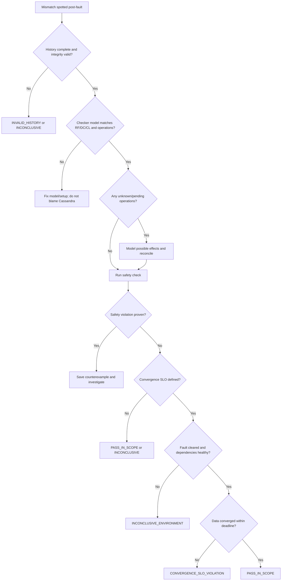

# Recording Operation History and Checking Post-Fault Invariants

> **Chapter:** Load and Distributed Fault Testing  
> **Context:** Apache Cassandra with its wide-column model, partition keys, replication, consistency levels, compaction/repair, fault injection, and Java Driver 4.x. This lesson guides building an **operation history** to verify correctness rather than relying solely on throughput and latency charts.
>
> **Objective:** Distinguish dispatched requests from applied effects; record `invoke`, `ok`, `fail`, `info`; link business IDs with retry attempts; verify invariants using a dual-client history; understand when a timeout represents an unknown outcome; separate *safety*, *linearizability*, and *eventual convergence*; reconcile data once the Cassandra cluster recovers; and produce an evidence-based PASS/FAIL/INCONCLUSIVE report.

## 1. Problem: The Application Timed Out, Yet Cassandra Still Stored the Data

A Java client sends a request updating an order status:

```text
t=0 ms      Client A: UPDATE status='PAID'
t=15 ms     Replica R1 receives mutation
t=20 ms     Replica R2 receives mutation
t=25 ms     Coordinator sends ACK, but the network drops
t=500 ms    Client A receives a timeout
t=600 ms    Client B reads and sees status='PAID'
```

If you only log:

```text
ERROR: write FAILED
INFO: status PAID
```

you might mistakenly conclude Cassandra “committed even though the transaction failed.” In reality, a **timeout does not prove a mutation did not apply**. Coordinator/replicas may have completed it before the reply dropped, or a subset of replicas applied it while others need recovery.

To test accurately, you must know:

1. Which operation did A **intend** to execute, and on which partition key?
2. When was the request actually dispatched, and at what consistency level?
3. Did A receive an ACK, a definitive failure, or an unknown outcome?
4. In what interval did B read, via which coordinator/DC, and which version did it observe?
5. After the fault ends, do replicas and projection tables converge per the data model?
6. Did any discrepancy stem from Cassandra, the application, retries, or **history lost by the test harness**?

An **operation history** is the sequence of observations answering those questions. It is not merely an “INFO/ERROR” log file.

## 2. How Does an Operation History Differ from Ordinary App Logs?

Typical application log:

```text
10:00:00 Start update
10:00:01 Timeout update
10:00:02 Get order success
```

A more complete operation history:

```text
run_id      = run-001
op_id       = op-A
actor       = client-A
kind        = cas
key_ref     = tenant-a/order-42
invoke_ns   = 100000000
outcome_ns  = 600000000
outcome     = info (unknown)
expected    = version=3
requested   = version=4, state=PAID
CL          = LOCAL_QUORUM
serial_CL   = LOCAL_SERIAL

op_id       = op-B
actor       = client-B
kind        = read
key_ref     = tenant-a/order-42
invoke_ns   = 700000000
outcome_ns  = 720000000
outcome     = ok
observed    = version=4, state=PAID
CL          = LOCAL_QUORUM
```

This structure lets you:

- Pair every invocation with its completion.
- Separate completed requests from pending or ambiguous requests.
- Reconstruct causal links and real-time precedence order.
- Run state-machine validation for CAS or registers.
- Reconcile final database state by partition key.
- Extract a minimal **counterexample** whenever an invariant breaks.

Stack-trace logs assist troubleshooting, yet **never replace** the structured fields a checker requires.

## 3. Four Essential Outcome Categories

| Phase | Meaning | When to use |
| --- | --- | --- |
| `invoke` | Client starts an operation | Must persist before CQL dispatch in durable histories |
| `ok` | Operation receives a definite, model-valid response | `SELECT` returns rows/null; CAS returns `[applied]` |
| `fail` | Evidence proves the operation failed to take effect per contract | Validation rejected before dispatch; invalid CQL rejected clearly |
| `info` | Cannot determine whether the operation took effect | Write timeout, disconnect after dispatch, client crash |

LWT examples:

- `INSERT ... IF NOT EXISTS` returning `[applied]=true` → `ok`, condition applied.
- Returning `[applied]=false` → **still `ok`**, a valid CAS outcome where the row wasn't modified by this call.
- `DriverTimeoutException` after dispatch → usually **`info`**, because mutation application is uncertain.
- Client process killed between `invoke` and response → operation stays **pending**, never assume `fail`.

**Never use a catch-all exception handler to classify every error as `fail`.** That is the fastest way to inject false positives or false negatives into your checker.

## 4. Business Operations, Logical Requests, and Attempts

One business action can generate multiple network requests:

```text
business_id = payment-123
    |
    +-- HTTP request req-01
    |      +-- driver execution attempt 1
    |      +-- driver speculative attempt 2
    |
    +-- HTTP retry req-02
           +-- driver execution attempt 1
```

Maintain at least three identifier levels:

1. **Business operation ID:** stable across retries; drives idempotency.
2. **Logical request ID:** each service-level CQL/HTTP call.
3. **Attempt ID:** each actual execution attempt when instrumented.

Never count retries as separate new payments in business assertions; conversely, never erase attempts, because they drive extra coordinator and replica load.

Driver 4.x exposes retry/speculation metrics and tracing depending on configuration; do not claim visibility into every internode RPC if the harness only records logical requests. Explicitly document **client-side evidence scope**.

## 5. Multi-Client Histories Need Proper Time Representation

```text
Client A                 Cassandra cluster             Client B
   |                           |                          |
   | invoke op-1               |                          |
   +-------------------------->|                          |
   |                           | write R1/R2              |
   | timeout: info             |                          |
   |                           |<-------------------------+ invoke read
   |                           +------------------------->|
   |                           |                          | ok: version 4
```

Clocks are not interchangeable:

| Clock | Suitable for | Limitation |
| --- | --- | --- |
| `System.nanoTime()` | Durations inside **one JVM** | Cannot compare raw values across two hosts |
| `Instant.now()` / UTC | Aligning events to fault timelines | Subject to clock skew and NTP slews/steps |
| CQL write timestamp | Cassandra LWW cell reconciliation | Does not reliably reflect client invoke order |
| Driver/server tracing clock | Investigating coordinator/replica hops | Skew across hosts, overhead, and sampling |

For instance, if A logs `t=100ms` on host A and B logs `t=90ms` on host B under clock skew, you cannot infer B happened before A.

Instead, record:
- Process-local monotonic clock intervals for invocation/completion.
- Process/actor IDs and monotonic sequence numbers.
- Explicit causal edges (e.g., A finishes before triggering B).
- Clock-skew bounds/uncertainty when correlating hosts.
- Fault-controller timelines and cluster health evidence.

**A linearizability checker must honor provable happens-before order rather than blindly sorting JSONL files by UTC wall clock.**

## 6. Manifest for Each Fault Test Run

Alongside the history, store an immutable manifest:

```yaml
run:
  id: "fault-run-001"
  seed: 314159
  scenario: "cas-plus-projection"
  target_slo: "<approved>"
  cassandra:
    distribution: "Apache Cassandra"
    server_release: "<observed>"
    native_protocol: "<observed>"
    cluster_name: "<observed>"
    replication:
      strategy: "NetworkTopologyStrategy"
      dc1: {nodes: 3, rf: 3}
    read_cl: "LOCAL_QUORUM"
    write_cl: "LOCAL_QUORUM"
    serial_cl: "LOCAL_SERIAL"
    schema_revision: "<hash>"
  java:
    jdk_release: "<observed>"
    driver_artifact: "<resolved>"
    application_instances: 2
    retry_policy: "<resolved>"
    speculative_policy: "<resolved>"
  fault:
    kind: "node-network-isolation"
    target: "<approved-test-node>"
    start_utc: "<observed>"
    stop_utc: "<observed>"
  artifacts:
    histories: ["client-A.jsonl", "client-B.jsonl"]
    checksums: "<sha256-manifest>"
```

Bracketed values are **placeholders**, not verified deployments. Never use a single-node RF1 manifest to claim 2/3 quorum validation.

Specify clearly whether the test ran on a single-node lab, multi-node lab, multi-DC cluster, or staging; the moment a fault stops **differs** from the moment the cluster finishes recovering enough for reconciliation.

## 7. What Is an Invariant, and Who Enforces It?

An invariant is a property that must never break within the declared scope.

| Invariant | Scope | Primary enforcement |
| --- | --- | --- |
| At most one CAS winner per version | Single partition / valid lifecycle | LWT, Paxos |
| Reads match row by full primary key | Query shape + CL | Cassandra + client mapping |
| Read-after-write under quorum intersection | Same DC/RF/CL without concurrent overwrites | Replica read/write CL |
| Zero duplicate business payments | API / retries / queues | **Application** idempotency |
| Canonical and projection versions eventually match | Across tables/partitions | **Application** reconciliation |
| Job state never regresses after `SUCCEEDED` | Business state machine | CAS/versioning and validation |
| Deleted data never resurrects after node outage | Multi-replica, repair/GC conditions | Tombstones + repair/operations |
| Sum across two accounts stays globally atomic | Multi-partition | Not promised by ordinary `BATCH` |
| Reads in every DC reflect local quorum writes instantly | Multi-DC | Not guaranteed by default |

**Never assert an invariant stronger than Cassandra's actual contract and blame the engine for a bug.**

## 8. Safety vs Liveness / Convergence

**Safety:** “Did something bad ever happen?”

For example, two CAS operations targeting `expectedVersion=0` on the same partition both return `[applied]=true` with no intervening reset or write. Backed by clean history evidence, that is a candidate safety violation.

**Liveness / convergence:** “Does the desired target state eventually hold?”

For instance, after an outage ends, the projection table catches up to canonical within 60 seconds **once both projector and cluster pass recovery checks** per the approved SLO.

A read observed during the fault:

```text
canonical: version 5
projection: version 4
```

is not automatically a bug if the design allows eventual consistency.

Conversely, waiting 30 seconds never “heals” two conflicting CAS winners. **A safety violation does not vanish just because final state converges.**

## 9. Lab Schema: Canonical State and Projection

Assuming a test cluster with real DC `dc1` and RF3 replicas:

```cql
CREATE KEYSPACE IF NOT EXISTS fault_lab
WITH replication = {
    'class': 'NetworkTopologyStrategy',
    'dc1': 3
};

CREATE TABLE IF NOT EXISTS fault_lab.job_state_by_id (
    tenant_id text,
    job_id uuid,
    version bigint,
    state text,
    amount bigint,
    updated_at timestamp,
    PRIMARY KEY ((tenant_id, job_id))
);

CREATE TABLE IF NOT EXISTS fault_lab.job_state_by_owner (
    tenant_id text,
    owner_id uuid,
    job_id uuid,
    source_version bigint,
    state text,
    PRIMARY KEY ((tenant_id, owner_id), job_id)
);
```

`fault_lab.job_state_by_id` holds canonical state. `job_state_by_owner` is a query-specific projection by owner.

**The two tables have different partition keys.** Cassandra never automatically updates the projection when canonical changes. If running in a **single-container** lab, switch to an RF1 keyspace and matching CL; never pretend `RF3`/`LOCAL_QUORUM` behaves meaningfully on one replica.

Illustrative domain state machine:

```text
NEW -> RUNNING -> SUCCEEDED
NEW -> CANCELLED
RUNNING -> FAILED
```

Cassandra does not automatically forbid an ordinary `UPDATE` rolling back `SUCCEEDED -> NEW`. The application must enforce transitions through versioning and conditional updates.

## 10. Initializing a Row with LWT

```cql
INSERT INTO fault_lab.job_state_by_id (
    tenant_id, job_id, version, state, amount, updated_at
) VALUES (
    'tenant-a',
    11111111-1111-4111-8111-111111111111,
    0, 'NEW', 1000,
    '2026-11-21T10:00:00Z'
) IF NOT EXISTS;
```

If it returns `[applied]=true`, creation succeeded. If `false`, the row already existed—never treat that as the current request applying the insert.

Use a **fresh key per test**; leftover rows from prior runs cause competing clients to both see `false`, invalidating results.

## 11. Version-Based CAS: Clear and Reproducible Invariant

```cql
UPDATE fault_lab.job_state_by_id
SET version = 1,
    state = 'RUNNING'
WHERE tenant_id = 'tenant-a'
  AND job_id = 11111111-1111-4111-8111-111111111111
IF version = 0;
```

Clients A and B submit:

```text
A: expected version 0, next version 1, state RUNNING
B: expected version 0, next version 1, state CANCELLED
```

Provided **both return definite outcomes** on the same partition and lifecycle with no non-LWT writers, **at most one** gets `[applied]=true`.

If A times out and B gets `false`, never conclude A definitely failed. A may have succeeded while its ACK dropped. Quorum reads and history logs narrow down what happened.

### Fields to Log for Each CAS

- `op_id` and stable business ID.
- Anonymized partition-key reference.
- Expected version, proposed next version, and target state.
- Invocation timestamp.
- Returned `[applied]` value or unknown outcome.
- Regular CL and serial CL.
- Coordinator/attempt metadata when observable.
- Exact scope of writers permitted to mutate that row.

**LWT gives Cassandra-scoped CAS on one partition; it does not wrap cross-partition projections in a SQL transaction.**

## 12. Ordinary `UPDATE` Follows Different Rules from CAS

Example:

```cql
UPDATE fault_lab.job_state_by_id
SET state = 'RUNNING'
WHERE tenant_id = 'tenant-a'
  AND job_id = 11111111-1111-4111-8111-111111111111;
```

Cassandra reconciles cells by write timestamp and deterministic tie-breakers. Under concurrent writes, whichever operation replies later on a client clock **does not always win** if its write timestamp was lower.

Avoid naive assertions like:

```text
"Whichever operation returned last must be the final state."
```

Verifying LWW requires knowing timestamp inputs, schema rules, and cell tie-breaking. To prevent illegal domain transitions, enforce CAS/versioning or an appropriate transactional store instead of relying on HTTP finish order.

## 13. Two-Table Invariants: Temporary Divergence Can Be Valid

Right after updating canonical state:

```text
canonical: version=7, state=SUCCEEDED
projection: source_version=6, state=RUNNING
```

Eventual projections legitimately lag briefly. Separate two checks:

- **Canonical safety:** versions and state transitions never violate the model.
- **Projection convergence:** post-recovery, the projector/reconciler advances `source_version` to 7 within the agreed deadline.
- **Read contract:** UI/API explicitly displays syncing state or queries canonical when required.

A multi-partition `LOGGED BATCH` uses a batchlog to help drive mutations to completion after partial failures; it **does not provide cross-partition snapshot isolation**. Multi-partition `BEGIN UNLOGGED BATCH` lacks that batchlog group recovery.

**Never treat two `SELECT` calls across two tables as a transactional snapshot just because they share one `CqlSession`.**

## 14. Operation History in JSON Lines

Each line captures one event:

```json
{"runId":"r-001","opId":"op-1","actor":"client-A","phase":"invoke","kind":"cas","keyRef":"k-7","expectedVersion":0,"nextVersion":1,"monoNanos":100000000,"wallUtc":"2026-11-21T10:00:00Z"}
{"runId":"r-001","opId":"op-2","actor":"client-B","phase":"invoke","kind":"cas","keyRef":"k-7","expectedVersion":0,"nextVersion":1,"monoNanos":101000000,"wallUtc":"2026-11-21T10:00:00.001Z"}
{"runId":"r-001","opId":"op-1","actor":"client-A","phase":"info","kind":"cas","keyRef":"k-7","errorClass":"RequestTimeout","monoNanos":600000000,"wallUtc":"2026-11-21T10:00:00.500Z"}
{"runId":"r-001","opId":"op-2","actor":"client-B","phase":"ok","kind":"cas","keyRef":"k-7","applied":false,"monoNanos":620000000,"wallUtc":"2026-11-21T10:00:00.520Z"}
```

These are **illustrative sample records**, with `k-7` as an opaque key placeholder. For real datasets, use consistent salted hashes and avoid raw PII.

### Minimal Fields

| Field | Purpose |
| --- | --- |
| `runId` | Prevents mixing separate test runs |
| `opId` | Links `invoke` ↔ outcome |
| `actor` / `processId` | Identifies distinct clients/JVMs |
| `phase` | `invoke` / `ok` / `fail` / `info` |
| `kind` | `read` / `write` / `cas` / `delete` / `batch` |
| `keyRef` | Groups events by partition for checkers |
| `expectedVersion` / `nextVersion` | State-machine inputs |
| `applied` / `observed` | Actual returned values |
| `monoNanos` / `wallUtc` | Intervals and fault correlation |
| `cl` / `serialCl` | Declared consistency scope |
| `attemptId` / `businessId` | Retries and deduplication tracking |
| `errorClass` | Outcome classification |
| `faultEpoch` | Alignment with fault injection phase |

Never log passwords, tokens, private keys, sensitive bind values, or raw customer payloads just for extra detail.

## 15. Persist `invoke` Durably Before Dispatch

Anti-pattern:

```java
session.executeAsync(statement)
    .thenAccept(result -> history.write("ok"));
```

If the client crashes after Cassandra applies the mutation but before the callback runs, the history holds **zero trace of the operation**.

Rule:

```text
1. Generate stable op ID.
2. Persist "invoke" and wait for the history store's ACK.
3. Only then dispatch CQL.
4. On completion, persist ok/fail/info.
5. On process crash, an unmatched invoke stays pending.
6. If the history recorder fails, mark the run INVALID/INCONCLUSIVE.
```

Merely buffering `invoke` in RAM is not durable; a crash loses it. True durability requires defining an `fsync` or remote durable ACK boundary. Even so, **never `fsync` directly on the driver event-loop**, or you stall network I/O and distort latency measurements.

## 16. History Writers Need Bounded Queues and Failure Policies

A compliant writer must:

- Never silently drop events.
- Enforce a bounded queue or bounded backpressure.
- Measure append/`fsync` latency.
- Fail explicitly if storage breaks.
- Avoid keeping the entire history only on the JVM heap.
- Support log rotation, manifests, and checksums.
- Drain pending outcomes cleanly during graceful shutdown.
- Never call `println` per request on load-generation or driver callback threads.

In **correctness mode**, logging overhead is acceptable in exchange for durability. In **peak throughput benchmarks**, you may swap strategies only by explicitly disclosing acceptable log loss. **Never sample histories for operations audited by safety invariant checkers.**

## 17. Java 17: JSONL Recorder with a Dedicated Writer Thread

The snippet below uses Jackson `ObjectMapper`, `FileChannel`, and a single-thread bounded executor. It illustrates the durability boundary rather than a full production library.

```java
import com.fasterxml.jackson.databind.ObjectMapper;

import java.io.IOException;
import java.io.UncheckedIOException;
import java.nio.ByteBuffer;
import java.nio.channels.FileChannel;
import java.nio.file.Path;
import java.nio.file.StandardOpenOption;
import java.time.Instant;
import java.util.concurrent.ArrayBlockingQueue;
import java.util.concurrent.CompletableFuture;
import java.util.concurrent.CompletionStage;
import java.util.concurrent.RejectedExecutionException;
import java.util.concurrent.ThreadPoolExecutor;
import java.util.concurrent.TimeUnit;

public final class DurableJsonlHistory implements AutoCloseable {

    public record Event(
        String runId,
        String opId,
        String actor,
        String phase,
        String kind,
        String keyRef,
        Long expectedVersion,
        Long nextVersion,
        Boolean applied,
        String observed,
        String errorClass,
        long monoNanos,
        String wallUtc
    ) {}

    private final ObjectMapper mapper = new ObjectMapper();
    private final FileChannel channel;
    private final ThreadPoolExecutor writer;

    public DurableJsonlHistory(Path path) throws IOException {
        channel = FileChannel.open(
            path, StandardOpenOption.CREATE,
            StandardOpenOption.WRITE, StandardOpenOption.APPEND
        );
        writer = new ThreadPoolExecutor(
            1, 1, 0L, TimeUnit.MILLISECONDS,
            new ArrayBlockingQueue<>(4096),
            runnable -> {
                Thread t = new Thread(runnable, "history-writer");
                t.setDaemon(false);
                return t;
            },
            new ThreadPoolExecutor.AbortPolicy()
        );
    }

    public CompletionStage<Void> append(Event event) {
        try {
            return CompletableFuture.runAsync(
                () -> appendDurably(event), writer);
        } catch (RejectedExecutionException overloaded) {
            return CompletableFuture.failedFuture(overloaded);
        }
    }

    private void appendDurably(Event event) {
        try {
            byte[] json = mapper.writeValueAsBytes(event);
            byte[] line = new byte[json.length + 1];
            System.arraycopy(json, 0, line, 0, json.length);
            line[json.length] = (byte) '\n';

            ByteBuffer bytes = ByteBuffer.wrap(line);
            while (bytes.hasRemaining()) {
                channel.write(bytes);
            }

            // Writer thread, NOT a driver I/O callback.
            channel.force(false);
        } catch (IOException e) {
            throw new UncheckedIOException(e);
        }
    }

    @Override
    public void close() throws Exception {
        writer.shutdown();
        if (!writer.awaitTermination(30, TimeUnit.SECONDS)) {
            throw new IllegalStateException("History not drained");
        }
        channel.close();
    }
}
```

### Implementation Limitations

- `channel.force(false)` requests an OS flush; actual durability depends on filesystem, OS, disk write-cache settings, and crash mode.
- Bounded 4096-entry queue: saturation rejects cleanly instead of silently dropping events.
- Per-event `fsync` adds heavy cost requiring **calibration** and can bottleneck throughput.
- Lacks log rotation, checksums, parent-directory `fsync`, disk-full recovery, and distributed sequence IDs.
- Never call `close()` while operations are still completing; appending after close truncates the run.
- Any writer exception must invalidate the run (`INVALID`), not merely log a warning.
- If the process dies between `invoke` and completion, an `invoke`-only record accurately reflects **pending/unknown**.

Under high load, swap in a vetted durable log store with explicit ACK semantics rather than uncapping queues and pretending the test remains safe.

## 18. Java Driver 4.x: Wrapping LWT CAS with Operation History

Uses Java Driver 4.x and `DurableJsonlHistory` above to persist `invoke` prior to dispatch and separate CAS `[applied]` outcomes from timeouts.

```java
import java.time.Instant;
import java.util.UUID;
import java.util.concurrent.CompletionStage;

import com.datastax.oss.driver.api.core.CqlSession;
import com.datastax.oss.driver.api.core.DefaultConsistencyLevel;
import com.datastax.oss.driver.api.core.cql.AsyncResultSet;
import com.datastax.oss.driver.api.core.cql.BoundStatement;
import com.datastax.oss.driver.api.core.cql.PreparedStatement;
import com.datastax.oss.driver.api.core.cql.Row;

public final class HistoryAwareCasClient {

    public record CasOutcome(
        String opId,
        Boolean applied,
        String errorClass,
        boolean unknown
    ) {}

    private final CqlSession session;
    private final PreparedStatement cas;
    private final DurableJsonlHistory history;
    private final String runId;
    private final String actor;

    public HistoryAwareCasClient(
        CqlSession session,
        DurableJsonlHistory history,
        String runId,
        String actor
    ) {
        this.session = session;
        this.history = history;
        this.runId = runId;
        this.actor = actor;
        cas = session.prepare(
            "UPDATE fault_lab.job_state_by_id " +
            "SET version = ?, state = ? " +
            "WHERE tenant_id = ? AND job_id = ? " +
            "IF version = ?"
        );
    }

    private DurableJsonlHistory.Event event(
        String opId, String phase, String keyRef,
        long oldVersion, long newVersion,
        Boolean applied, String observed, String error
    ) {
        return new DurableJsonlHistory.Event(
            runId, opId, actor, phase, "cas",
            keyRef, oldVersion, newVersion,
            applied, observed, error,
            System.nanoTime(), Instant.now().toString()
        );
    }

    public CompletionStage<CasOutcome> attempt(
        String tenantId, UUID jobId,
        String keyRef, long oldVersion, String nextState
    ) {
        String opId = UUID.randomUUID().toString();
        long newVersion = oldVersion + 1;

        BoundStatement statement = cas
            .bind(newVersion, nextState, tenantId,
                  jobId, oldVersion)
            .setConsistencyLevel(
                DefaultConsistencyLevel.LOCAL_QUORUM)
            .setSerialConsistencyLevel(
                DefaultConsistencyLevel.LOCAL_SERIAL)
            .setIdempotent(false);

        return history.append(
            event(opId, "invoke", keyRef,
                  oldVersion, newVersion,
                  null, null, null)
        ).thenCompose(ignored -> {

            CompletionStage<AsyncResultSet> stage;
            try {
                stage = session.executeAsync(statement);
            } catch (RuntimeException ex) {
                return history.append(
                    event(opId, "info", keyRef,
                          oldVersion, newVersion,
                          null, null, ex.getClass().getName())
                ).thenApply(v -> new CasOutcome(
                    opId, null, ex.getClass().getName(), true
                ));
            }

            return stage.handle((result, error) -> {
                if (error != null) {
                    return new CasOutcome(
                        opId, null,
                        error.getClass().getName(), true
                    );
                }
                Row row = result.one();
                if (row == null) {
                    return new CasOutcome(
                        opId, null, "MissingCasResult", true
                    );
                }
                return new CasOutcome(
                    opId, row.getBoolean("[applied]"),
                    null, false
                );
            }).thenCompose(outcome -> {
                String phase = outcome.unknown() ? "info" : "ok";
                String observed = outcome.applied() == null
                    ? null : "applied=" + outcome.applied();

                return history.append(
                    event(opId, phase, keyRef,
                          oldVersion, newVersion,
                          outcome.applied(), observed,
                          outcome.errorClass())
                ).thenApply(v -> outcome);
            });
        });
    }
}
```

### Write-Path Invariants

1. Mint `opId` before any side effects.
2. Persist `invoke` completely before dispatching CQL.
3. Definite `[applied]` response → `ok`, including `false`.
4. Timeouts/uncertain errors → `info`.
5. Outcome persists before the client stage completes.
6. Any recorder failure fails the run: **never grant PASS with incomplete logs**.
7. Never store raw tenant/user keys as `keyRef` if they contain PII.
8. `LOCAL_QUORUM`/`LOCAL_SERIAL` assume RF3 in `dc1`, not single-node RF1 labs.
9. Using CAS versioning means **all cooperating writers must follow LWT rules** for checker assumptions to hold.

This snippet conservatively marks every exception without a CQL result as unknown. Production harnesses can classify proven pre-dispatch rejections as `fail` with evidence, never by default.

## 19. When the Journal Fails, the History Cannot Support PASS

Scenario:

```text
op-7 invoke recorded
CQL request dispatched
Recorder queue overflows before writing outcome
```

Cassandra may already have committed the mutation. The history stays pending while the recorder lost ability to confirm outcomes.

Accurate verdict:

```text
history_integrity = INVALID
op-7 = pending/unknown
test_conclusion = INCONCLUSIVE or INVALID_HISTORY
```

**Never backfill synthetic `fail` events, delete dangling `invoke` records, or fabricate outcomes** to make reports look clean.

## 20. Two `CqlSession` Objects Do Not Guarantee Two Coordinators

A test using:

```text
Client A --> CqlSession A ----+
                             +--> Cassandra
Client B --> CqlSession B ----+
```

cleanly separates driver pools and state to test races, read-after-write, and LWT contention. Yet against a single Cassandra container, both still talk to the exact same node.

To validate node failures or cross-DC behavior, run a multi-node cluster and **verify actual coordinators, local DC, RF, and CL** via driver metadata, logs, or tracing.

### Two Sessions Do Not Create a Snapshot

Opening a `CqlSession` at 10:00 **does not** pin a snapshot at 10:00. Every `SELECT` runs independently. Querying two tables on the same session provides zero cross-table SQL snapshot isolation.

## 21. Concurrency Test: Two CAS Operations on One Version

After seeding `version=0`, two clients submit:

```text
A expected=0, set version=1, state RUNNING
B expected=0, set version=1, state CANCELLED
```

Requirements for the test:

- Separate `CqlSession` instances.
- Synchronization barrier to align dispatch closely.
- Bounded future deadlines.
- Separate recording of `[applied]` vs exceptions.
- Never assert A must win.
- Whenever both return definite results, **at most one** CAS applied.
- If one times out, **never assert exact winner count of 1**—preserve unknown status.

Across larger runs, log keys, versions, and lifecycle epochs on all clients. Remember a JVM `CountDownLatch` does not dictate coordinator arrival order on the server.

## 22. Minimal Offline CAS Winner Checker Pseudocode

```text
for each (key_ref, lifecycle_epoch, expected_version):
    applied_ops = distinct op_ids having:
        phase = ok
        kind = cas
        applied = true

    if count(applied_ops) > 1:
        report candidate SAFETY_VIOLATION
    else:
        no evidence of violating this invariant
```

This checker is valid only when:

- Versions never reset/reuse within the same epoch.
- No non-LWT writer mutates version directly.
- `key_ref` maps deterministically to the same Cassandra partition.
- Each `op_id` identifies one distinct logical CAS.
- History is complete with zero duplicate outcome records.

It **does not prove full linearizability**: it ignores real-time intervals, reads, pending ops, and complex state transitions.

## 23. Linearizability Requires Intervals, Not Just Final Values

A history is linearizable if there exists a sequential ordering of operations consistent with:

1. The object's sequential specification / state machine.
2. Observed inputs and outputs.
3. Real-time precedence: if A **completed** before B was **invoked**, A precedes B.

Examples:

```text
A invoke -------- result
  B invoke --- result
```

A and B overlap, so the checker may try either serialization order.

```text
A invoke --- result
                        B invoke --- result
```

A must precede B on the same object when a trustworthy real-time order is established.

Pick a model matching Cassandra semantics:
- Partition-scoped LWT/CAS follows Paxos and serial CL guarantees.
- Ordinary LWW writes and `LOCAL_ONE` are not cluster-wide linearizable registers.
- Cross-partition logged `BATCH` lacks snapshot isolation.
- `LOCAL_QUORUM` in two separate DCs does not automatically intersect.

**Checking a stronger model than the database promises only produces meaningless “violations.”**

## 24. Pending and Unknown Operations Must Be Accounted For

```text
A invoke CAS 4 -> 5
A killed before response arrives
B read sees version 5
```

A may have taken effect. Checkers cannot arbitrarily assume A failed. In linearizability checking, pending operations can be treated as either having taken effect inside their open interval or not having taken effect, as required to explain observations.

A stable business ID plus an idempotency ledger helps resolve unknowns. Without resolution, report `INCONCLUSIVE_UNKNOWN_OUTCOME` when ambiguity prevents a verdict.

### Final Row Values Do Not Tell the Whole Story

```text
A write(1) -> timeout
B write(2) -> ok
Final read -> 2
```

Observing final value `2` does not prove A never wrote `1`. For counters, list appends, and external side effects, intermediate traces remain critical.

## 25. Offline Checkers Must Validate History Integrity Before Data

Minimal checking pipeline:

1. Parse all JSONL segments from every client.
2. Verify manifests, checksums, run IDs, and schema versions.
3. Confirm every outcome links to a valid `invoke`.
4. Separate `pending`, `info`, `fail`, and `ok`.
5. Validate stable IDs, retry/attempt lineage, and lifecycle epochs.
6. Reconstruct per-process order and explicit causal edges.
7. Never sort blindly across hosts by UTC timestamps.
8. Load expected initial states for all test keys.
9. Run the versioned safety checker.
10. Record verdicts/counterexamples, then reconcile final storage state.

A checker that skips malformed lines or discards pending ops before analysis can emit a **false PASS**.

## 26. Reference Exception/Outcome Mapping Table for Histories

| Observed condition | Proper classification | Rationale |
| --- | --- | --- |
| CAS returns `[applied]=true` | `ok` | Conditional mutation succeeded |
| CAS returns `[applied]=false` | `ok` | Condition failed; deterministic result |
| `SELECT` returns a row | `ok` | Valid observation |
| `SELECT` returns null | `ok` | No live row visible at that CL |
| App validation rejects before DB | `fail` | Proven CQL never dispatched |
| Invalid CQL schema/column | `fail` with server proof | Server rejected statement |
| Write timeout | **`info`** | Mutation may still have applied |
| Disconnect after dispatch | **`info`** | Outcome unknown |
| LWT timeout | **`info`** | Uncertain if CAS applied |
| Client killed after `invoke` | `pending` | Response never received |
| History writer dropped events | `INVALID_HISTORY` | Insufficient evidence |

## 27. Never Mistake a Timeout for a Rollback

```text
Client A: UPDATE -> timeout
Client B: SELECT -> observes new value
```

This is a completely legal distributed outcome. Sending `DELETE` afterward to “undo” it issues a **new mutation** carrying its own timestamp, tombstones, and failure modes—it is not a SQL `ROLLBACK`.

When business logic requires compensation, log the new compensating action explicitly and rely on idempotency/reconciliation. Never erase earlier history when issuing compensations.

## 28. Read-After-Write Must Match the RF/CL Contract

Assume RF=3 in DC `dc1`:

```text
R1, R2, R3 hold replicas of partition P

Write LOCAL_QUORUM requires two local responses
Read  LOCAL_QUORUM requires two local responses
```

Without competing writers bearing overriding timestamps and while replication behaves normally, local read/write quorums **within the same DC** intersect—forming a stronger basis for read-after-write testing than `LOCAL_ONE`.

However:

- **`LOCAL_ONE`** can read a lagging replica.
- Two `LOCAL_QUORUM` operations in **two separate DCs** do not automatically intersect on the same replicas.
- Write-timestamp reconciliation can let an earlier wall-clock write lose or win differently from client expectations.
- Quorums never form a **multi-statement snapshot transaction**.
- Test LWT/serial guarantees separately from ordinary writes.

In a single-container RF=1 setup, `LOCAL_QUORUM` only touches one local replica—it **never proves** production's 2/3 quorum behavior.

### Sample CL History Records

```json
{"opId":"r-101","kind":"read","phase":"invoke","cl":"LOCAL_QUORUM","keyRef":"k-7","actor":"dc1-client"}
{"opId":"r-101","kind":"read","phase":"ok","cl":"LOCAL_QUORUM","keyRef":"k-7","observed":"version=5","actor":"dc1-client"}
```

Record DC/CL per operation or verified effective profile rather than logging a default config once and ignoring statement overrides.

## 29. Cross-DC Local Quorums Do Not Provide Global Snapshots

Consider a keyspace using `NetworkTopologyStrategy` with RF=3 in both `dc1` and `dc2`. This scenario **applies strictly to real two-DC clusters**:

```cql
-- Topology illustration only; do not run on single-DC labs.
CREATE KEYSPACE IF NOT EXISTS global_lab
WITH replication = {
  'class': 'NetworkTopologyStrategy',
  'dc1': 3,
  'dc2': 3
};
```

```text
Client A (dc1): UPDATE with LOCAL_QUORUM
Client B (dc2): SELECT with LOCAL_QUORUM
```

B can temporarily read an older version before cross-DC replication converges. Checkers must not demand immediate global freshness across DCs under local CLs.

Instead, specify:

- Safety/correctness inside the local DC per RF/CL.
- Cross-DC **convergence** after links stabilize and replica repair/catch-up completes.
- Explicit deadlines and preconditions in business SLOs.
- Actor and coordinator DC tagging on every observation.

**“The network link came back up” never guarantees “all replicas finished catching up.”**

## 30. Logged `BATCH` and Multi-Partition Histories

A logged batch:

```cql
BEGIN BATCH
  UPDATE fault_lab.job_state_by_id
  SET state = 'SUCCEEDED'
  WHERE tenant_id = 'tenant-a'
    AND job_id = 11111111-1111-4111-8111-111111111111;

  UPDATE fault_lab.job_state_by_owner
  SET state = 'SUCCEEDED'
  WHERE tenant_id = 'tenant-a'
    AND owner_id = aaaaaaaa-aaaa-4aaa-8aaa-aaaaaaaaaaaa
    AND job_id = 11111111-1111-4111-8111-111111111111;
APPLY BATCH;
```

Both mutations touch **different tables and partitions**. A logged batch writes a batchlog to help eventually apply all statements on failure recovery per Cassandra semantics; it **does not provide cross-partition isolation or snapshots**.

Batch histories must record:

1. Logical batch ID.
2. List of statement kinds and anonymized partition references.
3. Type (`LOGGED`, `UNLOGGED`, or `COUNTER`).
4. CL and batch request status/exception.
5. Fault start/end and coordinator/node health.
6. Partition readbacks before, during, and after the fault.
7. Final reconciliation and pending/unknown outcomes.
8. Batchlog/repair diagnostics if supported by server release.

### Never Assert Unpromised Engine Guarantees

```text
"Session B must always observe either old/old or new/new."
```

That demands **cross-partition snapshot isolation**, which ordinary logged batches never guarantee. Readers can legitimately observe `new/old` mid-propagation.

Multi-partition `BEGIN UNLOGGED BATCH` omits logged batch recovery entirely. On failure, the app must rely on idempotent retries and business reconciliation rather than expecting unlogged batches to reconcile across partitions.

## 31. Using Business IDs to Catch Duplicate Writes

Example payment events:

```text
Expected:
  payment-A: amount=100
  payment-B: amount=200
  payment-C: amount=300

Observed:
  payment-A applied twice
  payment-B not applied
  payment-C applied once
```

Checking total ACKs or row counts misses this swap completely.

Checkers should verify:

- The **set of business event IDs** instead of raw counts.
- Which IDs applied.
- Effect multiplicity per ID.
- Unreconciled unknown requests.
- Monetary totals per event ID where applicable.
- Duplicates arising from queue redeliveries, HTTP retries, or driver attempts.

Specifically, CQL counter increments are **not idempotent**: retries double-count. Likewise, logged batches cannot guarantee exactly-once side effects across external systems.

If requirements demand a zero-duplicate ledger, enforce idempotency keys/conditional writes and test explicitly across timeouts—never merely turn on retries.

## 32. Canonical vs Projection: Verifying Eventual Convergence

Canonical table:

```text
job_id J, version 8, state SUCCEEDED
```

Projection table:

```text
job_id J, source_version 7, state RUNNING
```

A convergence checker must:

1. Verify the **fault genuinely ended**.
2. Confirm cluster, consumers, and projectors **recovered**.
3. Start the approved convergence timer from that verified recovery mark.
4. Read canonical and projection by full partition keys.
5. Check `source_version` and `state`, not just row count.
6. Poll at bounded intervals with bounded concurrency.
7. Append every read observation to history.
8. If still diverged past deadline, report `CONVERGENCE_SLO_VIOLATION` with evidence.
9. If the projector remains down, return `INCONCLUSIVE_ENVIRONMENT`.
10. Never label an un-converged mid-fault read as a datastore bug.

**Convergence SLOs belong to the application workflow**, not an implicit hard SLA on arbitrary CQL writes.

## 33. Testing Delete Safety with Tombstones

A Cassandra `DELETE` writes a tombstone rather than scrubbing every cell across SSTables instantly. If a replica stays offline past `gc_grace_seconds` without repair, old rows can resurrect.

A properly scoped test:

1. Seeds a fresh key and confirms the live row.
2. Runs a multi-node cluster matching declared RF/CL.
3. Injects a controlled replica outage.
4. Issues `DELETE` at the required CL.
5. Records delete `invoke`, outcome, and timestamps.
6. Restores the node and runs supported repair runbooks.
7. Reads/reconciles across paths over a meaningful window.
8. Monitors compaction and `gc_grace_seconds` without hacking settings arbitrarily.
9. Never uses a single post-delete `SELECT` to declare every SSTable/replica clean.
10. Documents any untested gaps explicitly.

**Never slash `gc_grace_seconds` or disrupt production repairs to rush tests.** This property spans multiple replicas and time; a single-container RF1 test cannot verify it.

## 34. Store the Fault Timeline Beside the Operation History

Example:

```json
{"runId":"r-001","event":"fault_start","faultId":"f-1","target":"node-2","kind":"network-isolation","wallUtc":"2026-11-21T10:00:00Z"}
{"runId":"r-001","event":"fault_end","faultId":"f-1","target":"node-2","kind":"network-isolation","wallUtc":"2026-11-21T10:00:20Z"}
{"runId":"r-001","event":"cluster_healthy","target":"dc1","wallUtc":"2026-11-21T10:00:50Z"}
{"runId":"r-001","event":"reconcile_start","wallUtc":"2026-11-21T10:01:00Z"}
```

Always separate:

- When the controller issues fault start.
- When the fault actually takes effect.
- When the controller stops the fault.
- When nodes/cluster return to healthy operation.
- When replication/repair/projectors catch up to checker preconditions.
- When the checker begins the convergence SLO clock.

A tool reporting a node “UP” never proves zero backlog or zero replica drift; ground conclusions in verified health telemetry.

### Fault Metadata to Record

| Field | Rationale |
| --- | --- |
| Fault ID/type | Distinguishes network, disk, kill, and GC pauses |
| Node/DC/rack/coordinator | Identifies impacted replicas |
| Planned start/end | Compares against workload schedule |
| Observed start/end | Identifies actual disruption window |
| Fault tool/config | Reproduces exact packet loss/delay |
| Safety stop thresholds | Protects labs from unintended damage |
| In-flight ops at fault | Flags requests exposed to unknown outcomes |
| Health-restored evidence | Anchors convergence deadlines |
| Repair/streaming/projector state | Explains lingering lag |

Run fault injection **strictly in approved lab or staging environments**.

## 35. Scenario: Losing One Replica Under RF3

With `dc1` nodes R1, R2, R3, `LOCAL_QUORUM` reads/writes require two local replicas.

```text
t=0      Baseline: R1/R2/R3 all healthy
t=10     Client A/B issue CAS and reads, logging history
t=20     R3 isolated
t=20-50  Continue bounded load, capture errors/latency
t=50     Remove fault
t=80     Verify cluster recovery
t=90     Run safety and convergence checkers
```

One failed replica **does not fail every request** while two peers stay healthy and coordinators route cleanly, though latency, timeouts, and retries can climb.

The checker must know:

- CL used per request.
- Coordinator used, when instrumented.
- Operations finishing `ok`.
- Operations left `info`/pending.
- Whether CAS invariants held.
- Whether data converged post-recovery.
- Whether recovery time stayed within SLO.

**Measure data effects that occurred without client ACKs, not just error counts.**

## 36. Scenario: Losing Two Replicas Under RF3

When only R1 stays reachable in local RF3, `LOCAL_QUORUM` loses quorum.

Quorum operations are expected to fail with `Unavailable` or timeout depending on failure detection and timing. History must:

- Retain the original `invoke`.
- Log the specific error without inventing rollbacks.
- Avoid infinite retries trying to “hold QPS.”
- Never downgrade CL to `ONE` while omitting metadata changes.
- Track which requests completed before failure detection caught up.
- Reconcile unknown outcomes once replicas return.

Verdicts must record **contracted availability loss under CL**, never misreporting it as a safety violation.

## 37. Coordinator Crash During a Logged `BATCH`

To evaluate batchlog recovery properly:

1. Use a multi-node Cassandra lab with proper RF.
2. Target known partitions without real customer data.
3. Have Client A dispatch a logged `BATCH`.
4. Persist `invoke` durably beforehand.
5. Trigger an approved instrumented coordinator fault.
6. Record whether A returned `ok`, `info`, or a connection error.
7. Have Client B read each partition across intervals; partial visibility may appear temporarily.
8. Wait for coordinator/batchlog replay per cluster policy.
9. Run convergence checking and full workload reconciliation.
10. Archive logs/metrics without asserting snapshot isolation.

A single RF1 container cannot test this scenario. Never use `Thread.sleep(10)` and claim you covered intermediate batchlog windows.

## 38. The History Store Has Its Own Failure Domain

Possible layout:

```text
Client A -----+
              +----> Durable history storage
Client B -----+
              |
Fault runner -+----> Fault event log
              |
Cassandra cluster
```

Co-locating history storage on the node/volume killed during the fault risks losing both cluster state and test logs simultaneously. Placing history storage remotely risks network faults severing logs before severing CQL.

Design explicitly for:

- Durable intent logging before dispatch.
- Bounded queues and clear rejection handling.
- Log rotation and file checksums.
- Handling client process crashes cleanly.
- Comparing sent vs durably confirmed history events.
- Detecting missing log intervals.
- Clock sync and causal links.
- Privacy, redaction, and retention.

**A test with lost history cannot pass any invariant whose proof depends on that history.**

## 39. Artifacts Needed for Reproducibility

An isolated test harness may archive:

```text
run-manifest.json
client-A-history-0001.jsonl
client-B-history-0001.jsonl
fault-events.jsonl
readback-observations.jsonl
history-integrity-report.json
checker-report.json
checksums.sha256
```

These illustrate a test-harness artifact layout—**not instructions to create extra files** outside this lesson's scope.

Before running the checker:

1. Validate matching `runId` across every file.
2. Verify SHA-256 checksums and segment completeness.
3. Parse all JSONL lines strictly; never skip malformed lines silently.
4. Confirm every outcome matches a recorded `invoke`.
5. Confirm zero duplicate `opId` values outside explicit retry lineage.
6. Attach lifecycle epochs wherever keys reset.
7. Keep all pending/`info` operations in scope.
8. Load the model/checker version matching the schema and workload.
9. Never merge UTC and monotonic timestamps into an unproven global order.
10. On insufficient data, return `INVALID_HISTORY` or `INCONCLUSIVE`.

## 40. Java: At-Most-One CAS Winner Checker

A minimal offline checker reading `DurableJsonlHistory` JSONL logs. It is not a full linearizability solver, yet catches candidate violations where **two distinct CAS ops succeed for the same key, expected version, and epoch**.

```java
import com.fasterxml.jackson.databind.JsonNode;
import com.fasterxml.jackson.databind.ObjectMapper;

import java.nio.file.Files;
import java.nio.file.Path;
import java.util.HashMap;
import java.util.HashSet;
import java.util.Map;
import java.util.Set;

public final class CasWinnerChecker {

    public static void check(Path file) throws Exception {
        ObjectMapper mapper = new ObjectMapper();
        Map<String, Set<String>> winners = new HashMap<>();

        try (var lines = Files.lines(file)) {
            for (String line : (Iterable<String>) lines::iterator) {
                if (line.isBlank()) continue;

                JsonNode e = mapper.readTree(line);
                if (!"ok".equals(e.path("phase").asText())) {
                    continue;
                }
                if (!"cas".equals(e.path("kind").asText())) {
                    continue;
                }
                if (!e.path("applied").asBoolean(false)) {
                    continue;
                }

                String key = e.path("keyRef").asText();
                String version =
                    e.path("expectedVersion").asText();
                String opId = e.path("opId").asText();

                if (key.isBlank() || version.isBlank()
                    || opId.isBlank()) {
                    throw new IllegalStateException(
                        "Malformed successful CAS event");
                }

                String group = key + ":" + version;

                winners.computeIfAbsent(
                    group, ignored -> new HashSet<>()
                ).add(opId);
            }
        }

        for (var entry : winners.entrySet()) {
            if (entry.getValue().size() > 1) {
                throw new AssertionError(
                    "More than one CAS winner for " +
                    entry.getKey() + ": " + entry.getValue()
                );
            }
        }
    }
}
```

### Code Limitations

- Checks only one **narrow** CAS invariant.
- Requires merging histories across **all clients** before running.
- Assumes prior integrity checks verified event completeness and `invoke` pairings.
- If a key/version ever **resets or recycles**, you must include lifecycle epoch in `group`.
- Non-LWT writers or retries generating fresh `opId` values break assumptions unless modeled.
- Ignores invocation/completion overlap intervals and read observations.
- Does not fully model pending or unknown operations.
- Passing **never proves full cluster-wide linearizability**.

Real linearizability verification needs a state-machine checker reasoning over concurrency intervals, reads, and unknown outcomes matching exact engine contracts. Never claim broad guarantees from a simple winner counter.

## 41. Bounded Reconciliation: No Infinite Polling

Anti-pattern:

```java
// WRONG: can trigger a read storm or hang indefinitely.
while (!projectionMatchesCanonical()) {
    // No deadline; no pause; no rate limit.
}
```

A proper convergence check enforces:

- A start timestamp only after recovery preconditions pass.
- Explicit deadlines, polling intervals, and max concurrent reads.
- Recorded, fixed consistency levels.
- Per-key observation logging.
- Cancellation and timeout-handling policies.
- Version/state equality criteria rather than mere row presence.
- Clear inconclusive statuses whenever preconditions fail.

Pseudocode:

```text
deadline = monotonicNow + approvedSloWindow

while monotonicNow < deadline:
    read canonical and projection by full partition key
    append observation to history
    if sourceVersion == canonical.version
       and projection.state == canonical.state:
         return CONVERGED
    boundedWait()

return CONVERGENCE_SLO_VIOLATION
```

If the cluster isn't healthy yet or the projector stayed stopped, return `INCONCLUSIVE_ENVIRONMENT` rather than marking temporary lag as permanent corruption.

### Never Turn the Checker Into a Denial-of-Service Load Source

Polling one million keys every 250 ms crushes the cluster. Shard key ranges, cap QPS/in-flight requests, prioritize affected keys, and track readback p95/p99 and completion progress.

## 42. Honest Outcome Classification

| Status | Meaning |
| --- | --- |
| `PASS_IN_SCOPE` | Zero invariant violations observed within declared scope |
| `SAFETY_VIOLATION` | Verified counterexample under valid model and intact history |
| `CONVERGENCE_SLO_VIOLATION` | Post-recovery convergence missed approved deadline |
| `INCONCLUSIVE_UNKNOWN_OUTCOME` | Unresolved pending/`info` ops prevent definitive verdict |
| `INCONCLUSIVE_ENVIRONMENT` | Cluster/projector failed recovery preconditions |
| `INVALID_HISTORY` | Dropped events, checksum mismatches, corruption, or missing records |
| `TEST_SETUP_FAILURE` | RF/DC/CL, versions, schema, or fault injection deviated from plan |

**PASS means only PASS within tested scope**, never proof that zero bugs exist anywhere.

## 43. Minimal Counterexamples Must Preserve Causal Edges

Example:

```text
Run r-104; key K; lifecycle 1
Initial version=0, RF3 dc1, LWT LOCAL_SERIAL

A invoke CAS 0->1 RUNNING at t=100
B invoke CAS 0->1 CANCELLED at t=110
A ok applied=true at t=200
B ok applied=true at t=210

No reset/DELETE/other writers.
Candidate SAFETY_VIOLATION.
```

Before blaming Cassandra:

1. Did both CAS statements hit the **same actual partition key**?
2. Could `keyRef` mapping collide across keys?
3. Did both stay inside the same lifecycle epoch?
4. Could the recorder have duplicated result lines?
5. Did any ordinary `UPDATE` bypass LWT?
6. Did both `[applied]` flags parse accurately without mapper bugs?
7. Did both clients point to the same cluster and keyspace?
8. Were serial CL, regular CL, and server versions accurate?
9. Were any intervening operations lost from history?
10. Does the minimized example keep all causal and real-time precedence edges?

Keep raw histories separate from minimized counterexamples, and never prune pending operations that might explain an alternate interleaving.

## 44. Client and Cassandra Metrics to Retain

| Group | Example metrics / evidence |
| --- | --- |
| History | `invoke`/`ok`/`fail`/`info` counts, pending operations |
| Recorder | Writer queue depth, `fsync` p99, log drops, checksums |
| Workload | Offered/dispatched/completed QPS, in-flight, rejected |
| Driver | Request errors/timeouts, retry/speculation counts |
| Read/write | CL, serial CL, coordinator/DC, observed row versions |
| Fault | Start/end timestamps, target node, health-restored marker |
| Cassandra | CPU, heap/off-heap, GC, disk await, pending/dropped tasks |
| Replication | Repair/streaming status, internode messaging |
| Data | Duplicate business IDs, version drift, projection lag |
| Checker | Model version, counterexample IDs, unknown counts |

Exact metric names vary across Java Driver, Cassandra, and exporter releases; never assume availability blindly. Never attach raw tenant/customer IDs as high-cardinality time-series labels.

**Operation histories and metrics complement each other:** metrics quantify scale and correlations, while histories supply exact per-operation correctness proof.

## 45. Protecting Sensitive Data Inside Histories

Histories often reference partition keys, payment IDs, amounts, endpoints, and internal errors. Enforce:

1. Record strictly what checkers need.
2. Anonymize key references using consistent hashes/mappings.
3. Never write bearer tokens, passwords, or private keys.
4. Avoid raw CQL bind values holding PII.
5. Encrypt histories at rest and in transit.
6. Restrict history and checker outputs via RBAC.
7. Enforce security retention/TTL policies.
8. Redact before sharing counterexamples externally.
9. Keep run/trace IDs sufficient for correlation without exposing secrets.
10. Prefer synthetic datasets; require formal approval for real production data.

Using per-event random hashes breaks checker grouping by key; keep salts consistent within each run.

## 46. Incident A: Client Crash Leaves History Without Outcome

**Symptom:** canonical version bumped, yet A recorded only `invoke`.

**Interpretation:** A's mutation may have succeeded. Do not force it to `fail`.

**Action:** read back at valid CL; inspect stable business IDs, versions, and concurrent writers. Leave as `pending` whenever ambiguity cannot be resolved conclusively.

If the recorder logged only after results arrived and lost even `invoke`, the harness broke evidence requirements—fix the harness rather than blaming Cassandra.

## 47. Incident B: Recorder Queue Overflows and Produces a “False Green” Benchmark

**Symptom:** Cassandra p99 looks low while the history writer lags; events are dropped, blocked, or missing outcomes.

**Action:**

- Monitor recorder latency and queue depth.
- Halt runs whenever history integrity cannot be guaranteed.
- Lower offered load or scale history storage deliberately.
- Never replace bounded queues with unbounded queues.
- Benchmark recorder overhead with synthetic dry runs upfront.
- Never omit recorder-rejected requests from offered-load denominators.

**Verdict:** `INVALID_HISTORY` or `INCONCLUSIVE`, never PASS.

## 48. Incident C: Projection Remains Stale Post-Fault

```text
canonical: version=12, state=SUCCEEDED
projection: version=10, state=RUNNING
```

Investigate:

- Are projector/consumer workers running?
- Queue backlogs, DLQs, checkpoints, and retry loops?
- Did the fault genuinely clear and do replicas satisfy CL?
- Out-of-order events or idempotency bugs?
- Older timestamps overwriting newer state?
- Is the projection reading/writing the right owner/tenant partition?
- Correct RF/DC/CL on readbacks?
- Lingering compaction/repair/network bottlenecks?

If the post-recovery deadline expires while healthy pipelines were permitted to run, report an end-to-end workflow **convergence SLO violation** rather than jumping to storage-engine defects.

## 49. Incident D: Deleted Data Resurfaces

When a replica misses a tombstone, log exact node outage times, `DELETE` CL, repair history, and `gc_grace_seconds`. Also check whether **the application re-sent old values** or replayed stale events.

Never run `nodetool compact` or slash `gc_grace_seconds` ad hoc in production. Anti-entropy repair reconciles replicas; it never rolls back business mutations.

## 50. History and Invariant Testing Matrix

| Case | Condition | Expectation |
| --- | --- | --- |
| H1 | `invoke` then `ok` | `opId` pairs and values match cleanly |
| H2 | `invoke` then timeout | Classified `info`, no false `fail` |
| H3 | Process killed after `invoke` | Preserved as `pending` |
| H4 | Validation rejects before dispatch | Classified `fail` with proof |
| H5 | History queue overflows | Run marked `INVALID` |
| H6 | Truncated JSONL line | Parser/checksum catches failure |
| H7 | Missing log segment | Manifest integrity fails |
| H8 | Retry under same business ID | Attempts link to parent ID |
| H9 | Duplicate `opId` | Collision flagged |
| H10 | Cross-host clock skew | Never sorted blindly by UTC |
| H11 | Synthetic two CAS winners | Checker catches violation |
| H12 | One CAS true, one false | No false alarm |
| H13 | CAS true + timeout | Unknown outcome preserved |
| H14 | Two CAS unknown | Neither forced to winner |
| H15 | Version reset/recreate | Lifecycle epochs kept distinct |
| H16 | Ordinary LWW writes | Timestamp model applied properly |
| H17 | RF1 single node | Claims strictly single-node CQL contract |
| H18 | RF3 `LOCAL_QUORUM` | Validates 2/3 quorum |
| H19 | One replica down | Availability and unknown outcomes tracked |
| H20 | Two replicas down | Errors/timeouts recorded, no fake rollback |
| H21 | Coordinator crash | Pending log stays intact |
| H22 | Multi-partition logged batch | Eventual convergence, no snapshot assertion |
| H23 | Cross-partition unlogged batch | Never assume batchlog recovery |
| H24 | Cross-DC local reads | Remote staleness modeled properly |
| H25 | Driver retries/speculation | Attempt amplification recorded |
| H26 | Counter increment retry | Duplicate effect caught |
| H27 | Business event redelivery | Stable IDs / idempotency hold |
| H28 | Projection trailing canonical | Bounded convergence met |
| H29 | Projection misses SLO | Convergence violation reported |
| H30 | Projector stayed unhealthy | Environment marked inconclusive |
| H31 | `DELETE` while replica offline | Tombstone/repair verified |
| H32 | Mixed TTL records | Retention semantics honored |
| H33 | Readback key missing | Classified via history |
| H34 | Missing fault event logs | Cannot claim fault actually occurred |
| H35 | In-flight requests undrained | Pending/unfinished state disclosed |
| H36 | Hot partition dataset | Workload skew explicitly documented |
| H37 | Mismatched schema revision | Setup failure flagged |
| H38 | Missing CL metadata | Avoid overclaiming consistency |
| H39 | Out-of-order projection events | Version reconciliation checked |
| H40 | Canonical version regression | Flagged as safety candidate |
| H41 | Partial batch visibility | Not falsely called DB bug |
| H42 | Safety PASS, projection FAIL | Reported as two separate verdicts |
| H43 | History INVALID despite valid final rows | Never granted strong PASS |
| H44 | Cluster holds lingering repair backlog | Convergence clock respects recovery |
| H45 | Minimized counterexample | Preserves all causal edges |
| H46 | Clients on different driver versions | Manifest captures exact artifacts |
| H47 | History store lost during fault | Marked unknown/incomplete |
| H48 | PII present in test payloads | Redaction and RBAC verified |
| H49 | Logging throttles load generator | Instrumentation overhead quantified |
| H50 | Clean end-to-end run | Clear PASS/FAIL/INCONCLUSIVE report |

## 51. Questions and Exercises

1. Why doesn't a write timeout prove a write failed to apply?
2. Compare standard application logs with an operation history.
3. When is `[applied]=false` still classified as `ok`?
4. How does `info` differ from `fail` in potential database side effects?
5. Which state should an operation retain if the client dies right after `invoke`?
6. Distinguish business ID, logical request ID, and attempt ID.
7. Why must `invoke` persist durably before dispatching CQL?
8. Is an event sitting in an in-memory RAM queue durable?
9. If `fsync` slows request scheduling, how should you adjust architecture?
10. Why must a history recorder enforce bounded queues?
11. Can `System.nanoTime()` values from two separate JVMs be compared directly?
12. How does clock skew break naive linearizability checkers?
13. Distinguish CQL write timestamps from client invocation timestamps.
14. How do safety invariants differ from convergence SLOs?
15. On one partition, how many CAS winners can succeed for the same `expectedVersion`?
16. If a CAS times out, why can't you assume it lost?
17. When might a simple winner-counting checker report a false positive?
18. Why does resetting versions require tracking lifecycle epochs?
19. Can ordinary `UPDATE` statements protect a business state machine by themselves?
20. Why do multi-table projections typically need asynchronous reconciliation?
21. Does logged `BATCH` give cross-partition snapshot isolation?
22. Which recovery mechanism does multi-partition unlogged `BATCH` lack?
23. With RF3 in one DC, how many replicas does `LOCAL_QUORUM` require?
24. Does RF1 with `LOCAL_QUORUM` prove 2/3 quorum behavior?
25. Do two `LOCAL_QUORUM` operations in two separate DCs share the same replica set?
26. Define linearizability and real-time precedence order.
27. Must two overlapping operations serialize strictly in invocation-timestamp order?
28. How do pending operations enter a linearizability model checker?
29. Does an accurate final value prove zero duplicate side effects occurred?
30. How do counter retries cause business data errors?
31. How do stable payment IDs catch duplicate write effects?
32. Why must primary-key `SELECT` verification record exact readback CL?
33. When is reading an older projection version temporarily valid?
34. Which preconditions must hold before starting a convergence SLO deadline?
35. Why shouldn't you poll millions of keys every 10 ms?
36. How do `DELETE` tombstones interact with anti-entropy repair?
37. Why can't single-node setups validate repair convergence?
38. How does `fault_end` differ from `cluster_healthy`?
39. If the fault controller loses logs, can a test legitimately report PASS?
40. Can checksum validation replace state-machine correctness checks?
41. Why validate history integrity before running safety checkers?
42. What is the value of feeding a synthetic “two CAS winners” fault into your checker?
43. Why doesn't a CAS winner checker prove full linearizability?
44. How can key-mapping collisions trigger false safety violations?
45. Is a compensating `DELETE` equivalent to a SQL transaction `ROLLBACK`?
46. When is `INCONCLUSIVE_ENVIRONMENT` distinct from a convergence failure?
47. Which artifacts belong in a reproducible fault-test bundle?
48. How can PII leak into CQL operation histories?
49. Which timestamps and metadata must every counterexample report retain?
50. When should cross-partition invariants prompt choosing a transactional store instead of Cassandra?

## 52. Runbook — Before Injecting Faults

1. Separate safety invariants from eventual convergence SLOs.
2. Define exact CQL operation models: CAS, ordinary write, batch, read, delete.
3. Map query-first partition keys across canonical vs projection tables.
4. Pin server release, Java Driver/JDK versions, and schema revisions.
5. Verify RF/DC/CL/serial CL against actual cluster topology.
6. Use synthetic datasets/IDs with controlled seeds.
7. Define run IDs, business IDs, and retry-attempt links.
8. Standardize history JSON schemas and event phases.
9. Test recorder bounded queues, durability boundaries, and integrity checks.
10. Feed a synthetic violating history to verify the checker catches it.
11. Feed an unknown-outcome history to confirm zero false positives.
12. Define hard safety stop gates on load, CPU, and disk.
13. Log planned fault timeline events and rollback scripts.
14. Ensure tests cannot touch production or unauthorized shared clusters.
15. Assign clear owners, deadlines, and `PASS`/`FAIL`/`INCONCLUSIVE` reporting rules.

## 53. Runbook — During Fault Injection

1. Persist `invoke` durably prior to every CQL dispatch.
2. Log responses/`[applied]`, or `info` on unknown outcomes.
3. Track offered/dispatched/completed counts, in-flight requests, and retry attempts.
4. Record actual fault start/end timestamps and impacted nodes/DCs.
5. Monitor coordinator/replica queues, timeouts, CPU, GC, and disk stats.
6. Never retry non-idempotent writes blindly.
7. Never scrub pending operations to tidy logs.
8. Never let recorder queues grow unbounded.
9. Halt the run immediately whenever safety thresholds breach.
10. Never mutate cluster data manually outside recorded history mid-test.
11. Log all client crashes, network drops, and reconnects.
12. Keep aligned time series across baseline, fault, and recovery phases.

## 54. Runbook — Post-Fault Recovery and Reconciliation

1. Execute fault removal and confirm nodes/links genuinely work.
2. Stop new request arrivals and drain in-flight work up to deadline.
3. Record all unfinished/pending/unknown outcomes cleanly.
4. Verify cluster health, RF/DC placement, and CL state.
5. Wait until repair, projectors, and consumers reach recovery preconditions.
6. Anchor the convergence SLO clock at verified recovery.
7. Parse and validate integrity of all history segments.
8. Verify manifests, checksums, operation IDs, and model versions.
9. Run the safety checker over both completed and pending operations.
10. Read back canonical and projection keys covered by the workload.
11. Run bounded convergence polling with strict QPS and in-flight caps.
12. Audit duplicate business IDs, states/versions, and TTL/delete semantics.
13. On any violation, archive raw histories plus minimized counterexamples.
14. On invalid history or unresolved unknowns, emit the proper non-PASS verdict.
15. Report correctness outcomes separately from performance SLO metrics.
16. Store artifacts according to privacy and retention policies.
17. Issue `GO` only when approved scope and all verification gates pass.

## 55. Decision Flow



## 56. Conclusion

Following a distributed fault, **data correctness cannot be proven by one `ERROR` log line or a single trailing `SELECT`**. Client timeouts leave mutation application uncertain; retries amplify effects; logged batches lack cross-partition isolation; local quorums across separate DCs do not automatically yield instant cross-region visibility.

To verify distributed behavior reliably:

- Persist **`invoke` durably before dispatch**, preserving `ok`/`fail`/`info` and `pending` accurately.
- Chain **business IDs → logical requests → execution attempts** to expose duplicate side effects.
- Match invariants strictly to Cassandra's guarantees: LWT/CAS per partition scope, replication/CL per RF/DC, and application-owned reconciliation.
- Keep **safety violations** distinct from **eventual convergence SLOs**.
- Validate history integrity, model versions, and causal/clock ordering before raising violations.
- Post-fault: confirm recovery, drain requests, read back by partition key, poll within bounds, and reconcile.
- Report evidence-backed verdicts—**`PASS_IN_SCOPE`**, **`SAFETY_VIOLATION`**, **`CONVERGENCE_SLO_VIOLATION`**, **`INCONCLUSIVE`**, or **`INVALID_HISTORY`**—instead of simplistic PASS/FAIL labels.

**Remember:** **Operation history is your evidence; invariants are your standard; the checker is your reasoning engine.** Only when all three align with Apache Cassandra's query-first data model, RF/DC/CL, and failure semantics can post-fault verdicts be trusted.
