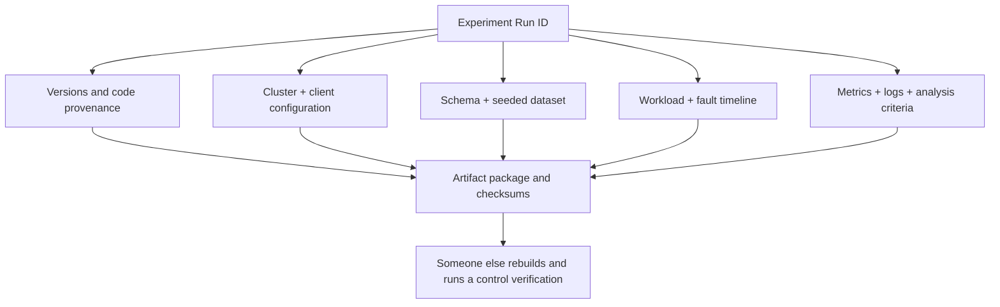

# Recording Versions, Configuration, Data, and Conditions to Reproduce Apache Cassandra Load and Fault Test Results

## 1. Reproducibility Is Part of Testing, Not an Afterthought

In the **DATABASE_ENGINE_WIDE_COLUMN_CASSANDRA** module, Apache Cassandra is a **distributed wide-column** database. The *partition key* determines data placement by token, **replication factor (RF)** determines replica count, and **consistency level (CL)** governs read/write acknowledgment conditions; query-driven table design, compaction, repair, schema, networking, and the Java Driver all shape latency.

Suppose a team reports:

> “After raising concurrency to 256, throughput jumped 35% with unchanged p99; when one node went DOWN, the system kept running.”

This report is **not yet reproducible or verifiable**. You need at least:

- Which exact Cassandra Server version, node count, DC/racks, and RF/CL?
- Which Java Driver / Spring Boot / JDK versions and retry/speculative execution policies?
- Which partition keys, CQL queries, row sizes, partition counts, hot-key skew, and TTL/tombstones?
- Did the workload send 256 **in-flight requests**, 256 **threads**, or 256 **operations/second**?
- Was p99 measured at the Java Driver, HTTP ingress, or a single coordinator attempt?
- Were timeouts, rejections, and pending requests included in the sample?
- When was the fault injected, targeting which node, for how long, and how was recovery confirmed?
- Does repeating the same test three times yield comparable distributions, or was it one lucky run?

**Goal of this lesson:** build an **experiment record** complete enough for someone else to reconstruct the **same meaningful conditions**, verify the dataset, run the same workload/fault, and explain any observed variance. Reproducibility does not mean two runs match **to the exact millisecond**: Cassandra and the OS have schedulers, GC, caches, compaction, and network timing that are never strictly deterministic.

This lesson belongs to the **Load and Distributed Fault Testing** chapter and focuses directly on **recording versions, configuration, data, and conditions for reproducible results**.

### Learning Objectives

After this lesson, you can:

1. Build a manifest for a load/fault run capturing **run ID**, code revisions, image digests, Cassandra/Driver/JDK versions, and topology.
2. Record full relevant **RF/CL, schema/compaction, retry/timeout, hardware, network, and JVM settings**.
3. Generate datasets with verifiable **seeds, sizes, partition-key distributions, timestamps/TTLs, and fingerprints**.
4. Define workloads, warm-up, open-loop/closed-loop pacing, fault phases, stop conditions, and measurement boundaries.
5. Measure and report **goodput, p50/p95/p99, error rate, queue wait, and `UNKNOWN` states** with clean boundaries.
6. Record fault timelines, recovery criteria, affected nodes/tokens, and pre/post cluster evidence.
7. Separate real measurements, illustrative assumptions, deliberate changes, confounding variables, and scope limits.
8. Structure an artifact package and checklist to re-run safely in CI/labs without affecting production.

## 2. Three Concepts: Repeatability, Reproducibility, and Comparability

| Concept | Question | Example in Cassandra |
| --- | --- | --- |
| **Repeatability** — repeating in the same environment | Do three runs on the same cluster/code produce similar metric distributions? | Identical RF=3, CQL, dataset, traffic, and config; p99 varies within explainable bounds |
| **Reproducibility** — rebuilding from artifacts | Can someone else stand up the environment from the manifest and run an equivalent test? | Uses pinned images/versions/configs/schema/seed/workload/fault scripts with checks |
| **Comparability** — fair comparison | Do before and after runs differ only in the target factor? | Comparing `LOCAL_ONE` vs `LOCAL_QUORUM` while holding row size, skew, node count, and workload fixed |

**Identical p99 numbers are not required** for a test to count as reproducible. What matters is having **methodology, inputs, observed distributions, and variance sources** clear enough to audit the conclusion.

For instance, changing partition bucketing may reduce p99. However, if the “after” run also shrank row size, weakened CL, and deleted 90% of rows, you **cannot credit the gain to bucketing**.

### 2.1. Five Mandatory Information Groups



Within each group, separate **intended settings**, **actually observed runtime values**, and **evidence**. Saving `application.yml` alone never proves runtime used those exact effective values.

## 3. Experiment IDs and Organizing a Run

Every execution should carry a unique run ID and a stable scenario identifier:

```text
experiment_id: cassandra-hot-partition-rf3-cl-localquorum
run_id: 2026-11-21T09-30-00Z_7f92c4d8
scenario: hot-partition-80pct
phase_set: baseline-warmup-fault-recovery
attempt: 2-of-5
```

**Experiment** describes the method and hypothesis. **Run** is one concrete execution with its own timestamps, variance, and artifacts. Never overwrite older runs just to “keep the latest report.”

Recommended metadata hierarchy:

| Field | Meaning |
| --- | --- |
| `experiment_id` | Repeatable experiment name run across iterations |
| `run_id` | Unique per-execution ID usable in metric tags and logs |
| `scenario_id` | Baseline, hot-key, wide-partition, tombstone, node-down |
| `attempt` / `repetition` | Iteration index inside an experimental design |
| `operator` / `ci_job_id` | Person or pipeline executing the run (never store secrets) |
| `started_at_utc` / `ended_at_utc` | Absolute wall-clock window |
| `git_commit` / `schema_version` | Exact code and DDL revision |
| `environment_id` | Test cluster/testbed and load-generator host |
| `outcome` | `PASS` / `FAIL` / `ABORTED` / `INCONCLUSIVE` per criteria |
| `artifact_manifest_sha256` | Integrity digest over the full evidence bundle |

### 3.1. Naming Rules and Scope

Test keyspace names (`load_it`), test nodes, and output filenames can reference `run_id`, yet **never spawn hundreds of keyspaces/schemas on a shared cluster**. Execute strictly in isolated environments with resource quotas.

Minimum artifacts per run should cover: *manifest*, *dataset descriptor*, *workload logs*, *metrics*, *fault events*, *schema/config fingerprints*, *correctness verification*, and *analysis notes*. No real customer data is required.

## 4. Recording Versions: Server, Driver, JDK, App, and Images

### 4.1. Which Versions Affect Results?

| Component | What to save | Why |
| --- | --- | --- |
| Cassandra Server | Exact version/build of **every node** and mixed-version state | Read/write paths, compaction, metrics, and limits differ across releases |
| Java Driver | Exact artifact group/version/module and request policy | Retries, paging, protocol, connection pools, routing |
| JDK / JVM | Vendor/build, `java -version`, GC, heap, JVM flags | GC pauses, allocation behavior, threads, TLS |
| Spring Boot / Data (if used) | Exact version, active profile, dependency lock/BOM | Object mapping, CQL generation, auto-configuration |
| Load generator | Commit/build/container digest/version | Key selection, throttling, and percentile math can change |
| Cassandra image | Tag **and digest** (or package build ID) | Image tags are mutable; digests pin exact bytes |
| OS / kernel / container runtime | Version, architecture, CPU/RAM limits | Scheduler, I/O, networking, cgroup throttling |
| Test / fault tool | Version, rule IDs, fault implementation | Pause/latency/drop semantics differ by tool |

**Never write “Cassandra 4.x” or “Java Driver latest”** and claim reproducibility. Save exact versions and, for containers, immutable digests.

### 4.2. Collecting Version Evidence from Runtime

Illustrative read-only inspection commands **in a lab**:

```bash
# Java on the application / load-generator host:
java -version

# Commit of the test harness currently running:
git rev-parse HEAD
git status --short

# Cassandra version via nodetool on a node:
nodetool version
nodetool status

# Container image digest via appropriate container runtime:
docker image inspect cassandra:4.1.6
```

These commands are illustrative. `docker image inspect` prints extensive metadata; extract reliable **repo digests / image IDs**, not tags alone. Never assume running `nodetool version` on Node A proves Nodes B and C run the exact same build.

Partial data is also visible via CQL:

```sql
SELECT host_id, cluster_name, data_center, release_version
FROM system.local;
```

`system.local` reflects the connected coordinator node; to verify **every node**, query each node or pull verified topology telemetry from cluster monitoring. Watch carefully for rolling upgrades causing mixed-version states.

### 4.3. Pinning Dependencies as a Contract

Upgrading the Java Driver, Netty, JDK, or Spring Data can shift tail latency even without application code changes. For reviewability, retain:

- Source code commits/hashes and build artifacts.
- Dependency lockfiles or resolved dependency trees.
- Container image digests for app and generator.
- Runtime JVM flags, GC configuration, and container resource limits.
- **Resolved** driver configuration across files, env vars, and overrides (secrets redacted).
- Deployment timestamps per node; confirm zero mixed-version drift.

Never dump raw credentials, tokens, truststore private keys, or secret-bearing environment variables into benchmark artifacts.

## 5. Cluster Configuration: Topology, RF/CL, and Server Settings

### 5.1. Topology and Replica Placement Are Mandatory Inputs

A `LOCAL_QUORUM` measurement means nothing without knowing RF and datacenter layout.

Example:

```text
cluster: cassandra-lab-3node
dc1:
  node-a, rack-a
  node-b, rack-b
  node-c, rack-c

keyspace replication:
  NetworkTopologyStrategy
  dc1: 3

read CL: LOCAL_QUORUM
write CL: LOCAL_QUORUM
serial CL (if LWT used): LOCAL_SERIAL
```

With RF(dc1)=3:

\[
\operatorname{quorum}=\left\lfloor\frac{3}{2}\right\rfloor+1=2
\]

`LOCAL_QUORUM` needs **two replicas in `dc1`**. Losing one node still lets the remaining two serve requests, yet if either survivor slows down, timeouts still occur.

Every manifest must record:

1. Internal node IDs/IPs (**anonymized** if published externally).
2. DC/rack layout and snitch placement.
3. Token ownership/vnodes and exact replicas owning tested partitions.
4. Node `UP`/`DOWN` states **before, during, and after** the run.
5. RF for the **actual keyspace**, not just cluster defaults.
6. CL **per query category**, plus serial CL for LWTs.
7. Java Driver coordinator/routing/load-balancing policy.
8. Whether bootstrap, streaming, repair, upgrade, or node replacement is active.

### 5.2. Schema and Table Options

Time-series table example:

```sql
CREATE KEYSPACE IF NOT EXISTS load_it
WITH replication = {
    'class': 'NetworkTopologyStrategy',
    'dc1': 3
};

CREATE TABLE IF NOT EXISTS load_it.events_by_device_day (
    device_id uuid,
    event_day date,
    event_ts timestamp,
    event_id uuid,
    payload text,
    state text,
    PRIMARY KEY (
        (device_id, event_day),
        event_ts,
        event_id
    )
) WITH CLUSTERING ORDER BY (
    event_ts DESC, event_id ASC
);
```

In a single-node lab, RF=3 must change to RF=1 with matching CL. **Never run code against a single node and claim RF=3 quorum verification.**

Schema attributes to save:

| Attribute | Why it impacts measurements |
| --- | --- |
| Partition key + clustering key | Routing, partition sizing, clustering scan order |
| Column types, frozen/collections/UDTs | Row size and codec cost |
| Compaction strategy/options | SSTable count, tombstone purging, disk I/O |
| Compression | CPU cost and disk read/write bytes |
| TTL / `default_time_to_live` | Tombstone creation lifecycle |
| `gc_grace_seconds` | Tombstone retention and repair deadlines |
| Indexes / materialized views (if any) | Write amplification and read path |
| Server speculative retry policy (if supported) | Extra replica read attempts and tail smoothing |
| Memtable / commit log / cache settings | Latency and memory footprint |
| Repair / compaction / flush state | Background state shifting over time |

**Never record only the initial `CREATE TABLE`**: later migrations may have executed `ALTER TABLE` or `ALTER ... WITH`. Export the **actual observed schema** and confirm it matches the expected migration revision.

### 5.3. Pre- and Post-Run Status Commands

```bash
nodetool status
nodetool describecluster
nodetool info
nodetool tpstats
nodetool compactionstats
nodetool netstats

# When targeting a specific table and supported by version:
nodetool tablestats load_it.events_by_device_day
nodetool tablehistograms load_it events_by_device_day
```

Command outputs and metric names vary across Cassandra releases; archive **timestamped raw text tagged with node names**, rather than a cropped screenshot. `nodetool status` reflects the queried node's view and does not by itself prove global cluster stability.

**Never force flushes or compactions between two runs just to make states “look alike” without logging it.** Flushing and compaction alter physical SSTable layout and may itself be an experimental factor. If normalization is genuinely needed, make it an explicit **reproducible preparation phase** with documented gates and effects.

## 6. Java Driver Configuration: Settings to Lock When Comparing

Identical `SELECT` queries behave differently under altered driver timeouts, retries, routing, or pools.

| Setting | What to record | Impact |
| --- | --- | --- |
| Local datacenter | `dc1` | Constrains coordinator routing inside local DC |
| Contact points | Endpoints / discovery config | Initial bootstrap and metadata fetch |
| Default / statement CL | `LOCAL_ONE`, `LOCAL_QUORUM`, etc. | Required replica acknowledgments |
| Serial CL | `LOCAL_SERIAL` / `SERIAL` for CAS | LWT consistency semantics and latency |
| Request timeout | Milliseconds and per-statement overrides | Distinguishes driver vs coordinator timeouts |
| Page size | Target rows/page and paging logic | Memory pressure and network round trips |
| Retry policy | Class/options + actual retries observed | Overload, tail latency, unknown write outcomes |
| Speculative execution | Enabled/disabled, policy parameters | Extra coordinator attempts and tail hedging |
| Idempotence metadata | `setIdempotent(true/false)` | Eligibility gate for driver retries/speculation |
| Connection / pool limits | Connections/streams/requests, queue caps | Client-side admission saturation |
| Execution profiles | Profile name used per statement | Effective settings can differ from defaults |
| Auth / TLS | Enabled state, cipher/protocol choices | Handshake/CPU overhead (never log secrets) |

**Never assume `setIdempotent(true)` makes a CQL mutation safe.** Blind retries on counter increments, list appends, LWTs, or external side effects cause corruption. Build explicit idempotency and reconciliation instead.

### 6.1. Example Query Specification in a Manifest

```yaml
queries:
  - id: read-latest-20
    cql: "SELECT event_ts, event_id, payload FROM load_it.events_by_device_day WHERE device_id = ? AND event_day = ? LIMIT 20"
    category: read
    consistency: LOCAL_QUORUM
    page_size: 100
    request_timeout_ms: 2000
    idempotent: true
    execution_profile: "read-profile"
    expected_rows_min: 1
    expected_rows_max: 20

  - id: upsert-event
    cql: "INSERT INTO load_it.events_by_device_day (device_id, event_day, event_ts, event_id, payload, state) VALUES (?, ?, ?, ?, ?, ?)"
    category: write
    consistency: LOCAL_QUORUM
    request_timeout_ms: 2000
    idempotent: false
    expected_effect: "one logical event keyed by device/day/ts/eventId"
```

This is an **illustrative manifest schema**, not a file parsed automatically by the Java Driver. Statement idempotence on the write is conservatively `false`; flip it to `true` only after verifying timestamps, TTLs, concurrent writers, and business semantics.

## 7. Datasets: Record Shape and Distribution, Not Just Row Count

Two “10-million-row” datasets can produce radically different workloads:

- Dataset A: 1 million partitions × 10 tiny rows, zero tombstones.
- Dataset B: 100 partitions × 100,000 wide rows, 80% covered by tombstones.
- Dataset C: many partitions, yet 90% of reads target one key.

**Total row count never characterizes workload difficulty.** Record partition cardinality, rows-per-partition distribution, bytes/row, time span, TTL/delete ratios, hot-key skew, and query patterns.

### 7.1. Dataset Manifest

```yaml
dataset:
  dataset_id: "events-fixture-v3"
  source_generator_commit: "<full-git-commit>"
  random_seed: 20261121
  dataset_generation_version: 3
  schema_migration_version: "V014"
  keyspace: load_it
  table: events_by_device_day

  partition_count: 10000
  rows_per_partition:
    distribution: fixed
    value: 200
  payload_bytes:
    distribution: fixed_ascii
    value: 256
  event_time:
    start_utc: "2025-03-01T00:00:00Z"
    interval_ms: 1000
    bucketing_timezone: UTC
  null_rate: 0.00
  ttl_seconds: null
  delete_fraction: 0.00
  hot_key:
    top_key_query_share: 0.05
    selection_algorithm: "seeded-prng-v1"

  expected_logical_rows: 2000000
  expected_partition_fingerprint: "<sha256-of-canonical-spec>"
  seed_completion_utc: "<observed-utc>"
  verification_status: "not-yet-verified"
```

`expected_partition_fingerprint` hashes the **logical dataset specification or verified canonical rows**, never raw SSTable files. Physical SSTables evolve during flushes and compaction even for identical logical contents.

### 7.2. Distinguishing RNG Seed from Dataset Fingerprint

- **RNG seed** makes a fixed generator algorithm produce a repeatable sequence.
- **Generator version** is essential: changing shuffle/hash code changes generated keys even with the same seed.
- **Fingerprint / hash** verifies the canonical manifest or verified dataset actually matches.
- **Verified readback** confirms rows landed in Cassandra under proper CL rather than merely proving the seeder called `executeAsync`.

**Never use `UUID.randomUUID()` per run** when tests require matching partition keys across executions. Use a seeded deterministic mapping from `device_index` and `event_index`.

### 7.3. Deterministic Java ID and Payload Generation

```java
import java.nio.charset.StandardCharsets;
import java.time.Instant;
import java.time.LocalDate;
import java.time.ZoneOffset;
import java.util.UUID;

public final class DeterministicEventFixture {

    private static final Instant BASE =
        Instant.parse("2025-03-01T00:00:00Z");

    public static UUID deviceId(int deviceIndex) {
        return UUID.nameUUIDFromBytes(
            ("device-v3-" + deviceIndex)
                .getBytes(StandardCharsets.UTF_8));
    }

    public static UUID eventId(int deviceIndex, int eventIndex) {
        return UUID.nameUUIDFromBytes(
            ("event-v3-" + deviceIndex + "-" + eventIndex)
                .getBytes(StandardCharsets.UTF_8));
    }

    public static Instant eventTime(int eventIndex) {
        return BASE.plusSeconds(eventIndex);
    }

    public static LocalDate eventDayUtc(Instant time) {
        return time.atZone(ZoneOffset.UTC).toLocalDate();
    }

    public static String payload(int bytes) {
        if (bytes < 1 || bytes > 1024) {
            throw new IllegalArgumentException("Out of lab bounds");
        }
        // ASCII: each 'x' occupies one UTF-8 byte.
        return "x".repeat(bytes);
    }

    private DeterministicEventFixture() { }
}
```

Identical `deviceIndex`, `eventIndex`, and generator code produce identical UUIDs, timestamps, and ASCII payloads. **Never equate** “identical logical rows” with “identical write timestamps and SSTable layout”: server/driver execution timing, compaction, and storage still vary. Whenever tests depend on explicit write timestamps or TTLs, record exactly how they are set and respect LWW rules.

### 7.4. Verifying Seed Completion

Mark a seed phase complete only when:

1. Every write future settled, with any failures classified and resolved safely.
2. Expected vs confirmed operation counts reconcile.
3. Sampled partitions verify expected keys, row counts, payloads, and attributes.
4. Where exact counts matter, verify via **bounded** queries/manifests rather than repeated wide `COUNT(*)` scans.
5. Schema, compaction, and repair state are logged prior to load measurements.
6. Any `WriteTimeout` or `DriverTimeout` mutations are **marked `UNKNOWN`**, never treated as “unwritten” for blind infinite retries.

### 7.5. Special Records for Tombstones and TTLs

For tombstone-heavy experiments:

```yaml
deletions:
  method: "per-row DELETE"
  rows_inserted: 2000
  rows_targeted_for_delete: 1800
  clustering_selection: "newest-by-event_ts"
  delete_completion: "all-acks-observed"
  ttl_variant: false
  gc_grace_seconds: "<actual-table-value>"
  compaction_state_before: "<captured>"
  compaction_state_after: "<captured>"
```

**Never jump from** “sent 1,800 `DELETE` statements” to “Cassandra holds 1,800 tombstones in SSTables.” Capture **tombstones scanned per read**, SSTable counts, and version-specific query behavior. Remember TTL expirations advance with real server wall-clock time, so elapsed wait periods between phases become part of dataset state.

## 8. Describing the Workload: Request Shape, Arrivals, Concurrency, and Think Time

### 8.1. Commonly Confused Terms

| Parameter | Accurate meaning |
| --- | --- |
| `total_requests` | Planned **logical operations** count |
| `offered_rps` | Target generation rate (open-loop) |
| `admitted_rps` | Rate passing admission control |
| `completed_rps` | Rate reaching terminal outcome |
| `successful_rps` / **goodput** | Valid operations completed accurately per second |
| `max_in_flight` | Max concurrent pending CQL requests (define exact scope) |
| `worker_threads` | OS threads, **not synonymous** with async in-flight concurrency |
| `think_time` | Simulated virtual-user pause between requests |
| `request_timeout_ms` | Deadline enforced by driver or app |
| `retry_attempts` | Technical extra attempts per logical operation |
| `page_size` | Driver fetch chunk size; **not** CQL `LIMIT` |
| `LIMIT` | Logical row cap in CQL; does not prevent tombstone scanning |

Two runs both claiming “concurrency=128”—where one spawns 128 synchronous worker threads while the other launches 128,000 unbounded async futures—are **not comparable**.

### 8.2. Closed-Loop vs Open-Loop

**Closed-loop:** submits a new request whenever one completes or frees an in-flight slot. This bounds memory easily, yet slower servers automatically throttle submission rate, inducing **coordinated omission** when evaluating SLOs against fixed arrival demand.

**Open-loop:** dispatches requests on an `offered_rps` schedule independent of completion time. Under overload, enforce **bounded queues**, explicit admission/rejection policies, and measure latency from scheduled arrival/ingress rather than post-slot wait alone.

For reproducibility, document:

- Workload model: open-loop vs closed-loop.
- Arrival distribution: constant, Poisson, bursty, or trace replay; include **seed**.
- In-flight caps and pending queue caps.
- Overload and failure-rate stop conditions.
- Synthetic generation vs production-shaped trace replay.
- Partition-key selection distribution per request.
- Expected pages, rows, and bytes per query.
- How driver retries/speculation and logical IDs are counted.

### 8.3. Phased Workload Timeline

A load-and-fault run can be structured into phases:

```text
T-120 s .. T0        Warmup: steady load excluded from primary stats
T0 .. T+120 s        Baseline steady-state
T+120 .. T+180 s     Fault active: one replica experiences network delay
T+180 .. T+300 s     Recovery: fault cleared, watch catch-up
T+300 .. T+420 s     Post-recovery steady-state
T+420 .. drain       Stop arrivals, drain in-flight within bounded deadline
```

These timings are **illustrative**, not rigid mandates. Experiments involving time-windowed TTLs or background compaction often need longer warm-up and recovery windows. Record **actual observed timestamps** for fault activation/verification rather than assuming scheduled markers equal reality.

## 9. Fault Injection: Log Intent, Events, and Observed State

A distributed fault test cannot simply say “node 2 down.” Reproducibility requires:

- **Fault type:** process stop, network latency, packet loss, partition, CPU contention, disk delay, simulated clock skew (strictly in authorized labs).
- **Target:** node, role, DC, rack, and whether it owns **replicas of tested partitions**.
- **Scope:** inbound vs outbound, client → coordinator vs coordinator → replica.
- **Parameters:** latency ms, jitter, loss %, bandwidth cap, duration; note tool-specific semantics.
- **Triggers:** wall-clock schedule or condition (“once baseline stabilizes”).
- **Actual start/stop:** when the fault tool confirms rules applied and cleared.
- **Observations:** node status, driver errors, CL behavior, queues, GC, repair/streaming.
- **Recovery gate:** node `UP`, schema/cluster agreement, backlog/compaction stabilization.
- **Safety controls:** target allowlists, abort thresholds, and rollback hooks.

### 9.1. Example Fault Event Log in JSON Lines

```json
{"run_id":"sample-001","event":"BASELINE_START","time_utc":"2026-11-21T09:00:00Z"}
{"run_id":"sample-001","event":"FAULT_SCHEDULED","time_utc":"2026-11-21T09:02:00Z","fault_id":"replica-delay-01"}
{"run_id":"sample-001","event":"FAULT_APPLIED","time_utc":"2026-11-21T09:02:01.240Z","fault_id":"replica-delay-01","target_alias":"node-b","parameters":{"direction":"replica-inbound","latency_ms":120,"jitter_ms":20}}
{"run_id":"sample-001","event":"FAULT_REMOVED","time_utc":"2026-11-21T09:03:01.740Z","fault_id":"replica-delay-01"}
{"run_id":"sample-001","event":"RECOVERY_CONFIRMED","time_utc":"2026-11-21T09:03:30Z","checks":["node-up","backlog-within-gate"]}
```

This is an **illustrative log**, not an executed fault. Use aliases when sharing externally, while retaining an internal encrypted alias → real-node mapping so internal engineers can reproduce runs.

### 9.2. Clocks and Time Measurements

- Use `Instant.now()` / UTC wall clock to **align multi-host timelines**; maintain NTP/clock sync and record clock offsets.
- Use `System.nanoTime()` to measure **in-process elapsed durations**, never comparing `nanoTime` values across separate JVMs.
- Format timestamps as ISO 8601 UTC (and timezone IDs if local bucketing applies).
- Record actual fault-applied timestamps since fault controllers incur setup lag.
- If clock skew is detected, never rewrite timestamps silently; log the measured offset/uncertainty for analysts.
- Never use CQL `now()` as an end-to-end latency clock: its boundary differs from client admission.

### 9.3. Failover Testing Requires Knowing Replica Placement

With `RF=3`, partition replicas follow token ranges and topology. Slowing **a node that does not own the partition** may bypass the tested path entirely. Record:

```text
partition_under_test:
  partition_key: "<anonymized or synthetic device/day>"
  token: "<actual-or-hashed-token-if-sensitive>"
  replicas_before_fault:
    - node-a
    - node-b
    - node-c
  fault_target: node-b
  is_target_replica: true
  coordinator_candidates: "<observed>"
```

Verify placement via driver token-map metadata or version-appropriate Cassandra commands instead of guessing from hostnames.

**Safety boundaries:** never run fault injection against production or arbitrary user-supplied addresses. Testbeds require allowlists, time quotas, cleanup automation, and formal approval. Destructive network/process kill commands are omitted here because recovery paths vary by infrastructure.

## 10. Measurement Contract: How Metrics Are Calculated

### 10.1. Goodput and Error-Rate Denominators

Suppose a 60-second run observes:

```text
Offered logical requests:   10,000
Admitted requests:           9,600
Rejected before send:          400
Completed CQL operations:    9,200
  Success:                   9,000
  Error/timeout:               200
Still in-flight at cutoff:     400
```

Illustrative calculations:

\[
\mathrm{goodput}=\frac{9000}{60}=150\ \mathrm{successful\ ops/s}
\]

\[
\mathrm{completion\ error\ rate}=\frac{200}{9200}\approx2.17\%
\]

\[
\mathrm{admission\ rejection\ rate}=\frac{400}{10000}=4\%
\]

\[
\mathrm{success\ over\ offered}=\frac{9000}{10000}=90\%
\]

**Note:** the 400 in-flight requests at cutoff are **not yet successes or failures** until drained and classified. Truncating measurement cleanly and dropping them from denominators artificially flatters error rates. Record pending count, drain/timeout policy, and true stop time.

### 10.2. Latency Percentiles

Separate at minimum:

1. **Driver request latency:** `execute`/`executeAsync` call to terminal outcome/error.
2. **Logical operation latency:** may span retries, multi-page iteration, and app logic.
3. **End-to-end latency:** measured from ingress/arrival, including admission queue wait, serialization, and response encoding.

Under a shared definition:

- `p50`: 50% of samples are at or below this value.
- `p95`: 95% are at or below this value.
- `p99`: 99% are at or below this value.

Report **success latency** alongside **failed/timed-out latency**. Strong success-only p99 means little if 25% of requests timed out.

**Never compare async “first-page-only” p99 with synchronous “drain-all-pages” p99.** Whenever business completion requires consuming multiple pages, measure until full consumption finishes.

### 10.3. Per-Phase Metrics

Segment metrics by `baseline`, `fault_active`, `recovery`, and `post_recovery`. Because exporters lag slightly, record sampling intervals, exporter versions, and scrape delays.

| Metric | Role | Additional context to save |
| --- | --- | --- |
| E2E p50/p95/p99 | User experience | Measurement boundary and histogram config |
| Goodput + completion/error/rejection | Effective capacity | Denominators and in-flight pending |
| Retry / speculative attempts | Load amplification | Attempts per logical operation |
| `Unavailable` / `ReadTimeout` / `WriteTimeout` / `DriverTimeout` | Failure breakdown | CL, statement, coordinator |
| Java heap/RSS, threads, GC | Client saturation | JVM flags, container limits |
| Node CPU/disk/network/GC | Server saturation | Node/DC/rack labels |
| Server read/write latency | Storage/coordinator path | Node and operation type |
| Tombstones scanned / SSTables per read | Read amplification | Version-exact metric names |
| Compaction pending/active | Background noise and disk pressure | Strategy + table |
| Repair/streaming state | Data consistency context | Execution window |
| Queue depth / in-flight / admission wait | Backpressure | Client / load generator |
| Replica status / schema agreement | Fault/recovery health | Full UTC timeline |

### 10.4. Histogram Data

Average latency can look flat while tail p99 spikes. When exporting Prometheus, Micrometer, or HdrHistogram data:

- Record histogram implementation, buckets, resolution, and observation count.
- Pick bucket granularity matching SLOs (e.g., millisecond-level around SLO bounds), avoiding coarse buckets that hide 5 ms p99 shifts.
- Avoid storing millions of raw boxed `Long` timestamps on the JVM heap just to sort percentiles.
- Archive raw/aggregated histograms per phase rather than relying solely on dashboard screenshots.
- Across multiple nodes/replicas, never take the arithmetic mean of per-node `p99` values and report it as cluster-wide `p99`.

## 11. Java Driver 4.x: Recording Timing, Outcomes, and Key Distributions Safely

Changes inside a load generator between runs easily invalidate comparisons. The example below executes **partition-key reads**, caps concurrency at `16` in-flight CQL requests, pins the RNG seed, tracks successes/failures, and records latency. It does **not** inject faults itself; a separate controller logs the fault timeline.

### 11.1. Request and Fixture Design

Assumes `load_it.events_by_device_day` is preloaded for 64 devices on `2025-03-01`. Query under test:

```sql
SELECT event_ts, event_id
FROM load_it.events_by_device_day
WHERE device_id = ?
  AND event_day = ?
LIMIT 20;
```

Attach `run_id` to logs and metrics; select every key from pre-seeded, verified synthetic IDs rather than generating non-existent random UUIDs mid-test when benchmarking read hits.

### 11.2. Bounded Java Harness Example with Manifest Output

```java
import java.net.InetSocketAddress;
import java.time.Duration;
import java.time.Instant;
import java.time.LocalDate;
import java.util.ArrayList;
import java.util.Collections;
import java.util.List;
import java.util.Random;
import java.util.UUID;
import java.util.concurrent.CountDownLatch;
import java.util.concurrent.Semaphore;
import java.util.concurrent.TimeUnit;
import java.util.concurrent.atomic.AtomicInteger;

import com.datastax.oss.driver.api.core.CqlSession;
import com.datastax.oss.driver.api.core.DefaultConsistencyLevel;
import com.datastax.oss.driver.api.core.cql.PreparedStatement;

public final class ReproducibleReadRun {

    private static final int REQUESTS = 2_000;
    private static final int MAX_IN_FLIGHT = 16;
    private static final long RNG_SEED = 20261121L;
    private static final LocalDate DAY =
        LocalDate.parse("2025-03-01");

    static void run(CqlSession session, List<UUID> seededKeys,
            String runId) throws InterruptedException {

        if (seededKeys.size() != 64
                || seededKeys.stream().distinct().count() != 64) {
            throw new IllegalArgumentException(
                "Requires exactly 64 pre-seeded fixture partition keys");
        }

        PreparedStatement select = session.prepare(
            "SELECT event_ts, event_id " +
            "FROM load_it.events_by_device_day " +
            "WHERE device_id = ? AND event_day = ? LIMIT 20");

        Random random = new Random(RNG_SEED);
        Semaphore permits = new Semaphore(MAX_IN_FLIGHT);
        CountDownLatch done = new CountDownLatch(REQUESTS);
        AtomicInteger succeeded = new AtomicInteger();
        AtomicInteger failed = new AtomicInteger();
        List<Long> successLatencyNs =
            Collections.synchronizedList(
                new ArrayList<>(REQUESTS));

        Instant wallStartUtc = Instant.now();
        long runStart = System.nanoTime();

        // Closed-loop: at most MAX_IN_FLIGHT requests pending at once.
        for (int i = 0; i < REQUESTS; i++) {
            permits.acquire();
            UUID deviceId =
                seededKeys.get(random.nextInt(seededKeys.size()));
            long requestStart = System.nanoTime();

            try {
                session.executeAsync(
                    select.bind(deviceId, DAY)
                        .setConsistencyLevel(
                            DefaultConsistencyLevel.LOCAL_ONE)
                        .setPageSize(100)
                        .setTimeout(Duration.ofSeconds(2))
                        .setIdempotent(true))
                    .whenComplete((page, error) -> {
                        try {
                            if (error == null && page != null
                                    && page.currentPage()
                                        .iterator().hasNext()) {
                                succeeded.incrementAndGet();
                                successLatencyNs.add(
                                    System.nanoTime() - requestStart);
                            } else {
                                failed.incrementAndGet();
                            }
                        } finally {
                            permits.release();
                            done.countDown();
                        }
                    });
            } catch (RuntimeException error) {
                failed.incrementAndGet();
                permits.release();
                done.countDown();
            }
        }

        if (!done.await(60, TimeUnit.SECONDS)) {
            throw new IllegalStateException(
                "Run timeout: unclassified requests still outstanding");
        }

        long totalNs = System.nanoTime() - runStart;
        Instant wallEndUtc = Instant.now();
        Collections.sort(successLatencyNs);

        double seconds = totalNs / 1_000_000_000.0;
        System.out.printf(
            "run=%s start=%s end=%s model=closed-loop " +
            "requests=%d maxInFlight=%d rngSeed=%d " +
            "ok=%d failed=%d goodput=%.1f/s%n",
            runId, wallStartUtc, wallEndUtc,
            REQUESTS, MAX_IN_FLIGHT, RNG_SEED,
            succeeded.get(), failed.get(),
            succeeded.get() / seconds);

        if (!successLatencyNs.isEmpty()) {
            System.out.printf(
                "run=%s successP50Ms=%.2f " +
                "successP95Ms=%.2f successP99Ms=%.2f%n",
                runId,
                percentileMs(successLatencyNs, 0.50),
                percentileMs(successLatencyNs, 0.95),
                percentileMs(successLatencyNs, 0.99));
        }
    }

    private static double percentileMs(
            List<Long> sorted, double quantile) {
        int index = (int) Math.ceil(
            quantile * sorted.size()) - 1;
        index = Math.min(sorted.size() - 1, Math.max(0, index));
        return sorted.get(index) / 1_000_000.0;
    }

    public static void main(String[] args) throws Exception {
        String runId = "sample-repro-read-v1";
        List<UUID> keys = loadVerifiedFixtureKeys();

        // Connect ONLY to a LAB Cassandra cluster after verifying endpoint/DC.
        try (CqlSession session = CqlSession.builder()
                .addContactPoint(
                    new InetSocketAddress("127.0.0.1", 9042))
                .withLocalDatacenter("datacenter1")
                .build()) {
            run(session, keys, runId);
        }
    }

    // Placeholder: replace with actual pre-seeded fixture IDs in fixed order.
    private static List<UUID> loadVerifiedFixtureKeys() {
        throw new UnsupportedOperationException(
            "Must seed and pin 64 fixture IDs prior to benchmark");
    }
}
```

**Limitations of this example (must be disclosed in reports):**

1. `loadVerifiedFixtureKeys()` is a **stub**; callers must supply 64 pre-seeded, verified IDs in fixed order. Never claim this is a complete standalone project without dependencies and helpers.
2. `LOCAL_ONE` targets a **single-node RF=1 lab**, not production RF=3 `LOCAL_QUORUM`. When changing topology, update RF/CL and document both in the manifest.
3. `REQUESTS=2,000`, `MAX_IN_FLIGHT=16` act as bounds; latency starts **after acquiring a permit**, omitting admission wait. Real API SLO evaluation must capture queue wait from ingress.
4. Because it is **closed-loop**, offered rate depends on server latency; reproducing overload requires a dedicated open-loop generator.
5. `successLatencyNs` tracks only successes with rows on page one. Reports **must** include failed counts, and real suites should track failure/timeout histograms with bounded histograms (like HdrHistogram) rather than an in-memory `List<Long>`.
6. `currentPage().iterator().hasNext()` only checks for a row on the **first page**, ignoring full payloads and subsequent pages. Add complete correctness/row checks whenever logical completion spans multiple pages.
7. Inside `whenComplete`, `error` may wrap the root cause in `CompletionException`; production harnesses must unwrap, classify, and tally by exact exception type.
8. If `done.await` times out, in-flight requests are still outstanding: **never** claim they weren't dispatched. Stop/drain/cancel cleanly per policy and report incomplete counts.
9. Running identical code on different hosts still differs in scheduling and GC; fixed seeds never guarantee identical latencies.

### 11.3. Extending Writes to Capture Unknown Outcomes

For read-only `SELECT`, conditional retries are straightforward to interpret. For `INSERT`/`UPDATE` hitting `WriteTimeout` or driver timeouts, writes **may have applied** despite missing ACKs. To benchmark writes properly:

- Keep **logical operation IDs** stable.
- Separate **physical attempts** from **logical business operations**.
- Classify outcomes as `CONFIRMED` / `UNKNOWN` / `FAILED_CONFIRMED` per protocol guarantees.
- Never treat `setIdempotent(true)` as an exactly-once guarantee.
- Reconcile after the run to verify fixtures and invariants.
- Never truncate or reset tables while async writes remain in-flight.

A benchmark claiming “10,000 writes/s” without verifying persistence and CL might simply be counting dispatched calls.

## 12. Full Manifest: Sample YAML for One Run

A manifest captures both **planned configuration** and **observed** metrics/artifacts. The sample below is an **educational template with placeholders**, not an executed run:

```yaml
schema_version: 1
experiment_id: "cassandra-node-delay-rf3-lq"
run_id: "2026-11-21T09-30-00Z_7f92c4d8"
status: "PLANNED"
operator_or_ci_job: "<internal-id>"
started_at_utc: null
ended_at_utc: null

source:
  application_git_commit: "<full-sha>"
  generator_git_commit: "<full-sha>"
  schema_migration_version: "<version>"
  migration_sha256: "<sha256>"
  generator_image_digest: "<digest>"

versions:
  cassandra_nodes:
    node_a: "<exact-server-build>"
    node_b: "<exact-server-build>"
    node_c: "<exact-server-build>"
  java_driver_group: "<artifact-group>"
  java_driver_version: "<exact-version>"
  jdk_vendor_build: "<exact-build>"
  spring_boot_version: null
  test_tool_version: "<exact-version>"
  fault_tool_version: "<exact-version>"
  os_kernel: "<version>"
  container_runtime: "<version>"

topology:
  cluster_id: "cassandra-lab-3node"
  datacenters:
    dc1:
      racks: ["rack-a", "rack-b", "rack-c"]
      node_count: 3
  snitch: "<snitch-class>"
  token_and_replica_mapping_artifact: "topology/replicas.json"
  keyspace: load_it
  replication_strategy: NetworkTopologyStrategy
  rf_by_dc:
    dc1: 3
  expected_live_replicas_before: 3

schema:
  table: events_by_device_day
  ddl_artifact: "schema/expected.cql"
  observed_schema_artifact: "schema/observed.json"
  compaction_class: "<actual-strategy>"
  compression: "<actual-option>"
  default_ttl_seconds: 0
  gc_grace_seconds: "<actual-number>"
  schema_agreement_before: null

client:
  local_datacenter: dc1
  consistency:
    read: LOCAL_QUORUM
    write: LOCAL_QUORUM
    serial: null
  request_timeout_ms: 2000
  page_size: 100
  retry_policy: "<class-and-options>"
  speculative_execution: "<enabled-and-options>"
  pool_config_artifact: "client/resolved-config-redacted.txt"
  app_heap_mb: 1024
  gc_algorithm: "<algorithm>"
  container_cpu_limit: "<cpu-units>"
  container_memory_mb: "<memory-mb>"

dataset:
  id: events-fixture-v3
  seed: 20261121
  generator_version: 3
  device_count: 10000
  rows_per_device_day: 200
  payload_bytes: 256
  event_timestamp_origin_utc: "2025-03-01T00:00:00Z"
  ttl_seconds: null
  delete_fraction: 0.0
  fixture_manifest_sha256: "<sha256>"
  verified_rows: null
  verification_artifact: "dataset/verification.json"

workload:
  model: open_loop
  offered_rps: 1000
  arrivals: constant
  arrival_seed: 42
  max_in_flight: 128
  max_pending_queue: 256
  warmup_seconds: 120
  baseline_seconds: 120
  fault_seconds: 60
  recovery_seconds: 120
  query_mix:
    read_latest: 0.95
    upsert_event: 0.05
  hot_key_share: 0.05
  operation_definition: "one request/response, read first page"
  success_definition: "successful response plus expected row checks"
  timeout_and_drain_policy: "<documented>"

fault:
  id: replica-delay-01
  type: network_latency
  target_alias: node-b
  target_is_replica: true
  latency_ms: 120
  jitter_ms: 20
  planned_start_after_baseline_seconds: 120
  apply_and_remove_log: "faults/events.jsonl"
  rollback_verified: null

observability:
  time_sync_status: "<measured>"
  metrics_sampling_seconds: 5
  latency_histogram_spec: "<tool-and-buckets>"
  driver_request_log_values_enabled: false
  metrics_artifact: "metrics/timeseries.jsonl"
  result_summary_artifact: "results/summary.json"
  server_logs_redacted: "logs/"
  nodetool_snapshots: "cluster/"

gates:
  stop_if_node_not_up_unexpectedly: true
  max_error_rate_fraction: 0.10
  max_disk_usage_fraction: 0.80
  max_duration_seconds: 900
  require_all_async_requests_accounted_for: true

observed:
  admitted: null
  rejected: null
  completed: null
  succeeded: null
  errored: null
  pending_at_cutoff: null
  p99_end_to_end_ms: null
  goodput_ops_sec: null
  aborted_reason: null
  recovery_confirmed_at_utc: null
```

**Not every field applies to every scenario.** Pure-read tests don't need `serial CL`, and RF=1 tests shouldn't declare RF=3 replica targets. Mark non-applicable fields clearly as `null` or `not_applicable` instead of inventing dummy values.

A manifest missing filled-in **observed** fields is only a test plan—attach executed artifacts and verification before claiming results.

## 13. Evidence Package: Artifacts to Retain

Illustrative output bundle layout for a single run:

```text
results/
  2026-11-21T09-30-00Z_7f92c4d8/
    manifest.yaml
    checksums.sha256
    schema/
      expected.cql
      observed.json
      migrations.json
    versions/
      dependencies.txt
      images.txt
      runtime.txt
    topology/
      nodes.json
      replicas.json
      nodetool-before.txt
      nodetool-during.txt
      nodetool-after.txt
    client/
      resolved-config-redacted.txt
    dataset/
      generator-spec.yaml
      verification.json
      sample-keys-hashed.txt
    workload/
      phase-plan.yaml
      offered-admitted-completed.jsonl
    faults/
      events.jsonl
      recovery-checks.json
    metrics/
      latency-histogram.hdr
      timeseries.jsonl
      phase-summary.json
    logs/
      application-redacted.log
      cassandra-redacted.log
    analysis/
      conclusions.md
      limitations.md
```

This is a **lesson reference structure**, not an instruction to create these directories inside this module. Every real artifact should retain:

- Filename, UTC timestamp, and **SHA-256 hash** wherever feasible.
- Log/metric schemas and exporter versions.
- Source machine/container/node alias.
- UTC timezone and sampling interval.
- Explicit explanation for any missing, sampled, or redacted artifacts.

### 13.1. Checksums Do Not Prove Data Correctness

Checksums verify files **were not altered** after capture; they **never prove** datasets seeded properly or metrics were accurate. Combine:

- `manifest.yaml` ↔ schema and config version verification.
- `dataset/verification.json` ↔ expected counts and key samples.
- `metrics` ↔ load-generator counters and server telemetry.
- `faults/events.jsonl` ↔ node state/logs confirming fault activation.
- `checksums.sha256` ↔ artifact integrity.

### 13.2. Secrets and Sensitive Data

Never archive:

- Cassandra passwords/credentials, session tokens, or TLS private keys.
- Sensitive raw bind values, real customer IDs, or payment tokens.
- Full environment dumps containing secrets or real user request payloads.

Retain **aliases/pseudonyms, hashes of synthetic IDs**, redacted configs, and non-sensitive key names. To mimic real distributions without leaking PII, generate **synthetic datasets** matching real shapes.

## 14. Confounding Variables You Cannot Ignore

### 14.1. Caching and Warm-Up

Repeated reads speed up via OS page cache, row cache, key cache, and JVM JIT warmup. Document:

- Cold start vs warm cache?
- Warm-up duration and key distribution used?
- Cache configuration and whether working set fits in RAM?
- Any reboots, flushes, or compactions between runs?
- Did multiple clients share warm-up?

Never compare “pre-warmup” with “post-warmup” and credit a code change.

### 14.2. Compaction, Repair, and Tombstone Lifecycles

Cassandra background jobs continuously shift latencies and physical layouts. Record:

- Compaction strategy, active/pending compactions, and timing relative to measurement windows.
- Repair schedules/status, streaming, or bootstrap activity.
- Whether seeded rows remain in memtables or flushed to SSTables.
- Whether TTLs expired or tombstones became eligible for purge.
- SSTables per read and partition-size estimates.

When benchmarking tombstones, snapshot cleanly **before DELETE, after DELETE, and after compaction if triggered**. **Never arbitrarily drop `gc_grace_seconds`** or force production compactions just to “tidy test conditions.”

### 14.3. Cross-Traffic and Infrastructure Limits

Even dedicated test clusters experience:

- Backup/snapshot jobs, background compaction, and monitoring overhead.
- Container CPU throttling, memory pressure, and noisy neighbors.
- Network congestion, DNS/TLS handshakes, and TCP retransmissions.
- Client and server JVM GC pauses.
- Altered hot-partition skew if RNG/fixtures drift.
- Driver retry attempts outnumbering logical operations.
- Disk caches/temp volumes, newly resized volumes, or differing filesystems.

**Whenever confounding noise intrudes during measurement**, log it and mark the run `INCONCLUSIVE` if effects cannot be isolated. Never quietly prune bad points out of histograms.

### 14.4. Randomizing Execution Order and Repeating Runs

A/B comparisons frequently suffer ordering bias (A runs cold, B runs warm). Mitigate by:

1. Running at least a solid baseline plus multiple repetitions per budget.
2. Counterbalancing A/B ordering (e.g., ABBA or seeded randomized ordering).
3. Waiting for cluster recovery gates between runs.
4. Holding data/schema fixed or regenerating deterministically per manifest.
5. Reporting cross-run variance instead of picking a single best p99.

**Percentiles estimate distribution tails.** With small sample counts, p99 fluctuates heavily. Never proclaim a 3% p99 drop statistically significant from a few hundred samples inside a noisy CI runner.

## 15. Controlled Before/After Comparisons

### 15.1. Isolate a Single Intentional Change

Example hypothesis:

> Partitioning events by `(device_id, event_day)` reduces latest-event read p99 compared to multi-month single partitions.

**Hold constant:**

- Cassandra Server, Java Driver, JDK, node count, DC/racks, RF/CL.
- Logical event counts, row sizes, and device ID distributions.
- Queries returning identical business data.
- Concurrency/offered load, retries, timeouts, and page sizes.
- Hardware, disks, networking, and compaction strategy (unless compaction itself is **the variable under test**).
- Warm-up duration and histogram configuration.

**Variable under test:** partition schema (unbucketed vs daily bucket). Note that changing schemas can change **query shapes**; account for read fan-out, queries per logical operation, merge latency, and late-arriving data. Never compare one single-shard query on the new schema against a complete multi-day read on the old schema unless both satisfy the identical business result.

### 15.2. Illustrative Data Table — Not Real Benchmark Numbers

| Run | Schema | Goodput | E2E p50 | E2E p95 | E2E p99 | Error % | Node disk util |
| --- | --- | ---: | ---: | ---: | ---: | ---: | ---: |
| A1 | Unbucketed | 950 ops/s | 18 ms | 55 ms | 170 ms | 0.2% | 68% |
| B1 | Bucketed | 980 ops/s | 17 ms | 45 ms | 125 ms | 0.2% | 61% |
| B2 | Bucketed | 975 ops/s | 18 ms | 49 ms | 133 ms | 0.3% | 65% |
| A2 | Unbucketed | 930 ops/s | 20 ms | 60 ms | 186 ms | 0.3% | 72% |

**All numbers above are synthetic practice data.** They alone cannot prove production improvements—reports still need sample counts, percentile methodology, error accounting, repeat variance, CPU/disk telemetry, and verified query correctness.

### 15.3. When Should You Report “Not Reproduced”?

A run failing to reproduce a p99 spike may stem from:

- Load staying below saturation thresholds.
- Datasets missing the hot keys or tombstone density of the real incident.
- Different predicates, page sizes, or consistency levels.
- Different cache warmth or compaction states.
- Fault targeting a node not owning the tested partition's replicas.
- Different coordinator routing, racks, or DCs.
- Different client timeouts or retry policies.
- An RF=1 lab missing multi-replica quorum dynamics.

State **“not reproduced under conditions X, Y, Z”**—never claim “the bug is proven non-existent.”

## 16. Qualitative Failure Reporting: Unknown Outcomes and Consistency

### 16.1. Never Misclassify Timeouts

| Error | Valid inference | Invalid conclusion |
| --- | --- | --- |
| `UnavailableException` | Coordinator saw insufficient live replicas for the attempt's CL | Data has been lost |
| `ReadTimeoutException` | Insufficient read responses/data arrived before deadline | Row does not exist |
| `WriteTimeoutException` | Insufficient write ACKs arrived before deadline | Mutation definitely did not apply |
| `DriverTimeoutException` | Client exceeded request deadline | Coordinator never received or forwarded write |
| Network error with write in-flight | Client lost connection | Zero server-side effects occurred |

For **write load tests**, alongside raw attempts and successes, report:

- Planned logical request IDs count.
- IDs confirmed committed per CL contract.
- IDs left `UNKNOWN` after timeouts.
- Reconciliation method (readback, LWT, or business source of truth).
- Duplicate or conflicting effects detected.
- Timestamp when `UNKNOWN` operations resolved post-recovery.

Without tracking this, a test claiming “retries boosted write throughput” might simply be creating **duplicate records**.

### 16.2. Workload Correctness Verification

If a client executes `LIMIT 20` and checks only HTTP 200 without verifying rows match the requested device/day, tests can “pass” despite broken models or queries.

Reliable benchmarks verify **appropriate correctness guarantees**:

1. Valid schema and partition keys.
2. Verified pre-seeded fixtures.
3. Queries return accurate rows, fields, and sort order.
4. Zero unexpected duplicates or missing rows under declared consistency contracts.
5. Proper failure classification without turning timeouts into “not found.”

You don't need heavy full-payload assertions inside every single hot-path request if that distorts latency; run an independent sampled check or dedicated reconciliation phase documented in the manifest.

## 17. Runbook: From a Surprising Result to a Reproducible Bundle

### Phase A — Define Question and Hypothesis

1. Frame the problem: did `events_by_device_day` read p99 spike when one replica slowed, or did write throughput collapse on a hot partition?
2. Lock a falsifiable hypothesis: e.g., “80% of reads hitting one partition saturate its token-owning replicas.”
3. Identify the **independent variable**, fixed controls, output metrics, and PASS/FAIL/INCONCLUSIVE gates.
4. Lock an isolated test environment, resource quotas, and stop conditions—never probe production directly.
5. Assign `experiment_id`, `run_id`, and exact scope.

### Phase B — Freeze Versions, Config, and Dataset

1. Capture code commits/builds, image digests, per-node server versions, and driver/JDK versions.
2. Export DC/rack topology, node health, token maps, RF/CL, and redacted resolved server/driver configs.
3. Archive DDL, migration versions, and observed schema metadata.
4. Use versioned generators + RNG seeds for deterministic fixtures; record counts, distributions, and hashes.
5. Seed data, await completion, verify readbacks, schema agreement, and cluster health.
6. Log warm/cold cache states, compaction/repair/flush baseline, CPU/disk/RAM, and time sync.

### Phase C — Execute Along a Gated Timeline

1. Start telemetry and logging, recording UTC timestamps and sampling intervals.
2. Run warm-up with the target workload, isolating its metrics from steady baseline stats.
3. Run baseline, archiving offered/admitted/completed counts, histograms, and server stats.
4. Inject the allowlisted fault **in the testbed**, logging actual applied event + state checks.
5. Run the fault window, logging exceptions, CL, retry attempts, and node states.
6. Clear the fault, log actual removal time, await recovery gates, and record backlogs/repair/compaction.
7. Stop request dispatch, **drain** within deadlines, and classify pending/`UNKNOWN` outcomes.
8. Archive observed manifests, artifacts, and SHA-256 checksums.

### Phase D — Analyze and Repeat

1. Confirm complete datasets and accurate query semantics.
2. Compare per-phase p50/p95/p99, goodput, errors/rejections/pending, server load, and tombstone/partition stats.
3. Flag confounding noise or missing artifacts; mark `INCONCLUSIVE` whenever isolation failed.
4. Repeat runs with the exact manifest (new `run_id`) to quantify cross-run variance.
5. In A/B tests, hold everything else fixed and counterbalance run order where feasible.
6. Publish conclusions citing hypothesis, evidence, limitations, and artifact paths.
7. Promote to production only under dedicated, approved canary and safety runbooks.

## 18. Common Mistakes When Trying to “Reproduce”

| Mistake | Why it invalidates the test | Fix |
| --- | --- | --- |
| Writing “Cassandra 4.x” | Patch/minor builds differ | Record exact version per node |
| Saving image tag without digest | Mutable tags change bytes | Pin image digest / build ID |
| Omitting Java Driver retry policy | Attempt counts and p99 shift | Save resolved configs and attempts |
| Recording node count only | Hides RF, DCs/racks, tokens, replicas | Record full topology and keyspace RF |
| Copying `LOCAL_QUORUM` onto RF=1 | Single-node quorum ≠ RF=3 quorum | Record real RF/CL; never extrapolate failover |
| Logging total row count alone | Hides partition skew and wide rows | Log rows/partition distributions and hot keys |
| Minting fresh random UUIDs per run | Shifts dataset and token ring load | Pin seed, generator version, and fingerprints |
| Changing TTL and claiming same data | Tombstones and read paths differ | Record TTLs, deletes, and compaction state |
| Omitting warm-up / cache state | Later runs ride warmer caches | Document warm-up and reset steps |
| Measuring success-only latency | Ignores timeout tail | Report errors/pending and failure histograms |
| Counting raw attempts as goodput | Retries inflate attempt volume | Count logical operations and goodput |
| Using overly coarse histogram buckets | Masks small p99 regressions | Document histogram tool and resolution |
| Saying “Node DOWN” without target tokens | Fault may miss the tested partition's replicas | Log replica placement and fault target |
| Measuring nanoseconds via wall clock | NTP adjustments jump wall time | Use `nanoTime` in-process; UTC for timelines |
| Omitting actual fault-apply timestamp | Scheduled time lags actual effect | Log confirmed applied/removed events |
| Comparing hot-key run to different dataset | Confounds skew with dataset change | Hold row size, count, and keys fixed except target factor |
| Taking one dashboard screenshot | Leaves zero raw data for re-analysis | Export raw time series and histograms |
| Ignoring active background compaction | Creates massive latency noise | Record compaction phase/metrics; re-run if needed |
| Lacking stop conditions | Risks damaging shared testbeds | Enforce quotas, allowlists, abort/rollback hooks |
| Testing with production customer data | Safety and privacy violations | Build privacy-safe synthetic distributions |
| Marking “PASS” with missing logs/verifies | Unauditable claims | Require `FAIL` or `INCONCLUSIVE` per quality gate |

## 19. Scenario Exercises

### Exercise 1 — Reproducing Quorum Behavior

Report A states: “`LOCAL_QUORUM` still succeeded while one node was DOWN.” Your lab runs a single RF=1 Cassandra container with `LOCAL_QUORUM`, and 100% of queries pass.

1. Does this lab prove Report A holds in production RF=3?
2. Which topology fields must be recorded to verify?
3. Design a testbed with proper replicas plus matching fault and verification gates.
4. How do you confirm the faulted node **genuinely owns replicas** of the read partition?

**Hint:** No. RF=1 quorum only needs one replica. You need multi-node RF=3, token/replica maps, DC/rack layout, verified fault target, and real CL.

### Exercise 2 — Two Different 1-Million-Row Datasets

- Dataset A: 100,000 partitions × 10 rows.
- Dataset B: 100 partitions × 10,000 rows.
- Both hold 1 million rows with 256-byte payloads.

1. Why can these two runs show sharply different read latencies?
2. Which additional distribution details must the manifest capture?
3. Would a `LIMIT 20` query react identically if one partition held heavy tombstones?
4. How do you verify datasets without running constant `COUNT(*)` scans?

**Hint:** Partition distribution, clustering ranges, tombstone scans, and SSTables per read differ completely. Record rows/partition histograms, hot-key shares, and TTL/deletes; verify via manifests and sampled partition reads.

### Exercise 3 — Unintentional Driver Version Drift

Run A used Java Driver `4.x.y`; Run B updated a transitive dependency while team notes still said “Java Driver 4.x.” Observed p99 dropped 12%.

1. Is there enough proof to credit the new data model?
2. Which exact artifacts/versions must be pinned?
3. If retry or speculative configs shifted, how could throughput and p99 change?

**Hint:** Not enough evidence; lock full resolved dependency graphs, exact driver builds, request configs, attempt counts, server builds, and confirm workloads stayed fixed.

### Exercise 4 — Clock Drift in Fault Timelines

The fault injector logs `09:03:00Z` while the load generator logs a p99 spike at `09:02:59Z`; the two hosts have 3 seconds of clock skew.

1. Can you conclude the spike started **before** the fault?
2. How should you record clock sync/offsets and confirmed applied events?
3. For measuring Java request durations, pick `Instant.now` or `System.nanoTime`?

**Hint:** Unsynchronized timestamps cannot establish exact cross-host order. Record UTC plus measured offsets for timelines; use `System.nanoTime` for in-process durations.

### Exercise 5 — Goodput, Rejections, and Pending Work

A 60-second run shows 10,000 offered, 9,600 admitted, 9,200 completed, 9,000 succeeded, and 200 errors, leaving 400 pending and 400 rejected.

1. Compute goodput, completion error rate, and rejection rate.
2. Can you claim the overall error rate was 2%?
3. What must happen to the 400 pending requests at cutoff?
4. If retries were counted as new operations, how do numbers mislead?

**Hint:** Goodput = 150 ops/s; `200/9200 ≈ 2.17%`; `rejected/offered = 4%`. Pending requests need drain/timeout/reconciliation while keeping logical IDs fixed.

### Exercise 6 — Unfair Bucketing Comparison

Unbucketed Run A fetches the latest 20 events. Bucketed Run B queries only one shard and returns 20 rows from that shard, claiming 50% lower p99.

1. Why can't you credit bucketing for the speedup?
2. Which query workflow is required to return **the same** global 20 latest events across shards?
3. Which extra metrics must Run B capture?

**Hint:** Must include bounded fan-out, merge rows across sufficient buckets/shards, and measure total logical latency, request count, and bytes rather than one single-shard attempt.

### Exercise 7 — Non-Repeatable Tombstone Test

Deleting 90% of rows raised p99 on one run, yet the next run with identical SQL saw zero p99 increase.

1. Name five factors that could differ between runs.
2. Should you force `gc_grace_seconds=0` so tombstones disappear and tests stabilize?
3. How should you record SSTables, compaction, repair, and TTL states?
4. When should a run be marked `INCONCLUSIVE`?

**Hint:** Memtable flushing, prior compaction, tombstone purge eligibility, OS cache warmth, read range, versions, disks, GC, and wall-clock TTL elapsed time. Never slash grace arbitrarily; disclose uncontrolled variables.

### Exercise 8 — Building a Minimal Reproducible Manifest

You receive one log line: “2,000 writes/s, 1% timeouts, Node B delayed by 120 ms.” List everything you must add:

- Exact server/node/DC/RF/CL metadata.
- Schema/table/query/partition-key distribution.
- Driver timeouts, retries, idempotence, and page sizes.
- Dataset generator seeds, row counts, TTL/deletes, and verification.
- Workload arrival model, concurrency, warm-up, and measurement windows.
- Actual fault timeline, target replica placement, and recovery criteria.
- Success/error/`UNKNOWN` accounting and evidence artifacts.

**Hint:** Only with all groups captured can someone build a control experiment, distinguish coordinator vs driver timeouts, and know whether writes persisted.

## 20. Pre-Publication Reproducibility Checklist

- [ ] Distinct `experiment_id`, `run_id`, and exact source commits/builds recorded.
- [ ] Exact Cassandra Server version saved **per node**, not just major version.
- [ ] Java Driver artifact/version, JDK build, framework, Testcontainers, and tool versions pinned.
- [ ] Container tags **and** digests/IDs pinned; never cite `latest` as a version.
- [ ] CPU, RAM, disk, kernel/container limits, network, and generator placement recorded.
- [ ] DC/rack layout, token/replica placement, node health, keyspace RF, and per-query CL recorded.
- [ ] Effective schema, migration versions/checksums, compaction/compression, TTL, and `gc_grace_seconds` saved.
- [ ] Server flags/JVM options and resolved driver config archived **with zero secrets**.
- [ ] Exact CQL, prepared/bound semantics, page size, timeouts, retries, and idempotency policies recorded.
- [ ] Dataset captures generator version/seed, partition counts, rows/partition, payload bytes, time bounds, hot-key skew, and tombstone ratio.
- [ ] Seeding verified via CQL/fixture readbacks rather than assuming dispatched counts persisted.
- [ ] Memtable/SSTable, compaction/repair/streaming, and cache warmth logged pre/post.
- [ ] Changed **one intentional variable** (or fully specified a factorial design).
- [ ] Workload specifies arrival model, rate, query mix, think time, concurrency, queues, and stop gates.
- [ ] Warm-up, measurement, fault, recovery, and drain phases carry explicit UTC markers.
- [ ] Fault records target alias, replica mapping, parameters, actual apply/remove timestamps, and rollback proof.
- [ ] Host clock sync/offsets logged; `nanoTime` used strictly for in-process durations.
- [ ] Goodput, offered/admitted/completed/rejected/pending counts clearly separated.
- [ ] Error classes and retry/speculative attempts per logical operation reported.
- [ ] p50/p95/p99 include measurement boundaries, histogram method, sampling, and sample counts.
- [ ] Failed and timed-out requests never stripped from performance reporting.
- [ ] Writes include stable logical request IDs, `UNKNOWN` tracking, and correctness reconciliation.
- [ ] Raw metrics/histograms, redacted logs, `nodetool` captures, fault events, and SHA-256 checksums saved.
- [ ] Multiple repetitions run with cache/compaction controls and variance/uncertainty reported.
- [ ] Non-reproduced issues report **exact conditions tested**, never claiming bugs don't exist.
- [ ] Testbed isolated from production with resource quotas, fault allowlists, and abort/cleanup/recovery hooks.
- [ ] Reports clearly separate **observed measurements** from **illustrative examples**.
- [ ] Conclusions state strictly what evidence supports, disclosing untested hypotheses and next steps.

## 21. Version-Specific Reference Documentation

When implementing tests, cross-check documentation matching your pinned Cassandra Server and Java Driver releases:

- [Apache Cassandra — Documentation](https://cassandra.apache.org/doc/latest/): architecture, schema, replication, compaction, repair, operations, and version-specific limits.
- [Apache Cassandra — CQL](https://cassandra.apache.org/doc/latest/cassandra/developing/cql/index.html): partition/clustering keys, types, TTLs, consistency, and queries.
- [Apache Cassandra — nodetool](https://cassandra.apache.org/doc/latest/cassandra/managing/tools/nodetool/nodetool.html): node status, table stats, compaction, and operational diagnostics.
- [Apache Cassandra Java Driver — Query Options](https://apache.github.io/cassandra-java-driver/4.18.1/core/query_options/): per-statement CL, timeouts, page size, and idempotence.
- [Apache Cassandra Java Driver — Request Tracker](https://apache.github.io/cassandra-java-driver/4.18.1/core/request_tracker/): tracking attempts, outcomes, coordinators, and request metadata.
- [Apache Cassandra Java Driver — Execution Profiles](https://apache.github.io/cassandra-java-driver/4.18.1/core/configuration/reference/): driver configuration options and execution-profile scopes per release.
- [HdrHistogram](https://hdrhistogram.github.io/HdrHistogram/): storing and analyzing latency histograms while guarding against sampling and coordinated-omission bias.

**Conclusion:** A standalone p99, throughput figure, or timeout percentage **is not** verifiable load-test evidence without **versions, configuration, schema, data fixtures, arrival mechanics, fault timelines, and runtime proof**. In Cassandra, explicitly capture **RF/CL, token/replica placement, partition-key distribution, tombstones/TTL, compaction/repair state, retries/idempotency, and write `UNKNOWN` outcomes**. Pair every run with a versioned manifest, deterministic fixtures, raw metrics/histograms, fault/event logs, checksums, and carefully scoped conclusions—separating genuine improvements from cache noise, silent config drift, or flawed measurement while enabling another team to reproduce results safely in their own testbed.
