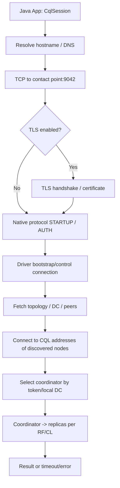
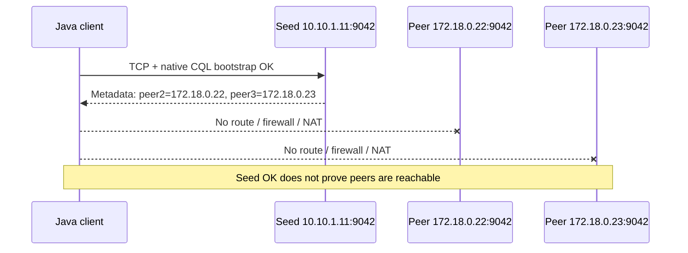
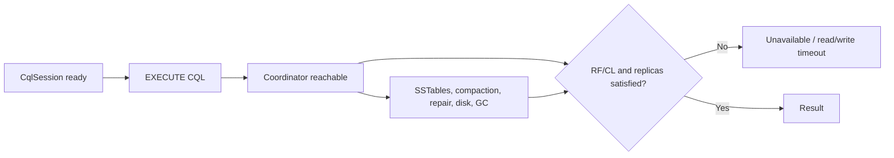

# Connection Failures Due to Address, Port, DNS, Firewall, or Topology

## 1. Scenario: Port 9042 Is Open, Yet Java Still Cannot Connect

A Java application running in Kubernetes is configured to connect to Apache Cassandra using `db-seed.internal.example:9042`. A TCP check from the Pod to the seed succeeds; `cqlsh` on the Cassandra node itself also works normally. However, the application still throws `AllNodesFailedException` when creating `CqlSession`, or starts up successfully only to have many queries unexpectedly time out after a few seconds.

The fault could lie anywhere: wrong hostname; DNS returning IPv6 when the network only supports IPv4; host/port with no listening process; a firewall blocking traffic from the Pod; TLS/client authentication failure; the Java Driver configured with the wrong local datacenter; or **the seed is reachable, but the node addresses advertised by Cassandra are unreachable**.

**Key principle:** "Cannot connect" is a *symptom*, not a diagnosis. Identify the **failing layer** using evidence from the exact location where the program runs, and only then modify a single configuration setting accurately.

This lesson belongs to the **Troubleshooting** chapter of the `DATABASE_ENGINE_WIDE_COLUMN_CASSANDRA` module. The context covers distributed architecture, partitions/tokens, replicas/consistency, CQL, replication, repair/compaction, error handling, and Java connectivity. Connectivity failures must not be conflated with a slow query caused by a hot partition or insufficient quorum.

### Learning Objectives

After completing this lesson, you will be able to:

1. Classify failures along **DNS → TCP/port → TLS → native protocol/auth → driver discovery/routing → request/replica**.
2. Inspect the differences between `listen_address`, `rpc_address`, `broadcast_address`, and `broadcast_rpc_address`, recognizing port 9042 as native CQL.
3. Explain why reaching one contact point is insufficient once the driver discovers Cassandra peers.
4. Test from the **exact namespace/host/Pod** using safe tools such as `Resolve-DnsName`, `Test-NetConnection`, `getent`, `nc`, `openssl`, and `cqlsh`.
5. Diagnose Java Driver 4.x, `AllNodesFailedException`, local DC, TLS/auth, Docker/Kubernetes/NAT, and multi-datacenter setups.
6. Author a runbook with verification criteria, rollback steps, and safety rules; never "fix" network faults by downgrading consistency levels or disabling security.

> **Versions and scope:** examples target Apache Cassandra 4.1/5.x, Apache Cassandra Java Driver 4.18.x, Java 17, and Spring Boot 3.x. Option names, TLS mechanisms, or metadata tables may differ across versions or vendors. Commands are predominantly **read-only**; configuration edits shown are examples for labs or approved rollouts. Never expose CQL to the public Internet, disable TLS, or open entire firewalls just to test.

## 2. Connection Flow Map from Application to Cassandra



**Reading top-down:** Successful DNS, TCP, and TLS are prerequisites before native CQL can even begin. After receiving topology, the driver must also reach **the nodes selected as coordinators**; those nodes do not necessarily share the same address as the configured seed. Finally, a working client–coordinator connection still does not guarantee a `LOCAL_QUORUM` query has enough replicas to return a result.

### Two Failure Models to Separate

- **Session fails to initialize:** the application cannot retrieve metadata, authenticate, or establish initial connections. Investigate contact points, DNS, port, TLS/auth, local DC, and the error map.
- **Session initializes, but queries fail:** may be due to unreachable peer addresses, pool exhaustion, schema/permission errors, request timeouts, insufficient replicas for CL, or ongoing cluster repair/compaction; inspect execution info, node status, and metrics.

A Pod starting up does **not prove** DNS/contact points are completely valid. Conversely, seeing `nodetool status` report nodes as `UN` does **not prove** port 9042 is reachable from the application subnet.

## 3. Cassandra Ports: Do Not Confuse Client with Internode

| Common TCP Port | Role | Who Needs Access? | Notes |
| --- | --- | --- | --- |
| **9042** | CQL **native transport**, default | Java Driver, `cqlsh`, applications | Can serve TLS **on 9042 itself** if configured on the server |
| **9142** | **Separate** native TLS port when configured | Designated clients only | **Not open by default**; depends on `native_transport_port_ssl`; separate port option is deprecated in Cassandra 5.0 |
| **7000** | Common internode traffic/gossip/streaming | Cassandra nodes | **Not** a client CQL port |
| **7001** | Legacy/optional internode TLS port | Cassandra nodes | Since Cassandra 4.0, secure/insecure can share one port; 7001 is not always used by default |
| **7199** | Common JMX/nodetool port | Authorized operators/monitoring | Never configure Java Driver to query CQL here |
| **9160** | Legacy Thrift in very old Cassandra releases | Unused in modern CQL Cassandra | Never point Java Driver 4.x to 9160 |

These are **common defaults**, not universal truths across every container/cloud/vendor: ports may be changed or mapped through NAT/Service/Load Balancers. Verify `native_transport_port`, TLS settings, actual endpoints, and published ports **from the running environment itself**.

### What Does "Port Open" Exactly Mean?

A successful TCP connect proves a network path to **some TCP listener** at that host/port at test time; it does **not** prove the listener is Cassandra, supports the native protocol version, accepts your TLS/auth settings, or can query tables.

A TCP `REFUSED` usually indicates no listener or an active rejection; `TIMED OUT` can indicate an ACL/firewall/routing drop or an unresponsive node. Still, do not jump to absolutes: network appliances can send REJECT/RESET, NAT/firewalls have varying policies, and findings must be verified on both ends.

## 4. Symptom → Fault Layer Matrix

| Client Symptom | Priority Cause to Check | Decisive Evidence |
| --- | --- | --- |
| `UnknownHostException` | DNS wrong hostname/search domain, DNS service failure | Resolver inside Pod/JVM, `getent`/`Resolve-DnsName` |
| `Connection refused` to `IP:9042` | Native transport not listening, wrong port, firewall REJECT | Node `ss -ltn`, runtime config, TCP test from client |
| `Connect timed out` | Routing, security group, NetworkPolicy, firewall DROP | Source→destination 5-tuple, routes, counters |
| `SSLHandshakeException` | TLS mode/CA/hostname/SNI/client cert | TLS handshake using exact hostname/CA |
| `AuthenticationException`/bad credentials | Wrong user/password, authenticator, or TLS client identity | Auth logs and role config; never log passwords |
| `UnauthorizedException` after connecting | Missing keyspace/table permissions | Valid CQL SELECT rejected for insufficient role permissions |
| `AllNodesFailedException` | Wrapper of per-node errors; **not a root cause** | `getAllErrors()` and causes, contact/discovered addresses |
| `NoNodeAvailableException` | Query plan has no usable coordinator | Driver metadata, local DC, node distance/state |
| `UnsupportedProtocolVersionException` | Protocol mismatch / forced wrong version | Driver/server versions, native handshake |
| `DriverTimeoutException` | Driver exhausted its request budget | Bootstrap or query stage? pool/network/replica |
| `ReadTimeoutException`/`UnavailableException` | Coordinator/replicas/CL | RF, CL, local DC, replica health, compaction/repair |
| Seed connects, peers fail | Advertised addresses unreachable | `broadcast_rpc_address`, `system.peers_v2`, DNS/NAT |
| Fails only after deploy/restart | Pod IP changed, stale DNS cache, cert rotated, endpoint changed | Release timeline, resolved IPs, certs, and driver logs |

**Warning:** an exception class only narrows the layer; it is rarely enough to pick a fix. `AllNodesFailedException` in particular can hold **different causes across different nodes**. Never catch the exception and fall back to `127.0.0.1` or downgrade CL, as that can target the wrong cluster or corrupt data guarantees.

## 5. Minimum Information to Collect Before Fixing

A connectivity incident report needs:

| Field | Safe Example | Purpose |
| --- | --- | --- |
| Timestamp | UTC, with timezone | Correlate logs and NetworkPolicy changes |
| Environment | `staging/orders-api/pod-a` | Diagnose in the right namespace/subnet |
| Client | Java 17, Driver 4.18.x, Boot 3.x | Check compatibility/configuration |
| Contact points | **Approved** hostnames + ports | Compare DNS/TCP paths |
| Local DC | Actual `dc1` from cluster | Detect skipped/ignored routing |
| Errors and causes | Exception class, hostname/port, attempt stage | Classify fault layer |
| Request RF/CL | `dc1:3`, `LOCAL_QUORUM` | Separate connectivity vs. quorum errors |
| Recent changes | DNS/cert/secret/node replacement | Narrow timeline |
| Three probe results | DNS, TCP, native CQL | Pinpoint failing layer |
| Cluster/driver metrics | Connections, timeouts, node status | Confirm system-wide impact |

**Never collect** raw passwords, private keys, bearer tokens, customer payloads, or full bound CQL values into tickets. Internal hosts/IPs may be sensitive: widely shared reports should use labels or controlled hashes, while on-call operators still need enough detail to trace the network path.

## 6. Step 1 — Check the Addresses *Actually* Used

First verify the **effective configuration**, not just what the author *thinks* was set:

- Contact points in `application.yml`, `application.conf`, environment variables, or service bindings; verify precedence rules for the exact version.
- Did it accidentally fall back to Java Driver's default `127.0.0.1:9042`? That only works when Cassandra runs **in the same network namespace/host**.
- Is the hostname an internal DNS name resolvable from **that Pod/container**, not a name that only exists on a laptop?
- Is the **client** port a Load Balancer/NAT published port that differs from Cassandra's internal port?
- Does `local-datacenter` match `system.local.data_center` **case-sensitively**? Distinguish `dc1` from `DC1`.
- Does the app share one `CqlSession`, or does it create a new one per request and saturate pools/handshakes?

**Hostname note:** `cassandra-1.lab.example.invalid` is a placeholder; replace it with your authorized lab DNS name. Never hardcode an ephemeral Pod IP into production config, and never use `localhost` inside an app container to refer to a separate database container.

### Three Addresses Commonly Confused

| Address | Meaning | Valid as Contact Point? |
| --- | --- | --- |
| `127.0.0.1` on developer laptop | Loopback of **developer machine** | Only if Cassandra/port-forward listens there |
| `127.0.0.1` inside Java Pod | Loopback of **Pod network namespace** | Not a Cassandra service in another Pod |
| `10.x.x.x` or Kubernetes Service name | Cluster-internal IP/DNS | Depends on network policies and how peers are advertised |

**Docker/Kubernetes:** publishing a port from host to container does not mean Cassandra nodes will **advertise** that published address to the Java Driver. That is a topology issue—adding a second seed will not fix it.

## 7. Step 2 — Check DNS from Where the Application Runs

### Linux/Pod

```bash
# Read-only; run inside the exact container/Pod sharing the app's network namespace.
getent ahosts cassandra-1.lab.example.invalid
getent hosts cassandra-1.lab.example.invalid

# If dig/nslookup are installed, inspect DNS records:
dig +short A cassandra-1.lab.example.invalid
dig +short AAAA cassandra-1.lab.example.invalid

# Do not treat ping as a Cassandra native protocol test.
```

`getent` reflects the running Linux environment's resolver, whereas `dig` queries DNS directly and may bypass NSS/`/etc/hosts` rules. If their answers differ, inspect `/etc/resolv.conf`, search domains, `/etc/hosts`, and resolver rules using authorized **read-only** checks.

### Windows/PowerShell

```powershell
Resolve-DnsName -Name cassandra-1.lab.example.invalid
Resolve-DnsName -Name cassandra-1.lab.example.invalid -Type A
Resolve-DnsName -Name cassandra-1.lab.example.invalid -Type AAAA
```

### DNS Discrepancies to Record

1. **NXDOMAIN**: hostname does not exist in the active zone/search domain, or the app hits the wrong resolver.
2. **SERVFAIL/TIMEOUT**: DNS server/upstream network failed to respond; distinct from non-existent hostname.
3. **A vs. AAAA**: DNS returns IPv6 when the network only routes IPv4, or the JVM/OS picks the wrong address family.
4. **Round-robin A records**: individual IPs may have different health; test **each IP** and record mapping/TTL.
5. **Split-horizon DNS**: the same hostname resolves to private IPs inside a VPC/cluster and different IPs over laptop/VPN.
6. **DNS cache**: JVM/OS/CoreDNS may cache stale records after failover; inspect TTL and Java security network cache policy for your actual JVM.
7. **Search suffix**: short name `cassandra-1` may resolve into the wrong namespace; test explicit FQDN.

**Never** apply a permanent fix by editing `/etc/hosts` inside a container and forgetting it. It masks broken DNS and goes stale when Pods/nodes change IPs.

## 8. Step 3 — Check TCP to the CQL Port *from the Client Side*

### Linux

```bash
# Run in the exact app container/Pod, if tools are available:
nc -vz -w 3 cassandra-1.lab.example.invalid 9042

# When only Bash with /dev/tcp support is available:
timeout 3 bash -c 'echo > /dev/tcp/cassandra-1.lab.example.invalid/9042'

# This tests TCP reachability, NOT CQL SELECT/handshake.
```

If these tools are missing in a minimal image, use an **approved debug container in the same namespace/policy**. A debug container in another namespace may have a different NetworkPolicy, so a pass there **does not prove** the application Pod has the same access.

### Windows/PowerShell

```powershell
Test-NetConnection -ComputerName cassandra-1.lab.example.invalid -Port 9042
```

Check `TcpTestSucceeded`, resolved remote address, and source interface. If DNS returns multiple IPs, test each target via an approved method to isolate the failing node/record.

### Distinguishing Outcomes

| Result | What Can Be Inferred | Next Step |
| --- | --- | --- |
| TCP connect succeeds | A listener/path to 9042 exists right now | Test TLS/native protocol and node discovery |
| Connection refused | Target actively rejected or nothing listening | Check `ss -ltn` and config on node, firewall REJECT |
| Timeout | TCP handshake did not complete in time | Routes, firewall DROP, SG/NACL/NetworkPolicy, node reachability |
| No route to host | Routing/network stack issue | Routes, subnets, overlay/CNI, VPN/VPC peering |
| DNS resolves but all IPs wrong | Stale/wrong record or endpoint | DNS zone/Service/advertise config |

**Never use "ping works" instead of a TCP check**: ICMP can be blocked while TCP works and vice versa. Also never conclude "firewall is closed" solely from an `nc` timeout; the Pod might lack a route or the listener might be saturated.

## 9. Step 4 — Check the Native CQL Listener on the Cassandra Node

On the **actual Cassandra node/pod** (with read access per policy):

```bash
# Linux: inspect listening addresses and ports.
ss -ltn '( sport = :9042 )'

# Supported in some environments:
ss -ltnp | grep ':9042'

# Read-only OS socket inspection; does not alter server config.
```

If you only see `127.0.0.1:9042`, clients on **other hosts/containers** usually cannot connect directly. If you see `0.0.0.0:9042`, the server binds all IPv4 interfaces; **this still does not mean** every subnet has routing/firewall access, nor that `broadcast_rpc_address` is valid.

### Cassandra Options to Cross-Check in the Active Config

```yaml
# SAMPLE CASSANDRA CONFIG — do not copy verbatim into production.
start_native_transport: true
native_transport_port: 9042

# Bind CQL listener to the node's internal NIC address.
rpc_address: 10.10.1.11

# Address reachable by the Java Driver from the application subnet:
broadcast_rpc_address: 10.10.1.11

# Internode traffic — a different scope from client CQL:
listen_address: 10.10.1.11
broadcast_address: 10.10.1.11
```

**This example only works if `10.10.1.11` actually belongs to the node and is reachable in your topology.** Do not blindly equate `rpc_address` with `listen_address` when clusters span multiple NICs, overlays, or public/private networks.

| Setting | Scope | Critical Rule |
| --- | --- | --- |
| `start_native_transport` | Enables native CQL server | If false, do not expect 9042 to serve clients |
| `native_transport_port` | Client native port | Usually 9042, but always verify |
| `rpc_address` / `rpc_interface` | **Bind** client native transport | Can bind `0.0.0.0` when needed, provided broadcast is reachable |
| `broadcast_rpc_address` | **Advertise** CQL address to drivers/peers | Must **never** be `0.0.0.0`; must be reachable from clients |
| `listen_address` / `listen_interface` | Internode bind/identity | Must **never** use `0.0.0.0` for `listen_address` |
| `broadcast_address` | Internode advertised address | Need not match client CQL advertised address |
| `storage_port`/`ssl_storage_port` | Internode ports | Do not confuse with `native_transport_port` |

Per Cassandra documentation, if `rpc_address: 0.0.0.0`, you must set a **specific, non-0.0.0.0** `broadcast_rpc_address`. Conversely, `listen_address: 0.0.0.0` is invalid for internode communication. These two rules **differ**.

**Never edit production node configs and rolling-restart the entire cluster** just to experiment. Changing bind/advertise settings can affect membership/discovery, certificate SANs, IP routing, firewall rules, and availability. Require a change record, test one node in a lab, evaluate impact, and have an owner for rollout/rollback.

## 10. Step 5 — Why Does the Seed Connect Yet Java Driver Still Fails?

Java Driver 4.x uses **contact points to bootstrap topology**. Afterward, the driver receives cluster/peer metadata and attempts to connect to the addresses advertised by nodes, typically tied to `broadcast_rpc_address`. Therefore:



For example: the contact point is a container's published host address, but Cassandra advertises a Docker bridge `172.18.x.x` range that external apps cannot route to. Once the driver discovers peers, connection pools fail to open and requests fail. **Adding another seed hostname pointing at the same proxy does not fix advertised topology.**

### How to Inspect When You Have One Working Native CQL Connection

```sql
-- Connect cqlsh to a real node and inspect metadata:
SELECT cluster_name, data_center, rpc_address, release_version
FROM system.local;

-- On Cassandra 4.x/5.x, node native address columns typically live in peers_v2.
SELECT peer, data_center, native_address, native_port
FROM system.peers_v2;
```

Some versions/distributions alter system table schemas; **do not assume every release has the exact rows/columns shown here**. `system.peers_v2` normally excludes the local node from the peer list; read the local node from `system.local`. Verify each address/port against **the network path from the actual application**.

**Why isn't `nodetool status` enough?** It reports Cassandra's gossip/ring state, primarily over **internode traffic**. A `UN` node can still have `9042` unbound, blocked by client firewalls, or advertising an unreachable `broadcast_rpc_address` to Java.

### Architectural Fixes, Not Workarounds

1. Design `broadcast_rpc_address` so every node is **reachable** from the application network when clients connect directly.
2. Across NAT, enforce **stable, distinct per-node mappings** aligned with TLS certs and driver topology; evaluate Driver 4.x `AddressTranslator` when the architecture requires translation.
3. If using a specialized Cassandra proxy/gateway, verify **native protocol, topology discovery, TLS, and routing support**—do not assume any generic TCP Load Balancer can replace native cluster topology.
4. On Kubernetes, consider headless Services / stable Pod DNS or operator/driver-supported patterns within the client's reachable network; avoid handing unreachable Pod IPs to clients outside the cluster.

**What never to do:** set every node's `broadcast_rpc_address` to **the same** Load Balancer IP to "solve reachability". The driver must distinguish and route to **individual nodes**; collapsing multiple nodes behind one undifferentiated IP/port breaks topology and token-aware routing.

## 11. Step 6 — Firewalls, Routes, ACLs, and TCP Handshake

Do not inspect "the Cassandra firewall" as a single setting: multiple enforcement layers sit along the path.


**Inspect a concrete flow:** `(source IP, source port, destination IP, destination port, TCP)` at test time. With NAT, source/destination may be translated at intermediate hops; record both pre-NAT and post-NAT addresses when needed.

| Location | Policy Example | Symptom |
| --- | --- | --- |
| Pod egress NetworkPolicy | Restricts Pod outbound to specific IPs/ports | App Pod times out while another debug Pod connects |
| Node/VM host firewall | nftables/iptables/firewalld/Windows Firewall | `ss` shows listener, yet client times out/refused |
| Cloud security group | Source subnet not allowed on TCP 9042 | One VPC connects, another VPC does not |
| Network ACL | Return traffic or ephemeral ports blocked | SYN leaves, connection never completes |
| Route/peering/VPN | Missing route to private peer addresses | `No route to host`/timeout |
| Stateful LB/NAT | Idle timeout, wrong port mapping, or broken SNAT | Connects initially, then resets after idle periods |
| Overloaded Cassandra node | Listener exists, accept/handshake stalls | Connect/handshake timeout alongside high CPU/GC/threads |

### Do Not Open Entire Subnets or the Internet as a Quick Check

Firewalls must permit TCP 9042 **from authorized application sources** to **all node CQL endpoints the driver may use**. Internode ports 7000/7001 and JMX 7199 have **separate source groups** and must not be exposed to client networks. With NetworkPolicy, verify both app egress and Cassandra namespace ingress per your CNI's implementation.

**Why does the return path matter?** TCP begins with SYN/SYN-ACK/ACK. Stateful firewalls track return flows automatically; stateless NACLs must explicitly permit the return path across the right ephemeral port range. NAT or asymmetric routing can send return packets along a different path and drop them.

### Evidence the Network Team Needs

| Question | Evidence |
| --- | --- |
| What source IP does the app present past the gateway? | Pod/VM IP, NAT/SNAT mapping, timestamps |
| What IPs did DNS return? | A/AAAA records and TTL from the app namespace itself |
| Which endpoints were tested? | Destination IP:port, TCP probe outcome, elapsed time |
| Were TCP SYN and SYN-ACK observed? | Firewall counters or authorized packet capture |
| Which hop dropped packets? | Route/ACL/SecurityGroup/NetworkPolicy logs |
| Was the node listening at the same time? | `ss -ltn` and Cassandra native transport logs |

Packet captures can contain internal metadata or sensitive traffic; use narrow filters, sampling, and proper access controls. **Never instruct learners to run cluster-wide tcpdump or upload raw captures publicly.**

## 12. Step 7 — TCP Succeeds, but TLS Mismatches

A CQL listener can require TLS on port `9042` itself. A Java Driver using plaintext against a TLS-only server—or using TLS against a plaintext server—fails during handshake/protocol startup before any CQL executes. Do not assume TLS environments always use port 9142.

### TLS Hypotheses to Verify

1. Does the server enable `client_encryption_options` and require TLS on that port?
2. Is the server certificate valid, unexpired, and signed by a CA trusted by the Java truststore/SSL bundle?
3. **Hostname verification:** does the name the client actually connects to appear in the server certificate's SAN?
4. Is **mTLS/client certificate** required rather than server-auth-only TLS?
5. Does a NAT/LB terminate TLS? How does native protocol traffic travel after termination?
6. Is the Java truststore/keystore mounted with readable permissions inside the **running container**?
7. Is a configured port other than 9042 in use (or optional 9142 in older releases)?

### Testing TLS with OpenSSL in an Authorized Lab/Namespace

```bash
# Use the same hostname as the app; do not switch to raw IP if the cert uses DNS SANs.
# Omit -brief on very old OpenSSL builds.
openssl s_client \
  -connect cassandra-1.lab.example.invalid:9042 \
  -servername cassandra-1.lab.example.invalid \
  -showcerts

# When a matching lab CA file is available:
openssl s_client \
  -connect cassandra-1.lab.example.invalid:9042 \
  -servername cassandra-1.lab.example.invalid \
  -CAfile /path/to/trusted-ca.pem \
  -verify_return_error
```

**Limitations:** OpenSSL checks the TLS handshake and certificate chain/trust when configured properly, **not** CQL native protocol, auth, keyspaces, or driver metadata. `Verify return code: 0` does not substitute for hostname verification unless the tool explicitly enables hostname checks; to verify hostnames, pass the appropriate flag for your OpenSSL version or test with Java Driver hostname verification enabled.

**Never pass `-verify_return_error` with an untrusted CA just to grab production certificate info.** Never put private keys or passwords on the command line or into logs.

### Distinguishing TLS Errors

| Symptom | Priority Check |
| --- | --- |
| `PKIX path building failed` | CA/truststore, certificate chain |
| `No subject alternative DNS name matching` | SAN/hostname verification, DNS/advertised endpoint |
| `handshake_failure` | Protocol/cipher/mTLS mismatch, server policy |
| Server closes connection immediately upon client STARTUP | TLS mismatch or native protocol error |
| TCP OK but Java SSL fails after cert rotation | Secret mount/trust bundle/cert lifetime/rollout |

**Never** "fix" this by disabling certificate verification in production. If certs do not match advertised peer addresses, fix **certificate SANs, endpoint/translation, or TLS architecture**; avoid insecure trust-all TLS that leaves man-in-the-middle attacks undetected.

## 13. Step 8 — Checking Native Protocol, Authentication, and Authorization

Beyond TCP/TLS, Java Driver performs the Cassandra native protocol handshake and authenticates if the server enables an authenticator. This is a **distinct layer** from network reachability.

### Using `cqlsh` as a Native CQL Probe

```bash
# Run from a location with the same network path as the app, when TLS is not required:
cqlsh cassandra-1.lab.example.invalid 9042

# If the server requires TLS, run cqlsh configured with proper SSL/trust:
cqlsh cassandra-1.lab.example.invalid 9042 --ssl

# Never pass passwords directly in shell history/logs.
```

Once connected:

```sql
SELECT release_version, cluster_name, data_center
FROM system.local;

SELECT keyspace_name
FROM system_schema.keyspaces
WHERE keyspace_name = 'system';
```

Reading `system.local` confirms **which Cassandra cluster and DC** you are talking to, not merely that some unknown service answered on the port. Under restricted roles, certain system queries may have specific access policies; distinguish `UnauthorizedException` (missing permission) from TCP/DNS failures.

### When `cqlsh` Works but Java Fails

| Difference | Questions to Ask |
| --- | --- |
| Execution location | Did `cqlsh` run **on the DB node**, while Java runs in a separate Pod/VPC? |
| DNS/IP | Do both programs resolve the hostname to the same IP? |
| Port/TLS | Is `cqlsh` using 9042 plaintext while Java uses 9142 TLS or vice versa? |
| Credentials | Are Java roles, credential providers, or rotated secrets out of sync? |
| Truststore | Does `cqlsh` trust the OS CA bundle while the JVM uses a separate truststore? |
| Metadata | Did `cqlsh` hit one endpoint while Java Driver also discovers peers? |
| Local DC | Did Java Driver set `withLocalDatacenter` accurately? |
| Version | Are driver/native protocol and Cassandra server versions compatible? |

**Never assume `cqlsh localhost` passing proves the application firewall allows traffic.** Run `cqlsh` or a smoke test from the **same source path** if you want to rule out network causes.

## 14. Step 9 — Configuring Java Driver 4.x Contact Points and Local DC

Per Java Driver 4.18.x, if no contact points are specified, the driver may default to `127.0.0.1:9042` for quickstarts. When explicit contact points are supplied, you must provide a **local datacenter** and choose **contact points belonging to that local DC** per driver guidance.

### Direct Builder Configuration

```java
import java.net.InetSocketAddress;
import com.datastax.oss.driver.api.core.CqlSession;
import com.datastax.oss.driver.api.core.cql.Row;

public class CassandraConnectivitySmoke {
    public static void main(String[] args) {
        try (CqlSession session = CqlSession.builder()
                .addContactPoint(new InetSocketAddress(
                    "cassandra-1.lab.example.invalid", 9042))
                .addContactPoint(new InetSocketAddress(
                    "cassandra-2.lab.example.invalid", 9042))
                .withLocalDatacenter("dc1")
                // In production, add Auth/TLS options per policy.
                .build()) {

            Row row = session.execute(
                "SELECT release_version, data_center FROM system.local")
                .one();
            if (row == null) {
                throw new IllegalStateException("No system.local row");
            }
            System.out.printf("dc=%s, version=%s%n",
                row.getString("data_center"),
                row.getString("release_version"));
        }
    }
}
```

This is a **lab smoke test without auth/TLS**; do not copy verbatim into production without client authentication and TLS. In Spring Boot applications, share **a single `CqlSession` bean**, never call `build()` per HTTP request; the container manages closing it at shutdown.

### Pure Driver HOCON Configuration

```hocon
datastax-java-driver {
  basic {
    contact-points = [
      "cassandra-1.lab.example.invalid:9042",
      "cassandra-2.lab.example.invalid:9042"
    ]
    load-balancing-policy.local-datacenter = dc1
    request.timeout = 2 seconds
  }

  advanced {
    connection.connect-timeout = 5 seconds
  }
}
```

**Two distinct timeouts:** `advanced.connection.connect-timeout` bounds TCP connection establishment; `basic.request.timeout` bounds driver-managed CQL request execution. In practice, TLS/auth handshakes, session initialization deadlines, and API end-to-end deadlines also apply; raising request timeout will not fix broken DNS or firewalls.

### Spring Boot 3.x

```yaml
spring:
  cassandra:
    contact-points:
      - cassandra-1.lab.example.invalid:9042
      - cassandra-2.lab.example.invalid:9042
    local-datacenter: dc1
    keyspace-name: orders_lab_ks
    request:
      timeout: 2s
      consistency: LOCAL_QUORUM
    connection:
      connect-timeout: 5s
    # TLS and credentials must be configured per environment.
```

`orders_lab_ks` is a hypothetical keyspace; it is **not automatically created by Spring Boot** merely by appearing in properties. If the keyspace does not exist and the session initializes against it, startup errors can happen even after DNS/TCP/TLS succeed. For connectivity smoke tests, run system queries using a session **independent of application keyspaces**, then verify permissions and schemas separately.

**Do not copy `spring.data.cassandra.contact-points` from legacy Spring Boot tutorials** without checking Boot 3.x metadata. On Spring Boot 4.x some auto-configuration packages change; always verify property names against your actual version.

## 15. Step 10 — Driver Metadata and Per-Node Error Reporting

When the driver throws `AllNodesFailedException`, inspect its **cause map** rather than logging only the top-level message. Driver 4.x exposes errors per node: one node may report `ConnectException` while another reports `SSLHandshakeException` or `ConnectionInitException`.

### Java Pattern Logging **Error Types**, Not Secrets

```java
import com.datastax.oss.driver.api.core.AllNodesFailedException;
import com.datastax.oss.driver.api.core.metadata.Node;
import java.util.List;
import java.util.Map;

try {
    // Session can be initialized via a Spring bean or smoke test.
    session.execute("SELECT release_version FROM system.local");
} catch (AllNodesFailedException failure) {
    for (Map.Entry<Node, List<Throwable>> entry
            : failure.getAllErrors().entrySet()) {
        Node node = entry.getKey();
        for (Throwable error : entry.getValue()) {
            System.err.printf("node=%s causeClass=%s%n",
                node == null ? "unknown" : node.getHostId(),
                error.getClass().getSimpleName());
        }
    }
    throw failure;
}
```

**Limitations:** the imports/APIs above target Java Driver 4.18.x and may vary slightly by minor version; on certain init paths, exceptions are wrapped in completion/driver execution exceptions and must be unwrapped safely. Avoid printing `error.toString()` or full stack traces into public responses if they contain internal addresses, hostnames, or credentials. Keep detailed logs/traces restricted to authorized sinks.

### Easily Misinterpreted Cases

- `NoNodeAvailableException` is a subtype of `AllNodesFailedException` meaning the query plan had no eligible coordinator—not necessarily that the entire cluster is dead.
- `NodeUnavailableException` may mean the driver selected a node that currently has **no available connection in its pool**, not necessarily that the node's CQL listener is gone.
- `ConnectionInitException` points to connection initialization; inspect its cause to separate auth, TLS, protocol, and port failures.
- `UnsupportedProtocolVersionException` requires matching server and driver versions; never force an arbitrary native protocol version.
- `DriverTimeoutException` is not automatically a DNS/TCP failure; if CQL was sent, the coordinator/replicas may be stalled or unable to satisfy CL.

**Do not blindly retry** write queries that time out once the request may have been sent. An unknown write outcome does not mean the write never occurred; preserve idempotency/operation IDs for reconciliation.

## 16. Step 11 — Wrong Local DC and "No Valid Nodes"

Driver 4.x defaults to a **local-datacenter-preferring** load-balancing policy. If `local-datacenter: dc-main` is configured while Cassandra nodes actually report `dc1`, the driver may reject every node or fail to initialize properly.

```sql
-- Run on a reachable Cassandra node:
SELECT data_center, rack, cluster_name
FROM system.local;
```

```bash
# View cluster grouped by datacenter/rack:
nodetool status
nodetool describecluster
```

| Issue | What to Cross-Check |
| --- | --- |
| Case mismatch or wrong DC name | `system.local.data_center`, `nodetool status` |
| Contact point in a different DC | Check seed DC; driver docs recommend seeds in the local DC |
| Cluster metadata shows only remote DC nodes | Load-balancing node distance / `IGNORED` |
| Recent node/rack/DC move | Snitch config, restart/topology update per runbook |
| Different RF across DCs | `LOCAL_QUORUM` in one DC requires a different ACK count than another |

**Never fix this by changing `LOCAL_QUORUM` to `ONE`** or enabling cross-DC failover carelessly. Cross-DC failover in Driver 4.x requires explicit configuration, **is disabled by default**, and carries consistency implications for `LOCAL_ONE`/`LOCAL_QUORUM`/`LOCAL_SERIAL` when DCs have different RFs. Multi-region failover requires coordinated architecture, routing, consistency analysis, WAN latency budgeting, and DC-loss testing.

### Why Can Topology Break After a Node Comes Back UP?

After node replacement or DC changes, metadata, advertised addresses, or TLS certificates may change; the driver may still hold stale state until topology events and reconnects settle. Observe **driver metadata, peer addresses, and logs** alongside node status; never assume "node is UP means every client is ready".

## 17. Docker/Podman and Kubernetes: Two Different NAT Cases

### 17.1. Single Docker Container

```text
Docker container:
  cassandra internal 9042
  host published 127.0.0.1:19042 -> container:9042

App on host:
  host:127.0.0.1:19042 (may bootstrap)
  Cassandra peers advertise:172.18.x.x:9042 (may not be routable)

App on same Docker network:
  service/container DNS + internal:9042 (usually preferable)
```

A **single-node** Cassandra container via a published host port often suffices for local integration smoke tests. With **multiple Cassandra containers**, publishing one seed to the host is insufficient; the driver must reach peer addresses received via metadata. Place clients on **the same routable network** or configure native-topology-compatible address translation/gateways.

**Do not confuse:** host port 19042 is an external mapping; inside the container `native_transport_port` is still 9042. If the app runs in **another container**, `localhost:19042` points to the app container's own loopback, not the Docker host.

### 17.2. Kubernetes

Read-only example in an authorized namespace:

```bash
kubectl -n cassandra get pods -o wide
kubectl -n cassandra get svc
kubectl -n cassandra get endpointslices
kubectl -n cassandra describe svc cassandra-client

# Test from the app Pod using available tools (if policy allows):
kubectl -n apps exec deploy/orders-api -- \
  sh -c 'getent hosts cassandra-client.cassandra.svc.cluster.local'
```

Names like `cassandra-client` and `orders-api` are illustrative; verify your actual resource names. Many clusters use a **headless service**, where DNS returns individual Pod addresses. A ClusterIP or Load Balancer can bootstrap initial contact, yet the Java Driver may switch to **advertised Pod addresses**: Pods inside the cluster can reach them, while apps outside the VPC cannot.

**Kubernetes checklist:**

1. Cassandra Pods are genuinely `Ready` and native transport is listening.
2. Service `port/targetPort` match, selectors target the right Pods, and EndpointSlices list healthy backends.
3. Service/headless peer DNS returns current IPs and matches app search domains.
4. App **egress** and Cassandra **ingress** NetworkPolicies permit TCP CQL to all node endpoints.
5. CNI/VPC routing and TLS SANs match all advertised addresses.
6. Java Driver receives the right local DC and routes to peers as expected.

If a Service only exposes a single ClusterIP, **do not assume** the driver will keep sending all traffic through that Service. A native driver does not behave like a stateless HTTP client sticking to one hostname.

## 18. Multi-DC, VPN, Peering, and Load Balancers

When the application and Cassandra reside in different VPCs, regions, or datacenters, separate:

- **Reachability:** valid routes, security groups, network ACLs, DNS, and source NAT to **every peer**.
- **Local DC routing:** the driver strongly prefers nodes in its configured DC and will not silently fail over remotely the way apps might expect.
- **Replica placement and consistency:** `LOCAL_QUORUM` requires quorum within the target DC based on that keyspace's DC RF, not cluster-wide RF.
- **TLS identity:** are nodes reached via public hostnames, private IPs, or a proxy? Do SANs, truststores, and mTLS align?
- **WAN latency:** connect timeouts and request timeouts serve different phases; one successful TCP handshake does not guarantee p99 compliance.
- **Failure domains:** a broken VPN link can cut off an app from all peers even while Cassandra nodes remain UP to one another.

### When Can a Load Balancer Be Used?

A simple proxy/LB can help **bootstrap** or connect to a Cassandra-compatible gateway engineered for the native protocol. However, Cassandra Java Driver relies on topology/token-aware routing and **per-node** pooling, so a generic random TCP LB cannot blindly replace peer connectivity. If your architecture mandates routing all nodes through a proxy, use a vendor/driver-supported solution and verify:

| Criterion | Why |
| --- | --- |
| Per-node identity preserved after discovery | Token routing and per-node health tracking |
| Stable address/port mapping | Prevents pools from shifting across nodes unexpectedly |
| End-to-end or terminated TLS policy | Cert validation, mTLS, SNI |
| Sticky routing / native protocol compliance | Driver connections are stateful, not stateless HTTP |
| Topology refresh on scale/replacement | Avoids stale endpoints |
| Source IP/ACL and connection limits | Prevents resource exhaustion and inconsistent blocks |

**Never expose Cassandra ports to the Internet** "just to test easily". Prefer private networking, VPN/peering, source allow-lists, TLS/mTLS, least-privilege credentials, and dedicated monitoring permissions.

## 19. Distinguishing Connectivity Errors from RF/CL, Repair, or Compaction Errors

An application may pass TCP, TLS, and CQL startup yet still fail `SELECT` with timeouts or `UnavailableException`. At that point, stop tweaking DNS and inspect the **request path past the coordinator**:



| Symptom | Typical Layer | Example Action |
| --- | --- | --- |
| Cannot open TCP socket | Network/listener | Check DNS, routes, firewalls, `rpc_address` |
| TLS fails before STARTUP | TLS/security | Check CA, SAN, truststore, mTLS |
| Session init fails on local DC | Driver/discovery | Check `data_center`, contact points, node distances |
| Connect and `SELECT system.local` OK, app query times out | Query/replica/CL | RF, CL, keyspace, coordinator + replicas, compaction/repair |
| Reads on hot partition slow | Data model/load | Partition size, token distribution, SSTables/tombstones |
| `UnauthorizedException` on table query | RBAC | SELECT/MODIFY grants on table, effective role |
| Queries fail only when a node dies | Replica placement and retries | RF/CL, node pools, token-aware routing, failure domains |

**Example:** RF3 in `dc1` with `LOCAL_QUORUM` requires two replica responses in that DC. Java Driver may have a healthy connection to coordinator A, yet if only one natural replica for that partition is available in the DC, the query cannot achieve `LOCAL_QUORUM`. **Never fix this by lowering CL to ONE** when the contract requires quorum, as it alters read/write consistency guarantees.

### Read-Only Cluster Inspection Commands

```bash
nodetool status
nodetool describecluster
nodetool netstats
nodetool tpstats
nodetool compactionstats
nodetool tablestats system.local
```

Depending on the `nodetool tablestats` version, the `system.local` argument is optional when diagnosing connectivity; this command merely shows a system table example. For business tables, substitute an authorized **keyspace/table** and avoid state-mutating or cleanup commands.

If heavy repair/streaming/compaction is underway, query timeouts may reflect **capacity pressure**, not a wrong port. Even so, gossip `UN` does not prove Cassandra can meet CL at query time; inspect **coordinator and replica** metrics.

## 20. Which Metrics and Logs Pinpoint the Failing Layer Fastest?

### 20.1. On the Java Application

| Observation | Value |
| --- | --- |
| DNS resolution errors | Separates bad hostnames from network timeouts |
| Driver session initialization latency/errors | Shows whether pool/metadata bootstrap is stalling |
| Connection open/close/reconnect counts | Exposes connection churn and NAT idle timeouts |
| Node distances/status | Reveals wrong local DC or `IGNORED` nodes |
| Per-node `AllNodesFailed` causes | Captures true underlying errors instead of the wrapper |
| Request latency, timeouts, retries | Shows requests ran but failed to complete |
| In-flight requests / pool saturation | Detects client/driver pressure masquerading as network drops |
| TLS/auth failures | Catches cert/secret rotations and permission changes |
| Business API error rate | Confirms connectivity recovered enough to serve traffic |

### 20.2. On Cassandra Nodes

| Observation | Purpose |
| --- | --- |
| Native transport listener / accepted connections | Confirms client connections arrive on expected NIC/port |
| Authentication/TLS/server logs | Handshake failures, bad credentials, cert mismatches |
| Read/Write request latency/timeouts | Distinguishes connect errors from request timeouts |
| Dropped messages, thread pools | Server saturation and resource starvation |
| CPU/GC/memtable flush/disk await | Connect/request slowdowns caused by resource pressure |
| Compaction/repair/streaming backlog | Latency spikes following topology changes |
| Gossip status/rack/DC | Node membership relative to local datacenter |

**Synchronize log timestamps** in UTC; a TCP timeout at 10:00:02 cannot be matched against a restart at 10:05:00 to claim causality.

### Do Not Leave Debug Logging On Everywhere Indefinitely

Driver debug/native protocol logs, Cassandra traces, and packet captures introduce overhead and can expose IPs, query text, or identifiers. Enable them only with bounded duration, scope, and sampling; log correlation IDs and query shapes without PII or bind values. Revert logging levels once the incident closes.

## 21. Layered Test Matrix: Passing One Layer Does Not Replace the Next

| Test | Run From Where? | Pass Proves | Does Not Prove |
| --- | --- | --- | --- |
| T1. DNS | Actual app Pod/host | Hostname resolves to IP | TCP, TLS, or right cluster |
| T2. TCP 9042 | Actual app Pod/host | Path exists to a listener | Native CQL/auth or peers |
| T3. TLS handshake | Actual app Pod/host | TLS negotiates; cert matches test settings | Login, keyspace, or queries |
| T4. `cqlsh` system.local | Matching source path + TLS/auth | Native protocol + one node login/SELECT OK | All peers reachable |
| T5. Driver session init | Java with real config | Driver bootstraps metadata | All queries/CL succeed |
| T6. Peer reachability | App host to each advertised node | Discovered endpoints are reachable | Replica quorum / data correctness |
| T7. Keyed CQL query | Java Driver | CQL/permissions/CL work on tested partition | All partitions or all DCs |
| T8. Multi-node/fault | Lab with matching RF | Fault tolerance in tested topology | Every production failure mode |
| T9. Soak + recovery | Loaded measurement window | Stable connections, recovered error rate/p99 | Guaranteed zero future timeouts |

**Never stop at T2 just because "the port is open".** For an application to work reliably, validate at least through T5/T6/T7 as required by the service.

### Read-Only Diagnostic Script from Windows

```powershell
# Run on a Windows host/container sharing the application network.
$hostName = 'cassandra-1.lab.example.invalid'
$port = 9042

Resolve-DnsName -Name $hostName
Test-NetConnection -ComputerName $hostName -Port $port

# Do not use Invoke-WebRequest / curl HTTP against 9042: it is not HTTP.
```

### Read-Only Diagnostic Script from Linux

```bash
HOST=cassandra-1.lab.example.invalid
PORT=9042
getent ahosts "$HOST"
nc -vz -w 3 "$HOST" "$PORT"
# Only afterward test TLS and native CQL if authorized.
```

**Never store outputs containing full internal topology details in public CI artifacts.** If sharing is required, redact hostnames/ports or use secure incident channels.

## 22. Java Practice: Separating Session Creation Failures from Query Failures

A smoke test should separate **two distinct phases**: (A) build `CqlSession` to fetch metadata; (B) execute a system SELECT. Log each phase's outcome and close the session exactly once.

```java
import java.net.InetSocketAddress;
import com.datastax.oss.driver.api.core.CqlSession;
import com.datastax.oss.driver.api.core.cql.Row;

public final class TwoPhaseConnectCheck {
    public static void main(String[] args) {
        CqlSession session;

        // Phase A: bootstrap session.
        try {
            session = CqlSession.builder()
                .addContactPoint(new InetSocketAddress(
                    "cassandra-1.lab.example.invalid", 9042))
                .withLocalDatacenter("dc1")
                .build();
            System.out.println("SESSION_INIT_OK");
        } catch (RuntimeException initializationFailure) {
            System.err.println("SESSION_INIT_FAILED class="
                + initializationFailure.getClass().getSimpleName());
            throw initializationFailure;
        }

        // Phase B: real query over native protocol.
        try (CqlSession owned = session) {
            Row row = owned.execute(
                "SELECT release_version, data_center FROM system.local"
            ).one();

            if (row == null) {
                throw new IllegalStateException("No system.local result");
            }
            System.out.println("CQL_QUERY_OK dc="
                + row.getString("data_center"));
        } catch (RuntimeException queryFailure) {
            System.err.println("CQL_QUERY_FAILED class="
                + queryFailure.getClass().getSimpleName());
            throw queryFailure;
        }
    }
}
```

**This is a lab program**: it lacks TLS/auth configuration and must not be used outside authorized environments. In Spring Boot apps, never manually close a shared injected session bean inside services; Spring closes the bean on shutdown. If Phase A fails, there is no resource to close; if Phase B fails, try-with-resources still closes the session.

### Verifying Local DC and Metadata

An improvement for the smoke test: after initialization, log node IDs, DCs, and endpoints to **internal diagnostics** of the Java Driver (never leak sensitive topology publicly). Cross-check against:

- `nodetool status` per DC;
- `system.local`/`system.peers_v2`;
- DNS + TCP from the app to **every advertised address**;
- whether topology matches the target keyspace and RF.

If nodes appear `IGNORED` or lack pools due to a wrong local DC, fix the **local DC/topology** before benchmarking queries. Never mask the failure by adding infinite retries.

## 23. Testing Failure Scenarios in the Lab

You do not need to **break production networks** to practice diagnostics. Use CassandraContainer or lab VMs in isolated namespaces with bounded logs. When a scenario involves multiple nodes, a **single-node container cannot** validate topology or multi-DC behavior.

| Scenario | Lab Setup | Expected Observation | Fix |
| --- | --- | --- | --- |
| F01 — Wrong DNS | Typo or non-existent contact point hostname | DNS fails before TCP | Fix zone/FQDN/env |
| F02 — Wrong port | Connect to 9043 when node listens on 9042 | Refused/timeout | Match published/native port |
| F03 — Loopback bind | Node binds native to loopback, remote client | Local test passes, remote fails | Configure `rpc_address` per NIC/policy |
| F04 — NetworkPolicy block | App egress to CQL denied | DNS OK, TCP timeout | Allow port for specific source/dest |
| F05 — TLS mismatch | Plaintext client, TLS-only server | TCP OK, handshake/protocol fails | Align client TLS/trust |
| F06 — SAN mismatch | Connect by IP against DNS-only cert | Hostname verification fails | Fix cert SAN or endpoint |
| F07 — Bad credentials | Stale app role secret | Auth fails after network/TLS | Rotate secret/fix role |
| F08 — Wrong local DC | `withLocalDatacenter` differs from server | No local nodes in query plan | Read `system.local.data_center` |
| F09 — Unroutable advertised IP | Public seed, private Docker peer IPs | Seed OK, peers fail | Reachable advertise or translation |
| F10 — Native transport disabled | `start_native_transport:false` in lab | Gossip may be UP, CQL not listening | Controlled server config fix |
| F11 — Pool exhausted | Flood requests / create new sessions | Node unavailable / queued requests | Reuse session, tune pool/concurrency |
| F12 — Insufficient replicas for CL | RF3 loses 2 replicas, requires LOCAL_QUORUM | Coordinator connects, CQL unavailable | Restore replicas; never downgrade CL blindly |
| F13 — Missing CQL keyspace | Configured keyspace does not exist | Schema error after connect | Run schema migration / fix keyspace name |
| F14 — Stale peer advertise after node replace | Replacement IP/cert out of sync | Intermittent failures, reconnect loops | Align metadata/addresses/rollout |
| F15 — Stale DNS cache | A record changed, client did not reload | Flaky per process lifetime | Tune TTL/cache/connection refresh |
| F16 — Wrong published port | Docker host 19042, app calls 9042 | App outside host fails | Use right published port or shared network |

**PASS criteria:** each test must record the **failing layer**, exception class, DNS/TCP/CQL probe results, and post-fix evidence. For instance, F09 only passes after checking **all advertised node addresses** post-bootstrap, not just seeing the seed reconnect.

### Timeouts Do Not Automatically Prove Network Faults

A `ReadTimeoutException` can occur when replicas stall on disk/compaction even while firewalls and DNS are untouched. When injecting node failures or latency, preserve a **timeline** and verify the CQL path. On write timeouts, mutations may already be committed; never auto-retry non-idempotent writes.

## 24. Incident Troubleshooting Runbook: 12 Steps Allowing Early Exit

### P0 — Confirm Scope and Impact

Record timestamp, namespace/host, app release, affected client count, target DC/cluster, affected APIs, and SLO impact. If production is degraded, prioritize **reducing blast radius**: halt bad rollouts, roll back an identified broken release, and avoid destructive commands.

### P1 — Verify Effective Configuration

Inspect contact points, port, local DC, SSL/auth, keyspace, config source precedence, and effective runtime properties. Distinguish host-outside-container, inside-Pod, and public/private/VPN endpoints.

### P2 — DNS at the Exact Source

Run `getent`/`Resolve-DnsName` from the app namespace; record A/AAAA answers, TTL/search domains, and results at failure time. With multiple IPs, test every IP rather than stopping after one lookup.

### P3 — TCP 9042 at the Exact Source

Run `nc`/`Test-NetConnection` to each intended target. On timeout, check routes, source egress, destination ingress, SG/NACL/NetworkPolicy, NAT, and return path. On refused, check listeners and ports.

### P4 — Listener and Config on the Cassandra Node

Check `ss -ltn`, `start_native_transport`, `native_transport_port`, `rpc_address`, and `broadcast_rpc_address`. Never confuse internode `listen_address` with the client CQL bind address.

### P5 — TLS and Native Protocol

If TCP succeeds, verify TLS mode/CA/SAN/mTLS and run `cqlsh` from an equivalent network path. Separate certificate, authentication, protocol, and authorization errors.

### P6 — Topology Discovery

Inspect `system.local`/`system.peers_v2`, node advertised endpoints, and DNS/TCP reachability for **every peer**. Seed-OK-but-peers-unroutable is a distinct diagnostic branch; never add arbitrary seeds and assume the problem is solved.

### P7 — Local DC and Load Balancing

Compare `local-datacenter` with actual `data_center`, cluster/tokens/racks, and node distances. Never enable remote failover without understanding RF, local consistency, and WAN impacts.

### P8 — Classify Query/Replica Failures

If the session connects yet app SELECTs fail, inspect RF/CL, keyspace/role, partition keys, replica status, compaction/repair, and pool saturation. Do not change network rules if the root cause is `UnavailableException` from lost quorum.

### P9 — Apply a Minimal Reversible Change

Examples: fix a DNS record, permit TCP 9042 strictly between app and peers, update TLS SANs/truststore, fix local DC, or fix advertised addresses architecturally. Record owner/change/time and roll out progressively per topology.

### P10 — Verify End-to-End After the Fix

Re-verify DNS→TCP→TLS→`cqlsh`→Java session→**all peer endpoints**→keyed CQL query at target CL, then run a load smoke test. Inspect p95/p99, errors/goodput, pool stability, and reconnect counts—not merely "CqlSession built".

### P11 — Close the Incident and Prevent Recurrence

Archive root cause, evidence, before/after configs, test matrix, timeline, recovery proof, and residual risks. Add CI/integration checks for DNS/ports/TLS/topology and appropriate readiness probes. Revoke temporary credentials, turn off debug/tracing, and monitor through a post-change window.

## 25. Readiness, Liveness, and Avoiding Restart Storms During Flaky Cassandra Connectivity

In Spring Boot/Kubernetes, an app can start its HTTP server before Cassandra is usable. However, before **receiving business traffic**, readiness should verify minimum prerequisites:

- Valid session/connectivity (TLS/auth/topology) and reachability of critical endpoints.
- If the service cannot function without Cassandra, a **low-cost readiness check with a sensible timeout** may be warranted.
- For critical APIs, a dedicated smoke check can test **CQL by partition key/CL**, without scanning large tables or PII on every probe.
- **Liveness** should check the process itself and must not depend on transient Cassandra outages; if liveness failures restart every Pod simultaneously, a connection storm can worsen the outage.
- Driver reconnection and Spring bean lifecycles must be clean; recreating sessions on every incoming request overwhelms connection pools and Cassandra auth.

### Spring Boot Actuator Example (Illustrative)

```yaml
management:
  endpoint:
    health:
      probes:
        enabled: true
      show-details: never
  endpoints:
    web:
      exposure:
        include: health,info
```

Depending on the Spring Boot version, a Cassandra health contributor may be auto-configured. **A health "UP" status does not certify every node, replica, quorum, or partition is healthy**: maintain separate business smoke checks/observability and never expose environments or passwords via health endpoints.

## 26. Dangerous "Quick Fixes" to Avoid

| Bad Practice | Why It Is Dangerous | Better Approach |
| --- | --- | --- |
| Opening TCP 9042 to `0.0.0.0/0` on firewall | Exposes native database to the Internet | Allow only specific app subnets/identities |
| Disabling TLS/cert verification to connect | Drops server identity checks, invites MITM | Fix CA/SAN/truststore/endpoints |
| Passing passwords in cqlsh commands/logs | Leaks secrets in shell history/CI/tickets | Use secret management and masked logging |
| Setting `broadcast_rpc_address=0.0.0.0` | Driver cannot route to advertised address | Set a concrete reachable endpoint |
| Setting `listen_address=0.0.0.0` | Invalid internode configuration | Bind a valid node NIC/IP |
| Pointing all peer `broadcast_rpc_address` to one LB IP | Breaks node identity, topology, token routing | Use distinct peer mappings or supported gateway |
| Always using `localhost:9042` in containers | Loopback hits the wrong network namespace | Use Service/Pod DNS or right published host port |
| Creating multiple `CqlSession`s to "get more connections" | Multiplies pools, metadata, handshakes, threads | Share one session per cluster/credentials |
| Downgrading `LOCAL_QUORUM` to `ONE` to hide errors | Alters consistency contract | Restore replicas/quorum, fix resource bottlenecks |
| Unlimited retries and unconditional reconnect-on-init | Retry storms/hung startup, masks root cause | Enforce deadlines, backoff, readiness, clear policies |
| Restarting entire cluster to fix DNS/firewall | Widens outage, disrupts quorum/streaming | Isolate exact failing layer, roll out carefully |
| Testing connectivity only from the DB node | App client path remains unverified | Test from the actual app namespace |
| Checking only one contact point | Peers may still be unreachable | Verify every advertised endpoint |
| Using ping or HTTP curl as final check | Does not test native protocol/TLS/auth | Run TCP + CQL smoke checks |
| Seeing `UN` and declaring CQL healthy | Gossip ≠ native client endpoint | Verify 9042, CQL, auth, and CL |

## 27. Exercises and Self-Check Questions

1. A Java Pod throws `UnknownHostException` while Cassandra reports `UN`. Where should diagnostics start and why?
2. Which resolver sources can cause `getent` and `dig` to return different answers?
3. Why does a correct A record on a developer laptop fail to prove the hostname works inside a Kubernetes Pod?
4. When DNS returns both IPv4 and IPv6, what causes intermittent TCP failures?
5. What is the difference between `Connection refused`, `Connect timed out`, and `No route to host`?
6. What does a successful `nc -vz host 9042` confirm? What does it leave unconfirmed?
7. What are ports 9042, 7000, 7001, and 7199 used for? When is 9142 relevant?
8. Why can port 9042 fail to connect even while `nodetool status` shows the node as `UN`?
9. Contrast `rpc_address` and `broadcast_rpc_address` using a NAT example.
10. Why can `rpc_address=0.0.0.0` be valid alongside a concrete `broadcast_rpc_address`, whereas `listen_address=0.0.0.0` is invalid?
11. Are contact points in Java Driver the only coordinators the driver will ever use?
12. Why does a reachable public seed with private advertised peer IPs break the Java Driver?
13. Should every peer advertise the same LB IP? Explain via token-aware routing.
14. What can you verify using `system.local` and `system.peers_v2`?
15. Why can SSL certificate hostname mismatch occur when an app connects by IP instead of DNS?
16. Does a passing `openssl s_client` check prove a Cassandra role has SELECT permission?
17. Why can `cqlsh localhost` succeed while Java in another subnet times out?
18. If an `AllNodesFailedException` shows a TLS error on node A and `ConnectException` on node B, how do you record and investigate it?
19. Does `NoNodeAvailableException` guarantee the entire Cassandra cluster is dead?
20. Why can a wrong local DC stop the driver from picking a coordinator even when TCP to the seed is open?
21. With RF3 in the local DC, how many replica responses does `LOCAL_QUORUM` require? What happens if only one remains?
22. Why is lowering CL so queries succeed not a valid fix for network/availability faults?
23. With Docker host port mapping `19042→9042`, what addresses must an app on the host vs. an app in another container use?
24. In Kubernetes, which selector/EndpointSlice/NetworkPolicy issues produce "port open but cannot reach Pod"?
25. Why is a debug Pod in a different namespace not conclusive proof for the app Pod?
26. After replacing a Cassandra node, which caches, metadata, and certificates must be rechecked?
27. When should you inspect Security Groups, Network ACLs, and return ephemeral ports?
28. Why must liveness probes not turn a transient Cassandra outage into a restart storm across all app Pods?
29. A `SELECT` on `system.local` works, yet business-table `SELECT` fails; list three non-DNS causes.
30. Draft a before/after evidence table for an incident caused by a misconfigured `broadcast_rpc_address`.

### Synthesis Exercise A — "Seed OK, Java Not Ready"

You have three Cassandra nodes in the same DC, each with its own internal CQL address. A Java app in Kubernetes can reach the seed IP via TCP, yet `AllNodesFailedException` occurs after metadata discovery:

- Document the app's effective config: contact points, `withLocalDatacenter`/`spring.cassandra.local-datacenter`, TLS, and port.
- Test DNS/TCP/TLS to the seed from the application Pod, not from a laptop.
- If `cqlsh` works, read `system.local` and `system.peers_v2`; list **every** native endpoint.
- Check each endpoint against the Pod's routes, NetworkPolicies, NAT, and SSL SANs.
- Determine how to fix advertised addresses, address translation, or a supported gateway so every node ID has a reachable endpoint.
- Validate Java session bootstrap, primary-key queries at the committed CL, and post-rollout pool stability.
- State the rollback plan if bind/advertise edits break other nodes or clients.

### Synthesis Exercise B — "Cluster UP, Yet Some Queries Time Out"

A Spring Boot application reports Cassandra health UP, yet API p99 spikes and multiple requests throw `ReadTimeoutException` right after a node restarted:

- Separate DNS/TCP/TLS/session failures from request/replica failures using logs at the right layers.
- Record RF/CL, partition keys, coordinators, node status, repair/compaction/streaming, and driver retries.
- Verify whether `LOCAL_QUORUM` has enough replicas for the failing partitions.
- Check hot partitions, disk await, GC, pool saturation, and backlogs; never raise timeouts indefinitely or downgrade CL arbitrarily.
- Align readiness probes with application contracts and avoid liveness restart storms.
- Close the incident only when success rate, correctness, latency, and recovery metrics pass—not merely when nodes show `UN`.

**Completion criteria:** the learner can trace a Java symptom to **layer-accurate evidence** (DNS, port, TLS, auth, topology, driver routing, replica/CL), avoid mistaking advertised endpoints for listeners or treating one reachable contact point as proof of cluster-wide reachability, and restore connectivity **without weakening TLS, authorization, or consistency**.

## 28. References

- [Apache Cassandra — cassandra.yaml configuration](https://cassandra.apache.org/doc/stable/cassandra/managing/configuration/cass_yaml_file.html): `rpc_address`/`broadcast_rpc_address`, `listen_address`/`broadcast_address`, native transport ports, and TLS.
- [Apache Cassandra Java Driver 4.18 — Core overview](https://apache.github.io/cassandra-java-driver/4.18.0/core/): contact points, session bootstrap, local DC, and driver initialization.
- [Apache Cassandra Java Driver 4.18 — Load balancing](https://apache.github.io/cassandra-java-driver/4.18.0/core/load_balancing/): local DC, node distances, token-aware query plans, and cross-DC failover.
- [Apache Cassandra Java Driver 4.18 — Driver exceptions API](https://apache.github.io/cassandra-java-driver/4.18.1/api/com/datastax/oss/driver/api/core/package-summary.html): `AllNodesFailedException`, `NoNodeAvailableException`, timeouts, and protocol errors.
- [Apache Cassandra Java Driver 4.18 — AllNodesFailedException](https://apache.github.io/cassandra-java-driver/4.18.1/api/com/datastax/oss/driver/api/core/AllNodesFailedException.html): per-node `getAllErrors()`.
- [Apache Cassandra Java Driver 4.18 — AddressTranslator API](https://apache.github.io/cassandra-java-driver/4.18.1/api/com/datastax/oss/driver/api/core/addresstranslation/AddressTranslator.html): translating advertised node addresses when clients sit behind NAT/segmented networks; verify API on your actual release.
- [Apache Cassandra Java Driver 4.18 — Configuration](https://apache.github.io/cassandra-java-driver/4.18.0/core/configuration/): HOCON, contact-points, timeouts, precedence.
- [Apache Cassandra Java Driver 4.18 — Security](https://apache.github.io/cassandra-java-driver/4.18.0/core/security/): TLS, credentials, truststores, and client authentication.
- [Apache Cassandra — Cluster architecture](https://cassandra.apache.org/doc/stable/cassandra/architecture/overview.html): topology, coordinators, and replicas.
- [Apache Cassandra — Monitoring/metrics](https://cassandra.apache.org/doc/stable/cassandra/managing/operating/metrics.html): node/cluster diagnostics.
- [Spring Boot 3.5 — Cassandra integration](https://docs.spring.io/spring-boot/3.5/reference/data/nosql.html): `spring.cassandra.*` and the `CqlSession` bean.
- [Kubernetes — DNS for Services and Pods](https://kubernetes.io/docs/concepts/services-networking/dns-pod-service/): DNS/Service/headless DNS.
- [Kubernetes — Network Policies](https://kubernetes.io/docs/concepts/services-networking/network-policies/): Pod egress/ingress policies.

**Conclusion:** When Java cannot connect to Cassandra, **do not jump straight to raising timeouts, adding retries, or restarting the cluster**. Start in the **actual app namespace**, verify addresses/DNS, TCP listeners, and firewalls; next check TLS and native CQL/auth; then validate **local DC and all advertised peer endpoints**; finally analyze RF/CL, coordinators, and replicas/compaction/repair for query-level errors. A fix is complete only when **bootstrap, peer paths, queries at committed consistency, data correctness, latency, and error budgets** are all verified—with TLS, access controls, and rollback capability intact.
