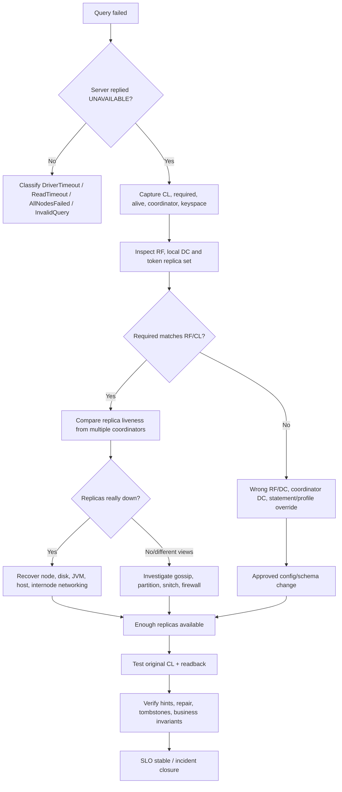

# Unavailable Due to Insufficient Replicas to Satisfy CL

> **Chapter:** Troubleshooting  
> **Module:** `DATABASE_ENGINE_WIDE_COLUMN_CASSANDRA` — understanding Apache Cassandra's distributed architecture and wide-column model, especially partition keys, query-driven table design, read/write consistency levels, CQL, replication, compaction, repair, failure handling, and Java application connectivity.  
> **Topic:** `UnavailableException` when the coordinator knows **too few live replicas exist** to satisfy a request's consistency level (`CL`).  
> **Applies to:** Cassandra 4.x/5.x, Java Driver 4.19, Spring Boot 3.x/4.x; verify APIs and settings against your actual deployed versions.

## 1. Opening Scenario: Cassandra Still Has Up Nodes, Yet Requests Fail Unavailable

A Java application writes an order at `LOCAL_QUORUM` and receives:

```text
com.datastax.oss.driver.api.core.servererrors.UnavailableException
Not enough replicas available for query at consistency LOCAL_QUORUM
(2 required but only 1 alive)
```

At the same time, `nodetool status` still shows several nodes `UN`, and the app connects to CQL port `9042` without issue. Why did the coordinator reject the request?

Because **having connectivity to Cassandra** does not mean **having enough replicas for the partition being read or written**. In an RF3 keyspace within a single DC, `LOCAL_QUORUM` requires two replica responses. If the coordinator believes only one of the partition's three replicas is alive, it returns `UNAVAILABLE` immediately before executing the request.

```text
                         Java Application
                                │
                    SELECT ... WHERE order_id = O42
                                │
                                ▼
                    Coordinator cass-a
                                │
                     Token + keyspace RF
                      /      |       \
                Replica A Replica B Replica C
                    UN        DN       DN
                      \       |       /
                       known alive = 1
                       required    = 2
                                │
                         UNAVAILABLE
```

Never conclude the whole cluster has only one node Up: `alive=1` reflects only the **eligible replicas for that operation believed alive by the coordinator**. Across a cluster with many token ranges, one Down node may break CL for some partitions while other partitions still satisfy CL.

An `Unavailable` occurs when the coordinator **knows upfront that minimum liveness is not met**. By contrast, `ReadTimeout` or `WriteTimeout` occurs when the coordinator initially believed enough replicas were live, dispatched the request, and then failed to receive enough replies/ACKs in time.

**Troubleshooting goal:** Read CL, required, alive, coordinator, keyspace RF, DC, and replica ownership accurately; find out why replicas are not considered alive; and recover **without blindly downgrading CL and breaking business invariants**.

## 2. Learning Outcomes

After completing this lesson, you will be able to:

1. Explain coordinator, replica, contact point, partition token, RF, NTS, local DC, and consistency levels.
2. Inspect `UnavailableException` via `getConsistencyLevel()`, `getRequired()`, and `getAlive()`.
3. Compute thresholds for `QUORUM`, `LOCAL_QUORUM`, `ONE`, `TWO`, `THREE`, and `ALL`, and distinguish `EACH_QUORUM` from `ANY`.
4. Distinguish `Unavailable` from `ReadTimeout`, `WriteTimeout`, `DriverTimeout`, `AllNodesFailed`, `NoNodeAvailable`, and validation errors.
5. Locate a partition's replica set instead of guessing from total Up node counts.
6. Check `nodetool status` from multiple coordinators to spot network partitions and gossip divergence.
7. Query `system_schema.keyspaces` to verify RF/NTS/DC, and understand why RF3 on a single node is a broken lab setup.
8. Diagnose wrong local DC, RF/DC name mismatches, topology changes, bad contact points, and per-statement CL overrides.
9. Analyze multi-DC `QUORUM` vs. `LOCAL_QUORUM` during WAN splits.
10. Find root causes of Down nodes: disk/GC/JVM/network, internode TLS, address advertisement, and membership.
11. Use Java Driver 4.19 to classify errors safely, perform bounded retries, and avoid silent consistency downgrades.
12. Use CQL, Java, JUnit/Testcontainers, or lab clusters to reproduce insufficient-replica scenarios.
13. Separate CQL availability recovery from hints, repair, and data convergence.
14. Build runbooks for investigation, mitigation, and post-incident verification.
15. Verify CL guarantees using read-backs, metrics, business invariants, and SLOs.

## 3. Three Roles Commonly Conflated

| Term | Function | Not Synonymous With |
|---|---|---|
| **Contact point** | Seed address for Java Driver bootstrap and cluster discovery | Replica for every partition |
| **Coordinator** | Node receiving a CQL request and coordinating replicas/CL | Necessarily a contact point |
| **Replica** | Node chosen by keyspace replication strategy for a partition/token range | Every Up node |
| **Local DC** | Datacenter the client prefers for local coordinators | Assumed cloud region name |
| **RF** | Designed copy count per keyspace/DC | Number of clients or connections |
| **CL** | Number/scope of replica responses/ACKs required per operation | Retry configuration |
| **Alive** in `Unavailable` | Eligible replicas the coordinator believes are live | Total Cassandra nodes in the cluster |

### 3.1. Token Map and Replica Placement

Given the table:

```sql
CREATE TABLE orders_by_id (
    order_id uuid PRIMARY KEY,
    customer_id uuid,
    state text,
    amount_cents bigint
);
```

The partition key `order_id` is hashed into a token; the replication strategy selects replicas from the token ring. In a 12-node RF3 cluster, each partition still has only **3 replicas**. One Down node affects the token ranges it owns; check availability by **partition key**, never assuming "11/12 nodes Up means every query works".

### 3.2. The Coordinator Need Not Belong to the Replica Set

```text
App → Coordinator cass-07
           └── token(order_id=O42)
                       ├── Replica cass-02
                       ├── Replica cass-05
                       └── Replica cass-09
```

`cass-07` can be completely healthy while `cass-05` and `cass-09` are Down, causing `LOCAL_QUORUM` to miss its required count. Restarting `cass-07` will not revive `cass-05` or `cass-09`.

### 3.3. Contact Points Do Not Determine Quorum

The driver uses contact points to discover topology; after bootstrap, it can query other nodes. Adding three more contact points neither increases RF nor creates extra replicas. Conversely, a single Down contact point at **startup** can prevent bootstrap even while other coordinators and replicas are healthy. Distinguish startup bootstrap errors from protocol `UnavailableException` returned by an active coordinator.

## 4. Protocol Definition and `required`/`alive`

### 4.1. Trigger Condition

An `UNAVAILABLE` response carries:

```text
consistency = requested CL
required    = minimum responses/ACKs required by CL
alive       = replicas coordinator believes are live
```

In the standard case:

\[
\mathrm{alive} < \mathrm{required}.
\]

Example:

```text
Keyspace: NTS { dc1:3 }
Requested CL: LOCAL_QUORUM
Required: floor(3 / 2) + 1 = 2
Coordinator believes alive replicas: 1
Result: UNAVAILABLE
```

Java Driver 4.19 `UnavailableException` exposes `getConsistencyLevel()`, `getRequired()`, and `getAlive()`. These provide **far better evidence** than parsing version-dependent message strings.

### 4.2. What Determines `required`?

- **`ONE`:** one replica responds.
- **`LOCAL_ONE`:** one replica in the coordinator's DC.
- **`TWO`/`THREE`:** 2 or 3 replicas respectively, when topology supports it.
- **`QUORUM`:** strict majority of the keyspace's total RF.
- **`LOCAL_QUORUM`:** strict majority of RF in **the coordinator's local DC**.
- **`EACH_QUORUM`:** quorum in **every DC** for supported operations/versions.
- **`ALL`:** all replicas per RF.
- **`ANY`:** write-only and may accept hints; **not** valid for reads.

Most examples below assume **full replicas** and `NetworkTopologyStrategy`. If using **transient replication** (`3/1`, `5/2`), do not apply full-RF math naively; check version-specific semantics and constraints.

### 4.3. `alive` Is the Coordinator's Perspective

`alive` is **not** the number of nodes connected to the driver or reported by `kubectl get pods`. It is the number of eligible replicas the coordinator knows to be live during preflight CL checking. If coordinator A is partitioned from B/C while the app still reaches A over TCP 9042, A can report `alive=1`, while coordinator B (which sees C) achieves `alive=2`.

### 4.4. One Exception Does Not Tell the Whole Business Outcome

An `UnavailableException` means that single attempt was rejected upfront by the coordinator for lacking live replicas. However, the same business command could have had an earlier attempt, async side effects, or partial multi-table workflow steps already applied. For payment/order jobs, never infer "no mutation occurred anywhere" solely from the final attempt's error. Use deterministic business command IDs/versions and reconcile whenever retries or timeouts happened.

## 5. Quorum by RF: Calculate Explicitly, Never Guess

### 5.1. Formula

For \(N\) full replicas:

\[
Q(N) = \left\lfloor\frac{N}{2}\right\rfloor + 1.
\]

| RF | Quorum | Replicas Allowed Down While Keeping Quorum |
|---:|---:|---:|
| 1 | 1 | 0 |
| 2 | 2 | 0 |
| 3 | 2 | 1 |
| 4 | 3 | 1 |
| 5 | 3 | 2 |
| 6 | 4 | 2 |

This table assumes remaining replicas **actually reply in time and the coordinator sees them Up**. A node that is Up yet stalled on I/O can still cause timeouts despite sufficient math.

### 5.2. RF3, Single DC

```text
A Up, B Up, C Up     → LOCAL_QUORUM 2/3: can succeed
A Up, B Up, C Down   → LOCAL_QUORUM 2/3: can succeed
A Up, B Down, C Down → LOCAL_QUORUM 2/3: UNAVAILABLE
A Up, B Up, C Down   → ALL 3/3: UNAVAILABLE
```

If A/B/C are all Up in gossip yet B/C fail to answer before the deadline, the error becomes `ReadTimeout`/`WriteTimeout`, not `Unavailable`.

### 5.3. Two DCs, RF3 + RF3

```sql
CREATE KEYSPACE orders_prod WITH replication = {
    'class': 'NetworkTopologyStrategy',
    'dc-east': 3,
    'dc-west': 3
};
```

- Cluster-wide `QUORUM`: \(Q(6)=4\).
- `LOCAL_QUORUM` with an East coordinator: \(Q(3)=2\) in East.
- `LOCAL_QUORUM` with a West coordinator: \(Q(3)=2\) in West.
- `EACH_QUORUM`: requires \(Q(3)=2\) in each DC for supported operations.
- `ALL`: all six replicas.

**WAN cut example:** East has all 3 local replicas, while West is unreachable. `LOCAL_QUORUM` in East can continue, whereas global `QUORUM` needs 4 and fails with only 3/6 in East; `EACH_QUORUM` also fails.

### 5.4. RF3 + RF1, Coordinator in a Different DC

```text
NTS: dc-east=3, dc-west=1
Coordinator East: LOCAL_QUORUM required=2
Coordinator West: LOCAL_QUORUM required=1
Global QUORUM required=floor(4/2)+1=3
```

Hence **switching coordinator/local DC** during failover changes `required`. Driver 4.19's built-in policy disables cross-DC failover by default; enabling failover requires evaluating RF/CL and accepting explicit trade-offs.

### 5.5. `LOCAL_QUORUM` and \(R + W > RF\)

With local RF3, reading \(R=2\) and writing \(W=2\):

\[
R+W=4>3=RF.
\]

The read and write replica sets overlap, supporting read-after-write when Cassandra conditions hold. Downgrading both read and write to `ONE`:

\[
R+W=1+1=2\leq3,
\]

eliminates guaranteed intersection. Therefore, `LOCAL_QUORUM → ONE` **alters the consistency contract**, not merely a timeout parameter.

### 5.6. When RF Exceeds Actual Node Count

A single-node Cassandra lab container with a keyspace configured as RF3:

```sql
CREATE KEYSPACE lab_bad WITH replication = {
    'class': 'NetworkTopologyStrategy',
    'datacenter1': 3
};
```

Declaring RF3 does not materialize three full replicas; `LOCAL_QUORUM` can fail for lacking replicas. **A single-node lab should use RF1**; never invert that into "lower production to RF1 so it runs" during an incident.

### 5.7. `ALL` and `ANY` Are Not Cure-Alls

`ALL` raises the ACK requirement and sacrifices availability whenever one replica goes Down. `ANY` applies only to **writes**, may count a hint as an acknowledgement under specific rules, and offers no immediate read-your-write guarantee. Never downgrade CL to `ANY`/`ONE` just to return HTTP 200 if the business requires local quorum.

## 6. `Unavailable` Differs from Timeouts, Failures, and No Node

| Error | Origin | Meaning | Inspect First |
|---|---|---|---|
| `UnavailableException` | Coordinator | Knows `alive < required` for requested CL | RF/CL, token replicas, gossip |
| `ReadTimeoutException` | Coordinator | Dispatched read; insufficient timely responses/data | Slow replicas, disk, network |
| `WriteTimeoutException` | Coordinator | Dispatched write; insufficient timely ACKs | Replica network/storage; outcome uncertain |
| `ReadFailureException` | Coordinator | Replica/server returned explicit read failure | Logs/failure reasons |
| `WriteFailureException` | Coordinator | Write path returned explicit failure | Commitlog/disk/server errors |
| `DriverTimeoutException` | Java Driver | No response before client deadline | Client/coordinator path, queues, WAN |
| `AllNodesFailedException` | Java Driver | All query-plan candidates failed | Per-node causes; may contain `Unavailable` |
| `NoNodeAvailableException` | Java Driver | No usable coordinator candidate | Discovery, load balancing/local DC |
| `OverloadedException` | Coordinator | Server overloaded | Requests/s, queues, CPU/disk |
| `InvalidQueryException` | Server validation | Bad schema/WHERE/CL constraints | CQL query/model |
| `UnauthorizedException` | CQL authz | Role lacks permissions | GRANT/auth, not replication |

### 6.1. Error Timeline of a Network Partition

```text
t0: Network severed between A and B/C
t1: A still believes B/C are Up → sends requests and waits → ReadTimeout
t2: A's failure detector marks B/C Down
t3: A sees alive=1 < LOCAL_QUORUM required=2 → Unavailable
t4: B sees C Up and can satisfy local quorum from B's view
```

There is no contradiction when the same partition/CL shifts from Timeouts to `Unavailable` as membership converges. Capture timestamped logs rather than inspecting only the final error.

### 6.2. Why Does `Unavailable` Usually Fail Fast?

The coordinator already holds membership state showing too few live replicas, so it fails immediately instead of waiting for read timeouts. Raising `basic.request.timeout` from 2s to 30s **will not revive dead replicas** and may simply bloat client queues.

### 6.3. Ping / Port 9042 Open Is Not Enough

CQL port `9042` can accept TCP connections while internode links between coordinator and replicas are broken. A Running OS container also does not equal a node Up in gossip. Check **client→coordinator** and **coordinator↔replica** paths separately.

### 6.4. LWT and the Serial Phase

`INSERT ... IF NOT EXISTS` or `UPDATE ... IF ...` executes a **Paxos serial phase** (`SERIAL`/`LOCAL_SERIAL`) alongside the regular CL. LWT failures require inspecting both serial-phase quorum/availability and regular-phase CL per version/protocol. Never downgrade `LOCAL_SERIAL` as a default retry behavior; it breaks conditional-write correctness.

## 7. Reading Useful Error Fields

### 7.1. RF3 `LOCAL_QUORUM`

```text
operation      = SELECT orders_by_id
keyspace       = orders_prod
coordinator    = cass-a / dc-east
consistency    = LOCAL_QUORUM
required       = 2
alive          = 1
```

**Next step:** Find the three replicas owning that `order_id`, and determine why `cass-a` sees two of them as Down. Never restart every node or alter CL before identifying the replica set.

### 7.2. `ALL` on RF3

```text
consistency = ALL
required    = 3
alive       = 2
```

One Down replica is enough to fail `ALL`. This is **expected behavior** for CL `ALL`, not a server calculation bug. If the system must tolerate one Down node, choose the appropriate CL ahead of time per SLO/RPO—never patch it in production with an implicit downgrade.

### 7.3. Global `QUORUM` Larger Than Expected

```text
keyspace NTS = dc-east:3 + dc-west:3
consistency  = QUORUM
required     = 4
alive        = 3
```

`required=4` because total RF is 6; never calculate cluster-wide `QUORUM` from a single DC's RF3. If the use case genuinely needs local consistency, verify statement configs and business contracts before changing it.

### 7.4. Different Coordinators, Different Answers

```text
cass-a → required=2, alive=1
cass-b → required=2, alive=2
```

`cass-a` may be isolated or gossip views haven't converged. This is a strong cue to pull `nodetool status` from **both A and B**, inspect internode networking/GC, and check target nodes in Java Driver logs.

### 7.5. Redacting Sensitive Data

Log operation name, CL, required, alive, logical coordinator label, keyspace, DC, and correlation ID. Never log CQL passwords, private keys, raw tenant/customer identifiers, PII-bearing bind values, or full internal IPs in public HTTP responses.

## 8. Quick Diagnostic Decision Tree



A decision tree keeps you from fixing the wrong layer: **replica membership** is not **client contact points**; **keyspace RF** is not **driver retries**; **Cassandra repair** is not **application reconciliation** across denormalized tables.

## 9. Seven Common Root Causes

### 9.1. Replicas Actually Down

Process crash, node OOM, full disk, OS failure, failed Cassandra startup, GC stalls, storage latency, container eviction, or stopped service. Under RF3, when two replicas for the **same partition** are Down, local quorum fails.

### 9.2. Internode Network Partition

The coordinator accepts client CQL yet cannot reach peer replicas due to firewalls, routes, ACLs, internode TLS, DNS, NAT, MTU, or asymmetric paths. Verify internode ports in actual `cassandra.yaml`/distributions, not just CQL `9042`.

### 9.3. Snitch / DC Placement Mismatch

Keyspace NTS specifies `dc-east`, while nodes report `DC-EAST` or `east`. DC names are case-sensitive; unintended rack/DC layouts produce unexpected required counts or placement. Changing snitches or DC names is a major **topology operation**, not a harmless label tweak.

### 9.4. RF Exceeds Available Full Nodes

A single-node lab using RF3, or a production DC with RF3 reduced to two nodes running CL `ALL`. Changing `contact-points` will not add data copies.

### 9.5. Unintended CL Override

`application.yml` defaults to `LOCAL_ONE`, yet `BoundStatement.setConsistencyLevel(ALL)` or an execution profile overrides it. One code path may start failing right after deployment. Read `getConsistencyLevel()` from the live exception rather than trusting YAML alone.

### 9.6. Isolated Coordinator

A thinks B/C are Down while B/C still communicate normally. The default retry policy may retry on the next coordinator; if B succeeds, do not assume A is fine. Track errors by coordinator and fix the network path.

### 9.7. Incomplete Topology Change

Ongoing bootstrap/decommission/replacement, stalled streaming, or nodes in `UJ`/`UL` leave replica ownership unconverged. Never run `decommission` or `replace` for a transient fault without a proper runbook and capacity check.

## 10. Capturing Per-Request Incident Evidence

```text
incident_id      = INC-20261121-042
occurred_at_utc  = 2026-11-21T10:30:25Z
operation        = SELECT/INSERT/UPDATE/DELETE/LWT
keyspace         = orders_prod
table            = orders_by_id
partition_key    = <hashed-or-privileged-test-id>
requested_cl     = LOCAL_QUORUM
serial_cl        = <only-if-LWT>
required         = 2
alive            = 1
coordinator      = cass-a / dc-east / rack1
application      = service-api / version / profile
driver_version   = 4.19.x
retry_attempts   = ...
```

- **One table/keyspace fails while another succeeds:** check RF/NTS/schema.
- **Only specific keys fail:** check token ranges/replica owners, especially at CL `ALL`.
- **Only LWT fails:** check the serial phase.
- **Fails only after deploy:** check statement CL/profile, local DC, and driver config.
- **Only coordinator A fails:** check isolation or liveness view on A.
- **Only one app fails:** check client networking, discovery, and local DC before blaming cluster-wide Cassandra.

Never paste production PII into test keys or public incident tickets.

## 11. Non-Destructive `nodetool` Observation Commands

### 11.1. `nodetool status`

```bash
# Run on a Cassandra host with JMX access; read-only.
nodetool status
nodetool status orders_prod
```

Example:

```text
Datacenter: dc-east
====================================
Status=Up/Down
|/ State=Normal/Leaving/Joining/Moving
--  Address    Load  Tokens  Owns   Host ID  Rack
UN  10.1.1.11  ...   16      ...    id-A     rack1
DN  10.1.2.12  ...   16      ...    id-B     rack2
DN  10.1.3.13  ...   16      ...    id-C     rack3
```

`UN` = Up/Normal; `DN` = Down/Normal **from the queried node's perspective**. `nodetool status` on another coordinator can show a different view during a network partition. Collect from at least two nodes before assuming everyone sees the same state.

### 11.2. Gossip, Streaming, and Node Details

```bash
nodetool gossipinfo
nodetool describecluster
nodetool info
nodetool netstats
```

- `gossipinfo`: membership, generation, and endpoint states.
- `describecluster`: cluster, snitch, and schema context.
- `info`: node metadata and uptime.
- `netstats`: streaming, repair, and network activity.

Avoid dumping raw gossip output into public logs; filter to affected hosts. Never run state-mutating gossip commands when you only need observation.

### 11.3. Thread Pools and Table Stats

```bash
nodetool tpstats
nodetool tablestats orders_prod.orders_by_id
```

These metrics help find why replicas are Down or slow (GC, queues, dropped messages, compaction/tombstones). Do not assume raising `read_request_timeout` fixes missing liveness. `nodetool` uses JMX; unreachable JMX **does not by itself prove CQL is unavailable**.

## 12. CQL Checks for Keyspace Replication and DC

### 12.1. Read the Keyspace's Exact RF

```sql
SELECT keyspace_name, replication, durable_writes
FROM system_schema.keyspaces
WHERE keyspace_name = 'orders_prod';
```

Example output:

```text
class   = org.apache.cassandra.locator.NetworkTopologyStrategy
dc-east = 3
dc-west = 3
```

Do not assume RF from a different keyspace, or look only at session defaults when queries use fully qualified `tenant_a.orders_by_id`.

### 12.2. Check the Node's Actual DC

```sql
SELECT data_center, rack
FROM system.local;
```

`system.local` describes **the single node answering the query**. To inspect the whole cluster, check `nodetool status`/metadata from multiple nodes or driver node metadata. DC names must match NTS and driver `local-datacenter`. Never guess DC names from Kubernetes zones or cloud regions.

### 12.3. Schema RF Does Not Prove Replicas Are Healthy

`dc-east:3` is the **configured replica placement**, not a guarantee that all replicas are Up/Normal at fault time. Corroborate with `nodetool status`, replica ownership/token mapping, and server readiness.

### 12.4. Do Not Reflexively `ALTER KEYSPACE`

`ALTER KEYSPACE` changing RF does not automatically stream/repair all historical data onto new replicas and alters durability/availability. Changing RF requires migration planning, backups, capacity, repair/streaming, and approval. Never shrink RF during an incident just to reduce `required`.

## 13. Identifying Partition Replica Owners

### 13.1. Replica Sets Matter More Than Total Up Nodes

A 12-node RF3 cluster with 11 `UN` nodes does not satisfy **CL=ALL** for every partition. Partitions owned by the Down node lose 1/3, while partitions elsewhere retain all replicas. Always extract the **failing request's partition key** and find its exact replica set.

### 13.2. `nodetool getendpoints`

```bash
# Standard nodetool syntax; substitute a properly formatted key.
nodetool getendpoints orders_prod orders_by_id '<partition-key-value>'
```

`getendpoints` takes keyspace, table, and key. A single `text` partition key can be passed directly; for UUIDs or composite keys, check how your version encodes partition keys. **Never** concatenate UUIDs as strings or use Java `hashCode()` to guess Cassandra tokens. Use driver `TokenMap` and codec-encoded routing keys when needed.

### 13.3. Sample Output

```text
Partition O42:
  replica cass-01 / dc-east / rack1 / UN
  replica cass-05 / dc-east / rack2 / DN
  replica cass-09 / dc-east / rack3 / DN
  CL LOCAL_QUORUM, required=2, alive=1
```

Even with 10/12 nodes Up, **partition O42** lacks quorum. You must restore `cass-05`/`cass-09` or resolve gossip divergence; adding `cass-11` to contact points creates no new replicas.

### 13.4. Rack-Aware Replication and Topology Changes

NTS spreads replicas across racks when enough racks/nodes exist and snitch metadata is accurate. Misconfigured racks/power domains can take down two replicas at once. During bootstrap, decommission, or replacement, token ownership and streaming are in flux; capture point-in-time topology, host IDs, and metadata rather than relying on stale diagrams.

## 14. Case A — RF3, Two Replicas Actually Down

```text
NTS dc1:3
A UN, B DN, C DN
LOCAL_QUORUM required=2, alive=1
```

This is **expected `Unavailable` per CL**.

Workflow:

1. Cap retry storms and in-flight requests; return safe infrastructure errors if needed.
2. Investigate B/C (host, JVM, OOM, full disk, internode networking, TLS).
3. Restore **at least one relevant replica in the local DC**, not just any arbitrary cluster node.
4. Check gossip from both A and the recovered node.
5. Test queries at the **original `LOCAL_QUORUM`**, verifying expected data/versions.
6. Check hints backlog, repair plan, and tombstones.
7. Reconcile business commands with uncertain outcomes after prior timeouts.

Raising timeouts **cannot** create replicas when the coordinator already knows live nodes are missing. Automatically switching `LOCAL_QUORUM→ONE` is also not an infrastructure fix: it alters read-after-write/durability contracts and requires approval, auditing, and an explicit degraded-mode policy if ever permitted.

## 15. Case B — Isolated Coordinator

### 15.1. Asymmetric Membership

```text
App → A: native CQL OK
A -X→ B and C: internode blocked
B ↔ C: internode healthy

A sees alive=1 and returns Unavailable.
B sees C alive and achieves 2/3.
```

Typical signs:

- Cassandra on A is Running and accepting CQL.
- `nodetool status` on A marks B/C `DN`.
- `nodetool status` on B marks C `UN`.
- Driver retries to coordinator B and the same query succeeds.

### 15.2. Evidence to Collect

1. Failing coordinator per request plus `required`/`alive`.
2. `nodetool status` from A, B, and C at aligned timestamps.
3. Internode firewalls, ACLs, ports, TLS, and broadcast addresses.
4. JVM GC pauses / CPU saturation on A.
5. Driver query plan, connected nodes, and retry counts.
6. Replica owners for the keys so you don't compare different partitions.

### 15.3. Mitigating Without Tangling Topology

If A is isolated, you may temporarily drain A from the client serving path per driver/LB runbooks while fixing networking. Editing contact points **does not necessarily** stop the driver from using A after discovery. Never run `nodetool decommission` for a transient network partition, because decommission triggers streaming and ring changes.

`DefaultRetryPolicy` may retry another coordinator once on `Unavailable` when eligible. However, if all coordinators lack quorum, repeated retries only amplify load.

## 16. Case C — Multi-DC, WAN Outage, and Global CL

### 16.1. Two DCs, RF3 Each

```text
dc-east: E1,E2,E3 (RF3)
dc-west: W1,W2,W3 (RF3)

East internal: 3/3 healthy
East–West: WAN severed
East app hits coordinator E1
```

| CL | Required | Only 3 East Replicas Reachable |
|---|---|---|
| `LOCAL_ONE` in East | 1 East | Can succeed |
| `LOCAL_QUORUM` in East | 2 East | Can succeed |
| Global `QUORUM` (RF6) | 4 total | Insufficient |
| `EACH_QUORUM` | 2 East + 2 West | Insufficient in West |
| `ALL` | 6 | Insufficient |

Results assume the entire remote DC is unreachable, full replicas, and converged server gossip. Before convergence, timeouts may appear before `Unavailable`.

### 16.2. `QUORUM` Is Not `LOCAL_QUORUM`

When expanding a single-DC RF3 cluster to dual-DC RF3+3, global `QUORUM` jumps from `required=2` to `required=4`. Services still using `QUORUM` suddenly depend on WAN connectivity. If the business only requires local consistency, switching to `LOCAL_QUORUM` may be the right design, provided you evaluate RPO, DR, and cross-DC read-your-write implications. Never treat mid-incident CL changes as risk-free.

### 16.3. Failover Switching Coordinators Can Change Quorum

```text
NTS dc-east:3, dc-west:1
LOCAL_QUORUM coordinator East → 2
LOCAL_QUORUM coordinator West → 1
Global QUORUM                 → 3
```

Java Driver 4.x's built-in load balancer prefers the **local DC** and will not fail over remotely unless configured. When remote failover is enabled, local CL restrictions and business semantics can shift. Verify providers, DCs, and RFs before routing East traffic to West.

### 16.4. Losing One DC Need Not Take Down the Cluster

In East, with 2/3 local replicas alive, `LOCAL_QUORUM` keeps working even if West is Down; `EACH_QUORUM` does not. However, writes acknowledged only in East may not have reached West yet, so immediate failover can expose cross-DC data freshness gaps.

## 17. Case D — RF, Schema, and DC Name Mismatch

### 17.1. RF3 on Single-Node Testcontainers

```yaml
# Lab with only one Cassandra node.
spring:
  cassandra:
    contact-points: "127.0.0.1:9042"
    local-datacenter: "datacenter1"
    keyspace-name: "lab_bad_rf3"
    request:
      consistency: LOCAL_QUORUM
```

```sql
CREATE KEYSPACE lab_bad_rf3 WITH replication = {
    'class': 'NetworkTopologyStrategy',
    'datacenter1': 3
};
```

RF3 does not create two extra physical replicas. Use RF1 for single-node labs, and build a real 3-node cluster to test quorum. Never lower production RF to mimic Testcontainers fixes.

### 17.2. DC Names Are Case-Sensitive

```text
nodetool status: Datacenter: dc-east
keyspace NTS:   'DC-EAST':3
```

Mismatches between snitch values and NTS keys break intended placement. Never edit a snitch on a live production node ad hoc; that is a topology change. Identify the source of truth and follow planned schema/topology migration plus repair/streaming.

### 17.3. The Query's Target Keyspace Matters

A CQL statement referencing `other_ks.orders_by_id` uses `other_ks`'s RF even when `CqlSession` defaults to `orders_prod`. Always evaluate RF/CL against the **actual target keyspace** of the statement.

### 17.4. Spring Boot Versions

Spring Boot 2.7 uses `spring.data.cassandra.*`, whereas Boot 3.x/4.x uses `spring.cassandra.*`. Upgrading Boot while keeping legacy prefixes can cause settings to be ignored silently. Inspect resolved properties, custom session beans, and statement overrides before blaming the server.

## 18. Case E — Statement CL Differs from Default CL

### 18.1. Per-Statement Override

```hocon
datastax-java-driver {
  basic.request.consistency = LOCAL_QUORUM
}
```

```java
BoundStatement query = prepared.bind(orderId)
    .setConsistencyLevel(DefaultConsistencyLevel.ALL);
```

When one replica is Down in RF3, this statement requires 3/3 even though the default `LOCAL_QUORUM` only needs 2. Read `Unavailable.getConsistencyLevel()` directly instead of assuming from HOCON/YAML.

### 18.2. Execution Profiles

Java Driver profiles can define distinct `basic.request.consistency`, and Spring Data query options can override CL. One endpoint on a `critical` profile (`ALL`) may fail while another endpoint on `LOCAL_QUORUM` stays green. Track effective CL per operation/query name.

### 18.3. Never Downgrade CL Automatically in a Catch Block

```java
// ANTI-PATTERN: implicit downgrade breaks the contract.
try {
    return session.execute(statement
        .setConsistencyLevel(
            DefaultConsistencyLevel.LOCAL_QUORUM));
} catch (UnavailableException e) {
    return session.execute(statement
        .setConsistencyLevel(
            DefaultConsistencyLevel.ONE));
}
```

Any degraded read mode lowering CL must be approved by business owners with explicit contracts, time bounds, observability, and rollback. Never embed CL downgrades in a shared retry wrapper for writes.

### 18.4. LWT Is a Special Case

`UPDATE ... IF revision = ?` / `INSERT IF NOT EXISTS` uses Paxos serial consistency (`SERIAL`/`LOCAL_SERIAL`). If only LWTs fail, inspect serial-phase quorum alongside regular CL, separating quorum loss from Paxos contention timeouts.

## 19. Layer-by-Layer Investigation of Communication and Health

| Layer | Check | Avoid False Conclusions |
|---|---|---|
| App→coordinator | DNS, TCP 9042, TLS/credentials, Driver connected nodes | One reachable seed ≠ enough replicas |
| Coordinator↔replicas | Internode ports, gossip, firewalls, TLS, broadcast addresses | CQL 9042 OK ≠ healthy replication |
| OS/JVM | OOM, GC, process restarts, CPU throttling | Container Running ≠ Cassandra gossip Up |
| Storage | Disk free/inodes, commitlog, compaction/flush | Node `UN` ≠ fast responses |
| Topology | DC/rack/snitch, host IDs, bootstrap/decommission | Schema RF ≠ data already streamed |
| Driver/app | Local DC, CL profile, retry budget, pooling | More retries ≠ higher RF |
| Business | Command IDs, idempotency, stale reads | One `Unavailable` attempt ≠ zero prior side effects |

If `nodetool` cannot reach JMX, treat it as a **JMX failure** first—not proof the node is Down. Conversely, `nodetool status` from one node might not match another coordinator's membership view.

## 20. Triage Runbook: First 15 Minutes

The timeline below is an **illustrative action sequence**, not a guarantee every cluster recovers in 15 minutes.

### Minutes 0–2: Confirm Exact Error Type

1. Capture the root exception class; distinguish `UnavailableException` from `AllNodesFailedException` wrapping `Unavailable`.
2. Record CL, required, alive, coordinator, timestamp, keyspace, table, and safe partition key.
3. Separate reads, writes, LWTs, and newly deployed query versions.
4. Cap retries/queues per SLO without downgrading CL.
5. Communicate degraded status if business contracts cannot be met.

### Minutes 2–5: Identify Involved Replicas

1. Query `system_schema.keyspaces.replication`.
2. Check coordinator DC, local DC, and NTS DC names.
3. Locate partition replica owners via `getendpoints`/`TokenMap`.
4. Verify `required` against the formula and actual RF.
5. Scope impact: one keyspace/partition vs. entire DC.

### Minutes 5–10: Inspect Membership and Networking

1. Collect `nodetool status` from at least two nodes.
2. Check for `DN`/`Joining`/`Leaving`, active streaming, and backlogs.
3. Verify both CQL and internode links on the right ports.
4. Check process, disk, GC, and JVM logs on replicas considered Down.
5. Group errors by coordinator and client app instance.

### Minutes 10–15: Choose Mitigation Path

- **Replicas genuinely Down:** restore OS/Cassandra/network per node runbook.
- **One isolated coordinator:** fix links/gossip; consider draining it from client serving paths cleanly.
- **RF/DC mismatch:** roll back broken deployment or execute approved schema migration—never improvise.
- **Wrong CL override:** revert code, profile, or config.
- **WAN outage:** execute pre-designed DR plan for local CL or failover.
- **Uncertain write outcomes:** log command IDs and wait for reconciliation rather than replaying non-idempotent writes.

**Do not close the incident merely when nodes return to `UN`.** Verify original CL, data, hints/repair, and SLOs.

## 21. Java Driver 4.19: Extracting `UnavailableException` Details

### 21.1. Shared `CqlSession`

```java
import java.net.InetSocketAddress;
import com.datastax.oss.driver.api.core.CqlSession;

try (CqlSession session = CqlSession.builder()
        .addContactPoint(
            new InetSocketAddress("cass-a.lab.internal", 9042))
        .addContactPoint(
            new InetSocketAddress("cass-b.lab.internal", 9042))
        .withLocalDatacenter("dc1")
        .withKeyspace("lab_unavailable")
        .build()) {
    // Prepare statements, execute, and inspect exceptions.
}
```

Hostnames are illustrative lab placeholders; never run verbatim in production. `CqlSession` should be application-scoped, never constructed per HTTP request or retry.

### 21.2. Structured Field Extractor

```java
import com.datastax.oss.driver.api.core.servererrors.UnavailableException;

public final class UnavailableDiagnostic {

    public record Detail(
        String coordinator,
        String consistency,
        int required,
        int alive) {}

    public static Detail of(UnavailableException error) {
        var coordinator = error.getCoordinator();
        return new Detail(
            coordinator == null
                ? "unknown"
                : coordinator.getEndPoint().toString(),
            error.getConsistencyLevel().name(),
            error.getRequired(),
            error.getAlive());
    }
}
```

These four fields describe coordinator-level failure, not total cluster node counts. `getCoordinator()` is inherited from `CoordinatorException`. Avoid exposing raw internal IPs/endpoints in public logs; map to logical coordinator labels when appropriate.

### 21.3. Explicit Statement and CL

```java
import java.util.UUID;

import com.datastax.oss.driver.api.core.CqlSession;
import com.datastax.oss.driver.api.core.DefaultConsistencyLevel;
import com.datastax.oss.driver.api.core.cql.PreparedStatement;
import com.datastax.oss.driver.api.core.cql.Row;
import com.datastax.oss.driver.api.core.servererrors.UnavailableException;

public class OrderLookup {
    private final CqlSession session;
    private final PreparedStatement prepared;

    public OrderLookup(CqlSession session) {
        this.session = session;
        this.prepared = session.prepare(
            "SELECT state, amount_cents " +
            "FROM lab_unavailable.orders_by_id " +
            "WHERE order_id=?");
    }

    public Row read(UUID orderId) {
        var statement = prepared.bind(orderId)
            .setConsistencyLevel(
                DefaultConsistencyLevel.LOCAL_QUORUM)
            .setIdempotent(true);

        try {
            return session.execute(statement).one();
        } catch (UnavailableException ex) {
            var detail = UnavailableDiagnostic.of(ex);
            // Report internal metrics: CL, required, alive, node.
            // Never fall back to ONE or return "not found".
            throw new StorageUnavailableException(
                "Requested CL unavailable", ex);
        }
    }
}
```

`StorageUnavailableException` is an **application-defined domain exception** (e.g., subclassing `RuntimeException`), not a Java Driver class. The same pattern works with `CompletionStage`/WebFlux while handling async wrappers and retry policies carefully.

### 21.4. Never Swallow Errors into Empty Results

An infrastructure failure is not a business "not found":

```java
// ANTI-PATTERN in reactive services:
return reactiveRepository.findById(orderId)
    .onErrorResume(error -> Mono.empty()); // Can turn into HTTP 404.
```

Instead: map `Mono.empty()` from a **successful query** to 404, while mapping storage errors to 503/504 per your error contract with correlation IDs and alerts. If Spring Data translates exceptions to `DataAccessException`, inspect the Spring exception type and cause chain.

## 22. Java: Inspecting `AllNodesFailedException` Per Coordinator

### 22.1. `getAllErrors()` API

In Driver 4.19, `AllNodesFailedException.getAllErrors()` returns `Map<Node, List<Throwable>>`. One coordinator can accumulate multiple failed attempts, so use `getAllErrors()` rather than deprecated `getErrors()`.

```java
import java.util.ArrayList;
import java.util.List;
import java.util.concurrent.CompletionException;
import java.util.concurrent.ExecutionException;

import com.datastax.oss.driver.api.core.AllNodesFailedException;
import com.datastax.oss.driver.api.core.servererrors.UnavailableException;

public final class DriverFailureInspector {

    public record UnavailableAtNode(
        String node, String cl, int required, int alive) {}

    static Throwable unwrap(Throwable thrown) {
        Throwable current = thrown;
        for (int i = 0; i < 8; i++) {
            if ((current instanceof CompletionException
                 || current instanceof ExecutionException)
                && current.getCause() != null) {
                current = current.getCause();
            } else {
                break;
            }
        }
        return current;
    }

    public static List<UnavailableAtNode> collect(
            Throwable thrown) {

        Throwable error = unwrap(thrown);
        List<UnavailableAtNode> result = new ArrayList<>();

        if (error instanceof UnavailableException u) {
            result.add(new UnavailableAtNode(
                String.valueOf(u.getCoordinator()),
                u.getConsistencyLevel().name(),
                u.getRequired(), u.getAlive()));
            return result;
        }

        if (error instanceof AllNodesFailedException all) {
            all.getAllErrors().forEach((node, causes) -> {
                for (Throwable candidate : causes) {
                    Throwable cause = unwrap(candidate);
                    if (cause instanceof UnavailableException u) {
                        result.add(new UnavailableAtNode(
                            String.valueOf(node.getEndPoint()),
                            u.getConsistencyLevel().name(),
                            u.getRequired(), u.getAlive()));
                    }
                }
            });
        }
        return result;
    }
}
```

This uses Java 17+ `record` and pattern-matching `instanceof`, fitting Spring Boot 3/4 services. It extracts **only** `Unavailable` causes—not a complete classifier for TLS, auth, or network errors. In production, bound cause-chain traversal for framework wrappers and emit metrics by root category.

### 22.2. An Empty List Does Not Mean the Request Succeeded

`AllNodesFailed` can also wrap:

- `NodeUnavailableException` (no usable connection in pool).
- `ClosedConnectionException` / TLS handshake failures.
- Authentication/authorization errors.
- Query timeouts or coordinator errors.
- Request throttling.

If `collect()` returns empty, inspect **all per-node errors**. Never force every `AllNodesFailed` into Cassandra `UNAVAILABLE`.

### 22.3. Default Retry Policy and Idempotency

Per Java Driver 4.19 docs, the default retry policy retries only select safe cases, and `onUnavailableVerdict` may try **one other coordinator** at most once under qualifying conditions. No policy can turn two missing replicas into a quorum. App-level retries require budgets, deadlines, and idempotency—especially after uncertain timeouts.

### 22.4. Async Wrappers

`CqlSession.executeAsync` returns `CompletionStage<AsyncResultSet>`; `whenComplete` errors may be wrapped in `CompletionException`. Never block with `get()`/`join()` on driver I/O threads. Unwrap cleanly within bounds and propagate to request/job boundaries so you never report success before execution finishes.

## 23. Spring Boot and Spring Data: Effective Config Is What Matters

### 23.1. Boot 3/4 Configuration

```yaml
spring:
  cassandra:
    contact-points: "cass-a.dc1.internal:9042,cass-b.dc1.internal:9042"
    local-datacenter: "dc1"
    keyspace-name: "orders_prod"
    request:
      consistency: LOCAL_QUORUM
      timeout: 3s
    schema-action: none
```

Hostnames are illustrative; Boot 2.7 used `spring.data.cassandra.*`, whereas Boot 3/4 uses `spring.cassandra.*`. When configured properly, an auto-configured `CqlSession` bean is injected and shared.

### 23.2. Effective CL Can Differ from YAML

A `BoundStatement`, Spring Data query options, or a Driver execution profile can override defaults. When an exception reports `ALL required=3`, hunt down the override rather than reading `LOCAL_QUORUM` in `application.yml` and assuming that's what ran.

### 23.3. `HealthIndicator` Does Not Prove Local Quorum

Spring Boot Actuator's Cassandra health check may only verify basic connectivity / `system.local`, while a business table lacks replicas for `LOCAL_QUORUM`. Meaningful readiness checks need a **small PK lookup** at the target CL with a tight timeout—never `COUNT(*)` or `ALLOW FILTERING` in health probes.

### 23.4. Spring Exception Translation

Reactive/imperative Spring Data may translate driver exceptions into `org.springframework.dao.DataAccessException`. Catching `UnavailableException` directly at the repository boundary can miss it. Check Spring's exception classes and bounded cause chains without brittle message-string parsing.

### 23.5. Verify Local DC and Driver Metadata

An app in East configured with `local-datacenter=dc-west` routes to unintended coordinators, computing local CL against the coordinator's DC. Inspect `session.getMetadata().getNodes()` and node datacenters rather than inferring from Kubernetes namespaces. An app accidentally pointed at the wrong cluster/keyspace will show baffling RF/CL failures that are not server bugs.

## 24. Metrics: Observing Coordinators, Nodes, and SLOs

### 24.1. Cassandra JMX `ClientRequest.Unavailables`

Per Apache Cassandra monitoring docs, coordinator metrics track request types and `Unavailables` counters:

```text
ClientRequest.Unavailables.Read
ClientRequest.Unavailables.Write
ClientRequest.Unavailables.CASRead
ClientRequest.Unavailables.CASWrite
```

Exact Prometheus metric names exported from JMX **depend on exporter mappings**; do not assume these literal strings exist verbatim. Compute `rate()`/`increase()` per node and request type, and handle counter resets on JVM restarts.

### 24.2. Minimum Dashboard

| Layer | Metric / Evidence | Question Answered |
|---|---|---|
| Application | Unavailable rate by keyspace/CL/operation | Which workload is affected? |
| Driver | Per-node errors, connected nodes, retries | Is only one coordinator failing? |
| Cassandra | `ClientRequest.Unavailables.Read/Write` | Which coordinator reports missing replicas? |
| Membership | Node Up/Down, gossip differences, uptime | When were replicas marked Down? |
| Storage/JVM | CPU, GC, disk, dropped messages | Did host/GC/disk cause the node drop? |
| Repair | Pending/delivered hints, repair status | How far along is data convergence? |
| Business | Successful requests at CL + data checks | Is the business contract being served? |

### 24.3. Do Not Lump All HTTP 503s Together

An incident might simultaneously produce 300 `Unavailable`, 200 `DriverTimeout`, and 100 Auth failures—each demanding a different fix. Dashboards need a bounded `error_category`, logical `coordinator` label, and `requested_cl`. Never put raw bind values, tenant UUIDs, passwords, or sensitive host IPs into metric labels.

### 24.4. Counters Reset After Node Restarts

Restarting a node resets JMX counters to 0. Never interpret negative deltas as Unavailables being "fixed" or event totals shrinking. Use reset-aware `rate`/`increase` functions and overlay node uptime/restart markers on dashboards.

### 24.5. Watch Error Transitions Over Time

During a network partition, `ReadTimeout` spikes first, followed by `Unavailable` once failure detection triggers. Looking only at trailing `Unavailable` counts hides the detection window. Plot the full timeline: fault `t0` → gossip Down → driver reroute → replica recovery → hints/repair → stable p99.

## 25. Node Recovery Is Only Step One: Hints and Repair

### 25.1. Node Up Does Not Mean Data Has Converged

Suppose under RF3, B is Down for 30 minutes while A and C keep acknowledging writes at `LOCAL_QUORUM`. When B restarts:

- B must rejoin gossip/ring with the right host ID and token ownership.
- The driver reconnects to B if it is a usable local node.
- B missed mutations during its downtime.
- Hinted handoff replays stored mutations, yet **hints are best effort**.
- Anti-entropy `repair` must run per schedule/runbook to protect long-term consistency.

Never mark recovery complete solely because `nodetool status` shows `UN`.

### 25.2. Hinted Handoff Is Not a Backup

Hints are a best-effort optimization to reduce divergence after brief outages; they are bounded by time windows, disk caps, and replay policies. If a node stayed Down too long, never assume every missed write still has a hint. Check hint backlogs/metrics and run anti-entropy repair.

### 25.3. Cassandra Repair

```bash
# Reference command: execute ONLY per operational plan,
# as repair consumes substantial CPU, disk, and network.
nodetool repair orders_prod
```

`nodetool repair` compares Merkle trees across replicas per token range and streams differences. Cassandra does not schedule repair automatically unless operators configure orchestration. Select incremental vs. full, scope, and DC per your Cassandra version and repair plan; never trigger uncoordinated repairs everywhere without capacity headroom.

### 25.4. Zombie Tombstones After Extended Outages

CQL `DELETE` and TTL generate tombstones. If B stays Down past `gc_grace_seconds` without receiving tombstones and A/C purge them before repair, stale data on B can **resurrect** when B rejoins. Never slash `gc_grace_seconds` to a few seconds just to "clean faster". Recovery plans must weigh outage duration against repair cadence and tombstone retention.

### 25.5. Cassandra Repair Does Not Sync Separate Business Tables

If the Java service wrote `orders_by_id` and failed before writing `orders_by_customer_day`, anti-entropy repair **will not** populate the second projection table. You need app-level event replay or reconciliation; never treat "all nodes `UN`" or "repair finished" as proof multi-table business workflows converged.

### 25.6. Four Distinct Recovery Milestones

| Milestone | Evidence |
|---|---|
| Transport recovered | CQL connections / driver nodes reconnect |
| Membership recovered | Gossip, ring, and node statuses align |
| Replica data recovered | Hint delivery / repair / read-backs and tombstone checks |
| Service SLO recovered | Request success at original CL, p99/retries/queues normal |

These four milestones can be separated by minutes or hours. An incident report should track each milestone rather than collapsing them into one "node restarted" timestamp.

## 26. Do Not Conflate `Unavailable` with Uncertain Write Outcomes

### 26.1. An `Unavailable` Attempt Differs from a `WriteTimeout` Attempt

`UnavailableException` tells you directly that the coordinator saw too few live replicas before proceeding with that attempt. `WriteTimeoutException` means the write was dispatched, ACKs did not arrive in time, and some replicas may have written it. `DriverTimeoutException` means the client deadline expired without a complete reply—the server may already have processed it.

### 26.2. Multi-Attempt Business Commands

```text
Command ID: payment-C17
Attempt #1 → WRITE_TIMEOUT (server may have applied it)
Attempt #2 → UNAVAILABLE (coordinator now sees too few replicas)
App observes final error: UNAVAILABLE
```

You cannot conclude the command never created a payment. Upon recovery, read canonical state / command ledgers by deterministic primary key and version before deciding safe retry or compensation.

### 26.3. Never Infinitely Retry Non-Idempotent Mutations

Counter increments, freshly generated UUIDs, list appends, payment/refund side effects, and LWTs with uncertain outcomes are not idempotent merely because CQL uses `INSERT`/`UPDATE`. Enforce stable business command IDs, payload hashes/versions, deduplication ledgers, and retry budgets.

### 26.4. Driver Retry Policy on `Unavailable`

Java Driver 4.19's `DefaultRetryPolicy` may retry once on another coordinator under qualifying conditions, mainly helping when one coordinator is isolated. Avoid careless use of `ConsistencyDowngradingRetryPolicy`: docs warn it lowers CL and can violate visibility and DC-locality invariants.

### 26.5. Downgrade CL Only as an Explicit Conditional Business Policy

A read-only reporting system might define a degraded mode accepting stale reads during quorum loss, tagging responses "degraded" with strict TTL and rollback. In contrast, payments, ledgers, and inventory typically forbid that to protect read-your-write and conditional state transitions. Never put "catch `Unavailable` → retry `ONE`" into a shared driver wrapper.

## 27. Mitigating Safely in Production

### 27.1. Generally Safer Actions

- Suppress retry storms; enforce bounded in-flight requests and sensible timeouts.
- Shed noncritical traffic per API contracts.
- Pause heavy background backfills, exports, or repairs if they slow node recovery, per operator plan.
- Prioritize restoring the replicas, hosts, or networks causing quorum loss.
- Halt rollouts containing bad local DC, RF, or CL configs.
- Steer drivers away from an isolated coordinator cleanly once verified and reversible.
- Use circuit breakers to surface unavailability clearly instead of serving stale data as authoritative.
- Capture command IDs and reconcile uncertain writes once healthy.

### 27.2. Actions Never to Take Recklessly

| Action | Risk |
|---|---|
| Switching `LOCAL_QUORUM` to `ONE` | Weakens or breaks consistency guarantees |
| Changing RF3 to RF1 | Eliminates redundancy; triggers topology/repair/streaming risks |
| Decommissioning a node during a transient outage | Forces streaming, ownership shifts, and added complexity |
| Restarting the entire cluster | Loses remaining quorum and prolongs the outage |
| Infinite retries | Queue saturation and thundering herds |
| Disabling internode TLS / hostname checks | Breaks security boundaries |
| Deleting hints/tombstones to "speed up" | Causes data loss or zombie data |
| Raising all timeouts to 60 seconds | Bloats in-flight requests and masks liveness failures |
| Running full repair on all nodes simultaneously | Disk/network storm and severe latency spikes |
| Treating `ALL` failures as Cassandra bugs | `ALL` by definition requires every replica |

### 27.3. If NTS RF Truly Must Change

Require:

1. Business durability/RPO approval.
2. Backups and sufficient DC/rack capacity.
3. Audit of app sessions, query CLs, and execution profiles.
4. Schema change executed via formal migration policy.
5. Appropriate streaming/rebuild/repair after the RF change.
6. Monitoring of token ownership, replica placement, and availability.
7. Holding if topology changes or Down nodes violate procedure rules.
8. Reconciliation of acknowledged data and SLA verification afterward.

Altering RF just to shrink `required` **is not a triage command**.

## 28. CQL Lab: Creating a Keyspace and Point-Lookup Table

### 28.1. Two Lab Environment Profiles

**Lab A:** Single Cassandra Testcontainer, typically DC `datacenter1`, RF1. Useful for testing Java Driver connectivity, CQL/schemas, and exception classifiers; **cannot** demonstrate RF3 `Unavailable` when a replica goes Down.

**Lab B:** Three Cassandra nodes in **the same cluster/token ring**, one DC `dc1` (matching actual snitch), RF3. Required to test one/two replicas Down, quorum, and gossip. Three isolated Testcontainers with separate cluster names **will not work**; configure consistent seeds, DCs, racks, host IDs, ports, and bootstrap order.

### 28.2. Keyspace for the RF3 Lab

```sql
-- ONLY on a converged three-node dc1 cluster.
CREATE KEYSPACE IF NOT EXISTS lab_unavailable
WITH replication = {
  'class': 'NetworkTopologyStrategy',
  'dc1': 3
};
```

For single-node Testcontainers, replace `'dc1': 3` with `'datacenter1': 1` or your container's real DC. Never set RF3 on a one-node lab and assume quorum is satisfied.

### 28.3. Single-Partition-Key Table for Easy `getendpoints`

```sql
CREATE TABLE IF NOT EXISTS lab_unavailable.orders_by_id (
    order_id uuid PRIMARY KEY,
    state text,
    amount_cents bigint,
    revision bigint,
    updated_at timestamp
);
```

One row per `order_id` gives a clean partition key for point lookups. Real applications may include tenant ID in the partition key to prevent cross-tenant collisions; this simple test uses UUIDs to make token mapping transparent.

### 28.4. Insert Fixture and Read-Back

```sql
-- cqlsh command, NOT a CQL statement sent via session.execute.
CONSISTENCY LOCAL_QUORUM;

INSERT INTO lab_unavailable.orders_by_id (
    order_id, state, amount_cents, revision, updated_at
) VALUES (
    22222222-2222-4222-8222-222222222222,
    'PAID', 2500, 1, '2026-11-21 08:00:00+0000'
);

SELECT order_id, state, amount_cents, revision
FROM lab_unavailable.orders_by_id
WHERE order_id = 22222222-2222-4222-8222-222222222222;
```

`CONSISTENCY` is a `cqlsh` command; in Java, call `setConsistencyLevel`. For RF3 tests, insert fixtures only after the ring has fully bootstrapped all replicas so you don't hit setup artifacts.

### 28.5. Inspect Metadata Before Fault Injection

```sql
SELECT keyspace_name, replication
FROM system_schema.keyspaces
WHERE keyspace_name = 'lab_unavailable';

SELECT data_center, rack
FROM system.local;
```

`system.local` reports the single answering node; cross-check `nodetool status` across multiple nodes. Confirm NTS DC names match. Then run `nodetool getendpoints` (mind UUID formatting) or Driver `TokenMap` to prove A/B/C own the test row.

### 28.6. Baseline Reference Data

Record a manifest:

```text
order_id       = 22222222-2222-4222-8222-222222222222
expected_state = PAID
amount_cents   = 2500
revision       = 1
written_at_cl  = LOCAL_QUORUM
```

Across faults and restores, assert **full PK, revision, amount, and state**, not merely `COUNT(*)` or row presence. If using multiple rows, assign unique IDs per test so tests do not clobber each other's fixtures.

## 29. Lab Fault Test: One Replica vs. Two Replicas Down

### 29.1. Strict Preflight

- Three full Cassandra nodes A/B/C in **the same ring**, matching DC.
- All nodes `UN`, none Joining or Leaving.
- Keyspace NTS `dc1:3`.
- CQL fixture written and read at `LOCAL_QUORUM`.
- Monitoring active for errors, timeouts, gossip, hints, retries, plus a stop switch.
- Execute **only in an isolated lab**, never on shared/production nodes.
- Abort if overload spreads beyond the test blast radius.

### 29.2. Case T1: Stop B, `LOCAL_QUORUM` Can Keep Serving

```text
Baseline: A/B/C UN, order O42 available at LOCAL_QUORUM.
Fault: stop B.
Expect: A/C provide 2 replicas; queries can continue.
Allow: transient errors while driver/gossip detect B down.
Restore B and verify original CL + data invariants.
```

Conceptual commands:

```bash
# ONLY when cass-b is a verified lab container.
docker stop cass-b
# Restore the exact same container and data volume:
docker start cass-b
```

Do not define PASS as "100% of requests succeed during the detection window"; transient `ClosedConnection` or timeouts can happen before the driver detects B is Down. Define SLO/error budgets upfront and verify **acknowledged data**.

### 29.3. Case T2: Stop B and C, A Remains Up

```text
Fault: B/C stopped, A remains Up serving CQL.
Requested CL = LOCAL_QUORUM, required = 2, alive ≈ 1.
Expected: coordinator A replies UNAVAILABLE once membership converges.
Before convergence: timeouts may appear first.
```

Key assertion: **zero requests succeed contrary to CL when only one replica remains**. Do not assert `UnavailableException` at every millisecond from fault onset, because the coordinator initially waits for timeouts until failure detection flips.

### 29.4. Case T3: `CL ONE` Illustrating Trade-Offs

In an isolated lab with only A Up, `ONE` can succeed. Treat this solely as a **trade-off demonstration**, never proof that switching production to `ONE` is safe. Reconcile data after B/C recover and repair, and document the weaker consistency guarantees of that test.

### 29.5. Case T4: Coordinator Network Isolation

Leave processes running, and block A from talking to B/C over **internode links** while keeping client CQL→A open. A will report `Unavailable`, while B/C still hold quorum. Confirm the fault targets internode traffic rather than mistakenly blocking CQL 9042 and thinking you isolated replica replication.

### 29.6. Startup Contact Point Failure Differs from Protocol `Unavailable`

If an app configures only seed A and A is Down **before bootstrap**, it throws `AllNodesFailed`/connection errors with no coordinator to send protocol `Unavailable`. Distinguish that from A Up while B/C are Down and A returns `UnavailableException`.

### 29.7. Recovery Assertions

1. B/C restored with their original host IDs and data volumes, not accidentally replaced.
2. Ring views converged.
3. Prepared point reads/writes succeed at original CL.
4. Business rows show no duplicates or mismatches.
5. Hint replay and repair assessed for the outage window.
6. p99, retries, and errors returned to baseline.
7. All test network rules/toxics completely removed.

## 30. Testcontainers, JUnit, and Single-Node Limits

### 30.1. A Single-Node Testcontainer Is Useful for Integration Tests

```java
import java.net.InetSocketAddress;

import com.datastax.oss.driver.api.core.CqlSession;
import org.junit.jupiter.api.AfterAll;
import org.junit.jupiter.api.BeforeAll;
import org.junit.jupiter.api.Test;
import org.testcontainers.containers.CassandraContainer;
import org.testcontainers.junit.jupiter.Container;
import org.testcontainers.junit.jupiter.Testcontainers;

@Testcontainers
class CassandraSingleNodeIT {

    @Container
    static final CassandraContainer<?> cassandra =
        new CassandraContainer<>("cassandra:4.1");

    static CqlSession session;

    @BeforeAll
    static void setup() {
        session = CqlSession.builder()
            .addContactPoint(new InetSocketAddress(
                cassandra.getHost(),
                cassandra.getMappedPort(9042)))
            .withLocalDatacenter("datacenter1")
            .build();

        session.execute(
            "CREATE KEYSPACE IF NOT EXISTS lab_unavailable " +
            "WITH replication = {'class':'NetworkTopologyStrategy'," +
            "'datacenter1':1}");

        session.execute(
            "CREATE TABLE IF NOT EXISTS " +
            "lab_unavailable.orders_by_id (" +
            "order_id uuid PRIMARY KEY, state text," +
            "amount_cents bigint, revision bigint)");
    }

    @AfterAll
    static void close() {
        if (session != null) session.close();
    }
}
```

This uses **Testcontainers 1.x-style** `org.testcontainers.containers.CassandraContainer`; 2.x may alter coordinates/packages. Verify `datacenter1` against your Cassandra image/snitch. This test builds **RF1** and cannot test `LOCAL_QUORUM 2/3` with a Down replica.

### 30.2. Do Not Stop the Sole Container to Test Quorum

On a single RF1 container, stopping it removes the only coordinator, throwing `AllNodesFailed`. Never cite that as proof RF3 Cassandra lacks fault tolerance. To observe `Unavailable` from a live coordinator, use a **multi-node same-cluster lab**.

### 30.3. What a Multi-Node Harness Requires

An RF3 JUnit harness needs:

- Three Cassandra processes sharing cluster name, snitch, and DC.
- Proper seeds and internode communication.
- Stable storage host IDs and tokens.
- Schema agreement and `UN` ring before tests begin.
- An allowlisted fault controller restricted to lab containers/links.
- Metrics, deadlines, and `try/finally` restoration.
- Read-backs at original CL, repair verification, and cleanup.

Never spin up three independent `CassandraContainer` instances and assume they form a 3-replica ring. Use a verified operator/harness or an admin-provisioned cluster fixture.

### 30.4. JUnit Pseudo-Test for RF3

```java
import org.junit.jupiter.api.Test;
import static org.assertj.core.api.Assertions.assertThat;

class UnavailableQuorumScenarioIT {

    @Test
    void twoReplicasDownMustNotAcknowledgeLocalQuorum() {
        // PSEUDOCODE: faultController, runner, and verifier are
        // project-implemented test abstractions.
        faultController.assertIsolatedLabCluster();
        faultController.assertRf3AndAllNodesUp();

        try {
            faultController.stop("cass-b");
            faultController.stop("cass-c");
            faultController.waitUntilBothDetectedDown();

            var result = runner.executeAtLocalQuorum(
                "test-order-42", 100);

            assertThat(result.successfulAcknowledgements())
                .isZero();
            assertThat(result.unavailableOrTimeouts())
                .isPositive();
            // Do not assert every request fails Unavailable instantaneously.
        } finally {
            faultController.restore("cass-b");
            faultController.restore("cass-c");
            faultController.waitForRingHealthy();
            verifier.reconcileAtOriginalConsistency();
        }
    }
}
```

`faultController`/`runner`/`verifier` are **hypothetical interfaces**; never claim this compiles/runs directly against one Testcontainer. Passing tests must prove the fault hit the intended scope, measure error classes, and leave business data intact.

### 30.5. Assertions Must Match Fault Phases

Right after fault injection, timeouts or connection errors may appear. Once gossip marks replicas Down, `Unavailable` dominates. After restoration, reconnects, hints, and repairs take time. Never use a fixed `Thread.sleep(1000)` to "ensure the cluster is healthy"; use bounded polling on node status/health and record actual timings.

## 31. `Unavailable` Root-Cause Test Matrix

| ID | Scenario | Expected Symptom | What to Assert |
|---|---|---|---|
| U01 | Local RF3, three healthy nodes | Local quorum succeeds | Accurate data/read-back |
| U02 | RF3, one replica Down | Can still achieve 2/3 | SLO and quorum contract |
| U03 | RF3, two replicas Down | `Unavailable` (or timeout pre-detection) | Zero ACKs violating CL |
| U04 | RF3, one replica Down, CL `ALL` | `Unavailable` | `Required=3` |
| U05 | One-node RF1 lab, CL `LOCAL_QUORUM` | Succeeds while node is Up | `Required=1`, no HA proven |
| U06 | RF3 declared on one-node lab | Insufficient replicas | Catch schema/topology mismatch |
| U07 | Single contact point Down at bootstrap | Connection/`AllNodesFailed` | Do not label as protocol `Unavailable` |
| U08 | Coordinator A internode-isolated | `Unavailable` from A | Per-coordinator membership divergence |
| U09 | Coordinator B still has quorum | Can succeed | Driver reroutes properly |
| U10 | Replicas Up yet slow | `Read/WriteTimeout` | Do not misclassify as `Unavailable` |
| U11 | Global `QUORUM` RF3+3, WAN severed | Cannot reach 4 from one DC | `Required=4` |
| U12 | East `LOCAL_QUORUM`, WAN severed | Achieves 2/3 in East | Local CL holds |
| U13 | `EACH_QUORUM`, one DC lost | Misses remote quorum | No silent fallback |
| U14 | RF3+RF1, failover to West coordinator | Local quorum required drops to 1 | Detect semantics shift |
| U15 | LWT lacking serial quorum | LWT fails | Separate serial vs. regular CL |
| U16 | Statement override `ALL` | Only that operation fails | Effective CL logged |
| U17 | NTS DC name mismatch | Wrong placement/availability | Schema/snitch names |
| U18 | One node Joining/Leaving | Token ownership shifting | Avoid stacking more topology changes |
| U19 | `AllNodesFailed` wrapping `Unavailable` | Per-node wrapper | `getAllErrors()` inspected |
| U20 | `AllNodesFailed` with TLS errors only | Not replica quorum | Classifier does not misreport |
| U21 | Hint replay post-recovery | Data lag shrinks | Not marked done on `UN` alone |
| U22 | Missed `DELETE`, long outage | Tombstone/repair risk | Zero zombie data per policy |
| U23 | App retry storm on quorum loss | In-flight/errors spike | Budget/bulkheads engage |
| U24 | CL downgrade policy enabled accidentally | Succeeds with weaker CL | Alerted and blocked per contract |
| U25 | Fault cleared; verify recovery | Original CL succeeds again | Data integrity + SLO met |

**Tiering:** RF1 Testcontainers suffices for U05 and basic API classifier tests. U02–U04, U08–U09, U11–U15, and U21–U22 require a real multi-node fault lab; never claim one node validated them.

## 32. Real-World Investigation Scenarios

### 32.1. One Node Down, Yet Only `/payments` Fails

**Facts:**

```text
9-node cluster, payments keyspace RF=3.
Node cass-4 Down.
GET /payments/{id}: CL ALL → Unavailable for some IDs.
GET /catalog/{id}: CL LOCAL_QUORUM, another keyspace → healthy.
```

**Reasoning:** `ALL` demands all three replicas of each payment partition. Only token ranges owned by `cass-4` miss a replica. Catalog uses a different keyspace, weaker CL, or different replica owners, so it may stay green. Map the failing payment token ranges and RF/CL; never cry cluster-wide outage over one failing endpoint.

**Remediation:** Recover `cass-4` per runbook; if the business accepts a lower CL, design and approve that change ahead of time. Never lower `ALL` on payments ad hoc mid-incident. Post-recovery, check payment states/versions and hint replay/repair.

### 32.2. All East Apps Fail After Expanding to DC West

**Facts:**

```text
Before: keyspace RF dc-east=3, CL QUORUM required=2.
After:  RF dc-east=3 + dc-west=3, CL QUORUM required=4.
East↔West WAN cut during deployment.
East Cassandra 3/3 Up yet all QUORUM writes fail.
```

**Reasoning:** Raising total RF raised the global quorum threshold. Three replicas in East cannot satisfy 4; `LOCAL_QUORUM` in East only needs 2, yet carries different consistency/RPO semantics. Check intended cross-DC semantics, keyspace NTS, and driver effective CL.

**Remediation:** Restore WAN/remote replicas, or execute an approved, tested CL redesign. Never treat RF expansion as a storage-only edit with zero request-path impact.

### 32.3. One Coordinator Reports `alive=1`, Others Report `alive=3`

**Facts:**

```text
App connects to cass-A on 9042.
A returns Unavailable: LOCAL_QUORUM required=2 alive=1.
B/C see each other healthy and serve requests.
```

**Reasoning:** A is likely internode-isolated or holds a diverged gossip/failure-detector view. CQL connectivity to A does not verify A↔B/C. Driver retries to B may succeed while leaving the root cause unfixed.

**Remediation:** Check routes, firewalls, internode TLS, advertised addresses, and gossip across A/B/C; drain A out of CQL serving paths if policy permits. Log coordinator-specific error rates.

### 32.4. After Node Restart, `nodetool status` Shows `UN`, Yet Data Is Stale

**Facts:**

```text
RF3, B was Down for several hours.
A/C continued accepting writes at LOCAL_QUORUM.
B comes back Up; some weaker-CL reads miss recent updates.
Large hint backlog, repair hasn't run.
```

**Reasoning:** Membership recovery does not equal replica data convergence. Hints are best effort; repair is needed across token ranges for the outage window. Outages exceeding `gc_grace_seconds` risk zombie tombstones.

**Remediation:** Preserve requested CL, monitor hints/repair, and verify data. Never delete hints or slash `gc_grace_seconds` just to make dashboards look pretty.

### 32.5. `Unavailable` Appears Right After a Spring Boot Upgrade

**Facts:**

```text
Boot 2.7 → Boot 4.x.
YAML still uses spring.data.cassandra.*.
App queries via a custom CqlSession bean.
Effective CL/code path differs from expected; local DC metadata changed.
```

**Reasoning:** Property namespace/auto-config changes and custom beans can alter sessions, profiles, and defaults. The app might even be hitting **a different cluster/keyspace** with different RF. Do not blame Cassandra server health first.

**Remediation:** Verify BOM, active profiles, resolved `spring.cassandra.*` properties, custom session beans, and statement CLs, then verify keyspace/DC/replica owners via CQL. Fix bindings—never raise RF or timeouts blindly.

### 32.6. `Unavailable` After a 30-Second Network Glitch, Yet Retries Last Minutes

**Facts:**

```text
Fault repaired at t1.
Driver retry policy + service retryWhen + gateway retries.
Pending HTTP requests and message-broker redeliveries create a burst.
Cassandra queues, p99, and CPU keep climbing.
```

**Reasoning:** The original replica outage ended, yet **retry amplification** sustains the outage. Enforce global deadlines, bounded concurrency, exponential backoff with jitter, circuit breakers, and idempotency.

**Remediation:** Shed load safely, monitor actual execution attempts vs. business attempts, avoid spawning extra sessions, and never downgrade CL. Watch SLOs throughout the recovery window.

## 33. Signal-to-Action Decision Table

| Evidence | Most Reasonable Conclusion | Do | Do Not |
|---|---|---|---|
| `LOCAL_QUORUM required=2 alive=1`, local RF3 | Coordinator lacks live replicas | Find owners; check gossip/OS/network | Just raise timeouts |
| `ALL required=3 alive=2` | One Down replica fails `ALL` | Restore replica; review CL design once calm | Call it a server bug |
| `QUORUM required=4`, RF3+3 | Global quorum | Check WAN/remote and business contract | Calculate as if RF3 |
| A `alive=1`, B `alive=2` | Per-coordinator membership/partition | Compare status/gossip and internode links | Only test TCP 9042 |
| One-node lab with RF3 | Misconfigured lab schema/topology | Use RF1 in lab or build a 3-node cluster | Shrink production RF |
| Only `IF`/LWT fails | Serial quorum / Paxos path | Check serial + regular CL and node health | Retry LWT infinitely |
| `AllNodesFailed` with TLS causes | Connection/security failure | Check per-node errors, CA/credentials | Blame missing replicas |
| Only subset of partition keys fail | Token-range replica ownership | Map via `getendpoints`/`TokenMap` | Count total Up nodes |
| `DriverTimeout` on write | Client deadline; outcome uncertain | Reconcile deterministic command | Retry with a new UUID |
| Node `UN` yet hints still pending | Membership ≠ convergence | Monitor repair/hints/read-backs | Close incident solely on `UN` |

## 34. Operational Checklist Before Closing the Incident

### 34.1. Diagnosis

- [ ] Confirmed actual error is `UnavailableException` or `Unavailable` inside `AllNodesFailed`.
- [ ] Captured `CL`, `required`, `alive`, and coordinator.
- [ ] Identified affected keyspace, table, and partition keys.
- [ ] Verified RF, NTS, DC, and snitch names.
- [ ] Located replica owners via accurate token mapping.
- [ ] Compared `nodetool status` across multiple coordinators.
- [ ] Separated client connection failures from internode replica failures.
- [ ] Verified app local DC and effective statement CL.
- [ ] Archived timestamps, releases, and topology/host ID snapshots.

### 34.2. Mitigation

- [ ] No implicit CL downgrades introduced.
- [ ] Retries, bulkheads, and deadlines bounded to prevent storms.
- [ ] Noncritical traffic shed if warranted.
- [ ] No per-request/per-retry session creation.
- [ ] No reckless RF/topology edits while nodes are Down.
- [ ] Degraded status communicated to stakeholders.
- [ ] Uncertain write command IDs saved for reconciliation.

### 34.3. Recovery

- [ ] Nodes, processes, and networks restored for **the exact replica set**.
- [ ] Gossip/ring membership converged.
- [ ] Probe queries succeed at **the original CL**.
- [ ] Full-PK reads/writes verify accurate business values/versions.
- [ ] Hint backlogs and repair status checked.
- [ ] No stale resurrected data from out-of-policy tombstones/TTL.
- [ ] App read models / event workflows reconciled.
- [ ] Driver connected nodes, p99, retries, and Unavailables back to baseline.
- [ ] Postmortem and regression test recorded for the root cause.

## 35. Practice Exercises

### Exercise 1 — RF3 `required`

Single DC RF3, request at `LOCAL_QUORUM`. What is `required`? If only one replica is alive, what error should occur once the coordinator detects the state?

### Exercise 2 — `ALL` and One Down Node

RF3, one node Down, two nodes Up. Is `ALL` still available? Should a payment service automatically downgrade CL?

### Exercise 3 — RF2

Single-DC keyspace with RF2, CL `LOCAL_QUORUM`. If one replica goes Down, does quorum still hold? Why?

### Exercise 4 — Multi-DC `QUORUM`

NTS `dc-east:3, dc-west:3`. How many total responses does `QUORUM` require? How many does `LOCAL_QUORUM` in East require?

### Exercise 5 — RF3 + RF1

NTS `dc-east:3, dc-west:1`. A West coordinator runs `LOCAL_QUORUM`. What is `required`? Can it survive one West replica Down?

### Exercise 6 — Unexpected `required`

App expects `LOCAL_QUORUM` on RF3, yet the exception reports CL `ALL required=3`. Where should you look first?

### Exercise 7 — Two Different Apps

App A reports `Unavailable` while App B succeeds on the same partition/CL. They use different contact points and local DCs. Can you declare the cluster recovered?

### Exercise 8 — Isolated Coordinator

A reports `alive=1` under RF3 while B reports `alive=2`. Networking between A and B/C is blocked, while B↔C is healthy. What is the likely root cause?

### Exercise 9 — CQL Port OK

`telnet cass-a 9042` succeeds, yet queries fail `Unavailable`. Why doesn't that rule out an internode partition?

### Exercise 10 — `Unavailable` vs. `ReadTimeout`

Explain the lifecycle difference between them. Why can timeouts appear first and `Unavailable` appear after gossip converges?

### Exercise 11 — `DriverTimeout`

Java Driver times out at 1s while Cassandra's coordinator timeout is 2s. Can you conclude the coordinator stopped executing the request at 1s?

### Exercise 12 — Getting Endpoints

A 12-node RF3 cluster loses one node, and only certain order IDs fail CL `ALL`. Which command or metadata identifies the replicas for a specific order?

### Exercise 13 — RF3 on One Node

Single-node Testcontainers with an NTS RF3 keyspace fails `LOCAL_QUORUM`. Is this a driver bug or a lab schema/topology mistake?

### Exercise 14 — `DefaultRetryPolicy`

When can Driver 4.19 retry another coordinator on `Unavailable`? Why does that help when A is isolated, yet fail when B/C are genuinely Down?

### Exercise 15 — Lowering CL

A payment API requires read-your-write at `LOCAL_QUORUM`. Should you catch `Unavailable`, retry with `ONE`, and return HTTP 200? State the risks.

### Exercise 16 — Hints

RF3, node B goes Down for 4 hours and comes back Up; hints may be incomplete. What else must you verify before trusting data convergence?

### Exercise 17 — Repair vs. Projection Repair

After `nodetool repair`, `orders_by_customer_day` is still missing a row that exists in `orders_by_id`. Why?

### Exercise 18 — Gossip Divergence

`nodetool status` on A marks B/C `DN`, while on B it marks C `UN`. Is one of the tools buggy? What additional evidence do you need?

### Exercise 19 — Wrong DC

Keyspace NTS specifies `dc-east`, while node snitches report `DC-East`. What impact can occur? Is editing the app's local datacenter name enough to fix it?

### Exercise 20 — LWT

`INSERT IF NOT EXISTS` fails for lacking serial quorum. Why must you check `LOCAL_SERIAL` or `SERIAL` in addition to regular `LOCAL_QUORUM`?

### Exercise 21 — CL Contract

Under RF3, \(R=2, W=2\) guarantees intersection; if both \(R\) and \(W\) drop to 1, what guarantee is lost?

### Exercise 22 — Per-Node `AllNodesFailed`

The exception wrapper shows `Unavailable` on A, `SSLHandshakeException` on B, and `ClosedConnectionException` on C. Can you classify the root cause as "whole cluster lacks replicas"?

### Exercise 23 — Operational Metrics

Name five metrics/pieces of evidence that separate lost quorum from client networking or driver timeouts.

### Exercise 24 — Mixed Keyspace Schemas

Two keyspaces in the same cluster have different RFs; one query returns `Unavailable` while another succeeds. What should you inspect before rebooting nodes?

### Exercise 25 — Node `UN` Yet Incomplete Recovery

A node returns to `UN`, the driver queries it, hints pending remain high, and weaker-CL reads see stale rows. Can you close the incident?

### Exercise 26 — Retry Storm

An app has retries at the HTTP gateway, service, and driver layers. After the network is repaired, p99 stays high. What do you adjust?

### Exercise 27 — Transient Replication

A keyspace uses transient replicas with RF `3/1`. Can you apply the full-replica RF3 table from this lesson directly? Why?

### Exercise 28 — Invalid Testing

A single RF1 Testcontainer is stopped and the app throws `AllNodesFailed`. Does that prove RF3 Cassandra cannot survive one Down replica?

### Exercise 29 — Altering RF

A DBA plans to `ALTER KEYSPACE` from RF3 down to RF1 so queries immediately achieve quorum. What must be evaluated before doing this?

### Exercise 30 — Incident Closure Criteria

List at least four post-recovery checks required before declaring an `Unavailable` incident properly resolved.

## 36. Suggested Solutions

1. `Required=2`; when `alive=1`, the coordinator knows replicas are missing, so `Unavailable` is the expected result.
2. `ALL` requires 3, so 2/3 is insufficient. Never auto-downgrade payment CL; changes require business approval and RPO policy.
3. RF2 local quorum requires 2; losing one replica breaks quorum.
4. Global `QUORUM` for RF6 requires 4; East `LOCAL_QUORUM` requires 2 in East.
5. West RF1 local quorum requires 1; losing the sole West replica breaks it.
6. Inspect statement overrides, execution profiles, and Spring Data query options—not just YAML defaults.
7. Not yet. Compare coordinators/DCs, routing, timestamps, and replica views for both apps.
8. A is internode-isolated or has a diverged gossip/failure-detector view; inspect networking A↔B/C.
9. Port 9042 serves client CQL; replication and gossip use separate internode links that can fail independently.
10. `Unavailable` means the coordinator already knows live replicas are insufficient; timeout means it dispatched requests and missed responses before the deadline.
11. No. A client timeout does not cancel server execution; write outcomes remain uncertain.
12. `nodetool getendpoints` (with proper key formatting) or Java Driver `TokenMap`, combined with per-node `nodetool status`.
13. Lab topology mismatch; use RF1 on one node or build a real 3-node RF3 cluster.
14. When coordinator A is isolated, coordinator B may still see quorum, so one retry to B can succeed. When replicas are genuinely Down everywhere, retries cannot conjure quorum.
15. Not by default; `ONE` drops quorum intersection and can serve stale data or violate visibility guarantees.
16. Check hinted handoff delivery metrics, outage duration, appropriate repair, tombstones, and read-backs at target CL.
17. Anti-entropy repair syncs replicas **within the same table**; it does not backfill separate projection tables skipped by a failing app workflow.
18. No. Views can diverge during partitions; compare timestamps, `gossipinfo`, internode links, JVM/GC, and coordinator errors.
19. Case-sensitive mismatches break NTS placement; fix via a proper schema/snitch migration and topology plan, not merely an app label.
20. LWT runs both a Paxos serial phase and a regular CL phase; identify which phase lacked quorum.
21. Quorum intersection is lost, weakening read-after-write guarantees.
22. No. The wrapper spans distinct per-node root causes; classify per node and investigate TLS/networking separately.
23. `ClientRequest.Unavailables`, driver `getAllErrors()`, node membership/gossip, connected nodes, read/write timeouts, OS/GC, disk, and hints.
24. Inspect replication/NTS of **the actual queried keyspace**, effective CL, and the partition's replica owners.
25. Not yet. Verify hints/repair, data correctness, and stable SLOs.
26. Enforce a global retry budget, bounded concurrency, jitter/backoff, load shedding, and actual-attempt metrics; stop blindly raising timeouts.
27. No. Transient vs. full replica semantics, constraints, and placement differ—consult dedicated docs.
28. No. One node lacks RF3 redundancy; bootstrap connection failures differ from coordinator `Unavailable`.
29. Durability/RPO, streaming/repair impact, schema availability, business consistency, backups/approvals, and root cause; never do it impulsively.
30. Queries succeed at original CL, membership views converged, data/versions verified, hints/repair checked, p99/error budgets normal, and zero uncertain writes left unreconciled.

## 37. Official References

Verify details against your running **Cassandra and Java Driver versions**:

- [Apache Cassandra — Dynamo architecture & tunable consistency](https://cassandra.apache.org/doc/stable/cassandra/architecture/dynamo): replication, partitioning, `ONE`, `QUORUM`, `LOCAL_QUORUM`, `ALL`, `EACH_QUORUM`, `ANY`.
- [Apache Cassandra — Find misbehaving nodes](https://cassandra.apache.org/doc/4.0/cassandra/troubleshooting/finding_nodes.html): `UnavailableException` from coordinator perspective and network partitions.
- [Apache Cassandra — Use nodetool](https://cassandra.apache.org/doc/stable/cassandra/troubleshooting/use_nodetool.html): `nodetool status` and membership evidence.
- [Apache Cassandra — nodetool getendpoints](https://cassandra.apache.org/doc/stable/cassandra/managing/tools/nodetool/getendpoints.html): identifying replicas owning a partition.
- [Apache Cassandra — CQL DDL](https://cassandra.apache.org/doc/latest/cassandra/developing/cql/ddl.html): `NetworkTopologyStrategy` and RF/schemas.
- [Apache Cassandra — Hints](https://cassandra.apache.org/doc/stable/cassandra/managing/operating/hints.html): best-effort hints and limits.
- [Apache Cassandra — Repair](https://cassandra.apache.org/doc/stable/cassandra/managing/operating/repair.html): anti-entropy, Merkle trees, incremental/full repair.
- [Apache Cassandra — Transient replication](https://cassandra.apache.org/doc/latest/cassandra/managing/operating/transientreplication.html): full vs. transient replica caveats.
- [Apache Cassandra — Monitoring](https://cassandra.apache.org/doc/stable/cassandra/managing/operating/metrics.html): JMX `ClientRequest.Unavailables` and per-node metrics.
- [Apache Cassandra Java Driver 4.19 — UnavailableException Javadoc](https://apache.github.io/cassandra-java-driver/4.19.0/api/com/datastax/oss/driver/api/core/servererrors/UnavailableException.html): `getRequired()`, `getAlive()`, `getConsistencyLevel()`.
- [Apache Cassandra Java Driver 4.19 — AllNodesFailedException Javadoc](https://apache.github.io/cassandra-java-driver/4.19.0/api/com/datastax/oss/driver/api/core/AllNodesFailedException.html): `getAllErrors()` and per-node causes.
- [Apache Cassandra Java Driver 4.19 — Retries](https://apache.github.io/cassandra-java-driver/4.19.0/core/retries/): `onUnavailableVerdict`, default retry behavior, consistency-downgrading hazards.
- [Apache Cassandra Java Driver 4.19 — Load balancing](https://apache.github.io/cassandra-java-driver/4.19.0/core/load_balancing/): local DC, query plans, remote DC failover caveats.
- [Apache Cassandra Java Driver 4.19 — Idempotence](https://apache.github.io/cassandra-java-driver/4.19.0/core/idempotence/): retry eligibility and statement idempotence.
- [Apache Cassandra Java Driver 4.19 — Configuration](https://apache.github.io/cassandra-java-driver/4.19.0/core/configuration/): HOCON and execution profiles.
- [Spring Boot — Cassandra auto-configuration](https://docs.spring.io/spring-boot/reference/data/nosql.html): `spring.cassandra.*` and `CqlSession`.
- [Spring Data Cassandra — Repository/template](https://docs.spring.io/spring-data/cassandra/reference/): mapping, query options, and exception translation.
- [Testcontainers — Cassandra](https://java.testcontainers.org/modules/databases/cassandra/): single-node integration tests.
- [JUnit 5 — User Guide](https://junit.org/junit5/docs/current/user-guide/): lifecycle and assertions.

## 38. Conclusion

1. **`Unavailable` is not a timeout.** It is the coordinator's verdict that **live replicas are insufficient for CL**. Inspect `required` and `alive` before acting.
2. **Exact partition ownership matters.** A cluster with many Up nodes can still lack replicas for one specific token range. Locate replica owners using the actual partition key.
3. **Calculate RF, DC, and CL accurately.** Global `QUORUM` differs from coordinator-local `LOCAL_QUORUM`; `EACH_QUORUM` demands quorum in every DC for supported operations.
4. **Contact points do not create replicas.** Client CQL reachability does not prove internode reachability; startup seed failures differ from server `UNAVAILABLE`.
5. **Gossip views can diverge.** An isolated coordinator may report `alive=1` while another coordinator still sees quorum. Pull `nodetool status` from multiple vantage points.
6. **RF3 on a single-node lab is a broken premise.** RF1 Testcontainers never proves RF3 resilience; test quorum on a true multi-node same-ring lab.
7. **Never fix by auto-downgrading CL.** Doing so violates read-after-write, RPO, and business invariants. Prioritize restoring replicas and networks.
8. **Bound retries.** `DefaultRetryPolicy` can try another coordinator once when helpful, yet retries never replace missing replicas.
9. **`UN` does not equal converged data.** Check best-effort hints, repair/tombstones, and application-level reconciliation.
10. **An incident ends when original CL and business SLOs hold**, not merely when a restart command finishes.

When facing `Unavailable due to insufficient replicas for CL`, follow the sequence **query CL → RF/DC → replica owners → coordinator liveness view → network/node health → recovery → data and SLO verification**. This resolves the true cause without weakening consistency and builds trustworthy operational evidence for distributed Cassandra systems.
