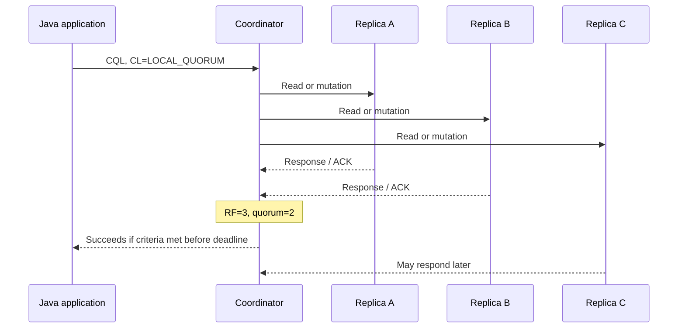
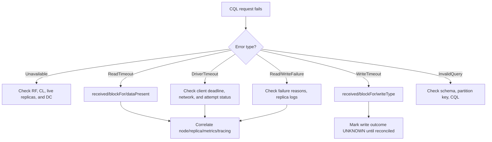
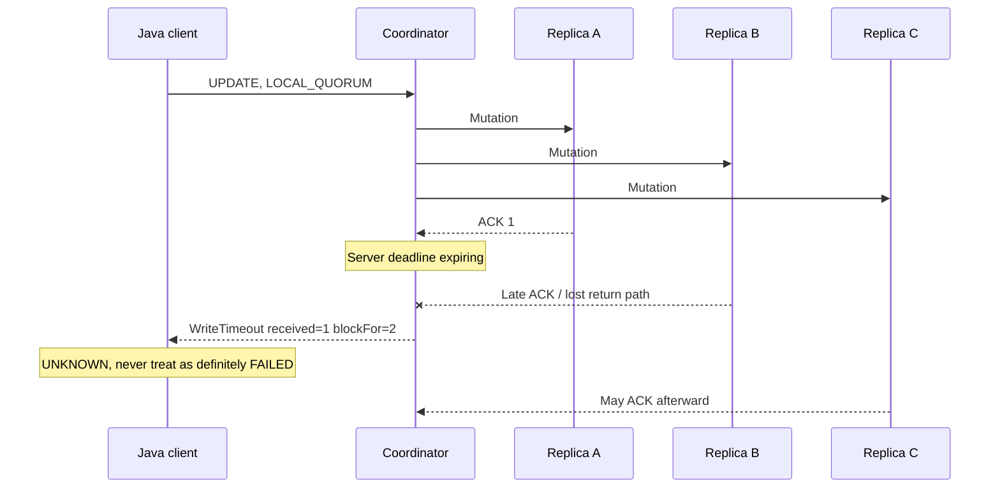
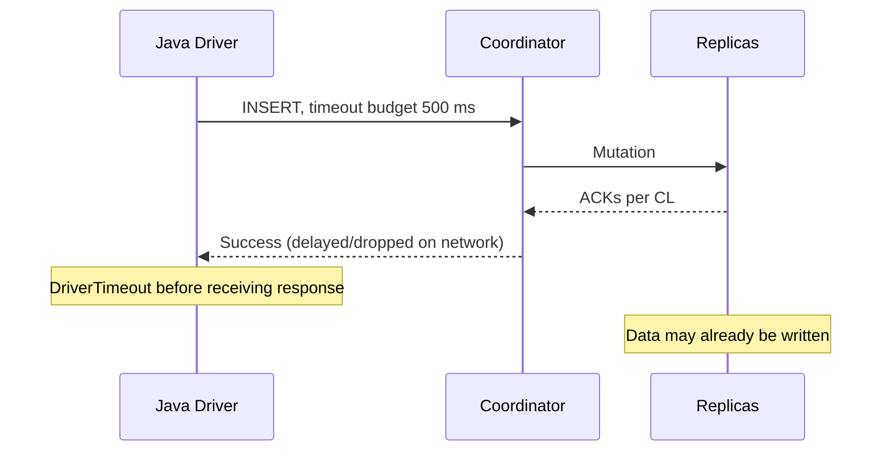
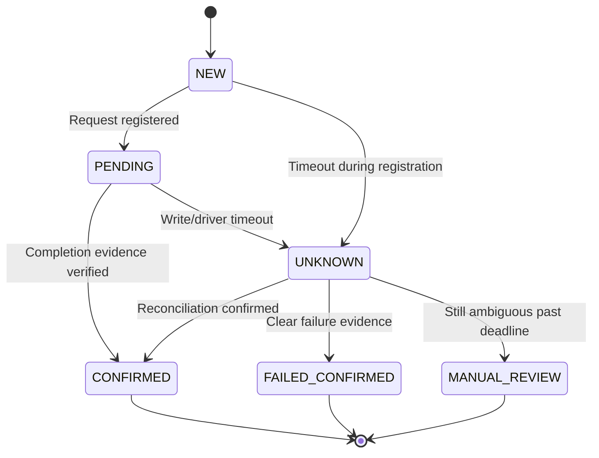

# ReadTimeout/WriteTimeout: Checking Write Type, ACKs, and Data Received in Apache Cassandra

## 1. Context: Timeouts Do Not Mean Data Does Not Exist or Was Not Written

In the **DATABASE_ENGINE_WIDE_COLUMN_CASSANDRA** module, Apache Cassandra is a **distributed wide-column** database. Data is distributed by **partition key**, replicated per **replication factor (RF)**, and read/write requests use a **consistency level (CL)** to specify how many replicas must respond. Java applications issue CQL through the Java Driver or Spring Data Cassandra, without directly seeing every state transition across coordinators, replicas, networks, and server memory/disks.

When an API encounters `ReadTimeout` or `WriteTimeout`, common wrong reactions include:

- "Row not found" when the read request actually **failed to finish in time**.
- "Write definitely failed" when the client only knows **insufficient acknowledgements arrived**.
- Automatically retrying every mutation, amplifying load or causing duplicate side effects.
- Downgrading `LOCAL_QUORUM` to `ONE` without evaluating the consistency contract.
- Raising timeouts to a huge value without investigating replicas, compaction, tombstones, or networking.
- Interpreting `received` as returned rows instead of protocol responses from replicas/coordinator.

This **Troubleshooting** lesson focuses on: **ReadTimeout/WriteTimeout and checking write type, ACKs, or data received**.

### After This Lesson, You Will Be Able To

1. Diagram the coordinator–replica flow of a request at RF=3, CL=`LOCAL_QUORUM`.
2. Distinguish `ReadTimeoutException`, `WriteTimeoutException`, `UnavailableException`, `ReadFailureException`/`WriteFailureException`, and Java Driver client timeouts.
3. Explain **`received`, `blockFor`, `dataPresent`** on the read path and **`writeType`** on the write path.
4. Know **what can and cannot be concluded** from ACKs, even when a response is lost.
5. Capture structured logs/metrics via Java Driver 4.x to classify timeout types.
6. Diagnose using topology, RF/CL, `nodetool`, CQL tracing, metrics, and compaction/repair state.
7. Handle **UNKNOWN** write outcomes using idempotency keys, read-backs, and reconciliation rather than blind retries.
8. Design fault/load tests **in isolated environments** and production runbooks with clear stop conditions.
9. Avoid conflating "too few ACKs" with "missing full data response" or "non-atomic batch writes".

## 2. Where Does a Cassandra Request Travel?

Applications do not contact every replica manually. Java Driver picks a **coordinator**, which determines replicas from the partition key, token ring, keyspace replication, and topology.



This diagram is illustrative: Cassandra employs optimizations such as selecting a full-data replica, digest responses, speculative retries, request forwarding, and write hints; exact paths depend on version, CL, query type, and node state.

With RF=3 in one datacenter:

\[
\operatorname{quorum} = \left\lfloor\frac{RF}{2}\right\rfloor+1 = 2
\]

| In-DC CL | Replica Responses Basically Needed | Meaning |
| --- | ---: | --- |
| `LOCAL_ONE` | 1 | Favors availability/latency; may read a stale replica |
| `LOCAL_QUORUM` | 2 when DC RF=3 | Requires majority of replicas in local DC |
| `ALL` | 3 when 3 replicas apply | Sensitive to a single slow or unavailable replica |
| `LOCAL_SERIAL` | LWT consensus path, not regular CL | Used for serial/conditional phase |

**Note:** declaring RF=3 on a keyspace does not create three replicas if a lab has only one node. An RF=1 test at `LOCAL_QUORUM` requires only **one** replica and does not validate RF=3 behavior when a node goes DOWN.

### 2.1. An ACK Is a Phase Signal, Not a Business Certification

A **write ACK** is a Cassandra protocol acknowledgement for a write phase on a replica/branch, aggregated by the coordinator per write type and CL. It does not by itself guarantee:

- Every replica received the mutation.
- Every copy immediately holds identical data.
- An external side effect (sending email / charging a card) ran exactly once.
- Multi-table writes carry SQL RDBMS ACID semantics.
- Another concurrent write on the same partition did not win via timestamp / last-write-wins.

With `durable_writes = true`, Cassandra uses commit logs and memtables per engine durability rules, yet you must not assume **every ACK is a separate backup** or every replica called `fsync` under conditions you guessed. Analyzing durability requires checking actual commit-log sync settings, storage behavior, and Cassandra version.

A **read ACK** also does not mean "N rows were found". The coordinator may receive **digest** or **full-data responses**; response count and full-data presence are two distinct dimensions.

## 3. Classify the Failure Before Doing Anything Else

| Error / Symptom | Layer Where Raised | Can Be Inferred | Must Never Be Inferred |
| --- | --- | --- | --- |
| `ReadTimeoutException` | Coordinator/server-side response for CQL read | Read did not finish at CL before server deadline | Row does not exist |
| `WriteTimeoutException` | Coordinator/server-side response for CQL write | Write phase did not get enough ACKs within deadline | Mutation definitely did not apply |
| `UnavailableException` | Coordinator sees too few live replicas for CL | Insufficient available replicas to attempt request | All replicas lost data |
| `ReadFailureException` / `WriteFailureException` | Explicit replica failure response during processing | At least one replica failed, not merely slow | Root cause is known without inspecting failure details |
| `DriverTimeoutException` | Client-side Java Driver deadline | Client received no terminal response in time | Coordinator never got the request / mutation didn't happen |
| `AllNodesFailedException` | Driver tried eligible nodes without completion | Inspect child errors by node/attempt | All Cassandra nodes are definitely DOWN |
| `InvalidQueryException` | Schema/CQL/query validation | Request rejected due to query/type/permission issue | Raising timeouts will fix the schema |
| `Unavailable` on lab RF/CL mismatch | Config/topology | Insufficient replicas for declared CL | Cluster needs more heap first |

With Java Driver, exceptions can arrive **wrapped in `CompletionException`** on async calls, or aggregated across attempts. Never classify solely from `exception.getMessage()` while ignoring **exception class, CL, coordinator, and diagnostic fields**.

### 3.1. Quick Classification Flow



## 4. `ReadTimeout`: `received`, `blockFor`, and `dataPresent`

`ReadTimeout` usually indicates the coordinator **could not assemble the required read consistency responses before its timeout**. Driver 4.x exposes fields distinguishing missing response count from missing full data.

### 4.1. What Is `blockFor`?

`blockFor` is the number of responses required for the request under the active consistency path, computed by coordinator/CL rules. For instance, `LOCAL_QUORUM` in an RF=3 DC typically requires **2**.

It is NOT:

- The number of rows to return.
- The number of bytes to read.
- The number of nodes in the cluster.
- A CPU threshold or millisecond count.

### 4.2. What Is `received`?

`received` reports how many qualifying replica responses the coordinator had received when the timeout fired. Comparing it with `blockFor` tells you how many timely replies were missing.

Hypothetical example:

```text
ReadTimeout:
  consistency: LOCAL_QUORUM
  received: 1
  blockFor: 2
  dataPresent: false
```

The coordinator did not get two replies before the deadline. Inspect **which replica was slow**, whether the coordinator was overloaded, or whether the query hit a hot/wide partition or excessive tombstones. **Never conclude** the target row does not exist.

### 4.3. What Is `dataPresent`?

On the read path, Cassandra uses **digest responses** to compare replicas and a **full-data response** to supply the actual row data. `dataPresent` indicates whether the coordinator received the full data payload in protocol terms.

Comparison cases:

| `received` | `blockFor` | `dataPresent` | Suggested Interpretation |
| ---: | ---: | --- | --- |
| 1 | 2 | false | Insufficient responses for quorum; no full data yet |
| 1 | 2 | true | Received full data from one replica, yet still short of quorum |
| 2 | 2 | false | Response count met threshold, yet **needed full-data response still missing** |
| 2 | 2 | true | Normally meets return conditions unless another race/error intervened; check exact exception/version/timeline before generalizing |

**Key point:** `dataPresent=false` **does not mean** "the SELECT matched zero rows". A successful `SELECT` returning an empty result set still received a valid full-data response. "Row absent" is a **valid query outcome**, whereas "full data did not arrive to finish the protocol" is a **timeout state**.

### 4.4. Why Can `ReadTimeout` Happen Even When Enough Responses Arrived?

A read may receive enough **digest** responses or partial responses without the coordinator obtaining the complete data payload in time. Thus, when `received >= blockFor` yet `dataPresent=false`, never dismiss it as "Cassandra bugged out even though quorum was met". Inspect the full-data replica, tracing, server logs, speculative reads, and network behavior.

**Do not over-interpret these three fields:** they are a point-in-time snapshot at timeout, not a guaranteed list of which replica holds the newest data or what the final row would be.

## 5. `WriteTimeout`: `received`, `blockFor`, and `writeType`

`WriteTimeoutException` signals that the coordinator failed to collect enough acknowledgements for the **write phase** and CL before the deadline. Crucially, **write type** identifies which write path/phase timed out, because single mutations, batches, counters, and CAS carry different semantics.

### 5.1. Readable Example

Assume RF=3 in DC `dc1` at `LOCAL_QUORUM`:

```text
WriteTimeout:
  consistency: LOCAL_QUORUM
  received: 1
  blockFor: 2
  writeType: SIMPLE
```

Safe interpretation:

- The coordinator observed **one ACK** for that write request when the timeout fired.
- **Two ACKs** were required by the write CL in this context.
- The client cannot treat the mutation as succeeded under the `LOCAL_QUORUM` contract.
- **At least partial work may have occurred** on one replica; other replicas may also have applied the mutation with delayed or lost ACKs.
- Business logic must classify the outcome as **UNKNOWN** unless proven or deduplicated.

Never conclude "only one replica holds the data", because late or dropped ACKs do not mean replicas skipped applying the mutation. Likewise, `received=0` never guarantees zero replicas applied the write.

### 5.2. `writeType` Is a Phase Signal, Not a Success Code

Common write types across compatible Cassandra/Driver releases:

| `writeType` | Representative Operation / Phase | Diagnostic Question |
| --- | --- | --- |
| `SIMPLE` | Standard mutation, not counter or special batch path | Which replica missed ACK; are write path / commit log / memtable slow? |
| `BATCH` | Protocol phase applying mutations of a logged batch | How many partitions in the batch; which mutations may already have run? |
| `UNLOGGED_BATCH` | Batch without a batch log | Spreading across many partitions; how loaded are coordinator/replicas? |
| `BATCH_LOG` | Phase writing the batch log in a logged batch | Did a batch-log node/path fail? Never assume zero mutations ran without verifying |
| `COUNTER` | Counter mutation | Retries can **double-count**; do not treat like a fixed-value upsert |
| `CAS` | Lightweight transaction / conditional write | Serial/conditional outcome may be uncertain; must read back state/version |
| `VIEW` | Materialized view update path when supported | How are MV infrastructure and base table synced? |
| Other version-specific values | Server/Driver may add values or phases | Log the exact raw value and consult docs for your running release |

**Compatibility note:** exact enum values and phase classifications depend on Cassandra Server and Java Driver versions. Never write a Java `switch` assuming every version shares the exact same closed list with no new values.

### 5.3. `BATCH_LOG` Differs from `BATCH`

A **logged batch** writes a batch log to help ensure eventual mutation completion across failures; it **does not turn multi-table/multi-partition writes into isolated SQL ACID transactions**.

On timeout:

- `BATCH_LOG` points diagnostics toward **writing the batch log**.
- `BATCH` points toward applying **the batch's mutations**.
- `UNLOGGED_BATCH` means multiple mutations were dispatched without a batch log.
- In every case, treat the state as **uncertain** when no terminal confirmation arrives.

**Never** bundle a thousand-partition bulk insert job into one giant logged batch because of timeouts; huge batches crush coordinator, batch-log, and replica resources. Cassandra batches are not general bulk-ingest tools.

### 5.4. Why Are `COUNTER` and `CAS` Especially Sensitive?

For counters:

```sql
UPDATE commerce.counters_by_id
SET view_count = view_count + 1
WHERE counter_id = ?;
```

On timeout, blindly retrying can increment twice. You **cannot** rely on a subsequent read-back to distinguish individual attempts under concurrent writers without a separate business ledger.

For CAS/LWT:

```sql
UPDATE commerce.payments_by_id
SET state = 'COMMITTED'
WHERE payment_id = ?
IF state = 'PENDING';
```

Timeouts can occur while the conditional step is executing or right after it succeeded. Read back **state and version/request ID** rather than assuming CAS did not apply. Note that `[applied]=false` is a **successful conditional write response**, not a `WriteTimeout`.

## 6. Two Timelines: Coordinator Outcome vs. What the Client Sees

### 6.1. Write Can Apply Even While the Client Sees Timeout



A **timeout response** does not roll back dispatched mutations. When the coordinator times out and when replicas finish applying the mutation can differ.

### 6.2. Client Times Out Before Receiving the Server Response



Here Java Driver raises **`DriverTimeoutException`**, not `WriteTimeoutException` from the coordinator. Never assume the coordinator hit a server-side timeout.

**Shared reality:** the application lacks terminal confirmation. For side-effecting business operations, status must be **UNKNOWN requiring reconciliation**, never "write failed, so safely resend with a brand-new ID".

## 7. Quick-Action Matrix by Error and Operation Type

| Received | Read/Write | Priority Verification | Immediate Safe Action |
| --- | --- | --- | --- |
| `ReadTimeout`, `received < blockFor` | Read | Replicas/network/queues, RF/CL | Bounded idempotent read retry if policy allows; watch for overload |
| `ReadTimeout`, count met yet `dataPresent=false` | Read | Full-data response path, tracing | Inspect coordinator/replicas; never turn into "not found" |
| `WriteTimeout SIMPLE` | Write | ACK/mutation state, node health | Mark `UNKNOWN`; read back by key and contract |
| `WriteTimeout COUNTER` | Write | Logical increment ID/ledger | Never blindly retry counter |
| `WriteTimeout CAS` | LWT | State/version, serial CL, contention | Reconcile whether condition applied |
| `WriteTimeout BATCH/BATCH_LOG` | Batch | Mutations, batch log, partial visibility | Check each invariant; never assume SQL transaction |
| `Unavailable` | Read/Write | Live replicas per RF/DC/CL | Restore topology first; do not spam retries |
| `DriverTimeout` | Read/Write | Client queues, network, did server see request? | Reconcile writes; check timeout budget and attempts |
| `ReadFailure`/`WriteFailure` | Read/Write | Failure details + server logs | Investigate replica errors; do not lump into timeouts |

Side-effect-free **reads** can often be retried with backoff and budgets once overload is ruled out, though heavy read-repair, paging, or expensive queries can still amplify load. Never configure infinite retries or retry every node at once during cluster saturation.

## 8. Java Driver 4.x: Extracting Diagnostic Fields from Exceptions

Java Driver 4.x classifies server errors by exception type and provides getters for consistency level, response counts, and write type. The example below uses Java 11+ and standard Driver 4.x APIs; verify exact signatures against your pinned dependency version.

### 8.1. Helper for Synchronous Exception Inspection

```java
import java.util.concurrent.CompletionException;
import java.util.concurrent.ExecutionException;

import com.datastax.oss.driver.api.core.DriverTimeoutException;
import com.datastax.oss.driver.api.core.servererrors.ReadTimeoutException;
import com.datastax.oss.driver.api.core.servererrors.WriteTimeoutException;
import com.datastax.oss.driver.api.core.servererrors.UnavailableException;

public final class CassandraTimeoutDiagnostics {

    public static Throwable unwrap(Throwable error) {
        Throwable t = error;

        while ((t instanceof CompletionException
                || t instanceof ExecutionException)
                && t.getCause() != null) {
            t = t.getCause();
        }

        return t;
    }

    public static void inspect(Throwable failure) {
        Throwable error = unwrap(failure);

        if (error instanceof ReadTimeoutException) {
            ReadTimeoutException e =
                (ReadTimeoutException) error;

            System.err.printf(
                "kind=READ_TIMEOUT cl=%s received=%d " +
                "blockFor=%d dataPresent=%s%n",
                e.getConsistencyLevel(),
                e.getReceived(),
                e.getBlockFor(),
                e.wasDataPresent());

        } else if (error instanceof WriteTimeoutException) {
            WriteTimeoutException e =
                (WriteTimeoutException) error;

            System.err.printf(
                "kind=WRITE_TIMEOUT cl=%s received=%d " +
                "blockFor=%d writeType=%s%n",
                e.getConsistencyLevel(),
                e.getReceived(),
                e.getBlockFor(),
                e.getWriteType());

        } else if (error instanceof UnavailableException) {
            UnavailableException e =
                (UnavailableException) error;

            System.err.printf(
                "kind=UNAVAILABLE cl=%s%n",
                e.getConsistencyLevel());

        } else if (error instanceof DriverTimeoutException) {
            System.err.println(
                "kind=DRIVER_TIMEOUT; write outcome may be UNKNOWN");

        } else {
            System.err.printf(
                "kind=OTHER class=%s message=%s%n",
                error.getClass().getName(),
                error.getMessage());
        }
    }

    private CassandraTimeoutDiagnostics() { }
}
```

**Important code caveats:**

- `e.getReceived()` reflects response count at failure time, **not** row count.
- `e.wasDataPresent()` reflects full-data response arrival, **not** whether a row exists.
- `e.getWriteType()` identifies the **write type/phase**, not whether the mutation applied.
- `UnavailableException` should also log alive/required counts if exposed by your API version; this snippet prints CL to stay compatible with older getters. Always verify against observed topology.
- `System.err` is strictly educational; production must use **rate-limited structured logging/metrics** and never log raw CQL bind values containing PII/secrets.
- Getters, enums, and packages may vary across minor releases or driver families; verify compilation and Javadoc against your pinned version.
- Some errors arrive wrapped inside `AllNodesFailedException`; this example does not walk per-node/per-attempt error maps.

### 8.2. Synchronous CQL Call with Explicit Deadline

```java
import java.time.Duration;
import java.util.UUID;

import com.datastax.oss.driver.api.core.CqlSession;
import com.datastax.oss.driver.api.core.DefaultConsistencyLevel;
import com.datastax.oss.driver.api.core.cql.PreparedStatement;
import com.datastax.oss.driver.api.core.cql.Row;

public class OrderReadService {

    private final CqlSession session;
    private final PreparedStatement select;

    public OrderReadService(CqlSession session) {
        this.session = session;
        this.select = session.prepare(
            "SELECT order_id, state FROM commerce.orders_by_id " +
            "WHERE order_id = ?");
    }

    public Row find(UUID orderId) {
        try {
            return session.execute(
                select.bind(orderId)
                    .setConsistencyLevel(
                        DefaultConsistencyLevel.LOCAL_QUORUM)
                    .setTimeout(Duration.ofSeconds(2))
                    .setIdempotent(true)).one();

        } catch (RuntimeException error) {
            CassandraTimeoutDiagnostics.inspect(error);
            throw error; // Never convert a timeout into "row not found".
        }
    }
}
```

Here `LOCAL_QUORUM` reflects the example app's requirement; ensure the keyspace RF and topology actually support it. Do not copy this into a single-node RF=1 test and claim it proves production quorum behavior.

### 8.3. Async Execution: Do Not Lose the Cause

```java
import java.util.concurrent.CompletionStage;
import com.datastax.oss.driver.api.core.cql.AsyncResultSet;

CompletionStage<AsyncResultSet> stage =
    session.executeAsync(statement);

CompletionStage<AsyncResultSet> observed =
    stage.whenComplete((page, error) -> {
        if (error != null) {
            CassandraTimeoutDiagnostics.inspect(error);
        }
    });

// Return observed to the caller for downstream handling.
// Never call join() on a Netty/event-loop callback.
```

`session` and `statement` are pre-prepared in the service. Keep callbacks lightweight—never run blocking I/O, `Thread.sleep`, or inline retries on driver callback threads. Callers must still **propagate errors** and classify state; logging once does not complete the workflow.

### 8.4. Multiple Node/Attempt Failures

Java Driver may try multiple coordinators per policy and topology. When catching an aggregate exception, record:

- `AllNodesFailedException` and per-node/per-attempt errors per API version.
- Timestamp, chosen coordinator, execution profile, and CQL operation ID.
- Whether retries or speculative executions fired.
- Root cause per attempt—one attempt may hit a network error while another hits a server timeout.
- One logical write may span **multiple attempts**; never count each attempt as a separate business operation.

**Never** assume `AllNodesFailedException` always wraps `WriteTimeoutException`; inspect the actual cause collection rather than fragile regex parsing on message strings.

## 9. Logging and Metrics in an Investigable Format

Useful incident logs include **enough context to correlate errors with topology and CQL**, without leaking sensitive data.

```json
{
  "event": "cassandra_request_failed",
  "operation": "order-write",
  "logical_request_id": "synthetic-req-0031",
  "query_id": "update-order-state",
  "consistency": "LOCAL_QUORUM",
  "error_kind": "WRITE_TIMEOUT",
  "received": 1,
  "block_for": 2,
  "write_type": "SIMPLE",
  "driver_timeout_ms": 2000,
  "attempt_count_observed": 1,
  "partition_token_hash": "redacted-or-hashed",
  "coordinator_alias": "node-b",
  "outcome": "UNKNOWN",
  "time_utc": "2026-11-21T03:00:00Z"
}
```

This is an **illustrative example**, not raw Cassandra server logs. Ensure:

- `logical_request_id` contains no sensitive customer identifiers.
- `attempt_count_observed` is recorded only from actual instrumentation, never guessed.
- `partition_token_hash` does not make sensitive keys trivially reversible.
- Timestamps use UTC with clock-sync awareness when aligning client and server logs.
- `outcome=UNKNOWN` updates once reconciliation finishes; never leave `UNKNOWN` unowned forever.

### 9.1. Minimum Metrics

| Metric | Diagnostic Value | Notes |
| --- | --- | --- |
| `ReadTimeout` count by CL/query | Where reads are timing out | Separate `ReadFailure`/`Unavailable` |
| `WriteTimeout` count by `writeType` | Which write phase is impacted | Count logical requests and attempts separately |
| `received`/`blockFor` histogram | How many ACKs/responses were missed | Keep cardinality low; never label by user ID |
| `dataPresent` true/false | Missing full data vs. missing count | Does not mean row exists/absent |
| `DriverTimeout` count | Client/network/deadline trouble | Can fire without server timeouts |
| p50/p95/p99 and error rate | Tail latency vs. failures | Measure at same boundary; include timed-out requests |
| Per-node CPU/GC/disk/network | Coordinator/replica saturation | Safe node labels |
| Dropped messages / pending tasks | Queue overload / backpressure | Check exact version/metric names |
| Compaction pending/active | SSTable / I/O contention | Do not force compactions mid-incident |
| Tombstones scanned/read | Read amplification | By query/table and server version |
| Hot partition / row size | Key skew and wide partitions | Never put real partition keys on public dashboards |
| Retry / speculative attempts | Load amplification | Enforce bounded retry budgets |
| `UNKNOWN` reconciliation age | Business state divergence risk | Set an SLO for reconciliation jobs |

If p99 looks "great" while `ReadTimeout` climbs, the histogram might only record **successful requests**; always track **failures + timeouts + queue wait** together.

## 10. Verify RF/CL/Topology Before Raising Timeouts

### 10.1. Node Observation Commands

In a testbed or production with **read-only** operator privileges, check each node:

```bash
nodetool status
nodetool describecluster
nodetool info
nodetool tpstats
nodetool compactionstats
nodetool netstats
```

Some versions differ in syntax or metric labels; record command, server version, timestamp, and target node. `nodetool status` reflects topology from the queried node's perspective, not necessarily unanimous cluster agreement.

For a specific table:

```bash
nodetool tablestats commerce.orders_by_id
nodetool tablehistograms commerce orders_by_id
```

Check:

- Are enough live replicas actually up for CL?
- Is the driver's `local-datacenter` pointed at the right DC?
- Are disk usage, commit log, memtables, GC pauses, or dropped messages abnormal?
- Did compaction, repair, streaming, or backups overlap the timeout window?
- Which node acted as coordinator and which nodes own the partition replicas?
- Is there a hot partition key or oversized partition relative to schema/query?

### 10.2. CQL Schema and Replication Checks

```sql
SELECT keyspace_name, replication, durable_writes
FROM system_schema.keyspaces
WHERE keyspace_name = 'commerce';

SELECT table_name, compaction, compression
FROM system_schema.tables
WHERE keyspace_name = 'commerce'
  AND table_name = 'orders_by_id';
```

These are **metadata queries** for Cassandra versions exposing those system tables. Seeing `replication = {'dc1':'3'}` alone does not guarantee three live replicas; corroborate with live topology and request CL.

### 10.3. Reasoning with an RF=3 Example

| Situation | `LOCAL_QUORUM` Needs | Possible Outcome |
| --- | ---: | --- |
| 3 replicas UP, light load | 2 | Usually succeeds if replies arrive in time |
| 1 replica DOWN, 2 healthy UP | 2 | Can still succeed |
| 1 replica DOWN, 1 of 2 UP slow | 2 | Likely `ReadTimeout`/`WriteTimeout` |
| Only 1 replica seen UP | 2 | Usually `Unavailable` instead of waiting for timeout |
| 3 UP, compaction/GC/network stalls 2 | 2 | Can time out even though all statuses are UP |

Node status **`UN`** (*Up/Normal*) does not guarantee timely replies before deadlines. Healthy topology is necessary, **not** a latency guarantee.

## 11. Analyzing `ReadTimeout`: Runbook by Data Received

### Case A — `received < blockFor`

```text
read_timeout:
  CL: LOCAL_QUORUM
  RF in local DC: 3
  received: 1
  blockFor: 2
  dataPresent: true
```

**Interpretation:** the coordinator likely received one full-data response, yet fell short of quorum count.

Check in order:

1. Identify coordinator and replica set for the **partition key**.
2. Verify reachability among all three replicas rather than just `UP`/`DOWN`.
3. Inspect server read latency, thread-pool pending/dropped, GC pauses, and network RTT.
4. Inspect query shape: does `WHERE` supply full partition key and bounded clustering ranges?
5. Inspect partition size, tombstones, SSTables per read, compaction, and disk.
6. Check if driver retries are piling onto the same replica set.
7. If only one hot key fails, inspect token/replica ownership for that key before scaling nodes.

**Never** return HTTP 404 or `Optional.empty()`; return an explicit error or apply bounded retries per contract.

### Case B — `received >= blockFor` Yet `dataPresent=false`

```text
read_timeout:
  CL: LOCAL_QUORUM
  received: 2
  blockFor: 2
  dataPresent: false
```

**Interpretation:** enough response counts arrived in failure context, yet the coordinator lacked the full data payload to return.

Check:

- Which replica was picked for **full data**, and did it hit a timeout or network drop?
- Did digest replies return quickly while the full-data reply stalled?
- Did speculative reads/retries complicate timing?
- Are there read failures or tracing samples for similar requests?
- Did paging, wide partitions, or tombstone scans slow the full-data read compared to digest checks?

Never say "the row doesn't exist" just because `dataPresent=false`. To verify existence, execute **a successful read at proper CL** afterward or run a defined reconciliation workflow.

### Case C — Valid Yet Very Expensive Query

Example:

```sql
-- Query specifies partition key, yet can be costly on huge partitions:
SELECT event_ts, payload
FROM commerce.events_by_device
WHERE device_id = ?
LIMIT 100;
```

Even with `LIMIT 100`, Cassandra may scan thousands of tombstones before finding enough live rows. Switching from `execute` to `executeAsync` **does not speed up replica CQL execution**. Fix partition/bucketing design, retention, or query ranges, and re-measure under identical load.

### Case D — Timeouts Scoped to One DC

If `LOCAL_QUORUM` targets `dc1` yet Java Driver misconfigured `local-datacenter`, or replica placement/CL shifted unexpectedly, check real DC values in `system.local` and per-DC RF. Never swap `LOCAL_QUORUM` for `EACH_QUORUM` or `QUORUM` without understanding cross-DC impact.

## 12. Analyzing `WriteTimeout`: Runbook by `writeType`

### 12.1. `SIMPLE` — Standard Single Mutation

Example:

```sql
UPDATE commerce.orders_by_id
SET state = 'PAID'
WHERE order_id = ?;
```

On timeout:

1. Record `received`, `blockFor`, CL, coordinator, and token/replicas.
2. Never flip business state to `FAILED` merely because ACKs were missed.
3. Check replica commit log / memtable / write latency, GC, disk/network, and queues.
4. Check true idempotency: setting a constant value replays more safely than counters/appends, yet concurrent writers, TTL, and timestamps can still interact unexpectedly.
5. To verify state, **read back by partition key** and invariant at the designed CL.
6. If older vs. newer writes cannot be distinguished, keep `UNKNOWN` and hand off to a reconciler.

### 12.2. `BATCH` and `BATCH_LOG` — Never Treat Batches as SQL Transactions

Logged batches use a batch log to drive eventual atomicity across batch failures; mutations across multiple partitions **are never observed with SQL transaction isolation**.

On `writeType=BATCH_LOG`:

- Focus diagnostics on the batch-log path, involved nodes, disk/network, and coordinator.
- Never assume zero mutations applied without reconciling.
- Check batch size and partition count; avoid huge cross-partition batches.

On `writeType=BATCH` or `UNLOGGED_BATCH`:

- Record logical mutations and synthetic/hashed keys.
- Inspect each target table/partition after an uncertain batch outcome.
- Ensure workflows can reconcile partial mutations per invariant.
- Never blindly retry an entire batch if any inner mutation is non-idempotent.

**Never use large batches to boost write throughput.** Bounded async prepared writes aligned with your partition/key strategy usually perform far better.

### 12.3. `COUNTER` — Never Blindly Retry

```sql
UPDATE commerce.counters_by_id
SET total = total + 1
WHERE id = ?;
```

On timeout, you cannot tell whether "+1" applied, especially with concurrent writers. If business requires exactly-once counting, design an **event ledger/request ID + idempotent aggregation** model; raw counters carry no per-increment identity.

### 12.4. `CAS` — Check Conditions and Versions

```sql
UPDATE commerce.payment_state_by_id
SET state = 'COMMITTED', version = 2
WHERE payment_id = ?
IF state = 'PENDING' AND version = 1;
```

On CAS timeout:

1. Never assume `[applied]` was false without a response.
2. Read back `state, version` by key at appropriate CL.
3. If state matches the expected transition **and request ID/version proves it came from this operation**, mark applied per workflow.
4. If version differs or another writer intervened, classify conflict or escalate reconciliation.
5. Retry CAS only for the **same logical operation** under a proven safe policy—never mint a new payment event.
6. Inspect serial-path contention and latency; never ramp concurrency infinitely during CAS contention.

**Reading only `state='COMMITTED'` is insufficient** if multiple actors can transition a payment to `COMMITTED`. Include request ID, version, transition history, or a business ledger for definitive attribution.

### 12.5. `VIEW` or Dependent Write Paths

If write type points to a materialized view path, inspect both base table and view update state per version observability and semantics. Never treat `WriteTimeout` as "the base row wasn't written" when a secondary write path stalled. Reconcile data and review MV configs against your exact Cassandra release docs.

## 13. Difference Between Data Correctness and Consistency Level

### 13.1. \(R + W > RF\) Is a Model, Not an Absolute Guarantee

With RF=3, many designs use \(R=2, W=2\), giving:

\[
R+W = 4 > RF = 3
\]

This provides replica-set overlap under ideal conditions, **but does not automatically eliminate** all anomalies:

- Concurrent writes and timestamp ordering.
- TTL expirations or tombstones.
- Replica/network failures and delayed mutations.
- Read repair, hinted handoff, and anti-entropy repair lags.
- LWT/serial consistency when conditional transitions are required.
- Timed-out requests with uncertain outcomes.

Never interpret the formula as "every read is linearizable like a SQL transaction" unless the design enforces matching serial guarantees.

### 13.2. Read-After-Write and Reconciliation Timing

A read-back after `WriteTimeout`:

```sql
SELECT state, version, last_request_id
FROM commerce.payment_state_by_id
WHERE payment_id = ?;
```

**Is meaningful only in full context**:

- Which CLs were used for the read and write?
- Are schema and partition key exact?
- Could concurrent writers, TTL, or deletes interfere?
- Do the returned fields uniquely identify this operation?
- Did the read itself succeed without timing out?
- How much time elapsed relative to mutation propagation / replica lag?

Not finding the expected state **still does not guarantee** the mutation won't appear later via delayed delivery or hints. Conversely, seeing the expected state could come from a different operation if no request ID or version proves provenance.

## 14. Designing Idempotency to Handle `UNKNOWN` Write Outcomes

A safe business-layer approach pairs a **stable logical request ID** with reconcilable state. For example, a payment/order flow can maintain a request ledger table:

```sql
CREATE KEYSPACE IF NOT EXISTS commerce
WITH replication = {
  'class': 'NetworkTopologyStrategy',
  'dc1': 3
};

CREATE TABLE IF NOT EXISTS commerce.operations_by_request (
    tenant_id uuid,
    request_id uuid,
    payload_hash text,
    status text,
    result_code text,
    updated_at timestamp,
    PRIMARY KEY ((tenant_id), request_id)
);
```

This schema is **illustrative**; adjust RF/DC and domain design accordingly. Each logical request keeps the **exact same `request_id`** across retries.

Register the operation with a conditional insert:

```sql
INSERT INTO commerce.operations_by_request (
    tenant_id, request_id, payload_hash, status, updated_at
) VALUES (?, ?, ?, 'PENDING', ?)
IF NOT EXISTS;
```

**Never equate an LWT timeout with "not registered".** Without `[applied]`, read back to check whether the row, request, or payload hash already exists, separating identical retries from conflicting payloads.

### 14.1. State Machine Including `UNKNOWN`



**`UNKNOWN`** is a first-class operational state: never coerce it to failed merely to simplify the API. A reconciler can:

1. Read the ledger by `tenant_id, request_id`.
2. Verify `payload_hash` to block key reuse with altered payloads.
3. Read target entity state and version.
4. For external providers, query provider status using **the exact same provider idempotency key** instead of initiating a new charge.
5. Classify as confirmed, duplicate, conflict, pending, or manual review per deadlines.
6. Log attempt counts and reconciliation results for auditability.

### 14.2. Reading Back Alone Does Not Give Exactly-Once

Reliable reconciliation must account for races:

- A read may see older state right before a delayed mutation lands.
- Another operation may produce an identical state value.
- Counter increments carry no per-operation identity.
- Denormalized tables do not update in one atomic transaction.
- External systems may settle slowly or inconsistently.

Where strong correctness is required, use **dedupe ledgers, CAS/versioning/fencing**, outbox workflows, or a verifiable source of truth. CQL read-after-write is **one piece of evidence**, not magic.

## 15. Inspecting Cassandra Server-Side: Read Path and Write Path

### 15.1. What Relates to `ReadTimeout`?

| Symptom | Layer to Inspect | Likely Cause |
| --- | --- | --- |
| Only one partition key is slow | Token replicas for that key | Hot partition or wide partition |
| Many tombstone warnings | Read path, compaction/SSTables | Deletes/TTL, read amplification |
| High SSTables per read | SSTable state/compaction | Data layout causing heavy I/O |
| High CPU/GC across nodes | JVM GC, serialization | Large rows/collections, allocation pressure |
| Pending read tasks / dropped messages | Thread pools/queues | Overloaded replica or coordinator |
| High network RTT / packet loss | Coordinator↔replica networking | Slow ACK/digest/data responses |
| Errors scoped to one DC | DC/rack/topology | Misconfigured routing, CL, or replica placement |

Never run repeated `SELECT COUNT(*)` over huge partitions to "check row counts": that expensive read worsens timeouts. Use histograms, metadata, and bounded diagnostic queries.

### 15.2. What Relates to `WriteTimeout`?

| Symptom | Layer to Inspect | Likely Cause |
| --- | --- | --- |
| `SIMPLE`, missed ACKs | Memtable / commit log / write latency | Disk/commit log, GC, network |
| `BATCH_LOG` | Batch-log nodes / coordinator | Batch-log path or networking |
| `COUNTER` | Counter consistency/concurrency | Retry-sensitive semantics, contention |
| `CAS` | Paxos/LWT path | High contention, serial latency |
| Timeout spike after traffic surge | Driver retries, in-flight, server queues | Overload / retry storm |
| Dropped mutations on one node | Node resources / replica placement | Hot token or degraded node |
| App batches across many partitions | Batch size / partition cardinality | Unnecessary batch overhead |

**Compaction, repair, and GC** can degrade reads and writes simultaneously. Align timelines before touching concurrency, RF, or CL.

## 16. CQL Tracing Without Causing Secondary Incidents

On an authorized synthetic/test query:

```sql
CONSISTENCY LOCAL_QUORUM;
TRACING ON;

SELECT order_id, state
FROM commerce.orders_by_id
WHERE order_id = 11111111-1111-1111-1111-111111111111;

TRACING OFF;
```

These are **`cqlsh` commands**; do not use `?` bind markers in `cqlsh` outside prepared statement APIs. Target an existing keyspace/table, synthetic PK, and a CL matching real RF/DC.

Traces can reveal:

- Coordinator and replica path for the query.
- Processing steps and per-step latencies per server version.
- SSTable and tombstone scanning during reads.
- Where time was spent across network vs. replicas.

However:

- Tracing adds **overhead** and trace writes; never enable it across all production traffic.
- Timed-out queries may have incomplete trace events or delayed trace persistence.
- Missing trace events never prove a mutation failed to apply.
- Traces may capture CQL/values; enforce permissions, redaction, and retention.
- Trace output formatting varies across Cassandra versions; never assert exact trace text.

### 16.1. Capturing Before–During–After Snapshots

Example read-only timeline checklist:

```text
T-60s  topology / RF / CL / partition replicas
T-30s  node CPU/GC/disk/network and compaction
T0     request ID + coordinator + error class
T+5s   per-node queues, dropped messages, server logs
T+30s  correctness read-back / UNKNOWN reconciliation
T+60s  confirm recovery, record retries and pending counts
```

Tag all logs/metrics with `run_id`/UTC and account for clock skew across hosts. Never include raw customer keys or passwords in incident reports.

## 17. Production Troubleshooting Sequence for `ReadTimeout`

### Phase 1 — Verify Impact and Protect the System

1. Quantify impact: affected endpoints, error rate, p95/p99, read CL, keyspace/table, DC.
2. Check for retry storms; apply concurrency caps, bulkheads, or load shedding to protect the cluster.
3. Never map timeouts to `404 Not Found`.
4. Do not immediately raise timeouts everywhere; adjust only per SLOs after understanding the slowdown.
5. Check node health of **the involved replicas**, not just the coordinator.

### Phase 2 — Collect Server and Client Evidence

1. Log `received`, `blockFor`, and `dataPresent` on sampled failures.
2. Separate `DriverTimeout` from server `ReadTimeout` counts.
3. Confirm actual RF/CL, UP replica counts, and driver DC routing.
4. Inspect read latency, server queues, disk I/O, GC, compaction, and tombstone metrics.
5. Inspect query predicates and partition keys for hot or wide partitions.
6. If needed, run time-bounded tracing on a few valid synthetic queries.

### Phase 3 — Remediate Root Cause

- Replica DOWN → restore node/topology per approved runbook.
- Replica UP yet timing out → address disk/GC/network/compaction and shed excess load.
- Tombstone-heavy → fix TTL/delete/bucketing patterns rather than merely bumping warning thresholds.
- Hot partition → apply designed caching, read routing, or sharding; never invent ad-hoc partitions mid-incident.
- Wide partition → adopt bucketing, bounded ranges, and retention; avoid unbounded scans.
- Client saturation → lower in-flight limits, bound queues, and never block driver event loops.

### Phase 4 — Verify Recovery

1. `ReadTimeout` rate drops and error budget returns within threshold.
2. p95/p99 improves under **comparable workload**.
3. No lingering queue backlogs or retry storms.
4. Queries return accurate data per CL/consistency contracts.
5. Document root cause, impact, and follow-up tests.

## 18. Production Troubleshooting Sequence for `WriteTimeout`

### Phase 1 — Prevent Duplicate Writes

1. Identify business operation IDs and side-effect sensitivity.
2. Never automatically emit **a new command with a fresh request ID** while outcome is `UNKNOWN`.
3. Log `writeType`, `received`, `blockFor`, CL, coordinator, and hashed partition key.
4. Reduce retries/concurrency during overload per system policy.
5. Classify failures across `SIMPLE`/`COUNTER`/`CAS`/`BATCH`/`BATCH_LOG` and fail vs. unknown.

### Phase 2 — Investigate Missed ACKs

1. Are RF, DC, and replica set accurate?
2. Were fewer than `blockFor` replicas reachable, or simply slow to reply?
3. Inspect replica memtable/commit-log/write latencies, GC, disk, and networking.
4. Check batch sizes, multi-partition spread, counter contention, or LWT contention.
5. Are retries or speculative executions multiplying attempts beyond logical requests?
6. Check write hints, repair, and catch-up activity per server behavior/version.

### Phase 3 — Reconcile Outcomes

1. Read back by **primary key and CL** per design.
2. Verify request ID, version, payload hash, and state transition—not a single status field.
3. For counters, reconcile via ledgers or domain-specific workflows.
4. For batches, verify invariants across **every mutation/table** rather than assuming SQL atomicity/isolation.
5. For external providers, query provider status before retrying.
6. If still indeterminate, route to `MANUAL_REVIEW` with an owner and timeout SLA.

### Phase 4 — Recover and Harden

- Fix the underlying bottleneck and enforce load limits.
- Add metrics broken down by `writeType` and ACK deficit.
- Implement retry budgets, request deduplication, and reconciliation workers.
- Validate fault scenarios in staging with matching RF/CL.
- Alert on `UNKNOWN` count and age, not merely raw `WriteTimeout` totals.

## 19. Integration / Fault-Injection Tests to Validate Handlers

**Use only dedicated isolated test clusters, synthetic data, and bounded resources.** Never kill production nodes just to "test CL".

### 19.1. RF=3 Setup for a Multi-Node Lab

Assume three nodes in DC `dc1` across appropriate racks:

```sql
CREATE KEYSPACE IF NOT EXISTS timeout_it
WITH replication = {
    'class': 'NetworkTopologyStrategy',
    'dc1': 3
};

CREATE TABLE IF NOT EXISTS timeout_it.orders_by_id (
    order_id uuid PRIMARY KEY,
    state text,
    version int,
    last_request_id uuid
);
```

On a single-node Testcontainers instance, **do not** use this RF=3 schema to test `LOCAL_QUORUM`; adjust RF for CQL/mapping tests or run a multi-node testbed for fault tests. DDL shown is for a hypothetical lab.

### 19.2. Test Cases and Stop Conditions

| Case | Setup | Lab Fault | Expected Investigation |
| --- | --- | --- | --- |
| B0 | RF=3, 3 UP, `LOCAL_QUORUM` | None | Baseline success and p99 |
| R1 | Read synthetic partition | One replica delayed | 2 replies may still succeed; record actual `received`/`dataPresent` on failure |
| R2 | Read with one replica DOWN, another slow | Controlled fault | Can trigger `ReadTimeout`; inspect count/`dataPresent` |
| W1 | Upsert constant state, RF=3 | Replica ACK delayed | Can trigger `WriteTimeout SIMPLE`; read back operation/version |
| W2 | CAS on state/version | Bounded version contention | Inspect CAS timeout / conditional outcome |
| W3 | Counter on test table | Simulated timeout, auto-retry off | Prove handler preserves `UNKNOWN` |
| B1 | Small test-only logged batch | Bounded lab network/disk fault | Observe actual `writeType`, reconcile mutations |
| D1 | Tight client deadline (test-only) | Bounded network delay | Distinguish `DriverTimeout` from server timeout |

**No fault injection guarantees the exact same exception class on every run.** Scheduling, coordinator selection, speculative execution, node state, and deadlines determine what fires. Tests must assert **business invariants and proper classification**, logging the observed exception rather than forcing every run to return `received=1`.

### 19.3. Verifying Retry Handlers Against Business Rules

A solid test confirms:

- `ReadTimeout` **never** becomes an empty result or HTTP 404.
- Read retries are **bounded** with backoff/jitter and an overall deadline.
- `WriteTimeout` preserves the **exact same logical request ID**.
- `COUNTER`/`CAS` mutations are never replayed blindly.
- `UNKNOWN` reconciles cleanly to `CONFIRMED`/`FAILED_CONFIRMED`/`MANUAL_REVIEW`.
- Attempts never exceed the retry budget under cluster overload.
- Removing the fault lets the service recover without wiping/resetting real data.
- Logs/metrics record `writeType`/`received`/`blockFor`/`dataPresent` without PII.

## 20. Practice Exercises and Analysis Scenarios

### Exercise 1 — `ReadTimeout` Missing ACKs

A `SELECT` runs under RF=3 in `dc1` at CL=`LOCAL_QUORUM`; driver reports:

```text
received=1, blockFor=2, dataPresent=true
```

1. How many replicas are required for quorum?
2. Can you claim the row does not exist?
3. Does `dataPresent=true` let the request succeed even though `received=1`?
4. Which three indicators should you inspect first?

**Hint:** 2 required; cannot infer row absence; full data arrived yet consistency count fell short; check replica latency/network/queues and the queried partition.

### Exercise 2 — `ReadTimeout` Count Met, Full Data Missing

```text
received=2, blockFor=2, dataPresent=false
```

1. Why couldn't the query finish successfully?
2. What is the difference between a digest and a full-data response?
3. How do you distinguish "row does not exist" from "full-data response missing"?
4. How would you capture a safe trace?

**Hint:** the coordinator lacked the full data payload to return. Run a **successful** read at target key/CL to check row existence; trace a redacted sample, never full traffic.

### Exercise 3 — `WriteTimeout SIMPLE`

RF=3, CL `LOCAL_QUORUM`, `received=1`, `blockFor=2`, `writeType=SIMPLE`.

1. How many ACKs arrived in time?
2. Is it certain that only one replica wrote the data?
3. If the app was writing `state='PAID'`, should it automatically issue a new payment?
4. How can reconciliation distinguish the original operation from another write?

**Hint:** only confirms 1 timely ACK, not how many replicas applied it; keep `UNKNOWN` and reconcile via request ID + version/payload hash + provider status.

### Exercise 4 — `COUNTER` Timeout

Two concurrent workers execute `view_count = view_count + 1`; one hits `WriteTimeout COUNTER`.

1. Why can retrying inflate the count?
2. Can `received=0` prove no replica incremented the counter?
3. How would you redesign if the business requires exact-once counting?

**Hint:** use an event-ID dedupe ledger and controlled aggregation; never treat counter mutations as idempotent.

### Exercise 5 — `CAS` and `UNKNOWN` Outcome

LWT:

```sql
UPDATE timeout_it.orders_by_id
SET state='SHIPPED', version=3
WHERE order_id=?
IF state='PAID' AND version=2;
```

The client times out before receiving a response.

1. Can you write `[applied]=false` into the business database?
2. Why doesn't reading `state='SHIPPED'` alone prove this specific attempt succeeded?
3. What extra field should you persist for reconciliation?

**Hint:** `last_request_id`/version/transition log and serial consistency contract; keep `UNKNOWN` until verified.

### Exercise 6 — Distinguishing `Unavailable` from `WriteTimeout`

Cluster DC has RF=3, CL `LOCAL_QUORUM`. Only one replica is considered alive before the request runs.

1. Why is `Unavailable` returned?
2. If all three replicas are UP yet two are extremely slow, which error occurs?
3. Does `nodetool status` showing `UN` guarantee requests won't time out?

**Hint:** insufficient live replicas triggers `Unavailable`; UP replicas missing deadlines trigger timeouts. `UN` does not guarantee meeting deadlines.

### Exercise 7 — `DriverTimeout` vs. Server Timeout

A Java endpoint sets a 500 ms timeout; Cassandra finishes the write in 700 ms. The client sees `DriverTimeout`.

1. Is there enough evidence that the server returned `WriteTimeout`?
2. Could the write have applied?
3. What is the risk if middleware retries with a new request ID?
4. Which logs/metrics are needed to correlate the timeline?

**Hint:** driver deadline tells nothing about server state; preserve request ID, reconcile, and log attempt/coordinator/CL/UTC.

### Exercise 8 — Batches Are Not SQL Transactions

A logged batch updates two partitions; the client receives `WriteTimeout(BATCH)`.

1. Can you claim neither partition changed?
2. Which invariants must you check after the timeout?
3. Why must you not retry the whole batch if one inner statement is a counter increment?
4. Should you enlarge batch size to boost throughput?

**Hint:** partial visibility and retries must be handled without SQL isolation; huge batches hurt rather than help bulk inserts.

### Exercise 9 — `ReadTimeout` from Tombstones

A partition holds 100 live rows behind thousands of tombstones at the start of the clustering range. A `LIMIT 10` query times out.

1. Does `LIMIT 10` guarantee reading only 10 physical cells?
2. Which metrics and traces expose tombstone read amplification?
3. Does raising timeouts or `tombstone_failure_threshold` fix the root cause?
4. Propose a partition/bucketing/retention redesign to test.

**Hint:** `LIMIT` bounds returned rows, not tombstones scanned; fix the data model, deletion, or TTL strategy.

### Exercise 10 — Writing a Reproducible Incident Report

You are handed a single line:

```text
"500 WriteTimeouts in 5 minutes; lowered CL and errors disappeared."
```

Specify at minimum what must be added:

- Server/Driver versions, RF/DC/rack/node health.
- Query type, `writeType` distribution, `received`/`blockFor`/CL.
- Errors/timeouts/p99, retries/attempts, and logical operation counts.
- Partition-key schema, hot/wide/tombstone/compaction state.
- How `UNKNOWN` writes are reconciled and business data protected.
- Impact of **lowering CL** on data consistency contracts.
- Runbook rollback, recovery metrics, and post-change staging tests.

**Hint:** "zero timeouts" does not equal "correct data"; altering CL changes consistency guarantees and requires review and restoration if it violates business rules.

## 21. Production Checklist for `ReadTimeout`/`WriteTimeout`

- [ ] Separate `ReadTimeout`, `WriteTimeout`, `Unavailable`, `Read/WriteFailure`, and `DriverTimeout`.
- [ ] Know keyspace RF, DC/rack, replica set, and effective request CL.
- [ ] Never extrapolate RF=3 quorum behavior from an RF=1 node.
- [ ] Log `received`, `blockFor`, `dataPresent` on `ReadTimeout`.
- [ ] Never equate `dataPresent=false` with "row does not exist".
- [ ] Log `received`, `blockFor`, `writeType` on `WriteTimeout`.
- [ ] Understand `received` is response/ACK count, not row count or proof only one replica wrote.
- [ ] Distinguish `SIMPLE`, `COUNTER`, `CAS`, `BATCH`, `BATCH_LOG`, and `UNLOGGED_BATCH`.
- [ ] Never treat logged batches as multi-table isolated SQL transactions.
- [ ] Never blindly retry counters, list appends, batches, or LWTs.
- [ ] Classify timed-out writes as **`UNKNOWN`** until verified.
- [ ] Maintain logical request IDs and idempotency/reconciliation for side-effecting writes.
- [ ] Never turn `ReadTimeout` into HTTP 404 or `Optional.empty()`.
- [ ] Bound retry policies with budgets, backoff/jitter, and overall deadlines.
- [ ] Never set `setIdempotent(true)` falsely just to trigger more driver retries.
- [ ] Measure p50/p95/p99, goodput, errors/rejections, and pending requests.
- [ ] Capture per-node CPU, GC, disk, network, dropped messages, queues, and compaction state.
- [ ] Inspect hot partitions, wide partitions, tombstone scans, and query predicates.
- [ ] Never raise timeouts or lower CL before understanding impact and root cause.
- [ ] Enable tracing only selectively with redaction and strict retention.
- [ ] Align UTC timestamps across client, coordinator, and replica logs.
- [ ] Reconcile after `WriteTimeout` using partition key, request ID/version, and business invariants.
- [ ] Alert on aged `UNKNOWN` requests with an assigned owner.
- [ ] Run fault injection only on isolated test clusters with stop/rollback gates.
- [ ] Have QA verify data correctness, not just reduced timeout rates.
- [ ] Document RCA: versions/configs/CL, write types, ACKs/responses, data state, and recovery actions.

## 22. Version-Specific Reference Documentation

Useful sources; verify APIs against your **exact Cassandra Server and Java Driver versions**:

- [Apache Cassandra — Documentation](https://cassandra.apache.org/doc/latest/): architecture, consistency levels, replication, read/write paths, compaction, and repair.
- [Apache Cassandra — CQL](https://cassandra.apache.org/doc/latest/cassandra/developing/cql/index.html): CL, conditional writes, batches, TTL, and schema rules.
- [Apache Cassandra — nodetool](https://cassandra.apache.org/doc/latest/cassandra/managing/tools/nodetool/nodetool.html): inspecting node status, thread pools, compaction, and table metrics.
- [Apache Cassandra Java Driver 4.x — Server errors](https://docs.datastax.com/en/drivers/java/4.17/com/datastax/oss/driver/api/core/servererrors/ReadTimeoutException.html): `ReadTimeoutException`, `WriteTimeoutException`, version-specific diagnostic getters.
- [Apache Cassandra Java Driver — Query options](https://apache.github.io/cassandra-java-driver/4.18.1/core/query_options/): per-statement timeout, consistency, idempotence, and page size.
- [Apache Cassandra Java Driver — Request Tracker](https://apache.github.io/cassandra-java-driver/4.18.1/core/request_tracker/): logging request attempts, success/failure, and coordinators.
- [Apache Cassandra Java Driver — Retry policies](https://apache.github.io/cassandra-java-driver/4.18.1/core/retries/): policies, idempotence, retries, and exception handling.
- [Apache Cassandra — Operations](https://cassandra.apache.org/doc/latest/cassandra/managing/operating/index.html): topology, repair, monitoring, and server-version operations.

**Conclusion:** Both `ReadTimeout` and `WriteTimeout` report **responses failing to arrive within the deadline**, not directly whether data exists or whether a mutation failed. On reads, separate **`received`/`blockFor`** from **`dataPresent`**; on writes, inspect **ACK counts** and **`writeType`** to tell `SIMPLE`, `BATCH`, `COUNTER`, and `CAS` paths apart. Cross-check RF/CL, token replicas, server metrics, CQL tracing, and compaction/repair state. In Java, treat unconfirmed write outcomes as **reconcilable `UNKNOWN`**, rather than blindly retrying or returning false "FAILED" statuses. Fixing root causes and proving data correctness matter far more than merely making timeout charts drop.
