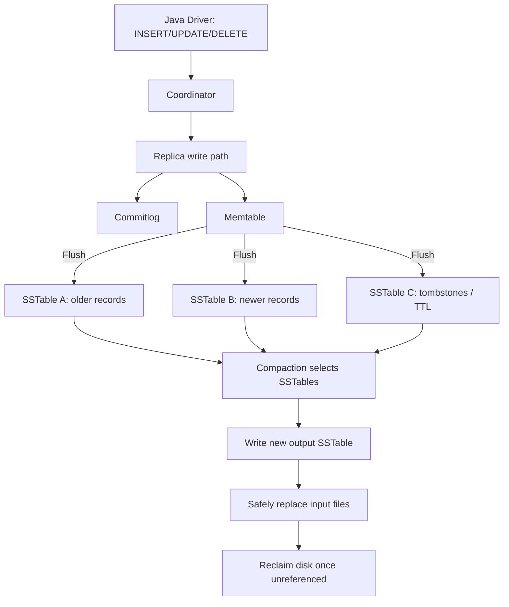
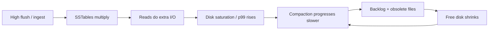
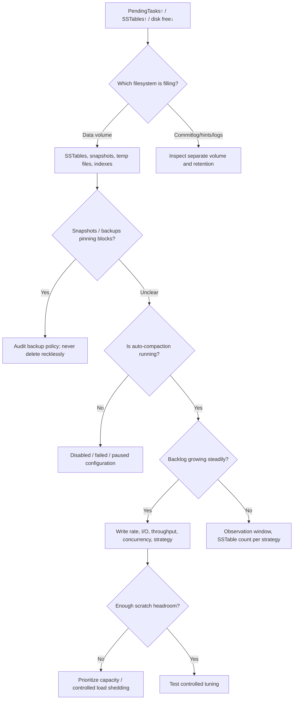
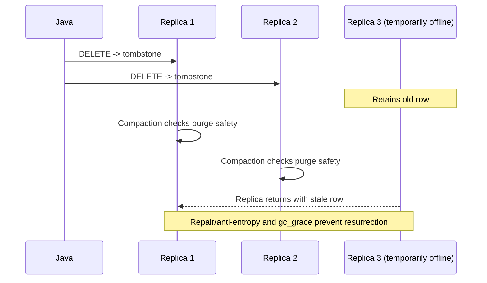

# Compaction Backlog, High SSTable Counts, and Near-Full Disks

## 1. Scenario: Slow Writes, Slow Reads, and No Disk Space Left

In an Apache Cassandra cluster, a Java service sees `SELECT ... WHERE partition_key = ?` p99 climb from tens of milliseconds to hundreds of milliseconds. Dashboards show some nodes holding far more SSTables than usual; `nodetool compactionstats` reports steadily climbing pending compactions; free space on one volume is down to a few percent. Several reads and writes at `LOCAL_QUORUM` time out, and compactions do not seem to free space as expected.

These three symptoms—**compaction backlog**, **many SSTables**, and **near-full disk**—often appear together yet **are not synonymous**:

- **Backlog:** compaction work is being generated faster than it is processed, or compactions are delayed/blocked. `PendingTasks` is not the number of bytes waiting to be compacted.
- **Many SSTables:** can result from frequent flushes, sustained writes, disabled compaction, tombstones, or simply a compaction strategy/layout that maintains many small files by design. A high file count is not automatically a fault.
- **Near-full disk:** can be caused by live SSTables, temporary/obsolete files, snapshots/hardlinks, incremental backups, commit logs, hints, indexes/repair/streaming, or even another volume. Never assume "compaction is consuming the disk" from a filesystem usage percentage alone.

**Operational principle:** when free space is low, **do not rush to run major compaction, manual garbage collection, flushes, large repairs, or delete SSTable files directly**. Compaction must write output files **before** safely releasing input files; the tighter the headroom, the easier it is to hit a "need to compact to free space, but lack space to compact" deadlock.

This lesson belongs to the **Troubleshooting** chapter of the `DATABASE_ENGINE_WIDE_COLUMN_CASSANDRA` module. Connected topics include distributed wide-column architecture, partition keys, query-driven tables, read/write consistency, replication, read/write paths, compaction, repair, error handling, and Java Driver. You cannot fix a poorly modeled hot partition by raising `concurrent_compactors` endlessly.

### Learning Objectives

After completing this lesson, you will be able to:

1. Describe the lifecycle memtable → flush → immutable SSTables → compaction → obsolete file cleanup, and connect it to tombstones, TTL, and repair.
2. Read `PendingTasks`, `BytesCompacted`, `LiveSSTableCount`, `LiveDiskSpaceUsed`, `TotalDiskSpaceUsed`, SSTables/read, and filesystem free bytes/inodes accurately.
3. Diagnose root-cause groups: ingestion outpacing compaction, disabled/throttled compaction, I/O/CPU contention, mismatched strategies, snapshots pinning blocks, streaming/repair/indexes/backups, and expired data blocked from purging.
4. Contrast STCS/LCS/TWCS in Cassandra 4.1 with UCS recommended for many workloads starting in Cassandra 5.0, avoiding one-size-fits-all tuning myths.
5. Prioritize actions when disks approach capacity: throttle ingestion per policy, protect headroom, expand capacity safely, restore compaction under control, and verify correctness/RF/CL.
6. Design labs and runbooks with stop/rollback gates and before/after evidence without losing data through bad disk actions.

> **Scope and safety:** examples use Cassandra 4.1/5.x, Java Driver 4.x, and Linux. Exact configs, commands, and metrics depend on release/distribution; verify in your running environment before executing. Commands that alter data or config apply only in **isolated labs or approved changes**. This lesson never asks you to fill a production disk intentionally.

## 2. The LSM Model: Why Does Compaction Exist?



In Cassandra, SSTables are **immutable** files ordered by token, partition, and clustering keys. An `UPDATE` never mutates an old SSTable in place; it writes a newer version to the memtable, which flushes into a new SSTable. A `DELETE` writes a **tombstone**; expired TTLs likewise mark data obsolete so compaction can reclaim it safely.

### Three Types of Amplification

| Concept | Phenomenon | Incident Link |
| --- | --- | --- |
| **Read amplification (RA)** | One query must inspect multiple SSTables, Bloom filters, index summaries, or tombstones | High SSTables/read, rising p95/p99 |
| **Write amplification (WA)** | One logical write triggers extra I/O bytes across flushes, compactions, and maintenance | High disk await, CPU, and storage/network budgets |
| **Space amplification (SA)** | New data, old versions, tombstones, temp files, and copies coexist | Headroom needed before old files are released |

**Compaction reduces some costs, yet consumes CPU and disk itself.** A workload writing faster than compaction can merge creates SSTables faster than they are consolidated; reads slow down progressively and recovery becomes harder once disk headroom runs out.

### The Vicious Cycle to Break



This loop is **not** the sole explanation. Snapshots can pin physical blocks even when backlog is tiny; a separate commit-log volume can fill while table `LiveDiskSpaceUsed` stays flat. The lesson is to **inspect layer by layer before acting**.

## 3. Classifying Urgency Levels

| Level | Illustrative Condition | Priority |
| --- | --- | --- |
| **Monitor** | Pending compactions fluctuate then return to baseline; free space comfortably within headroom plan | Verify trend; do not intervene hastily |
| **Warning** | `PendingTasks` or SSTables/read climb over multiple windows; free disk drops steadily; p99 drifts toward SLO | Isolate table/node, check ingest/compaction/backups, prepare change |
| **Severe** | Disk growth projects exhausting headroom before mitigations take effect; errors rising | Rate-limit load safely, protect write path, prepare capacity/failover |
| **Emergency** | OS reports `No space left on device`, flush/commitlog/SSTable writes fail, node unhealthy | Incident response, halt worsening actions, restore capacity with owner |

**Never treat 80%/90% as a universal law.** On a 200 GiB volume, 10% free is 20 GiB; on a 20 TiB volume, 10% free is 2 TiB. Headroom must account for **the largest possible concurrent compactions**, streaming/repair, write rate, and storage expansion lead time. On multi-volume SSDs, inspect **each filesystem individually** rather than a cluster-wide average percentage.

### Two Questions to Answer in Minute One

1. **If we do nothing, how long until we hit the unsafe-to-write threshold?** Calculate from free bytes, net consumption rate, and safety reserve—not percentages alone.
2. **Which activity is driving disk growth?** Live SSTables, compaction outputs/obsolete files, snapshots, incremental backups, commit logs, hints, or another volume?

## 4. Diagnostic Branching Flowchart



These branches define an **inspection order**, not automatic permission to alter settings. Never tune compaction throughput or concurrency before knowing free space and I/O headroom.

## 5. Collecting Evidence Without Mutating the System

### 5.1. *Read-Only* Cassandra Commands

```bash
# Run from a node / operator host authorized for JMX.
nodetool status
nodetool describecluster
nodetool compactionstats -H
nodetool compactionhistory
nodetool tpstats
nodetool tablestats -H
nodetool tablehistograms example_ks events_by_device_day
nodetool netstats
nodetool listsnapshots
nodetool getcompactionthroughput
nodetool statusautocompaction example_ks events_by_device_day
```

`example_ks.events_by_device_day` is a lab placeholder; substitute your target table. Some commands and flags vary between Cassandra 4.1, 5.x, and vendor builds; run `nodetool help <command>` on **your exact release** to confirm. These commands mainly reflect **the node `nodetool` connects to**, not automatically every node in the RF/cluster.

| Command | What to Record | What Not to Infer |
| --- | --- | --- |
| `compactionstats -H` | Active tasks, byte progress, estimated remaining, pending tasks per table | `PendingTasks` is not GiB remaining to compact |
| `compactionhistory` | Strategy/volume of recent compactions where available | Does not replace long-term throughput baselines |
| `tablestats -H` | SSTable counts, live/total/snapshot sizes, tombstones/latencies | Does not replace `df` for filesystem free space |
| `tablehistograms` | SSTables/read and read/write latency/partition-size distributions | Does not reflect full end-to-end Java latency |
| `tpstats` | Thread pool active/pending/dropped | Compaction pending is not every pending task type |
| `netstats` | Active streaming? | Does not measure full compaction speed |
| `listsnapshots` | Cassandra snapshot tags and reported sizes | Does not prove backups are safely stored off-node |
| `getcompactionthroughput` | Current configured throughput cap per release | Cap does not mean compaction is actually achieving that rate |
| `statusautocompaction` | Whether any table disabled auto-compaction | Enabled does not guarantee progress is happening |

### 5.2. OS and Volume Checks

```bash
# Replace directories with the node's real data/commitlog/snapshot paths.
df -h /var/lib/cassandra
df -i /var/lib/cassandra
lsblk -f
mount

# Observe disk utilization/latency if sysstat is installed:
iostat -x 1 5

# Top-level directory sizing can add I/O; keep narrowly scoped:
du -sh /var/lib/cassandra/data
du -sh /var/lib/cassandra/commitlog

# Only when operators need to inspect unlinked files still held open:
# lsof +L1
```

**Be cautious with `du`, `find`, `lsof`, and large filesystem scans:** they generate extra metadata I/O on an already stressed node. Never run `du -a /` or hammer JMX every second mid-incident. `df` reports filesystem-level free space while `du` sums directory-tree allocations; snapshots/hardlinks and open-but-deleted files make the two numbers diverge.

### 5.3. When Running in Kubernetes

```bash
# Read-only inspection in an authorized lab namespace:
kubectl -n cassandra get pods -o wide
kubectl -n cassandra get pvc
kubectl -n cassandra describe pvc cassandra-data-example

# Verify the actual volume mounted inside the Pod, not the node root filesystem.
```

Declared PVC capacity, in-container filesystem free space, storage-class expansion, and disk quotas can differ. A `Ready` Pod does not certify the PVC has enough space for **both output files and input SSTables** to coexist during compaction.

## 6. Reading `nodetool compactionstats` Properly

**Illustrative** output:

```text
pending tasks: 34
- example_ks.events_by_device_day: 30
- example_ks.users_by_id: 4
id         compaction type  keyspace    table                 completed   total       unit   progress
...        Compaction       example_ks  events_by_device_day  128000000   640000000   bytes  20.00%
Active compaction remaining time : 0h00m35s
```

Never multiply "34 × 640 MB ≈ 21 GB compaction backlog": individual tasks vary wildly in size, `640000000` is the **total bytes of that single active task**, and pending tasks is an estimate of unstarted work. Estimated remaining time fluctuates with compaction speed and type; it is not an SLA deadline.

### Watch **Trends**, Not Single Snapshots

| Hypothetical Time | PendingTasks | Live SSTables | Free Data Disk | Observation |
| --- | ---: | ---: | ---: | --- |
| 09:00 | 14 | 180 | 420 GiB | Monitoring begins |
| 09:10 | 31 | 225 | 360 GiB | Backlog and space pressure both rising |
| 09:20 | 56 | 300 | 280 GiB | Compaction falling behind ingest |
| 09:30 | 48 | 270 | 300 GiB | Slight improvement; inconclusive yet |

**These numbers are simulated.** If the queue rises for 10 minutes and drains back to 0 after a controlled bulk import, it may be transient; if backlog and SSTables/read climb continuously across workload cycles, hunt down the bottleneck.

### Additional Signals to Correlate

- `PendingTasks` climbs while `BytesCompacted` stays flat: compaction is disabled, stalled by I/O/CPU/headroom, task selection, or errors.
- `PendingTasks` is low while SSTables/read is high: compaction strategy, scattered SSTables, large/wide partitions, tombstones, or mismatched metric scopes.
- `PendingTasks` drops yet free disk stays flat: snapshots/hardlinks, ongoing writes, obsolete files, indexes/backups, or compaction producing large outputs.
- One node looks worse than peers: token/RF skew, hot partitions, differing PVC/SSD performance, local disk faults, or dedicated repair/streaming.

## 7. Reading JMX Metrics Without Confusing Gauges and Counters

Cassandra exposes metrics via Dropwizard/JMX or exporters. **Exact names vary by version**, yet core groups include:

| Metric / Meaning | Unit and Proper Reading | Common Misinterpretation |
| --- | --- | --- |
| `Compaction.PendingTasks` | Gauge of estimated waiting tasks | Not bytes waiting |
| `Compaction.BytesCompacted` | Counter of bytes compacted since process start | Never compare raw totals across nodes with different uptimes |
| `Compaction.CompletedTasks` | Completed tasks over time | Many tiny tasks do not equal one huge task |
| `Compaction.PendingTasksByTableName` | Per-keyspace/table breakdown when exposed | Not byte count or ETA |
| `Table.LiveSSTableCount` | Count of *live* SSTables for a table on that node | LCS/UCS legitimately keep many small files |
| `Table.LiveDiskSpaceUsed` | Bytes used by live SSTables of that table | Excludes snapshots, commitlog, and OS overhead |
| `Table.TotalDiskSpaceUsed` | Live SSTables + obsolete SSTables awaiting release | Does not equal total filesystem usage |
| `SSTablesPerReadHistogram` | Distribution of SSTables consulted per read | Compare only across matching queries/workloads |
| `TombstoneScannedHistogram` | Tombstones encountered per read, when exposed | Does not equal tombstones purged |
| `ReadLatency` / `WriteLatency` | Per-node/per-table timers/histograms | Does not equal end-to-end Java p99 |
| `PendingFlushes` | Memtables waiting to flush | Can rise alongside compaction under I/O saturation |

**Measure byte rates properly:** take `rate(Compaction.BytesCompacted)` or interval deltas on the same live process; restarts reset counters. Also remember `BytesCompacted` measures work processed, **not** net bytes reclaimed on the filesystem.

### Separating *Live*, *Total*, *Snapshot*, and *Filesystem* Space

```text
Filesystem used
  ├─ Live SSTables for tables + indexes
  ├─ In-progress compaction outputs / referenced obsolete files
  ├─ Snapshots / incremental backups (often hardlinks)
  ├─ Commitlog, hints, caches, logs (depending on mount layout)
  ├─ Streaming / repair / temporary files
  └─ Other processes/components sharing the filesystem
```

**Never sum these components mechanically as disjoint sets of bytes:** hardlinks share physical blocks, and snapshots **prevent blocks of replaced SSTables from being freed**. Thus `df` is the ultimate truth for physical space, while `nodetool listsnapshots` and `tablestats` explain **why**.

## 8. Formulas for Headroom Alerts and Backlog Drain Rate

### 8.1. Never Rely on a Single Percentage

For a given filesystem, let:

- `F` = actual measured free space right now.
- `S` = mandatory safety reserve set by operations that must not be breached.
- `C` = estimated **peak extra bytes** needed by concurrent compactions before inputs are released.
- `I` = expected net byte growth from ingress, streaming, repair, indexes, and backups over the window.

Prudent condition before starting any byte-heavy operation:

\[
F \;>\; S + C + I
\]

This is an **estimation framework**, not a theorem guaranteeing safety: multiple data directories, shifting compression ratios, inode limits, and filesystem reserved blocks all matter. If `C` cannot be estimated reliably, **never trigger a large manual compaction** based solely on a free-space percentage.

### 8.2. Estimating Time to Exhaustion

If `g` is the **net rate of disk space growth** (`> 0`) on that volume, then:

\[
T_{\text{to threshold}} \approx \frac{F-S}{g}
\]

**Illustrative** example: 80 GiB free, 30 GiB reserve required, and disk used growing at 5 GiB/hour yields a theoretical `(80 - 30) / 5 = 10 hours` runway. However, growth jumps suddenly during flushes, compactions, or streaming; measure across multiple windows and leave ample safety margin.

### 8.3. Estimating Backlog Drain Time

When remaining **compaction work** is measured in the same byte units as the compaction rate:

\[
T_{\text{drain}} \approx \frac{\text{Backlog work}}{\text{Compaction service rate} - \text{New compaction work rate}}
\]

This is meaningful only when the denominator is **positive** and both rates share identical units. Never treat `PendingTasks` as GiB and divide by `BytesCompacted/s`; tasks vary in size, and output bytes differ from input bytes. When work creation outpaces service rate, waiting longer will never drain the backlog.

## 9. Root-Cause Groups for Compaction Backlogs

### 9.1. Sudden or Sustained Write Spikes

Every memtable flush creates a new SSTable. If an import/backfill job floods mutations, flush rate can overwhelm compaction capacity. A node holding a hot token range or heavily updated partition can fall behind even when cluster-wide QPS looks modest.

**Signals:** rising `MemtableSwitchCount`/write rate, growing `LiveSSTableCount`, heavy disk write bytes, and `PendingTasks` climbing right alongside a deploy/import. **Never confuse** repeated updates to the same partition with "few rows means low disk I/O": immutable SSTables accumulate versions and tombstones.

**Remediation:** if ingress exceeds capacity, apply throttling/backpressure **with RPO/lag awareness**, lower import concurrency, and verify the backlog stops growing. Never kill producers lacking durable queues/checkpoints; with Kafka/streaming, coordinate offsets, idempotency, and uncertain write outcomes.

### 9.2. Auto-Compaction Disabled or Blocked

A prior maintenance task may have run `nodetool disableautocompaction` and forgotten to re-enable it, a table may have `compaction = {'class': '...', 'enabled': 'false'}`, or tasks may stall on disk/I/O/permission errors.

**Signals:** `statusautocompaction` reports disabled, `BytesCompacted` stays flat over multiple windows, and SSTables keep piling up. **Remediation:** check change history/owners to understand why it was disabled, and re-enable only once **sufficient headroom exists**. If the disk is nearly full, re-enabling can immediately launch large outputs and push the node out of space.

### 9.3. Compaction Throttling Set Too Tight

In Cassandra 4.x/5.x, `compaction_throughput` sets the bytes/sec cap (exact YAML key/unit formatting varies by version); `nodetool getcompactionthroughput` shows the current cap. If the cap sits below the steady rate of incoming compaction work, queues grow.

**Never set throughput = 0** just to "run faster": in common releases, `0` disables throttling altogether. On an already I/O-saturated disk, unthrottled compaction starves foreground reads/writes, spikes p99, and stalls commit logs/flushes.

### 9.4. Too Few or Too Many `concurrent_compactors`

`concurrent_compactors` controls simultaneous compaction tasks (separate from repair validation threads depending on version). Too few leaves CPU/IOPS idle while backlogs grow; too many floods SSD I/O queues, CPU, and page cache while **multiplying concurrent scratch-space demand**.

**Sensible order:** inspect disk await, CPU, IOPS, throughput cap, task sizes, and free headroom first; if real capacity remains, step up cautiously in lab/canary under load. There is no universal "optimal = core count" rule for every workload and storage tier.

### 9.5. Slow Disk I/O, Filesystem Errors, or Volume Quotas

Compaction reads and writes huge SSTables. Provisioned IOPS caps, exhausted cloud EBS burst credits, noisy shared volumes, or kernel I/O errors stall compaction even with high `PendingTasks`. Another log or backup process may also be competing for the same disk.

**Signals:** `iostat -x` shows high latency/await and saturated util/queues, OS/Cassandra logs show I/O exceptions, storage metrics report throttling, and `BytesCompacted/s` drops. **Remediation:** restore disk capacity/IOPS and pause competing background work per policy rather than blindly raising `concurrent_compactors`.

### 9.6. High SSTables from Mismatched Strategy or Data Patterns

STCS accumulates many SSTables when size buckets diverge; LCS maintains many small SSTables **by design**, requiring you to watch overlap (especially L0); TWCS retains older windows when out-of-order writes or unpurged data prevent expiration; UCS uses its own sharding/leveling mechanics.

**Never judge solely by absolute file count.** Compare SSTables/read, file ages, overlap, LCS levels, timestamps, compaction debt, p99, and disk bytes **under identical workload and version**.

### 9.7. Fallout from Repair, Streaming, Bootstrap, Node Replacement, or Index Rebuilds

Repair and streaming add SSTables and consume disk/I/O; node replacement and scale-out stream data across many token ranges. Looking only at application ingest misses background writers sharing the filesystem.

**Remediation:** align timelines across `nodetool netstats`, repair sessions, `compactionstats`, snapshots/backups, and recent changes. If near capacity, halt **scheduling new** heavy non-essential jobs per policy and check active jobs—never arbitrarily kill repairs protecting data consistency.

### 9.8. Snapshots, Incremental Backups, or Obsolete SSTables Pinning Blocks

Cassandra snapshots typically create hardlinks to SSTables; after compaction writes new SSTables, snapshot links keep **old files from freeing physical blocks**. Incremental backups likewise retain/link SSTables, and obsolete files may retain open descriptors briefly before cleanup.

**Signals:** `LiveDiskSpaceUsed` stays flat while `df` used climbs; `nodetool listsnapshots` shows aged snapshots/backups; `TotalDiskSpaceUsed` diverges from filesystem usage. **Never delete snapshots impulsively**: they may be the sole restore point or compliance artifact. Verify off-node backups and retention policies before approving cleanup.

### 9.9. TTL/Tombstones Blocked from Purging for Safety

TTL expiration does not mean an SSTable vanishes instantly. Tombstones obey `gc_grace_seconds`, anti-entropy/repair, and safety checks to stop deleted data from **resurrecting** from an out-of-date replica; an older SSTable may also still contain live cells or shadow data in other SSTables, blocking whole-file drops.

**Remediation:** review repair cadence, TTL distribution, tombstone-scanned metrics, SSTable ages, and compaction strategy; never slash `gc_grace_seconds` from days to `0` just to free disk without verifying repair and replica liveness constraints.

## 10. Comparing Compaction Strategies by Version

| Strategy | Core Mechanism | When Suitable | Signals to Investigate |
| --- | --- | --- | --- |
| **STCS** | Groups similarly sized SSTables for compaction | Write-heavy / steady ingest on older releases | Bucket starvation, high SSTables/read, large scratch headroom |
| **LCS** | Fixed-size levels; non-overlapping SSTables above L0 (L0 can overlap) | Strict read SLAs, read-heavy workloads | L0→L1 stall, rising write amplification and disk I/O |
| **TWCS** | Groups SSTables by time window; fits TTL time-series | Mostly append-only time-ordered data with uniform TTL | Late writes, overlapping windows, SSTables failing to expire |
| **UCS** (Cassandra 5.x) | Combines tiered/leveled trade-offs with sharding and levels | Recommended by Cassandra 5.0 docs for most workloads | Bad scaling parameters, compaction debt, size/overlap; dedicated metrics needed |

**Compatibility warning:** Do not assume Cassandra 4.1 OSS includes UCS by default. Starting in Cassandra 5.0, project documentation recommends **Unified Compaction Strategy (UCS)** for most workloads—yet that **does not** mean you should alter a STCS/LCS/TWCS table's strategy mid-incident while disks are nearly full.

### 10.1. STCS: `min_threshold`/`max_threshold` Are Not Cure-Alls

STCS selects groups of similarly sized SSTables; `min_threshold`/`max_threshold` govern when compaction triggers per version. Below threshold, files wait by design. After a burst of tiny SSTables, compaction can lag on file count and I/O.

**Never lower `min_threshold` recklessly:** it increases rewrite frequency, worsening WA and space pressure. Focus on flush rates, bucket distribution, disk capacity, and consistent config across nodes.

### 10.2. LCS: High SSTable Counts Can Still Serve Fast Reads

LCS organizes bounded-size SSTables into levels; above L0, SSTables within each level have disjoint token ranges. Thus `LiveSSTableCount=1,000` does not prove high read amplification. Watch SSTables/read, L0 backlog, compaction throughput, and p99 instead.

Under disk I/O bottlenecks, L0 piles up and introduces overlap, raising p99. Lowering the throughput cap out of I/O fear starves L0→L1 compaction even further; balance **foreground latency against background debt** rather than optimizing one metric blindly.

### 10.3. TWCS: Expired TTLs Yet Files Persist

TWCS works best when SSTables contain cleanly separated write-time windows. If apps write late events or `UPDATE` old rows, one SSTable spans multiple time windows, keeping tombstones unpurgeable or pulling fresh data into older windows.

**Check:** actual write-timestamp distributions (not just the domain `event_time` column), TTL spread, `gc_grace_seconds`, repair cadence, and overlapping blockers across SSTables. Adopt TWCS (or UCS configured with similar behavior) only when your data's write-time pattern truly fits.

### 10.4. UCS in Cassandra 5.x: A Version-Specific Choice, Not an Instant Disk Rescue

UCS supports sharding and tunable read/write amplification via scaling parameters and is broadly recommended in Cassandra 5.0 docs. Still, migrating from a legacy strategy can trigger heavy rewrites/compaction work impacting disk headroom, and scaling parameters must be tested against real data volume and load.

**During a near-full disk incident:** restore capacity and identify byte consumers first; evaluate switching to UCS as a **long-term optimization plan** post-stabilization rather than treating `ALTER TABLE ... WITH compaction` as an instant cleanup tool.

## 11. Tombstones, TTL, Repair, and "Data Resurrection" Risk

Deleting a row on node A does not mean every replica immediately received the tombstone. If a lagging replica still holds the old record, purging the tombstone **too early** allows the old row to re-propagate, causing **resurrection**. `gc_grace_seconds` protects deletion safety alongside anti-entropy repair and replica outage windows.



Never assume "waiting past `gc_grace_seconds` guarantees Cassandra deletes the tombstone". Conflicting timestamps across SSTables, snapshots, strategy/version rules, repair state, or missing eligible compactions can all retain tombstones longer.

### Dangerous Choices When Low on Disk

| Tempting Action | Why It Is Dangerous |
| --- | --- |
| `ALTER TABLE ... WITH gc_grace_seconds = 0` | Risks resurrecting deleted data if replicas/repairs aren't guaranteed |
| Forcing tombstone compaction ignoring safety checks | Can rewrite data **without** dropping tombstones, burning more disk |
| Running `nodetool garbagecollect` casually | Mutates SSTables/data with strict safety and headroom requirements |
| Assuming "TTL expired" means "safe to unlink file" | SSTable may hold live cells or block/be blocked by other files |
| Running offline SSTable tools while Cassandra runs | Risks inconsistent reads or broken operations |

**Crucial note:** `sstableexpiredblockers` is an **offline tool**; documentation requires **stopping Cassandra before running it**, and the script does not enforce that check itself. Never run it on a live online node just because its name sounds "read-only". Restrict it to planned maintenance windows or labs matching the exact version.

## 12. Why Did Compaction Finish Yet Filesystem Usage Didn't Drop?

This is the most common situation tempting operators to delete SSTables by hand.

| Possibility | Signals | Non-Destructive Verification |
| --- | --- | --- |
| Output nearly equals input | `BytesCompacted` rose with few obsolete bytes | Compare live/total table bytes before vs. after |
| New writes arrive at the same pace | Free disk stays flat despite compaction | Compare ingest bytes/s, compaction bytes/s, FS growth |
| Snapshot hardlinks pin inputs | `listsnapshots` shows long-lived snapshots | Audit backup retention against filesystem usage |
| Incremental backups pin SSTables | Backup directory/metadata grows | Verify off-node copy and retention rules |
| Temp files or obsolete open references | `TotalDiskSpaceUsed - LiveDiskSpaceUsed` rises | Re-check after compaction and reader references settle |
| Tombstones ineligible to purge | TTL expired yet SSTables stay live | Check repair, `gc_grace`, timestamp overlap, TWCS windows |
| Concurrent streaming/repair/index builds | `netstats` and ops logs show activity | Align UTC timeline with disk growth |
| A different volume is filling | `df` shows separate commitlog/hints/logs mount | Inspect `data_file_directories`/commitlog/hints |
| Unlinked files still held open | `df` and `du` diverge; logs show open-deleted handles | Authorized operator runs scoped `lsof +L1` |
| Inode quota exhausted | `df -i` near 100% while bytes remain | Check file counts and FS quotas |

**Never run `rm -rf /var/lib/cassandra/data/...` or delete `*-Data.db` files because you see newer outputs.** Every SSTable spans multiple component files (Data, Index, Statistics, Filter, etc.) whose references and deletion safety are owned by Cassandra. Manual deletion risks permanent partition loss, broken repair/replication, and corrupted backups.

### Snapshot Retention Is a Data-Protection Decision

`nodetool listsnapshots` is for **inspection**, not deletion permission. `nodetool clearsnapshot` **deletes local backup data** and requires approval, verification of off-node copies/restore tests, retention compliance checks, and realistic reclaimed-byte estimates. Because of hardlinks, a "100 GiB snapshot" **rarely frees 100 GiB** upon deletion.

## 13. When Disks Near Threshold: Safe Response Sequence

### Phase A — Stop Making It Worse and Preserve Evidence

1. Open an incident; identify **nodes, volumes, keyspaces/tables**, RF/CL, dependencies, and onset UTC.
2. Collect read-only observations at a moderate cadence; save `df`, `compactionstats`, `tablestats`, `listsnapshots`, `netstats`, and logs.
3. Determine if enough **filesystem free space** remains for commit logs, SSTables, and active compactions.
4. Pause **launching** non-essential byte-heavy jobs—bulk imports, index builds, backfills, new snapshots, or new repairs—**per runbook/owner**. For running jobs, inspect state and cancel cleanly rather than killing blindly.
5. If an app drives heavy ingestion, apply QPS/concurrency limits or backpressure **with durable buffering**. Never ACK/commit Kafka offsets before mutations succeed; on write timeouts, record **unknown outcome** instead of assuming failure.

**Do not:** trigger immediate major `nodetool compact`, disable auto-compaction cluster-wide, restart all nodes, delete `commitlog`, or shrink RF to "have fewer copies" without a data/repair strategy. Every one of those raises data-loss or outage risk.

### Phase B — Restore Capacity Headroom Before Tuning

- Where volumes support **online expansion**, grow storage per platform runbooks, then verify the OS filesystem actually recognized the new size and alerts updated.
- To move data directories or expand storage topology, follow **official Cassandra/OS procedures**—never `mv` live SSTables on a running node. For replica data, verify rack/DC placement, backups, runbooks, and target node headroom.
- Adding nodes increases total cluster capacity **yet** triggers bootstrap, streaming, and repair—**temporarily increasing** I/O and disk usage before cleanup; never treat it as an instant emergency fix when the whole cluster is near full.
- If expired snapshots are eligible per policy, clean up only after owners confirm **off-node backups passed restore checks**, exact scope, and retention compliance.

**Favor the lowest-risk option that restores physical margin.** Protecting data integrity and recoverability outweighs turning a dashboard green immediately.

### Phase C — Restore Compaction Under Control

Only after headroom is restored and the bottleneck is identified:

1. If auto-compaction was disabled, find out why; **re-enable with approval** once free space suffices—never flip the whole cluster unconditionally.
2. If the throughput cap is too low **and disk I/O has spare capacity**, step up the cap incrementally with before/after measurements. Avoid `0` (unthrottled) without explicit sign-off.
3. If CPU and disk I/O remain underutilized, evaluate `concurrent_compactors` based on version, task sizes, and scratch space.
4. Watch multiple measurement windows to confirm **`PendingTasks` stops climbing**, `BytesCompacted/s` advances, and **free headroom remains safe**.
5. Once stable, plan long-term fixes for compaction strategy, schema/TTL, hardware, hot keys, and ingestion budgets.

**Critical cause–effect trade-off:** raising concurrency drains `PendingTasks` faster yet keeps more temporary output SSTables open simultaneously; at 5% free space, that choice can push a node straight into `ENOSPC`. Always gate on **peak additional bytes**.

## 14. Which Runtime and Schema Changes Must Follow Change Control?

| Lever | Goal | Risk | Prerequisites |
| --- | --- | --- | --- |
| Throttle ingest / backfill concurrency | Slow new compaction work generation | Lag grows, queues fill, redeliveries | Durable queues, idempotent retries, lag SLAs |
| Expand storage / IOPS | Add headroom and compaction speed | Cost, quotas, volume resize limits | Platform approval, backups, capacity verified |
| Re-enable auto-compaction | Resume SSTable consolidation | Temporary peak scratch/output growth | Know why it was disabled; adequate free disk |
| Raise `compaction_throughput` | Increase bytes compacted/sec | Foreground p99 degrades from I/O contention | Spare disk I/O, canary test, rollback |
| Raise `concurrent_compactors` | Run more compactions in parallel | CPU, I/O, memory, and scratch spike | Per-node metrics and headroom |
| Switch STCS ↔ LCS/TWCS/UCS | Alter long-term RA/WA/SA profile | Heavy rewrites/conversions consuming disk | Lab test, byte/time plan, version check |
| Shorten TTL for **new** writes | Shrink future logical retention | RPO/audit/legal and query semantics | Data contract and policy approval |
| Lower `gc_grace_seconds` | Seemingly purge tombstones earlier | Data resurrection / broken correctness | Never use as a default hotfix |
| Clean up old snapshots | Release pinned blocks | Deletes local backup/restore point | Off-node verification and retention sign-off |
| Scale-out / change RF | Add capacity or alter replication | Streaming, repair, imbalance, availability | Topology plan, disk headroom, rollback |

### Verify Throughput Units on Your Running Release

Cassandra 5.x documentation uses `compaction_throughput` in YAML, whereas older releases differ in property names and formats; `nodetool getcompactionthroughput` reports the active cap (MiB/s per 5.0 nodetool docs). When adjusting at runtime via `nodetool setcompactionthroughput`, **confirm syntax and persistence** for your Cassandra version: runtime overrides vanish on restart or config management runs. Never hardcode arbitrary numbers into emergency runbooks.

### What to Monitor Immediately After a Change?

Record **before / canary / after**: free GiB, disk await/IOPS, `BytesCompacted` rate, `PendingTasks`, SSTables/read, read/write p95/p99, error rates, goodput, GC, and stream/repair backlogs. If pending tasks drop while latency or timeouts breach guardrails, **roll back the tuning** per plan rather than waiting until the disk fills.

## 15. Operations That Are **Not** Default Disk-Rescue Tools

| Operation | True Purpose | Why Caution Is Required |
| --- | --- | --- |
| `nodetool compact` / forced major | Forces compaction, often rewriting most SSTables | Consumes heavy scratch bytes, I/O, and time; risks `ENOSPC` |
| `nodetool garbagecollect` | Conditional SSTable GC/compaction | Requires understanding tombstone safety; may reclaim less than expected |
| `nodetool cleanup` | Removes unowned token ranges after topology changes | Not a general vacuum; requires valid ownership and headroom |
| `nodetool repair` | Anti-entropy replica synchronization | Increases disk/stream/compaction load; does not replace tombstone cleanup |
| `nodetool flush` | Flushes memtables to SSTables | Creates extra SSTables and adds disk pressure |
| `nodetool upgradesstables` | Rewrites SSTables to current format | Can require substantial temporary bytes |
| `nodetool clearsnapshot` | Deletes local snapshots by tag/scope | **Destroys backups** unless copied and verified elsewhere |
| Offline `sstableexpiredblockers` | Analyzes blockers on expired SSTables | **Requires Cassandra stopped** per docs; never run online |
| OS `rm` in data/commitlog/hints | Deletes files behind Cassandra's back | Severe risk of data loss and corruption |

**A command named "compact", "cleanup", or "garbagecollect" is never free, riskless online, or guaranteed to reclaim a fixed number of GB.** Before any state-mutating operation, assign an owner and verify health/backups/replication, free space, impact window, rollback, and post-checks.

## 16. Capacity Planning: Logical Data Differs from Physical Disk

A rough **cluster-level** sizing model:

\[
D_{\text{replicas}} \approx D_{\text{logical compressed per replica}} \times RF
\]

Yet sizing **per node** must account for uneven token/replica placement, multiple datacenters, strategy/partition hotspots, and overhead. Mandatory additions include:

- **Live SSTables** with versions/tombstones, compression metadata, and secondary/SAI indexes.
- **Space amplification** from compaction, unlinked obsolete files, and peak concurrent outputs.
- **Snapshots/backup retention** and incremental backups holding hardlinks, counted in actual physical blocks.
- **Commitlog/hints/logs** on their respective volumes, plus repair/streaming/bootstrap scratch space.
- **Growth** during capacity procurement/expansion plus an incident buffer.
- **Hardware failure cushion:** losing a node shifts load and replica duties onto survivors; scaling out triggers streaming.

### Sample Headroom Exercise (Hypothetical Numbers)

A node has a 2 TiB data volume with 1.78 TiB used, leaving ~0.22 TiB free. Two concurrent compactions project **peak extra** 180 GiB, planned streaming needs 70 GiB, and policy requires a 100 GiB reserve. **Headroom is insufficient** to run everything concurrently; even though `df` is not yet 100%, 220–230 GiB free is not safely "plenty for every operation".

**Decision:** reduce concurrent operations, defer non-essential streaming, expand capacity, or throttle ingest under a reversible policy before manual compaction. Numbers here illustrate the math, not fixed scratch defaults for STCS/LCS/UCS.

### Never Drop RF to Save Disk While Ignoring Quorum

RF3 in one DC with `LOCAL_QUORUM` requires **2** responses; RF2 in that DC also has quorum = 2, yet loses fault tolerance and alters replica placement. Dropping RF for disk space is a **durability and availability change**, not a quick compaction-backlog fix, and requires synchronization/repair/cleanup afterward.

## 17. Diagnosing from Java Driver 4.x: Query Errors Do Not Mean "Cassandra Is Out of Disk"

An exception from `session.execute()` could be:

- `ReadTimeoutException`, `WriteTimeoutException`, `UnavailableException`: CL, coordinator/replicas, overload, or network issues—potentially triggered indirectly when compaction saturates I/O.
- `DriverTimeoutException`: driver exhausted its request budget; does not prove compaction is the root cause.
- `OverloadedException`: server/coordinator overload in supporting versions/cases.
- `AllNodesFailedException`: per-node errors from pooling, connectivity, or topology—not automatically disk.
- `UnauthorizedException` / invalid CQL: permissions or schema, unrelated to compaction.

**Conclusions require correlation:** in the same time window, which node had high disk await/compaction backlog, which coordinator served the query, what were the request RF/CL, and which partition was read? Avoid catching every timeout and logging "disk full", which misdirects investigations.

### A Java Probe Reading by Exact Partition Key

```java
import java.time.Duration;
import java.util.UUID;
import java.util.concurrent.CompletionStage;

import com.datastax.oss.driver.api.core.CqlSession;
import com.datastax.oss.driver.api.core.DefaultConsistencyLevel;
import com.datastax.oss.driver.api.core.cql.BoundStatement;
import com.datastax.oss.driver.api.core.cql.PreparedStatement;
import com.datastax.oss.driver.api.core.cql.Row;

public final class CassandraReadProbe {
    private final CqlSession session;
    private final PreparedStatement byDevice;

    public CassandraReadProbe(CqlSession session) {
        this.session = session; // App/Spring owns session; repo never closes it.
        this.byDevice = session.prepare(
            "SELECT event_id, payload " +
            "FROM example_ks.events_by_device_day " +
            "WHERE device_id=? AND bucket_day=? LIMIT 20");
    }

    public CompletionStage<Boolean> check(
            UUID deviceId, java.time.LocalDate day) {
        BoundStatement stmt = byDevice.bind(deviceId, day)
            .setConsistencyLevel(DefaultConsistencyLevel.LOCAL_QUORUM)
            .setTimeout(Duration.ofSeconds(2))
            .setIdempotent(true);

        // Probe checks only whether at least one row exists in pre-seeded fixture.
        return session.executeAsync(stmt)
            .thenApply(page -> {
                Row first = page.one();
                return first != null;
            });
    }
}
```

**Snippet limitations:** `example_ks.events_by_device_day` requires the schema and fixture from the lab section below; code demonstrates CL/timeout and keyed reads, without measuring true p99, asserting payload values, or traversing multi-page results. For latency tests, use a monotonic clock and track errors, bytes, and achieved QPS. `LOCAL_QUORUM` requires supporting RF/topology—never run this against an RF1 container and claim RF3 quorum was verified.

### Retries and Uncertain Write Outcomes

During a disk-pressure outage, a replica may have applied a write even though the client timed out. Replaying counters, list appends, or external side effects causes duplicates. Bound retries, use operation IDs / idempotent writes where possible, and reconcile state post-recovery. **Never downgrade `LOCAL_QUORUM` to `ONE` just to make error charts look cleaner** when contracts forbid it.

## 18. Service Recovery: Don't Just Wait for `PendingTasks` to Hit 0

To declare the incident resolved, verify **all of these together**:

| Check | Pass Criteria | Insufficient If |
| --- | --- | --- |
| Disk headroom | Free bytes/inodes exceed reserve + planned scratch; projection won't hit 0 before next expansion | Only a single brief bump in free % |
| Compaction progression | Steady `BytesCompacted` rate; `PendingTasks` flat/falling across multiple windows | One `compactionstats` showing 0 while ingest continues |
| SSTables/read | Reduced or back within target for strategy/workload | Only raw SSTable count dropped |
| Client correctness | Keyed queries at CL and business oracles return accurate data | Only `cqlsh SELECT system.local` passes |
| Latency / goodput | p95/p99 and successful ops/s meet SLO under real offered load | Only p99 of the few succeeding requests looks good |
| Errors | No climbing timeouts, unavailable, overloaded, or `FSWriteError` | Only OS `No space left on device` stopped |
| Replicas / repair | RF/CL, nodes, repair/streaming, and tombstone safety verified | Node `UN` alone does not prove sync |
| Backups / retention | Validated restore paths for snapshots/backups; no unapproved backup loss | Snapshots were deleted merely to free disk |
| Operational rollback | Throughput/concurrency/ingest changes documented with revert steps | Unrecorded hotfixes applied on one node |

**`PendingTasks` need not stay 0 constantly:** under steady write traffic, Cassandra continuously runs background compaction. Look for sustainable trends, healthy latency/error budgets, and adequate capacity for target traffic.

## 19. Isolated CQL Lab: Observing SSTables, TTL, and Strategies

**Run only in an authorized lab container/cluster.** This exercise inserts **a tiny amount of data** to inspect schemas and read paths—**never intentionally fill a disk**.

### 19.1. Single-Node Fixture with RF1

```sql
-- LAB SINGLE NODE ONLY: in this RF1 cluster, quorum = 1.
CREATE KEYSPACE example_ks
WITH replication = {'class': 'SimpleStrategy', 'replication_factor': 1}
AND durable_writes = true;

CREATE TABLE example_ks.events_by_device_day (
    device_id uuid,
    bucket_day date,
    event_id timeuuid,
    payload text,
    PRIMARY KEY ((device_id, bucket_day), event_id)
) WITH CLUSTERING ORDER BY (event_id DESC)
  AND compaction = {
      'class': 'SizeTieredCompactionStrategy'
  };

INSERT INTO example_ks.events_by_device_day
    (device_id, bucket_day, event_id, payload)
VALUES (
    11111111-2222-4333-8444-555555555555,
    '2026-11-21', now(), 'synthetic-event-1'
);

INSERT INTO example_ks.events_by_device_day
    (device_id, bucket_day, event_id, payload)
VALUES (
    11111111-2222-4333-8444-555555555555,
    '2026-11-21', now(), 'synthetic-event-2'
) USING TTL 86400;

SELECT event_id, payload, TTL(payload)
FROM example_ks.events_by_device_day
WHERE device_id = 11111111-2222-4333-8444-555555555555
  AND bucket_day = '2026-11-21'
LIMIT 20;

SELECT keyspace_name, table_name, compaction, gc_grace_seconds
FROM system_schema.tables
WHERE keyspace_name = 'example_ks'
  AND table_name = 'events_by_device_day';
```

**Key observations:**

1. `(device_id, bucket_day)` is the composite partition key; the query reads a single partition without `ALLOW FILTERING`.
2. `event_id timeuuid` defines clustering order, modeling a wide-column time-series table.
3. `TTL 86400` seconds applies to that mutation's row cells, not guaranteeing disk usage drops exactly 24 hours later—physical cleanup awaits compaction and purge safety.
4. RF1 only validates functional syntax, **not** replica fault tolerance or RF3 `LOCAL_QUORUM`. Under RF1, even specifying `LOCAL_QUORUM` still checks a quorum of 1.
5. Querying `system_schema.tables` reads declared compaction config, not whether **physical SSTables have already transitioned** after a strategy change.

### 19.2. Post-Fixture Observation

```bash
# Read-only, run on the lab node.
nodetool tablestats example_ks.events_by_device_day
nodetool tablehistograms example_ks events_by_device_day
nodetool compactionstats -H
nodetool statusautocompaction example_ks events_by_device_day
```

With only a few rows, SSTables and pending compactions may read 0 while data sits in the memtable; that is **not** a test error. Never run repeated forced flushes just to "generate SSTables" on real systems. To study flushes/SSTables, use a **rate- and byte-capped** generator in an isolated lab with plenty of headroom, measuring after each batch with a kill switch.

### 19.3. Testing Another Compaction Strategy via a Separate Table, Not Under Live Load

```sql
-- Cassandra 4.1/5.x LAB; example dedicated TTL time-series table.
CREATE TABLE example_ks.events_twcs_lab (
    device_id uuid,
    bucket_day date,
    event_id timeuuid,
    payload text,
    PRIMARY KEY ((device_id, bucket_day), event_id)
) WITH CLUSTERING ORDER BY (event_id DESC)
  AND compaction = {
      'class': 'TimeWindowCompactionStrategy',
      'compaction_window_unit': 'DAYS',
      'compaction_window_size': '1'
  };

-- Config check only, not a benchmark:
SELECT table_name, compaction
FROM system_schema.tables
WHERE keyspace_name = 'example_ks'
  AND table_name = 'events_twcs_lab';
```

Comparing STCS vs. TWCS requires loading **identical logical data**, write timestamps, TTL distributions, and offered load at sufficient scale across **two separate tables**, measuring write latency, bytes compacted, SSTables/read, reclaimed space, and p99. Creating this TWCS table here illustrates syntax only, not strategy performance.

### 19.4. Observing Via Simulated Metrics Instead of Triggering Real Disk Full

Simulate alerts using a **synthetic metric table**:

```text
T0: free=380 GiB, PendingTasks=8,  SSTables/read p95=4
T1: free=260 GiB, PendingTasks=24, SSTables/read p95=7
T2: free=140 GiB, PendingTasks=51, SSTables/read p95=12
T3: free=100 GiB, PendingTasks=68, SSTables/read p95=15

Example reserve policy: 120 GiB
T3 already breached the action threshold long before filesystem=100%!
```

Have learners pick **containment** and explain why compaction throughput, disk await, snapshots, and streamed bytes must be measured before raising compactors. **Never** generate giant dummy files or disable throttling to force a real disk full.

## 20. Java / Spring Boot Scenario: Timeouts from Competing I/O

A Spring Boot service uses one `CqlSession` bean for keyed reads at `LOCAL_QUORUM`. Over 15 minutes, dashboards show:

- Driver read p99 climbs from baseline; error rates and driver timeouts follow.
- Cassandra node A shows climbing `PendingTasks`, high disk await, and high SSTables/read.
- Nodes B/C look healthier; cluster is RF3 in local DC `dc1`.
- A newly launched backfill job ramped up writes hitting token ranges with hot partitions.

### Sound Investigation Flow

1. Verify row/query shapes and CQL partition keys; confirm no unexpected scans or `ALLOW FILTERING`.
2. Identify the coordinator and natural replicas for slow keys; **is node A actually an owning replica or involved bottleneck?**
3. Compare RF/CL, `ReadTimeout`/`Unavailable` counts, retries, and speculative attempts.
4. Align `compactionstats`, `tablestats`, disk await, and backfill start time on **the same UTC window**.
5. If backfill is the new driver, throttle its concurrency per policy; watch whether disk await and backlogs stabilize and p99 recovers.
6. Once disk headroom is safe, consider targeted compaction tuning on affected nodes/tables while ensuring error rates stay low.
7. Read back business data at the required CL; never treat faster responses after flipping to CL `ONE` as proof the issue is fixed.

### Hypotheses to Rule Out

| Hypothesis | Corroborating or Refuting Evidence |
| --- | --- |
| New Java release spawns extra sessions | Driver connection counts, startup/GC, pool metrics |
| DNS / port failure | Initial/session connectivity; unrelated to compaction |
| Cassandra node A disk saturated | Host disk await/queues, compaction throughput |
| Interference from repair/streaming | `netstats` and repair timeline |
| Hot partition / bad schema | Partition sizes, token-aware queries, sample traces |
| Insufficient quorum | Replica statuses/RF, `Unavailable` per CL |
| Heavy tombstones | Tombstone scan metrics, TTL/delete patterns |

**Do not simply raise `spring.cassandra.request.timeout`.** When background compaction and foreground reads contend for disk, longer timeouts keep clients waiting, pinning more in-flight requests and worsening backlogs.

## 21. Fault and Load Testing Without Breaking Storage

### 21.1. Scenario Matrix

| ID | Lab Scenario | Primary Assertion | Do Not Infer |
| --- | --- | --- | --- |
| L01 | Baseline point reads, no heavy compaction | Correctness + p50/p95/p99 | One run proves production capacity |
| L02 | Bounded burst inserts | Pending/flush/SSTable trends | High backlog = broken disk |
| L03 | Continuous mixed read-write | Does backlog reach steady state? | `PendingTasks` must stay 0 always |
| L04 | Throttle write generator | Queue drains, free disk stabilizes | Permanent fix if capacity is short |
| L05 | Simulate snapshot-pinned bytes via metrics fixture | Reclamation differs from live data drop | Safe to delete real backups |
| L06 | Controlled auto-compaction disabled in lab | SSTables grow; verify status | Should disable in production |
| L07 | Re-enable auto-compaction with headroom | Task progression, scratch peak, correctness | Safe to re-enable at 99% disk |
| L08 | Simulate disk cap via metric/test model | Compute time-to-threshold and kill switch | Must fill a real filesystem |
| L09 | Compare STCS vs. TWCS on TTL workload | Disk/WA/RA and result oracle | TWCS always beats STCS |
| L10 | Controlled stream/repair on RF3 lab | I/O debt, recovery, replica integrity | RF1 container validates multi-node |
| L11 | Hot partition | Per-key SSTables/read + p99 | Adding compactors fixes bad data models |
| L12 | Client timeout under heavy disk load | `UNKNOWN` write outcome / idempotency | Timeout = "not written" |

### 21.2. Generator Safety Guardrails

- Cap **total written bytes and duration**, checking free space after every phase with a kill switch **well ahead** of danger thresholds.
- Use deterministic seeds, UUIDs, and partition distributions with identical RF/CL across runs.
- Log offered load, achieved load, business goodput, retries/errors, and p99; closed-loop generators mask **coordinated omission** when the server slows down.
- Avoid measuring during unexpected index builds, backups, or repairs unless those are the test variable.
- Clean up generated snapshots or massive tombstones via authorized lab teardown mechanisms.
- In multi-node tests, inject node faults **only** with a recovery plan, valid CL/failure domains, and synthetic data.

### 21.3. Test Full Recovery, Not Just Backlog Drain

After throttling writes or fixing a bottleneck, measure **how long** it takes for backlogs to stabilize, SSTables/read to recover, disk margins to hold, and p99 to return within SLO. A test checking only `PendingTasks` 30 seconds before and after misses tail latency, out-of-space errors, and read accuracy while replicas still need repair.

## 22. 12-Step Incident Runbook

### P0 — Confirm Scope

Identify cluster, DC, nodes, keyspaces/tables, volumes, versions, workloads, and SLO/RPO/RTO. Separate "one data volume full" from "commitlog volume full" and "high snapshot retention". Record user impact.

### P1 — Freeze Risky Changes

Do not launch new major compactions, cleanups, repairs, or strategy switches while headroom is unclear. Never delete SSTables, commit logs, or snapshots manually. Assign owners to active jobs and prepare fallbacks.

### P2 — Measure Free Bytes/Inodes and Growth Rate

On the exact target filesystems, capture `df -h` / `df -i` across multiple timestamps to estimate time-to-threshold and minimum reserve. Note snapshots/hardlinks and mount layouts.

### P3 — Identify Tables and Nodes Driving the Backlog

Run `compactionstats -H`, `tablestats -H`, `tablehistograms`, `tpstats`, and host disk metrics on affected nodes. Watch metric trends rather than single-point task counts.

### P4 — Check Background Activity and Snapshots

Inspect `netstats`, repair history, `compactionhistory`, backup/snapshot jobs, `listsnapshots`, and index builds. Never assume reported snapshot size equals exact bytes reclaimed on deletion.

### P5 — Verify Configuration and Strategy

Confirm actual table compaction strategy, `statusautocompaction`, throughput cap, `concurrent_compactors`, and Cassandra version. Check TTLs/tombstones, hot partitions, LCS L0, or TWCS late writes.

### P6 — Apply Containment

Prioritize throttling **non-essential ingestion/backfills** with durable buffering and proper ACKs. Expand capacity per platform runbooks if needed. Never downgrade CL/RF or disable TLS to make error charts look prettier.

### P7 — Restore Headroom

If expanding volumes: confirm the OS filesystem grew, not just PVC quota. If cleaning backup retention: verify off-node restore points, owners, and exact scope first.

### P8 — Apply Controlled Tuning

Only once disk headroom is safe, review auto-compaction state, throughput caps, and concurrency. Adjust in small steps, monitor p99/I/O/scratch, and roll back if guardrails trip. Never set `0` to unthrottle unconditionally.

### P9 — Monitor Sustained Recovery

Across multiple load windows, track `rate(BytesCompacted)`, `PendingTasks`, SSTables/read, free disk, disk await, and client errors/latencies. Watch peak extra bytes from concurrent compactions.

### P10 — Verify RF/CL and Data Correctness

Verify nodes, per-DC RF/CL, sample partitions, TTL/delete semantics, and needed repairs—never treat `UN` nodes or zero pending tasks as sufficient proof. Reconcile timed-out writes by operation ID before retrying.

### P11 — Handoff and Recurrence Prevention

Archive root-cause timeline, before/after metrics, config deltas, snapshot/backup state, capacity projections, kill switches, and inspection cadence. If the bottleneck came from data modeling or compaction strategy, schedule a separate post-incident change with load tests.

## 23. Quick Troubleshooting Matrix

| Symptom | Priority Cause Group | Checks | Fix Priority |
| --- | --- | --- | --- |
| Pending↑, SSTables↑, writes↑ | Ingest exceeds compaction throughput | Write/flush rates, queues/disk | Controlled throttling + headroom |
| Pending↑, `BytesCompacted` flat | Disabled/error/resource/blocked | `statusautocompaction`, logs, I/O | Clear blocker; never re-enable blindly on full disk |
| Low pending, high SSTables/read | Strategy/overlap/hot partition | `tablehistograms`, schema, read paths | Post-incident data model / compaction policy |
| LCS many SSTables yet fast reads | Disjoint leveled files | SSTables/read, L0 state | May be completely normal |
| TWCS TTL expired yet space not reclaimed | Late writes, tombstones/grace/overlap | Timestamps, repair, snapshots | Fix write-time patterns/recovery; never slash grace |
| `BytesCompacted`↑, `df` free flat | Snapshots/ingest/outputs | `listsnapshots`, `df`/`tablestats` | Verify pinning and retention |
| `df` used↑, `LiveDiskSpaceUsed` flat | Backups, commitlog, hints, other volume | `df`, mounts, scoped `du` | Pinpoint the real byte consumer |
| High disk await, slow compaction | IOPS/throughput cap, shared I/O | `iostat`, storage metrics | Raise IOPS/capacity; reduce contention |
| One node worse than peers | Token skew, hot partition, disk fault | Per-node/partition metrics | Fix skew and node capacity |
| Free disk drops right as repair runs | Streaming/anti-entropy creates files | `netstats`, repair timeline | Manage job/capacity per runbook |
| Flush fails with `ENOSPC` | Volume out of bytes or inodes | `df -h`/`-i`, logs | Capacity incident; never force flush |
| `ReadTimeout` spikes | I/O, replicas, CL, pools, or network | Coordinator/replica + disk metrics | Do not just raise driver timeouts |
| Snapshot cleanup frees no space | Links still pinned / live data | `df`, backup metadata, open files | Stop deleting blindly |
| Post-tuning Pending↓ yet p99↑ | Compaction starves foreground I/O | Disk await, app latency | Roll back tuning or scale capacity |

## 24. Intake Questions for a "Disk Nearly Full" Ticket

A complete ticket requires:

| Category | Required Information |
| --- | --- |
| **Environment** | Cluster/DC/rack/node, Cassandra version, instance/storage class, OS/JVM/Driver versions |
| **Storage paths** | Data directories, commitlog, hints, snapshots, FS mounts/PVCs, free bytes and inodes |
| **Scale** | Live/total SSTable bytes, table names, estimated partition sizes, RF/token ranges |
| **Compaction** | Strategy, enabled flag, throughput cap, `concurrent_compactors`, `PendingTasks` per table, `BytesCompacted` rate |
| **Workload** | Write QPS/bytes, TTL/delete/upsert patterns, hot partitions, replica/repair state |
| **Background jobs** | Streaming, repair, index builds, backfills, snapshots/backups, compaction migrations |
| **Impact** | Read/write p95/p99, timeout/error rates, goodput, dropped messages, per-coordinator latencies |
| **Timeline** | UTC onset, change/traffic timeline, time to threshold, dashboard windows |
| **Recovery** | Valid restore points, change/rollback plan, headroom needed for planned operations |

**If you don't yet know which disk is full**, never start with `ALTER TABLE ... WITH compaction`. Even when disk looks like the culprit, separate **node/data volumes** from **container overlays** or log partitions before choosing actions.

### Investigating "One Node" vs. "Whole Cluster"

Cassandra distributes data by token and RF/placement, so:

- Each node can carry different SSTable counts and compaction debt.
- A hot partition, huge clustering set, or dense tombstones concentrate load onto natural replicas.
- RF and per-DC placement govern how many nodes store each mutation; altering RF without capacity planning will not cure compaction backlogs.
- A coordinator may look healthy while owning replicas stall on disk I/O; checking only coordinator CPU misses it.
- Nodes with differing SSDs, throttling, or IOPS quotas produce wildly different Java p99s.

**Inspect the replicas owning the failing keys**, not merely cluster-wide averages. Use version-appropriate token-aware driver metadata or `nodetool` to map sample partition endpoints, never assuming every table shares the same token distribution or key set.

## 25. Self-Check Exercises

1. Why does Cassandra create new SSTables after `UPDATE`/`DELETE` even on the same primary key?
2. How does compaction reduce read amplification while simultaneously adding write amplification?
3. What happens to input SSTables when compaction creates a new output SSTable? Why is scratch disk required?
4. What is the difference between `Compaction.PendingTasks` and `Compaction.BytesCompacted`?
5. A node shows `PendingTasks=200`; can you convert that directly into 200 GiB of remaining work?
6. Why can `LiveSSTableCount=1000` be normal under LCS compared to other strategies?
7. What does `SSTablesPerRead` answer that raw file counts cannot?
8. Distinguish `LiveDiskSpaceUsed`, `TotalDiskSpaceUsed`, and `df` used.
9. Why can hardlinked snapshots keep `df` free space flat even after compactions finish?
10. Why shouldn't you use reported snapshot size to predict exact GiB freed upon deletion?
11. Which data paths besides SSTables can fill Cassandra volumes?
12. Why check `df -i` even when free bytes remain?
13. Why can running `du -a` across a whole filesystem worsen an I/O-saturated node incident?
14. When `BytesCompacted/s` is low, how do you tell an overly tight throughput cap apart from disk I/O saturation?
15. What is the risk of raising `concurrent_compactors` when few free bytes remain?
16. Why can setting compaction throughput to `0` in common releases create uncontrolled I/O load?
17. When `statusautocompaction` reports disabled, should you re-enable it immediately at 98% filesystem usage?
18. Compare the trade-offs among STCS, LCS, TWCS, and UCS.
19. How do Cassandra 4.1 and Cassandra 5.0 differ regarding UCS availability and recommendations?
20. Why can LCS level L0 become a bottleneck for read-heavy workloads?
21. Why doesn't TWCS automatically drop every SSTable merely because an `event_time` column is old?
22. Does TTL expiration mean the SSTable file vanishes immediately? Why or why not?
23. Why can lowering `gc_grace_seconds` unconditionally resurrect deleted data?
24. Can `sstableexpiredblockers` be run while Cassandra is online?
25. Why is forced major `nodetool compact` unsafe as a knee-jerk fix when disks are nearly full?
26. What must be verified before approving `nodetool clearsnapshot`?
27. What is the difference between running `nodetool repair` and `nodetool cleanup`, and why aren't they interchangeable?
28. When backfills jump 10x, how do you throttle ingestion without losing Kafka events or committing wrong offsets?
29. Are `UN` nodes and `PendingTasks=0` enough to declare the service recovered?
30. Which components must be verified when read p99 degrades under disk pressure while Java sessions still connect cleanly?
31. Under RF3 and `LOCAL_QUORUM`, how many replicas must respond in the local DC, and why must CL never be lowered to "fix" compaction?
32. Define offered ops/s, achieved ops/s, and business goodput. Why can p99 of successful requests alone mislead?
33. Design a time-to-full alert based on bytes rather than percentages alone.
34. If compaction throughput rises while free disk fails to recover, list five hypotheses and the evidence to gather for each.
35. List the mandatory prerequisites before raising compaction concurrency and how to roll back if p99 degrades.
36. Describe how to verify full recovery after a disk incident, including data correctness and backups.

### Synthesis Exercise A — Disk Exhausting Rapidly During a Backfill

A 3-node RF3 lab cluster has all nodes `UN`, yet node A has only **90 GiB** free. A partitioned backfill grows disk used by roughly **12 GiB/hour**; policy mandates a **50 GiB** reserve. One table's `PendingTasks` climbs from 12 to 65 in 30 minutes with high disk await. The team plans to run `nodetool compact` to save space.

Complete the following:

- Estimate time to the reserve threshold at **the current assumed growth rate**, explaining why estimates err once large compactions emit outputs.
- List five read-only commands/metrics to collect **on node A** before deciding.
- Choose an ingest/backfill throttling method that **preserves checkpoints/ACKs**.
- Explain why major compaction can fail due to scratch space.
- Outline a volume-expansion or headroom-restoration plan per platform runbooks.
- Design a canary for throughput/concurrency tuning **only after free space suffices**.
- Define PASS criteria: disk headroom, `PendingTasks` trend, SSTables/read, p99/goodput/errors, and correctness.

### Synthesis Exercise B — TTL Expired, Yet Disk Space Is Not Reclaimed

A TWCS time-series table uses a 30-day TTL. After 45 days, many SSTables remain and disk usage climbs. The app receives late events, keeps long-lived snapshots, and one replica was offline for several days:

- Identify three independent causes preventing immediate space reclamation.
- Distinguish Cassandra write timestamp / CQL TTL from the business `event_time` column.
- Explain `gc_grace_seconds` and repair schedules for safe data deletion.
- Read `listsnapshots`/`tablestats`/`compactionstats` and pick additional metrics/metadata to confirm.
- Explain why `sstableexpiredblockers` must not run on a live Cassandra node.
- Define approval gates before changing retention or cleaning snapshots.
- If a strategy switch is warranted, design a separate post-incident benchmark instead of running `ALTER` while disks are nearly full.

### Synthesis Exercise C — LCS Has Thousands of SSTables, Yet p99 Stays Healthy

An operator sees an LCS table's SSTable count climbing, yet p95 SSTables/read stays flat, compaction backlog does not grow persistently, free capacity is ample, and goodput meets SLAs:

- Explain why raw file count alone does not prove an incident.
- Propose concrete triggers that would warrant action (L0 overlap, pending trend, I/O, disk headroom).
- Contrast the risks of switching LCS→STCS/UCS without evaluating migration cost.
- Draft a "no immediate action" report backed by evidence and ongoing monitoring thresholds.

## 26. Suggested Incident / Capacity Report Template

```text
incident_id: cassandra-ops-lab-20261121-01
scope: lab dc1 / node-A / data filesystem
service: DATABASE_ENGINE_WIDE_COLUMN_CASSANDRA
cassandra_version: <actual>
compaction_strategy: <STCS|LCS|TWCS|UCS + options>
keyspace_table: <actual>
rf_and_cl: <per DC / per API>

time_utc: <start, baseline, action, verification>
free_disk_bytes: <actual time series>
free_inodes: <actual>
live_sstable_count: <per-table/node>
sstables_per_read_p95: <actual>
live_disk_space_used_bytes: <actual>
total_disk_space_used_bytes: <actual>
snapshot_retention_status: <verified>
compaction_pending_tasks: <trend>
compaction_bytes_rate: <actual interval delta>
compaction_throughput_cap: <actual>
concurrent_compactors: <actual>
repair_or_streaming_active: <yes/no/details>
offered_write_rate: <actual>
successful_read_write_goodput: <actual>
client_p99_ms_and_error_rate: <actual>
backup_restore_point_verified: <yes/no/evidence>

suspected_root_cause: <grounded by evidence>
containment: <what changed and why>
capacity_recovery: <plan and verification>
rollback: <criteria and owner>
data_correctness: PASS|FAIL|UNKNOWN
post_recovery_guardrails: PASS|FAIL|INCONCLUSIVE
```

Values in this template are **placeholders**, not real investigation results. Real reports must include UTC timestamps, tool versions, approvers, and links to controlled metrics/logs. Never put raw customer data, passwords, or sensitive backup paths into public artifacts.

## 27. References

- [Apache Cassandra — Compaction overview](https://cassandra.apache.org/doc/stable/cassandra/managing/operating/compaction/overview.html): SSTable lifecycle, tombstones, compaction, read/space amplification, conditional operations.
- [Apache Cassandra — Monitoring metrics](https://cassandra.apache.org/doc/stable/cassandra/managing/operating/metrics.html): `Compaction.PendingTasks`, `BytesCompacted`, table-level `LiveSSTableCount`, disk metrics, read/tombstone histograms.
- [Apache Cassandra — Use Nodetool](https://cassandra.apache.org/doc/stable/cassandra/troubleshooting/use_nodetool.html): collecting `compactionstats`/`tpstats` and isolating read/replica bottlenecks.
- [Apache Cassandra — compactionstats](https://cassandra.apache.org/doc/stable/cassandra/managing/tools/nodetool/compactionstats.html): active/pending tasks and version-specific units/flags.
- [Apache Cassandra — tablestats](https://cassandra.apache.org/doc/stable/cassandra/managing/tools/nodetool/tablestats.html): live/total/snapshot disk usage, SSTable counts, and table metrics.
- [Apache Cassandra — statusautocompaction](https://cassandra.apache.org/doc/stable/cassandra/managing/tools/nodetool/statusautocompaction.html): inspecting auto-compaction state.
- [Apache Cassandra — listsnapshots](https://cassandra.apache.org/doc/stable/cassandra/managing/tools/nodetool/listsnapshots.html): snapshot sizes and retention implications.
- [Apache Cassandra — getcompactionthroughput](https://cassandra.apache.org/doc/stable/cassandra/managing/tools/nodetool/getcompactionthroughput.html): inspecting runtime throughput caps.
- [Apache Cassandra — cassandra.yaml configuration](https://cassandra.apache.org/doc/stable/cassandra/managing/configuration/cass_yaml_file.html): `compaction_throughput`, `concurrent_compactors`, and version parameters.
- [Apache Cassandra — STCS](https://cassandra.apache.org/doc/stable/cassandra/managing/operating/compaction/stcs.html): size buckets and thresholds.
- [Apache Cassandra — LCS](https://cassandra.apache.org/doc/stable/cassandra/managing/operating/compaction/lcs.html): levels and read/write amplification.
- [Apache Cassandra — TWCS](https://cassandra.apache.org/doc/stable/cassandra/managing/operating/compaction/twcs.html): time windows, TTL, out-of-order writes.
- [Apache Cassandra — UCS](https://cassandra.apache.org/doc/stable/cassandra/managing/operating/compaction/ucs.html): strategy recommended from Cassandra 5.0 and scaling parameter trade-offs.
- [Apache Cassandra — sstableexpiredblockers](https://cassandra.apache.org/doc/stable/cassandra/managing/tools/sstable/sstableexpiredblockers.html): offline blocker diagnostics; **requires Cassandra stopped**.
- [Apache Cassandra — Nodetool index](https://cassandra.apache.org/doc/stable/cassandra/managing/tools/nodetool/nodetool.html): distinguishing `compact`, `garbagecollect`, `repair`, `cleanup`, `flush`, `clearsnapshot`.
- [Apache Cassandra Java Driver 4.x — Consistency](https://apache.github.io/cassandra-java-driver/4.18.1/core/consistency/): consistency levels on CQL requests from Java.
- [Apache Cassandra Java Driver 4.x — Retry/Idempotence](https://apache.github.io/cassandra-java-driver/4.18.1/core/retries/): timeouts, policy retries, and limits when write outcomes are uncertain.

**Conclusion:** When Cassandra exhibits **compaction backlogs, many SSTables, and near-full disks**, never start with major compaction or manual file deletion. Pinpoint the **exact filesystem and table under pressure**, read trends across `PendingTasks`/`BytesCompacted`/SSTables-per-read, separate **live SSTables from hardlinked snapshots and other byte consumers**, and protect headroom via controlled ingest throttling and capacity expansion. Only once adequate disk margin exists should you tune throughput, concurrency, or strategy per version. An incident is resolved only when **disk margins are sustainable, compactions keep pace, RF/CL hold, reads/writes return accurate data, p99/goodput/errors meet SLOs, and backups/repairs remain intact**.
