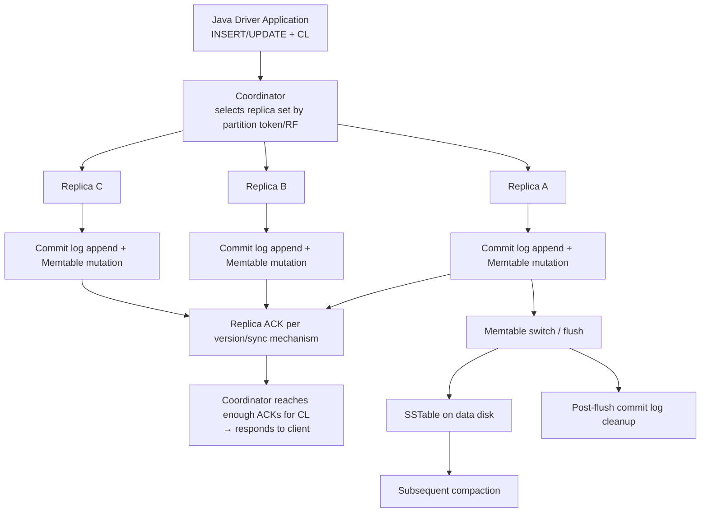
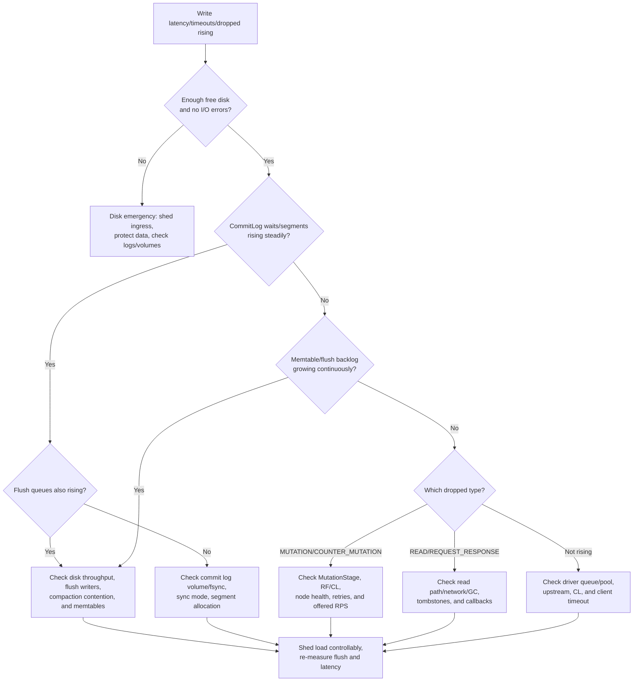
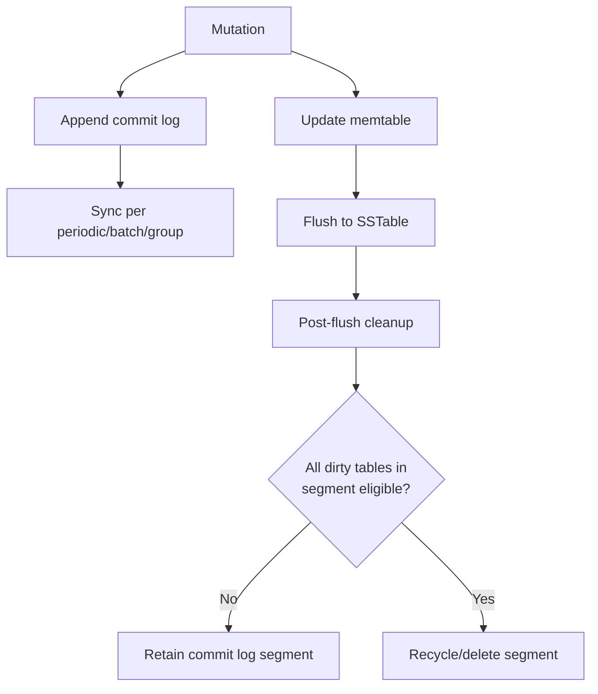

# Memtable/Flush Bottlenecks, Commit Log Pressure, or Dropped Messages

**Chapter:** Troubleshooting  
**Module:** `DATABASE_ENGINE_WIDE_COLUMN_CASSANDRA` — Apache Cassandra  
**Focus:** Analyzing the Cassandra write path; distinguishing memtable/flush, commit log, and dropped messages; isolating root causes, safely shedding load, recovering, and verifying data correctness from a Java application.

A Java service uses Cassandra to record device events by partition key. Over 15 minutes, write p99 rises from 25 ms to over 2 seconds, and several API calls time out. Dashboards show growing memtable sizes, rising `CommitLog.TotalCommitLogSize`, and `nodetool tpstats` reports dropped `MUTATION` messages. This is **not enough to conclude that Cassandra lost all timed-out records**, yet it clearly signals pressure along the write path or message queues.

The three symptom groups in the title are related but **not synonymous**:

- **Memtable/flush bottleneck:** memory holding unflushed data fills up, or flush tasks to disk cannot keep pace.
- **Commit log pressure:** commit log segments, the fsync path, or segment allocation slow down, or space limits trigger flushes that impact incoming writes.
- **Dropped messages:** an internode/intranode message type is discarded because its timeout or processing conditions expired; you must inspect **message type, growth rate, request errors, and replica state** rather than automatically equating every dropped message with a lost row.

This lesson builds a workflow of **symptom → confirming metrics → hypothesis branches → lowest-risk action → recovery and data verification**. The material connects Cassandra wide-column concepts, partition tokens, RF/CL, tombstones, compaction/repair, and Java Driver 4.x integration.

> **Scope and safety principles:** Content targets Apache Cassandra 4.1/5.x; parameter names and MBeans/`nodetool` output may vary across versions. Verify against documentation for your exact version and deployment configuration. Observation commands are examples to run on **authorized** nodes. **Do not manually delete commit log/SSTable files, disable fsync, change `gc_grace_seconds`, force major compaction, lower consistency level, or restart nodes en masse to "clear queues".** Any configuration or data change in production requires an incident owner, backup/RF/CL preflight, and a rollback plan. Lab examples are strictly for disposable clusters.

## 1. Learning Outcomes

After this lesson, you can:

1. Trace the write path `client → coordinator → replica → commit log + memtable → flush SSTable` and distinguish consistency-level ACKs from fsync/flush.
2. Explain why a **memtable flush is not compaction**, and why commit log segments can only be reused once their corresponding data safely meets release conditions.
3. Read `nodetool tpstats`/`tablestats`/`compactionstats` alongside disk/GC metrics to pinpoint the congested stage.
4. Distinguish `MemtableOnHeapSize`, `AllMemtablesOnHeapSize`, `PendingFlushes`, `BytesFlushed`, and flush-related thread pools.
5. Interpret `CommitLog.TotalCommitLogSize`, `PendingTasks`, `WaitingOnCommit`, and `WaitingOnSegmentAllocation`.
6. Understand how `commitlog_total_space` can trigger flushes for tables still dirty in old segments; raising the space limit does not fix a congested disk.
7. Distinguish dropped message types: `MUTATION`, `READ`, `COUNTER_MUTATION`, `REQUEST_RESPONSE`, `HINT`, `READ_REPAIR`.
8. Classify `WriteTimeoutException`, `WriteFailureException`, `UnavailableException`, `DriverTimeoutException`, and `RequestThrottlingException`.
9. Avoid concluding that "a write timeout means nothing was written" or that "a dropped message guarantees data loss".
10. Reduce offered write rate, admission, or concurrency in a controlled manner, avoiding retry storms and preserving business event IDs.
11. Differentiate disk saturation, `ENOSPC`, GC pauses, compaction contention, hot partitions, CDC/index/MV pressure, and network latency.
12. Design a CQL + Java Driver lab to measure write latency/timeouts and observe flushes without damaging storage.
13. Use RF3/`LOCAL_QUORUM` to ask the right questions about replica availability, hints, and repair after a node slows down or returns.
14. Write an incident timeline, stop conditions, and recovery evidence covering latency, queues, disk, commit log, and data verification.
15. Plan adjustments to `memtable_*`, `commitlog_*`, flush writers, or disk layout **only after proving the bottleneck**.

## 2. Background Model: Where Does Cassandra ACK a Write?

### 2.1. Simplified Write-Path Diagram



This is a **logical model**; it does not mandate an absolute ordering of every thread/JVM step or guarantee that flushing finishes before ACK. Cassandra writes are typically appended to the **commit log** and applied to the **memtable** on each replica; the memtable is flushed to an SSTable later when memory or commit log thresholds trigger, or via operational action. **Compaction** is a subsequent process that merges and reorganizes SSTables—it is not the same operation as a flush.

Key takeaways:

- **Client ACK** depends on the consistency level: with `NetworkTopologyStrategy` RF=3 in a single DC, `LOCAL_QUORUM` requires **two** replicas to respond—not "all replicas have flushed to SSTables".
- **Commit log sync mode** affects the fsync/durability boundary. In `periodic` mode, Cassandra can ACK before the periodic fsync; in `batch`/`group` mode, ACKs carry different fsync constraints. Always check your actual configuration and version.
- A **write timeout** does not reveal how far every replica progressed. Some replicas may have applied the mutation, or the request may have completed while the response back to the client was lost.
- Every node maintains a **local memtable and commit log**. An overloaded coordinator does not prove all replicas are overloaded; you must read metrics on each relevant node.

### 2.2. Same Partition Key Means Same Replica Set

Cassandra hashes the **partition key** into a token to determine replicas; clustering columns control row ordering within the partition and **do not spread data across multiple tokens**. An extremely hot tenant or bucket can funnel mutations onto the exact same replica set, causing:

- memtable, commit log, and write latency spikes on a few nodes while other nodes sit idle;
- continuous flushes on a handful of tables;
- growing SSTable/tombstone counts and compaction backlogs;
- retries and speculative executions from multiple applications **pushing even more load onto the same replicas**.

When identifying a hotspot, do not merely add `memtable_heap_space` or worker threads; inspect partition/bucket/shard design against actual **query patterns** and volume.

### 2.3. Flush, Commit Log, and Compaction Are Distinct

| Operation | Input | Output / completion condition | When congested |
| --- | --- | --- | --- |
| **Memtable flush** | Memtable holding mutations | SSTable on data disk, after which the memtable can be reclaimed | Memtable pressure and prolonged commit log segment retention |
| **Commit log append/sync** | Mutations for crash recovery | Commit log segments with fsync semantics per `commitlog_sync` | Write latency, segment allocation/commit waits |
| **Post-flush cleanup** | Flush completion for segment data | Eligible old segments are recycled/deleted | `TotalCommitLogSize` fails to shrink even while flushes run |
| **SSTable compaction** | Existing SSTables on disk | Consolidated/reorganized SSTables | Disk I/O, write amplification, slow reads |
| **Repair** | Replica ranges, SSTable data/metadata | Data compared and synchronized across replicas by repair type | CPU/disk/network contention, backlog |
| **Hint replay** | Hints stored for unavailable replicas, if present and eligible | Mutations redelivered | Extra write pressure on recovering nodes |

A common misconception: **a commit log segment holds data for multiple tables**. Even after a hot table flushes, if an older segment still holds unflushed mutations from another table, that segment may not be reclaimable yet. A small `commitlog_total_space` can force Cassandra to flush **low-traffic tables** simply to free old segments.

## 3. Identifying Symptoms Without Jumping to Conclusions

### 3.1. Quick Classification Table

| Observed symptom | Signals to cross-check | Premature conclusion to avoid |
| --- | --- | --- |
| High `MemtableOnHeapSize` | `AllMemtables*`, flush queue, `BytesFlushed`, heap/GC | "We definitely need to increase heap" |
| Rising `PendingFlushes` | Per-disk flush writer pending/active, disk await, free space | "Adding flush writers will solve this" |
| Rising `TotalCommitLogSize` | `WaitingOnSegmentAllocation`, `WaitingOnCommit`, `PendingTasks`, segments/flush | "Deleting the commit log is safe" |
| Rising dropped `MUTATION` | Write latency, `MutationStage` pending/blocked, RF/CL, retries/hints | "All writes are permanently lost" |
| Rising dropped `READ` | `ReadStage` pending, read latency, tombstones, SSTables | "The commit log has an issue" |
| Rising dropped `REQUEST_RESPONSE` | Coordinator response path/network/GC, in-flight callbacks | "Replicas did not receive the write" |
| Rising dropped `COUNTER_MUTATION` | Counter workload, retry logic, coordinator/replica health | "We can retry counters freely" |
| App `DriverTimeoutException` | Driver queue/pool, coordinator/replica metrics, network | "The server definitely did not write" |
| App `UnavailableException` | Node status and replica availability per CL | "Slow disk flushes are the sole cause" |
| p99 rising on **one node** | Token/hot partition, disk/GC, node-local queue | "Must upgrade the whole cluster config" |
| p99 rising on **all nodes** | Offered RPS, shared storage/network, compaction/GC, backpressure | "More retries will improve things" |

### 3.2. Preliminary Decision Tree



Never jump straight from **a single counter** to editing `cassandra.yaml`. Look for **at least two correlated signals** (for example, flush queues rising **alongside** disk await and commit log segments; or dropped `MUTATION` rising **alongside** `MutationStage.PendingTasks` and write timeouts).

### 3.3. Triage Priority Levels

- **P0/P1:** Disk nearly full, `ENOSPC`, commit log append/fsync errors, critical data writes failing, node dropped from the ring, insufficient replicas for RF/CL, or irreconcilable unknown outcomes.
- **P2:** Write p99 exceeding SLO, continuously rising dropped messages, growing flush backlog while reads/writes still succeed.
- **P3:** Snapshot showing a high cumulative counter after a past spike, no longer rising, with normal latency and application success rates.

This is a **classification framework**, not a universal severity standard for every organization. Decide using your actual SLOs, data criticality, and operational conditions.

## 4. Collecting Evidence in the First 5–10 Minutes

### 4.1. Preserve the Scene and Timeline

Before changing any configuration, record:

```text
INCIDENT_ID:
UTC_START / UTC_NOW:
CASSANDRA_VERSION / JVM_VERSION:
AFFECTED_DC / NODES:
KEYSPACE / TABLES / PARTITION_KEYS:
RF / READ_CL / WRITE_CL:
APP_VERSIONS / DRIVER_VERSIONS:
OFFERED_WRITE_RPS / SUCCESS_RPS / TIMEOUT_RPS:
LAST_DEPLOY / SCHEMA_CHANGE / COMPACTION / REPAIR:
DISK_FREE / DISK_AWAIT / CPU / GC:
RETRY_POLICY / THROTTLER / CONCURRENT_REQUESTS:
WAS_THE_WRITE_IDEMPOTENT:
EVIDENCE_AND_LAST_GOOD_BASELINE:
```

You must establish **which node**, **which table**, **which time window**, and whether a metric is a **cumulative counter or a rate**. Comparing a snapshot of `Dropped=120000` against `Dropped=0` on a freshly restarted node **does not mean the new node is healthy**; many counters reset per process.

### 4.2. Relatively Safe Observation Commands

Run on an authorized node/host, depending on your systemd/container/Kubernetes deployment:

```bash
# Cluster status / node identity:
nodetool status
nodetool info
nodetool describecluster

# Queues / dropped messages by thread pool:
nodetool tpstats

# Table / node-level statistics:
nodetool tablestats <keyspace>.<table>
nodetool tablehistograms <keyspace> <table>

# Distinguish compaction backlog and streaming:
nodetool compactionstats
nodetool netstats

# Gather usage from relevant filesystems:
df -h
df -i
```

Strings `<keyspace>` and `<table>` inside code blocks are **placeholders**, not literal names; substitute your assigned keyspace/table. `nodetool tablestats`/`tablehistograms` syntax and output format depend on release; verify via `nodetool help` for your exact Cassandra image.

### 4.3. Observing Disk I/O and JVM

```bash
# Linux host/namespace; tools may not be pre-installed:
iostat -xz 1 5
vmstat 1 5
free -h

# If authorized to read logs, use the active service manager:
journalctl -u cassandra --since "15 minutes ago"

# If deployment uses file logs:
# tail -n 300 /var/log/cassandra/system.log
```

**Caution:** `df` inside a container may display a different filesystem than the actual Cassandra volume; identify the exact mounts backing `data_file_directories` and `commitlog_directory`. `iostat` must be mapped to the corresponding block device; CPU iowait is only one indicator, not standalone proof. Read logs strictly read-only, and do not grep/collect bulk PII from queries.

### 4.4. Paths to Verify Without Guessing

Confirm against the node configuration:

- `data_file_directories` holds SSTables/data.
- `commitlog_directory` holds commit logs.
- `cdc_raw_directory`, if CDC is enabled, can represent a separate source of disk pressure.
- Log and JMX endpoints vary by distro or Kubernetes operator.
- `saved_caches_directory` is not the commit log.
- `hints_directory` is distinct from the commit log; hints must not be treated as a backup substitute.

Never assume default example paths like `/var/lib/cassandra/commitlog` apply to every image or host, and **never delete files based on assumed default paths**.

## 5. Metrics: Distinguishing Gauges, Counters, Timers, and Rates

### 5.1. Ground Rules Before Reading Numbers

Cassandra exposes metrics via JMX (and optionally exporters or virtual tables depending on version). Many metrics are **per-node** scoped. Never pull metrics from one coordinator and extrapolate to the entire cluster. Common metric types:

- **Gauge:** instantaneous level; watch magnitude and trend.
- **Counter:** cumulative since process startup/creation; evaluate **delta/rate**, not just raw totals.
- **Meter:** event rate and total count depending on exporter/metric.
- **Timer/Histogram:** latency distribution, count, p95/p99; verify units (ms/µs/ns).
- **Task queue snapshot:** monitor active/pending/blocked continuously alongside completion throughput.

For example, `DroppedMessage.Dropped` is a meter by message type; `PendingFlushes` in documentation may be described as a counter/estimated pending task metric. **Do not assume every metric containing "Pending" is a gauge** or apply `rate()` indiscriminately—check your actual JMX/Prometheus exporter definitions.

### 5.2. Table/Memtable Metrics Worth Measuring

| Cassandra documented metric | Role | Interpretation |
| --- | --- | --- |
| `MemtableOnHeapSize` | On-heap memtable data | Rising without dropping while flushes lag indicates pressure |
| `MemtableOffHeapSize` | Off-heap memtable data | Compare against off-heap budget and direct memory |
| `MemtableLiveDataSize` | Live data size | Compare against overhead and mutation patterns |
| `AllMemtablesOnHeapSize` | Includes memtables awaiting flush and related indexes | Can exceed current active memtable size |
| `AllMemtablesOffHeapSize` | Total off-heap across memtables | Distinguish live vs pending |
| `MemtableSwitchCount` | Count of memtable switches on flush | Rising rate can indicate pressure or workload pattern |
| `PendingFlushes` | Estimated flush tasks pending per table | Track continuously alongside stage queues, not as a single point |
| `BytesFlushed` | Total bytes flushed since startup | Take delta rate over time |
| `PendingCompactions` | Table compaction backlog | Competes with flushes for disk/CPU |
| `LiveSSTableCount` | Active SSTables | Sharp growth can drive read/compaction pressure |

MBean names take the form `org.apache.cassandra.metrics:type=Table keyspace=<KS> scope=<TABLE> name=<MetricName>`, though exporters may remap them into different labels. When inspecting `AllMemtables*`, remember it includes memtables waiting to flush and secondary indexes, not just actively written memtable data.

### 5.3. Thread Pool Metrics Worth Tracking

In Cassandra metrics documentation, relevant pools include:

| Thread pool | Question it answers |
| --- | --- |
| `MemtableFlushWriter` or `PerDiskMemtableFlushWriter_<n>` | Are flushes to data disks queuing or backed up? |
| `MemtablePostFlush` | Is post-flush commit log cleanup falling behind? |
| `MemtableReclaimMemory` | Is memtable memory being reclaimed fast enough? |
| `MutationStage` | Are regular mutations queuing up? |
| `CounterMutationStage` | Are counter writes specifically congested? |
| `ViewMutationStage` | Are materialized views adding write pressure? |
| `Native-Transport-Requests` | Are native protocol requests queuing? |
| `ReadStage` / `RequestResponseStage` | Are drops/timeouts caused by reads, callbacks, or network? |
| `CompactionExecutor` | Is compaction competing with flush for CPU/disk? |

Exact pool names vary by Cassandra release; `tpstats` confirms **which stages actually exist** on the node. Standard metrics—`ActiveTasks`, `PendingTasks`, `CompletedTasks`, `TotalBlockedTasks`, `CurrentlyBlockedTasks`—separate sustained throughput deficits from brief bursts.

### 5.4. Commit Log Metrics Worth Tracking

Official metric names under `org.apache.cassandra.metrics.CommitLog`:

| Metric | Diagnostic meaning |
| --- | --- |
| `TotalCommitLogSize` | Bytes currently occupied by commit log segments |
| `PendingTasks` | Messages not yet past the commit/fsync step per metric definition |
| `CompletedTasks` | Total committed messages; track delta/rate |
| `WaitingOnCommit` | Time waiting on commit log fsync; rises if sync path slows |
| `WaitingOnSegmentAllocation` | Time waiting to allocate a segment; normally near zero |

**A higher `TotalCommitLogSize` alone is not an error:** it naturally grows with write rate and drops across segment lifecycles. It becomes concerning when it **stays elevated or climbs continuously while flush/segment allocation/commit waits and latency degrade**.

### 5.5. Dropped Message Metrics

Cassandra tracks `DroppedMessage.Dropped`, `InternalDroppedLatency`, and `CrossNodeDroppedLatency` by type—such as `MUTATION`, `READ`, `COUNTER_MUTATION`, `READ_REPAIR`, `REQUEST_RESPONSE`, `HINT`, and other release-specific types.

Questions to answer before concluding:

1. Which type is increasing? One type or several?
2. By **how much** did total drops grow over 1, 5, and 15 minutes?
3. Do request timeouts/driver errors correlate in UTC time?
4. Was the dropping node acting as coordinator, replica, or both?
5. Do `MutationStage`/`ReadStage` show pending or blocked tasks?
6. Do disk, GC, or network metrics correlate?
7. What are the cluster RF/CL, hints, replica health, and ACKed writes?
8. Did a bulk load, repair, compaction, or deployment immediately precede the spike?

**Dropped ≠ guaranteed loss of a logical row.** A write ACKed by other replicas can still succeed at `LOCAL_QUORUM`; a slow replica may recover via hints or repair. Conversely, sustained drops can lead to client timeouts and missing replica data. Never use a single counter to prove either extreme.

## 6. Prioritizing Low-Risk Actions During an Active Incident

### 6.1. Shed Load at the Source First

When evidence shows a continuously growing backlog, **stopping write traffic amplification is usually safer than changing disk/flush configuration**:

- Throttle producers/concurrency in APIs, queue consumers, and batch jobs at the source.
- Pause or slow **non-critical ingestion** within operational authority; verify durable upstream queue buffering and retention before pausing.
- Curb retries in gateways, applications, and the Driver when they fuel a retry storm; do not alter policies blindly without checking idempotency.
- Disable experimental speculative writes or over-parallel execution if enabled and adding extra load.
- Prioritize critical mutations; enforce backpressure and appropriate HTTP 429/503 responses.
- Re-capture offered RPS, completed RPS, queue depth, and disk/flush/commit log stats across multiple windows to verify the backlog stops growing.

**Do not** stop producers lacking durable buffers while assuming all events are preserved. For Kafka or other queues, monitor consumer lag, retention, and controlled replay capacity.

### 6.2. What NOT to Do During a P1

- Do not manually `rm` or `truncate` commit log segments: this breaks crash recovery and risks data loss.
- Do not delete SSTables, snapshots, or tombstones just to reclaim space immediately.
- Do not run `nodetool flush` across nodes when disk I/O is already saturated; this can **increase** pressure.
- Do not run `nodetool compact` / major compaction to "clear pending flushes"; compaction causes heavy I/O amplification.
- Do not arbitrarily raise `memtable_heap_space`: it increases memory/GC pressure and merely delays rather than fixes insufficient disk throughput.
- Do not enlarge `commitlog_total_space` just to make a percentage gauge look lower; physical disk still fills and old segments still require flushing.
- Do not downgrade `LOCAL_QUORUM` to `ONE` while ignoring consistency/durability contracts.
- Do not blindly retry counter increments, list appends, LWTs, or billing writes when outcomes are unknown.
- Do not mass-restart nodes before verifying RF/CL, restore/repair plans, and capturing diagnostics.
- Do not add `ALLOW FILTERING` onto poorly modeled queries/partitions causing overload.
- Do not disable fsync/commit log sync for better p99 without formally accepting crash data-loss risk.

### 6.3. Stop Conditions for Experimental Actions

| Signal | Stop or rollback |
| --- | --- |
| Free disk drops below your organization's safety/compaction reserve | Halt load tests and write increases |
| Commit log append/fsync errors or `ENOSPC` | Escalate to P1/incident commander; protect data |
| ≥2 replicas unavailable at RF3 when `LOCAL_QUORUM` is required | Stop changes; prioritize restoring availability |
| Irreconcilable unknown write outcomes | Stop non-idempotent mutations and preserve evidence |
| GC pauses/heap usage spike after raising memtable budget | Roll back change and shed ingress |
| Pending flushes/commit log waits jump after forcing flushes | Stop issuing additional flushes |
| Dropped `MUTATION`/timeouts climb after retry changes | Roll back retry change; cap offered load |
| Restarted node is not `UN` or streaming has not completed | Do not restart the next node |
| Loss of out-of-band access to an impaired node | Stop intervention; invoke infrastructure recovery |

Exact thresholds must come from your capacity models and SLOs; no single number fits every cluster safely.

## 7. Diagnosing Memtable/Flush Bottlenecks

### 7.1. Flush Triggers and Memory Backpressure

Memtables hold mutations before they become SSTables. Upon reaching memory thresholds, commit log cleanup pressure, or an operational request, Cassandra **switches the active memtable** and hands the old one to the flush pipeline. Incoming writes can continue into the new memtable as long as headroom remains.

When memtables awaiting flush and total memory exceed reclamation capacity, Cassandra can **block incoming writes** until a flush frees enough memory. Thus, p99 spikes do not come only from commit log fsyncs; they can come from **memtable allocation stalls** when flush backlogs fail to drain.

Useful signals include `MemtablePool.BlockedOnAllocation` (where exposed by your Cassandra version), `AllMemtables*`, `PendingFlushes`, and `MemtableFlushWriter`/`PerDiskMemtableFlushWriter_<n>` pending/active counts. Correlate these with disk await/throughput, JVM GC, and ingress load.

### 7.2. Backlog Model with Explicit Units

Consider one node and a set of active tables:

- `λ_in`: rate (**bytes/s**) of mutations entering memtables, including approximate overhead or derived from metrics.
- `μ_flush`: effective rate (**bytes/s**) flushed cleanly to SSTables.
- `B(t)`: unflushed backlog expressed in bytes, not task count.
- `T`: observation window (seconds).

Simple balance model:

\[
B(t+T)\approx\max\left(0,\ B(t)+(\lambda_{in}-\mu_{flush})T\right)
\]

If sustained input exceeds flush throughput, the backlog tends to grow. Even on a fast disk, if `iostat await` is high because compaction saturates I/O, `μ_flush` can still fall behind. **Do not** compare raw CQL payload bytes 1:1 with `BytesFlushed`: SSTable compression, metadata/indexes, write amplification, and row updates change byte counts; the model illustrates **direction and trend**, not exact accounting.

Hypothetical example:

| Variable | Illustrative value |
| --- | ---: |
| Effective mutations entering memtables | 80 MiB/s |
| Effective flush rate during window | 55 MiB/s |
| Net accumulation rate | 25 MiB/s |
| Duration | 120 s |
| Theoretical backlog growth | ~3,000 MiB |

In practice, thresholds trigger backpressure and rates vary over time. This model helps ask **"for how long has input exceeded disk/flush capacity?"**—never assume Cassandra buffers infinitely.

### 7.3. Common Patterns

**Pattern A — Rising flush worker pending counts, rising disk await**

Hypothesis: data disks suffer I/O contention (flushes, compaction, repair, snapshot copies, backups, or underlying storage issues). Inspect:

- `nodetool tpstats`: are flush-related pools showing growing pending/blocked counts?
- `nodetool compactionstats`: are active/pending compactions abnormally large?
- `iostat -xz`: do the exact block devices backing `data_file_directories` show poor `await`/utilization?
- OS logs: filesystem errors, latency spikes, kernel I/O retries.
- `BytesFlushed` rate: progressing steadily or nearly stalled?
- `TotalDiskSpaceUsed`: are obsolete SSTables or snapshots squeezing disk space?

**Pattern B — High memtable memory, flush workers idle**

May simply be below trigger threshold, a brief snapshot, hot partition/index overhead, exporter mismatch, or upstream backpressure. Do not rush to add flush threads without proving writer saturation.

**Pattern C — `MemtablePool.BlockedOnAllocation` rising while flushes still run**

Cassandra is waiting for memory reclamation; causes include insufficient flush throughput, too many in-flight memtables, GC/off-heap pressure, or disk contention. Prioritize shedding ingress, then isolate the constraining resource.

**Pattern D — Many small flushes after a commit log setting change**

If `commitlog_total_space` is too small for the write rate and table interleaving across segments, Cassandra can force flushes on mostly idle tables to reclaim segments. Numerous tiny flushes create **many small SSTables** and downstream compaction pressure. Cross-check `MemtableSwitchCount`, `LiveSSTableCount`, `BytesFlushed`, `TotalCommitLogSize`, and config change history.

### 7.4. Why Adding `memtable_flush_writers` Is Not Always Better

In Cassandra configuration, `memtable_flush_writers` controls flush concurrency based on disk layout and version. Raising concurrency can help when idle **disk headroom remains** and workers are the bottleneck, yet it can also:

- produce smaller flushes, multiplying SSTables and compaction work;
- increase I/O and CPU contention against compaction and foreground reads;
- fail completely if the underlying device is saturated or malfunctioning;
- indirectly worsen GC or direct-memory pressure if other limits are hit.

Review related settings:

| Parameter | Purpose | Caveat |
| --- | --- | --- |
| `memtable_heap_space` | On-heap memory budget for memtables | Competes with JVM heap; raising it can worsen GC |
| `memtable_offheap_space` | Off-heap memory budget for memtables | Must fit within total process/container memory |
| `memtable_flush_writers` | Flush parallelism | Higher concurrency can inflate compaction overhead |
| `memtable_cleanup_threshold` | Pressure-based cleanup/flush trigger | Marked deprecated in modern configs; avoid arbitrary tuning |
| `memtable_allocation_type` / per-table `memtable` | Memtable structure, version-dependent | Cassandra 5.x offers newer/trie implementations sensitive to hot partitions; test per version |
| `concurrent_compactors`, `compaction_throughput` | Compaction parallelism and throttle | Affects disk pressure and backlog rather than flushes directly |

Cassandra 5.x introduces alternative memtable implementations (such as trie vs legacy formats depending on version). A setting well-suited to uniform workloads may behave poorly under an **extremely skewed hot partition**. If an incident coincides with an upgrade or default change, include memtable implementation in your hypotheses and A/B test on a staging cluster—never guess.

### 7.5. Evidence-Based Safe Actions

1. Lower offered write RPS / batch consumers to reduce `λ_in` controllably.
2. If disks are saturated: pause or reschedule competing I/O tasks *following runbooks* (backup copies, maintenance); do not kill compaction/repair blindly.
3. If disks retain clear headroom while flush workers remain queued: evaluate `memtable_flush_writers` sizing for your version and disk layout on an equivalent test cluster first.
4. If heap/GC is the bottleneck: evaluate heap/off-heap/JVM/cgroup allocations, hot partitions, and mutation shapes. Never set memtable budgets beyond physical memory.
5. Check storage throughput, failing drives, and free capacity; expand volumes cleanly if capacity is genuinely exhausted.
6. Re-measure `PendingFlushes`, `BlockedOnAllocation`, `BytesFlushed`, `TotalCommitLogSize`, write p99, and error rates across **at least several time windows**.
7. If backlogs drain yet p99 remains elevated, check post-burst compaction/SSTable growth and driver/server queues.

### 7.6. Do Not Treat `nodetool flush` as a "Free Memory Clear" Button

`nodetool flush <keyspace> [table...]` forces memtables in the specified scope to flush **to disk**. It does not relieve write pressure caused by saturated disks; if flushes are already queued behind I/O, forcing more flushes can worsen the outage. Use it only intentionally (e.g., before snapshots, safe maintenance, or labs) when disk headroom exists and the owner approves. **Never** run a cluster-wide flush just because a memtable graph looks high.

## 8. Diagnosing Commit Log Pressure

### 8.1. Why Does the Commit Log Exist?

The commit log is an append-only log of mutations on a node used to **recover unflushed memtable data after a crash or restart**, governed by configured sync/durability semantics. It is **not** a full backup archive for point-in-time recovery from scratch. Once data is safely flushed to SSTables and a segment holds no remaining needed mutations, Cassandra can recycle or delete that segment.



**Note:** This diagram illustrates dependency relationships, not a strict sequential execution requirement between `append` and `memtable update`. Specific Cassandra releases may implement internal steps differently; the key concept is that commit log and memtable **jointly protect a mutation prior to SSTable flush**.

### 8.2. Commit Log Sync Mode and ACKs

In modern Cassandra configuration, `commitlog_sync` supports `periodic`, `batch`, and `group` modes (depending on release). Do not assume defaults without checking; inspect the running node configuration directly:

| Mode | Key characteristic | Risk when disk sync slows |
| --- | --- | --- |
| `periodic` | Commit log is fsynced periodically; writes can ACK prior to the latest fsync | Commit waits/lag/blocking can still arise; crashes carry an unsynced local durability window |
| `batch` | Write ACK waits on batch log fsync | Fsync latency directly elevates write p99 |
| `group` | Groups writes over an interval for shared fsync | Tuning group window trades off latency vs batching |

**Do not** switch `batch` → `periodic` mid-incident to lower p99: doing so changes the **crash durability trade-off** and requires formal approval and testing. Likewise, do not arbitrarily raise `commitlog_sync_period` unless the business accepts the larger risk window on sudden power loss.

### 8.3. Commit Log Segment Allocation vs. Fsync

Two distinct diagnostic metrics:

- Rising `WaitingOnCommit`: the node is stalling on commit log commit/fsync, typically due to storage latency or sync contention.
- Rising `WaitingOnSegmentAllocation`: the node is stalling while allocating/preparing a new segment; investigate free disk space, segment recycling/cleanup, log I/O, and flush backlogs.

Commit log `PendingTasks` must be read according to its MBean definition (messages written but not yet fsynced) alongside `WaitingOnCommit`, rather than conflated with `PendingFlushes`.

### 8.4. `commitlog_total_space`: A Flush Trigger Limit, Not a Log Deletion Tool

When total segments exceed `commitlog_total_space`, Cassandra can force flushes on tables still dirty in the oldest segment so it can be reclaimed. Setting this limit too low relative to write rate and disk layout triggers a cascade:

1. Segments rotate rapidly.
2. Quiet tables that happened to touch old segments are forced to flush.
3. Many small SSTables accumulate.
4. Compaction workload rises later.
5. Disk I/O competes with foreground writes.
6. p99 latency and dropped messages can rise as a result.

Raising `commitlog_total_space` only helps when **commit log storage actually has capacity**, segment reuse is understood, and the limit itself was undersized. If flushes are already blocked on data disks, raising the limit only defers pressure and consumes more commit log space.

### 8.5. Investigating the Commit Log Volume

Follow a structured sequence:

1. Verify the actual mount backing `commitlog_directory` in configuration.
2. Check `df -h`, inode usage, read-only mounts, and I/O errors.
3. Compare `TotalCommitLogSize` against raw volume usage, noting other files may share that volume.
4. Correlate `WaitingOnCommit`/`WaitingOnSegmentAllocation` with disk await/fsync latency and CPU/GC.
5. Inspect `PendingFlushes`, flush pools, and `MemtablePostFlush`; slow cleanup pins segments longer.
6. Check commit log archiving or CDC directories if enabled: they follow separate lifecycles and consume space.
7. Review recent changes to `commitlog_sync`, `commitlog_total_space`, `commitlog_segment_size`, compression/encryption, and storage layout.
8. Verify the node can still flush and recover; if `ENOSPC` or I/O errors appear, prioritize protecting data and host integrity.

### 8.6. CDC Can Be an Independent Branch

When **Change Data Capture** is enabled on a table, `cdc_raw_directory`/`cdc_total_space` can cause write rejections or backpressure if CDC consumers fall behind on cleanup. Do not mislabel CDC space exhaustion as "commit log full" and raise `commitlog_total_space`. Separate:

- Commit log paths used for node crash recovery.
- CDC raw space, consumer progress, and `cdc_block_writes` per release.
- Hints storage.
- SSTable data disks and snapshot space.

With CDC, **never disable space guards or delete unconsumed CDC files** if downstream consumers require a complete change stream. Coordinate directly with CDC pipeline owners.

### 8.7. When Is Changing Commit Log Configuration Justified?

Only after:

- metrics prove `WaitingOnCommit` or `WaitingOnSegmentAllocation` is the primary bottleneck;
- disk latency, capacity, IOPS, and flush pressure are evaluated;
- accepted durability policy is clearly understood;
- tests pass on a staging/disposable node running the same version;
- a rollback path and safe rolling-change procedure exist;
- you are not inside an active P0 disk I/O error or out-of-space failure.

Never modify `commitlog_sync_period`, `commitlog_total_space`, flush writers, and compaction throughput simultaneously and credit the resulting graph for the fix; changing multiple variables obscures causality.

## 9. Dropped Messages: Message Type Matters More Than Total Count

### 9.1. Drops Signal Queuing/Age Expiry, Not a Data Verdict

Cassandra attaches age/deadline limits to internal messages; a message may be dropped once too stale to process usefully or past its deadline. `nodetool tpstats` and `DroppedMessage` metrics expose per-type counts; analyze **deltas since startup** alongside error and latency correlations.

Official documentation notes that **dropped writes can trigger hinted handoff**. However, hints **do not guarantee recovery of every write**: delivery depends on hint configuration, RF/CL, replica state, hint time windows, disk capacity, whether the coordinator accepted and stored the mutation, and scheduled repair/anti-entropy afterward. **A client write timeout may already have succeeded on some replicas**; never treat every dropped message as guaranteed permanent loss—nor as guaranteed recovered.

### 9.2. Classification by Dropped Message Type

| Dropped type | Layer / operation | Diagnostic focus |
| --- | --- | --- |
| `MUTATION` | Standard write mutations | `MutationStage`, replica write latency, disk/memtable/commitlog, hints, CL |
| `COUNTER_MUTATION` | Counter updates | `CounterMutationStage`, counter read-before-write path, non-idempotent retries |
| `READ` | Local/replica reads | `ReadStage`, SSTables/tombstones, CPU/GC/disk, read timeouts |
| `READ_REPAIR` | Read repair work | Replica divergence, read repair overhead, disk/network |
| `REQUEST_RESPONSE` | Internode callbacks/responses | Coordinator callback queues, network latency, GC, node health |
| `HINT` | Hinted handoff delivery | Hint queues/replay, recovering replicas, network/disk |
| `BATCH_STORE`/`BATCH_REMOVE` | Batchlog maintenance | Logged batches, batchlog I/O, batch sizing |
| `PAGED_SLICE`/`RANGE_SLICE` | Paged/token range reads | Scans/range queries, large partitions, read saturation |
| `_TRACE` or other types | Tracing/internal per release | Tracing sampling and diagnostic overhead |

**Exact type names vary by version.** Verify against real `tpstats` output and your metric exporter. If only `READ` is dropping and a team raises `memtable_flush_writers`, that intervention lacks evidence.

### 9.3. Calculating Dropped Message Rate

Suppose cumulative dropped `MUTATION` counts on the same node/process are:

- At 10:00: 4,200.
- At 10:05: 4,350.

Then:

\[
\Delta D=4{,}350-4{,}200=150\text{ messages over 5 minutes}
\]

\[
r_D=150/300=0.5\text{ messages/s}
\]

Compare this against the rate of **handled mutations** of the same type when reliable measurements exist. Never sum across disparate message types, and never compare raw `Dropped` counts of a newly restarted node against one running for weeks. Always record timestamps/uptime, restarts/resets, labels, and rate units.

### 9.4. Distinguishing Write Failures from Dropped Mutations

Assume single-DC RF=3 and `LOCAL_QUORUM` writes:

- Replica A ACKs.
- Replica B ACKs.
- Replica C runs slowly and drops one mutation.

The coordinator can return **success** to the client after receiving two ACKs. Replica C may need hints or repair to converge; **CL success does not prove C already persisted the row**.

Conversely:

- Only A ACKs; B and C fail to respond before deadline.
- The coordinator returns `WriteTimeoutException`.

You cannot assert the write never reached A, nor can the client safely retry a counter `+1`. The accurate state is **unknown outcome**, handled per mutation semantics and business requirements.

With RF=1 and CL=`ONE`, an overloaded single node fails differently than RF=3. Always anchor conclusions to the keyspace's actual **RF/CL**.

### 9.5. Dropped `REQUEST_RESPONSE` Does Not Mean "Request Was Not Executed"

A replica or coordinator may finish its work while the callback or response returns late, drops, or finds no active waiting requester. Hence a Java client can observe a timeout even after part or all of the work occurred. This symptom calls for inspecting **network RTT, dropped callbacks, GC pauses, coordinator stages, and client timeouts**—not just disk flushes.

### 9.6. What Not to Do When Dropped Counts Rise

- Do not raise read/write timeouts indefinitely: this prolongs queued state and hides latency.
- Do not expand thread pools blindly when disks are already saturated.
- Do not enable unbounded retry loops in gateways, Java Driver, or batch consumers.
- Do not weaken consistency levels to "reduce drops" if data contracts prohibit it.
- Do not equate a point-in-time `nodetool tpstats` dropped count with lost rows.
- Do not delete hints or commit logs to "clear pending work" without understanding recovery impact.
- Do not launch heavy repair immediately while nodes/disks remain P1-overloaded; repair adds I/O and network load.

## 10. Connections to Bottlenecks Beyond Memtable/Commit Log

### 10.1. Data Disk Saturation and Compaction I/O Contention

Flushes and compaction share disk I/O. Heavy TTL deletes, excessive small SSTables, or repair backlogs can stall disks:

```text
High write rate → frequent memtable flushes → many SSTables
                → heavy compaction → high disk I/O
                → slow flushes → memtable allocation blocks
                → commit log segments cannot reclaim
                → rising write latency and dropped MUTATIONs
```

This is one **plausible feedback loop**, not the path of every workload. Diagnose using `BytesFlushed` rate, `PendingCompactions`, `LiveSSTableCount`, `compactionstats`, and block device I/O together.

### 10.2. Hot Partitions or Skewed Token Distribution

If a table uses `PRIMARY KEY (tenant_id, event_ts)` and one tenant writes 10 million events/day, all those writes funnel onto one partition and one replica set. Check:

- Permitted top-key/partition distribution telemetry.
- `nodetool tablehistograms`/`tablestats` for partition sizes.
- Per-node skew in write latency, drops, and flush pressure.
- Whether the keyspace/table concentrates hot mutation patterns.
- Whether TTL/tombstones and compaction strategy fit time-series data.

Long-term remediation usually requires **redesigning partitions with bucketing or sharding** aligned to queries—not adding threads endlessly. For example, `PRIMARY KEY ((tenant_id,bucket_day), event_ts, event_id)` splits by day, though single-tenant daily volume must still be bounded; extreme volume may need hourly buckets or shards.

### 10.3. Large Mutations, Batches, Collections, and Indexes/MVs

Pressure multipliers include:

- **Large partitions/mutations:** each write consumes substantial memory and commit log bytes; oversized batches spike memory, network, and latency.
- **Cross-partition logged batches:** add batchlog overhead; **never** use logged batches to boost write throughput.
- **Counters:** follow distinct write paths and semantics; `COUNTER_MUTATION` drops require separate handling.
- **Materialized views:** view mutations and write stages generate extra write amplification.
- **Legacy secondary indexes / SAI:** evaluate per-version flush/compaction overhead.
- **Large collections:** collection updates or read-before-write patterns inflate cost and complicate safe retries.
- **CDC:** consumer lag and CDC raw space limits can reject writes.

Never lump schema or index regressions into "a commit log bug". If an incident aligns with a query, schema, or batch-size deploy, diff before and after.

### 10.4. GC/Off-Heap and OS Pressure

Long GC pauses prevent threads unrelated to disk flushing from meeting request deadlines. Off-heap, direct-memory, or container cgroup OOM throttling can mimic disk stalls when workers freeze. Inspect:

- Heap occupancy and GC pause frequency/duration in JVM metrics.
- Direct/off-heap pool usage and `memtable_offheap_space`.
- Swap/thrashing, cgroup memory limits, and OOMKilled events.
- CPU saturation, run queues, and context switches.
- File descriptors and network errors.
- Recent JVM flag changes.

Do not add JVM heap to fix EBS/network storage latency; do not tune GC blindly for unclassified dropped messages.

### 10.5. Network Latency and Client Overload

A Java Driver write timeout can originate from:

- `CqlSession` unable to reach coordinators in the local DC.
- Exhausted connection pools/stream IDs (`BusyConnectionException`).
- Full request throttler queues (`RequestThrottlingException`).
- Time spent waiting in client admission queues before reaching the wire.
- Network RTT, packet loss, or TLS connection churn.
- Slow coordinator callbacks.
- Genuine server memtable/commit log/flush slowdowns.

Hence you need **both client and server telemetry**. If server `MutationStage` and disks are healthy while client `throttling.queue-size` climbs, fix ingress, concurrency, and session topology before editing `cassandra.yaml`.

## 11. Classifying Java Driver Exceptions and What Cannot Be Concluded

### 11.1. Exceptions to Distinguish

| Exception / mechanism | Client-side meaning | What it does NOT prove |
| --- | --- | --- |
| `WriteTimeoutException` | Coordinator did not collect required write ACKs before timeout | That no replica persisted the write |
| `WriteFailureException` | Server reported replica failure(s) along the write path | That all replicas rolled back the mutation |
| `UnavailableException` | Not enough live replicas for CL at decision time | That the commit log is full |
| `DriverTimeoutException` | Driver request deadline expired, possibly including queue wait | That the server never executed the mutation |
| `AllNodesFailedException` | No coordinator completed the request; wraps per-node errors | That all cluster nodes are Down |
| `RequestThrottlingException` | Driver refused to admit/queue the request | That Cassandra lost data |
| `InvalidQueryException` | Invalid CQL, schema, or query syntax | That disks or flushes are congested |
| `OverloadedException` | Server explicitly rejected due to overload | That immediate retry helps |
| `BusyConnectionException` | Insufficient connection/stream-ID pool capacity (often per-node) | That memtable heap must grow |
| LWT `[applied]=false` | Conditional update did not match | A connection failure |

On write timeouts, retry safety depends on **true idempotency**, consistency policy, event IDs, and reconciliation capability. Calling `setIdempotent(true)` merely tells the Driver how to apply retry/speculative policies—it **does not** make a non-idempotent mutation safe.

### 11.2. Counters and List Appends Are Especially Dangerous

```sql
-- These two statements are NOT idempotent under replay:
UPDATE lab_incident.counter_by_id
SET hits = hits + 1
WHERE counter_id = 00000000-0000-4000-8000-000000000001;

-- Using list append on another table:
UPDATE lab_incident.history_by_id
SET steps = steps + ['PAID']
WHERE history_id = 00000000-0000-4000-8000-000000000001;
```

These statements only **illustrate semantics**; `counter_by_id` and `history_by_id` are not part of the main lab DDL below. After an initial timeout, retrying can double-increment the counter or duplicate the list entry. **Never** execute these statements against production data during an incident just to test whether timeouts happen.

### 11.3. Recording Unknown Outcomes Explicitly

```text
WRITE_STATUS:
  ACKED_AT_REQUIRED_CL
  DEFINITIVELY_REJECTED_BEFORE_SEND
  CONDITION_NOT_APPLIED
  UNKNOWN_OUTCOME_AFTER_TIMEOUT
  FAILED_INVALID_QUERY
  UNAVAILABLE_AT_REQUIRED_CL
  CLIENT_ADMISSION_REJECTED

RECOVERY_ACTION:
  if stable idempotent event ID:
      reconcile existing row / retry by reviewed policy
  if non-idempotent mutation:
      do not blind retry; investigate source of truth
  if application request was rejected before any send:
      may retry with total budget and backoff
```

"Unknown outcome" does not mean "always written". It means **insufficient evidence from the exception to confirm written vs unwritten**. Verify via an appropriate CL and your source-of-truth records; especially while a node remains Down, convergence and deduplication require time and formal business workflows.

## 12. Java Driver 4.x: Observing Writes Without Fueling a Retry Storm

### 12.1. Illustrative Setup

The code below targets Java 17+, Apache Cassandra Java Driver 4.x, a shared `CqlSession`, and the `lab_incident.events_by_device_day` table created in Section 13. It uses a **complete primary key** per event, with stable upstream-generated IDs. `DefaultConsistencyLevel.ONE` in an RF=1 lab is **not** a recommended production setting; with RF=3 and quorum requirements, use `LOCAL_QUORUM` after verifying topology.

Probe goals:

- Count **application-admitted attempts**, never inferring successful ACKs from a timeout.
- Cap maximum in-flight logical writes.
- Never block I/O threads with `.join()` or `Thread.sleep()`.
- Classify **ACKED**, **REJECTED_BEFORE_SEND**, and **UNKNOWN_OUTCOME**.
- Preserve business event IDs for retries/reconciliation.
- Avoid accidental speculative execution or retries before reviewing idempotency.

### 12.2. Bounded Asynchronous Java Probe

```java
import com.datastax.oss.driver.api.core.CqlSession;
import com.datastax.oss.driver.api.core.DefaultConsistencyLevel;
import com.datastax.oss.driver.api.core.ConsistencyLevel;
import com.datastax.oss.driver.api.core.cql.BoundStatement;
import com.datastax.oss.driver.api.core.cql.PreparedStatement;
import com.datastax.oss.driver.api.core.data.CqlDate;

import java.time.Duration;
import java.time.Instant;
import java.time.LocalDate;
import java.util.UUID;
import java.util.concurrent.CompletableFuture;
import java.util.concurrent.CompletionException;
import java.util.concurrent.CompletionStage;
import java.util.concurrent.Semaphore;
import java.util.concurrent.atomic.LongAdder;

public final class IncidentWriteProbe {

    public enum ResultKind {
        ACKED_AT_REQUESTED_CL,
        REJECTED_BY_APPLICATION_BEFORE_SEND,
        UNKNOWN_OUTCOME_AFTER_SUBMIT
    }

    public record WriteResult(
        UUID eventId,
        ResultKind kind,
        long elapsedMicros,
        String errorType
    ) {}

    private final CqlSession session;
    private final PreparedStatement insert;
    private final Semaphore inFlight;
    private final ConsistencyLevel writeCl;

    public final LongAdder acked = new LongAdder();
    public final LongAdder rejected = new LongAdder();
    public final LongAdder unknown = new LongAdder();

    public IncidentWriteProbe(
            CqlSession session,
            ConsistencyLevel writeCl,
            int maxInFlight) {
        if (maxInFlight <= 0) {
            throw new IllegalArgumentException("maxInFlight must be > 0");
        }
        this.session = session;
        this.writeCl = writeCl;
        this.inFlight = new Semaphore(maxInFlight);
        this.insert = session.prepare(
            "INSERT INTO lab_incident.events_by_device_day " +
            "(device_id,bucket_day,event_ts,event_id,kind,payload) " +
            "VALUES (?,?,?,?,?,?)"
        );
    }

    public CompletionStage<WriteResult> submit(
            UUID deviceId,
            LocalDate bucketDay,
            Instant eventTs,
            UUID stableEventId,
            String eventType,
            String payload) {

        // Application-level admission control: never block on overload.
        if (!inFlight.tryAcquire()) {
            rejected.increment();
            return CompletableFuture.completedFuture(
                new WriteResult(
                    stableEventId,
                    ResultKind.REJECTED_BY_APPLICATION_BEFORE_SEND,
                    0,
                    "APPLICATION_IN_FLIGHT_LIMIT")
            );
        }

        final long startedNanos = System.nanoTime();

        try {
            // CQL date maps to CqlDate in Driver 4.x.
            CqlDate cqlDay = CqlDate.fromDaysSinceEpoch(
                (int) bucketDay.toEpochDay());

            BoundStatement statement = insert.bind(
                deviceId,
                cqlDay,
                eventTs,
                stableEventId,
                eventType,
                payload
            ).setConsistencyLevel(writeCl)
             .setTimeout(Duration.ofMillis(1500))
             // Conservative: prevent automatic driver retries until
             // semantics and retry policies are reviewed.
             .setIdempotent(false);

            return session.executeAsync(statement)
                .handle((result, failure) -> {
                    inFlight.release();
                    long micros =
                        (System.nanoTime() - startedNanos) / 1_000;

                    if (failure != null) {
                        unknown.increment();
                        Throwable root = unwrap(failure);
                        return new WriteResult(
                            stableEventId,
                            ResultKind.UNKNOWN_OUTCOME_AFTER_SUBMIT,
                            micros,
                            root.getClass().getSimpleName());
                    }

                    acked.increment();
                    return new WriteResult(
                        stableEventId,
                        ResultKind.ACKED_AT_REQUESTED_CL,
                        micros,
                        "");
                });
        } catch (RuntimeException ex) {
            inFlight.release();
            unknown.increment();
            long micros =
                (System.nanoTime() - startedNanos) / 1_000;
            return CompletableFuture.completedFuture(
                new WriteResult(
                    stableEventId,
                    ResultKind.UNKNOWN_OUTCOME_AFTER_SUBMIT,
                    micros,
                    ex.getClass().getSimpleName())
            );
        }
    }

    private static Throwable unwrap(Throwable throwable) {
        Throwable current = throwable;
        while (current instanceof CompletionException &&
               current.getCause() != null) {
            current = current.getCause();
        }
        return current;
    }
}
```

**Intentional constraints of this example:**

- Any failure after `executeAsync` is labeled **UNKNOWN_OUTCOME_AFTER_SUBMIT** so no blind retry is ever triggered from a generic exception. Production systems can classify definitely rejected server errors such as `InvalidQueryException` separately, backed by dedicated classifier tests.
- `.setIdempotent(false)` here is **conservative**, not because every `INSERT` with a full PK is non-idempotent. With stable PK/payload and no unintended timestamp/TTL shifts, an `INSERT` can be marked idempotent after review; enable an appropriate retry policy and measure amplification.
- `UNKNOWN_OUTCOME` **does not claim the server persisted the row**: it merely reflects missing certainty on the caller side.
- `ACKED_AT_REQUESTED_CL` means the driver received success for the requested CL—**not that all replicas flushed SSTables** or fsynced in `periodic` mode.
- The `Semaphore` caps **one** probe instance; 10 pods each running `maxInFlight=16` still yield 160 concurrent requests. Budget across all sessions and consumers.
- Rejections prior to send can be retried upstream under backoff policies, provided duplicates are avoided and a total attempt cap exists.
- The callback avoids logging full payloads, blocking reconciliation, or issuing nested CQL calls; keep callbacks minimal so they do not distort latency.
- Do not accumulate an unbounded list of `CompletableFuture` handles; load drivers need finite queues, backpressure, and timeouts.
- Exception class names aid diagnosis; never infer data loss from class names alone.

### 12.3. Session Initialization for the Lab

A `CqlSession` should span the application or test harness lifecycle, never per request. Example:

```java
import com.datastax.oss.driver.api.core.CqlSession;
import com.datastax.oss.driver.api.core.DefaultConsistencyLevel;

import java.net.InetSocketAddress;

try (CqlSession session = CqlSession.builder()
        .addContactPoint(
            new InetSocketAddress("127.0.0.1", 9042))
        .withLocalDatacenter("datacenter1")
        .build()) {

    IncidentWriteProbe probe = new IncidentWriteProbe(
        session,
        DefaultConsistencyLevel.ONE, // ONLY for an RF1 lab
        16);

    // Generate IDs before emitting events, persisting to a durable source if needed.
    // Use a rate-limited scheduler with bounded pending futures:
    // probe.submit(deviceId, day, ts, eventId, "PING", "lab");
    //
    // After the test window, stop new arrivals and await remaining
    // in-flight CompletionStages within a finite deadline.
}
```

With Testcontainers or remote Docker hosts, **do not hardcode `127.0.0.1:9042`**; retrieve the actual contact points, mapped port, and local DC. For RF=3 Cassandra clusters, configure multiple contact points and verify RF/DC and CL before sending load.

### 12.4. Do Not Turn Probe Metrics Into a Reconciliation System

An incrementing `LongAdder unknown` only tracks failures whose **outcome is unknown to the caller**. To reconcile events:

1. Keep `deviceId`, `bucketDay`, `eventTs`, and `stableEventId` as the **full primary key**.
2. Once the cluster is healthy and replicas have converged, read back by full PK at an approved CL.
3. Inspect payload, timestamp, TTL, and upstream business facts; a null read **immediately after a timeout** does not prove no replica received the write.
4. When using a durable upstream queue, check offsets, ack status, and event IDs to prevent duplicate publishing or side effects.
5. For counters, list appends, or conditional LWTs, reconcile against separate authoritative facts; do not treat two HTTP attempts as one transaction.
6. Explicitly report remaining `UNRESOLVED` events in the incident report rather than arbitrarily marking them "LOST" or "SUCCESS".

## 13. CQL Lab and Observation on Disposable Cassandra

### 13.1. Safe Lab Objectives

This lab demonstrates the **write path, memtable/flush metrics, and error classification**. Do not deliberately fill disks, delete commit logs, disable fsync, turn off GC, or force real dropped messages via destructive overload. Failing to reproduce dropped messages in a lightweight lab **does not mean the test failed**; inducing real drops requires dedicated fault/pressure scenarios on a disposable test cluster.

Prerequisites:

- One disposable Cassandra 4.1/5.x node or Testcontainers instance with isolated data storage.
- Local DC confirmed via `system.local`; examples assume `datacenter1`.
- Sufficient disk and RAM, never pointing at production.
- Access to `cqlsh`/`nodetool` and metrics/JMX exporters.
- Record server version, JVM flags, `commitlog_sync`, and memtable budgets.
- Use distinct keys per run or fresh containers/keyspaces; do not run `TRUNCATE` on shared test tables.
- Verify commands against your exact release; never copy lab configs straight to production.

### 13.2. Single-Node RF1 Lab DDL

```sql
CREATE KEYSPACE IF NOT EXISTS lab_incident
WITH replication = {
    'class': 'NetworkTopologyStrategy',
    'datacenter1': 1
}
AND durable_writes = true;

CREATE TABLE IF NOT EXISTS lab_incident.events_by_device_day (
    device_id uuid,
    bucket_day date,
    event_ts timestamp,
    event_id uuid,
    kind text,
    payload text,
    PRIMARY KEY ((device_id, bucket_day), event_ts, event_id)
) WITH CLUSTERING ORDER BY (event_ts DESC, event_id ASC);

CREATE TABLE IF NOT EXISTS lab_incident.status_by_device (
    device_id uuid PRIMARY KEY,
    state text,
    updated_at timestamp
);
```

**Why RF1?** We only need to observe CQL, memtable, commit log, and flush behavior on one node. RF1/`ONE` **cannot verify** hinted handoff, replica divergence, or `LOCAL_QUORUM` surviving a Down node. Those require the RF3 workflow in Section 14.

### 13.3. CQL Smoke Test Using Full Partition Key

```sql
CONSISTENCY ONE;

INSERT INTO lab_incident.events_by_device_day (
    device_id, bucket_day, event_ts, event_id, kind, payload
) VALUES (
    10000000-0000-4000-8000-000000000101,
    '2026-11-21',
    '2026-11-21T10:00:00Z',
    20000000-0000-4000-8000-000000000101,
    'ONLINE', 'lab-only'
);

INSERT INTO lab_incident.events_by_device_day (
    device_id, bucket_day, event_ts, event_id, kind, payload
) VALUES (
    10000000-0000-4000-8000-000000000101,
    '2026-11-21',
    '2026-11-21T10:02:00Z',
    20000000-0000-4000-8000-000000000102,
    'HEARTBEAT', 'lab-only'
);

SELECT event_ts, event_id, kind
FROM lab_incident.events_by_device_day
WHERE device_id = 10000000-0000-4000-8000-000000000101
  AND bucket_day = '2026-11-21'
LIMIT 10;
```

Expect both events inside the same partition, with `10:02` returned before `10:00` due to `DESC` clustering order. No `ALLOW FILTERING` or cluster-wide scan is needed.

### 13.4. Capturing Baseline Before Load

```bash
# Run on the lab node:
nodetool status
nodetool tpstats
nodetool tablestats lab_incident.events_by_device_day
nodetool compactionstats
df -h
```

Beyond CLI output, if a JMX exporter is present, sample several 1-minute windows for:

- Table `MemtableOnHeapSize`, `AllMemtablesOnHeapSize`, `PendingFlushes`, `BytesFlushed`.
- Flush pool `ActiveTasks`/`PendingTasks`/`TotalBlockedTasks`.
- `CommitLog.TotalCommitLogSize`, `WaitingOnCommit`, `WaitingOnSegmentAllocation`.
- `DroppedMessage.Dropped` by type.
- OS disk await/throughput, GC pauses, write p95/p99.

Never compare counters across differing uptimes without converting to rates.

### 13.5. Generating Light, Bounded Load

A Java harness using `IncidentWriteProbe` should:

1. Spread writes across a deterministic set of `deviceId` values to avoid creating an artificial hot partition.
2. Generate each `eventId` once stably before submission.
3. Keep in-flight calls within cap (e.g., 16) and offered RPS well inside baseline node capacity.
4. Run a finite batch, e.g., **100–500 writes** in a small lab; do not expect this volume to trigger natural memtable flushes.
5. Track ACKed, admission-rejected, and unknown outcomes separately rather than merging them into one success rate.
6. Observe metrics before and after across multiple windows.
7. Never auto-retry all unknown outcomes; verify via full-PK reads once healthy.
8. Abort if write p99, GC, or disk usage breaches lab-owner guardrails.

**Note:** A small mutation burst may never fill a memtable enough to trigger a flush. That is normal; do not escalate load endlessly just to force dropped messages.

### 13.6. Intentional Flush Only After Lab Baseline

If your goal is observing the flush lifecycle on a **disposable node with ample free disk**, you may run one manual flush after stopping the producer:

```bash
# ONLY on a disposable lab node, after confirming ample disk headroom:
nodetool flush lab_incident events_by_device_day

# Observe over the next several windows:
nodetool tpstats
nodetool tablestats lab_incident.events_by_device_day
nodetool compactionstats
```

Expect memtable switch counts and `BytesFlushed` to reflect the transition. `TotalCommitLogSize` **need not drop immediately** because segments can still retain other tables' mutations or recycle on their own schedule. Never treat manual flushing as a "fix" during a P1 disk bottleneck.

### 13.7. Lab Acceptance Checklist

- [ ] CQL schema defines composite partition key and clustering order properly.
- [ ] Single shared `CqlSession`, never instantiated per write.
- [ ] Writes ACK and full-PK reads succeed at RF1/`ONE`.
- [ ] Pre/post metrics recorded with timestamps and versions.
- [ ] At least one meaningful memtable/commitlog metric observed without forcing drops.
- [ ] If manual flush was run, it ran only on a disposable node with headroom.
- [ ] No manual commit log/SSTable deletion or `ENOSPC` induced.
- [ ] Application admission rejections cleanly separated from server drops.
- [ ] Teardown and container/keyspace cleanup plan documented per permissions.
- [ ] Explicitly documented that **RF3/repair/hints were not tested**.

## 14. When RF3, CL, Hints, or Replica Recovery Are Involved

### 14.1. Test Only on a Multi-Node Cluster

Evaluating dropped `MUTATION` behavior and data convergence requires a **disposable multi-node Cassandra cluster** sharing a ring with appropriate `NetworkTopologyStrategy` RF—typically RF=3 in one DC. Three standalone containers do not automatically form an RF=3 cluster; seeds, snitch, DC/rack, networking, and full bootstrap completion are required.

Preflight:

```bash
nodetool status
nodetool describecluster
nodetool netstats
```

Verify three `UN` nodes, distinct host IDs, matching DC, schema agreement, adequate disk headroom, and no unexpected running repairs. In a single-DC RF=3 cluster, `LOCAL_QUORUM=2`.

### 14.2. One Replica Slows Down and Recovers

Controlled scenario:

1. Create an isolated RF=3 test keyspace and table and verify schema agreement.
2. Record a baseline with three healthy replicas, full PKs, and stable event IDs.
3. Impair or stop one replica **in the lab only**—never in production.
4. Keep bounded `LOCAL_QUORUM` writes flowing, recognizing the two healthy replicas can still satisfy quorum.
5. Capture `MUTATION` drop rates, write timeouts/client exceptions, and hint metrics; never declare data loss from one counter.
6. Recover the replica and monitor `netstats`, hint replay, disk/GC, and service latency.
7. Validate data from appropriate coordinators and CLs; never rely on a single `ONE` read to prove convergence.
8. Per your release runbook, schedule repair if downtime or hint limits prevented full sync.
9. Archive per-node timelines, ACKed mutation IDs, and unknown outcomes.

If a `LOCAL_QUORUM` write succeeds while one node is Down, **two replicas ACKed** per the contract—not every replica already holds the row. Conversely, if `LOCAL_QUORUM` fails with only one live replica remaining, never drop CL to `ONE` just to turn tests green.

### 14.3. Hinted Handoff Does Not Replace Repair

Hints help absorb mutations when a replica is temporarily unavailable; they are bounded by time windows, capacity, and configuration policies, and may not cover all failure modes. Monitor `HintsSucceeded`, `HintsFailed`, `HintsTimedOut`, and release-specific delivery latency metrics. **Repair** reconciles replica data to guarantee convergence across operational schedules; never rely on hints as an absolute guarantee.

Do not launch cluster-wide repairs the moment nodes recover onto already saturated disks. Scope and schedule ranges thoughtfully while tracking network, disk, and data correctness. If restoration is needed, follow backup RPO/RTO procedures rather than trying to "recover" data manually from commit logs.

### 14.4. Why a Single Successful Read Does Not Prove Full Write Recovery

- A `ONE` read may hit a healthy replica and miss an out-of-sync one.
- A `LOCAL_QUORUM` read at RF=3 satisfies that specific query; it is not cluster-wide anti-entropy proof.
- A timed-out write may still finish applying after the client deadline expired.
- Tombstones, TTLs, and last-write-wins timestamps can surface newer or older values unexpectedly.
- If event IDs mutated between retries, duplicate business events can go undetected by primary-key checks alone.
- Companion read models (e.g., projection tables) may remain inconsistent due to dual-write failures.

Recovery sign-off must combine **queue/hint metrics, key/partition spot verification, and business workload checks**—never "exceptions stopped".

## 15. Recommended Observability Thresholds and Dashboards

### 15.1. No Single Memtable/Dropped Threshold Fits Every Cluster

Under write-heavy workloads, cyclic rises and falls in memtable and commit log sizes are normal. Alerts should track:

- **Sustained trends** in backlogs and blocked time.
- **Write p95/p99** and success/error rates.
- **Disk free/IOPS/await** on the exact backing volumes.
- **Per-node skew** (one replica markedly more loaded than peers).
- **Rate of dropped messages** by type, not raw cumulative totals.
- **Commit log wait / segment allocation latency**.
- **Recovery time** after shedding ingress.
- **Unreconciled business data**, never reporting "zero loss" without verification.

The examples below are **alert frameworks**, not universal production thresholds.

### 15.2. Layered Dashboard Reference

| Panel | Aggregation level | What to look for |
| --- | --- | --- |
| App offered/admitted/completed write RPS | Service/pod & fleet-wide | Separate retry amplification from true ingress |
| App write p50/p95/p99/error classes | Endpoint/statement | Distinguish `DriverTimeout` vs `Unavailable` |
| `MutationStage`/`CounterMutationStage` pending/dropped | Node/stage | Identify primary write queuing |
| Memtable OnHeap/OffHeap + BlockedOnAllocation | Node/table | Accumulated vs actively blocked memory |
| `PendingFlushes`/`BytesFlushed` | Node/table | Flush backlog vs realized throughput |
| Flush/post-flush thread pools | Node/pool | Pending/blocked writers and cleanup lag |
| CommitLog TotalSize/WaitOnCommit/SegmentAllocation | Node | Genuine commit log pressure |
| Disk `await`/IOPS/throughput/free | Physical volume/node | Separate data disk from commitlog disk |
| Compaction PendingTasks/bytes written | Node/table | Compaction competing for disk I/O |
| DroppedMessage rate by type | Node/message type | Pinpoint mutation vs read vs callback drops |
| JMX/JVM GC pause/heap/off-heap | Node/JVM | Rule out stop-the-world pauses and memory pressure |
| Hints delivery/backlog | Node/peer | Track replica catch-up |
| Nodetool status/latency/repair | Cluster/DC | Tie errors to RF/CL topology |

### 15.3. Correlating Across Time Windows Instead of Single Charts

Consider a 10-minute sequence:

```text
10:00  Write p99=35ms; MutationStage.Pending=0
       MemtablePool.BlockedOnAllocation=0
       CommitLog.WaitingOnSegmentAllocation near 0

10:04  Producer traffic jumps from 2k/s to 10k/s
10:05  Disk await rises, flush writer pending rises
10:06  AllMemtablesOnHeapSize climbs, BlockedOnAllocation rises
10:07  TotalCommitLogSize stays high, WaitingOnSegmentAllocation rises
10:08  Dropped MUTATION rate climbs, WriteTimeout increases

10:09  Producer admission cap reduces offered rate
10:11  Flush queue drains, commit log waits drop
10:15  p99 returns to baseline; backlog steadily clears
```

**This is illustrative, not captured telemetry.** It points to disk/flush throughput failing to absorb the burst and cascading into commit log waits and dropped mutations. However, if `WaitingOnCommit` spiked **before** flush queues while commit logs sit on an independent disk, the root cause may lie in fsync or the commit log volume. Never invert cause and effect merely because two curves move upward together.

### 15.4. Pitfalls When Computing Alerts from Counters

Prometheus exporters can map identical JMX counters/meters into varied metric names and labels. Pseudocode example:

```promql
# CONCEPTUAL - adjust metric names/labels to match your actual exporter:
rate(cassandra_dropped_message_total{type="MUTATION"}[5m])

# Compare against server write timeouts over the same window:
rate(cassandra_client_request_timeouts_total{scope="Write"}[5m])
```

Do not copy names verbatim if your exporter differs; **metric names here are illustrative**. Never apply `rate()` to gauges like `TotalCommitLogSize`; for gauges use thresholds, slopes/derivatives, and capacity context. For counters across node restarts, ensure your query engine handles counter resets properly.

### 15.5. Multi-Condition Alerting

Conceptual logic instead of brittle absolute thresholds:

```text
IF (
  write_timeout_rate > baseline + error_budget
  AND dropped_MUTATION_rate > baseline
  AND (flush_pending_sustained OR commitlog_wait_p99_high)
) FOR multiple windows
THEN alert "write-path pressure"

IF (
  commitlog_disk_free_below_safe_budget
  OR ENOSPC/commitlog fsync errors
)
THEN critical page immediately

IF (
  memtable_size_high
  BUT blocked_on_allocation=0
  AND flush/commitlog waits healthy
  AND write SLO healthy
)
THEN observe trend, do not auto-restart
```

Never wire automated `nodetool flush` or node restarts directly to multi-condition alerts without thorough validation and operational approval.

## 16. Practical Scenarios and Diagnostic Approaches

### A. `PendingFlushes` Rises While `BytesFlushed` Barely Moves

**Hypothesis:** Flushes are stalled on disk I/O, filesystem errors, or blocked workers.

**Required evidence:** Flush pool `ActiveTasks/PendingTasks`, `iostat` on the exact data volume, `df -h/df -i`, kernel/system logs, `MemtablePool.BlockedOnAllocation`, `compactionstats`.

**Priority:** Shed ingress; check disk capacity/health and competing I/O tasks; do not force cluster-wide `nodetool flush`. If disk failure/`ENOSPC` occurs, escalate to P1 and follow recovery procedures.

### B. `TotalCommitLogSize` Is High While Write p99 Remains Normal

**Hypothesis:** The commit log is cycling segments normally under active traffic; no actual stall exists.

**Required evidence:** `WaitingOnCommit`/`WaitingOnSegmentAllocation`, `TotalCommitLogSize` trend, free disk space, segment lifecycle, memtable flushes.

**Priority:** Observe across multiple windows alongside disk headroom; do not delete logs or alter `commitlog_total_space` just over one elevated gauge.

### C. `WaitingOnCommit` Rises While Flush Queues Stay Normal

**Hypothesis:** Slow fsync / commit log volume, `commitlog_sync` mode constraint, or separate I/O contention.

**Required evidence:** Commit log disk path, `periodic`/`batch`/`group` mode, per-volume await, commit log `PendingTasks`, JVM GC pauses.

**Priority:** Protect log disks and shed ingress; investigate storage IOPS/latency and durability trade-offs; **never flip sync modes unilaterally** mid-incident.

### D. `WaitingOnSegmentAllocation` Rises Alongside `PendingFlushes`

**Hypothesis:** Old segments cannot be reclaimed promptly because dirty memtables have not flushed, or commit log/data disks are bottlenecked.

**Required evidence:** `TotalCommitLogSize`, `MemtablePostFlush`, flush queues, `BytesFlushed`, segment/snapshot/CDC disk usage, compaction status.

**Priority:** Throttle writes and identify dirty tables or flush bottlenecks. Increase commit log space only after capacity and reclaim analysis.

### E. Dropped `MUTATION` Rises Yet Client `LOCAL_QUORUM` Still ACKs

**Hypothesis:** One replica is lagging while the coordinator still receives ACKs from two healthy RF=3 replicas.

**Required evidence:** RF/CL, per-node drops and `MutationStage`, hint metrics, write latency, replica `UN` status, read verification.

**Priority:** Recover the lagging node, track hints/repair planning, and avoid claiming either total data loss or immediate full convergence.

### F. Dropped `READ` Climbs While `MUTATION` Stays Near Zero

**Hypothesis:** Read path, tombstones, wide partitions, or compaction overhead rather than the write commit log.

**Required evidence:** `ReadStage`, `SSTablesPerReadHistogram`, tombstones scanned, `tablehistograms`, read p99, disk metrics.

**Priority:** Inspect query patterns, hot partitions/TTL, compaction, and read repair; do not raise flush threads without evidence.

### G. Dropped `REQUEST_RESPONSE` Rises Alongside JVM GC Pauses

**Hypothesis:** Callbacks/responses missed deadlines during GC pauses, queue stalls, or network glitches.

**Required evidence:** Per-node GC metrics/logs, callback stage queues, network RTT/loss, driver timeout breakdowns.

**Priority:** Lower concurrency, address root causes of memory/GC pressure, verify response paths; do not assume mutations were never applied.

### H. Dropped `COUNTER_MUTATION` Coupled With App Auto-Retries

**Hypothesis:** Replayed `+1` counter increments corrupted counts via double-counting.

**Required evidence:** Retry policy, effective `setIdempotent`, request/event IDs, counter values, upstream redeliveries, application logs.

**Priority:** Halt blind retries on counters; reconcile from source facts and redesign around idempotent event logs or aggregations where accuracy matters.

### I. Burst Begins Right After Deploying More Consumers

**Hypothesis:** Aggregate offered RPS/in-flight requests exceeded flush/disk capacity, especially multiplied across pods sharing concurrency settings.

**Required evidence:** Pod counts, session counts, per-pod in-flight caps, queue lag, ingress write rate, per-node CPU/I/O/flush backlogs.

**Priority:** Scale back consumers and fleet-wide admission caps; never compensate with extra retries. Follow with capacity planning and canary rollouts.

### J. SSTable Count Spikes After Changing `commitlog_total_space`

**Hypothesis:** The reduced cap or config change forces frequent flushes across low-volume tables.

**Required evidence:** Commit log segment size/`TotalCommitLogSize`, `MemtableSwitchCount`, `BytesFlushed`, `LiveSSTableCount`, compaction backlog.

**Priority:** Evaluate rolling back the config change under change control, verify disk headroom, and avoid tuning multiple knobs at once. Compaction may need time to clear accumulated SSTables.

### K. Commit Log Fsync Logs I/O Errors Despite Remaining Free Space

**Hypothesis:** Storage device/path/mount failure, permission issue, read-only filesystem error, or cloud volume throttling.

**Required evidence:** Kernel/system logs, path-to-volume mapping, read-only mount status, `iostat`, JMX waits, Cassandra `system.log`.

**Priority:** Treat as P1 storage incident; do not delete logs or blindly restart; engage infrastructure and recovery owners to preserve recoverability.

### L. `MemtableOnHeapSize` Is High While `AllMemtables*` and `BlockedOnAllocation` Stay Normal

**Hypothesis:** Normal write accumulation approaching a flush trigger without stalling writes.

**Required evidence:** Write SLOs, heap/GC health, memtable switches, `BytesFlushed` across multiple windows.

**Priority:** Monitor only; never tune memory knobs from an isolated snapshot.

### M. Single-Tenant Hot Partition Overloads Three Replicas

**Hypothesis:** Partition key is too coarse, directing bulk writes to one token replica set and driving compaction/read amplification.

**Required evidence:** Authorized partition/key sampling, per-node skew, schema and query shape, `tablehistograms`, events per partition.

**Priority:** Rate-limit the hot tenant, evaluate query-driven bucketing/sharding and table migration with backfill/cutover; do not assume changing Java annotations alters a live table's primary key.

### N. CDC-Enabled Tables Fail Writes While Other Tables Succeed

**Hypothesis:** CDC raw disk space/consumer lag, `cdc_total_space`, or `cdc_block_writes` rather than general commit log exhaustion.

**Required evidence:** List of CDC-enabled tables, CDC raw directory space, CDC consumer lag/errors, commit log metrics, driver exception classes.

**Priority:** Unblock the CDC pipeline/capacity per retention policy; never disable CDC guards or delete CDC files if audit/stream completeness is required.

### O. Compaction Backlog Stays High After a Write Burst Even Though Flushes Recovered

**Hypothesis:** Rapid flushing spawned many SSTables that compaction has not finished merging, prolonging read latency.

**Required evidence:** `compactionstats`, `PendingCompactions`, `LiveSSTableCount`, disk await/CPU, read p99.

**Priority:** Keep load moderate until compaction stabilizes, review compaction strategy for TTL/time-series workloads, and avoid forcing major compaction when disk headroom is tight.

### P. Client Timeouts Climb While Server Drops, Flushes, and Commit Logs Look Normal

**Hypothesis:** Driver throttler limits, stream-ID pool exhaustion, misconfigured contact points/local DC, network issues, or upstream timeouts.

**Required evidence:** Driver `throttling.*`, `pool.available-streams`, per-node errors inside `AllNodesFailedException`, app queues, network RTT.

**Priority:** Shed ingress and tune client admission/pooling based on telemetry; do not inflate memtable memory unnecessarily.

### Q. Repeatedly Restarting a Node to "Clear Pending Tasks"

**Risk:** Restarts wipe observability counters, force I/O-heavy commit log replay, prolong gossip/bootstrap convergence, and weaken RF/CL margins. Restarting another node before the previous one reaches `UN` risks quorum outage.

**Priority:** Stop the restart loop, assess cluster RF state, identify root causes, and draft a recovery plan. Any rolling restart must follow drained/flushed/backed-up procedures—never on saturated disks.

### R. Switching `LOCAL_QUORUM` to `ONE` Reduces Timeouts

**Risk:** ACKs from a single replica weaken consistency and freshness guarantees. Dashboards may turn "green" while violating business data contracts.

**Priority:** Maintain the required CL, add capacity, shed ingress, or heal replicas. If temporary degradation is accepted by the business, require formal approval, time-bounding, and dedicated telemetry—never change CL silently.

### S. Hints Backlog Grows When a Node Rejoins

**Hypothesis:** The recovering replica is receiving hint replay concurrently with normal flushes, compaction, and disk I/O.

**Required evidence:** Hints succeeded/failed/timed out, `netstats`, disk/GC, write p99, RF/CL, downtime duration.

**Priority:** Leave capacity headroom for replay and avoid concurrent heavy maintenance or faults; evaluate repair needs if hints are insufficient; never delete hints merely to shrink metrics.

### T. `PendingFlushes` Drops to Zero While Many Requests Still Lag

**Hypothesis:** Flushes cleared, yet downstream layers still carry backlogs: compaction, native transport, connection pools, GC, client admission, or hinted handoff.

**Required evidence:** Align panels at matching UTC timestamps; inspect queues, latencies, and capacity across both application and every node.

**Priority:** Never close an incident solely because one metric returned to zero. Verify SLOs, unknown outcomes, and data correctness before closure.

## 17. Hypothetical Case Study: From Write Timeouts to Root Cause

### 17.1. Context

An RF=3 Cassandra cluster in DC `dc1` serves a Java service storing device states and events. The API uses `LOCAL_QUORUM` with a 2-second client timeout, fed by Kafka consumers. Workloads previously ran stably at 2,000 writes/s; after a deployment raised consumer concurrency, write p99 climbed. Records include tenant/device IDs, event timestamps, and stable event IDs.

The timeline below is **entirely hypothetical**, designed to practice interpreting evidence.

### 17.2. Timeline

| Time (UTC) | Observation | Preliminary meaning |
| --- | --- | --- |
| 09:00 | 3 nodes `UN`, p99=40 ms, drops near 0 | Healthy baseline |
| 09:10 | Deploy raises consumers; ingress climbs from 2k to 7k writes/s | Candidate trigger |
| 09:13 | Disk await rises sharply on two replica nodes | Storage path possibly congested |
| 09:14 | Flush worker pending and `BlockedOnAllocation` climb | Memtables waiting for reclamation |
| 09:15 | `TotalCommitLogSize` and `WaitingOnSegmentAllocation` climb | Downstream commit log segment pressure |
| 09:16 | Dropped `MUTATION` rate and `WriteTimeoutException` climb | Client/replica impact |
| 09:18 | App retry policy and Kafka redeliveries amplify offered attempts | Feedback loop amplifying incident |
| 09:20 | Incident owner throttles consumers and disables unsafe retries | Breaks amplification loop |
| 09:23 | Flush backlog and commit log waits decline | Early recovery signals |
| 09:28 | Write p99=50 ms, timeout rate returns to baseline | Write path stabilized |
| 09:35 | Reconcile event IDs with unknown outcomes; check hints/repair plan | Preserve data correctness |

### 17.3. Evidence-Based Root Cause Analysis

We can conclude with **high probability** that ingress exceeded flush/storage throughput, blocking memtable allocations and delaying commit log segment reclamation, while retries amplified load—supported by:

1. Consumer concurrency increased **before** disk/queue growth.
2. Disk await, pending flushes, and `BlockedOnAllocation` rose together.
3. `WaitingOnSegmentAllocation` climbed **after** flush backlogs, matching a downstream cascade.
4. Shedding ingress resolved queues and latency without storage config changes.
5. No filesystem errors, out-of-space conditions, or standalone GC pauses explained the stall.
6. No unrecorded repair or compaction task started at the same moment.

If logs instead showed cloud volume throttling on the commit log prior to the deploy, root cause would have to be revisited. Temporal correlation alone **does not prove absolute causation**; strong alternative hypotheses must be ruled out.

### 17.4. Claims You Must NOT Make

- "There were 2,000 dropped `MUTATION`s, so exactly 2,000 rows were lost."
- "A write timeout means Kafka retries are automatically safe."
- "Because `PendingFlushes` dropped, all replicas are now synchronized."
- "Raise `commitlog_total_space` as the fix because commit log metrics were high."
- "p99 recovered this time, so verifying data correctness isn't needed."

### 17.5. Preventive Actions

- Sum total arrival capacity across pods, consumers, and sessions; enforce bounded admission and backpressure.
- Configure multi-signal alerts: write p99 + dropped mutation rate + flush queue/commit log waits/disk await.
- Preserve stable event IDs and run a reconciliation pipeline for timeouts/unknown outcomes.
- Load-test changes on a disposable RF=3 cluster with realistic partition distributions prior to rollout.
- Review indexes, MVs, CDC, and compaction strategies for write amplification.
- Plan disk capacity/IOPS and monitor cloud throttling and headroom.
- Never configure automatic retries on non-idempotent operations.
- Maintain verified hints, repair, and restore procedures reviewed by DBA/SRE.

## 18. Runbook P0–P10: Controlled Incident Handling

### P0 — Protect Data and Contain Scope

Confirm environment (production vs staging), affected DC/nodes, business impact, mutation types, and SLOs. Assign an incident owner and communication channel. Freeze unrelated concurrent changes (deployments, ad-hoc repairs/compactions, schema updates) that muddy signals. Protect durable upstream queues and preserve event ID states.

### P1 — Capture Configuration and Diagnostics

Snapshot `nodetool status/info/tpstats/tablestats/compactionstats`, server/driver versions, RF/CL, p99/error classes, JVM/disk stats, and logs aligned in UTC. **Do not restart** nodes before gathering baseline telemetry unless forced by an immediate safety emergency.

### P2 — Classify the Pressure Type

Follow the decision tree:

- High `PendingFlushes`/`BlockedOnAllocation` → memtable/flush branch.
- High `WaitingOnCommit`/`WaitingOnSegmentAllocation` → commit log branch.
- Dropped `MUTATION`/`COUNTER_MUTATION` → write stages/replicas branch.
- Dropped `READ`/`REQUEST_RESPONSE` → read/callback/network/GC branch.
- Application timeouts despite healthy servers → driver queue/pool/upstream branch.

Document at least two correlated signals and formulate falsifiable hypotheses.

### P3 — Stop Load Amplification

Throttle non-critical producers/consumers, cap in-flight/queued requests, curb gateway/Driver/job retry storms, and stop authorized load tests or non-essential maintenance I/O. Never discard upstream data; verify queue retention and lag monitoring before pausing consumers.

### P4 — Inspect Disk, Memtable, and Commit Log

Verify mounts for data, commit log, and CDC directories along with free space, inodes, I/O errors, `iostat`, and GC. Distinguish fsync waits from flush backlogs and compaction contention. Do not delete logs/SSTables or blindly increase memory limits.

### P5 — Restore Write-Path Headroom by Priority

For disk I/O errors or full volumes: engage storage owners and expand/recover volumes per runbook. For load-driven flush backlogs: hold ingress down until memory reclaims and commit logs recycle. For client bottlenecks: tune admission/pools per evidence without overwhelming servers.

### P6 — Verify RF/CL and Replica State

Confirm enough healthy replicas satisfy required CL without silently lowering CL. Recover any Down node one by one under control. Track hints, streaming, and schema agreement, and never restart another node before quorum and `UN` state stabilize.

### P7 — Verify Data Correctness

Reconcile ACKed event IDs/PKs, unknown-outcome writes, and any TTL/counter/list/LWT operations. Re-read at appropriate CL; never use one `ONE` read to declare full replica sync. Address missing data via planned repair or restore—never blind replay of non-idempotent mutations.

### P8 — Confirm Recovery Across Multiple Signals

Minimum gates:

- Latency and error-rate SLOs back within baseline across multiple windows.
- Flush queues/`BlockedOnAllocation` drained; `BytesFlushed` advancing normally.
- Commit log waits/segment allocation back to normal with sufficient disk headroom.
- Dropped message rates stopped growing abnormally per type.
- No unresolved node, connectivity, or repair backlogs.
- Application ingress and retry amplification within budget; unknown outcomes tracked to resolution.
- No hidden CDC/hint/compaction backlog poised to re-trigger the failure.

### P9 — Reopen Traffic Gradually

Ramp producers and concurrency in canary stages while watching disk, flushes, commit logs, drops, and p99; halt immediately if pressure recurs. If legacy throughput cannot be sustained safely, never "open the floodgates" simply because shedding load cleared timeouts—invest in capacity or data-modeling fixes.

### P10 — Postmortem and Prevention

Document the timeline, root cause with confidence level, unverified variables, data impact, remediation, rollback steps, follow-ups, and owners. Validate any Cassandra config or Java Driver policy changes on a disposable cluster before rolling out to production.

### 18.1. Incident Report Template

```text
INCIDENT_ID:
SEVERITY_AND_BUSINESS_IMPACT:
UTC_START / DETECTED / MITIGATED / RESOLVED:
CASSANDRA_VERSION / JVM:
CLUSTER / DC / AFFECTED_NODE_IDS:
KEYSPACE / TABLE / PARTITION_KEY_MODEL:
RF / READ_CL / WRITE_CL / SERIAL_CL:
APP_VERSION / JAVA_DRIVER_VERSION:
LAST_DEPLOY_OR_CAPACITY_CHANGE:
BASELINE_OFFERED_RPS / CURRENT_OFFERED_RPS:
APP_SUCCESS_RATE / P50 / P95 / P99:
ERROR_CLASSES_AND_COUNTS:
RETRY_COUNTS / THROTTLER_COUNTS / APP_REJECTIONS:
TPSTATS_STAGE_PENDING / BLOCKED / DROPPED_DELTA:
DROPPED_MESSAGE_TYPES_AND_RATE:
TABLE_MEMTABLE_ONHEAP_OFFHEAP:
ALL_MEMTABLES / BLOCKED_ON_ALLOCATION:
PENDING_FLUSHES / BYTES_FLUSHED_RATE:
COMMITLOG_TOTAL_SIZE / WAIT_ON_COMMIT:
WAIT_ON_SEGMENT_ALLOCATION / COMMITLOG_PENDING:
DATA_DISK_FREE_AWAIT / COMMITLOG_DISK_FREE_AWAIT:
GC_PAUSES / CPU / OFFHEAP:
ACTIVE_COMPACTION_REPAIR_HINTS:
ROOT_CAUSE_HYPOTHESES_AND_EVIDENCE:
IMMEDIATE_ACTIONS_AND_TIMESTAMPS:
DATA_CORRECTNESS / UNKNOWN_OUTCOME_IDS:
REPLICA_CONVERGENCE_CHECK:
RESTORE_OR_REPAIR_ACTIONS_IF_ANY:
ROLLBACK_AND_FAULT_CLEANUP:
RECOVERY_GATES:
LONG_TERM_ACTIONS_WITH_OWNER:
KNOWN_LIMITATIONS:
POSTMORTEM_REVIEWER:
```

Never write "zero data loss" without supporting reconciliation, backup, or repair evidence. Record unmeasured fields as `NOT_MEASURED`, never `0`.

## 19. Practice Exercises and Interview Scenarios

### Exercise A — Difference Between ACK and Flush

A `LOCAL_QUORUM` write returns success under RF=3, yet `nodetool tablestats` still shows unflushed memtable data. Is this contradictory? Explain the write path, commit log, and ACK conditions.

### Exercise B — Memtable Backlog

Over 2 minutes, memtable intake averages 70 MiB/s while effective flush rate averages 45 MiB/s. Estimate the theoretical backlog using the simple model, and list three reasons real numbers can diverge.

### Exercise C — Unreclaimed Commit Log Segment

One segment holds mutations across three tables; two tables flushed while the third has not. Why might the segment still be retained, and how can an undersized `commitlog_total_space` trigger a flush cascade?

### Exercise D — `WaitingOnCommit` vs. `WaitingOnSegmentAllocation`

The two metrics spike at different moments. Propose distinct hypotheses for the fsync path vs. segment allocation/recycling, along with three metrics or OS tools to tell them apart.

### Exercise E — Dropped `MUTATION` While `LOCAL_QUORUM` Still Succeeds

Single-DC RF=3: replicas A and B ACK while C lags, and the client receives success. Can you assume C holds the row? What role do hints and repair play, and why can you not declare guaranteed data loss?

### Exercise F — Dropped `READ`

Only `READ` drops climb while write latency stays normal and memtable queues read zero. Which metrics and query patterns would you prioritize instead of raising `memtable_flush_writers`?

### Exercise G — Driver Timeouts and Counters

A `+1` counter update times out on the client, and the API gateway retries three times. Explain the risks and design an event-facts, deduplication, and reconciliation approach, explicitly tracking unknown outcomes.

### Exercise H — CDC Affecting Writes

A CDC-enabled table stops accepting writes while non-CDC tables work fine. Which paths and metrics must you inspect, and why must you not manually delete CDC raw files?

### Exercise I — Avoiding Cascading Outages on Restart

One node in an RF=3 cluster is Down; an operator proposes restarting a second node to clear dropped mutations. With `LOCAL_QUORUM=2`, what happens next? Define a stop condition and safer alternatives.

### Exercise J — Running `nodetool flush`

When data disk `await` and `PendingFlushes` are both high, should you run `nodetool flush` cluster-wide to "free memtables"? Propose alternative actions and the sole condition where a manual flush might be considered.

### Exercise K — Cumulative Counts vs. Rates

Node A reports `Dropped MUTATION=50,000` over 40 days of uptime; Node B reports `Dropped MUTATION=3,000` over 1 hour. From those two numbers alone, which node looks more troubled, and what extra data do you need?

### Exercise L — Hot Partition

A table uses `PRIMARY KEY (tenant_id, event_ts)` and a large tenant writes millions of events per day. Redesign the partition/bucket scheme for better distribution without breaking query patterns, and describe what migration tests are needed.

### Exercise M — Multi-Layer Retry Storm

Driver retries, API gateway retries, and Kafka consumer redeliveries stack together. As timeouts rise, logical inbound events stay flat while coordinator attempts soar. Propose a total retry budget, in-flight caps, and verification evidence.

### Exercise N — False Recovery

After shedding load, `PendingFlushes` hits 0, yet p99 stays high and compaction backlogs remain huge. Can you close the incident? What recovery gates are required?

### Exercise O — Changing Commit Log Sync Mode

A DBA suggests switching `commitlog_sync` from `batch` to `periodic` mid-incident. What must you verify regarding durability, RPO, and latency, and why is this not a "free" remediation?

### Exercise P — Differential Diagnosis

Given three telemetry snapshots:

```text
Snapshot 1:
  Flush pending ↑; data disk await ↑; commit log wait rises later ↑
Snapshot 2:
  Flush pending ~0; commit log WaitingOnCommit ↑; commitlog disk await ↑
Snapshot 3:
  Server metrics normal; driver throttling.queue-size ↑,
  pool.available-streams ↓; app timeout ↑
```

State the primary hypothesis for each snapshot, an appropriate load-shedding step, and one test capable of falsifying each hypothesis.

## 20. Self-Check Questions

1. What roles do memtables, the commit log, and SSTables each play in the Cassandra write path?
2. Why does a write ACK not imply the memtable has flushed to an SSTable?
3. How many ACKs does `LOCAL_QUORUM` require in a single-DC RF=3 cluster?
4. How do `commitlog_sync=periodic` and `batch` differ in fsync/ACK guarantees?
5. Why should you never switch `commitlog_sync` to lower p99 without reviewing RPO?
6. When does Cassandra switch/flush a memtable?
7. What causes an incoming write to block under memtable allocation pressure?
8. What does `MemtablePool.BlockedOnAllocation` help diagnose?
9. How does `MemtableOnHeapSize` differ from `AllMemtablesOnHeapSize`?
10. How should `PendingFlushes` and `BytesFlushed` be evaluated together?
11. Why can increasing `memtable_flush_writers` produce more small SSTables?
12. Why can increasing memtable heap space worsen JVM GC?
13. What caveat applies to `memtable_cleanup_threshold` in modern configurations?
14. How does a flush differ from compaction?
15. How can compaction or repair slow down memtable flushes?
16. If a commit log segment holds mutations from multiple tables, when can it be reclaimed?
17. How does an undersized `commitlog_total_space` trigger cascading flushes?
18. Does a high `TotalCommitLogSize` always indicate an incident?
19. How do `WaitingOnCommit` and `WaitingOnSegmentAllocation` differ?
20. When commit log fsync fails, why must you never delete log files?
21. Which volumes can `data_file_directories` and `commitlog_directory` reside on?
22. Why check `df`/`iostat` on the exact underlying mount rather than just inside a container root?
23. How do dropped `MUTATION` messages differ from dropped `READ` messages?
24. Does a dropped `REQUEST_RESPONSE` prove a mutation was never applied?
25. How do dropped `COUNTER_MUTATION`s constrain retry strategies?
26. Why must cumulative dropped counts be converted into rates/deltas?
27. Does one dropped message equal exactly one lost logical row?
28. Does hinted handoff guarantee recovery of every write?
29. How does repair differ in scope from hinted handoff?
30. Does `WriteTimeoutException` prove no write occurred on any replica?
31. Can `DriverTimeoutException` originate inside a client throttler queue?
32. What does `UnavailableException` tell you about CL and replica availability?
33. Why must you not silently drop `LOCAL_QUORUM` to `ONE` to reduce timeouts?
34. Does `setIdempotent(true)` make a counter increment idempotent?
35. Why are stable keys and event IDs vital for reconciliation?
36. Why must `TRUNCATE` or SSTable deletion never be used to relieve flush pressure?
37. How does a hot partition skew write load across replica sets?
38. How can CDC raw space trigger isolated write rejections?
39. Why can deploying additional application pods amplify commit log pressure?
40. Which signals separate a driver queue bottleneck from a server write-path bottleneck?
41. What is the safe triage order for a P1 involving disk I/O errors?
42. Does one `ONE` read after recovery prove all replicas converged?
43. Which recovery gates must pass before reopening producers?
44. Under what conditions may an incident report claim "zero data loss"?
45. Give an example explaining why `PendingFlushes` hitting 0 does not mean the whole system is healthy.

### Investigation Readiness Checklist

- [ ] Confirmed cluster/DC/nodes, keyspace/table, RF/CL, and impact/SLO.
- [ ] Captured UTC timeline, Cassandra/JVM/Driver versions, and recent deployments.
- [ ] Did not equate a write ACK with all replicas having flushed SSTables.
- [ ] Distinguished memtable, commit log, flush, post-flush, and compaction.
- [ ] Checked `nodetool status` across all relevant nodes.
- [ ] Tracked `tpstats` pending/blocked/dropped counts by type and time.
- [ ] Measured `MemtableOnHeapSize`/`AllMemtables*`/`BlockedOnAllocation`.
- [ ] Measured `PendingFlushes`, `BytesFlushed`, and flush writer queues.
- [ ] Measured `CommitLog.TotalCommitLogSize`/`WaitingOnCommit`/`WaitingOnSegmentAllocation`.
- [ ] Verified exact commit log, data, and CDC volumes and their I/O health.
- [ ] Checked free disk, inodes, and filesystem errors on every node.
- [ ] Checked `compactionstats`, repairs, hints, and competing I/O workloads.
- [ ] Did not infer data loss directly from dropped `MUTATION` counts.
- [ ] Converted cumulative drop counts to uptime-aware deltas/rates.
- [ ] Separated dropped `READ`/`MUTATION`/`REQUEST_RESPONSE` and other types.
- [ ] Correlated server metrics with Java Driver timeouts, throttlers, and pool errors.
- [ ] Explicitly logged unknown outcomes and reconciliation steps.
- [ ] Avoided blind retries on counters, list appends, LWTs, or side-effecting writes.
- [ ] Shed offered load and retry amplification controllably while backlogs climbed.
- [ ] Preserved consistency levels per business data contracts.
- [ ] Never deleted commit logs, SSTables, or hints, or altered `gc_grace_seconds` to relieve pressure.
- [ ] Never forced manual flushes or major compactions onto saturated data disks.
- [ ] Never raised heap, flush writers, or commit log space without measuring the bottleneck first.
- [ ] Checked CDC, indexes, MVs, hot partitions, and batches if changes preceded the incident.
- [ ] For RF=3 incidents, verified `UN` status, hints, and required repairs.
- [ ] Defined recovery gates for write p99, error rates, flush/commit log queues, disk, and data.
- [ ] Prepared canary producer ramp-up, stop conditions, and rollback plan.
- [ ] Completed postmortem with root-cause evidence, unknowns, and follow-up owners.
- [ ] Executed examples solely on authorized lab/staging clusters, never injecting faults in production.
- [ ] Explicitly noted portions not yet QA-tested against live Cassandra.

**Remember:** **Memtable/flush bottlenecks, commit log pressure, and dropped messages are write-path symptoms that can cascade into one another—not three names for one single fault.** To handle incidents safely, **measure the exact node, table, message type, and write-path stage**, throttle the overload source, protect commit logs and SSTables, keep RF/CL intact, and reconcile hints, repairs, and every unknown write outcome. Any "fix" that only improves p99 graphs without safeguarding business data correctness means the incident is not yet resolved.

## Technical References

- [Apache Cassandra — Storage Engine: CommitLog, Memtable, Flush, SSTable](https://cassandra.apache.org/doc/stable/cassandra/architecture/storage-engine.html).
- [Apache Cassandra — Monitoring Metrics: Table, ThreadPools, CommitLog, DroppedMessage](https://cassandra.apache.org/doc/stable/cassandra/managing/operating/metrics.html).
- [Apache Cassandra — cassandra.yaml configuration](https://cassandra.apache.org/doc/stable/cassandra/managing/configuration/cass_yaml_file.html).
- [Apache Cassandra — Use nodetool for troubleshooting](https://cassandra.apache.org/doc/stable/cassandra/troubleshooting/use_nodetool.html).
- [Apache Cassandra — nodetool flush reference](https://cassandra.apache.org/doc/stable/cassandra/managing/tools/nodetool/flush.html).
- [Apache Cassandra — nodetool tpstats reference](https://cassandra.apache.org/doc/stable/cassandra/managing/tools/nodetool/tpstats.html).
- [Apache Cassandra — CQL Data Definition](https://cassandra.apache.org/doc/stable/cassandra/developing/cql/ddl.html).
- [Apache Cassandra — CQL Data Manipulation and Consistency](https://cassandra.apache.org/doc/stable/cassandra/developing/cql/dml.html).
- [Apache Cassandra — Hinted Handoff](https://cassandra.apache.org/doc/stable/cassandra/managing/operating/hints.html).
- [Apache Cassandra Java Driver 4.18.1 — Retries](https://apache.github.io/cassandra-java-driver/4.18.1/core/retries/).
- [Apache Cassandra Java Driver 4.18.1 — Idempotence](https://apache.github.io/cassandra-java-driver/4.18.1/core/idempotence/).
- [Apache Cassandra Java Driver 4.18.1 — Request throttling](https://apache.github.io/cassandra-java-driver/4.18.1/core/throttling/).
- [Apache Cassandra Java Driver 4.18.1 — Metrics](https://apache.github.io/cassandra-java-driver/4.18.1/core/metrics/).

**Note:** Scenarios, figures, configurations, paths, and commands in this lesson are **illustrative learning examples**, not verified outputs from your cluster. When deploying for real, verify against your exact Cassandra and Java Driver versions, infrastructure, and permissions; archive pre/post-change evidence and validate on an isolated cluster first. Domain QA and live lab verification belong to STEP 6 once related evaluation components are complete.
