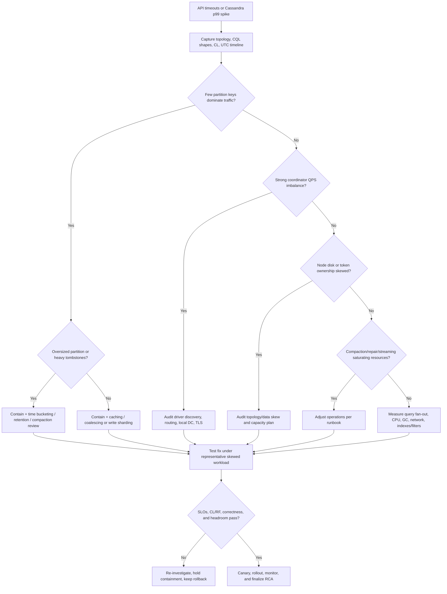

# Hot Partitions, Overloaded Coordinators, or Data Distribution Skew

> **Chapter:** Troubleshooting  
> **System:** Apache Cassandra — a distributed wide-column database with partition keys, token rings, replication, consistency levels, read/write paths, compaction, and repair — accessed from Java applications, specifically Cassandra Java Driver 4.x.
>
> **Learning Objectives:** Distinguish **hot partitions**, **large partitions**, **overloaded coordinators**, **overloaded nodes/replicas**, and **token/disk skew**; interpret driver and Cassandra telemetry accurately; investigate systematically by blast radius; shed or contain load without data loss; select query-first solutions like time bucketing/sharding only when truly justified; verify improvements using representative skewed key distributions; and build runbooks to avoid "adding nodes while the hot key stays hot".

## 1. Opening Scenario: One High-CPU Node and Rising API p99

A Java application serves an endpoint:

```text
GET /customers/{customerId}/events?day=2026-11-21

Java service -> Cassandra Java Driver -> Cassandra cluster
```

Following a marketing campaign, a single customer/tenant generates 100x normal traffic. Observed symptoms:

```text
API success p99:           45 ms -> 1,800 ms
Timeouts/errors:           0.1% -> 12%
Cassandra node-2 CPU:      35% -> 95%
Cassandra node-1 CPU:      40%
Cassandra node-3 CPU:      43%
Some requests:             coordinator node-2
Repair/compaction:         still running in background
```

Seeing node-2 running hot, engineers propose:

- Adding more Cassandra nodes.
- Running `nodetool cleanup` to reduce load.
- Switching `LOCAL_QUORUM` to `LOCAL_ONE`.
- Splitting batches or enlarging the connection pool.
- Adding a secondary index to the table.

These changes **may fail to address the root cause**, reduce safety headroom, or break consistency contracts. If all traffic targets **a single partition key**, Cassandra still maps that partition's copies onto **the token-selected replica set**. Adding nodes does not split one partition into multiple partitions.

**The right first step is determining what role makes the node hot, which partition drives the load, which requests generate it, and how traffic distribution shifted.**

## 2. Five Phenomena to Distinguish

| Phenomenon | Nature | Key signals | Primary direction |
| --- | --- | --- | --- |
| **Hot partition** | One partition key receives disproportionate reads/writes | A few keys drive most QPS; a small replica subset saturates | Rate-limit hot keys, cache, bucket/shard per query |
| **Large partition** | One partition holds excessive rows, cells, or bytes | High p99 scanning partition; heap/disk/tombstone impact | Cap partition growth via time buckets/data modeling |
| **Coordinator hotspot** | One node coordinates disproportionate client requests | Elevated client request rate on one node; replica load may look normal | Fix client routing, discovery, or connection topology |
| **Replica/storage hotspot** | One or a few nodes execute heavy reads/writes or compaction | High disk await, SSTable reads, stage queues on replicas | Reduce fan-out, data skew, partition/access skew |
| **Token/disk skew** | Uneven token ownership or byte footprint across nodes | Persistent disk usage imbalance; unusual token/rack/RF layout | Audit ownership, topology, and byte distribution before moving data |

**Multiple phenomena can overlap simultaneously.** For instance, a hot partition can create both a replica hotspot and overload a coordinator sitting inside that same replica set.

## 3. Cassandra Distributes Data by Partition Key, Not Row Count

Example CQL:

```cql
CREATE TABLE IF NOT EXISTS activity.events_by_customer_day (
    tenant_id text,
    customer_id uuid,
    bucket_day date,
    event_time timestamp,
    event_id uuid,
    payload text,
    PRIMARY KEY (
        (tenant_id, customer_id, bucket_day),
        event_time,
        event_id
    )
) WITH CLUSTERING ORDER BY (
    event_time DESC,
    event_id ASC
);
```

Assume the keyspace and table exist with this schema. A partition is uniquely identified by:

```text
(tenant_id, customer_id, bucket_day)
```

Rows with differing `event_time` and `event_id` values sharing that partition key still reside **inside the same Cassandra partition**. Clustering columns order rows within the partition; they **do not** distribute rows onto other tokens.

### Why Does the Partition Key Matter?

Execution path:

```text
CQL request + bound partition key
                  |
                  v
          Compute partition token
                  |
                  v
       Locate replicas by token/RF/DC
                  |
                  v
      Coordinator communicates with replicas
                  |
                  v
          Memtable/SSTables/commit log
```

Token placement depends on the partitioner and partition-key serialization. Many clusters configure `Murmur3Partitioner`; **never assume every deployment uses the same partitioner without checking**.

A single partition is served by replicas dictated by its token and replication strategy. Even millions of clustering rows never automatically hash themselves across different partitions.

## 4. Hot Partitions vs. Large Partitions

### Hot Partition

A partition containing just **20 rows** yet accessed 15,000 times/sec is **hot** due to request rate, not byte size.

### Large Partition

A partition holding millions of clustering rows or gigabytes of data yet rarely queried is **large**; it impacts reads, compaction, repair, and backups when touched, though it is not inherently request-hot.

### Both Hot and Large

Usually the worst-case failure mode:

- A single token and replica set absorb extreme QPS.
- Each `SELECT` reads across multiple SSTables, cells, and tombstones.
- Every request burns high CPU and disk I/O.
- Latency spikes dramatically during compaction.
- Driver retries and speculative execution multiply load further.

| Request rate | Partition size | Diagnosis |
| ---: | --- | --- |
| Very high | Small | Hot key / hot partition; evaluate caching, rate limits, concurrent reads |
| Low | Very large | Large partition; inspect scans, tombstones, bucketing |
| Very high | Very large | Hot + large; prioritize containment and remodeling |
| Evenly spread | Small | Possible coordinator / client routing hotspot |
| Evenly spread | Uneven node disk | Token/ownership/data skew or compaction lag |

**Looking only at disk usage misses hot partitions. Looking only at QPS misses large partitions.**

## 5. The Token Ring, Vnodes, and Why Adding Nodes Has Limits

A token ring partitions token space across nodes; with virtual nodes (*vnodes*), each physical node owns multiple token ranges.

```text
Partition Key P -> token T -> replica set {N1, N2, N3}

100,000 reads to P:
  -> still hit the exact same replica set

Adding node N4:
  -> redistributes other token ranges
  -> does NOT split P's contents into two partitions
```

Adding nodes can:

- Spread many **distinct partitions** across more hardware.
- Lower average disk usage per node when data is well-distributed.
- Rebalance token ownership and replica placement across topology.
- Generate streaming load during bootstrap and topology transitions.

However, it **cannot** split the traffic of **one single partition key** across the new nodes. If one customer dominates traffic, the replica set owning that key remains a bottleneck.

**Never bootstrap, decommission, or move tokens to fix a hot key before proving imbalance stems from ownership rather than a single hot key.**

## 6. How a Coordinator Differs from a Replica

Cassandra has no fixed master for queries. The **coordinator** is whichever node receives the client's CQL request and orchestrates replicas for that request. A **replica** stores the data corresponding to the partition key.

For a given request, a node may act as:

- Coordinator **without** belonging to that partition's replica set.
- Both coordinator **and** replica for that partition.
- Replica receiving forwarded requests from multiple coordinators.
- Both a coordinator hotspot and a replica hotspot simultaneously.

Example:

```text
            Application clients
                  |
                  v
                Node A (coordinator)
                  |
         +--------+--------+
         |        |        |
         v        v        v
       Node B   Node C   Node D (replicas)
```

If every client connects solely through A, Node A can saturate processing **coordinator work** even while data sits evenly across B, C, and D.

Conversely, for a hot partition P, **B, C, and D** absorb constant replica reads/writes; rotating coordinators will not sufficiently relieve overloaded replicas.

### Separating the Signals

| Observation | Role suggested |
| --- | --- |
| High client request rate/latency on Node A | A is coordinating heavy CQL traffic |
| High internal/replica read/write processing on B/C/D | Those nodes are serving underlying storage |
| High disk await/SSTable reads on B/C/D | Replica/storage bottleneck |
| Java Driver picks A for almost every request | Routing/discovery gap or hot-token affinity |
| Hot key P accounts for majority of logical requests | Key distribution skew |
| On-disk bytes on A vastly exceed peers | Disk/data skew, not automatically QPS skew |

Exact metric/JMX names depend on release and exporter; interpret against verified metric definitions.

## 7. Common Symptoms in Java Applications

A service typically encounters:

- `DriverTimeoutException`, server `ReadTimeoutException`/`WriteTimeoutException`, or `UnavailableException`.
- Rising p95/p99 latency, concentrated on specific query templates.
- Thread/future backlogs, exhausted semaphore permits, admission rejections.
- Climbing retries and speculative executions.
- One or a few hosts recurring frequently inside `ExecutionInfo`.
- Slow multi-page iteration; endpoints fetching broad date spans time out.
- Many failing requests tagged with the same tenant, account, or customer key.
- Tracing or driver errors showing dropped messages, unavailable hosts, or unprepared queries.

### Never Lump Every Exception Under "Cassandra Is Slow"

| Exception / response | What it indicates | Caveat |
| --- | --- | --- |
| Client-side timeout | Client deadline elapsed | Server may still be executing the work |
| Server read timeout | Insufficient replica responses/data within timeout for CL | Does not automatically prove disk failure |
| Server write timeout | Insufficient ACKs for CL within timeout | Mutation may already exist on some replicas |
| Unavailable | Not enough live replicas to meet CL | Never "fix" by lowering CL silently |
| Overloaded / rejected | Server or driver admission/queue limits hit | Check request rate, queues, backpressure |
| Invalid query / schema | Broken CQL or data model restriction | Retries usually won't help |
| TLS / auth failure | Connectivity or credentials fault | Not a hot partition |

A timeout on a query template **never** proves a hot partition without checking key distribution and node roles.

## 8. Broad-to-Narrow Investigation Workflow

```text
API p99 / timeouts rise
        |
        v
Scope impact: endpoints, CQL templates, tenants/DC
        |
        v
Protect cluster: cap retries/in-flight, capture baseline evidence
        |
        v
Separate coordinator load vs. replica/storage load
        |
        v
Cross-check key distributions, partition sizes, and topology
        |
        +--> Hot key?         -> rate-limit / cache / shard / bucket
        |
        +--> Large partition? -> partition-size redesign
        |
        +--> Coordinator?     -> driver routing / host discovery
        |
        +--> Token/disk skew? -> inspect ownership / topology
        |
        +--> Background load? -> compaction / repair / resources
        |
        v
Validate fix in staging using representative key skew
        |
        v
Canary / rollout with rollback plan and re-measurement
```

Never alter schema, repair schedules, CL, driver policies, and topology **all at once**; changing everything obscures which variable helped or hurt.

## 9. Incident Profiling Before Tuning

Record at least:

```yaml
incident:
  id: "cassandra-hotspot-example"
  time_window_utc: "<observed>"
  application_version: "<deployment-id>"
  driver_artifact: "<resolved>"
  cassandra_release: "<observed-per-node>"
  cluster: "<observed>"
  keyspace: "activity"
  local_dc: "dc1"
  replication_by_dc: {dc1: 3}
  read_cl: "LOCAL_QUORUM"
  write_cl: "LOCAL_QUORUM"
  affected_query: "events-by-customer-day"
  symptoms:
    api_p99_ms: "<observed>"
    timeout_rate: "<observed>"
    affected_coordinators: "<observed>"
    affected_replicas: "<observed>"
  recent_changes:
    schema: "<revision>"
    traffic: "<change>"
    compaction_or_repair: "<state>"
```

This is an investigation template, **not Cassandra configuration syntax**. Populate placeholders from live systems; never invent figures to defend a pet hypothesis.

### Why Does the Exact Timeline Matter?

High CPU on one node can stem from:

- One tenant suddenly spiking QPS.
- A scheduled repair starting at that exact moment.
- An app deployment altering query shapes or retry profiles.
- A newly bootstrapped node streaming data.
- A TLS, certificate, or config update skewing client routing.
- A compaction backlog reclaiming dense tombstones.

**Identical symptoms with different root causes require entirely different fixes.**

## 10. Checking Cluster Health and Topology Before Table Deep-Dives

Standard read-only baseline commands on authorized environments:

```bash
nodetool status
nodetool describecluster
nodetool info
nodetool version
```

### What Does `nodetool status` Tell You?

Depending on release/distribution, output shows node state/status, DC/rack, token counts, estimated load/ownership, and host addresses. It is a **topology and disk-load snapshot**, not a per-partition QPS map.

Avoid three classic errors:

1. "Low disk load ⇒ CPU can't be high." False; a coordinator hotspot uses CPU without storing the queried bytes.
2. "30% ownership ⇒ node serves 30% of logical queries." False whenever key access is skewed.
3. "All nodes `UN` ⇒ no timeouts." False; CPU, disk, GC, or thread pools can still stall.

**Compare across every node and DC.** A single `nodetool status` from one host does not prove all metrics or nodes are healthy.

## 11. Inspecting Thread Pools, Queues, and Dropped Work

```bash
nodetool tpstats
```

Across Cassandra releases, `tpstats` reports active/pending/completed/blocked stages and dropped message counts.

Check:

- Are read stages accumulating pending tasks?
- Are mutation/write stages queuing up?
- Are dropped messages or timeouts growing over time?
- Does queuing hit one hot node or every node?
- When traffic slows, do pending tasks return to baseline?

### What You Cannot Infer Directly

- A rising `dropped` counter never identifies the exact CQL key responsible.
- A single low-pending snapshot can miss 10-second microbursts.
- Stage names vary across releases; never copy thresholds blindly from legacy blogs.
- Pending queues do not equate directly to "lost data"; check request outcomes and CL.

Overlay `tpstats` snapshots with time-series metrics and logs over the exact incident window.

## 12. Inspecting Streaming, Repair, and Compaction

```bash
nodetool compactionstats
nodetool netstats
```

A node may run hot due to **background operations**:

- Heavy SSTable compaction.
- Streaming during bootstrap, decommission, or rebuild.
- Repair tasks exchanging Merkle trees/ranges or streaming repairs.
- Concurrent snapshots or backups.
- Memtable flushes, commit log syncs, or disk pressure.

Cross-check:

| Symptom | What to inspect |
| --- | --- |
| High disk await, many compaction tasks | Compaction backlog, SSTables, write rate |
| High network throughput, active streams | Topology operations, repair, streaming jobs |
| Long GC pauses | Heap pressure, large partitions, collection allocations |
| High CPU while disks sit idle | Coordinator overhead, codecs/compression, CPU-heavy queries |
| High pending reads on one node only | Replica hotspot/key skew or local hardware/disk issue |

Never **abort repairs** or **force major compaction** purely to make graphs look calm before assessing risk. Repair protects tombstone safety and replica convergence.

## 13. Identifying Tables Showing Large-Partition Signals

In many Cassandra releases, appropriate commands include:

```bash
nodetool tablestats activity.events_by_customer_day
nodetool tablehistograms activity events_by_customer_day
```

**Exact flags, argument order, and metric labels vary by version.** Always verify via `nodetool help tablestats` / `nodetool help tablehistograms` on your target server instead of assuming uniform syntax.

Key metrics to inspect:

- Partition size distribution, especially upper percentiles and max estimated bytes.
- Cell/row counts per partition where reported.
- SSTables per read and tombstones scanned per read.
- Read/write latency and operation counts.
- Disk space used, compression ratios, and compaction backlogs.
- Mean vs. max partition size gap.
- Tombstone warning/failure counts if thresholds are active.

### Caution About `system.size_estimates`

In certain releases, `system.size_estimates` provides approximate size estimates per token range and table. It is **not an exact inventory of individual partition keys** and is not guaranteed real-time.

Never use `size_estimates` alone to claim you identified a specific hot `customer_id`.

## 14. Identifying Hot Keys Safely

Some Cassandra releases offer sampling utilities like `nodetool toppartitions` or equivalent exporter integrations. **Invocation syntax, sampling overhead, window duration, and permissions vary by version.**

Start safely with:

```bash
nodetool help toppartitions
```

If supported and approved, run a **brief, bounded sample** scoped to a specific keyspace/table and duration. Document:

- Sampling window duration and UTC start/end.
- Read-hot vs. write-hot breakdown (if separated).
- Sampler cardinality limits and margin of error.
- Which node was sampled: one node **never** represents all replicas or coordinators.
- Whether keys are anonymized/redacted.
- Whether top keys can be exported safely without leaking PII embedded in partition keys.

**Never leave heavy samplers or tracing running indefinitely during a peak incident.** Observability tooling consumes CPU, RAM, and disk and can deepen p99 degradation.

### No `toppartitions` Available?

Sample safely on the application tier using `CQL template + hashed partition key`, then correlate against per-node coordinator/replica metrics. You don't need 100% key coverage to form initial hypotheses—just document sample coverage and confidence clearly.

## 15. Targeted CQL Tracing

Cassandra CQL tracing helps expose:

- When the coordinator received a query.
- Which replicas were contacted.
- Memtable, SSTable, merge, and filtering costs.
- Inter-stage queue delays.

Example in `cqlsh`:

```cql
TRACING ON;

SELECT event_time, event_id
FROM activity.events_by_customer_day
WHERE tenant_id = 'tenant-test'
  AND customer_id = 11111111-1111-4111-8111-111111111111
  AND bucket_day = '2026-11-21'
LIMIT 25;

TRACING OFF;
```

**These key values are hypothetical**, not a query to fire recklessly in production.

### Tracing Warnings

- Tracing adds overhead and writes session traces; enable only deliberately for isolated authorized requests.
- Trace output can contain sensitive keyspace, table, key values, and internal endpoint metadata.
- One trace captures **one individual execution**, not cluster-wide p99 proof.
- Compare against real CL and driver paths; `cqlsh` may pick a different coordinator than your Java Driver client.
- Never paste raw production bind values or unredacted traces into public tickets.

If traces reveal massive row or tombstone scans, revisit schema design, TTLs, and partition sizing—don't merely raise timeouts.

## 16. Checking Cassandra Java Driver Routing

A common misconception: **contact points** bootstrap initial discovery when opening a `CqlSession`, and are **not fixed coordinators for every query** once metadata and load-balancing policies operate normally.

Causes of skewed coordinator load:

- Driver fails to discover peers due to DNS, NAT, or misconfigured broadcast/advertised addresses.
- Several hosts are marked down, shrinking the load-balancing pool.
- Local datacenter mismatch against cluster topology.
- Custom load-balancing policies or pinned endpoints funneling traffic.
- Uncomputed routing keys preventing effective token-aware placement.
- Non-prepared statements or missing partition-key bindings.
- Queries genuinely hammering one hot token—token-aware routing works as designed, yet traffic itself is skewed.
- Network/gateway exposing only one proxy endpoint while peers remain unreachable to the driver.
- Per-node TLS/auth errors dropping connections to subsets of nodes.

**Before "fixing" token-aware routing**, measure actual selected coordinators and partition-key shares. Heavy traffic to one coordinator can be **expected behavior** when that node happens to be a replica for a hot token.

## 17. Reading the Actual Coordinator in Java Driver 4.x

Diagnostic read example (adapt keyspace/table to your environment):

```java
import java.util.UUID;

import com.datastax.oss.driver.api.core.CqlSession;
import com.datastax.oss.driver.api.core.DefaultConsistencyLevel;
import com.datastax.oss.driver.api.core.cql.BoundStatement;
import com.datastax.oss.driver.api.core.cql.PreparedStatement;
import com.datastax.oss.driver.api.core.cql.ResultSet;
import com.datastax.oss.driver.api.core.metadata.Node;

public final class CoordinatorProbe {

    private final CqlSession session;
    private final PreparedStatement select;

    public CoordinatorProbe(CqlSession session) {
        this.session = session;
        select = session.prepare(
            "SELECT event_time, event_id " +
            "FROM activity.events_by_customer_day " +
            "WHERE tenant_id = ? AND customer_id = ? " +
            "AND bucket_day = ? LIMIT 25"
        );
    }

    public void sample(
        String tenant,
        UUID customerId,
        java.time.LocalDate day
    ) {
        BoundStatement bound = select
            .bind(tenant, customerId, day)
            .setConsistencyLevel(
                DefaultConsistencyLevel.LOCAL_QUORUM)
            .setIdempotent(true);

        long started = System.nanoTime();
        ResultSet result = session.execute(bound);
        long latencyNanos = System.nanoTime() - started;

        Node coordinator =
            result.getExecutionInfo().getCoordinator();

        String nodeRef = coordinator == null
            ? "unknown"
            : String.valueOf(coordinator.getHostId());

        // Use a bounded-label metric aggregator;
        // never emit raw tenant/customer IDs into time-series.
        System.out.printf(
            "coordinator=%s latencyMs=%.2f%n",
            nodeRef, latencyNanos / 1_000_000.0
        );

        // Query uses LIMIT 25; if measuring multi-page reads,
        // include fetchNextPage() timings as well.
    }
}
```

### What This Sample Proves

- For a **specific execution**, the driver reports the chosen coordinator via `ExecutionInfo`.
- Aggregating samples across keys and query shapes reveals client-side coordinator skew.
- Eliminates guessing coordinator selection from contact points.

### Limitations

- This is a **synchronous diagnostic probe**, not a logger to fire on every high-QPS production request.
- `System.out.printf` adds I/O overhead; in production, sample a tiny fraction and aggregate metrics cleanly.
- Subsequent pages, retries, or speculative executions can produce distinct `ExecutionInfo` entries; one `getExecutionInfo()` does not list every replica RPC.
- A different coordinator does not necessarily mean different underlying replicas.
- Driver APIs/observability hooks can vary across versions; verify against your dependency release.
- Never open a new `CqlSession` per request just to inspect coordinators.

**Never treat one sample output as proof of fleet-wide traffic distribution.**

## 18. Inspecting Driver Node Metadata

Verify the driver actually discovers **every expected node**. In Java Driver 4.x, `CqlSession.getMetadata().getNodes()` exposes discovered nodes and their local DC mapping.

Pseudocode:

```java
var metadata = session.getMetadata();

for (var entry : metadata.getNodes().entrySet()) {
    var node = entry.getValue();
    // Log only approved hostId/datacenter/rack/state fields.
    System.out.println(
        node.getHostId() + " dc=" +
        node.getDatacenter() + " rack=" +
        node.getRack()
    );
}
```

If an application sees only 1 of 6 nodes, look at host discovery, networking, or TLS—not token skew. Verify from the **live running process**, never just from declarative HOCON config files.

### What Is Local DC?

Driver local DC controls client routing toward locality-matched coordinators. Keyspace per-DC replication factor (RF) governs **replica placement**. They are distinct concepts.

Never swap `withLocalDatacenter("dc1")` to another DC name simply to "spread load": that routes client traffic across WAN links or breaks `LOCAL_*` quorum pools.

## 19. Tagging Queries to Locate Hot Traffic Sources

Requests should emit **low-cardinality** labels:

```text
application = orders-service
operation   = list-customer-events
cql_table   = events_by_customer_day
consistency = LOCAL_QUORUM
local_dc    = dc1
outcome     = success/timeout/error
```

Pinpointing hot partitions may require **isolated key references** in sampled diagnostics—**never** export millions of raw tenant or customer IDs into Prometheus labels.

Strategy:

1. Assign a fixed `query_shape_id` per CQL template.
2. Under bounded sampling, compute an opaque HMAC of the canonical partition key.
3. Track candidate hot keys via a bounded heavy-hitter sketch or top-K buffer.
4. Report QPS shares alongside sampling margin of error.
5. Restrict opaque-ID ↔ entity reverse lookups to RBAC-protected debugging contexts.
6. Purge or expire key reference samples per retention policy.

**Unsalted hashes of emails or user IDs are trivial to brute-force.** When partition keys carry sensitive identifiers, use keyed HMACs with managed secrets and exclude raw values from logs.

## 20. Why High-Cardinality Metric Labels Are Dangerous

Bad:

```text
cassandra_query_latency_seconds{
  customer_id="11111111-1111-...",
  partition_key="tenant-a:customer-111:2026-11-21"
}
```

With millions of customers, exporters and Prometheus explode into millions of time series—triggering a monitoring OOM outage **right in the middle of a Cassandra incident**.

Better:

```text
cassandra_query_latency_seconds{
  operation="list-customer-events",
  dc="dc1",
  coordinator_node="node-2"
}
```

paired with a separate **bounded top-K sketch/log** holding anonymized key references.

### Bounded Heavy Hitters Are Not Exhaustive Telemetry

A top-50 sampler can miss keys ranked #51+. Always report sampling duration, rate, per-worker coverage, and error margins. Never assert "there are no hot keys" solely because a brief sampler missed them.

## 21. Distinguishing QPS Load from Per-Query Cost

A query shape accounting for 10% of QPS can easily burn 80% of CPU and disk if each execution scans huge cell counts or tombstones.

Example:

```cql
SELECT event_time, event_id, payload
FROM activity.events_by_customer_day
WHERE tenant_id = ?
  AND customer_id = ?
  AND bucket_day = ?
LIMIT 100;
```

Measure concurrently:

- Logical QPS per CQL query shape.
- Share of distinct keys/partitions queried.
- Live rows/cells returned vs. cells/tombstones scanned.
- `LIMIT`, page size, and pages fetched per logical call.
- SSTables touched per read and cache hit ratios.
- Per-node CPU, disk await, and GC pauses.
- Timeouts, errors, and retry/speculation amplification.
- Concurrent write/delete/TTL churn hitting that same partition.

**`LIMIT 100` caps returned rows—it does not guarantee only 100 storage cells were read or scanned.**

## 22. Quick Diagnostic Decision Table

| Evidence | Primary hypothesis | Next verification |
| --- | --- | --- |
| Top-1 key drives 60% of reads; its replica set saturates | Hot partition | Partition size and query cost |
| Top-1 key is 0.1% of reads; coordinator node-1 gets 80% | Client routing hotspot | Driver host discovery and CL |
| Node-3 disk is 3x peers; requests look evenly distributed | Token/data size skew | Ownership, table size growth, compaction |
| Key size p99 is huge; scans hit heavy tombstones | Large partition | TTL/`gc_grace`/TWCS/query pattern |
| Latency spikes match repairs and network surges | Background I/O contention | Repair and streaming schedules |
| All nodes hit high CPU; completed QPS plateaus | Cluster saturation | Backpressure and overall traffic growth |
| One tenant fires heavy concurrent LWTs on one key | Paxos/hot-LWT contention | CAS retries and serial CL |
| Hot API path runs `ALLOW FILTERING` | Query-model mismatch | Access-pattern redesign / partition keys |
| Driver sees only one endpoint | Coordinator bottleneck | Advertised addresses, DNS, TLS |
| Sharded hot tenant keys still hit one hot node | Broken shard hash or small ring overlap | Hash stability, RF, token placement |

**Every row is an investigation starting point, not an automatic verdict.**

## 23. Example Schema Design That Causes Hot/Large Partitions

Initial table:

```cql
CREATE TABLE IF NOT EXISTS activity.events_by_customer (
    tenant_id text,
    customer_id uuid,
    event_time timestamp,
    event_id uuid,
    payload text,
    PRIMARY KEY ((tenant_id, customer_id),
                 event_time, event_id)
) WITH CLUSTERING ORDER BY (event_time DESC);
```

A customer active over multiple years:

```text
Partition key: (tenant-a, customer-42)
Clustering rows: 20 million
Writes: 1,000/s at peak
Reads: 3,000/s requesting "latest 20 events"
TTL/Deletes: frequent
```

Even with `LIMIT 20`, the partition spans numerous SSTables and tombstones, complicating compaction, while every read and write hits the single replica set for that partition.

Adding clustering columns does not split tokens. Re-model the table around query patterns and target partition bounds.

## 24. Improving Distribution with Time Bucketing

A common refinement:

```cql
CREATE TABLE IF NOT EXISTS activity.events_by_customer_day (
    tenant_id text,
    customer_id uuid,
    bucket_day date,
    event_time timestamp,
    event_id uuid,
    payload text,
    PRIMARY KEY (
        (tenant_id, customer_id, bucket_day),
        event_time,
        event_id
    )
) WITH CLUSTERING ORDER BY (
    event_time DESC, event_id ASC
);
```

Instead of one lifetime partition per customer, each calendar day creates a fresh partition.

### Benefits

- Caps partition row count and SSTable read work per time window.
- Aligns cleanly with structured TTL retention and time-series compaction strategies.
- Customer + day lookups stay single-partition queries.
- Successive `bucket_day` partitions land on different tokens across the ring.

### Limitations

If a customer writes **100,000 events within one hour**, "today's" partition can still run hot. Time bucketing bounds **growth over time**, not **peak request rate inside the active bucket**.

**Choose bucket granularity from peak rate, payload size, and retention—never pick "daily" just because it looks tidy.**

## 25. Sizing Buckets Using Numbers

Let:

- \(r\): average or peak event rate for one entity (events/s).
- \(s\): estimated serialized row size (bytes, including overhead).
- \(T\): bucket duration (seconds).
- \(E\): expected events per bucket.

Approximate sizing:

\[
E \approx rT
\]

\[
\text{bucket bytes} \approx E \times s
\]

**Illustrative** example:

```text
Peak r = 50 events/s
Row size estimate = 800 bytes
Time bucket = 1 hour = 3,600 seconds

Expected events at sustained peak = 180,000
Estimated raw payload bytes = 144 MB
```

That 144 MB figure **excludes** storage overhead, compression effects, tombstones, SSTable indexes, replication factor, and write amplification. If peak traffic lasts minutes rather than a full hour, realized size is smaller. Never treat one estimate as a universal safe partition limit.

### Measurements Needed Before Finalizing T

- Peak per-key event rates (not just global service QPS).
- p50/p95/p99 and max partition sizes in live workloads.
- Row/cell sizes and collection/blob sizes.
- TTL/delete churn and read/write ratios.
- Clustering order, `LIMIT`, and page sizes.
- Data retention window and compaction strategy.
- Partition metadata proliferation when T becomes very small.
- Fan-out cost for queries spanning multiple buckets.

**Smaller buckets are not always better**: overly fine buckets force multi-bucket read fan-outs and inflate metadata/index overhead.

## 26. When Time Bucketing Isn't Enough: Intra-Bucket Sharding

You can introduce a bounded **`shard_id`**:

```cql
CREATE TABLE IF NOT EXISTS activity.events_by_customer_day_shard (
    tenant_id text,
    customer_id uuid,
    bucket_day date,
    shard_id smallint,
    event_time timestamp,
    event_id uuid,
    payload text,
    PRIMARY KEY (
        (tenant_id, customer_id, bucket_day, shard_id),
        event_time, event_id
    )
) WITH CLUSTERING ORDER BY (
    event_time DESC, event_id ASC
);
```

With `S=8`, one hot customer-day spreads across up to eight partitions by shard ID.

```text
tenant-a/customer-42/2026-11-21:
   shard 0 -> token A -> replica set A
   shard 1 -> token B -> replica set B
   shard 2 -> token C -> replica set C
   ...
   shard 7 -> token H -> replica set H
```

**Requirement:** shard IDs must spread cleanly across tokens and physical nodes. On small clusters, distinct shard tokens can still share overlapping replica nodes.

### Major Trade-offs

Fetching "the latest 20 events for this customer today" is no longer a single-partition read. The application must now:

1. Query across multiple shards (with bounded concurrency).
2. Merge-sort results globally by `(event_time, event_id)`.
3. Enforce global `LIMIT` and pagination correctness.
4. Handle retries and partial shard failures cleanly.
5. Pay the added network fan-out cost.

**Sharding eases write hotspots and partition size at the cost of higher read amplification and application complexity.**

## 27. Deterministic Shard Assignment via Stable Hashing

On writes, compute:

```text
shard_id = stable_hash(event_id) mod shard_count
```

Requirements:

- Hash function must be deterministic across Java releases, services, and languages sharing the table.
- Use `Math.floorMod` so negative integers never yield negative shard IDs.
- Never change `shard_count` at runtime without an explicit migration strategy.
- Avoid random shards if direct event lookup without storing the shard location is required.
- Hash a stable `event_id` so retries land on the exact same shard partition.
- Verify distribution under real IDs: even a strong hash skews if inputs aren't unique or repeat.

### Java 17: Deterministic Shard Hash From a UUID

```java
import java.nio.ByteBuffer;
import java.security.MessageDigest;
import java.security.NoSuchAlgorithmException;
import java.util.UUID;

public final class StableShard {

    public static int fromEventId(UUID eventId, int shards) {
        if (shards <= 0 || shards > Short.MAX_VALUE) {
            throw new IllegalArgumentException("Invalid shard count");
        }

        ByteBuffer input = ByteBuffer.allocate(16);
        input.putLong(eventId.getMostSignificantBits());
        input.putLong(eventId.getLeastSignificantBits());

        try {
            byte[] digest = MessageDigest
                .getInstance("SHA-256")
                .digest(input.array());

            int prefix = ByteBuffer.wrap(digest).getInt();
            return Math.floorMod(prefix, shards);
        } catch (NoSuchAlgorithmException e) {
            throw new IllegalStateException(
                "SHA-256 unavailable", e);
        }
    }
}
```

This is an **illustrative deterministic hash**, not an automatic load optimizer. If the hash algorithm or shard count evolves, persist a **schema/layout version** so old records remain readable. Test that identical `event_id` inputs always yield the identical shard across every service instance.

## 28. Changing Shard Count Is Not a Simple `ALTER TABLE`

Suppose a table initially uses `shards=8` and later bumps to 16. If point queries compute `hash(eventId) % 16`, **existing records stored under modulo-8 shards will vanish from lookups**.

Choose an explicit evolution strategy:

- **Versioned shard mapping:** persist `layout_version` alongside metadata tracking each version's shard count `S`.
- **Time-based cutover:** new date buckets use `S=16`; historical `bucket_day` partitions retain `S=8`.
- **Planned dual-read / dual-write** during bounded migration windows.
- **Backfill** historical rows into the new layout/table with verification and rollback.
- **Lookup table/index** mapping `event_id` directly when point lookups demand it.
- Version pagination cursors and API DTOs so old cursors are never misapplied post-cutover.

Never alter a hashing modulus live in production hoping Cassandra will "rebalance rows". Cassandra never rewrites existing primary keys when client hashing code changes.

## 29. Querying Multiple Shards Without Unbounded Fan-Out

For an 8-shard bucket requesting the 20 newest events:

```text
Read shard 0 -> latest rows
Read shard 1 -> latest rows
...
Read shard 7 -> latest rows

Merge 8 sorted streams by event_time DESC, event_id ASC
Return global top 20
```

Global ordering requires proper tie-breaking and cross-shard pagination—never blindly concatenate shard lists and chop at `LIMIT`.

**Design checklist:**

- Cap max concurrent in-flight shard reads.
- Set per-shard `LIMIT`/page sizes thoughtfully.
- Enforce a single logical query deadline rather than unbounded per-shard timeouts.
- Define clear partial-failure/retry contracts when one shard times out.
- Track per-shard continuation state in custom cursors—never reuse one shard's paging state across others.
- Account for rising CPU/network overhead as `S` increases.
- Beware converting a **write hotspot** into worse **read amplification** if read-heavy endpoints fan out across `S` shards on every call.

### Never Break Read Contracts Just to Cool a Hot Partition

If an API requires **atomic multi-item state across what used to be one partition**, splitting across sharded partitions breaks single-partition atomicity. Re-evaluate domain invariants, CL, LWT constraints, or alternative transactional stores.

## 30. Read-Hot Partitions: When Does Caching Help?

If one key sees intense repeated reads with slowly changing data, an **application cache** can offload direct Cassandra reads cleanly.

Works well when:

- Data mutates infrequently or short TTL staleness is acceptable.
- Writes trigger explicit invalidation or versioned keys.
- Cache keys strictly encode tenant boundaries and permissions.
- Strict TTLs and memory limits exist.
- Cache stampede protection is built in.

### Cache Stampede

```text
10,000 requests for key K
       |
       +--> cached entry expires
       |
       +--> 10,000 concurrent Cassandra reads
```

Implement single-flight request coalescing, bounded refresh concurrency, TTL jitter, and stale-while-revalidate **only where product contracts allow stale reads**.

Never cache sensitive unencrypted tenant data without isolation; never treat cache-masked latency as proof that Cassandra handles the raw hot partition smoothly. Report both cache hit ratios and origin Cassandra QPS.

## 31. Write-Hot Partitions: Why Caching Isn't Enough

Write hotspots demand different controls:

- Eliminate redundant mutations: coalesce, deduplicate, or use bounded single-partition batching carefully.
- Time bucketing and bounded deterministic sharding by event ID.
- Per-tenant/per-key ingress throttling.
- Check whether shared-key LWT contention is the culprit.
- Evaluate buffered event pipelines with idempotent consumers, keeping queue lag and end-to-end SLOs transparent.
- Avoid distributed counters for high-throughput counting if strict exactly-once accuracy is required.
- Reconcile/derive aggregates periodically rather than updating a singleton row on every event.

**A Cassandra `BATCH` never spreads a hot partition across extra replica sets**, and cross-partition logged batches do not provide snapshot isolation.

## 32. Hotspots From LWTs or Singleton Counters

Example:

```cql
UPDATE activity.tenant_config
SET version = 10, state = 'ACTIVE'
WHERE tenant_id = 'tenant-a'
IF version = 9;
```

Sending 1,000 LWTs/sec against **one row** triggers heavy Paxos contention, tail latency spikes, and retry loops.

Similarly, continuously incrementing a single counter row creates a write-hot partition paired with unsafe non-idempotent retries.

### Never "Solve" Contention With Infinite Retries

Instead:

- Serialize or cap concurrency per **business entity key**.
- Coalesce/buffer state transitions where domain semantics allow.
- Replace singleton updates with append-only event partitions plus controlled derived views.
- Use versioned read models/projections if appropriate.
- Specify loss/duplication/ordering guarantees cleanly at the queue/consumer boundary.
- Reserve LWTs for true conditional invariants and benchmark contention directly.

Spreading writes across random shards will break an `IF version = n` invariant scoped to one partition—redesign the invariant rather than blindly sharding state mutations.

## 33. Large Partitions Driven by TTL/Tombstone Churn

TTLs and `DELETE`s generate tombstones; rapid churn inside one partition causes:

- Read paths scanning mountains of dead cells.
- Overlapping SSTables holding mixed historical slices.
- Compaction delays preventing prompt tombstone eviction until replica safety conditions pass.
- `gc_grace_seconds` constraints protecting against zombie data resurrection.
- Even `LIMIT 20` reads burning CPU/I/O filtering tombstones.

Causal chain:

```text
High TTL churn
      |
      v
Many tombstones + overlapping SSTables
      |
      v
More read scanning + compaction pressure
      |
      v
p99 latency, disk, and CPU rise
```

### Mitigations

- Group rows into time buckets sharing matching retention lifetimes.
- Select compaction strategies fitting the workload; TWCS often suits uniform time-series TTL workloads under strict conditions.
- Avoid mixing very short and very long TTLs inside the same partition/SSTable needlessly.
- Avoid rewriting or overwriting large collections repeatedly.
- Keep repair schedules healthy relative to `gc_grace_seconds` before adjusting tombstone cleanup.
- Never slash `gc_grace_seconds` merely to clean graphs quickly.

**Changing compaction strategies never reduces incoming QPS on a hot partition key.** It alters storage layout and demands realistic operational benchmarks and migrations.

## 34. Hotspots From Indexes, Filtering, or Missing Partition Keys

Example API query:

```cql
-- Illustrative anti-pattern on a huge table:
SELECT *
FROM activity.events_by_customer
WHERE payload = 'ERROR'
ALLOW FILTERING;
```

Queries omitting the full partition key force Cassandra to fan out across many partitions, token ranges, and replicas, straining coordinators and nodes alike.

Secondary indexes or SAI (Storage-Attached Indexes) can accelerate **specific selective patterns in supporting releases**, yet never replace query-first modeling or make cluster-wide scans free.

### How to Confirm

- Audit every endpoint's CQL template and `WHERE` clause.
- Verify the full partition key is bound.
- For indexed queries, check index selectivity and cardinality.
- Measure coordinator fan-out across nodes.
- Inspect fetched pages and scanned tombstones.
- Evaluate creating a dedicated query-first denormalized table instead of runtime filtering.

Never create a new index in production mid-incident without measuring build cost and disk overhead.

## 35. Hotspots From Driver Contact Points or Load Balancing

Misconfigured client topology:

```text
All Java instances -> single proxy/contact endpoint
Proxy -> Node A only
Driver cannot discover/reach Nodes B/C/D
```

Result: Node A handles nearly all coordinator traffic despite balanced data placement.

Check:

- `system.local`, `peers`/`peers_v2` metadata, and advertised native transport addresses.
- Driver host-discovery, health, and connectivity logs.
- Firewall rules and TLS SAN/hostname verification for peer IPs.
- Matching local DC names across server configs and driver settings.
- Availability of routing keys on bound statements.
- Whether any load balancer/proxy breaks driver topology awareness.
- Custom load-balancing policies or pinned host lists.
- DNS resolution issues blocking peer reachability from app pods.

### Beware "Just Add More Contact Points"

Listing more contact points improves startup discovery resilience, yet **cannot fix peer discovery** if servers advertise unreachable internal addresses or fail TLS SAN checks.

Never disable TLS hostname verification just to help drivers reach peers; fix advertised endpoints and certificates through proper security channels.

## 36. Token/Data Skew and Verification

Token ownership and byte distribution are separate problems from hot-key QPS.

Inspect with:

```bash
nodetool status
nodetool ring
nodetool tablestats
```

Verify exact syntax for `tablestats`/`ring` via `nodetool help`. Cross-check:

- Actual node counts across DCs/racks, RF, and replication strategy.
- Token/vnode ownership (and effective ownership where reported).
- Per-node disk used/load and largest tables.
- SSTable, compaction, and repair state.
- Recent node additions, replacements, or topology changes.
- Which keyspace/table generates the bulk of disk bytes.
- Low-cardinality partition keys concentrating data into few tokens.

### Why Can Disk Usage Skew Even When Token Ownership Looks Balanced?

- A few giant partitions fall into one node's token ranges.
- Heavy byte growth concentrates in specific hot tenants.
- Compression ratios differ across tables or payloads.
- Active repairs, streaming, or pending compaction consume temporary disk space.
- Reported disk load can include active data, metadata, or snapshots depending on metrics.
- Ongoing topology transitions or missed cleanups after node moves.

**Never run `nodetool cleanup` or `move` impulsively.** These trigger heavy I/O, streaming, and operational duration; require SRE/DBA approval and confirmed root cause first.

## 37. Isolating Coordinator QPS vs. Replica Work via Controlled Experiment

Controlled test design:

1. Pick a representative query template and partition-key set.
2. Fix offered logical QPS and max in-flight concurrency.
3. Record per-coordinator distribution in the driver.
4. Record per-node client request rates on servers.
5. Record replica reads/writes, disk await, CPU, and GC.
6. Change **exactly one variable**: key distribution or client routing.
7. Compare p95/p99, errors, request shares, and node resources.
8. Keep CL and RF identical across runs.

### Two Diagnostic Runs

| Experiment | Input key distribution | Expected behavior |
| --- | --- | --- |
| Uniform across 100,000 keys | Evenly hashed | Coordinator and replica load distribute evenly if topology is healthy |
| Hot key taking 70% of reads | Heavily skewed | The hot key's replica set saturates regardless of total node count |

If uniform keys distribute cleanly while skewed keys hammer one replica set, focus on **data access distribution**. If even uniform keys pile onto one coordinator, inspect **driver routing and network discovery**.

## 38. Load Testing: Measure Offered, Dispatched, and Completed Traffic

A closed-loop load test masks hotspots via coordinated omission when Cassandra slows down:

```text
Client sends request -> blocks for response -> sends next
```

When server p99 jumps 10x, client throughput slows down automatically, hiding how production traffic keeps arriving unabated.

Measure at minimum:

- Planned/offered arrival rates.
- Actually dispatched requests.
- Client-side rejections or missed schedule ticks.
- Completed successes, errors, and timeouts.
- Requests still in-flight at test end.
- Concurrency levels and queue wait times.
- Query templates and key distributions.
- Retry and speculative amplification factors.
- Load-generator CPU/GC/network health alongside Cassandra CPU/disk/GC.

**Never claim a cluster handles 5,000 QPS if the generator only dispatched 1,200 QPS.** Use controlled open-loop scheduling with explicit in-flight safety bounds when simulating steady arrival rates.

## 39. Retries and Speculative Execution Can Overheat Hot Keys

Example:

```text
Logical reads: 1,000 req/s, 70% hitting key K

Driver retry rate: 15%
Speculative extra attempts: 10%
Coordinator and replica work > logical requests
```

Because retries and speculative attempts target the exact same replica set owning K, struggling nodes get pushed deeper into saturation.

Controls:

- Audit driver execution profiles and retry policies for your exact release.
- Mark statements idempotent **only** when both the CQL statement and **business semantics** allow safe replay.
- Cap total retry budgets across every tier (API gateway, queues, driver).
- Never enable speculative execution indiscriminately on LWTs, counters, or non-idempotent mutations.
- Apply bounded backoff, jitter, and circuit breakers.
- Track both logical operations and physical attempts per operation.

**Stopping a retry storm often restores cluster headroom faster than expanding connection pools**, while weighing availability and API contracts carefully.

## 40. Protecting the Cluster Before Changing the Data Model

During an active incident, you cannot redesign partition keys and backfill in minutes. Immediate containment steps:

1. Enforce per-tenant or per-hot-key rate limits at API/gateway layers.
2. Coalesce duplicate concurrent reads and guard against cache stampedes.
3. Cache hot reads if staleness/invalidation contracts permit.
4. Cap in-flight concurrency, queue depth, and request deadlines.
5. Throttle non-critical batch jobs or consumers with durable buffers.
6. Curb retry and speculative amplification under change control.
7. Isolate heavy workloads into separate execution profiles/lanes with quotas.
8. Preserve CL/quorum invariants—never lower consistency merely to hide timeouts.
9. Monitor repairs and compaction safely without killing them blindly.
10. Keep feature flags, rollback paths, and explicit owner sign-off.

### Never Drop Traffic Silently

Rate limiters must emit clear `429`/`503`/`Retry-After` responses per API contract; silently dropping requests swaps visible timeouts for silent business loss.

## 41. Per-Tenant Fairness and Bulkheads

One tenant generating 80% of load can starve every other tenant. Enforce **fairness** ahead of Cassandra:

```text
Tenant A -> queue/permit budget A ----+
                                      |
Tenant B -> queue/permit budget B ----+--> shared DB in-flight budget
                                      |
Tenant C -> queue/permit budget C ----+
```

Enforce:

- Per-tenant quotas or priority tiers.
- A shared global in-flight cap protecting Cassandra nodes.
- Bounded wait queues with tight deadlines.
- Weighted fair scheduling where appropriate.
- Per-tenant rejection tracking in **safe aggregate stores**, never exploding time-series metrics with unbounded tenant labels.
- Guard against tenants bypassing limits via multiple keys or multiplexed connections.
- Reserved capacity budgets for business-critical flows when approved.

**App-tier QoS does not cure an oversized partition permanently**, yet it prevents noisy-neighbor collapse across the cluster.

## 42. When to Bucket/Shard vs. Add Nodes?

| Situation | Is bucketing/sharding helpful? | Caveat |
| --- | --- | --- |
| One partition grows across years | **Time bucketing** | Bounds size per window |
| One hot day draws extreme writes | **Time + hash sharding** | Trades off read fan-out |
| One customer is read-hot with mostly static rows | **Caching / request coalescing** first | Sharding may not be needed |
| Evenly spread partitions exhaust node disks | **Capacity / topology expansion** | Add nodes and check ownership |
| Coordinator saturates because driver hits one host | **Fix client routing/discovery** | Bucketing won't fix discovery |
| LWT singleton key hits CAS contention | **Redesign invariant/workflow** | Sharding breaks global CAS |
| Large table queried via `ALLOW FILTERING` | **Query-first table redesign** | Sharding doesn't replace missing keys |
| Heavy disk I/O from compaction/repair | **Resource/schedule tuning** | Keep PK unchanged if unneeded |
| Hot partition bloated by tombstones | **Retention/bucketing/compaction review** | Repair safety remains mandatory |

**Never prescribe one fix for every high-CPU chart.**

## 43. Cost and Risks of Changing Primary Keys

Moving from:

```text
PRIMARY KEY ((tenant_id, customer_id), event_time, event_id)
```

to:

```text
PRIMARY KEY ((tenant_id, customer_id, bucket_day, shard_id),
             event_time, event_id)
```

requires a **new table and data migration**, not a simple in-place `ALTER PRIMARY KEY`.

Checklist:

- Design new schema and validated access paths.
- Plan dual-write or CDC/backfill pipelines carefully.
- Guarantee idempotent backfill keyed by stable event IDs.
- Reconcile counts, hashes, and random samples by key.
- Handle deletes, TTLs, and tombstones consistently across both tables.
- Version read/write cutover stages cleanly.
- Version pagination cursors and response schemas.
- Validate global sorting and limits across shards.
- Budget CPU/disk/network capacity for streaming, backfill, and compaction.
- Keep rollback viable while old and new tables diverge temporarily.
- Prevent duplicate business side effects during dual writes.

**Cut over reads to the new table only after read correctness and latency pass verification**—never assume correctness just because a backfill job exited 0.

## 44. How RF, DC, and CL Change Cost for Identical Workloads

Queries targeting the exact same partition key incur very different load when:

- RF changes from 1 to 3.
- `LOCAL_ONE` switches to `LOCAL_QUORUM`.
- Multi-DC replication is enabled.
- Driver local DC is misconfigured.
- Replicas must be reached across WAN links.
- Nodes are actively repairing or streaming.
- Server or driver speculative retries are active.

In a single-DC RF=3 setup, `LOCAL_QUORUM` requires two local replica responses; RF=1 requires one. CL is part of your **data correctness contract**, not merely a performance knob.

**Never benchmark a hotspot fix on RF=1/`ONE` and assume RF=3/`LOCAL_QUORUM` will deliver the same p99.**

## 45. Caution on Server-Side Speculative Retries

Cassandra supports server-side read speculative retries per table/release configuration, alongside Java Driver client-side speculative execution.

They are **not identical**:

```text
Java Driver speculation:
  CQL logical read -> extra attempt to another coordinator

Cassandra server speculative retry:
  Coordinator -> extra replica read when one replica lags
```

During a hot partition incident, both mechanisms can multiply replica load as tail latency climbs.

Monitor:

- Client driver attempt counters.
- Coordinator read attempts.
- Replica/internal read rates.
- Server speculative retry counters where exported.
- CL, table speculative settings, and per-node latency.
- Error/retry budgets per logical call.

**Never disable speculative retries blindly without measuring availability/tail latency impact**, nor crank them up carelessly just because idle p99 drops.

## 46. Compaction and Repair Pressure on Hot Nodes

Compaction and repair are not "zero-cost background tasks"; they consume:

- CPU, Java heap, and off-heap buffers.
- Disk read and write IOPS/bandwidth.
- Network throughput for repair/streaming.
- Executor queues and Linux page cache.
- I/O headroom needed by client traffic.

On a node pinned at 95% CPU, altering repair throughput or compaction concurrency visibly shifts p99—yet pausing repairs indefinitely compromises replica convergence and tombstone GC safety.

### Safe Handling Steps

1. Verify which background tasks actually overlapped the incident window.
2. Measure pending counts, throughput, duration, and disk reserve.
3. Check repair deadlines relative to `gc_grace_seconds` and data retention.
4. Adjust schedules or throttles strictly **per approved runbooks**.
5. Monitor API SLOs and repair progress after adjusting.
6. Roll back if repairs lag dangerously behind safety windows.
7. Never slash `gc_grace_seconds` or delete SSTables manually.

Never assume elevated compaction is automatically root cause: **sustained hot writes often create the compaction backlog in the first place**.

## 47. Essential Dashboard Groups

| Group | Key signals |
| --- | --- |
| API | Offered/completed QPS, errors/timeouts, p95/p99 per endpoint |
| Driver | In-flight, queues, pool saturation, retries/speculation, per-coordinator share |
| Key distribution | Top-K hashed keys, QPS/byte share, sample coverage |
| Node coordinator | Client request rate, coordinator latency, errors |
| Replica | Internal read/write work, pending/dropped stages |
| Storage | SSTables per read, tombstones scanned, partition sizes, disk await |
| Background | Compaction/repair/streaming, flushes/commit log |
| JVM | CPU, GC pauses, heap/off-heap memory, thread pools |
| Topology | RF/DC/rack, token ownership, node health |
| Data correctness | Readback mismatches, duplicates, TTL/repair health |

Never bind raw partition keys directly into Prometheus labels. Isolate heavy-hitter key tracking inside access-controlled diagnostic pipelines.

## 48. Minimizing Data Exposure When Hunting Hot Keys

Even internal company dashboards can leak sensitive PII if careless:

- Customer UUIDs tied directly to users.
- Tenant identifiers.
- Emails or phone numbers inside partition keys.
- Query bind values or payload snippets.
- Internal IPs, certificates, or role details.

Best practices:

1. Aggregate operational metrics by query shape, node, and DC.
2. Use secret-keyed HMACs for sampled key tracking so hot keys stay trackable privately.
3. Avoid logging raw CQL bind parameters unnecessarily.
4. Bound retention periods for diagnostic key samples.
5. Enforce RBAC on top-K reverse lookups.
6. Prevent cardinality explosions in time-series stores.
7. Redact CQL traces prior to sharing across teams.
8. Benchmark instrumentation overhead.

**Telemetry captured to hunt hot keys deserves the same security hygiene as production data**, never casual log handling.

## 49. Experiment Matrix: What Changes to Test Each Hypothesis?

Strong diagnostics go beyond "before and after" by testing **counterfactuals**: if this hypothesis holds, which exact metric must shift?

| Hypothesis | Controlled test | Expected effect if true |
| --- | --- | --- |
| Single hot partition | Hold QPS constant; switch skewed keys to uniform keys | Replica hotspot disappears cleanly |
| Large partition | Query identical row count from a smaller bucket at same CL | Scanned cells/tombstones and p99 drop |
| Pinned coordinator | Fix client host discovery/routing in staging under identical traffic | Coordinator QPS evens out across nodes |
| Disk/token skew | Measure ownership vs. byte usage per node and token range | Disk footprint tracks ownership or giant keys |
| Retry storm | Cap retry amplification controllably | Attempts/QPS ratio drops; CPU/timeouts ease |
| Cache stampede | Enable single-flight + TTL jitter | Origin Cassandra QPS spikes flatten |
| Compaction backlog | Compare steady workload before, during, and after compaction | Disk await and read p99 track background I/O |
| LWT contention | Spread identical total QPS across independent entity keys | Contention drops when same-key CAS caused it |
| Scan/index bottleneck | Replace with query-first table returning identical logical output | Node fan-out and scanned rows drop |

**Never run disruptive tests in production without explicit approval.** Validate structural fixes in isolated staging with synthetic skewed data.

## 50. Scenario A: Single Coordinator Hot Due to Broken Driver Node Discovery

### Symptoms

```text
Cassandra node-1: coordinator reads 8,000 req/s
Cassandra node-2: coordinator reads 1,000 req/s
Cassandra node-3: coordinator reads 1,000 req/s

Key distribution: relatively uniform
Disk per node:   roughly equal
Java driver:     sees only node-1 on a subset of app pods
```

### Investigation

1. Inspect `CqlSession.getMetadata().getNodes()` on affected app pods.
2. Compare discovered hosts against live `nodetool status` topology.
3. Verify driver local DC, TLS, auth, and peer endpoint reachability.
4. Check advertised native transport addresses, DNS, NAT, and network ACLs.
5. Check for custom load-balancing policies or pinned single-host URLs.
6. Sample `ExecutionInfo.getCoordinator()` across diverse partition keys.
7. Check whether specific nodes are marked down due to cert/connectivity failures.
8. Never assume supplying one contact point guarantees full peer connectivity.
9. Validate the fix in staging using the **same key distribution**.
10. Roll out via canary, watching coordinator QPS, p99, and error rates.

### What NOT to Do

- Disable TLS hostname verification just to make connections pass.
- Drop CL to `ONE` merely to shave latency.
- Enlarge connection pools to node-1 while leaving discovery broken.
- Migrate tables to sharded schemas when the bug is strictly client routing.

**Sample RCA takeaway:** coordinator imbalance caused by **client topology discovery**, not token skew.

## 51. Scenario B: Hot Customer-Day Absorbing Massive Events

### Symptoms

```text
Key:       (tenant-a, customer-42, 2026-11-21)
Reads:     4,000/s
Writes:    1,200/s
Partition: growing steadily throughout the day
Replicas:  one replica subset visibly overloaded
```

### Investigation

1. Inspect top-K hashed keys to quantify the exact key's share of QPS.
2. Measure partition byte size and clustering row counts on that table.
3. Track read latency, SSTables/tombstones scanned, and disk await.
4. Verify whether API endpoints repeatedly re-scan the full partition.
5. Check retry and speculative execution amplification on that key.
6. Check cache hit rates and cache expiry behavior.
7. Verify CL and replica placement.

### Containment

- Apply per-tenant/customer rate limits with explicit rejection statuses—never silent drops.
- Enforce bounded concurrency and duplicate-read coalescing.
- Cache/coalesce reads where domain staleness allows.
- Separate heavy query lanes from compaction/write contention where operations permit.
- Configure circuit breakers and deadlines to stop retry storms.

### Long-Term Fixes

- Model partition byte growth against peak event rates.
- Narrow time buckets if byte growth/scan size dominates.
- Add bounded deterministic sharding if single-bucket write rate still saturates replicas.
- Build bounded fan-out, global merge-sorting, and versioned cursors.
- Execute backfill, dual-write/dual-read, and reconciliation prior to cutover.
- Benchmark p99 under realistic **skewed hot-key traffic**, not solely uniform tests.

**Takeaway:** time bucketing and hash sharding solve distinct problems; both may be necessary, provided read contracts stay intact.

## 52. Scenario C: Large Partition + TTL Tombstone Scans

### Symptoms

- Millions of clustering rows accumulated inside a multi-day/month partition.
- Heavy TTL expirations and `DELETE` churn.
- `LIMIT 20` queries still lag badly.
- `tablehistograms`/metrics show rising SSTables per read and scanned tombstones.
- Compaction backlog and disk latency spike alongside traffic peaks.

### Investigation & Remediation

1. Verify actual/estimated partition size and row counts using version-appropriate tools.
2. Inspect query shapes, clustering order, `LIMIT`, and page sizes.
3. Run a tiny authorized trace using synthetic or safe test keys.
4. Check whether TTL durations are uniform or mixed inside the partition.
5. Inspect compaction strategy and SSTable overlap.
6. Audit repair compliance and `gc_grace_seconds` before touching tombstone lifecycle rules.
7. Design a new schema with aligned time buckets and retention cohorts.
8. Test first-page, deep-page, and tombstone-heavy queries in staging.
9. Measure post-backfill compaction behavior under production-like churn.
10. Never force cluster-wide major compaction during an active incident.

**Do not blame "too many live rows" for a slow scan when traces prove tombstones or SSTable overlap drove the cost.**

## 53. Scenario D: Disk Skew From Ownership or Giant Partitions

### Symptoms

```text
Node A: 3.2 TB used
Node B: 1.1 TB used
Node C: 1.2 TB used

Coordinator request rates: roughly balanced
Top-key QPS: no clear outlier
```

### Investigation

- Check `nodetool status` ownership/load and recent topology events.
- Check for bootstrapping nodes, active streaming, or pending cleanup.
- Inspect per-table byte distribution across nodes.
- Separate live SSTable data, snapshots, and temporary compaction overhead.
- Compare vnode/token ranges against partition-size distributions.
- Verify RF, rack, and DC placement rules.
- Determine whether a handful of massive inactive partitions happened to hash into one node's tokens.

### Direction

If caused by **token ownership or capacity imbalance**, plan node additions or supported topology rebalancing with headroom for streaming/repair and clear rollback.

If caused by **giant partitions from the data model**, adding nodes won't split those keys—redesign the schema/partition key.

**Never fire `cleanup`, `move`, or `decommission` as a panic "instant rebalance" button before proving the cause.**

## 54. Scenario E: Continuous LWT Contention on a Singleton Key

### Symptoms

- High-frequency `INSERT/UPDATE ... IF` targeting one partition key.
- Climbing LWT timeouts/contention while regular reads on other tables run smoothly.
- CAS retries inflating physical attempts far above logical operations.
- Multiple service instances racing on the exact same row.

### Investigation

1. Confirm hot key and shared `expectedVersion` collisions.
2. Track `[applied]=true/false` ratios, timeouts, and Paxos contention metrics.
3. Verify serial CL, regular CL, RF, and DC placement.
4. Check business-level retry and idempotency rules.
5. Test traffic spread across independent keys to separate cluster-wide failure from single-key CAS contention.

### Direction

- Serialize or coalesce updates per business entity where valid.
- Shift from "mutate one singleton row per event" toward append-only event logs plus derived state with clear ordering/idempotency.
- Keep CAS on a single canonical partition/source when invariants demand it—never split across shards while assuming global CAS still holds.
- Test concurrency, fault recovery, and unknown outcomes thoroughly.

**Never "optimize" LWT contention by dropping `IF` clauses if domain correctness depends on preventing lost updates.**

## 55. Scenario F: Hot Coordinators From Scatter-Gather Queries Instead of One Hot Key

### Symptoms

- An endpoint issues queries lacking the full partition key.
- Filtering relies on regular columns, indexes, or `ALLOW FILTERING`.
- Coordinators fan out to numerous token ranges and replicas.
- Top-K key sampling shows no single hot partition.
- Coordinator CPU/network spikes while every replica handles extra scanning.

### Investigation

1. List all CQL templates executed by that endpoint.
2. Verify `WHERE` binds the complete partition key.
3. Evaluate index type and selectivity for your release.
4. Inspect fetched pages and rows scanned vs. returned.
5. Quantify coordinator fan-out alongside per-replica work.
6. Build a query-first denormalized table serving that lookup directly rather than slapping on arbitrary indexes.
7. Benchmark the new query over production-scale datasets and realistic key distributions.

**Never force a wide-column database to perform global scans on hot paths and try to patch it with longer timeouts.**

## 56. Scenario G: Cache Stampedes Driving Periodic Hot Read Spikes

### Symptoms

```text
60s cache TTL for key K
Every 60s: 20,000 requests hit K within seconds
Cassandra reads for K surge abruptly
API p99 spikes cyclically on TTL expiration
```

### Remediation

- Single-flight / request coalescing: allow one origin refresh per key in-process or via distributed coordination where suitable.
- Add TTL jitter so keys do not expire in synchronized waves.
- Pre-warm critical keys prior to expiry where business/security policies permit.
- Bound stale-while-revalidate windows where stale reads are safe.
- Cap concurrent cache misses hitting origin.
- Track cache hit rate, origin Cassandra QPS, and origin latency—never substitute cache-hit p99 for Cassandra p99.

**Caching never replaces replica consistency**: sensitive data still requires strict invalidation/versioning and tenant isolation.

## 57. Scenario H: Compaction/Repair Overlapping a Hot Workload

### Symptoms

- p99 spikes directly match active repairs, streaming, or compaction backlogs.
- Per-node disk await and CPU climb together.
- Hot partitions exist continuously, yet spike far worse during background work.
- `nodetool tpstats` / `compactionstats` show heavy active/pending queues.

### Remediation

1. Quantify the separate contributions of query heat vs. background tasks.
2. Compare time-series windows before, during, and after background jobs.
3. Verify repair deadlines against tombstone safety windows (`gc_grace_seconds`).
4. Tune repair/compaction schedules or throttles strictly **per approved runbooks**.
5. Ensure sufficient disk and network headroom for maintenance jobs.
6. Never permanently disable repairs to keep p99 graphs pretty.
7. Once stabilized, fix the underlying hot-key, write-amplification, or schema issue.
8. Re-benchmark workloads while normal scheduled repairs run.

**Throttling background I/O buys temporary breathing room—it never fixes broken partition design.**

## 58. Diagnostic and Testing Matrix

| Case | Setup / Input | Expected assertion or evidence |
| --- | --- | --- |
| T1 | Uniform keys, steady QPS | Balanced coordinator and replica baseline |
| T2 | One key draws 70% reads | Exact hot replica set isolated |
| T3 | Tiny key under massive read QPS | Proves hot ≠ large partition |
| T4 | Huge partition under rare reads | Proves large ≠ QPS hotspot |
| T5 | Hot key + dense tombstones | Elevated p99, scanned cells, disk await |
| T6 | RF=1 / `LOCAL_ONE` | Scope strictly limited to single-node semantics |
| T7 | RF=3 / `LOCAL_QUORUM` | Accurate quorum cost and per-node telemetry |
| T8 | Multi-DC local CL | Local routing verified alongside cross-DC replication |
| T9 | Driver misses cluster nodes | Metadata/discovery/health fault identified |
| T10 | Driver hits 1 endpoint only | Abnormal coordinator concentration observed |
| T11 | Driver token-aware on prepared key | Observed coordinator/replica path matches tokens |
| T12 | Unprepared statement lacking routing key | Quantified routing/plan overhead |
| T13 | Java coordinator metrics sampling | Accurate `ExecutionInfo`, zero raw PII leaked |
| T14 | 95% cache hit rate | Verified drop in origin Cassandra QPS |
| T15 | Cache expiry stampede | Single-flight curbs origin burst |
| T16 | Per-tenant rate limiting on hot key | Explicit rejection statuses and accurate accounting |
| T17 | Low `maxInFlight` | App rejections clearly separated from DB timeouts |
| T18 | Retries enabled | Measured physical-to-logical attempt ratio |
| T19 | Speculative reads enabled | Quantified extra replica/coordinator load |
| T20 | Same-key LWT storm | Contention/timeouts weighed against CAS guarantees |
| T21 | LWT spread across independent keys | Separates cluster slowdown from single-key CAS contention |
| T22 | Daily time bucketing | Partition byte growth bounded per day |
| T23 | Peak tenant still saturates daily bucket | Proves daily bucketing alone insufficient |
| T24 | 8 deterministic hash shards | Write heat spreads; read fan-out cost measured |
| T25 | Shard count 8 → 16 | Historical rows still located via layout versioning |
| T26 | Retry of identical event | Hits identical shard cleanly and stays idempotent |
| T27 | Global top-20 read across 8 shards | Exact global sort order and tie-breaking verified |
| T28 | One shard times out | API follows explicit partial/failure contract |
| T29 | Pagination cursor across migration | Stale cursors handled safely without corruption |
| T30 | Active compaction window | Workload p99 measured against background I/O |
| T31 | Active repair under hot load | Headroom and repair completion verified |
| T32 | Uneven disk byte load | Byte skew never mislabeled as QPS skew automatically |
| T33 | Adding a node under 1 hot key | Confirms hot key does not split itself across partitions |
| T34 | Hot query using index/`ALLOW FILTERING` | Fan-out amplification measured |
| T35 | Heavy TTL + `LIMIT 20` | Read cost exceeds returned row count |
| T36 | Multi-partition batch | Never mistaken for throttling/distribution tool |
| T37 | Multiple services hitting same partition | Measured aggregate coordinator and replica overlap |
| T38 | Generator falls short of target QPS | Refuses to claim unreached Cassandra capacity |
| T39 | High-cardinality key Prometheus label | Catches metric memory/series blowup |
| T40 | Sampled hashed top-K | Redaction, coverage, and error bounds reported |
| T41 | Schema migration rollback | Reads/writes preserve full business data |
| T42 | Quorum unavailable during fault | Never silently degrades CL |
| T43 | Hot writes with duplicate event IDs | Deduplication and idempotency hold |
| T44 | Dual-write across two tables | Projection reconciliation handles partial faults |
| T45 | Node disk nearly full | Safety stop triggers; streaming stays budgeted |
| T46 | Post-deploy traffic skew | Diff query shapes, params, and retry profiles |
| T47 | Low success-only p99 with high timeouts | Error fraction and rejections explicitly reported |
| T48 | Throttling background jobs | Separates root bottleneck from background aggravation |
| T49 | Multi-page read path | Counts page round-trips and total fan-out |
| T50 | Synthetic incident replay | Fix improves both SLOs and data correctness |

**A single-container test never substitutes for multi-node cluster verification**, no matter how clean single-node p99 looks.

## 59. Rollout Readiness Criteria

Any change aimed at curing a hotspot must prove **four pillars**:

1. **Right root cause:** key heat, coordinator, replica, or disk telemetry improves at the targeted layer.
2. **Domain correctness:** zero lost or duplicated records; ordering, paging, and CL guarantees remain intact.
3. **Operational safety:** does not trigger new compaction, streaming, repair, or resource-contention outages.
4. **Reversibility:** canary stages, reversible code/schema paths, reconciled backfills, and version compatibility.

Sample go/no-go metrics (exact thresholds set by service SLOs):

| Criterion | What to measure |
| --- | --- |
| Origin Cassandra QPS | Did hot-key DB traffic actually drop, or merely hide behind cache? |
| Per-node p99 | Did tail latency recover on the previously hot node(s)? |
| Hot-key share | Request/byte concentration across top partitions |
| Retry amplification | Physical attempts per logical operation |
| Replica disk/CPU/GC | Headroom sustained under peak load and repairs |
| Read correctness | Matching logical results, global sorting, and pagination |
| Write correctness | Stable event IDs, idempotency, zero missing/duplicate rows |
| CL/DC contracts | Uncompromised consistency and locality routing |
| Migration safety | Backfill/dual-write discrepancies reconciled cleanly |
| Rollback readiness | Verified safe fallback path for reads and writes |

**Never accept "average cluster CPU dropped" as sufficient proof** if one new shard turns hot or total read fan-out blows up server cost.

## 60. First 15-Minute Incident Runbook

### Objective: Contain Blast Radius and Preserve Evidence

1. Confirm p99/timeout/error alerts along with affected endpoints, tenants, and DCs.
2. Log UTC start time, deployed app/driver versions, and RF/DC topology.
3. Enable bounded sampling/aggregation—never run cluster-wide tracing on all requests.
4. Check per-node CPU, disk await, GC, coordinator request rates, and replica execution work.
5. Run `nodetool status` and `tpstats` per authorized runbooks.
6. Check whether repairs, compaction, or streaming started just before symptoms.
7. Curb dangerous retry/speculation amplification under change approval.
8. Activate per-tenant fairness and bounded in-flight caps.
9. Define hard stop conditions if disk, GC, or error budgets breach limits.
10. Never change CL, RF, or run ad-hoc topology moves impulsively.
11. Record every mitigation timestamped inside the incident log.
12. Inform downstream teams of current degradation, errors, and timeout contracts.

**Never promise an instant fix by adding nodes** before separating hot partitions from coordinator discovery skew.

## 61. Root-Cause Investigation Runbook

1. Rank top CQL templates/query shapes by QPS and latency cost.
2. Inspect key distributions: top-K hashed partitions and sampler coverage.
3. Inspect schema and partition cardinality using safe/synthetic keys.
4. Compare per-node coordinator telemetry against replica/storage telemetry.
5. Sample `ExecutionInfo.getCoordinator()` in the affected Java service.
6. Cross-check driver discovered hosts and local DC against live `nodetool status`.
7. Audit `tablehistograms`/`tablestats`, tombstones scanned, and SSTables/read.
8. Review `nodetool compactionstats`, `netstats`, and recent repair schedules.
9. Diff pre/post deployments, traffic surges, TTL churn, and config updates.
10. Write at least two competing hypotheses and the measurement separating them.
11. Change only one variable per controlled experiment.
12. Classify the primary mechanism: partition heat, partition size, coordinator skew, replica bottleneck, token/disk skew, or background load.

### What a One-Paragraph RCA Must Answer

> Which CQL shape saw load or cost growth? Which keys drove the skew? Which coordinators received requests and which replicas served the tokens? Which resource actually saturated on which nodes? Why couldn't current safeguards absorb it? And which targeted fix addresses the **real bottleneck**, with what exact impact on consistency, latency, and data correctness?

## 62. Short-, Medium-, and Long-Term Remediation Runbook

### Short-Term

1. Protect the cluster with rate caps/quotas and emit explicit rejections.
2. Cache/coalesce hot reads where staleness contracts permit.
3. Eliminate retry storms and duplicate client work.
4. Repair driver peer discovery, advertised endpoints, or TLS if a coordinator is pinned.
5. Isolate heavy workloads from latency-sensitive paths via quotas/profiles.
6. Adjust background job schedules/throttles under change approval.
7. Monitor p99, error rates, repair backlogs, and data correctness continuously.

### Medium-Term

8. Redesign query-first CQL schemas to eliminate missing PKs and runtime filtering.
9. Size partition growth strictly from peak per-key write rates.
10. Adopt appropriate time buckets or time + deterministic hash shards.
11. Implement bounded fan-out, global merge sorting, versioned cursors, and shared deadlines.
12. Version schema and shard-layout mappings cleanly.
13. Execute idempotent backfills and dual-writes with event-ID reconciliation.
14. Verify correctness with readbacks and hash/content audits—not raw row counts alone.
15. Benchmark skewed hot-key traffic and replica faults before production rollout.
16. Roll out via canary stages while preserving quick rollback.

### Long-Term

17. Standardize per-tenant fairness bulkheads and automated hotspot detection.
18. Alert on partition byte/cell growth, tombstone scans, and coordinator imbalance.
19. Profile expected key distributions prior to major campaigns or tenant onboardings.
20. Track repair/compaction/capacity trajectories and plan cluster scaling early.
21. Re-audit retry and speculative policies during driver or server upgrades.
22. Update runbooks whenever schemas, CL, RF, or DC layouts evolve.

## 63. Visual Incident Decision Flow



Use this chart as an investigative guide; multiple branches often interact simultaneously. Whenever free disk is critical or CPU/GC exceeds safety budgets, containment takes priority over any experiment.

## 64. Common Misconceptions

**"Node CPU 95% ⇒ partition key distribution is broken."** Insufficient proof; the node could be bottlenecked on coordinator fan-out, repair, or compaction.

**"Whichever node uses the most disk receives the most QPS."** False; stored bytes or token ownership do not equal live traffic heat.

**"Adding a clustering column spreads data across tokens."** False; token hashing uses only the partition key.

**"Adding nodes will automatically split a hot partition."** False; scaling nodes never partitions one single key across extra partitions.

**"A hot partition must be huge on disk."** False; a tiny 20-row partition hit thousands of times/sec is hot.

**"A huge partition is always traffic-hot."** False; cold historical partitions skew disk without causing request heat.

**"Specifying one contact point means every query goes through that node."** Not normally; topology-aware drivers discover and route to peers.

**"Passing all contact points guarantees peer discovery succeeded."** Not automatically; inspect live driver host metadata and connectivity.

**"Token-aware routing always balances QPS evenly."** False; skewed application key traffic still lands on the hot key's replicas.

**"`nodetool status` Load reflects live request rate."** False; it reports storage load, not per-partition QPS.

**"`toppartitions` works identically and accurately everywhere."** False; syntax, sampling overhead, and coverage depend on version.

**"Turn tracing on for every request to catch the hot key."** Dangerous; carries severe overhead and PII exposure risks.

**"`LIMIT 20` means the server only reads 20 cells."** Not when tombstones or uncompacted SSTables sit in the partition.

**"Cache p99 looks fast, so Cassandra is tuned."** False; caches often just mask an unfixed origin bottleneck until stampedes hit.

**"Daily time buckets always prevent hot writes."** False; today's active bucket can still overheat under burst writes.

**"16 shards multiply throughput by 16x."** False; RF replica overlap, physical node count, read fan-out, and coordinator costs constrain gains.

**"Changing shard count needs no migration."** False; existing records won't match the new modulo mapping during lookups.

**"Once sharded, one `SELECT` fetches the newest events."** False; multi-shard queries require fan-out, global merge sorting, and cursor tracking.

**"`BATCH` spreads hot-key writes across nodes."** False; batches never alter partition key placement.

**"Increasing retries helps a hot partition recover."** False; retries amplify load and deepen saturation.

**"Turning off LWTs to reduce contention is always safe."** False whenever domain invariants rely on conditional CAS guarantees.

**"Dropping `LOCAL_QUORUM` to `LOCAL_ONE` is harmless performance tuning."** False; it weakens your data consistency contract.

**"Lowering `gc_grace_seconds` quickly clears tombstones safely."** Risks zombie data resurrection and violates repair safety windows.

**"Running major compaction cures every read p99 issue."** False; it adds massive I/O without fixing root access patterns.

**"Cassandra secondary indexes save every query missing a partition key."** False; index behavior and selectivity have strict limits.

**"A uniform-key benchmark proves hot-tenant workloads will survive."** False; always test realistic Zipfian/skewed traffic too.

**"A single trace proves cluster-wide behavior."** False; you need multi-sample metrics across time windows.

**"A single RF=1 container validates RF=3/`LOCAL_QUORUM` production."** False; replica counts, quorum waits, and fan-out costs differ fundamentally.

**"Exporting hashed partition keys as Prometheus labels is harmless."** False; unbounded distinct hashes still blow up time-series memory, and unsalted hashes risk PII exposure.

**"Lowering average CPU finishes the RCA."** False; verify tail SLOs, error rates, data correctness, and root-cause proof.

## 65. Self-Study Questions

1. Contrast a hot partition and a large partition using two concrete examples.
2. How does a coordinator differ operationally from a replica?
3. Can a coordinator serve a read without storing the target partition itself?
4. Which portion of a primary key determines the Cassandra token?
5. Does adding a clustering column spread rows onto new tokens?
6. Why doesn't adding cluster nodes split a single hot partition?
7. When does adding nodes genuinely help partition storage/capacity balance?
8. Can you infer live QPS from `nodetool status` Load?
9. Which types of bottlenecks does `nodetool tpstats` help separate?
10. What should you inspect via `nodetool compactionstats` and `netstats`?
11. Why isn't `system.size_estimates` an exact list of hot keys?
12. What are the main constraints and caveats of `nodetool toppartitions`?
13. Why must you avoid leaving CQL tracing enabled across all production traffic?
14. How do you retrieve the coordinator node from Java Driver 4.x?
15. Do two separate `CqlSession` instances always pick different coordinators?
16. How do contact points differ from coordinators?
17. How does broken driver peer discovery create a coordinator hotspot?
18. How does driver local datacenter differ from keyspace RF?
19. Why can token-aware routing still produce skewed replica load?
20. What telemetry must you collect safely to isolate a hot customer or tenant?
21. Why should partition keys never be used as metric labels?
22. What risks does HMAC key referencing solve, and what does it still leave unaddressed?
23. When can a 20-row partition still be a hot partition?
24. When is a partition very large without being traffic-hot?
25. Why can `LIMIT 20` remain slow when tombstones accumulate?
26. Which metrics quantify SSTable read amplification?
27. How do you distinguish whether a hot partition suffers read heat, write heat, or both?
28. If one key accounts for 70% of QPS, what replica placement details must you check?
29. At 50 events/s and 800 bytes/row over a 1-hour bucket, roughly how many raw payload bytes accumulate?
30. Why do sustained peak rates matter more than daily averages when sizing buckets?
31. Does daily time bucketing guarantee every partition stays small?
32. When should you add intra-bucket hash sharding?
33. Does changing `shard_count` from 8 to 16 break lookups of older rows?
34. Why must shard calculation use a stable deterministic hash of event IDs?
35. How should a global top-N multi-shard read handle one shard failing or timing out?
36. What steps keep global ordering accurate when reading top-20 across 8 shards?
37. When are application caching and request coalescing preferable to schema changes?
38. Describe how a cache stampede triggers a Cassandra spike.
39. Why do concurrent LWTs on one key cause Paxos contention?
40. Can you drop `IF version` to improve p99 without altering correctness?
41. How do retries and speculative execution amplify hot-key overload?
42. How does Java Driver speculative execution differ from server-side speculative retry?
43. With RF=3 and `LOCAL_QUORUM`, how many local replica ACKs are required?
44. Why is RF=1 testing insufficient for RF=3/`LOCAL_QUORUM` production workloads?
45. On workloads executing `ALLOW FILTERING`, what coordinator fan-out risks must you measure?
46. Does uneven disk usage automatically mean skewed token ownership?
47. How can repair or compaction mimic hotspot symptoms?
48. Should repairs be disabled indefinitely to stabilize p99? Why or why not?
49. Outline the migration steps from a single partition to bucket + shard layout.
50. How do you guard against lost or duplicate events during dual-writes?
51. Why must load tests run both uniform and Zipfian/hot-key distributions?
52. Can a benchmark whose load generator stalled below target QPS establish Cassandra's max capacity?
53. Why is success-only p99 misleading during rising timeouts?
54. How can per-tenant rate limiting cause silent business loss if misimplemented?
55. Design a short playbook distinguishing broken coordinator routing from a genuine hot partition.
56. Design a playbook for concurrent repair load colliding with hot writes.
57. Propose five go/no-go metrics before rolling out a new sharded schema.
58. Why can total cluster CPU/network cost actually climb after sharding improves one query?
59. How do you ensure investigations never modify production data outside authorized scope?
60. When should an incident be attributed to application logic rather than Cassandra storage?

## 66. Field Runbook Checklist

### Before an Incident

- [ ] Recorded Cassandra server/driver versions and RF/DC/rack topology.
- [ ] Built per-node dashboards separating coordinator and replica metrics.
- [ ] Tracked partition-size histograms and tombstone scan rates.
- [ ] Configured privacy-safe top-K opaque key sampling.
- [ ] Capped driver retries, speculation, and API concurrency.
- [ ] Inventoried all CQL query shapes and performance budgets.
- [ ] Scheduled compaction/repair/streaming with adequate disk headroom.
- [ ] Maintained staging datasets covering hot-tenant and large-partition edge cases.
- [ ] Prepared runbooks for rate limiting, caching, rollbacks, and primary-key migrations.
- [ ] Assigned clear owners for approving topology, schema, and CL changes.

### During an Active Incident

- [ ] Pinned incident timestamps and affected endpoints, tenants, and DCs.
- [ ] Separated coordinator, replica, disk, key-heat, and background pressures.
- [ ] Measured offered/completed QPS, errors/timeouts/rejections, and p95/p99.
- [ ] Restricted CQL tracing and `toppartitions` sampling to bounded windows.
- [ ] Checked retry/speculation amplification and driver discovered-node counts.
- [ ] Activated reversible containment controls behind feature flags.
- [ ] Avoided unauthorized CL downgrades, `gc_grace` cuts, topology moves, or major compactions.
- [ ] Kept diagnostic logs redacted so sensitive partition keys never leak.
- [ ] Updated incident timeline and communicated impact to dependent teams.

### After the Incident

- [ ] Archived before, during, and after metrics around every mitigation.
- [ ] Wrote an evidence-backed root cause analysis rather than stopping at symptoms.
- [ ] Verified query and key distributions against post-incident traffic patterns.
- [ ] Re-ran benchmarks incorporating hot-key and large-partition cases.
- [ ] Verified data correctness, migrations, and rollback readiness for schema fixes.
- [ ] Updated capacity forecasts, repair schedules, and operational guardrails.
- [ ] Improved alerts for coordinator skew and partition growth.
- [ ] Documented open limitations and follow-up owners with deadlines.

## 67. Conclusion

**Hot partitions, overloaded coordinators, and data distribution skew can all produce high CPU, timeouts, and ugly p99s—yet they stem from distinct causes.**

- A **hot partition** concentrates request rate on one partition key, regardless of disk size.
- A **large partition** stems from size, scan depth, and retention; even at low QPS it drives high SSTable and tombstone cost.
- A **coordinator hotspot** can stem either from broken driver peer discovery or from naturally coordinating a hot token's replica set; sample real coordinators and compare against replica work.
- **Token/disk skew** reflects ownership, giant historical partitions, snapshots, or compaction—never assume it matches live QPS blindly.
- **Time bucketing** bounds size across time windows; **hash sharding** distributes a hot bucket across multiple partitions while trading off read fan-out, global merge sorting, cursor complexity, and migration overhead.
- **Caching/coalescing, per-tenant fairness, bounded concurrency, and retry budgets** deliver immediate containment before schema migrations.
- **RF/DC/CL contracts, compaction, repair, and tombstone safety** remain hard constraints you must never sacrifice for cleaner graphs.
- Every remediation must prove improvement at the **right bottleneck, with intact data correctness, target SLOs, and verified rollback** under representative key skew.

**Key takeaway:** **First pinpoint exactly where the heat sits—coordinator, replica, token balance, or a single partition key—before deciding whether to fix routing, shed load, or redesign the partition key.** Adding nodes, inflating timeouts, or weakening consistency levels is no substitute for isolating the true bottleneck.
