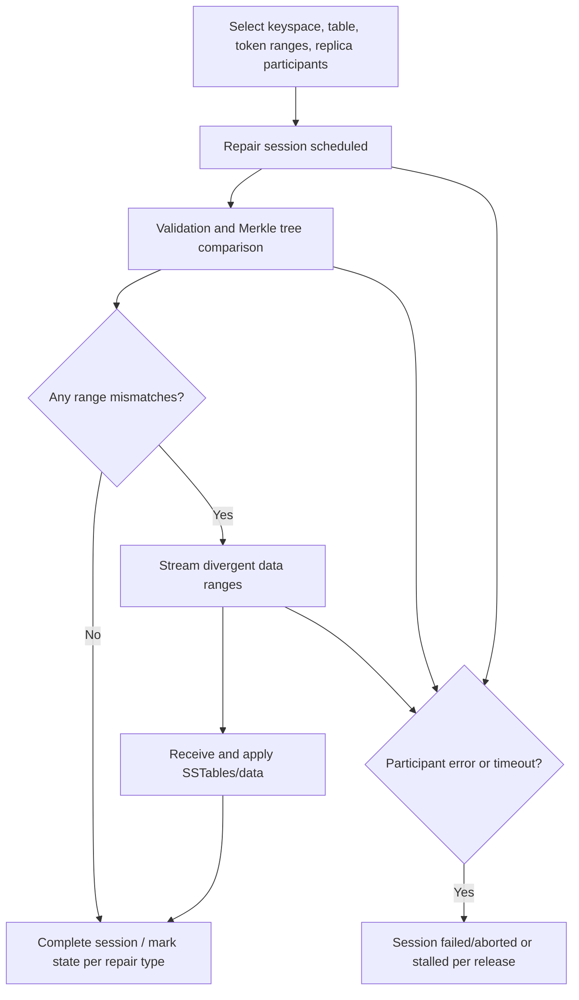
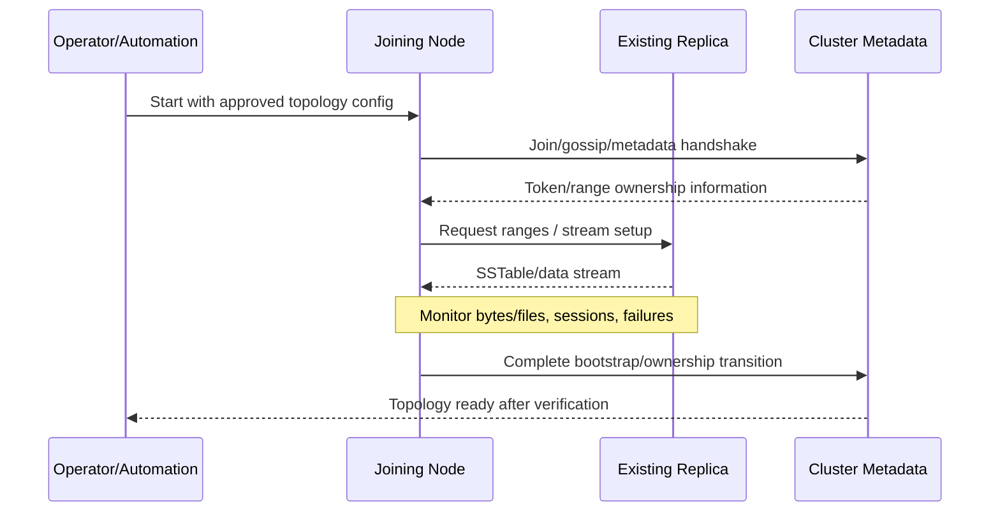
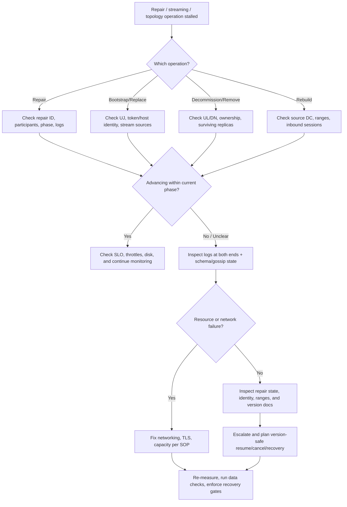

# Stuck Repair/Streaming and Topology Change Failures in Apache Cassandra

## 1. Why a "Hung Repair" Cannot Be Fixed by Retrying Blindly

In the **DATABASE_ENGINE_WIDE_COLUMN_CASSANDRA** module, Apache Cassandra is a **distributed wide-column** database. The **partition key** determines a partition's token; the **replication factor (RF)** and placement strategy govern which replicas own the data; and the **consistency level (CL)** specifies how many responses each request requires. Adding, replacing, or removing a node shifts **token ownership** and streams data. Whenever replicas diverge due to slow writes, temporary node outages, or incomplete repairs, Cassandra relies on **anti-entropy repair** to resynchronize them.

A typical incident report often starts bluntly:

> "The new node has been stuck `JOINING` for over two hours, and `nodetool netstats` isn't moving. Yesterday's repair also hung—should we cancel repair, run `cleanup`, or remove the broken node?"

You cannot answer from a vague "stuck" label alone:

- Perhaps **repair has not yet entered the streaming phase**, so `netstats` shows zero active transfers.
- Perhaps **validation / Merkle tree building** is running, while disk reads and compaction contend for I/O.
- Perhaps a stream session truly stalled on networking, TLS/ports, disk I/O, or one slow peer.
- Perhaps a `JOINING` node has not converged **schema, gossip, or topology metadata** yet, preventing streams from starting.
- Perhaps a concurrent operation (`decommission`, `replace`, `removenode`, `rebuild`) is colliding on the same token ranges.
- Perhaps misconfigured RF, DC, rack, or snitch settings prevent the node from claiming valid replica ranges.
- Perhaps the operation already failed with clear causes in logs while stale client/tool caches show old status.

**Recklessly running `repair`, `cleanup`, `removenode`, or mass restarts can strand under-replicated ranges, amplify I/O pressure, or trigger major outages.** This **Troubleshooting** lesson guides identifying the stalled phase, corroborating multi-node evidence, and choosing safe recovery paths.

### Learning Outcomes

After this lesson, you can:

1. Distinguish **repair**, **streaming**, **bootstrap**, **decommission**, **remove node**, **replace**, and **rebuild**.
2. Interpret `UN/UJ/UL/UM/DN` states from `nodetool status` in context of active topology operations.
3. Evaluate "lack of progress" from **multiple time-stamped samples**, never a single `netstats` snapshot.
4. Combine `nodetool status/netstats/tpstats/compactionstats/tablestats`, schema state, logs, and node metrics to isolate bottlenecks.
5. Analyze RF/CL, token/replica placement, DC/rack/snitch layout, internode networking/TLS, and disk headroom.
6. Handle failed or incomplete repair sessions cleanly per version without corrupting repaired state or tombstone safety.
7. Select the proper runbook per topology operation and verify data safety before running `cleanup` or removing nodes.
8. Inspect metadata, schema agreement, and readiness **read-only and rate-limited** from Java Driver 4.x.
9. Document incident reports, reproduce scenarios safely on multi-node testbeds, and enforce stop/rollback conditions.

**Scope limits:** Subcommand names, repair phases, streaming internals, and config keys vary across Cassandra 3.x/4.x/5.x and distributions. Read-only inspection commands shown here are common examples; **state-mutating data/topology commands** are discussed strictly conditionally—always verify exact documentation for your running version.

## 2. Seven Operations Frequently Conflated With "Repair"

| Operation | Purpose | Streams data? | Alters topology? |
| --- | --- | --- | --- |
| **Anti-entropy repair** | Compares replicas over shared token ranges and syncs differences | Yes, when divergent data exists | Typically no |
| **Bootstrap** | Joins a new node and streams ranges it will own | Yes | Yes |
| **Decommission** | Cleanly removes a live node, streaming ranges to remaining owners | Yes | Yes |
| **Remove node (`removenode`)** | Purges metadata of a dead node and restores lost replica copies from peers | Usually yes, via recovery paths | Yes |
| **Replace node** | Replaces a dead node under matching token ownership | Yes | Yes |
| **Rebuild** | Re-populates data from healthy source replicas/DCs (e.g., new DC) | Yes | Does not necessarily alter token ownership |
| **Cleanup** | Drops local SSTable data outside a node's ownership post-topology change | Not for data redistribution | No; deletes local unowned data |

Separate two everyday meanings of "repair":

- **Anti-entropy repair** (`nodetool repair` and siblings): coordinates validation and replica reconciliation.
- **Cluster recovery** broadly: spans bootstrap, streaming, node replacement, schema agreement, networking, or repair—not every failure is solved by `nodetool repair`.

### 2.1. Repair Does Not Replace Bootstrap

When adding a node, the core task is **reassigning ownership and streaming token ranges**. Launching `nodetool repair` while bootstrap remains incomplete adds competing I/O without fixing stalled bootstrap logic. Recovery must target **joining state, peer metadata, range assignments, and stream sessions**.

### 2.2. Cleanup Is Not a Blanket "Free Disk Space" Button

Once a topology change has **fully completed and passed verification**, existing nodes may still hold SSTables for token ranges they no longer own. `cleanup` purges out-of-range local data. However, **running `cleanup` before streaming/migration finishes can destroy the last surviving copy needed for recovery**.

Never trigger `cleanup` as a panic response to tight disk during bootstrap. If headroom is insufficient, **halt or throttle the change and expand capacity** instead of deleting unowned replicas prematurely.

## 3. Conceptual Flow: Coordinators, Replicas, Repair, and Topology

### 3.1. Token Ownership Model

Suppose keyspace `commerce` uses `NetworkTopologyStrategy` with RF=3 in `dc1`. Partition key `customer_id=C1` hashes to token `T`, mapped to a replica set based on token ring, snitch, DC, and rack layout:

```text
Partition key C1 --> token T
                  |
                  +--> replica A (dc1/rack1)
                  +--> replica B (dc1/rack2)
                  +--> replica C (dc1/rack3)

Read/Write CL=LOCAL_QUORUM => 2 responses for RF=3
Repair range holding T     => compares and syncs replica differences
Bootstrap/replace          => can change which nodes own T
```

This diagram is simplified; with **vnodes**, each physical node holds many token ranges. Never guess replica placement from node names or IP order.

### 3.2. Multi-Phase Repair Execution



**Zero active streams does not prove repair hung.** During Merkle validation across massive SSTables, **no streaming starts yet**—or ranges turn out consistent with nothing to transfer. Inspect repair session logs alongside CPU, disk I/O, and `compactionstats` to pinpoint the active phase.

### 3.3. Streaming During Topology Changes



Exact transitions vary by Cassandra release and operation (`bootstrap`/`replace`/`decommission`). Never use this abstract sequence to guess when **deleting data from old owners is safe**; verify terminal completion and full RF/placement first.

## 4. What Does "Stuck" Mean in Measurable Terms?

Saying "`nodetool netstats` is still at 60%" proves nothing by itself. Separate:

- **Slow yet actively working:** streamed bytes stay unchanged for 3 minutes while Merkle validation or flushes burn I/O inside the current phase.
- **Truly stalled:** identical session ID, identical byte/file counts, no phase movement, and silent or retrying peer logs caused by failed network, disk, or peers.
- **Already failed/aborted:** logs recorded terminal session failure while stale UI/tool snapshots show old state.
- **Streamed yet unfinalized:** streams completed while the node stays `JOINING` due to gossip/schema/finalization stalls, or a "succeeded" repair skipped ranges.
- **Wrong observation vantage point:** running `netstats` on an uninvolved node, or checking only outbound streams while transfers sit inbound on peers.

### 4.1. Build Time-Series Instead of Single Snapshots

**Hypothetical** sample series:

| Time (UTC) | Node | Session | Incoming | Outgoing | Active streams | Logs |
| --- | --- | --- | ---: | ---: | ---: | --- |
| 10:00 | node-new | stream-X | 12 GiB/20 GiB | 0 | 2 | Receiving |
| 10:05 | node-new | stream-X | 12.1 GiB/20 GiB | 0 | 2 | Retry / slow disk |
| 10:10 | node-new | stream-X | 12.1 GiB/20 GiB | 0 | 2 | Connection reset |
| 10:15 | node-new | stream-X | 12.1 GiB/20 GiB | 0 | 0 | Session failed |

Do not shout "stalled 15 minutes" just seeing `12.1 GiB`; track the **same session ID**, phases, logs, and source-peer behavior. Conversely, slow steady byte growth inside SLO might simply reflect **intentional bandwidth throttling**.

### 4.2. Metrics to Capture

- Bytes/files **planned**, **sent**, **received**, and **remaining** per session, peer, and node.
- Actual transfer rate across consistent time windows.
- Active, pending, and failed session counts plus phase transitions.
- Free/used disk space, IOPS/await/throughput, compaction backlog, and write amplification.
- CPU, JVM heap, GC pauses, stage queues, and dropped messages.
- Network RTT, packet loss, retransmits, internode connections, and TLS handshakes.
- Repair validation progress, repair IDs, and pass/fail state per range and table.
- Live replica counts, ring state, and schema agreement.
- Client `ReadTimeout`/`WriteTimeout`/`Unavailable`, p95/p99 latency, and retry load.

**Never diagnose from one isolated metric:** zero `netstats` bytes can come from network drops, slow disks, zero data skew, or an active Merkle validation phase tracked inside `compactionstats` and server logs.

## 5. Safety Rules and "Change Freeze" During Incidents

Before running any recovery command:

1. **Halt any new topology changes.** Never add nodes, decommission/remove others, or alter RF while an ongoing operation remains unclassified.
2. **Confirm the exact active operation:** bootstrap, replace, decommission, `removenode`, rebuild, repair, or cleanup.
3. **Freeze CQL schema migrations and DC/rack/snitch edits** unless proven causal with an approved change plan.
4. Preserve restorable backups/snapshots per runbook—never rely on snapshots as live replicas.
5. Verify disk capacity and remaining replica sources, especially prior to anything purging local SSTables.
6. Shed client workload and cap retries if nodes saturate; prevent retry storms during unstable replica transitions.
7. Assign an incident owner and document UTC timeline, versions, stop conditions, and rollback plan per SOP.
8. When beyond local recovery confidence, **escalate to DBA/on-call/vendor support** rather than testing destructive ring commands "just to see what happens".

**Never fire topology- or data-mutating commands (`decommission`, `removenode`, `assassinate`, `cleanup`, cluster-wide `repair`) just to nudge a stuck UI.** This lesson teaches safe inspection and decision criteria—not blanket permission for risky production actions.

## 6. Initial Read-Only Diagnostic Commands

Collect outputs across **every involved node** with UTC timestamps, hostnames, and versions:

```bash
# Node membership and cluster state:
nodetool status
nodetool describecluster
nodetool info

# Stream progress on both sending and receiving nodes:
nodetool netstats

# Background resource pressure:
nodetool tpstats
nodetool compactionstats

# Only when verifying gossip/tokens with bounded output volume:
nodetool gossipinfo
nodetool ring

# Target table statistics:
nodetool tablestats commerce.orders_by_customer
```

`nodetool` connects over JMX; ensure secure credentials and ports. Exact subcommands, fields, and units vary by release. If a subcommand differs or fails, inspect `nodetool help` for your running version—**never swap in a destructive command instead**.

### 6.1. Reading `nodetool status` States

| Common state | General meaning | What to inspect next |
| --- | --- | --- |
| `UN` | Up / Normal | Can accept requests, yet does not prove streaming, repair, or data sync finished |
| `UJ` | Up / Joining | Node bootstrapping/joining | Streams, gossip/schema agreement, token ranges, peer connectivity |
| `UL` | Up / Leaving | Node decommissioning | Handoff streaming, surviving replicas, completion progress |
| `UM` | Up / Moving | Node shifting token ownership (where supported) | Move session progress and disk headroom |
| `DN` | Down / Normal | Ring member viewed as DOWN | Node crash vs. network/JMX/gossip split; replica availability |
| `DL` / other | Down paired with transition state (if displayed) | Exact version semantics, server logs, and peer views |

`nodetool status` captures **one node's gossip membership snapshot** at a moment in time. It never means:

- `UN` guarantees full dataset presence on that node.
- `UJ` guarantees bytes are actively streaming at that exact second.
- `DN` proves disk failure (often network or gossip partitioning).
- All nodes share an identical topology view.

### 6.2. `nodetool netstats`: Inbound, Outbound, and Modes

Check both **source** and **destination**:

```text
Node A (source): outbound streams to node-new
Node-new (destination): inbound streams from Node A
```

Verify:

- Are transfers pointing to the right peers rather than stale IPs or dead host IDs?
- Are active streams advancing file/byte progress?
- Do completed/remaining totals shift over time?
- Do logs show stream failures while `netstats` looks frozen?
- Are transfers hitting configured bandwidth throttles or source/destination disk limits?
- Are too many concurrent streams saturating NIC or disk I/O?
- Are streams absent simply because validation, metadata exchange, or schema sync hasn't finished?

Empty `netstats` across nodes does not prove networking broke: **repair may be validating Merkle trees**, or bootstrap hasn't reached streaming yet.

### 6.3. `nodetool tpstats` and `compactionstats`

`tpstats` surfaces active, pending, completed, and dropped tasks by thread pool. `compactionstats` displays active compactions and validation-related tasks/backlogs depending on release.

Check:

- Do pending counts climb persistently while completed counts freeze?
- Are repair/streaming pools backing up or dropping messages?
- Is heavy compaction starving disk throughput needed by streaming?
- Do disk latency spikes overlap with GC pauses?
- Does one node look heavily skewed from hot or oversized partitions?

**Never assume high pending compactions alone caused everything**: intense streaming or ingestion often creates the compaction backlog itself. Align CPU, disk, network, and timelines.

## 7. Capturing Effective Versions, Schema, Replication, and Topology

Repair and streaming rely directly on live cluster metadata. Verify **runtime state**, not merely intended YAML templates.

### 7.1. CQL Keyspace and Local Node Inspection

```sql
SELECT keyspace_name, replication, durable_writes
FROM system_schema.keyspaces
WHERE keyspace_name = 'commerce';

SELECT host_id, cluster_name, data_center, rack, release_version
FROM system.local;
```

`system.local` reflects **only the coordinator node answering that query**, not peers. Cassandra 4.x exposes `system.peers_v2` alongside older `system.peers`. **Never trust one node's system table to prove cluster-wide metadata alignment**—verify across peers and cluster-management tooling.

### 7.2. Configuration Fields to Cross-Check

| Field | Why it matters |
| --- | --- |
| Exact Cassandra Server version/build per node | Protocol, repair, and streaming differences in mixed-version clusters |
| Host ID, token ranges, `num_tokens` | Replica placement and safe replacement identity |
| Cluster name, seeds, snitch | Gossip discovery and DC/rack topology |
| Effective datacenter/rack | `NetworkTopologyStrategy` maps replicas from snitch output |
| Keyspace RF per DC | Source/destination replica counts and quorum tolerance |
| Internode listen/broadcast addresses | Peer-to-peer reachability |
| Internode encryption/TLS/certificates | Handshake and stream channel establishment |
| Actual storage/SSL storage ports | Distinct from native CQL client port 9042 |
| Stream bandwidth/throttle configs | Transfer speed vs. foreground workload contention |
| Disk mounts/capacity/data directories | Space for incoming SSTables and compaction |
| Commit log/cache/heap/JVM flags | GC stalls and resource contention |
| Repair history/session state | Full/incremental/pending repair bookkeeping |

**Never rewrite hostnames, IPs, seeds, or snitch mid-bootstrap simply because gossip looks fragmented.** Altering identity/topology mid-flight can spawn conflicting "new" identities; follow version-specific SOPs to preserve host IDs and token ownership.

### 7.3. Schema Agreement ≠ Data Readiness

When `nodetool describecluster` or the Java Driver reports schema agreement, it means **DDL schema metadata converged**—it does **not** guarantee:

- New nodes finished receiving required SSTables.
- Repair covered all token ranges.
- `LOCAL_QUORUM` reads already return the newest version under migrations or concurrent writes.
- Compaction completed or tombstones purged safely.

Always run **separate data readiness verification** after topology changes.

## 8. Evidence of Replica Placement and Fault Scope

Topology changes affect specific token ranges. To confirm stream sources make sense:

1. Determine **keyspace RF per DC**.
2. Map **pre-change token ranges/ownership** vs. **planned post-change ownership**.
3. Identify stream sources and destinations in session logs and cluster metadata.
4. Confirm whether impaired nodes actually sit in the **replica set for the affected token range/partition**.
5. Compare peer views; resolve gossip/schema disagreement before trusting data placement conclusions.
6. Verify whether an old node remains the **sole surviving source** for any range—never drop it impulsively.

Example partition trace layout:

```text
partition:
  keyspace: commerce
  table: orders_by_customer
  partition_key: customer_id=synthetic-UUID
  token: T
  prior_replicas: [A, B, C]
  planned_replicas: [A, B, D]
  receiving_node: D
  expected_sources: [B, C]
  observed_stream_peer: B
```

These values are **hypothetical**, illustrating what to capture rather than live cluster facts.

With vnodes, each node spans hundreds of token ranges and `nodetool ring` output grows massive. Use driver/admin metadata APIs to map tokens and **sample representative partitions** rather than dumping unstructured gigabytes of ring text.

## 9. Root-Cause Classification by Repair/Streaming Symptom

| Symptom | Candidate hypothesis | Evidence to verify |
| --- | --- | --- |
| Repair stalls before any streams start | Merkle validation, task queuing, node resource bottleneck | Repair phase logs, `compactionstats`, I/O, heap |
| `netstats` lists session yet bytes stall long-term | Network drops, peer resets, disk saturation, low throttle | Logs at both ends, TCP retransmits, disk I/O |
| One specific peer consistently times out | Internode firewall, routing, TLS/cert expiry, or overloaded peer | Peer logs, port reachability, TLS handshakes |
| New node stays `UJ` with zero remaining streams | Bootstrap finalization, gossip, schema sync, remaining range checks | Boot logs, ownership/mode, peer views |
| `UL` drags on while disks near full | Decommission stream stalls / heavy compaction backlog | `netstats`, destination capacity, RF headroom |
| Node shows `UN` yet data missing post-replace | Incomplete streaming, repair/ownership gap, wrong source | RF/CL verification reads, token map, boot logs |
| Repair fails repeatedly on the same table | Corrupt SSTable, giant partition, disk errors, GC OOM | Validation/corruption logs, disk health, partition stats |
| Repair finishes suspiciously fast | Zero divergence, wrong range/table scope, skipped ranges | Session scope/tables/ranges, terminal status |
| Joining node fails to connect to seeds/peers | Mismatched cluster name, DC/rack, listen/broadcast, ACL, TLS | Gossip logs, socket reachability, host identity |
| Reads inconsistent right after increasing RF | RF metadata changed without streaming/repairing existing data | NTS RF, repair plan, placement, verification reads |
| Streaming finishes yet API p99 climbs | Post-stream compaction, cold cache, ongoing repair, shifted load | Pre/post metrics and workload distribution |

**No single symptom proves root cause on its own.** Corroborate time-stamped evidence across sources, destinations, coordinators, and clients.

## 10. Root Cause Group A: Network, Internode TLS, and Addresses

Cassandra streaming travels over **internode paths**, completely separate from Java client CQL port 9042. An app running `SELECT` over 9042 **does not prove** peer streaming connectivity works.

### 10.1. Connectivity Checklist

- Can source nodes connect to the **internode address/port** advertised by the destination?
- Can the destination accept inbound connections and stream data back?
- Do `listen_address`, `broadcast_address`, NAT mappings, and Kubernetes/container endpoints match consistently?
- Do firewalls, security groups, ACLs, and routes allow internode traffic across racks and DCs?
- If internode TLS is enabled, are certificate chains, expiration dates, SANs/hostnames, keystores, and truststores valid?
- Are packet loss, TCP retransmits, RSTs, or socket timeouts occurring inside the exact session window?
- Does path MTU or network asymmetry break large SSTable stream transfers between peers?
- Is stream bandwidth throttled too low relative to data size and SLA windows?

Depending on release and config, internode communication uses `storage_port` or `ssl_storage_port`. **Never punch open arbitrary firewall ports or disable TLS in production** just to bypass trouble—follow security change controls.

### 10.2. Separating Server Bottlenecks From Network Faults

If source logs report active sending while destination sees nothing arrive, check networking and receivers. If destination logs slow writes or high disk await, check storage I/O. If both peers sit quietly in Merkle validation, don't blame firewalls when zero stream connections were even attempted.

### 10.3. Never Corrupt Host Identity Mid-Incident

Each Cassandra node holds a **host ID, token ownership, and gossip state**. When replacing VMs or containers:

- Never clone old data directories and `system` metadata recklessly onto another live node.
- Never allow two instances to run with the same host identity.
- Never restart a dead node mid-replacement if your runbook requires it to remain DOWN after handing over identity.
- Never treat editing `seeds` as a way to remove a dead host ID; seeds bootstrap gossip discovery only.
- Follow version-exact replacement procedures so two nodes never claim overlapping token ranges.

## 11. Root Cause Group B: Disk, SSTables, Compaction, and Resource Pressure

Streaming moves physical SSTables; repair compares disk contents across replicas. Both stress I/O and disk capacity heavily.

### 11.1. Near-Full Disks

Inspect:

- Free disk on the **destination** (and sources for temporary repair/compaction space).
- Incoming SSTables, temporary compaction space, data volumes, commit logs, logs, and old snapshots.
- Disk IOPS, latency, and filesystem errors.
- Per-keyspace/table sizes and compaction backlogs.
- Co-scheduled disk consumers like backups, restores, snapshots, or parallel streams.

**Never treat a rigid "2x disk free" rule as dogma**: needed headroom depends on data layout, compaction strategy, stream concurrency, and volume topology. Still, if storage lacks headroom for incoming streams plus compaction, **stop scaling/recovery and expand storage capacity** before proceeding.

### 11.2. Ample Free Space Yet Saturated Disk I/O

Even with 50% disk free, transfers stall when disks saturate due to:

- Compaction backlogs and severe read amplification.
- Merkle validation scanning huge SSTables.
- Too many parallel stream sessions competing for seeks/bandwidth.
- Large/hot partitions or tombstone-heavy reads.
- Cloud volume IOPS/throughput bursting exhausted, or noisy neighbors.
- JVM GC pauses, CPU throttling, or heap pressure on the node.

Use **time-series data**: disk latency/util, CPU/iowait, GC pauses, `tpstats`, `compactionstats`, and stream throughput. If all nodes slow simultaneously, check shared storage/network infrastructure before raising repair concurrency.

### 11.3. Throttles and Concurrency

Lowering stream throughput protects foreground client SLOs while stretching bootstrap time. Cranking stream throughput or concurrency backfires once disks or GC saturate.

Document:

- Configured stream throughput, outbound, and inter-DC throttles **per release**.
- Repair parallelism and validation concurrency.
- Concurrent compaction limits.
- Application QPS, in-flight caps, and retry budgets.
- Source vs. destination throughput asymmetry.

**Never tune multiple knobs simultaneously** and attribute success to one setting. Test one variable at a time against pre/post baselines.

## 12. Root Cause Group C: Repair Sessions and "Repaired Data" State

Repair is not an idempotent "re-run until green" command when active sessions fail. Cassandra separates **full repair**, **incremental repair**, **repaired/unrepaired SSTables**, and in modern versions **pending repair sessions**.

### 12.1. Full vs. Incremental Repair

| Mode | Core concept | What to verify |
| --- | --- | --- |
| **Full repair** | Validates all chosen ranges, including already-repaired data | High I/O/stream load, range/table scope, schedule alignment |
| **Incremental repair** | Tracks and repairs only data not yet marked repaired | Pending session state, repaired/unrepaired SSTable split, failure cleanup |
| **Primary-range repair (`-pr`)** | Scopes ranges to those primarily owned by the target node | Requires running across all nodes/DCs to avoid skipped ranges |
| **Subrange / keyspace / table repair** | Limits blast radius of a single run | Never mistake "one table repaired" for "cluster fully repaired" |
| **Preview repair** (where supported) | Estimates divergence without modifying data | Never count preview runs as completed anti-entropy repairs |

Default repair modes and flags differ across releases. **Always check `nodetool help repair` on your live version before scheduling.** Never paste `-full` or `-pr` blindly from blogs without verifying exact range coverage.

### 12.2. Inspecting Repair State

On Cassandra releases supporting repair administration:

```bash
# Check exact help on the running version first:
nodetool help repair
nodetool help repair_admin

# Example where supported:
nodetool repair_admin list
```

Some setups lack `repair_admin` or use distinct tooling. Consult version docs and repair logs. **Never run `repair_admin cancel` or session-abort flags impulsively**: aborting can leave pending repair SSTable state requiring dedicated cleanup procedures and risking conflicts.

### 12.3. Before Canceling or Re-Running a Repair

1. Capture **repair session ID, initiator, participants, keyspaces, tables, and token ranges**.
2. Confirm the **current phase**: validation, Merkle comparison, streaming, or finalization.
3. Read **logs on every participant**, not solely the initiator.
4. Check whether progress, pending tasks, and disk I/O are still active or terminally failed.
5. Check whether the job is incremental with **pending repair state**.
6. Verify every replica/node is healthy enough for recovery overhead.
7. Review your exact release's supported procedure for **canceling/cleaning pending repair sessions**.
8. Cancel or re-run strictly under reviewed runbooks, recording session IDs and outcomes.
9. Afterward, validate covered ranges and replica correctness via sample partition reads.

**Never delete SSTables or system metadata by hand to "clear stuck repair state".** You risk destroying repaired-state tracking and irreplaceable unique replica data.

### 12.4. One Ad-Hoc Repair Does Not Replace a Repair Schedule

One clean repair run on a single node or table never guarantees permanent cluster consistency. Maintain:

- Recurring repair schedules with verified token-range and DC coverage.
- Failure rate and duration tracking.
- Alignment with `gc_grace_seconds` and tombstone safety bounds.
- Clear policy on full vs. incremental cadence and history retention.
- Explicit reconciliation for skipped ranges or Down participants.

**Never set `gc_grace_seconds = 0`** to "help repairs clear tombstones faster"; if a replica missed deletes prior to purge, zombie data resurrection becomes likely.

## 13. Root Cause Group D: Bootstrap Stuck in `JOINING` (`UJ`)

### 13.1. Step-by-Step `UJ` Triage

When a node remains `UJ` too long, verify sequentially:

1. Are **cluster name, DC/rack/snitch, seeds, listen/broadcast addresses** properly configured?
2. Can the joining node exchange gossip and schema with peers, and appear consistently in `nodetool status` across nodes?
3. Are tokens, `num_tokens`, and host IDs valid for the operation?
4. Does the node have ample disk, heap, and CPU, with zero I/O, TLS, or network errors in logs?
5. Does `nodetool netstats` show inbound streams, which sources are sending, and whether bytes advance?
6. If zero streams exist, is the node awaiting **range calculation/schema agreement**, or did stream setup fail?
7. If streams finished, is a finalization, metadata, or gossip blocker keeping state at `JOINING`?
8. Are clients hitting errors from ownership transitions or stale driver topology caches?

### 13.2. Frequent `UJ` Failure Modes

| Symptom | Likely cause | How to confirm |
| --- | --- | --- |
| Peers cannot see new node | Seeds, gossip, firewall, TLS | Handshake/connect logs, peer statuses |
| Host ID / token collision | Reused stale data directory or host identity | Node metadata/logs, prior host records |
| Streams run then destination disk fills | Insufficient storage headroom | Disk telemetry, data dirs, SSTable size |
| Inbound streams crawl slowly | Peer/disk/network throttling | `netstats` + I/O and network stats at both ends |
| Streams finished yet state stays `UJ` | Bootstrap finalization, schema, or gossip hang | Node boot logs and peer views |
| Schema mismatch | Unconverged DDL or mixed versions | `describecluster` and schema metadata |
| Wrong DC / rack | Broken placement or replica counts | `system.local`/peers, snitch config |

### 13.3. Can You "Resume Bootstrap"?

Certain Cassandra releases support **bootstrap resume**. Viability depends on:

- Which phase bootstrap halted in.
- Whether host identity and local data directories remain intact.
- Whether partial/failed sessions need explicit cleanup.
- Exact version compatibility and supported resume flags.
- Whether all source peers are stable with ample disk and network capacity.

**Never treat `nodetool bootstrap resume` as a generic reflex whenever `UJ` appears.** Check `nodetool help bootstrap` and version runbooks; execute only after diagnosing the failure with clear stop/rollback gates.

### 13.4. Never Run `cleanup` Before Confirming the New Node

Only after the new node owns its full ranges, topology stabilizes, and verification passes should old nodes run planned cleanup. Before then, **data on older owners may still be the critical fallback copy**. Never wipe SSTables mid-bootstrap to save disk space.

## 14. Prolonged Decommission: Live Node Leaving the Cluster (`UL`)

`Decommission` is a **graceful planned exit** for a healthy node capable of handing off data. When `UL` stalls or fails in logs, inspect:

- Is the leaving node still healthy and able to read local SSTables cleanly?
- Do receiving replicas have adequate disk, network headroom, and matching DC/rack capacity?
- Does remaining node count still satisfy RF and rack placement after exit?
- Are background compaction, repair, or unrelated streams contending for I/O?
- Are clients with stale caches still routing writes to the leaving node?
- Did an outbound stream session reset or hit a network partition?

**Never replace an interrupted `decommission` carelessly with `removenode`.** The two commands make fundamentally different assumptions about node health and handoff state; recovery paths require careful host-identity review and DBA/on-call sign-off.

### 14.1. If a Node Runs Out of Disk During Decommission

Never delete local SSTables on a `UL` node—it may still hold the only unstreamed copy of leaving token ranges. Instead:

1. Pause competing background operations.
2. Shed foreground client load where safe and authorized.
3. Verify receiving nodes have ample free capacity.
4. Add capacity or adjust schedules per runbook.
5. Complete decommission cleanly only once all streams and ownership transitions converge.

## 15. Dead Nodes: `removenode`, `replace`, and `rebuild` Are Not Interchangeable

### 15.1. `removenode`

Purges metadata for a permanently dead node under supported conditions while streaming replica copies from surviving nodes to restore RF. Risks:

- The "dead" node is actually still alive on a partitioned network and might rejoin.
- Surviving replicas lack sufficient surviving copies/RF to rebuild every range.
- Ownership shifts require heavy streaming across remaining nodes.
- Concurrent topology operations conflict fatally.
- Removing a node without quorum/replica sources deepens data unavailability.

**Never pass a host ID copied from old logs into `removenode` without verifying current host IDs, tokens, and live peer views.**

### 15.2. `replace`

Brings up a replacement node inheriting a failed node's token ownership/role per runbook. Verify:

- The failed node stays permanently down and cannot boot back up with the old identity/tokens.
- The replacement carries matching DC, rack, seeds, networking, TLS, and clean data directories.
- Host ID and replacement flags match your exact Cassandra release.
- Surviving source replicas hold complete, reachable data to stream.
- Can the dead node ever be turned back on post-replace? **Never allow it casually** if identity transferred.

A botched replacement risks **split ownership** or streaming from bad sources—far riskier than routine repairs.

### 15.3. `rebuild`

`Rebuild` streams data into a node from designated source DCs/replicas—it does **not** join a new node into the ring. When `rebuild` stalls, check stream sources, RF/DC, networking, disk, and logs identically. Never re-run `rebuild` onto a node mid-operation without verifying existing state.

### 15.4. Last-Resort Commands

Forceful gossip/token overrides (such as `assassinate` on supporting releases) are **never routine troubleshooting steps**—they belong solely to expert recovery runbooks under strict approvals. This guide omits execution recipes for them to discourage destructive ring surgery.

## 16. What to Verify Whenever RF or DC/Rack Changes

Streaming issues often appear right after `ALTER KEYSPACE` increases RF or shifts topology—for example, RF=2 to RF=3:

```sql
-- SAMPLE ONLY: never execute in production without a vetted migration plan.
ALTER KEYSPACE commerce
WITH replication = {
    'class': 'NetworkTopologyStrategy',
    'dc1': 3
};
```

**Updating replication metadata does not immediately populate data onto new replicas.** Execute version-specific repair/rebuild procedures after RF increases, monitor progress, and verify data before trusting new redundancy.

Frequent mistakes:

- Keyspace DC name (`dc1`) misspells the node's real snitch datacenter string.
- Insufficient nodes or racks to satisfy placement rules.
- Raising RF and immediately raising CL before replicas catch up, causing `Unavailable`/timeouts.
- Skipping range repair/rebuild post-RF change.
- Using a single-node RF=1 lab test to bless production RF=3 changes.
- Editing `cassandra-rackdc.properties` to relocate live nodes without following migration runbooks.
- Running mixed-version clusters with incomplete schema/protocol transitions.

### 16.1. RF/CL and Availability Mid-Transition

With RF=3 and `LOCAL_QUORUM`, two replicas must respond. While a node is `JOINING`/`LEAVING` or replicas saturate, clients may hit `Unavailable`, `ReadTimeout`, or `WriteTimeout`. Never conclude:

- `Unavailable` means permanent data loss.
- `WriteTimeout` means nothing was written.
- `ReadTimeout` means the row doesn't exist.
- Errors disappearing after lowering CL means placement/repair finished cleanly.

**Dropping CL to hide timeouts alters consistency guarantees** and requires explicit approval and restoration plans—never default to it during topology fixes.

## 17. Combining Java Driver 4.x to Verify Readiness and Real CQL

`nodetool` gives cluster-side internals; your Java service must independently prove **its actual CQL query path** works within bounds.

### 17.1. Do Not Rely on TCP-Only Health Endpoints

A successful TCP handshake or `CqlSession` creation never proves:

- Keyspaces/tables reached schema agreement.
- Replica ownership stabilized.
- Critical partitions respond cleanly at required CL.
- Timeouts and retry storms stopped.
- Streaming or repairs completed.

Enforce a thorough readiness contract: initialized session + schema agreement + rate-limited CQL check on a **synthetic key** + latency/error SLOs + server-side topology/repair gates.

### 17.2. Java Driver 4.x: Read-Only Node Metadata Inspection

JDK 11+ example with Java Driver 4.x:

```java
import java.net.InetSocketAddress;
import java.util.Map;
import java.util.UUID;

import com.datastax.oss.driver.api.core.CqlSession;
import com.datastax.oss.driver.api.core.metadata.Node;

public final class CassandraTopologySnapshot {

    public static void main(String[] args) {
        try (CqlSession session = CqlSession.builder()
                .addContactPoint(
                    new InetSocketAddress("127.0.0.1", 9042))
                .withLocalDatacenter("dc1")
                .build()) {

            boolean agreed = session.checkSchemaAgreement();
            System.out.println("schemaAgreement=" + agreed);

            Map<UUID, Node> nodes =
                session.getMetadata().getNodes();

            for (Map.Entry<UUID, Node> entry : nodes.entrySet()) {
                Node node = entry.getValue();

                System.out.printf(
                    "hostId=%s endpoint=%s dc=%s rack=%s state=%s%n",
                    entry.getKey(),
                    node.getEndPoint(),
                    node.getDatacenter(),
                    node.getRack(),
                    node.getState());
            }
        }
    }

    private CassandraTopologySnapshot() { }
}
```

**Limitations:**

- `127.0.0.1:9042` and `dc1` are **lab placeholders**. Configure real contact points and local DCs carefully without pointing probes recklessly at production.
- `getMetadata().getNodes()` reflects the driver's client-side metadata cache, which can lag server gossip transitions—never rely on it as sole ground truth.
- `checkSchemaAgreement()` never proves streaming or repair finished.
- Specific node metadata methods vary across 4.x minor versions; verify against compiled Javadoc for your pinned release.
- One snapshot never proves continuous progress. Sample sparingly with UTC timestamps—**never create a new `CqlSession` every 100 ms**.
- Logging internal host IDs or endpoints must obey security policies; redact before sharing externally.

### 17.3. CQL Synthetic Partition Read Probe at Target CL

Assuming `commerce.orders_by_id` is seeded safely:

```java
import java.time.Duration;
import java.util.UUID;

import com.datastax.oss.driver.api.core.CqlSession;
import com.datastax.oss.driver.api.core.DefaultConsistencyLevel;
import com.datastax.oss.driver.api.core.cql.PreparedStatement;
import com.datastax.oss.driver.api.core.cql.Row;

public final class CassandraReadinessProbe {

    private final CqlSession session;
    private final PreparedStatement query;

    public CassandraReadinessProbe(CqlSession session) {
        this.session = session;
        this.query = session.prepare(
            "SELECT order_id, state, version " +
            "FROM commerce.orders_by_id WHERE order_id = ?");
    }

    public boolean verify(UUID syntheticOrderId) {
        try {
            Row row = session.execute(
                query.bind(syntheticOrderId)
                    .setConsistencyLevel(
                        DefaultConsistencyLevel.LOCAL_QUORUM)
                    .setTimeout(Duration.ofSeconds(2))
                    .setIdempotent(true))
                .one();

            return row != null
                && syntheticOrderId.equals(row.getUuid("order_id"))
                && row.getString("state") != null;

        } catch (RuntimeException error) {
            // Emit structured metric/error; never conflate timeout with "not found".
            return false;
        }
    }
}
```

This probe validates **only one read path against one known key** and must be tightly rate-limited. Test against realistic RF=3/CL topologies; never write real user traffic inside health probes—use synthetic fixtures with strict lifecycle, privacy, and ownership rules.

**Never turn keyspace-wide `SELECT COUNT(*)` or `nodetool repair` into an automated health check.** Heavy probes add destructive pressure right when clusters are fragile.

### 17.4. Write Outcomes During Active Streaming Can Be Ambiguous

When Java Driver throws `WriteTimeout` or `DriverTimeout` mid-topology shift, mutations **may still apply on replicas** despite missing ACKs. Whenever handling retries:

- Preserve a stable **logical request ID**.
- Never unconditionally retry counters, list appends, or external side effects.
- Reconcile request IDs, versions, and domain invariants post-recovery.
- Never equate timeouts with "write didn't exist" to launch duplicate business transactions.
- Track counts and ages of all `UNKNOWN` write outcomes.

A synthetic readiness probe passing never clears unverified production writes; run **dedicated reconciliation**.

## 18. Decision Tree: Structured Triage Over Impulsive Commands



**Critical branch rule:** decisions to abort, cancel, or rerun belong inside version-verified runbooks—never wire them directly as automated alert hooks.

### 18.1. Order Interventions From Lowest Risk Upward

1. **Observe:** gather logs, metrics, versions, topology, and schema agreement.
2. **Shed load:** cap retries/in-flight requests and defer non-essential background work.
3. **Restore resources:** heal internode network/TLS, disk headroom, CPU, memory, and quotas per SOP.
4. **Re-evaluate progress:** verify whether the session/phase advances cleanly now.
5. **Execute recovery plan:** version-specific resume, cancel, or rerun with owner approval.
6. **Destructive topology edits:** strictly as proven last resorts with full impact sign-off.

Whenever replica counts or surviving sources look fragile, **stop at steps 1–3 and escalate** rather than gambling with ring-mutating commands.

## 19. Distinct "Completion Gates" by Operation

An operation is never done merely because a CLI process exited 0 or `netstats` looks empty.

### 19.1. Repair Completion

- Repair session IDs report terminal **success** across intended scope.
- Zero leftover participant errors or unaddressed pending repair sessions.
- All target token ranges, keyspaces, and tables covered.
- Node health and compaction backlogs remain within safe margins.
- Synthetic partition verification reads pass at target CL.
- Repair history/schedules updated; never mark the whole cluster repaired after running one node/range.

### 19.2. Bootstrap Completion

- Joining node moves `UJ` → `UN` cleanly with unanimous peer views within expected bounds.
- Expected token/range ownership and host identity confirmed.
- All stream sessions finished cleanly without leftover errors or pending transfers.
- Schema metadata and per-DC keyspace RF aligned.
- Representative partition reads pass at target CL.
- No unexpected CPU, GC, disk, or compaction skew breaches gates.

### 19.3. Decommission / `removenode` Completion

- Leaving/dead node cleanly removed from ring metadata and gossip per procedure.
- Zero failed or incomplete streams at either sources or destinations.
- Surviving replicas and token ranges satisfy RF and rack placement rules.
- Business and synthetic verification queries pass at target CL.
- Old nodes never run `cleanup` until ownership and data convergence pass complete verification.
- Pre-change backups/snapshots and recovery records preserved.

### 19.4. Rebuild Completion

- Required data streamed completely from intended source DCs/replicas and applied.
- Sources and targets show zero stalled pending sessions.
- Schema and cluster topology remain stable.
- Spot-checked row integrity and application CL checks pass.
- Zero unreconciled errors remain; rebuilding one keyspace/table proves nothing about untouched tables.

## 20. Safe Hands-On Lab Drills in a Test Cluster

**Run strictly inside a dedicated multi-node lab cluster—never production.** Focus on observation and evidence rather than damaging real datasets.

### 20.1. Setup

- Multi-node cluster with at least three nodes in one DC (`dc1`) to exercise RF=3 and `LOCAL_QUORUM` across valid racks.
- Synthetic dataset with known keys and row counts per partition.
- Pinned Java Driver version with bounded-concurrency test harness.
- Baseline snapshots: `nodetool status`, `netstats`, `tpstats`, `compactionstats`, disk/network/GC stats, and CQL success rates.
- Hard stop guards: minimum free disk threshold, error/latency ceiling, or unexpected node `DN`.
- Snapshot/backup or ability to **rebuild the entire lab from scratch**.
- Exercise **one topology operation per test run**.

### 20.2. Experiment A — Joining a Node Under Healthy Load

1. Follow your lab Cassandra version's supported bootstrap procedure.
2. Record UTC start, host identity, planned token ranges, and expected owners.
3. Poll `nodetool status` + `netstats` at **bounded intervals** on both sources and the joining node.
4. Track disk, network, compaction, and stream phase logs.
5. Once `UN`, verify ownership and sampled reads at target CL.
6. Strictly forbid running `cleanup` while `UJ` or streams remain active.
7. Only post-verification, evaluate whether `cleanup` is even needed per runbook rather than treating it as mandatory everywhere.

### 20.3. Experiment B — Simulating Slow Streaming Without Data Loss

In a lab equipped with **allowlisted fault injection and automatic rollback**:

1. Establish healthy baseline and ample disk space.
2. Rate-limit **strictly lab-scoped** internode network throughput—or add brief synthetic I/O load on a source disk.
3. Capture active streams/bytes, network/disk stats, and logs at both endpoints.
4. Verify whether "frozen bytes" align with validation phases, throttle caps, or real errors.
5. Clear faults on timer and observe whether streaming recovers automatically or requires SOP resume steps.
6. Confirm data/CL integrity without fueling retry storms.
7. Tear down fault rules and archive artifacts.

Never copy firewall-block or process-kill fault snippets from lab drills into production.

### 20.4. Experiment C — Repairing Controlled Data Divergence

Using synthetic fixtures under controlled versions, CL, and replica states in the lab, trigger repair **per lab SOP** to observe:

- Validation / Merkle tree building phase;
- Targeted streaming once divergence is detected;
- Release-specific full vs. incremental repaired-state markers;
- Empty `netstats` during validation;
- Post-repair synthetic key verification reads.

**Never induce data divergence in production—or corrupt SSTables by hand—just to watch repair fix it.** Use structured lab fixtures and safe fault harnesses without creating unrecoverable corruption.

## 21. Scenario Exercises and Suggested Answers

### Scenario 1 — "No Active Streams, So Repair Must Be Hung"

A repair started 5 minutes ago. `nodetool netstats` shows zero active streams, while `compactionstats` reports validation tasks and climbing disk reads.

1. Is there enough evidence that repair stalled?
2. Which session phases, logs, and metrics should you check next?
3. Why doesn't Merkle validation show up as active network streams?
4. What criteria shift triage from "progressing slowly" to "intervene"?

**Suggested answer:** Insufficient evidence. Repair is likely running Merkle validation (and may find zero differences to stream afterward). Collect time-series metrics, repair session IDs, and logs across participants; intervene only after breaching progress gates, hitting terminal errors, or endangering node resources.

### Scenario 2 — `UJ` With Frozen Incoming Bytes

A new node has been `UJ` for 45 minutes; incoming stayed stuck at 15/20 GiB for 10 minutes. Source logs show connection resets while destination disk nears full.

1. Which hypotheses have the strongest evidence?
2. Why is raising stream concurrency dangerous here?
3. Should you run `cleanup` on the source node right away to free disk space?
4. Which artifacts must you collect before attempting recovery?

**Suggested answer:** Network resets paired with destination disk exhaustion; raising concurrency intensifies disk and I/O bottlenecks. Running `cleanup` before ownership converges risks permanent data loss. Capture two-ended logs, disk telemetry, `netstats`, token/replica maps, and exact versions.

### Scenario 3 — Switching Decommission Mid-Flight to `removenode`

A `UL` node hit 80% decommission streaming before losing connectivity. Operators propose running `removenode` immediately since it appears `DN`.

1. Why is that decision dangerous?
2. Which states on both the leaving node and receivers must be separated?
3. What prerequisites must a DBA verify before picking a recovery path?
4. Why preserve SSTables on the old node whenever possible?

**Suggested answer:** `decommission` and `removenode` carry distinct assumptions and handoff state; you must verify range ownership, completed transfers, surviving replica redundancy, and metadata state first. Keep old source data intact until surviving replicas prove complete coverage.

### Scenario 4 — Raising RF Without Replicating Data

A three-node cluster shifted a keyspace from RF=1 to RF=3 via `ALTER KEYSPACE`. Seeing all nodes `UN` in `nodetool status`, the team assumes all replicas now hold complete data.

1. Does updating RF metadata copy existing rows automatically?
2. How should you schedule repair/rebuild for your release?
3. Why can immediately bumping read/write CL to `LOCAL_QUORUM` fail or return missing rows?
4. What proves data readiness afterward?

**Suggested answer:** Metadata changes alone never populate replicas; run version-appropriate repair/range sync and verify via sampled CL reads and node health. Enforcing quorum before data replicates exposes queries to incomplete replicas.

### Scenario 5 — `repair_admin list` Shows a Pending Session

An incremental repair failed, leaving a pending repair session visible in `repair_admin`. Engineers suggest deleting pending SSTables manually because "other replicas still have copies".

1. Why is manual SSTable deletion unacceptable?
2. What details must you capture about session ID, participants, ranges, and state?
3. When is canceling or cleaning pending sessions appropriate?
4. How do you ensure full repair coverage afterward?

**Suggested answer:** Repaired/pending SSTable tracking directly governs data correctness and future incremental runs; follow only reviewed version-specific cleanup/cancellation runbooks, then confirm terminal state and range coverage.

### Scenario 6 — Node Shows `UN` Yet Queries Time Out

A newly replaced node shows `UN` in `nodetool status`, yet `LOCAL_QUORUM` reads on synthetic keys time out.

1. Why doesn't `UN` prove data readiness?
2. How do you inspect replica/token placement and streaming outcomes?
3. Should you drop CL to make health checks pass green?
4. What gates belong in the readiness contract?

**Suggested answer:** Ring membership does not guarantee complete streamed data or healthy local pools. Inspect token ownership, CL failures, readback probes, logs on sources/targets, schema sync, and stage queues—never downgrade CL to fake readiness.

### Scenario 7 — "`netstats` Shows 100%, Yet Still Stuck"

Stream sessions report files complete, yet the node lingers in `UJ`, peer views conflict, and logs note schema disagreement.

1. Is the blocker still inside byte transfer?
2. Which post-streaming phases must be inspected?
3. Why won't launching another full repair fix the root issue?
4. When is bootstrap truly complete?

**Suggested answer:** Focus on gossip, schema agreement, bootstrap finalization, and host identity rather than byte transfers; completion requires `UN`, unanimous peer views, confirmed token ownership, and passing CL reads.

### Scenario 8 — Stuck on TLS/Ports While App CQL Keeps Running

Application reads work fine over 9042, yet new nodes fail to bootstrap and source logs report internode TLS handshake failures.

1. Why doesn't working CQL prove internode streaming works?
2. Which addresses, certificates, ports, and peer configs must align?
3. Should you turn off TLS in production to unblock bootstrap?
4. How do you verify recovery once certificates are fixed?

**Suggested answer:** Native client CQL and internode streaming follow separate ports and TLS trust configurations; fix allowlisted networking/TLS properly without disabling security, then confirm streams resume, ownership completes, and readiness passes.

### Scenario 9 — Disks and Compaction Choking Stream Progress

Both nodes are `UN`, yet streamed bytes trickle slowly while destination disk sits near 100% utilization with huge compaction backlogs and rising foreground p99.

1. Is this strictly a network bottleneck?
2. Which lower-risk steps beat raising stream throughput?
3. Why avoid forcing manual major compaction immediately in production?
4. Which metrics and gates decide whether to pause or continue streaming?

**Suggested answer:** I/O and compaction contention—shed non-critical load or expand disk headroom per SOP. Major compaction creates massive temporary disk/I/O spikes without relieving active contention.

### Scenario 10 — False Confidence From a Single-Node RF=1 Test

Testcontainers running single-node RF=1 ran repair cleanly, leading teams to conclude production RF=3 can survive losing a node mid-bootstrap.

1. Is that conclusion valid?
2. What does an RF=1 lab actually verify?
3. What testbed is required to test RF=3 quorum and node faults?
4. Which details must be recorded to reproduce multi-node failures?

**Suggested answer:** RF=1 tests zero multi-replica failover or quorum behavior; validate on multi-node RF=3 clusters tracking DC/rack/token/source placement, fault timelines, and data/CL checks.

### Scenario 11 — Conflicting Recovery Automation

A dead node remained off while a replacement booted—yet automation simultaneously ran `removenode` against the old host ID.

1. Why do those two operations conflict?
2. Which automation jobs must be frozen immediately?
3. Which metadata must be checked before acting further?
4. Why must you avoid casually booting the old node back up?

**Suggested answer:** Host identity, token ownership, and recovery workflows must stay singular and consistent. Freeze all topology automation, gather peer/range/session state, escalate, and avoid creating duplicate range owners.

### Scenario 12 — Writing an Incident Record

You receive a brief ticket note:

```text
"Repair hung for 90 minutes. Re-running it once cleared it."
```

Construct an incident record capturing:

- Exact server versions, topology, RF/DC/rack/token placement.
- Operation type, session ID, keyspaces/tables/ranges, full vs. incremental.
- Phases, start/end UTC timestamps, and `netstats`/`compactionstats` series.
- Network/disk/GC/stage telemetry plus logs from both ends.
- Presence or absence of pending repair state/SSTables.
- Pre-rerun actions, stop criteria, and approvals.
- Post-recovery CL readback and data verification.
- **Evidence-backed** findings alongside unverified gaps.

**Suggested answer:** "Re-running made it finish" describes an outcome, **never root cause**. Logs and time-series must prove whether network resets, slow sources, or schema mismatches aborted the initial run.

## 22. Pre-Closure Recovery Checklist

- [ ] Correctly identified the operation: repair, bootstrap, decommission, `removenode`, replace, rebuild, or cleanup.
- [ ] Recorded exact Cassandra version on every node, checking for mixed-version states.
- [ ] Assigned incident owner/runbook and froze competing topology changes.
- [ ] Avoided firing destructive membership or data commands blindly in production.
- [ ] Collected `nodetool status` across multiple nodes rather than relying on one snapshot.
- [ ] Verified DC/rack/snitch, RF, CL, host IDs, tokens/ranges, and replica placement.
- [ ] Verified schema agreement without mistaking it for data readiness.
- [ ] Logged repair/session IDs, active phase, participants, keyspaces, tables, and ranges.
- [ ] Distinguished Merkle validation from active data streaming.
- [ ] Captured time-series `netstats` and logs from **both source and destination**.
- [ ] Audited internode networking, broadcast addresses/ports, TLS certs, and peer reachability.
- [ ] Audited disk headroom, IOPS/await, GC, CPU, queues, compaction, and repair contention.
- [ ] Refrained from cranking throughput/concurrency before isolating the true bottleneck.
- [ ] Avoided impulsive changes to seeds, broadcast addresses, or host IDs.
- [ ] Handled full, incremental, and pending-repair states properly per release rules.
- [ ] Never manually deleted SSTables or system metadata to force-clear repairs.
- [ ] Never dropped `gc_grace_seconds` just to force tombstone purges.
- [ ] Never ran `cleanup` prior to full ownership and transfer verification.
- [ ] Never switched `decommission` carelessly to `removenode` or `replace`.
- [ ] Kept decommissioned/replaced old nodes off matching identities per SOP.
- [ ] Scheduled release-appropriate range sync/repair after any RF increases.
- [ ] Executed read-only Java Driver metadata checks and bounded synthetic CQL checks.
- [ ] Never equated `ReadTimeout` with "row missing" or `WriteTimeout` with "write unapplied".
- [ ] Assigned request IDs and reconciliation owners to all `UNKNOWN` writes.
- [ ] Confirmed stable final ring state (e.g., `UN`) and unanimous peer views.
- [ ] Confirmed scoped streaming/repair completion with zero unresolved pending sessions.
- [ ] Verified replica coverage and data correctness at required CL across sample partitions.
- [ ] Confirmed API errors, p95/p99, retries, and node resource queues returned to baseline.
- [ ] Archived logs, UTC timelines, snapshots, versions, and approved actions.
- [ ] Refused to declare root cause resolved solely because a rerun succeeded.

## 23. Repair/Streaming Incident Report Template

```yaml
incident_id: "cassandra-streaming-stall-001"
environment: "isolated-test-cluster"
start_time_utc: "<timestamp>"
end_time_utc: "<timestamp-or-open>"

versions:
  cassandra_server_per_node: "<exact versions>"
  driver: "<exact Java Driver version>"
  topology_tool: "<tool/version>"

topology:
  datacenters: ["dc1"]
  rack_placement: "<validated>"
  replication_by_keyspace: "<NTS RF values>"
  node_status_before: "<artifact>"
  node_status_after: "<artifact>"
  token_ranges_and_replicas: "<redacted artifact>"

operation:
  type: "bootstrap"
  initiator: "node-new"
  target: "node-new"
  keyspaces_tables: ["commerce.orders_by_customer"]
  repair_session_id: null
  stream_session_ids: ["<observed>"]
  current_phase: "<observed>"
  planned_bytes: "<observed>"
  completed_bytes: "<observed>"

diagnostics:
  netstats_snapshots: "<artifact path>"
  compaction_and_tpstats: "<artifact path>"
  source_and_destination_logs: "<redacted artifact>"
  disk_network_gc_metrics: "<artifact path>"
  schema_agreement: "<observed>"
  suspected_cause: "<hypothesis with evidence>"

actions:
  - time_utc: "<timestamp>"
    owner: "<on-call>"
    action: "<approved non-destructive step>"
    observed_effect: "<measured>"

recovery:
  stream_sessions_terminal: "<success/failure/pending>"
  node_membership: "<UN/UJ/UL/...>"
  token_coverage_verified: false
  sampled_cl_reads_verified: false
  unknown_write_reconciliations: 0
  client_error_rate_after: null
  decision: "IN_PROGRESS"
  remaining_risks: ["<explicit>"]
```

This is strictly a **report template**, not live captured telemetry. Mark `IN_PROGRESS`/`INCONCLUSIVE` whenever evidence is incomplete; never mark PASS simply because alerts quieted. Redact internal IPs, credentials, certificates, and real customer data.

## 24. Version-Specific Technical References

Before running potentially destructive operations, check official docs matching your **exact Cassandra Server version** alongside internal cluster runbooks:

- [Apache Cassandra — Documentation](https://cassandra.apache.org/doc/latest/): distributed architecture, replication, compaction, repair, streaming, and cluster management.
- [Apache Cassandra — Repair](https://cassandra.apache.org/doc/latest/cassandra/managing/operating/repair.html): anti-entropy repair, repair scheduling, and version-specific constraints.
- [Apache Cassandra — Adding/Removing Nodes](https://cassandra.apache.org/doc/latest/cassandra/managing/operating/topo_changes.html): topology procedures per version (confirm exact doc links for your release).
- [Apache Cassandra — nodetool](https://cassandra.apache.org/doc/latest/cassandra/managing/tools/nodetool/nodetool.html): `status`, `netstats`, `tpstats`, `compactionstats`, and cluster admin commands.
- [Apache Cassandra — CQL](https://cassandra.apache.org/doc/latest/cassandra/developing/cql/index.html): replication, keyspaces, CL, and partition-key tables.
- [Apache Cassandra Java Driver — Metadata](https://apache.github.io/cassandra-java-driver/4.18.1/core/metadata/): client-side topology/schema metadata (not a substitute for `nodetool`).
- [Apache Cassandra Java Driver — Query Options](https://apache.github.io/cassandra-java-driver/4.18.1/core/query_options/): CL, timeouts, paging, and idempotence for readiness probes and production queries.
- [Apache Cassandra Java Driver — Retry Policies](https://apache.github.io/cassandra-java-driver/4.18.1/core/retries/): retry/idempotence rules and bounding retries during unstable topologies.

## 25. Summary

**Stuck repairs/streaming and topology change failures** are never one monolithic failure mode. Begin by asking **"Which exact operation is running, and which phase is it in?"**: repair starts with Merkle validation prior to streaming; bootstrap, replace, decommission, `removenode`, and rebuild carry distinct assumptions regarding token ownership, healthy sources, and ring membership. Next, analyze **time-series** across `nodetool status/netstats/tpstats/compactionstats`, two-ended logs, RF/CL, DC/rack, host identity, networking/TLS, and disk/I/O to separate slow steady progress from genuine stalls and failures.

Before canceling sessions, re-running repairs, resuming bootstrap, running cleanup, or removing nodes, **verify source replicas, token placement, and data-loss risks** with formal approvals matching your exact Cassandra release. Seeing `UN` and schema agreement covers only part of completion: verify **scoped stream/repair success, token coverage, CL read probes, client error rates, and all `UNKNOWN` writes**. Safe incident response restores data correctness and verifiable telemetry first—never gambling on "one heavy command to clear the red dashboard".
