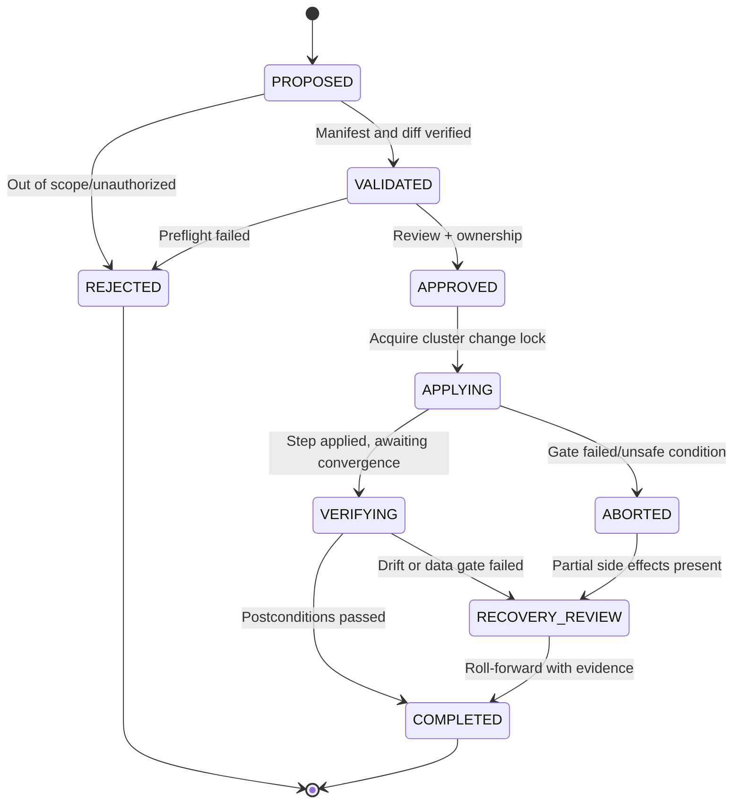
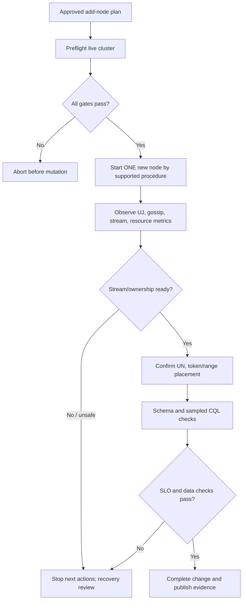
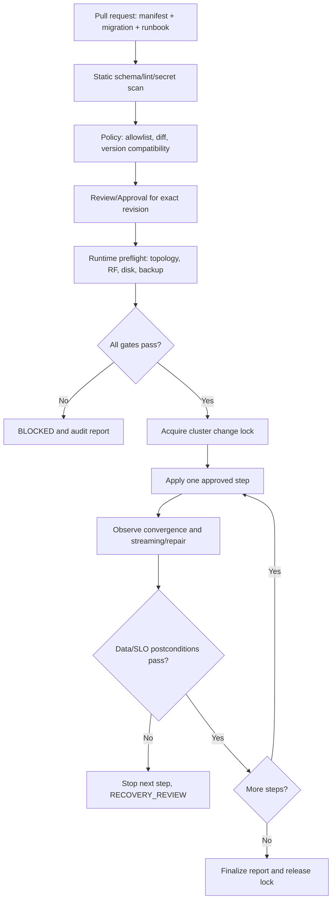

# Managing Configuration, Topology, and Changes with Auditable Workflows in Apache Cassandra

## 1. The problem: one configuration line can reshape the entire cluster

In the **DATABASE_ENGINE_WIDE_COLUMN_CASSANDRA** module, Apache Cassandra is studied as a **distributed wide-column** database management system: the **partition key** determines the token and the replica group storing the data; tables are designed around queries; and **replication factor (RF)** and **consistency level (CL)** govern read/write conditions. **Compaction, repair, streaming, and topology changes** interact with one another. From a Java application, the Java Driver must know the datacenter, coordinator, schema, and appropriate timeout/retry policies.

An operational outage sometimes starts from a seemingly tiny change:

- Changing the datacenter or rack in the snitch configuration without forecasting replica placement.
- Switching `NetworkTopologyStrategy` from RF=2 to RF=3 and assuming data is immediately replicated sufficiently.
- Adding a node with an incorrect broadcast address or internode certificate, causing bootstrap/streaming to stall.
- Increasing stream/compaction tasks when disk is already saturated, causing p99 latency to spike sharply.
- Increasing Java Driver retries to "reduce errors" and inadvertently triggering a retry storm when a replica is slow.
- Running `cleanup` on old nodes before confirming that streaming and ownership are complete.
- Someone editing `cassandra.yaml` via SSH while the IaC system still holds a different value; the next deployment restores the old configuration.

Therefore, **operations automation** is not simply putting `nodetool` commands into a script. It is about building **auditable change workflows with stop conditions, evidence, clear ownership, and appropriate recovery capabilities**.

### Learning objectives

After this lesson, you will be able to:

1. Classify **node configuration**, **topology/keyspace metadata**, **CQL schema**, and **Java Driver client configuration**.
2. Use Git/IaC as the source of truth, storing manifests, environment variables, and secrets within appropriate scopes.
3. Write **preflight checks** for version, node health, DC/rack, RF/CL, token ownership, disk, repair, and stream sessions.
4. Design a change plan following the states **PROPOSED → VALIDATED → APPROVED → APPLYING → VERIFYING → COMPLETED/ABORTED**.
5. Execute small changes step-by-step/canary with **gates** based on metrics and data.
6. Distinguish configuration file rollback from **roll-forward/topology recovery** when data has already streamed.
7. Verify schema/replication and read/write conditions using CQL/Java Driver, not just checking whether a port is open.
8. Collect complete artifacts (diffs, logs, metric snapshots, approvals, audit trail) for review and reproducibility.
9. Know when **not to automate** destructive actions or when DBA/on-call approval is required.
10. Create exercises and a checklist for a safe Cassandra change pipeline.

**Scope:** The examples are **models and labs**, not scripts authorized to mutate production automatically. Configuration syntax, restart/dynamic update behavior, `nodetool` commands, and repair/streaming algorithms may vary across Cassandra 3.x, 4.x, 5.x, or distributions. In real operations, always cross-check the **exact server version**, current topology, and the operations team's SOPs.

## 2. Four configuration layers: do not use one YAML file to explain everything

| Layer | Where stored / common tools | Examples | Risk if misconfigured |
| --- | --- | --- | --- |
| **Node/process** | `cassandra.yaml`, `cassandra-rackdc.properties`, JVM flags, cert/secret, service unit | `cluster_name`, seeds, listen/broadcast addresses, snitch, data paths | Node cannot gossip/stream; wrong identity, disk or memory saturation |
| **Cluster/topology** | Token ring/gossip/metadata, nodetool and supported orchestration | Add/replace/decommission/remove/rebuild, host IDs, node states | Insufficient replicas for data, conflicting range ownership |
| **Keyspace/schema** | Versioned CQL migrations | `NetworkTopologyStrategy` RF per DC, tables, partition key, compaction/TTL | Read/write CL cannot be satisfied, table does not match queries, data out of sync |
| **Client/service** | Spring Boot/Java Driver config, deployment descriptors | Local DC, CL, timeout, retry, page size, pool | Retry storm, wrong-DC routing, altered consistency contract |

**Do not equate "config applied" with "system converged."** Editing a node's YAML is only **one step**; ring membership, replication, SSTable placement, schema agreement, and read correctness may require time and separate procedures.

### 2.1. Desired, applied, and observed values

A workflow needs to record three columns:

| State | Example | Evidence |
| --- | --- | --- |
| **Desired** | New node belongs to `dc1/rack3`, keyspace RF=3 | Reviewed Git manifest |
| **Applied** | Service config deployed, CQL migration returned success | Deployment log and change ID |
| **Observed** | `system.local` returns `dc1/rack3`, token ranges/replicas are correct, `nodetool status` shows `UN` | CQL, nodetool, metrics from multiple nodes |

Differences between these columns represent **configuration drift**, or a change that is still in the convergence phase. Automation must distinguish the two cases and never mark COMPLETED solely because an apply API returned HTTP 200.

## 3. Source of truth: GitOps/IaC with versioned immutable configuration

### 3.1. What should be stored in Git

- Cluster name and environment: lab/staging/production.
- Server version/image **digest**, expected node count, DC/rack plan, and resources.
- Node config templates (without passwords or private keys).
- Keyspace/schema migrations and migration version state.
- Application query/CL contracts and Java Driver profiles.
- Operational thresholds: disk headroom, latency, timeout, repair/stream readiness.
- Change workflow, preflight logic, and postcondition checks.
- Backup/snapshot/restore SOPs and data owners.
- Approval checklist, rollback/roll-forward plan.
- Change event metadata: change ID, commit SHA, ticket, operator, timestamps.

### 3.2. What must not be stored in Git in plaintext

- Cassandra account passwords/tokens, private keys, keystore passwords.
- TLS private keys, secret environment variables, service credentials.
- Synthetic test data mixed with real customer data or payment tokens.
- Full production config dumps if they contain secrets or restricted internal IPs.

Use the existing secret manager/config injection system, store only the **secret reference/version**, and do not log secret values. Do not use base64 encoding as secret "protection."

### 3.3. Which artifacts belong to a change?

```text
Change request CR-CASS-2026-041
  Git commit SHA             → desired state
  Reviewed diff              → what changes
  Validation report          → preflight checks
  Operator approval          → who authorized
  Deployment step logs       → when/where applied
  Topology/replica snapshots → observed state
  CQL correctness checks     → data invariants
  SLO/error metrics          → service impact
  Recovery record            → rolled forward/aborted
```

A change management table outside Git can store approvals and audits, but it must be **linked** to the exact commit and artifacts. Avoid a "change RF" ticket without the deployed config/schema version.

## 4. Invariants to preserve before, during, and after a change

### 4.1. Data invariants

1. Every partition has **replica placement** matching the RF and DC/rack plan once topology stabilizes.
2. Never remove the **last remaining copy** of a token range before streaming/recovery is fully confirmed.
3. Never change a table's primary key by editing an annotation and assuming SSTables automatically re-partition.
4. Never lower `gc_grace_seconds` or delete tombstones just to speed up migration without proof of repair safety.
5. Writes that time out must be treated as **UNKNOWN** until reconciled; never drop logical request IDs.
6. A schema migration must never be marked complete when only part of the DDL executed.

### 4.2. Topology invariants

- Nodes have consistent **host identity** and token assignment; no two nodes are managed as one identity owning similar ranges.
- Before any destructive change, inspect the **actual node** and views from multiple peers, not just the IP/name in inventory.
- An active topology mutation must be managed as a **stateful operation**, without randomly starting a second mutation.
- RF and node count/placement can satisfy the application's consistency requirements.
- Never change DC/rack/snitch without a **migration plan** for replica placement.
- Never reduce capacity below safe thresholds during decommission.

### 4.3. Service invariants

- SLO p95/p99, error/timeout rate, and retry amplification do not breach the change gate for too long.
- Application traffic does not surge past processing capacity while bootstrap/repair/streaming is running.
- Java Driver `local-datacenter` and execution profiles match the actual DC.
- Health checks must use synthetic queries, be rate-limited, and never generate destructive load.
- If CL needs to be lowered, that is a **consistency contract change** requiring separate review; it is not a default "self-healing" action.

## 5. Sample change manifest for review, not a self-executing script

A change request can be stored in YAML as follows:

```yaml
apiVersion: ops.example.org/v1
kind: CassandraChangeRequest
metadata:
  changeId: CR-CASS-2026-041
  environment: isolated-lab
  gitCommit: "<full-sha>"
  requestedBy: "<team-or-operator>"
  approvedBy: []
  requestedAtUtc: "2026-11-21T02:00:00Z"

scope:
  clusterId: cassandra-lab-dc1
  keyspaces:
    - commerce
  operations:
    - bootstrap_one_node
  maxConcurrentTopologyChanges: 1

desired:
  cassandraImageDigest: "<pinned-digest>"
  datacenter: dc1
  rack: rack3
  expectedNodeCountBefore: 3
  expectedNodeCountAfter: 4
  keyspaceReplication:
    class: NetworkTopologyStrategy
    dc1: 3
  clientConsistency:
    reads: LOCAL_QUORUM
    writes: LOCAL_QUORUM

preflight:
  requireSchemaAgreement: true
  requireNoRunningTopologyOperation: true
  requireNoFailedRepairSessions: true
  requireDiskHeadroomFraction: 0.30
  requireAllExpectedNodesUp: true
  requireBackupReadinessEvidence: true
  maxClientErrorRate: 0.01

execution:
  strategy: one_node_at_a_time
  canaryNodeAlias: node-new-04
  maxChangeDurationMinutes: 120
  abortOnUnexpectedNodeDown: true
  abortOnReplicaCoverageRegression: true
  logEveryStep: true

postconditions:
  nodeState: UN
  expectedSchemaVersion: "<migration-version>"
  requireReplicaPlacementVerified: true
  requireNoFailedStreams: true
  requireSyntheticCqlReadAtPlannedCL: true
  requireSloWithinBudget: true

recovery:
  kind: operator_reviewed_roll_forward
  ticket: "<runbook-or-incident-id>"
  destructiveRollbackAllowed: false
```

This is a **learning contract template**, **not a Kubernetes CRD or a format natively recognized by Cassandra tools**. Any controller/pipeline wishing to use it must define its own schema validation, policy, authentication, secret handling, state transitions, and execution logic **for the exact server version**. Do not copy `maxClientErrorRate: 0.01` as a default production threshold: it is an illustrative value that must be chosen based on the application's error budget.

**Distinguishing the fields:**

- `desired`: target state to reach.
- `preflight`: conditions required to be **allowed** to start.
- `execution`: rollout order and stop conditions.
- `postconditions`: evidence required to **declare** completion.
- `recovery`: handling path if an error occurs. For topology data movement, **roll-forward/recovery** is usually required; there is no safe "undo" button.

## 6. Classifying changes: reloadable, restart required, or data-affecting?

Not every Cassandra parameter can be changed at runtime, and not every change requires a restart. Do not apply a single generic table across all versions.

| Change type | Examples | Approach |
| --- | --- | --- |
| Process config requiring restart | Certain listen/broadcast/TLS/JVM or storage options depending on version | Rolling restart with per-node verification |
| Runtime parameter with corresponding API | Certain throughput/throttling settings depending on version | Verify API support, capture before/after |
| CQL schema | `CREATE TABLE`, `ALTER TABLE`, table options | Versioned migration; verify schema agreement and query contract |
| Replication metadata | `ALTER KEYSPACE ... replication` | Separate data/replica migration project; do not treat DDL success as data moved |
| Topology mutation | Add/replace/decommission/remove/rebuild | Version-specific SOP, token/range/state tracking, stream verification |
| Java Driver config | CL, timeout, retry, pool, local DC | Canary service rollout, monitor request attempts and errors |
| Secret/certificate rotation | Internode/client TLS, auth | Overlap/compatibility procedure verifying handshakes |
| Repair schedule | Full/incremental repair coverage | Gated scope/schedule execution, verify history and tombstone safety |

**Always check the reference configuration and administrative commands of the running version.** A setting supported at runtime in one release cannot automatically be changed without restart in another.

### 6.1. Node configuration example as a template

The following snippet **only illustrates fields you may encounter** in `cassandra.yaml`/rackdc config, not a complete file:

```yaml
# cassandra.yaml — conceptual values requiring audit only
cluster_name: "cassandra-lab-dc1"
num_tokens: 16
endpoint_snitch: GossipingPropertyFileSnitch

listen_address: "10.0.0.11"
rpc_address: "0.0.0.0"

seed_provider:
  - class_name: org.apache.cassandra.locator.SimpleSeedProvider
    parameters:
      - seeds: "10.0.0.11,10.0.0.12"

# data_file_directories, commitlog_directory, encryption_options,
# authenticator, authorizer, and limits must be declared appropriately
# per version and environment; do not rely on this snippet to start a node.
```

Example `cassandra-rackdc.properties`:

```properties
dc=dc1
rack=rack1
```

**Guardrails:**

- `listen_address`/broadcast values, seeds, snitch, and DC/rack must be managed **per node**; never deploy a single static file containing node A's IP across all nodes.
- `seeds` assist gossip discovery; they are **not** a list of all replicas or a way to remove a node from the ring.
- `rpc_address=0.0.0.0` is a bind-all form in a controlled environment and must not be treated as a safe public exposure decision.
- `num_tokens` must not be arbitrarily changed on an existing node; token ownership belongs to a topology/data migration procedure.
- Defaults/JVM flags/`endpoint_snitch` and metadata mechanisms vary by version; record **observed** values after deployment.
- Never place credentials or TLS private keys in config templates or Git.

## 7. Keyspace replication and CQL schema are data-affecting configurations

### 7.1. RF=3 keyspace template for a multi-node testbed

Assume the testbed has **at least three replica-capable nodes** in `dc1`:

```sql
CREATE KEYSPACE IF NOT EXISTS commerce
WITH replication = {
    'class': 'NetworkTopologyStrategy',
    'dc1': 3
}
AND durable_writes = true;
```

With RF(dc1)=3, `LOCAL_QUORUM` requires two replica responses according to CL semantics in the local DC:

\[
\left\lfloor\frac{3}{2}\right\rfloor+1=2
\]

On a **single RF=1 node** for Java/CQL testing, `LOCAL_QUORUM` only needs one replica; you **cannot conclude** it tolerates one node DOWN like RF=3.

### 7.2. Changing RF does not mean data moves immediately

Suppose RF is changed from 2 to 3:

```sql
-- DDL illustration only, DO NOT run in production
-- without a migration/recovery plan and approval.
ALTER KEYSPACE commerce
WITH replication = {
    'class': 'NetworkTopologyStrategy',
    'dc1': 3
};
```

After `ALTER KEYSPACE`, replication metadata changes; **additional data on the new replicas must be distributed/repaired/rebuilt using the version-specific procedure**. Do not mark completion simply because the DDL statement returned success.

A proper procedure must record:

1. RF, node/DC/rack, and ownership **before** the change.
2. Capacity and data sources to serve the new RF.
3. Repair/range sync plan supported by the server version.
4. Resource limits during execution.
5. Data/repair state after the change.
6. Sufficient replicas satisfying application CL and verification queries.
7. When the new client CL rollout is permitted.

**Reducing RF** is even more sensitive: cleanup/replica-removal operations must have safety proofs and backup/restore policies, never a blind "delete extra data" command without coverage verification.

### 7.3. CQL tables are designed around queries

For example, a service needs to read orders by ID and list them by customer:

```sql
CREATE TABLE IF NOT EXISTS commerce.orders_by_id (
    order_id uuid PRIMARY KEY,
    customer_id uuid,
    state text,
    total_minor bigint,
    created_at timestamp
);

CREATE TABLE IF NOT EXISTS commerce.orders_by_customer (
    customer_id uuid,
    created_at timestamp,
    order_id uuid,
    state text,
    total_minor bigint,
    PRIMARY KEY ((customer_id), created_at, order_id)
) WITH CLUSTERING ORDER BY (created_at DESC, order_id ASC);
```

A primary key change cannot be "fixed" by editing `@PrimaryKeyColumn` in Java. It may require **a new table, dual writes, backfill, validation, cutover, and gated cleanup**.

**Do not use `ALLOW FILTERING` in a repository as a shortcut to avoid data migration.** A query that "passes" with a few rows in a lab does not prove stability with large partitions or hot keys.

## 8. Topology baseline: what must be measured before any operation

Before scaling nodes up/down or changing RF, collect snapshots **from multiple nodes**:

```bash
nodetool status
nodetool describecluster
nodetool info
nodetool netstats
nodetool tpstats
nodetool compactionstats
nodetool gossipinfo
```

When table-specific details are needed:

```bash
nodetool tablestats commerce.orders_by_id
nodetool tablehistograms commerce orders_by_id
```

Command names and output formats may vary by version. These commands are **observational**, yet they still carry JMX/log/output overhead; avoid high-frequency polling across all nodes when the cluster is overloaded.

### 8.1. Inspecting schema and metadata with CQL

```sql
SELECT keyspace_name, replication, durable_writes
FROM system_schema.keyspaces
WHERE keyspace_name = 'commerce';

SELECT table_name, compaction, compression
FROM system_schema.tables
WHERE keyspace_name = 'commerce';

SELECT host_id, cluster_name, data_center, rack, release_version
FROM system.local;
```

`system.local` reflects the **connected node**, not proof that the entire cluster shares the same version/DC. Collect per-node views/metrics as well; do not assume `system.peers`/`system.peers_v2` are identical across releases.

### 8.2. Invariants when evaluating the baseline

| Check | Question | Do not jump to conclusions |
| --- | --- | --- |
| Membership | Are all expected nodes `UN`? | `UN` does not prove every replica holds full data |
| Schema | Do nodes agree on schema? | Schema agreement does not mean streaming has finished |
| RF/CL | Are keyspace/DC RF and service CL aligned? | CQL success does not prove RF suffices when a node is DOWN |
| Token ranges | Are planned replicas/ownership clear? | Do not infer from IP order or hostname |
| Network | Are internode paths/TLS healthy? | Client port 9042 working does not prove streaming works |
| Disk | Do source and destination have headroom? | "10% free disk" is not a universal safe threshold |
| Background work | Are there no conflicting topology/repair tasks? | An empty `netstats` snapshot could still have repair validation running |
| Application | Are error rate, p95/p99, and retries within SLO? | Do not look only at success percentage |

### 8.3. When the baseline fails

Automation should **fail closed** before destructive changes if:

- There is an unplanned DOWN node or significant peer view disagreement.
- There is an unresolved failed/pending topology mutation or repair session.
- Replica sources for affected ranges cannot be determined.
- Disk/network is overloaded or lacks headroom for streaming/compaction.
- RF/CL and DC/rack are invalid for the target state.
- Mandatory backup/restore readiness evidence is missing.
- Migration state or schema drift cannot be explained.
- Application error budget is nearly exhausted, making another change high-risk.

"Fail closed" means **do not start the next operation**, not that the existing system must automatically shut down.

## 9. A change is a checked state machine, not a shell script



### 9.1. States and corresponding evidence

| State | What is established? | Allowed actions |
| --- | --- | --- |
| `PROPOSED` | Intent, diff, scope | Validate; do not change topology yet |
| `VALIDATED` | Static checks, preflight plan | Request approval |
| `APPROVED` | Authorization, runbook, change window | Acquire lock and apply first step |
| `APPLYING` | One stateful operation running | Bounded polling, stop on gate failure |
| `VERIFYING` | Apply response received, awaiting observed convergence | Read-only checks, semantic validation |
| `COMPLETED` | Evidence satisfies all postconditions | Release lock/report |
| `ABORTED` | Stopped applying new steps | Isolate partial effects |
| `RECOVERY_REVIEW` | Safe rollback unknown | DBA/on-call decides version-specific recovery |

**Do not** change `ABORTED` to "ROLLBACK COMPLETE" just because a config file was reverted. If data movement, repair, or metadata changes occurred, data ownership and client correctness must be proven.

### 9.2. Automation idempotency

A pipeline may be retried when an API caller times out. Requirements:

- Every change has a **unique change ID** and immutable commit SHA.
- Before each step, check **observed state**: if the postcondition is already met, do not re-run the destructive command.
- Never automatically replay `decommission`/`removenode`/`replace` when the outcome of the first attempt is unknown.
- Persist step status and external operation/session IDs before transitioning state.
- Use a cluster-scoped lock with lease/fencing to prevent two controllers from mutating topology concurrently.
- When a worker/controller crashes, **reconcile state first** rather than blindly executing the next step from an old log.

An **idempotent API call** does not guarantee cluster-level operation idempotency if a command had unconfirmed side effects.

## 10. Preflight checks: layered policy

A change pipeline should enforce separate validation layers:

### 10.1. Static validation

- YAML/JSON conforms to schema; required fields are present, unknown fields are rejected.
- Environment ID and target cluster match the allowlist.
- Version/image digest is pinned; `latest` is disallowed.
- Config values are valid in type and range.
- Template variables are resolved; no placeholders or plaintext secrets remain.
- Diff changes only approved fields; detect unrelated edits.
- Manifest `desired RF` is compatible with the node/DC/rack counts in the plan.
- Runbook and approval are present if the operation can delete or move data.

### 10.2. Runtime validation

- Read node version/DC/rack/status/token ownership.
- Read observed replication/schema; compare against expected.
- Confirm **no** other topology change or unexplained pending repair is active.
- Check free disk **on both source and destination**, internode network/TLS, and CPU/GC.
- Check application errors and retries prior to the change.
- Verify backup/restore procedure and data safety evidence.
- Identify which ranges/partitions are affected, who owns them, and who is expected to receive them.
- Confirm synchronized UTC clocks/timestamps accurate enough for auditing.

### 10.3. Dynamic gates during apply

During each step, periodically check:

```text
If unexpected node DOWN:
    STOP scheduling new topology actions
    record incident + peer views
    enter RECOVERY_REVIEW

If disk headroom below approved threshold:
    STOP scaling/decommission operation as appropriate
    do not cleanup data blindly
    request capacity mitigation

If stream/repair progress stalled beyond time budget:
    inspect phase and source/destination logs
    do not auto rerun destructive command

If p99/error budget violated:
    reduce nonessential load/traffic according to SOP
    block next step and request operator decision
```

This is **policy pseudocode**, not real control commands. Already-running activities must be handled safely; STOP scheduling **does not mean** killing the Cassandra process or aborting streaming arbitrarily.

## 11. Approvals and least privilege by change type

| Risk level | Examples | Recommended approval / privilege |
| --- | --- | --- |
| Low, observational | Snapshot metrics, read config/schema | Read-only operator/service account |
| Medium, config-revertible | Adjust query timeout/profile after canary | Service owner + on-call, rollback tested |
| High, data movement required | Add node, increase RF, rebuild, table migration | DBA/platform owner, capacity and recovery review |
| Very high, destructive | Decommission/removenode/replace/cleanup, reduce RF | Multi-party approval, manual gate, source data protection |
| Emergency | Recovery during replica/network loss | Incident commander, documented break-glass, audit |

CQL permissions, JMX, and system privileges must be scoped to their exact purpose. Do not grant Cassandra superuser and root SSH to every CI job just so it "can run everything." A pipeline that only collects metrics should **not** have `DROP KEYSPACE` privileges.

### 11.1. Four-eyes principle and separation of duties

One person may propose a change; another reviews live state, capacity, and recovery plans. In strict environments, the pipeline executes under a service account, while destructive steps require a **manual gate with recorded identity**.

Approvals must reference the exact commit SHA and manifest checksum. If the plan changes after approval, affected parts must be re-reviewed; do not allow "approve once, deploy a different file."

## 12. Scenario A: controlled single-node addition (bootstrap)

### 12.1. Preconditions before adding a node

Suppose a 3-node cluster in `dc1` with RF=3 wants to add a 4th node to improve capacity. This step **does not** change RF by default and does not give every partition 4 replicas.

Preflight:

1. Planned DC/rack, IP identity, tokens/vnodes, and storage capacity of the new node.
2. Existing nodes are all healthy enough to serve as streaming sources.
3. Sufficient **disk/network headroom** on source and destination; estimate bytes/ranges.
4. No unresolved failed/pending topology or repair sessions.
5. Seeds and internode TLS allow the new node to gossip/stream.
6. New node uses compatible version/config for the cluster; no unplanned mixed-version deployment.
7. Baseline application errors/p99, RF/CL, and current replica placement captured.
8. Gating/stop conditions, backup/restore, and incident owner defined.

### 12.2. Step-by-step apply



While the node is `UJ`:

- `nodetool netstats` observes incoming/outgoing streams at **both source and destination**.
- `nodetool tpstats/compactionstats` checks queue/I/O pressure.
- Node logs distinguish bootstrap phase, gossip/schema, and stream completion.
- Cluster metrics show p95/p99, dropped messages, GC, and disk.
- Automation **does not** add a second node before the first node's postconditions pass.

### 12.3. Completion criteria

- New node is `UN` across multiple peer views appropriate to the version.
- Expected token/range ownership and RF placement are correct.
- No related failed/incomplete stream sessions remain.
- Schema/client metadata have converged.
- Synthetic sample CQL reads/writes at the production CL contract succeed.
- Application latency/error rates return within bounds.
- No unresolved unknown writes remain from the operation window.

**Do not run `cleanup` before verification completes.** Cleanup removes local data outside ownership and must run according to plan only after data is safe and only on appropriate nodes.

## 13. Scenario B: decommissioning a node without causing under-replication

### 13.1. Why decommission is riskier than reducing replicas on paper

Decommissioning a healthy node requires handing off its owned ranges properly. When RF=3 in a DC that would drop to only **two nodes**, three replicas cannot be placed on three distinct nodes as specified. Therefore, before scaling down, node count and post-change capacity must be checked.

For example, a 4-node DC1 RF=3 cluster scaling down to 3 nodes:

1. Verify the remaining 3 nodes satisfy capacity and rack constraints.
2. Record token/range placement before and expected placement after.
3. Verify existing replicas, source data, and receiver disk headroom.
4. Ensure the leaving node is healthy and able to stream.
5. Protect client availability/SLO during departure.
6. Schedule only **one decommission** at a time.

### 13.2. Decommission is a phased change

- Seeing `UL` does not prove failure.
- `netstats` may still be sending streams.
- Once streaming completes, metadata must converge and data placement must be verified.
- A leaving node that goes DOWN mid-operation requires a **reviewed recovery path**, not automatic switching to `removenode`.
- Never "free disk" by deleting source SSTables before ranges have been handed off.

### 13.3. There is no one-step rollback

If decommission has already distributed data and altered ring metadata, reverting one line in inventory will not restore the node to the exact prior topology. It may require **roll-forward** to finish decommission or a new operation to bootstrap/rejoin the node per SOP; that is a separate, risky change requiring data verification.

## 14. Scenario C: replacing or removing a failed node

### 14.1. Distinguish states requiring proof

| Situation | Potentially appropriate action | Conditions to verify |
| --- | --- | --- |
| Node temporarily DOWN, recoverable | Fix network/disk/process per runbook | Do not treat as permanently lost |
| Failed node needing replacement | Version-supported replace | Host identity/token semantics, old node not running concurrently |
| Dead node needing ring removal | Removenode per SOP | Sufficient replicas/sources remain to rebuild ranges |
| Node in new DC needing data | Rebuild per plan | Source DC/ranges, RF, and stream readiness |
| Healthy node leaving as planned | Decommission | Data handoff and capacity verified |

**Do not automatically select `removenode` simply because `nodetool status` shows `DN` for a few minutes.** Gossip/network may be partitioned; the node could still be alive and holding critical replicas.

### 14.2. Protecting identity and ownership

- Use **host ID/token/peer metadata** to identify a node, not IP alone.
- Do not start the old node after the replacement identity is applied if SOP requires it to remain stopped.
- Do not copy raw system keyspace/data directories to a new node outside standard procedures.
- Do not run two controllers concurrently replacing/removing the same node.
- Never issue "assassinate"/forced metadata removal as an automatic reaction to an alert.
- Data verification and repair coverage are required after topology recovery.

### 14.3. Pipeline state after failure

A workflow encountering an error during replacement must not automatically transition to `FAILED_CLEAN`. It may belong in `RECOVERY_REVIEW` because partial streaming or metadata changes occurred. When safe rollback cannot be proven, record **partial state, session IDs, current replica status, and owner**, then escalate.

## 15. Scenario D: changing DC/rack or replication strategy

Changing a node's rack/DC is not just relabeling. `NetworkTopologyStrategy` selects replicas based on DC/rack placement; if the plan fails to check token ring/replica placement, data may be misplaced and CL affected.

### 15.1. Questions that must be answered

1. Why change DC/rack? Infrastructure migration or adding a new DC?
2. Which procedure does the Cassandra Server version support?
3. Is data rebuild/migration from the old DC to the new DC required?
4. What is the per-DC RF after the change; are node/rack counts suitable?
5. Do Java Driver `local-datacenter` and traffic routing change?
6. How must secrets/certificates/network paths between DCs change?
7. What is the sequence for changing RF, data, client CL, and cutover?
8. Is there a rollback/roll-forward plan if a new DC lacks complete data?

**Never simply edit `dc=dc2` in `cassandra-rackdc.properties` on a serving node and restart** to consider the node safely moved across DCs. This is a planned topology/data migration.

### 15.2. Read/Write CL and rollout

For multi-DC:

- `LOCAL_QUORUM` depends on the RF of the **local DC** used by the application.
- `QUORUM` has cluster-wide scope and may incur cross-DC latency.
- `EACH_QUORUM` enforces conditions in every DC.
- `LOCAL_ONE` is a different consistency contract from `LOCAL_QUORUM`.

When adding a DC, do not enable production reads in the new DC until data is ready and verified. Use synthetic correctness probes, metrics, and canary request routing.

## 16. Scenario E: auditable schema migrations

### 16.1. Migration does not mean transactional rollback

Cassandra DDL such as `CREATE TABLE`, `ALTER TABLE`, and `ALTER KEYSPACE` **is not a multi-statement auto-rolling-back transaction**. If the third migration step fails, the first two steps may already be applied.

A migration runner must record:

- Migration version/order and **checksum**.
- Each submitted DDL statement and its terminal result.
- Schema agreement and expected table/column/primary key after apply.
- Version registry/ledger and state **IN_PROGRESS / COMPLETED / FAILED**.
- A **forward-fix** procedure when schema is partially altered.
- Read compatibility between old and new application versions during rollout.

### 16.2. `IF NOT EXISTS` does not prevent schema drift

```sql
CREATE TABLE IF NOT EXISTS commerce.orders_by_id (
    order_id uuid PRIMARY KEY,
    state text
);
```

If the table exists with a different schema, `IF NOT EXISTS` may suppress a name collision error **without confirming the columns/primary key match**. Run expected-schema checks or sample prepared statements. For schema deployments, inspect **observed state** rather than relying on exit codes.

### 16.3. Expand–migrate–contract for data models

Suppose you want to migrate from `orders_by_id` to a new table with a different key:

1. **Expand:** create the new table and add reader/writer compatibility in the app.
2. **Migrate:** backfill data using cursors/checkpoints, bounded concurrency, idempotent writes, and metrics.
3. **Dual-write or projection:** maintain both tables during the cutover window, with reconciliation for partial failures.
4. **Validate:** compare counts by partitions/IDs, query semantics, and sample full rows; not just total count.
5. **Cutover:** enable the new reader via canary, measuring p99/errors and correctness.
6. **Contract:** deprecate/drop the old table only after retention/backup/owner approval and proof that no consumers remain.
7. **Document:** schema versions, request IDs, exceptions, and rollback/roll-forward boundaries.

Do not use `ALLOW FILTERING` to avoid migration when a new query does not fit the partition key.

## 17. Java Driver: application config must also go through the change pipeline

### 17.1. Parameters affecting availability

| Parameter | Required control |
| --- | --- |
| `local-datacenter` | Matches actual DC and topology strategy |
| Contact points | Sufficient for bootstrap/discovery; do not hardcode removed nodes |
| Request timeout | Aligned with SLO; distinguish server-side vs driver timeout |
| Consistency | Matches business requirements and per-DC RF |
| Serial consistency | Present in LWT/CAS contracts |
| Retry policy | Bounded attempts, backoff/jitter, avoid retry storms |
| Speculative execution | Only for idempotent operations with performance evidence |
| Page size | Do not equate with `LIMIT` or rows per partition |
| Pool/in-flight limits | Protect driver/network/server during topology instability |
| Prepared statements/schema metadata | Refresh after migration/cutover as appropriate |
| TLS/auth | Never disable authentication to "fix" connection errors |

### 17.2. Example service using explicit CL and timeout

```java
import java.time.Duration;
import java.util.UUID;

import com.datastax.oss.driver.api.core.CqlSession;
import com.datastax.oss.driver.api.core.DefaultConsistencyLevel;
import com.datastax.oss.driver.api.core.cql.PreparedStatement;
import com.datastax.oss.driver.api.core.cql.Row;

public final class OrderProbe {

    private final CqlSession session;
    private final PreparedStatement select;

    public OrderProbe(CqlSession session) {
        this.session = session;
        this.select = session.prepare(
            "SELECT order_id, state FROM commerce.orders_by_id " +
            "WHERE order_id = ?");
    }

    public boolean check(UUID syntheticOrderId) {
        try {
            Row row = session.execute(
                select.bind(syntheticOrderId)
                    .setConsistencyLevel(
                        DefaultConsistencyLevel.LOCAL_QUORUM)
                    .setTimeout(Duration.ofSeconds(2))
                    .setIdempotent(true))
                .one();

            return row != null
                && syntheticOrderId.equals(row.getUuid("order_id"))
                && row.getString("state") != null;

        } catch (RuntimeException error) {
            // Production: structured metrics / alert classification.
            // A timeout is an error; never turn it into "row does not exist".
            return false;
        }
    }
}
```

This snippet assumes `commerce.orders_by_id` exists and `syntheticOrderId` corresponds to a safe fixture. `LOCAL_QUORUM` is appropriate **only when RF/topology/contract are valid**. This probe must be rate-limited and must not reuse the same single key if verifying token ranges across multiple replicas.

**One passing probe does not prove the whole cluster is healthy.** Multiple representative ranges must be checked alongside cluster-level repair/stream readiness gates.

### 17.3. Java Driver metadata to cross-check topology

```java
import java.util.Map;
import java.util.UUID;

import com.datastax.oss.driver.api.core.CqlSession;
import com.datastax.oss.driver.api.core.metadata.Node;

public final class TopologyReadback {

    public static void print(CqlSession session) {
        boolean schemaAgreed = session.checkSchemaAgreement();
        System.out.println("schemaAgreement=" + schemaAgreed);

        Map<UUID, Node> nodes =
            session.getMetadata().getNodes();

        for (Map.Entry<UUID, Node> entry : nodes.entrySet()) {
            Node node = entry.getValue();

            System.out.printf(
                "id=%s dc=%s rack=%s state=%s endpoint=%s%n",
                entry.getKey(),
                node.getDatacenter(),
                node.getRack(),
                node.getState(),
                node.getEndPoint());
        }
    }
}
```

**Driver metadata is a client-side view**; it may be refreshing or lagging behind the actual ring. It does not replace `nodetool`, server logs, or observed replica placement. Calling `checkSchemaAgreement()` also does **not** verify that SSTables have finished streaming.

### 17.4. Multi-layer readiness verification

```text
1. TCP/native protocol reachable?
2. CqlSession can establish local-DC session?
3. Metadata/schema expected and agreed?
4. Synthetic partition-key CQL read at planned CL passes?
5. Token/replica coverage and stream/repair status healthy?
6. Error rate, p95/p99, retry amplification back in bounds?
7. Outstanding UNKNOWN writes reconciled or tracked?
```

Only when all gates **required for that change type** pass should COMPLETED be recorded. Do not turn `SELECT COUNT(*)` on a wide table into a health probe or auto-trigger repair every time readiness fails.

## 18. Checking configuration drift: desired vs observed

### 18.1. Three types of drift

1. **File drift:** runtime file differs from Git template; someone edited via SSH or an IaC rollout failed.
2. **Runtime drift:** file matches, but the running process uses old config, environment overrides, flags, or cached state.
3. **Semantic drift:** config/DDL is applied, yet topology/replication/data state does not match expectations.

Example:

```text
Git desired:
  keyspace RF dc1=3

Observed CQL:
  keyspace RF dc1=3

Observed topology:
  only 2 replica-capable nodes in dc1

Conclusion:
  Config value matches.
  Replica readiness/placement invariant FAIL.
  Change status cannot be COMPLETED.
```

A tool that only diffs `cassandra.yaml` will miss this case.

### 18.2. Drift detection workflow

- Capture the desired snapshot from the **reviewed commit SHA**.
- Capture the applied snapshot from the deployment controller and runtime process.
- Capture observed state from Cassandra metadata, nodetool, and CQL readback.
- Canonicalize order-independent fields (maps/sets) without normalizing away security-critical information.
- Compare against the allowlist and schema for the specific server version.
- Classify drift: **expected during rollout**, **unknown**, **unsafe**.
- Do not automatically "heal" via restart or node replacement if drift reflects unfinished membership/data movement.
- Escalate when topology diverges; self-heal only for fields proven safe and idempotent.

### 18.3. Fingerprints and artifacts

Canonical redacted/secret-free config can be hashed to detect unintended artifact changes. **Checksums do not validate correctness**: a byte-identical file where keyspace RF exceeds available nodes is still an invalid configuration.

## 19. Backup, repair, compaction, and resource gates in a change workflow

### 19.1. Backup readiness

Before topology data movement or destructive operations:

- Have a backup/snapshot plan and **verified restore** meeting RPO/RTO.
- Understand that backups do not automatically guarantee cross-table or cluster-wide consistency.
- Never implicitly treat a single node's snapshot as a complete cluster backup.
- Ensure data sources exist to recover affected token ranges if a node becomes unavailable.
- Enforce backup quotas, retention, and credentials without overwriting snapshots from other operations.
- Assign an owner responsible for recovery if the operation fails.

**A "backup completed" button is insufficient** if the ability to restore the corresponding data, DDL, and metadata has not been verified.

### 19.2. Repair readiness

- Know the full/incremental repair policy for your Cassandra version.
- Have no unexplained pending/failed sessions.
- Track scope: keyspace/table/ranges/participants; never call it "all repaired" when only one scope finished.
- Maintain a repair window well within tombstone grace safety where applicable.
- Never lower `gc_grace_seconds` just to purge tombstones.
- Never run wide-scope repair competing with bootstrap/decommission when the cluster lacks I/O headroom.
- Never manually delete SSTables or system metadata to "unblock" repair.

### 19.3. Compaction and disk gates

- Check `nodetool compactionstats`, disk utilization/latency, and temporary headroom.
- Account for incoming SSTables and compaction space per data model/strategy.
- Never apply one fixed disk threshold to every cluster; maintain a workload-approved policy.
- Never run `nodetool compact` as a default "fix" for slow streaming.
- Never increase compaction/stream throughput when I/O is saturated without evidence.

## 20. Bounded automation: pseudocode for a safe controller

A proper controller must not invoke destructive commands directly from raw input strings. It needs **policy validation, locking, observed state checks, and human gates**.

```text
function reconcileChange(change):
    require change.environment in APPROVED_ENVIRONMENTS
    require immutable(change.git_commit, change.manifest_checksum)
    require manifestSchemaValid(change)
    require approvalMatchesExactRevision(change)

    lock = acquireClusterScopedLease(change.cluster_id)
    if not lock:
        return WAITING_FOR_LOCK

    try:
        observed = readOnlySnapshotFromMultipleNodes()
        if not staticPolicyPasses(change):
            return REJECTED
        if not runtimePreflightPasses(change, observed):
            return BLOCKED_WITH_EVIDENCE

        for step in change.approved_steps:
            observed = readOnlySnapshotFromMultipleNodes()
            if step.postconditionAlreadySatisfied(observed):
                audit("already applied", step)
                continue

            if not step.preconditionPasses(observed):
                return RECOVERY_REVIEW

            if step.isDestructiveOrTopologyMutation:
                requireManualGateForThisStep(change, step)

            operationId = executeApprovedVersionSpecificStep(step)
            persist(operationId, step, UTC_TIMESTAMP)

            result = waitForBoundedObservedPostconditions(
                step, operationId, change.stop_conditions)

            if result.notSafe:
                blockAllFurtherMutations()
                auditAndEscalate(result)
                return RECOVERY_REVIEW

        if not dataAndSloVerificationPasses():
            return RECOVERY_REVIEW

        return COMPLETED_WITH_EVIDENCE

    finally:
        releaseLeaseIfOwner(lock)
```

**This pseudocode is not runnable automation** and intentionally omits `removenode`/`decommission` from an autonomous execution loop. In real implementations, a controller also requires:

- Lease/fencing semantics so two controllers are never authorized to mutate the cluster simultaneously.
- Authorization, auditing, and secret management.
- Crash recovery and reconciliation via operation IDs.
- API error handling, timeouts, and idempotency decisions.
- Quotas/timeout budgets that do not overload nodetool/JMX.
- Rollback/roll-forward plans **per operation type** and server version.
- Review for any step that could cause data loss.

### 20.1. Why is `operationId` needed?

An apply call may time out even though the cluster has already started streaming. If the controller only sees a timeout and replays the change, it may create **two overlapping topology operations**. Persist the operation/session ID, observe cluster state, and **reconcile** before retrying.

## 21. Guards against concurrent execution and serialization violations

Nothing guarantees two independent pipelines will automatically avoid each other:

- Pipeline A is bootstrapping a new node.
- Pipeline B is lowering RF or decommissioning a node.
- Pipeline C is running full repair.
- Pipeline D is deploying an app changing CL.

Even if each pipeline passed preflight independently, running simultaneously can create conditions far outside the design.

### 21.1. Locking and scheduling

- Enforce a **cluster-scoped lock** for topology mutations.
- Allow independent schema/app changes only after checking compatibility and confirming no freeze policy violation.
- While a change is in `VERIFYING`, do not release the lock early just because the apply command returned success.
- If the controller loses its lock/lease, **do not continue executing** destructive steps.
- Background repair/streaming tasks must count toward the capacity budget even if they do not hold the same lock.

### 21.2. Do not blindly retry every failure

| Failure | Safe to retry? | Conditions |
| --- | --- | --- |
| Read-only `nodetool status` timeout | Usually yes | Bounded retries + backoff, do not flood JMX |
| Synthetic read health query | Conditionally | Idempotent, rate-limited, semantics unchanged |
| Config apply via deployment API timeout | Must reconcile | Check desired/applied runtime state before retrying |
| CQL `ALTER KEYSPACE` timeout | Do not retry blindly | Inspect observed replication metadata/schema first |
| Bootstrap/decommission/removenode timeout | Do not retry blindly | Operation/host ID/stream state must be evaluated |
| Repair session failed | Per version SOP | Identify full/incremental/pending session/ranges |
| Cleanup interrupted | Per data SOP | Check ownership and SSTable safety first |
| WriteTimeout from application | Unknown outcome | Logical request ID, idempotency/reconciliation |

Automation retries are **distinct from** Java Driver retries. Both can amplify load if poorly coordinated.

## 22. Distinguishing rollback, abort, roll-forward, and restore

### 22.1. Four concepts

| Action | Meaning | Example |
| --- | --- | --- |
| **Abort before apply** | No side effects yet; safe to stop | Preflight fails due to insufficient disk |
| **Config rollback** | Revert a setting to an earlier version (if possible) | Revert timeout config after canary |
| **Roll-forward recovery** | Complete or repair partial state per SOP | Partially streamed bootstrap needing recovery |
| **Restore from backup** | Recover data from restorable artifacts | After unrecoverable loss of source data |

In Cassandra, **data movement is not transactional**. Rolling back a manifest does not reverse transferred SSTables, altered token ownership, or applied DDL.

### 22.2. When must automation stop?

Stop before the next mutation and escalate if:

- It is unclear which source replicas still hold required data.
- Host identity/token ownership is inconsistent.
- A node replacement is unfinished while the old node risks rejoining.
- Incremental repair leaves an unhandled version-specific pending session.
- Disk/source capacity is insufficient for recovery.
- A timeout makes it impossible to tell whether apply started.
- Data correctness read-back fails at the contracted CL.
- Recovery steps require delete/drop/removenode outside the approved scope.

**Never execute risky commands "to see if the system recovers on its own"**; when evidence is missing, report `RECOVERY_REVIEW` and preserve artifacts.

## 23. Git diff, policy-as-code, and checking "what actually changed?"

### 23.1. An illustrative diff

```diff
- max_client_requests_in_flight: 256
+ max_client_requests_in_flight: 128
```

This is an **illustrative internal manifest field**, not an official `cassandra.yaml` or Java Driver parameter name. Reviewers need to know:

- Does this cap the load generator, the app, or the Driver pool?
- Does it change SLOs or error budgets?
- Could it increase request queuing or timeouts?
- Was it tested beforehand on a representative workload?
- Is there a clear revert plan?

**Do not review purely by looking at numeric diffs** while ignoring where the setting applies and its semantics.

### 23.2. Policy to catch unintended changes

```yaml
policy:
  allowedChangeKinds:
    - java_driver_timeout
    - schema_add_nullable_column
    - bootstrap_one_node

  destructiveKindsRequireHumanApproval:
    - decommission_node
    - removenode
    - replace_node
    - drop_keyspace
    - cleanup_data
    - reduce_replication_factor

  rejectIf:
    - environment_not_allowlisted
    - git_revision_changed_after_approval
    - schema_drift_unexplained
    - topology_mutation_already_running
    - replica_coverage_not_proven
    - no_recovery_plan
```

This is a **policy template**; no engine understands these keys automatically. When using OPA/Gatekeeper, pipeline code, or internal tooling, you must clearly define the input schema and how observed state is fetched. Never allow an empty `approvedBy: []` field to be interpreted as "approved."

## 24. Which jobs belong in a deployment pipeline?



### 24.1. Separating CI and CD

- **CI:** validate manifest/migration/policy, test compatibility, lint, dry-run plan, run integration tests on ephemeral Cassandra.
- **CD:** inspect observed cluster, acquire lock, verify approval, apply approved step, measure actual outcome, retain audit.
- **Fault/integration tests:** multi-node staging cluster when RF/quorum/streaming/repair are needed; never claim a single RF=1 container substitutes.
- **Production:** never auto-inject faults to prove a release; use canary, progressive delivery, and rollback/roll-forward SOPs.

### 24.2. Never let tooling declare success from desired state alone

A CD job may print `Deployment successful` when the automation API returns success; that is **apply success**, not proof that the Cassandra cluster meets postconditions. The job should remain in `VERIFYING` until observed data, topology, and client gates pass.

## 25. Observing before/during/after: which numbers must be reported?

| Group | Snapshot / metric | Meaning |
| --- | --- | --- |
| Membership | `nodetool status` across nodes, topology mode `UN/UJ/UL/DN` | Is membership changing per plan? |
| Schema | Schema agreement, expected tables/keys | Are code and migration aligned? |
| Replication | Keyspace NTS RF per DC, replica placement | Is data coverage correct? |
| Streaming | `netstats` in/out, failures, bytes/files | Is data movement progressing? |
| Repair | Session ID, ranges, full/incremental/pending | Are replicas reconciled? |
| Resource | CPU, heap/GC, disk free/IOPS/latency, network | Is there enough headroom? |
| Client | p50/p95/p99, timeouts, retries, errors, rejected | Is the SLO breached? |
| Data correctness | Synthetic sample reads/writes at CL | Does the query contract still hold? |
| UNKNOWN writes | Logical operations without confirmed outcome | Is there risk of duplicate/lost effects? |
| Automation | Change ID, step states, operator, approvals, times | Is it auditable and reproducible? |

### 25.1. One snapshot is not enough

If `netstats` shows 75% at T0 and 75% at T+1 minute, it may simply be waiting on validation/compaction or throttling. Collect **multiple samples**, identify the exact session/phase, and cross-check logs on both ends, disk/network, and deadlines. Never conclude "stalled" from a single percentage reading.

### 25.2. Goodput and latency while the cluster is transitioning

- Count **logical operations** separately from retry/speculative attempts.
- Report **successful goodput** and error/timeout ratio; not just request attempts/s.
- Do not compute p99 only over successes while dropping timeouts.
- Keep measurement boundaries consistent: HTTP endpoint vs Driver request vs coordinator response.
- Keep page size, read/write CL, and request mix identical before and after.
- When adding a node shifts token placement, compare workloads with the same partition key / hot key distribution.

## 26. Change log and sample audit report

```yaml
changeId: CR-CASS-2026-041
environment: "isolated-lab"
sourceGitCommit: "<immutable-sha>"
manifestChecksum: "<sha256>"
operator: "<authorized-id>"

timeline:
  proposedAtUtc: "2026-11-21T02:00:00Z"
  approvedAtUtc: "<observed>"
  preflightAtUtc: "<observed>"
  applyStartedAtUtc: "<observed>"
  applyFinishedAtUtc: "<observed>"
  verificationFinishedAtUtc: "<observed>"

planned:
  kind: "bootstrap_one_node"
  targetNodeAlias: "node-new-04"
  targetDc: dc1
  targetRack: rack3

observedBefore:
  nodeCount: 3
  rfDc1: 3
  schemaAgreed: true
  failedStreamSessions: 0
  diskHeadroomFractionMin: "<measured>"

applied:
  deploymentOperationId: "<opaque-id>"
  serverVersion: "<pinned-version>"
  stepCount: 1
  failedSteps: 0

observedAfter:
  nodeCount: 4
  targetNodeState: "UN"
  schemaAgreed: true
  replicaPlacementVerified: "<boolean>"
  streamingComplete: "<boolean>"
  syntheticCqlChecksPass: "<boolean>"
  appErrorRate: "<measured>"
  appP99Ms: "<measured>"

decision:
  status: "VERIFYING"
  reason: "Waiting for final data checks"
  recoveryOwner: "<on-call>"
  artifacts:
    - "preflight.json"
    - "nodetool-before.txt"
    - "nodetool-after.txt"
    - "netstats-timeline.jsonl"
    - "metrics-histograms.json"
    - "data-probe-results.json"
```

Values in `<...>` and timestamps are **documentation template placeholders**, not measured numbers. `status: VERIFYING` is right when postcondition fields remain unverified; do not fill in `COMPLETED` merely because the node reached `UN` without data/SLO evidence.

**Artifacts to protect:** internal hostnames/IPs, credentials, sample data, and audit identities. For public reports, use appropriate aliases/hashes while preserving internal mapping for incident review.

## 27. Case study: IaC matches, yet RF/data is still wrong

### 27.1. Context

A 3-node cluster in `dc1` had keyspace `commerce` at RF=2. The team opened a PR changing RF=3. Automation executed `ALTER KEYSPACE`, received success, and marked `COMPLETED`. Later a node went down, application `LOCAL_QUORUM` operations timed out, and data in some partitions did not match expectations.

### 27.2. Missing steps

- Did not verify source replicas and capacity before increasing RF.
- Had no plan to repair/stream data to new replicas.
- Did not verify token/range data coverage.
- Marked completed based on CQL DDL success.
- Switched client CL before observed data was sufficient.
- Lacked postcondition read-back across partitions.

### 27.3. Correct workflow

1. Review the RF/topology plan with the DBA; identify source/target ranges and data migration.
2. Create an immutable manifest allowing `ALTER KEYSPACE` once preflight passes.
3. Record DDL success while keeping state in `APPLYING/VERIFYING`.
4. Run repair/data sync **according to the exact server version's guidance**; record session IDs and scope.
5. Verify RF metadata + replica placement + data correctness at CL.
6. Deploy the new client CL only after postconditions pass.
7. Monitor p99/timeouts/retry budget during the canary window.
8. Record the report and allow the change to complete.

### 27.4. Lesson

**Cassandra replication is a physical state with convergence time.** A desired YAML state may be valid while the cluster has not yet achieved the corresponding data placement. Only **evidence-based postconditions** make automation trustworthy.

## 28. Case study: two automations mutating topology concurrently

### 28.1. Context

Job A is bootstrapping node D into the cluster. Job B sees node C as `DN` and plans to run `removenode` on C. Job C is running full repair. All three passed individual preflights minutes apart.

### 28.2. Risks

- Bootstrap needs data from C, while `removenode` removes identity/source.
- Repair validation/streaming competes for I/O with bootstrap.
- Ring metadata shifts beneath all three controllers.
- RF/CL and app error rates can degrade unpredictably.
- If controller A times out, retrying bootstrap automatically can create overlapping operations.

### 28.3. Policy mitigation

- Cluster-scoped lock for topology mutations; only one operation in `APPLYING/VERIFYING`.
- Live preflight immediately before each step, never trusting stale results.
- Repair schedules check capacity and operation conflicts.
- When C is `DN`, classify network/gossip and verify the node before choosing `removenode`/`replace`.
- If A is partially streaming, stop only **new steps** and transition to `RECOVERY_REVIEW`; do not automatically abort/kill Cassandra.
- Persist per-step IDs, logs, and observed placement so the DBA can choose recovery.

## 29. Sample runbook: applying a configuration change safely

### Phase A — Proposal

1. Describe the **business reason**, query/load impact, and expectations.
2. Specify the exact target cluster/keyspace/nodes; enforce allowlisting.
3. Create a PR with manifest + config diff + versioned migrations if applicable.
4. Attach before-state, capacity, and backup/recovery evidence.
5. Classify impact: restart, CQL schema, RF change, or topology mutation.
6. Specify which data/key ranges may be affected.
7. Define abort gates and postconditions before apply.

### Phase B — Approval and preparation

1. Lint/schema validate; run secret scan and resolved dependency/config checks.
2. Review approval against the exact commit SHA and immutable manifest.
3. Snapshot node versions/host IDs/DC/rack/token ownership.
4. Check RF/CL, schema agreement, repair/stream state, and application SLO.
5. Check disk/network/CPU/GC headroom on source and destination.
6. Verify rollback/roll-forward SOPs; never promise "just revert YAML."
7. Acquire the cluster change lock; reject competing operations.

### Phase C — Step-by-step apply

1. Execute **one** approved, scoped step.
2. Persist operation/session ID and UTC timestamp.
3. Perform bounded polling, collecting observed state from multiple nodes.
4. Monitor stream/repair progress, membership, compaction, and app metrics.
5. If a gate fails, **stop scheduling subsequent steps** and escalate to review.
6. Do not automatically run another destructive operation to fix a failed step.

### Phase D — Post-change verification

1. Reconcile desired/applied/observed config.
2. Verify schema + replication + token/replica placement.
3. Ensure no related failed/incomplete streaming/repair sessions remain.
4. Pass representative synthetic CQL checks at the target CL.
5. Keep p95/p99, errors/retries, and foreground service load within gates.
6. Assign owners/reconcilers for any UNKNOWN writes.
7. Mark COMPLETED only when all evidence is gathered.

### Phase E — Audit and prevention

- Store manifest SHA, diff, approvals, logs/metrics/time series.
- Record versions/node IDs redacted to appropriate scope.
- Document the recovery plan used or why none was needed.
- Update automation tests and runbooks when new failure modes emerge.
- Do not delete failure artifacts simply because the change eventually went green.

## 30. Case-based exercises and solution hints

### Exercise 1 — Changing RF and stopping too early

A keyspace has RF=2; the team updates YAML to RF=3 and `ALTER KEYSPACE` succeeds. Automation marks COMPLETED.

1. What evidence is missing?
2. Why does RF metadata not prove new replicas hold the data?
3. Which gates are needed before switching clients to `LOCAL_QUORUM`?
4. If the repair session has not finished, what is the proper workflow state?

**Hint:** requires version-appropriate data sync/repair, token placement, stream/repair history, CL read-back, and SLO checks. Keep in `VERIFYING`/`RECOVERY_REVIEW`.

### Exercise 2 — Adding a node while disk is nearly full

A 3-node RF=3 cluster needs a 4th node. A source node has 8% free disk and heavy compaction running. The manifest sets max concurrency to one node.

1. Should bootstrap be allowed to start?
2. Which disk/compaction conditions must be checked?
3. Why can increasing stream throughput backfire?
4. When blocked, what artifacts must automation generate?

**Hint:** preflight fails closed or evaluates capacity per runbook; save observed disk, compaction backlog, projected bytes, and blocked reason.

### Exercise 3 — Two pipelines competing to mutate the ring

Pipeline A is bootstrapping; Pipeline B wants to decommission an old node because it sees `DN`.

1. What kind of lock is required?
2. Should B be allowed to execute because it was approved yesterday?
3. If A times out, should the bootstrap step be immediately re-run?
4. Which state is appropriate if the ring is in a partial state?

**Hint:** cluster-scoped lock/fencing, live preflight, reconcile operation IDs, `RECOVERY_REVIEW` when unclear.

### Exercise 4 — Editing `dc` on a production node

Someone moves a node from `dc1` to `dc2` by editing `cassandra-rackdc.properties` and restarting.

1. What can change regarding placement and CL?
2. Why must Driver `local-datacenter` be examined?
3. What migration plan is required?
4. Why might config rollback be insufficient?

**Hint:** DC/rack affects NTS replica placement; requires version-specific data movement/rebuild procedures and client routing rollout.

### Exercise 5 — Assuming `UN` means everything is done

A new node transitions from `UJ` to `UN`, yet `netstats` shows failed session logs and some synthetic reads time out.

1. Can the pipeline mark COMPLETED?
2. What data readiness evidence is missing?
3. What is the difference between membership and replica correctness?
4. If temporarily lowering CL to `LOCAL_ONE` turns probes green, is the issue fixed?

**Hint:** no; must verify failed streams, RF placement, CL contract, and timeouts. Lowering CL changes the contract rather than fixing the underlying issue.

### Exercise 6 — Changing App Driver retries

A PR increases retries and speculation; after canary, HTTP errors drop, but Cassandra dropped messages triple and p99 increases.

1. How do logical requests differ from CQL attempts?
2. Why can error rate alone be misleading?
3. What abort gate and recovery plan are appropriate?
4. Should every write be marked idempotent so it can be retried?

**Hint:** attempts amplify load; requires budgets, logs/tracking, per-operation idempotence, and no blind write retries.

### Exercise 7 — Editing files over SSH outside Git

A node's `cassandra.yaml` differs from desired Git. CI automatically reapplies and restarts while the node is streaming.

1. What type of drift is this?
2. Why is this style of auto-heal dangerous?
3. Which observed states must be checked?
4. What policy distinguishes safe drift from drift requiring manual review?

**Hint:** file/runtime/semantic drift, streaming/topology lock, restart phase gates.

### Exercise 8 — Decommission reducing capacity

A 4-node RF=3 cluster in DC1; the team wants to scale down to 2 nodes while keeping RF=3.

1. Is the plan valid under the three independent replicas requirement?
2. Why is a capacity/replica check needed before the step?
3. Does "decommission only one node at a time" fix the invalid RF on its own?
4. How should automation handle this plan?

**Hint:** insufficient nodes for RF=3; reject the plan before apply or require an architectural/contract change with review.

### Exercise 9 — Half-applied CQL migration

Migration V014 creates a new table, adds a column, and runs a backfill. The third step fails after the first two succeed.

1. Is there an automatic transactional rollback?
2. Why does reverting the Git commit not restore the cluster?
3. What per-step state must the runner store?
4. What does a safe forward-fix path include?

**Hint:** no multi-statement DDL rollback; persist migration state/checksum, inspect observed schema/data, idempotent repair/backfill and reconcile.

### Exercise 10 — One passing probe does not prove quorum

An RF=1 container passes `LOCAL_QUORUM` checks. The team claims production RF=3 can survive losing one replica.

1. Is the conclusion justified?
2. What environment and replica count are required?
3. What does the current probe actually prove?
4. Can a mocked repository replace distributed verification?

**Hint:** RF=1 quorum differs from RF=3; use multi-node RF=3 lab/staging and controlled fault testing.

### Exercise 11 — Lowering CL to mask errors

During bootstrap, `LOCAL_QUORUM` writes time out. Automation switches to `LOCAL_ONE` and records rollout success.

1. Is this a safe "self-healing" configuration?
2. How does it alter confirmation guarantees?
3. What approvals and postconditions are needed if the business genuinely permits a temporary downgrade?
4. What plan restores CL after recovery?

**Hint:** CL is a consistency contract; never downgrade automatically. Use a controlled incident decision, log the risk, set expiry/revert, and reconcile.

### Exercise 12 — Writing a change manifest and audit report

You are tasked with replacing a failed node in an RF=3 cluster. Write:

- Change ID/commit SHA, target host ID, and operation kind.
- Version/DC/rack/token ownership before replacement.
- Replica source availability and disk/network/TLS readiness.
- Human approval/lock and recovery/rollback boundaries.
- Stream/session IDs, status samples, errors/retries.
- Data correctness read-back and client p99/error metrics.
- Evidence to mark COMPLETED or RECOVERY_REVIEW.

**Hint:** never fill in only `nodeState=UN`; require data/replica coverage, zero failed streams, unchanged business query semantics, and an audit trail.

## 31. Operational checklist before merging/deploying a change

- [ ] Classified whether the change is process config, schema, replication, topology, or client.
- [ ] Manifest includes change ID, environment, exact commit SHA, and immutable checksum.
- [ ] Server/image/Driver/JDK versions are pinned and compatible.
- [ ] Git review, secret scan, and config/schema validation completed.
- [ ] No passwords, TLS private keys, or sensitive bind values placed in Git/logs.
- [ ] Desired/applied/observed states are clearly distinguished.
- [ ] Cluster/node/DC/rack/token/replica placement read live from multiple sources.
- [ ] RF and consistency levels match the application contract.
- [ ] Node/host IDs verified; never guessed from IP.
- [ ] Adequate disk/network/GC/compaction/repair headroom confirmed.
- [ ] No unclassified conflicting topology mutations or repair sessions active.
- [ ] Backup/restore and source data verified before destructive operations.
- [ ] Incident owner, exact-revision approval, and manual gate in place for risky steps.
- [ ] Cluster-scoped lock/lease/fencing prevents concurrent controllers.
- [ ] Preflight fails closed; never use stale observed state to decide new steps.
- [ ] Applied step-by-step with step IDs/session IDs and UTC timestamps.
- [ ] Never auto-retry bootstrap/decommission/removenode when outcome is unknown.
- [ ] Never run cleanup before data movement/ownership is verified.
- [ ] Never edit DC/rack/snitch/num_tokens as routine environment variables.
- [ ] Never treat `ALTER KEYSPACE` success as completed data replication.
- [ ] Schema migrations have versions/checksums and forward-fix for partial states.
- [ ] Application config CL/retries/page size/timeout uses canary and SLO checks.
- [ ] Synthetic CQL probes run at the target CL using partition-key queries.
- [ ] Never infer data readiness solely from `UN` or schema agreement.
- [ ] Stream/repair scope and token coverage reconciled.
- [ ] Client p95/p99, errors/retries, and server disk/GC/queues within post-change gates.
- [ ] UNKNOWN writes have a logical request ID, reconciliation, and owner.
- [ ] Distinguished abort, config rollback, roll-forward, and restore from backup.
- [ ] If postconditions are missing or partial effects exist, state is RECOVERY_REVIEW.
- [ ] Audit artifacts, diffs, logs, and metric snapshots stored and properly redacted.
- [ ] No automated fault injection or destructive operations in production.
- [ ] Post-change QA/monitoring plan and incident lessons documented.

## 32. Version-specific references

When performing real changes, consult documentation matching the **exact server/driver release**, as configuration names and commands vary:

- [Apache Cassandra — Documentation](https://cassandra.apache.org/doc/latest/): distributed architecture, configuration, replication, compaction, repair, and operations.
- [Apache Cassandra — CQL reference](https://cassandra.apache.org/doc/latest/cassandra/developing/cql/index.html): keyspace/schema, `NetworkTopologyStrategy`, partition/clustering keys, and CL.
- [Apache Cassandra — nodetool](https://cassandra.apache.org/doc/latest/cassandra/managing/tools/nodetool/nodetool.html): topology, status, netstats, compactionstats, repair, and observability tools.
- [Apache Cassandra — Operations](https://cassandra.apache.org/doc/latest/cassandra/managing/operating/index.html): bootstrap/decommission/repair and topology changes by version.
- [Apache Cassandra Java Driver — Metadata](https://apache.github.io/cassandra-java-driver/4.18.1/core/metadata/): schema/topology metadata in the client.
- [Apache Cassandra Java Driver — Query Options](https://apache.github.io/cassandra-java-driver/4.18.1/core/query_options/): consistency, timeout, paging, idempotency per statement.
- [Apache Cassandra Java Driver — Retry Policies](https://apache.github.io/cassandra-java-driver/4.18.1/core/retries/): retries and impact on replica/CL failures.
- [Spring Boot — Cassandra and NoSQL](https://docs.spring.io/spring-boot/reference/data/nosql.html): Cassandra configuration in Spring Boot applications by version.

## 33. Summary

**Managing configuration, topology, and changes with auditable workflows** means far more than "putting every YAML file in Git." Cassandra maintains **physical and distributed state**: token ownership, replica placement, SSTables, streaming, repair, and data retrieved at CL. Consequently, changes require **a source of truth, reviewed diffs, live preflight, approvals, one operation at a time, progress gates, and evidence-based postconditions**.

A safe workflow is:

**Propose → Validate → Approve → Inspect live cluster → Apply step-by-step → Observe convergence → Verify data/CL/SLO → Audit**, or stop at **RECOVERY_REVIEW** whenever safety cannot be proven.

Reverting a config file does not roll back data movement; a successful `ALTER KEYSPACE` does not complete replication; a `UN` node does not prove all data is repaired. Good automation knows **when not to proceed**, protects replica sources, and hands decisions to DBA/on-call personnel for destructive actions or ambiguous states. That is how Apache Cassandra is operated reliably, auditably, and accountably — both from Java applications and as cluster scale evolves.
