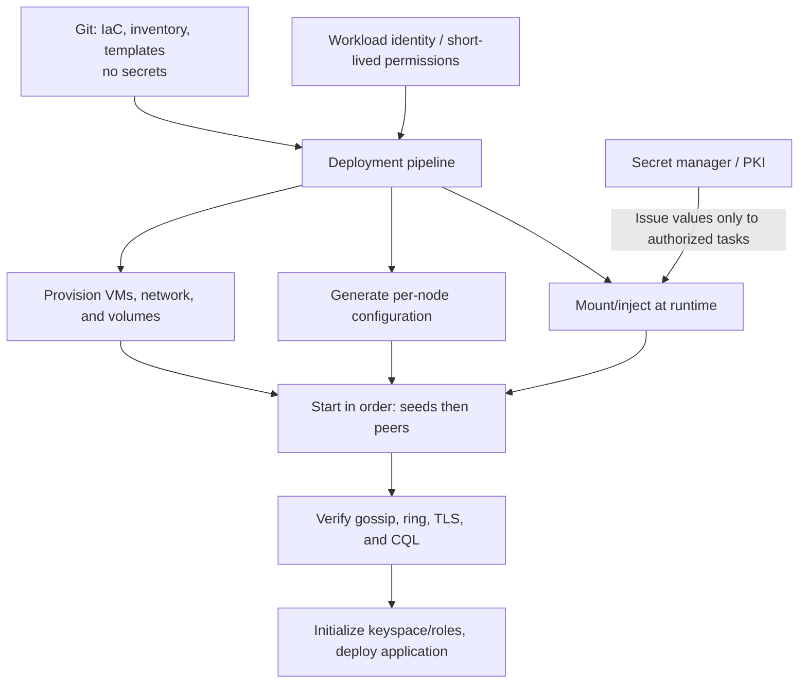

# Automated Cassandra Cluster Provisioning and Separating Secrets from Source-Controlled Configuration

## 1. Operational problem

Apache Cassandra is a distributed database following the **wide-column** model, with no single primary node. Each node participates in a data distribution ring determined by the *partition key*; the number of replicas and their placement depend on the replication strategy, datacenter (DC), and rack. Therefore, automated cluster provisioning is not merely installing a service on multiple machines: the deployment system must produce the **same logical configuration**, a **distinct network identity per node**, a **safe cluster-joining order**, and **repeatable verification conditions**.

In the **Operations Automation** chapter, this lesson focuses on two closely related goals:

1. From source-controlled configuration, provision and bring a new Cassandra cluster into service, and then roll out changes or scale in a controlled manner.
2. Supply CQL passwords, TLS private keys, access tokens, and backup keys from a *secret manager* at runtime; they never appear in the repository, container images, public config manifests, or pipeline logs.

The target is a **declarative, repeatable, observable, and gated** workflow. Automation does not mean starting every node simultaneously or ignoring existing data state.

### Expected outcomes

After this lesson, you can determine which configuration belongs in Git and which must come from a secret store; design a bootstrap order for a new cluster; read `nodetool` output; explain why seeds, DC/rack, replication, and consistency affect availability; and outline a safe pipeline for Java applications connecting to Cassandra.

## 2. Example model and baseline decisions fixed before deployment

Suppose you need to deploy the `orders-prod` cluster consisting of three Cassandra nodes of the same compatible version, running on three Linux hosts in datacenter `dc1`. This example illustrates a brand-new, empty cluster on a private network. Production environments should distribute nodes across appropriate physical failure domains; if datacenter-level fault tolerance is required, design multiple DCs and corresponding replication.

| Node | Internal address | DC | Rack | Initial seed role |
| --- | --- | --- | --- | --- |
| `cass-1` | `10.20.0.11` | `dc1` | `rack1` | Yes |
| `cass-2` | `10.20.0.12` | `dc1` | `rack2` | Yes |
| `cass-3` | `10.20.0.13` | `dc1` | `rack3` | No |

**A seed is an address that helps joining nodes discover cluster members — it is not a primary/master node, nor the sole location storing data.** One or a few stable seeds per DC are usually enough; there is no need to designate every node as a seed. The seed list must be reachable over the network from the nodes attempting to join.

Foundational decisions that should be locked in before provisioning machines:

- **Version and deployment method:** pin the Cassandra/JDK version and tested package or image; do not silently pull `latest` on subsequent runs. Parameter syntax can differ across versions.
- **Topology:** set `cluster_name`, DC, rack, snitch, and broadcast addresses appropriate for the environment. Rack settings must reflect real failure domains; assigning three logical racks on the same physical host does not provide rack-level fault tolerance.
- **Storage:** persistent data volumes decoupled from VM/container lifecycles; know the exact paths for `data_file_directories`, `commitlog_directory`, and required capacity. Never wipe volumes just to "fix" a failed bootstrap.
- **Networking:** ensure internode communication and CQL access from authorized clients. Common ports are `7000`/`7001` for internode traffic depending on encryption settings, `9042` for CQL, and `7199` for JMX; verify against your actual version and TLS setup. Never expose JMX, gossip, or native transport to the Internet.
- **Security:** prepare CA/certificates, secret store, access permissions, and credential rotation mechanisms before applications write data.
- **Lifecycle:** clearly separate **creating a new cluster**, **adding a node**, **replacing a dead node**, and **restoring data**. These workflows must never share a disk-initialization script branch.

## 3. Boundary between configuration and secrets

Put **references** and **rules** into the repository; supply **secret values** to the right service at the right time via a least-privilege machine/pipeline identity.

| Information category | Examples | Appropriate location |
| --- | --- | --- |
| Non-secret configuration | Version, cluster name, seed list, DC/rack, `num_tokens`, disk size, resource limits | Git: Terraform/Ansible/Helm, inventory, and templates |
| Secret references | `secret://prod/cassandra/admin`, key name in secret manager, certificate mount name | Git; holds identifiers only, never values |
| Authentication secrets | CQL role passwords, admin tokens, backup/object storage credentials | Vault, AWS Secrets Manager, Azure Key Vault, GCP Secret Manager, or equivalent |
| Sensitive keys and certs | Internode/CQL/JMX TLS private keys, keystore passwords, encryption keys | Secret manager/PKI; mounted onto target hosts only at runtime with restricted permissions |
| Stateful data | SSTables, commit logs, node metadata, snapshots | Persistent volumes and backup systems; belongs in neither Git nor secret manager |

Kubernetes `Secret` objects are only Base64-encoded in manifests; Base64 is **not secure encryption**. If using Kubernetes, enforce RBAC, control-plane encryption at rest, pod access scoping, and external secret-store synchronization. On VMs, use Vault Agent, cloud workload identity, or similar mechanisms to write protected files into a secured runtime directory.



One rule to enforce strictly: **secrets must never appear in `terraform plan` output, `ansible -vvv`, CI logs, shell history, command-line arguments, container images, or error messages**. In Ansible, set `no_log: true` on tasks handling sensitive values; in Terraform, understand that marking a variable `sensitive` only masks certain display outputs and does not remove secrets from state. Avoid passing secret values through state; protect and restrict state access if a tool must store sensitive data.

## 4. Phased cluster provisioning

### Phase A — Declare and validate input preconditions

A repository can store a password-free inventory as follows:

```ini
# inventory.ini — topology data, no credentials
[cassandra]
cass-1 ansible_host=10.20.0.11 rack=rack1
cass-2 ansible_host=10.20.0.12 rack=rack2
cass-3 ansible_host=10.20.0.13 rack=rack3

[cassandra:vars]
cassandra_dc=dc1
cassandra_cluster_name=orders-prod
cassandra_seed_ips=10.20.0.11,10.20.0.12
```

The pipeline verifies that the exact three expected hosts exist, hostnames/IPs are unique, versions match, volumes are accessible, and the pipeline identity can fetch required secrets. A job creating a new cluster must **halt** if it finds data already present in the data directory or detects that a node already belongs to another cluster; never auto-wipe state to push forward.

### Phase B — Provision and render per-node configuration

Infrastructure as Code provisions networks, compute instances, volumes, firewall rules, and OS settings. Configuration management installs the identical Cassandra version, configures time sync, file descriptors, and appropriate JVM/heap sizing, and renders configuration from per-host variables.

Example **excerpt** of keys in `cassandra.yaml` for `cass-1`, using illustrative Cassandra 4.1-style syntax; this is **not a complete configuration file**. Retain baseline settings shipped by your distribution and verify option names against the pinned version:

```yaml
cluster_name: 'orders-prod'
num_tokens: 16
listen_address: 10.20.0.11
rpc_address: 0.0.0.0
broadcast_rpc_address: 10.20.0.11
endpoint_snitch: GossipingPropertyFileSnitch

seed_provider:
  - class_name: org.apache.cassandra.locator.SimpleSeedProvider
    parameters:
      - seeds: '10.20.0.11,10.20.0.12'

authenticator: PasswordAuthenticator
authorizer: CassandraAuthorizer
```

On `cass-2` and `cass-3`, `listen_address`/`broadcast_rpc_address` must be replaced with each node's own IP, while keeping the same `cluster_name` and seed list. When `rpc_address: 0.0.0.0`, declare a client-reachable `broadcast_rpc_address` while restricting access via firewall and TLS. Never copy the first node's address configuration verbatim across the cluster.

With `GossipingPropertyFileSnitch`, the rack/DC configuration for `cass-1` in `cassandra-rackdc.properties` is:

```properties
dc=dc1
rack=rack1
```

Other nodes use their corresponding racks from the topology table. Snitch and topology must be right **before creating any DC-replicated keyspace**; changing DC/rack in a cluster that already holds data requires a migration and replica verification plan, not just editing a string in a file.

Note that `num_tokens` determines how many virtual tokens are assigned to a node during bootstrap. Changing this setting later does not automatically redistribute data on an existing node. If using manual tokens or another allocation scheme, establish an appropriate planning mechanism.

### Phase C — Bring nodes into the ring in a controlled order

For a **brand-new cluster with empty volumes**, the straightforward procedure is:

1. Start `cass-1` (first seed); wait for the service to come up and verify `nodetool status` shows the node as `UN` (*Up/Normal*).
2. Start `cass-2`, ensuring it discovers the seed and finishes bootstrapping; confirm both nodes are `UN`.
3. Start `cass-3`, waiting until all three nodes are `UN`, no abnormal streaming/bootstrapping remains, and schema is synchronized.
4. Only after the ring is stable, create the keyspace with the planned replication, provision application roles, and open application traffic.

Sequential startup makes it easy to isolate discovery, network, and TLS issues. In a cluster that already contains data, adding a node must use Cassandra's data bootstrap procedure with stream monitoring; **never disable `auto_bootstrap` to force a node into a live ring**. Replacing a dead node and restoring snapshots are two separate procedures that require verifying node ID, on-disk data, and token state beforehand.

Example verification commands run from an authorized administration host:

```bash
nodetool status
nodetool describecluster
nodetool netstats
```

`nodetool status` reports `UN`/`DN` state, DC, rack, and token distribution info; `describecluster` provides cluster/schema details; and `netstats` shows ongoing streaming activity. **Checking whether a TCP port is open is not enough**: the service may listen on a port while still not having joined the ring or while still transferring data.

### Phase D — Configure TLS, admin accounts, and application permissions

Configuring `PasswordAuthenticator`/`CassandraAuthorizer` is part of the CQL security policy. On Cassandra builds that ship with a default superuser account, enabling authentication may come with a well-known initial credential; you must **restrict network access from the start and rotate this credential during a secure bootstrap step** before granting application access. Exact details depend on the distribution and version; never assume default passwords are safe.

Separate three access layers: **internode TLS**, **client-to-node CQL TLS**, and **CQL role authentication/authorization**. Password authentication does not replace TLS; over unencrypted CQL connections, credentials and data risk exposure in transit. Private keys, truststores, keystore passwords, and CQL credentials must be supplied from the secret manager using the TLS mechanism supported by the running version.

A privileged job can retrieve credentials via workload identity, use them inside an encrypted CQL session, and delete temporary files afterward. The Ansible snippet below only illustrates **writing a short-lived authentication file**; the `bootstrap_password` variable must be injected into the runner from a secret manager, never declared in inventory, Git, or `--extra-vars` in plaintext:

```yaml
- name: Create admin-only runtime directory
  ansible.builtin.file:
    path: /run/cassandra-bootstrap
    state: directory
    owner: cassandra
    group: cassandra
    mode: '0700'

- name: Create temporary cqlshrc for bootstrap session
  ansible.builtin.copy:
    dest: /run/cassandra-bootstrap/cqlshrc
    owner: cassandra
    group: cassandra
    mode: '0600'
    content: |
      [authentication]
      username = {{ bootstrap_username }}
      password = {{ bootstrap_password }}
  no_log: true
```

The job runs `cqlsh` over TLS, pointing to the temporary configuration file via the mechanism supported by the active version, and removes the file inside an `always`/`finally` block even if the command fails. Never pass passwords directly via `-p`/`--password` or embed them in CQL command-line arguments, as they can appear in process lists or logs. `0600` permissions are an additional safeguard; the runner and target host still need tight access controls, suppressed debug logging, and temporary file lifecycle management.

Example CQL statements executed by the privileged step once secrets are injected into a secure connection:

```sql
-- Values in <...> are runtime placeholders; never commit real values.
ALTER ROLE cassandra WITH PASSWORD = '<new-bootstrap-secret>';

CREATE KEYSPACE IF NOT EXISTS orders
WITH replication = {'class': 'NetworkTopologyStrategy', 'dc1': 3};

CREATE ROLE app_orders
WITH LOGIN = true AND PASSWORD = '<app-secret>';

GRANT SELECT ON KEYSPACE orders TO app_orders;
GRANT MODIFY ON KEYSPACE orders TO app_orders;
```

Here `NetworkTopologyStrategy` sets **replication factor (RF) = 3 in `dc1`**; all three nodes must be present and ready to achieve the expected placement. The role pattern above is for an application reading/writing within one keyspace: never use the `cassandra` superuser as an application account. Depending on requirements, separate read-only roles, writer roles, and migration roles. CQL password literals must be properly generated/escaped and transmitted over a secure channel; disable sensitive logging during initialization.

### Phase E — End-to-end verification before opening traffic

To mark a deployment successful, the pipeline must pass infrastructure, topology, security, and data gates:

| Gate | Acceptance criteria | Action on failure |
| --- | --- | --- |
| Hosts and processes | Exact three hosts, matching version, persistent volumes mounted, service alive | Halt rollout, inspect specific node |
| Ring/gossip | All expected nodes `UN`, right DC/rack, agree on the same cluster | Stop opening traffic; check seeds, IPs, and internode connectivity |
| Bootstrap/streaming | No abnormal bootstrap or streaming remains, schema consistent | Wait/investigate; do not run migrations early |
| Security | CQL uses TLS with valid CA, default account changed, app role has least privilege | Block clients; fix configuration and rotate secrets |
| CQL and replication | Keyspace created with right RF; test write/read via client at target consistency | Investigate schema, RF, replica state, and permissions |
| Operational recovery | Backups configured, restore path tested, repair schedule aligned | Do not declare production readiness yet |

With RF = 3 and `QUORUM` consistency, each read/write operation requires enough responses per quorum rules (typically **two of three replicas** in a DC with RF = 3). When only the first one or two nodes are up, do not use `QUORUM` checks to infer the whole service is ready. In multi-DC designs, consider `LOCAL_QUORUM` and per-DC replication placement rather than mechanically copying RF from a single-DC example.

## 5. Integrating Java applications without hardcoding credentials

Java applications should read non-secret endpoint details from deployment configuration and fetch username/password, truststore, or tokens from the secret manager at runtime. With Java Driver 4.x, the connection pattern is:

```java
// secretProvider and tlsContext are initialized in the runtime configuration layer.
try (CqlSession session = CqlSession.builder()
        .addContactPoint(new InetSocketAddress("10.20.0.11", 9042))
        .withLocalDatacenter("dc1")
        .withAuthCredentials(
                secretProvider.username(),
                secretProvider.password())
        .withSslContext(tlsContext)
        .build()) {
    // Use prepared statements and controlled retry/timeout policies.
}
```

This is an **integration illustration** and requires project-appropriate imports and implementations of `secretProvider` and `tlsContext` before running. Never put passwords in `application.yml`, Java constants, or debug logs. `localDatacenter` must match the DC reported by the snitch. In practice, supply multiple appropriate contact points and let the driver discover cluster nodes; a single contact point in the example is not a complete resilience design.

Rotating the application password requires coordinating the secret manager, Cassandra roles, and Java instances: create the next credential/role, distribute it and roll applications over gradually, verify all connections, and then revoke the old credential. Overwriting a single password in place while running applications hold existing sessions can cause reconnection failures.

## 6. Re-running pipelines, scaling clusters, and troubleshooting

An **idempotent** pipeline does not needlessly recreate keyspaces/roles, unintentionally alter node IPs or identities, reformat volumes, or restart the entire cluster simultaneously just because a playbook ran again. Every config change should compare against the current version, apply in batches, and proceed only once the previous node returns to a healthy state.

| Symptom | Likely cause | Safe remediation |
| --- | --- | --- |
| New node does not see peers | Wrong seeds, firewall, wrong DNS/broadcast IP, internode TLS error | Cross-check `seed_provider`, `listen_address`, `broadcast_address`, logs, and network path |
| Node shows wrong DC/rack | Snitch/rackdc file rendered incorrectly | Halt deployment and fix topology before creating data or altering replication |
| Service runs but state is `UJ` or not `UN` | Still joining/streaming or bootstrap error | Check `nodetool netstats`, logs, and disk space; never force-skip streaming |
| Client connects but auth fails | Role lacks permissions, credential rotated, TLS/truststore mismatch | Distinguish TLS, authn, and authz errors; verify current secret version |
| `QUORUM` writes fail | Insufficient live replicas, RF mismatch, or network partition | Inspect actual RF and nodes; never auto-lower consistency to mask errors |
| Pipeline re-run makes node look new | Non-persistent volume or tooling wiped data | Block rollout, verify identity and data; follow standard node-replace/restore SOP |
| Secret exposed in logs or repo | Debug output, printed CI variables, committed temp file | Revoke/rotate secret, purge exposure and history if needed, tighten permissions, audit logs |

After provisioning, operations automation must also include **rehearsed backup/restore**, monitoring of read/write latency, heap/GC, SSTable/commit-log disk usage, disk pressure, pending compactions, and **repair** scheduling aligned with topology and `gc_grace_seconds`. Compaction is background work managed by Cassandra; do not automatically trigger major compaction across all nodes right after creating a cluster. Repair must be rate-limited and scheduled to avoid concurrent I/O or network storms. These practices complement bootstrapping and cannot substitute for initial verification.

## 7. Hands-on checklist

Consider a deployment successful only when you have evidence for all of the following items:

- [ ] Git contains only topology, versions, templates, secret references, and CQL migrations with no real credentials.
- [ ] The pipeline uses a least-privilege identity to fetch secrets; no secrets appear in command arguments, outputs, artifacts, state, or accessible logs.
- [ ] Each node has its own IP, DC/rack, data volume, and identity; both example seeds are reachable from joining nodes.
- [ ] Nodes bootstrap sequentially with verification; `nodetool status` shows all three nodes `UN` in the intended topology.
- [ ] TLS and CQL authentication work; default credentials have been changed; the application uses a dedicated least-privilege role.
- [ ] Keyspace `orders` has the right `NetworkTopologyStrategy`/RF, CQL operations succeed at the planned consistency, and the Java application connects using runtime secrets.
- [ ] Re-running the pipeline does not lose data or create unintended new nodes; rolling update, backup/restore, and repair plans are in place.

### Self-check questions

1. Why does declaring all three nodes as seeds not give Cassandra "three master nodes"? How do seeds differ from replicas?
2. If one node is mistakenly rendered as `rack1` instead of `rack3`, what is the risk to replica distribution?
3. What can still be exposed even if a Terraform variable is marked `sensitive`? How would you redesign the secret path?
4. When `cass-3` is not yet `UN`, why should you not open production client traffic assuming RF = 3 is already fully available?
5. How would you rotate a Java role password so running instances do not simultaneously fail to reconnect?

**Key takeaway:** A Cassandra cluster can start automatically and still not be ready to serve data. The real value of automation lies in configuring accurate topology, protecting secrets, verifying replica sufficiency, and preserving data state across every subsequent deployment.
