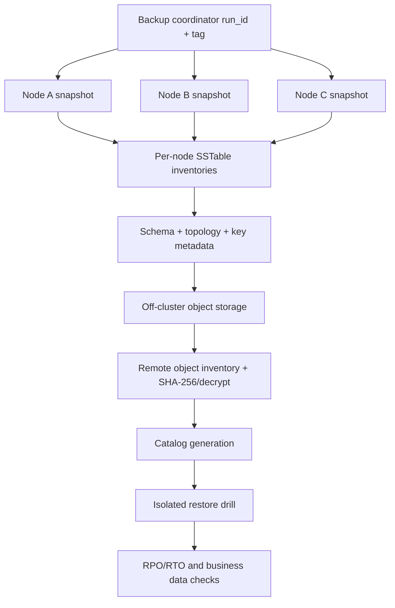
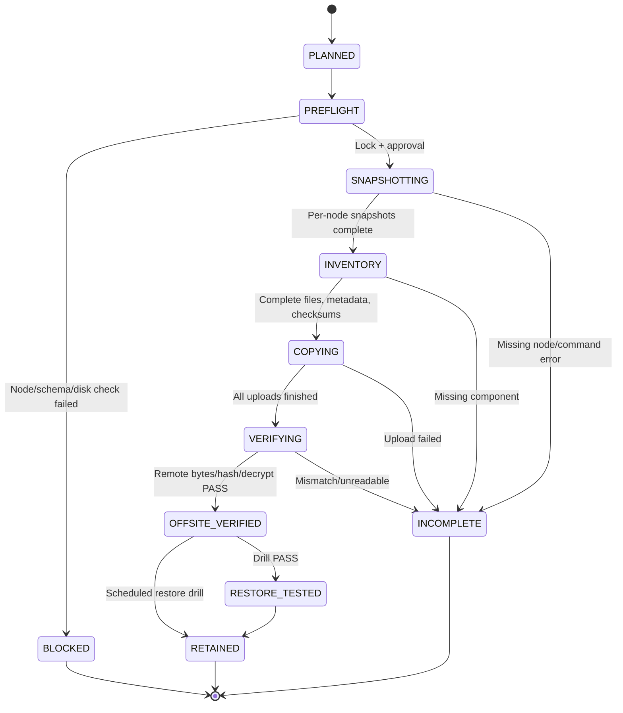
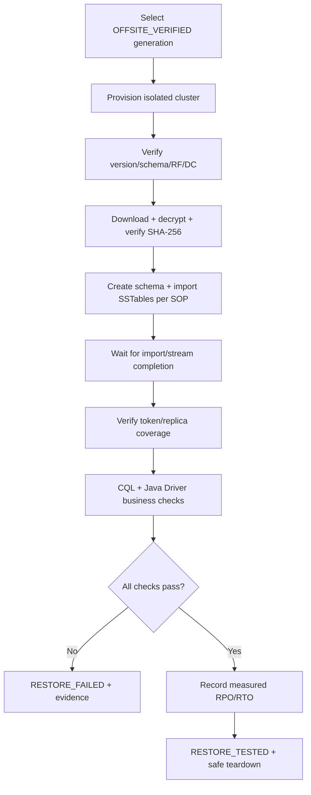

# Automated Snapshots/Backups, Inventory, and Off-Cluster Copy Verification in Apache Cassandra

## 1. A successful snapshot is not yet a restorable backup

In the **DATABASE_ENGINE_WIDE_COLUMN_CASSANDRA** module, Apache Cassandra is a **distributed wide-column** database: the **partition key** determines the token and replica group; tables are query-driven; and **replication factor (RF)** along with **consistency level (CL)** govern read/write acknowledgments. Cassandra uses SSTables, memtables, commit logs, compaction, repair, and streaming. Java Driver/Spring Data sees only CQL results per the application contract and does not guarantee safe data recovery points on its own.

A nightly job might print:

```text
nodetool snapshot: completed
backup status: SUCCESS
```

Yet when recovering from an incident, the operations team discovers:

- Snapshots were taken on **one node** despite the cluster having multiple nodes/DCs.
- SSTable sets still reside on the exact Cassandra disk that failed.
- Only partial components were copied, or schema/table IDs are missing.
- Remote storage holds files, yet bytes were never verified after download.
- The KMS key or decryption permission for older backups is gone.
- Snapshots of two tables were captured at different times, leaving business state inconsistent.
- Without restore drills, nobody knows the real time needed to bring the service back online.

**Taking a snapshot**, **transferring bytes off-cluster**, **verifying completeness/accuracy**, and **restoring business functionality** are four separate tasks. This lesson in the **Operations Automation** chapter directly addresses **automated snapshots/backups, inventory, and off-cluster copy verification**.

### Learning objectives

After this lesson, you will be able to:

1. Distinguish **replication, repair, snapshot, incremental backup, commit-log archiving, and restore**.
2. Understand that `nodetool snapshot` creates SSTable hard links **per node**, not an atomic cluster-wide snapshot.
3. Design a pipeline: **preflight → snapshot → inventory → offsite copy → integrity verify → restore drill → retention**.
4. Preserve **schema, UDTs, table IDs, node host IDs, DC/rack, token ranges, RF/CL, and versions**.
5. Build a manifest with size/hash for every SSTable component and verify remote GETs.
6. Define what makes a backup **OFFSITE_VERIFIED** versus merely **SNAPSHOTTED**.
7. Measure actual RPO/RTO and verify data correctness via CQL and the Java Driver.
8. Schedule backups with locking, bounds, quotas, key management, and stop conditions.
9. Restore into an **isolated** cluster without mixing old SSTables into live production.
10. Write auditable checklists, runbooks, and audit reports.

**Version caveat:** `nodetool` syntax, SSTable components, directory names, incremental/commit-log archiving, and restore procedures vary across Cassandra 3.x/4.x/5.x and distributions. Always cross-check commands against the **exact server version**, and never copy them verbatim into production while bypassing runbooks.

## 2. Replication and repair do not replace backups

| Mechanism | Primary function | Can recover from cluster-wide accidental delete? |
| --- | --- | --- |
| RF / replication | Maintain copies for availability and CL | No; valid accidental deletes propagate to replicas |
| Anti-entropy repair | Reconcile divergent replicas across ranges | Does not create an independent recovery point |
| Hinted handoff | Deliver missed mutations under certain conditions | Not a complete backup log |
| Local snapshot | Preserve SSTables at a point in time on one node | Only one component of a backup |
| Incremental backup | Retain newly flushed SSTables per configuration | Requires base/coverage; not a full backup alone |
| Commit-log archiving | Store additional log segments per procedure | Can aid near-point recovery, but replay must be tested |
| Verified off-cluster copy | Copy in an independent failure domain | Potentially restorable if metadata/keys exist |
| Restore drill | Real test of data and application recovery | Proof of recoverability |

RF=3 does not protect against every risk: buggy application payloads, accidental `DELETE`/`DROP`, misconfigured TTLs, compromised admin accounts, correlated failures within the same infrastructure zone, or lost KMS keys.

### 2.1. Four questions before choosing a backup schedule

1. **What are we protecting?** Which cluster, keyspaces, tables, UDTs, indexes, roles, DCs, and logical operations?
2. **Against which failures?** Single node loss, accidental deletion, full-region disaster, ransomware, or application bugs?
3. **To what point?** RPO in minutes/hours and RTO in hours/days?
4. **With what proof?** Node coverage, file inventory, checksums, remote GET/decrypt tests, restore drills, and correctness checks?

If RPO requires 15 minutes, a once-daily snapshot fails to meet it even if every job succeeds all year.

## 3. Snapshots live on nodes, not as atomic cluster checkpoints

### 3.1. What does a snapshot capture?

In many Cassandra versions, `nodetool snapshot` on a node creates **hard links** to immutable SSTable components, typically under `snapshots/<tag>` inside each table directory. Normally snapshots flush corresponding memtables before linking, **unless options/settings dictate otherwise**. Verify via `nodetool help snapshot` for your server version.

```text
/var/lib/cassandra/data/
  commerce/
    orders_by_id-<table-id>/
      <live-sstable-components>
      snapshots/
        bk-20261121T010000Z-a1b2/
          <snapshot-sstable-components>
          <manifest-or-schema-artifacts-if-produced>
```

This is a **conceptual diagram**, not a mandatory layout across all versions. Component filenames and metadata vary across SSTable formats.

Hard links have important consequences:

- Creating a snapshot usually does not copy all bytes immediately.
- Files remain on the **source node's filesystem**; losing the volume can lose the snapshot.
- Compaction can write new SSTables, yet old SSTables linked by the snapshot are not freed from disk.
- `ln` cannot link across filesystems and is not an offsite backup.
- Never manually delete snapshot/SSTable files without metadata and a recovery plan.

### 3.2. Snapshot every node within the protected scope



**Using the same tag across multiple nodes does not make the snapshots simultaneous.** For instance, A snapshots at 01:00:01, B at 01:00:08, and C at 01:00:15. Meanwhile, applications keep writing; replicas and tables may capture slightly different points in time.

### 3.3. Snapshots lack multi-table SQL transaction semantics

Consider the workflow:

```text
T0: orders_by_id.state = PAID
T1: payments_by_request.status = CONFIRMED
T2: orders_by_customer.state = PAID
```

Backups capturing tables at slightly different moments can yield an **inconsistent business state** after restore. For a cleaner cut:

- Quiesce writers / pause new mutations and confirm in-flight operations reached terminal outcomes.
- Persist an application-layer logical checkpoint/sequence ID and invariants.
- Use an event log/outbox/CDC with a tested replay contract.
- Record per-node/per-table start/end timestamps and bound recovery point uncertainty.
- For continuously active systems, state explicitly that **there is no cluster-wide atomic cut** unless proven otherwise.

Raising CL to `ALL` during the snapshot window **does not** turn multi-table writes into a distributed ACID transaction. Never use `TRUNCATE` to "clean up" data prior to a snapshot.

## 4. Snapshots, incremental backups, and commit logs

### 4.1. Base snapshots and incremental chains

```text
Base B001 (Sunday 01:00)
    + I001 SSTables (Monday)
    + I002 SSTables (Tuesday)
    + I003 SSTables (Wednesday)
Base B002 (next Sunday)
```

A base snapshot is the set of SSTable files retained at a point in time per node. Incremental backups in Cassandra (when enabled per version) typically retain hard links to newly flushed SSTables. **Incrementals alone cannot restore an entire table.**

Do not assume incrementals capture every write continuously; check:

- Flush cadence and SSTable generation.
- Whether incremental collectors/uploaders keep up reliably.
- Whether base dependencies are retained intact.
- Whether file identities and coverage across nodes/DCs are complete.
- Whether compaction, repair, or bootstrap altered the SSTable set.
- Which logical recovery point defines RPO, rather than just collector timestamps.

### 4.2. Commit-log archiving and PITR

Cassandra offers commit-log archiving depending on version and configuration. Reliable **point-in-time recovery** requires:

1. A valid base snapshot with matching schema and topology.
2. Complete commit-log segments with zero unexplained gaps.
3. Tested cutoff/replay policies aligned with write timestamps and TTLs.
4. Import/replay procedures compatible with the exact Cassandra Server version.
5. Tests recovering logical events, handling out-of-order data and tombstones.
6. Cross-table / external reconciliation when business logic requires it.

**Never claim "enabling commit-log archiving automatically provides per-second PITR."** Until replay is proven, declare RPO based on snapshots and incrementals you can actually restore.

### 4.3. Selection matrix

| Objective | Suitable tools | Mandatory verification |
| --- | --- | --- |
| Restore a table to a daily point | Snapshot + schema + offsite copy | Restore and accurate query read-back |
| Multi-hour RPO | Frequent snapshots or verified incremental chain | No missing base/files |
| Very short RPO | Snapshot + log/CDC/event workflow | Replay and logical consistency |
| Survive full-DC loss | Separate region/account/failure domain | Restore IAM/KMS/RTO |
| Availability if one replica is DOWN | RF/repair | Does not replace backups |
| Admin accidental deletion | Immutable historical backups | Retention, legal hold, restore earlier state |

## 5. Complete protection: data files and metadata

A single `*.db` file does not explain how to restore Cassandra data. Depending on backup scope, preserve:

- Keyspace DDL, `NetworkTopologyStrategy` RF per DC, `durable_writes`.
- Table names/IDs, partition/clustering keys, column types.
- UDT definitions and schema dependency creation order.
- Compaction/compression options, TTL, `gc_grace_seconds`.
- Index/SAI/MV metadata and version-specific rebuild/verify procedures.
- Exact Cassandra Server version and SSTable format compatibility.
- Node host IDs, DC/rack, tokens, and replica placement during the snapshot.
- Backup generation/tag and per-node start/end timestamps.
- Schema migration version and source commit SHA.
- Roles/permissions exported via a controlled procedure.
- References to secrets/KMS keys—**never** plaintext private keys.
- Logical business checkpoints and expected synthetic fixture IDs/values.
- Status of related incremental/log archive streams.

**Table IDs are especially critical:** Cassandra typically stores table directories using name and ID. A table dropped and recreated with the same name gets a different ID; backups cannot reliably infer schema solely from the string `orders_by_id`.

### 5.1. Scope and tenants

```yaml
backup_scope:
  environment: isolated-lab
  cluster: cassandra-lab
  datacenters: [dc1, dc2]
  keyspaces:
    commerce: [orders_by_id, orders_by_customer]
  include_schema: true
  include_udts: true
  roles_permissions: "controlled-export"
  include_topology_metadata: true
```

This is an **illustrative manifest**, not a configuration executed natively by Cassandra. If multiple tenants share one table, capturing all SSTables **is not** a single-tenant backup. Restoring one tenant separately requires a distinct data-export/query/authorization workflow—never blindly share full SSTables.

## 6. Preflight: cluster scope must be locked down

Before each generation, the controller confirms:

1. The **expected nodes** set from approved inventory, including any DOWN nodes (not just currently UP nodes).
2. Host IDs, DC/rack, token ownership, schema versions, and RF/CL.
3. No unassessed conflicting topology mutations (`UJ`/`UL`, bootstrap/replace/decommission) or repair/streaming.
4. Sufficient disk headroom as snapshots pin old SSTables across compactions.
5. Adequate budget for CPU/GC/disk I/O/network and foreground SLOs.
6. Active object-store quotas, retention policies, IAM permissions, and KMS keys.
7. No backup generation colliding on scope/tag; acquire a **cluster-scoped backup lock**.
8. Snapshot scope matches real keyspaces/tables with confirmed owner/approval.
9. Sufficient time to upload, verify, and meet RPO before deadline.
10. Rollback/incident escalation ready if a node snapshot fails.

### 6.1. Common version observation commands

```bash
nodetool status
nodetool describecluster
nodetool info
nodetool netstats
nodetool tpstats
nodetool compactionstats
nodetool listsnapshots
```

Run across **relevant nodes** and record every output with node ID, UTC timestamp, and exact server version. Command names/formats vary by release. These commands do not prove all data is globally consistent; they help assess preconditions before backing up.

### 6.2. Topology in transition

If a node is `JOINING` or `LEAVING`, snapshots may not align with pre- or post-migration token ranges. Choose:

- **BLOCKED:** defer the generation until topology stabilizes per policy.
- **INCOMPLETE/NEEDS_REVIEW:** collect a degraded snapshot explicitly documenting missing coverage and risk; **never** mark it full-cluster verified.
- In urgent disasters, owners may decide a degraded backup is still useful while explicitly declaring its limits.

**RF=3 does not justify skipping any node in a backup** without analyzing coverage, timestamps, changed ranges, and replica state.

## 7. Backup generation as a state machine



**OFFSITE_VERIFIED and RESTORE_TESTED are not synonymous.** A generation whose integrity verification passed but has never been restore-tested must record those two facts accurately.

### 7.1. Run ID and snapshot tag

```text
cluster_id: cassandra-lab-a
generation_id: 2026-11-21T010000Z_6e8b4c2a
snapshot_tag: bk-20261121T010000Z-6e8b4c2a
scope: commerce
attempt: 1
created_at_utc: 2026-11-21T01:00:00Z
```

Tags must follow a validated format with no separators or path traversal. When a command times out, **read back snapshot state for the same tag** before retrying; never blindly delete and re-snapshot under a new tag while other nodes already succeeded.

### 7.2. Coverage matrix

| Node | DC | Snapshot tag | SSTable inventory | Upload | Remote hash |
| --- | --- | --- | ---: | --- | --- |
| A | dc1 | Yes | 214 files | PASS | PASS |
| B | dc1 | Yes | 207 files | PASS | PASS |
| C | dc1 | Yes | 198 files | PASS | PASS |
| D | dc2 | Missing | — | — | — |

These figures are **hypothetical**. The generation is **INCOMPLETE** because D is missing, unless an approved exception policy and separate coverage proof exist. Never "beautify" percentages by removing D from the denominator after it goes DOWN.

## 8. Taking snapshots with version-appropriate `nodetool`

Before operating on an authorized node:

```bash
nodetool help snapshot
nodetool help listsnapshots
nodetool help clearsnapshot
```

Common command pattern:

```bash
# On each node, after controller checks scope and cluster identity.
nodetool snapshot -t bk-20261121T010000Z-6e8b4c2a commerce

# List snapshots on the exact node connected via JMX.
nodetool listsnapshots
```

- `-t` is the tag option in many Cassandra versions; verify with `help` for your release.
- Snapshots run only on the targeted JMX node and **do not automatically fan out cluster-wide**.
- Taking a snapshot may flush memtables and increase I/O.
- Never pass `--skip-flush` casually if you need memtable contents included.
- Exit code 0 **does not** prove offsite files exist.
- Never bundle `clearsnapshot` into the same step before off-cluster copies are verified.

### 8.1. Illustrative Bash shell on a lab node

```bash
#!/usr/bin/env bash
set -euo pipefail

# Run ONLY in an allowlisted LAB cluster.
EXPECTED_CLUSTER="cassandra-backup-lab"
KEYSPACE="commerce"
TAG="bk-20261121T010000Z-6e8b4c2a"

if [[ ! "$TAG" =~ ^[A-Za-z0-9_-]+$ ]]; then
  echo "Unsafe snapshot tag" >&2
  exit 2
fi

# Observation only (does NOT verify EXPECTED_CLUSTER itself).
# Real controller must verify identity/host ID/disk/lock before proceeding.
nodetool info
nodetool status

nodetool snapshot -t "$TAG" "$KEYSPACE"
nodetool listsnapshots

echo "SNAPSHOT_COMMAND_COMPLETED, offsite NOT VERIFIED"
```

This script is **intentionally not runnable as a production orchestrator**: it does not verify `EXPECTED_CLUSTER`, other nodes, disk, table ID snapshots, or uploads. Never copy it verbatim into a production cron job.

## 9. SSTable components: inventory must be complete

An SSTable consists of multiple components depending on version/format:

```text
...-Data.db
...-Index.db
...-Filter.db
...-Statistics.db
...-CompressionInfo.db
...-TOC.txt
...-Digest.crc32
...-Summary.db
...-Partitions.db / additional index components (if present)
```

This is an **example**, not an immutable list. Automation must preserve **all actual files** inside the snapshot directory for the exact table ID/version (along with corresponding metadata). Copying only `*-Data.db` can render a backup unloadable.

### 9.1. Inventory record template

| Field | Purpose |
| --- | --- |
| `generation_id` | Links the backup generation |
| `node_host_id`, DC/rack | Identifies node and failure domain |
| `keyspace`, `table`, `table_id` | Matches schema and actual path |
| `relative_path` | Avoids missing components or wrong directories |
| `size_bytes` | Verifies byte completeness |
| `sha256` | Source file integrity |
| `snapshot_start/end_utc` | Per-node time bounds |
| `data_directory_alias` | Distinguishes data volumes |
| `remote_object_uri/version_id` | Identifies remote object |
| `upload_status/verify_status` | Per-file state |

### 9.2. Read-only Bash inventory of a verified snapshot directory

```bash
#!/usr/bin/env bash
set -euo pipefail

# Set only after verifying cluster, host ID, tag, and table ID.
SNAPSHOT_DIR="/var/lib/cassandra/data/commerce/orders_by_id-TABLE_ID/snapshots/bk-20261121T010000Z-6e8b4c2a"

if [[ ! -d "$SNAPSHOT_DIR" ]]; then
  echo "Missing snapshot" >&2
  exit 3
fi

# TSV skeleton for lab. Production must use JSON/CSV
# with proper escaping, realpath allowlist, and untrusted-input checks.
printf "relative_path\tbytes\tsha256\n"

while IFS= read -r -d '' file; do
  relative="$(realpath --relative-to="$SNAPSHOT_DIR" -- "$file")"
  bytes="$(stat -c %s -- "$file")"
  digest="$(sha256sum -- "$file" | cut -d ' ' -f 1)"
  printf "%s\t%s\t%s\n" "$relative" "$bytes" "$digest"
done < <(find "$SNAPSHOT_DIR" -type f -print0)
```

Safety points:

- Verify the snapshot path lies inside an **allowlisted data directory** and matches exact table IDs.
- `sha256sum` reads large files and consumes I/O budget; do not hash 500 SSTables concurrently and saturate disks.
- If multiple data directories exist, inventory all of them.
- Never turn user-controlled absolute source paths into object keys to avoid path traversal.
- Never alter permissions or delete SSTables just so a script can read them.
- The illustrative TSV is unsafe for filenames containing tabs/newlines; use standard serialization in production.
- Object-store ETags are not always content hashes, especially with multipart uploads or encryption.

## 10. Generation manifest: planned differs from observed

```yaml
schema_version: 1
generation_id: "2026-11-21T010000Z_6e8b4c2a"
cluster_id: "cassandra-backup-lab"
snapshot_tag: "bk-20261121T010000Z-6e8b4c2a"
status: "COPYING"
created_at_utc: "2026-11-21T01:00:00Z"

versions:
  cassandra_server_by_node:
    node_a: "<exact-build>"
    node_b: "<exact-build>"
    node_c: "<exact-build>"
  sstable_format: "<observed>"
  backup_agent_version: "<exact-version>"
  backup_agent_commit: "<git-sha>"
  java_driver_version: "<verification-version>"

topology:
  expected_nodes: [node_a, node_b, node_c]
  observed_nodes: [node_a, node_b, node_c]
  dc_rack_map: "metadata/nodes.json"
  rf_by_keyspace: "metadata/replication.json"
  token_replica_map: "metadata/token-ranges.json"

scope:
  keyspaces: [commerce]
  tables: [orders_by_id, orders_by_customer]
  schema_artifact: "metadata/schema.cql"
  table_ids_artifact: "metadata/table-ids.json"
  include_udts: true
  roles_permissions: "separate-encrypted-export"

consistency:
  snapshot_mode: "per-node-sstables"
  global_atomic_cut: false
  writers_quiesced: false
  logical_checkpoint: null
  node_snapshot_times: "metadata/timestamps.json"

inventories:
  node_a: "files/node_a.jsonl"
  node_b: "files/node_b.jsonl"
  node_c: "files/node_c.jsonl"
  source_manifest_sha256: "<trusted-hash>"
  expected_files: null
  expected_total_bytes: null

offsite:
  provider: "<object-store>"
  account_alias: "<isolated-backup-account>"
  bucket_alias: "<backup-bucket>"
  prefix: "cassandra/lab/generation/"
  encryption: "kms-envelope"
  kms_key_reference: "<non-secret-key-id>"
  immutable_policy: "<reviewed-retention>"
  region_redundancy: "<approved-plan>"

validation:
  expected_node_coverage: null
  files_uploaded: null
  remote_get_sha256_pass: null
  decrypt_test_pass: null
  schema_metadata_complete: null
  restore_drill_id: null
  restore_drill_result: "NOT_RUN"

retention:
  classification: "daily"
  earliest_deletion_utc: "<calculated>"
  legal_hold: false
  min_verified_generations: 2
```

This is a **contract template**, not a file directly ingested by Cassandra or cloud tooling. `status: COPYING` must never be flipped to VERIFIED while validation fields remain `null`.

### 10.1. Criteria before declaring `OFFSITE_VERIFIED`

- Protected nodes, DCs, and tables all have snapshots.
- Snapshot tags, source paths, schema, and table IDs reconcile validly.
- Every SSTable component and metadata artifact has a corresponding remote object.
- Remote objects match exact bytes/hashes and record version IDs if versioning is enabled.
- Decryption test using KMS and the restore role succeeded.
- Zero failed uploads or skipped missing files.
- Catalog commits only once **trusted inventory** and validation evidence exist.
- Restore test status is tracked **separately**—never pretend a restore was tested.

## 11. Off-cluster: truly separating failure domains

| Storage location | Protects against | Remaining risk |
| --- | --- | --- |
| Local snapshot on node | Certain local SSTable operations | Loss of host or volume |
| NAS in the same rack | Certain node disk failures | Rack/network failure, shared credentials |
| Object store in same account/region | Isolated from Cassandra servers | Account compromise, region failure |
| Separate account + immutable retention | Stronger defense vs. deletion/ransomware | KMS/access/region dependencies |
| Independent region/account + restore tests | Adds DR readiness | Latency/cost/permissions |

Never look at an `s3://` URI and call it "safe offsite" if the Cassandra host admin role can also delete all object versions or bypass retention.

### 11.1. Copy rules

- Deterministic object keys by cluster/generation/node/table ID/file.
- Short-lived credentials scoped to write only the target prefix; never log secrets or bind values.
- TLS in transit and encryption at rest; record KMS key reference/version.
- Checkpointed multipart uploads with bounded retries targeting the **same object identity**.
- Never run `sync --delete` against a backup bucket.
- Never overwrite a generation already marked VERIFIED.
- Object lock / legal hold must be verified on actual object versions.
- Upload metadata/manifest and commit the catalog only after files are verified.
- On object stores with eventual listing semantics, issue HEAD/GET per **inventory**, not LIST alone.

### 11.2. Illustrative copy command

```bash
#!/usr/bin/env bash
set -euo pipefail

SOURCE="/backups/staged/host-a/commerce/orders_by_id/snapshot"
DEST="s3://isolated-backup-bucket/cassandra/lab/gen-001/host-a/orders_by_id/"
KEY_REF="alias/cassandra-backup-lab"

# ONLY after source/destination are allowlisted and inventoried.
# AWS CLI syntax and KMS permissions must be verified per environment.
aws s3 cp "$SOURCE" "$DEST" \
  --recursive \
  --sse aws:kms \
  --sse-kms-key-id "$KEY_REF"

echo "COPY_SENT; not remote content VERIFIED"
```

`aws s3 cp` exiting 0 **does not** prove remote GET/hash verification or object lock enforcement. Never copy this command into production without credential isolation, retention/overwrite policies, and quotas.

## 12. Off-cluster verification across three evidence levels

| Level | Check | Catches | Does not prove |
| --- | --- | --- | --- |
| L1 — Inventory | HEAD/LIST per expected object; count, size, version | Missing files / incomplete upload | Silent corruption |
| L2 — Content integrity | Remote GET and SHA-256 or checksum provider with verified semantics | Altered bytes / undecryptable object | SSTable/schema compatibility |
| L3 — Restore drill | Fresh cluster, import, and CQL read-back | Data can be restored to serve business logic | Future backups will never fail |

**L1 does not replace L2; L2 does not replace L3.**

### 12.1. Do not use ETag as a default end-to-end hash

Across multipart uploads, encryption modes, or storage providers, ETag does not necessarily match the original file's MD5/SHA. Use:

- Trusted source SHA-256.
- Remote object version ID.
- Remote GET/decrypt via the restore role in a test environment.
- Comparison of downloaded byte count and SHA-256.
- Or a provider checksum API with verified algorithm and semantics.

File checksums **do not prove** business correctness if SSTables lack schema, table IDs, or proper import procedures.

## 13. Java 11: SHA-256 verifier for downloaded copies

```java
import java.io.InputStream;
import java.nio.file.Files;
import java.nio.file.Path;
import java.security.MessageDigest;
import java.util.Locale;

public final class BackupFileVerifier {

    public static String sha256(Path path) throws Exception {
        MessageDigest digest =
            MessageDigest.getInstance("SHA-256");

        try (InputStream input = Files.newInputStream(path)) {
            byte[] buffer = new byte[64 * 1024];
            int count;

            while ((count = input.read(buffer)) >= 0) {
                if (count > 0) {
                    digest.update(buffer, 0, count);
                }
            }
        }

        byte[] bytes = digest.digest();
        StringBuilder hex = new StringBuilder(bytes.length * 2);

        for (byte value : bytes) {
            hex.append(String.format(
                Locale.ROOT, "%02x", value & 0xff));
        }
        return hex.toString();
    }

    public static void verify(
            Path downloadedFile,
            long expectedBytes,
            String expectedSha256) throws Exception {

        if (Files.size(downloadedFile) != expectedBytes) {
            throw new IllegalStateException(
                "Backup bytes mismatch: " + downloadedFile);
        }

        if (!sha256(downloadedFile)
                .equalsIgnoreCase(expectedSha256)) {
            throw new IllegalStateException(
                "Backup SHA-256 mismatch: " + downloadedFile);
        }
    }

    private BackupFileVerifier() { }
}
```

Requirements:

- `expectedSha256` must come from a **trusted/signed manifest**, not from the same object where an attacker could alter both file and checksum.
- `downloadedFile` must reside within a restore staging allowlist, never a symlink/traversal from untrusted metadata.
- Streaming hashing avoids loading entire SSTables into the JVM heap.
- Reading entire files incurs I/O cost: cap concurrency and throughput.
- This Java code verifies bytes, **not Cassandra SSTable internal format**.

### 13.1. Per-remote-object evidence

```json
{
  "generation_id": "gen-001",
  "node_host_alias": "node-a",
  "object_key": "cassandra/lab/gen-001/node-a/orders_by_id/part-Data.db",
  "version_id": "<object-version>",
  "expected_bytes": 73400320,
  "received_bytes": 73400320,
  "expected_sha256": "<64-hex-chars>",
  "received_sha256": "<64-hex-chars>",
  "decrypt_test": "PASS",
  "result": "PASS",
  "checked_utc": "2026-11-21T03:15:00Z"
}
```

Record PASS only when **both real hashes match and bytes are complete**. Placeholder strings are not valid hashes; never treat this sample JSON as measured output.

## 14. Backup catalog: managing generations by dependency

A catalog is more than a list of tags. It must know:

- Generation ID, status, and backup scope.
- Protected nodes, DCs, racks, tables, and table IDs.
- Per-node snapshot start/end times and logical checkpoints.
- Base generation and incremental/log chain dependencies.
- File/object counts, total bytes, and verified fraction.
- Remote failure domains, bucket/version IDs, and KMS references.
- Immutable retention, legal holds, and earliest delete times.
- Most recent restore drill and measured RPO/RTO.
- Jobs, operator, approvals, failed steps, and audit evidence.

A dashboard must answer:

1. "Where is the latest **OFFSITE_VERIFIED** backup for `commerce`?"
2. "Are any nodes or tables missing from the newest generation?"
3. "Which base + incrementals/log segments are needed to restore to point T?"
4. "Which backups have passed retention yet remain dependencies?"
5. "If KMS key K is disabled, which generations lose decryption?"
6. "When did the last restore drill PASS after upgrading Cassandra?"
7. "Are there orphaned remote objects absent from the inventory needing investigation?"
8. "By how much has the last verified point exceeded the RPO target?"

**A catalog is insufficient if remote objects are later deleted.** Run periodic remote inventory audits and restore tests. Keep an independently protected copy of manifests to recover the catalog if the catalog service itself is lost.

## 15. Retention: never delete bases while recovery chains still depend on them

### 15.1. Bases and incrementals form a dependency graph

```text
B001 (base Sunday)
  + I001 (Monday)
  + I002 (Tuesday)
  + I003 (Wednesday)

B002 (new base next Sunday)
```

If Tuesday's recovery point requires `B001 + I001 + I002`, deleting `B001` before Tuesday's support window expires breaks the chain. Deleting `I001` can also leave a gap. Never implement retention simply as "delete every object older than 30 days" without checking dependencies.

Conditions to delete a remote generation:

1. Past policy retention with no **legal hold**.
2. No supported restore point still depends on that generation.
3. Remaining **independent verified generations** satisfy policy minimums.
4. No active incident, reconciliation, or restore job needs it.
5. Object versions and immutable retention permit deletion.
6. Data owner or authorized automation approved the exact generation ID.
7. Dry-run inventory, expected object/byte counts, and audit record exist.
8. Procedure cannot accidentally delete another prefix if tag/generation metadata is malformed.

### 15.2. Conditions for deleting local snapshots

Consider `nodetool clearsnapshot` **only after**:

- The offsite copy is fully **OFFSITE_VERIFIED**.
- No uploader, hasher, or restore worker is still reading the local snapshot.
- Schema, UDTs, table IDs, manifests, and checksums are preserved.
- At least the policy minimum of verified generations remains valid.
- No legal or incident hold is active.
- No bootstrap, repair, or topology recovery needs local source data.
- Target tag/keyspace/node is confirmed by a human or guarded controller.
- Every action and stop condition is logged.

Syntax reference:

```bash
# Check exact version:
nodetool help clearsnapshot

# ILLUSTRATION — Do not run before all gates pass:
# nodetool clearsnapshot -t bk-20261121T010000Z-6e8b4c2a commerce
```

**Never call `clearsnapshot` without a tag mechanically.** Some syntaxes/flags can clear **more** snapshots than intended. Never substitute direct `rm -rf` inside Cassandra data directories.

### 15.3. Immutable retention and key management

A trustworthy immutable backup generation requires:

- Object versioning/locking/retention configured at the storage service.
- Separation between upload roles and bypass/delete roles; Cassandra service accounts lack bypass permissions.
- Legal hold checks before lifecycle transitions.
- KMS keys remaining intact and decryptable through the entire retention period.
- Auditing whenever IAM, keys, or policies change.
- Decryption tests run with the **restore role**, not just superadmin.
- Monitoring for unusual delete or bypass attempts.

A backup with intact bytes and valid checksums whose KMS key was revoked is **unrecoverable** and must trigger a critical alert.

## 16. RPO: valid recovery point, not upload completion time

\[
\mathrm{RPO} =
\text{failure timestamp}
-
\text{most recent trustworthy recoverable data timestamp}
\]

Example:

```text
Snapshot node A      01:00:01 UTC
Snapshot node B      01:00:07 UTC
Snapshot node C      01:00:12 UTC
Remote verify done   02:10:00 UTC
Disaster occurred    08:00:00 UTC
```

Without verifiable incremental/log replay, never use **02:10** as the data point for calculating RPO. That is merely **when copy verification finished**. The recovery point depends on the snapshot logical cut and application writes between 01:00:01 and 01:00:12.

When no cluster-wide consistent checkpoint exists, state the **RPO estimate/uncertainty** and multi-table reconciliation method. If business needs a 15-minute RPO yet only daily snapshots exist, report an **SLO GAP**—never write "15-minute RPO" out of wishful thinking.

### 16.1. Distinguishing backup freshness from recoverable freshness

- `last_snapshot_started_at`: when nodes started snapshotting.
- `last_snapshot_completed_at`: when nodes finished.
- `last_offsite_verified_at`: when remote files/hashes/decrypt passed.
- `last_log_archived_at`: may reflect log upload only, not proven replay.
- `last_restore_tested_at`: when a restore drill ran.
- `last_recoverable_checkpoint`: the data point proven recoverable under the contract.

Dashboards must highlight the **recoverable checkpoint**, not merely when the last cron ran.

## 17. RTO: time until the service is genuinely ready

\[
\mathrm{RTO} =
\text{service readiness timestamp}
-
\text{recovery start/trigger timestamp}
\]

A restore drill must account for:

1. Recovery approval and fetching credentials/backup generation.
2. Provisioning a fresh cluster in an isolated network.
3. Configuring Cassandra versions, DC/rack, RF/CL, KMS/TLS/auth.
4. Restoring schema, UDTs, and required metadata.
5. Downloading, decrypting, and verifying SHA-256 on SSTable files.
6. Importing/streaming using a compatible procedure.
7. Checking bootstrap/repair/replica coverage/compaction if needed.
8. Restoring service roles, app config, and Java Driver endpoints.
9. Running CQL correctness probes, business invariants, and endpoint smoke tests.
10. Measuring p95/p99 and errors; confirming traffic can safely open.

RTO is **not** just file copy time or when `cqlsh` first connects.

### 17.1. Sample SLOs (illustrative only)

| Item | Example | How to prove |
| --- | --- | --- |
| Target RPO | ≤ 4 hours | Last recoverable logical checkpoint |
| Target RTO | ≤ 6 hours | Full restore + readiness + correctness |
| Full snapshot | Daily | Per-node coverage records |
| Remote integrity | 100% SSTable files/bytes | Remote GET/hash/decrypt |
| Restore drill | Monthly | Signed drill report |
| Zone independence | Two failure domains | Storage account/region metadata |
| Local disk safety | Per capacity policy | Disk headroom + snapshot retention |
| Key recoverability | Key lifecycle ≥ retention | KMS decrypt test |

Do not treat these sample numbers as default policy. RPO/RTO are dictated by business requirements and operational budgets.

## 18. Restore drills: restoring into an isolated cluster

A restore drill has value only when it exercises the **real data recovery path** while **never impacting production**.

### 18.1. Preparing the target environment

- Fresh/isolated Cassandra cluster, never sharing data directories with live production.
- Confirmed compatible server version and SSTable format.
- DC/rack/snitch, RF, and token plan aligned with procedure.
- Keyspaces/tables/UDTs/schema migrations created in proper order.
- IAM/KMS/TLS/auth for the restore role granted with least privilege.
- Adequate CPU, disk, network, temp space, and time to load SSTables.
- Selected **OFFSITE_VERIFIED** generation plus required incrementals/log segments.
- Known application logical watermarks and expected synthetic data.

### 18.2. Two import strategies not to confuse

| Method | When to consider | Preconditions |
| --- | --- | --- |
| Offline SSTable restore per procedure | Restoring node/table with matching layout/version/topology | Table IDs, file permissions, node stop/start, format compatibility |
| `sstableloader` or version-appropriate streaming import | Loading SSTables into a new cluster via streaming | Schema created, DC/RF, source files, compatible version and network |

`sstableloader`, `nodetool refresh`, and offline SSTable copies have very different preconditions. **There is no universal command** that safely restores every version. Avoid copying hot files into a live cluster or editing system keyspaces manually. Follow a reviewed, version-specific runbook.

### 18.3. Restore flow



**Never treat a single file's checkpoint from node A as cluster-wide state** without a logical checkpoint and coverage check.

## 19. Correctness: verify partition-key queries and business data

Suppose a backup contains two query-driven tables:

```sql
CREATE TABLE commerce.orders_by_id (
    order_id uuid PRIMARY KEY,
    customer_id uuid,
    state text,
    total_minor bigint,
    updated_at timestamp
);

CREATE TABLE commerce.orders_by_customer (
    customer_id uuid,
    created_at timestamp,
    order_id uuid,
    state text,
    total_minor bigint,
    PRIMARY KEY ((customer_id), created_at, order_id)
);
```

After restoring, check:

- `order_id` lookups return the right entity, types, state, and amount.
- `orders_by_customer` returns the exact set of orders matching the logical checkpoint (not just count).
- Partition key distribution and wide partitions restored properly.
- UDTs, collections, and custom enum mappings still decode in Java Driver / Spring Data.
- TTLs and tombstones behave properly relative to **restore time**, without expecting expired rows to resurrect.
- Denormalized projections did not diverge across tables.
- Unknown pre-backup writes needing reconciliation by request ID/ledger are tracked.
- Predefined synthetic fixtures are readable at the target CL.

A full-table `SELECT COUNT(*)` is no substitute for correctness tests. It can be very expensive and still fail to prove row identities or field values match.

### 19.1. Java Driver 4.x: sample restore probe

```java
import java.time.Duration;
import java.util.List;
import java.util.UUID;

import com.datastax.oss.driver.api.core.CqlSession;
import com.datastax.oss.driver.api.core.DefaultConsistencyLevel;
import com.datastax.oss.driver.api.core.cql.PreparedStatement;
import com.datastax.oss.driver.api.core.cql.Row;

public final class RestoredOrdersVerifier {

    private final CqlSession session;
    private final PreparedStatement select;

    public RestoredOrdersVerifier(CqlSession session) {
        this.session = session;
        this.select = session.prepare(
            "SELECT order_id, customer_id, state, total_minor " +
            "FROM commerce.orders_by_id WHERE order_id = ?");
    }

    public void verify(List<UUID> syntheticOrderIds) {
        for (UUID id : syntheticOrderIds) {
            Row row = session.execute(
                select.bind(id)
                    .setConsistencyLevel(
                        DefaultConsistencyLevel.LOCAL_QUORUM)
                    .setTimeout(Duration.ofSeconds(3))
                    .setIdempotent(true))
                .one();

            if (row == null
                    || !id.equals(row.getUuid("order_id"))
                    || row.getString("state") == null) {
                throw new IllegalStateException(
                    "Restore data check failed");
            }
        }
    }
}
```

**Limitations:** this is a **read-only test on synthetic keys**; it does not claim to verify all data. `LOCAL_QUORUM` carries RF=3 semantics only if the restored cluster genuinely has RF=3 in the local DC. Tested on RF=1, it cannot prove three-replica quorum. A separate business test suite must assert **expected field values**, not mere row presence.

### 19.2. Restoring table IDs, UDTs, and secondary structures

If a table was dropped and recreated with the same name and a new ID, SSTable paths may not match the target. Indexes, SAI, MVs, and UDTs also have compatibility and rebuild considerations. Keep full schema snapshots and read exact release docs. Never use SSTables from one Cassandra major version to assume a three-major-version jump is supported.

## 20. TTLs, tombstones, and write timestamps during recovery

### 20.1. TTLs do not freeze inside snapshots

With a 24-hour TTL, a row snapshotted at 01:00 and restored a month later can still **expire**. Check backup timestamps, TTL policies, and server time during restore. Snapshots preserve SSTable bytes; they do not pause Cassandra's logical expiration clock.

### 20.2. Tombstones and grace periods

Tombstones enforce distributed delete semantics. Never arbitrarily lower `gc_grace_seconds`, strip tombstones, or force compaction to "fix a backup." Restoring an incomplete snapshot set while live or deleted data exists on other replicas risks **resurrection** or wrong state under LWW/tombstones.

### 20.3. Last-write-wins on clusters that already have data

Importing old SSTables into a live cluster holding newer mutations means older write timestamps may **lose to newer writes**. Conversely, stale mutations with unexpected timestamps can cause unintended effects.

That is why restore drills target an **empty/isolated cluster** by default, followed by controlled cutover or reconciliation—never mixing old backup SSTables directly into live production.

### 20.4. Counters and external side effects

Counters and operations with special semantics require dedicated runbooks and verifiers; never infer from `rows restored count` that every business increment is right. Side effects outside Cassandra (payments, emails, queues) require an independent business ledger/checkpoint during recovery.

## 21. Scheduling automation: bounded and auditable

### 21.1. Scheduling takes more than cron

A cron job, Kubernetes CronJob, or workflow engine can invoke the backup coordinator, yet it still requires:

- A **cluster-scoped backup lease** per generation/scope.
- Fenced locks so a stale worker cannot update the catalog after losing its lease.
- Unique run ID/tag and immutable manifest.
- Timeout budgets for snapshotting, hashing, uploading, and verification.
- **Per-object** checkpointed retries, never blindly re-running destructive or local cleanup steps.
- Quotas and priorities so backups do not starve foreground reads/writes, repair, or bootstrap.
- Alerts when last offsite verified breaches RPO/SLO.
- Never deleting local source snapshots on a schedule before remote copies pass verification.
- Logging every step outcome/attempt, UTC timestamp, and tool version.

### 21.2. Safe controller pseudocode

```text
function reconcileBackup(generation):
    require immutable_manifest(generation)
    require allowed_cluster_and_scope(generation)

    lock = acquire_cluster_backup_lease(generation.scope)
    if lock is absent:
        return WAITING_FOR_LOCK

    try:
        current = read_cluster_and_storage_state()
        if not preflight_pass(current):
            record(BLOCKED, current)
            return

        for node in generation.expected_nodes:
            if verified_same_tag_on_node(node):
                continue
            snapshot_once_with_approved_tag(node)
            verify_local_snapshot_files(node)

        for node_and_table in generation.scope:
            produce_versioned_source_inventory_and_hashes()

        for file in generation.expected_files:
            if remote_object_already_matches(file):
                continue
            upload_same_object_identity_with_bounded_retry(file)

        verify_all_remote_objects_and_decrypt()
        verify_schema_and_topology_artifacts()
        commit_generation(OFFSITE_VERIFIED)

        schedule_restore_drill()
        evaluate_retention_without_unsafe_deletion()

    on error:
        persist(INCOMPLETE, failed_step, evidence)
        alert_backup_owner()
        # Do not delete local snapshots blindly.

    finally:
        release_lease_if_owner(lock)
```

This is **pseudocode**, not official Cassandra commands. `verified_same_tag_on_node` must verify exact node identity and table paths, not merely directory existence. `remote_object_already_matches` needs trustworthy checksum semantics, not just HTTP 200.

### 21.3. Retrying by failure type

| Failure | Handling | Avoid |
| --- | --- | --- |
| `nodetool` timeout | Read back snapshot tag/status before retrying | Deleting/re-snapshotting whole cluster immediately |
| Node DOWN | Mark missing coverage, investigate | Dropping node from expected scope to force PASS |
| Insufficient disk | Block + capacity alert | Wildcard `clearsnapshot` |
| Upload timeout | HEAD/GET checkpoint + per-object retry | Overwriting VERIFIED generation |
| SHA mismatch | Quarantine, preserve evidence, retry per policy | Assuming size/ETag match suffices |
| KMS failure | Block OFFSITE_VERIFIED | Disabling encryption for speed |
| Restore drill failure | Preserve generation and open incident | Deleting backup to "clear the error" |
| Catalog unreachable | Fail closed on retention | Deleting source snapshots via cron |
| Backup misses RPO | Alert/capacity/schedule review | Backdating timestamps to mark PASS |

## 22. Operational load and cost

Snapshot hard links can prevent old local SSTables from being **reclaimed** after compaction, raising disk usage even when logical row counts stay flat.

Monitor:

- Free disk across **all** data volumes.
- Pending/running compactions and SSTables pinned by snapshots.
- Incremental backup directory size.
- Read/hash I/O, upload network throughput, and application p95/p99.
- Object storage bytes, request costs, cross-region transfers, and restore egress.
- KMS quotas/costs and retention locks.
- Retry backlogs, unfinished multipart uploads, and catalog growth.

Never "hash all SSTables in parallel" on congested disks; enforce bounded concurrency and rate limiting. If a backup is deferred because the cluster is overloaded, **explicitly record deferred/overdue status and alert on RPO risk**—never skip silently.

## 23. Security: backups are sensitive data

### 23.1. Role separation

| Role | Permitted actions | Must not hold |
| --- | --- | --- |
| Snapshot agent | Snapshot/list within allowed scope, read files per policy | Drop keyspace/table |
| Upload agent | Write new generation prefix | Delete immutable generations / bypass retention |
| Verifier | GET/HEAD/test decrypt copies, write verification report | Modify source SSTables |
| Retention agent | Delete eligible objects with approval | Unaudited changes to retention / legal holds |
| Restore agent | Read backups + provision allowlisted cluster | Overwrite live production |
| Auditor | Read evidence/versions/checksums | Alter PASS/FAIL outcomes |

Never share the same admin credentials across Cassandra, object storage, KMS, and backup deletion. Accidental deletion or a compromised account can destroy both live data and recovery paths.

### 23.2. KMS rotation

- Keep key references/versions, never plaintext secrets.
- Key lifecycles must cover the full backup retention period.
- Verify older generations remain decryptable after rotation.
- Maintain audited break-glass restore access/approval for disasters.
- Audit key disablement/deletion and role policy edits.
- Never let "server-side encryption enabled" substitute for real decryption tests.

## 24. Backup health dashboard and alerts

| Metric | Meaning | Alert condition |
| --- | --- | --- |
| Last local snapshot time | Files captured on node | Insufficient alone for health |
| Last OFFSITE_VERIFIED | Last time remote files/hashes passed | Exceeds RPO target |
| Node coverage | Verified expected nodes / expected total | Any node missing outside approved degraded plan |
| File/component coverage | Verified files/bytes / expected | Below 100% of scope |
| Checksum failures | Remote content diverges | Integrity alert |
| Restore drill age | Time since last restore test | Exceeds policy cadence |
| Last measured RPO/RTO | Actually achieved values | Exceeds business target |
| Local snapshot disk pressure | Space pinned by SSTable hard links | Drops below headroom gate |
| KMS decrypt test age | Is decryption still authorized? | Key policy/rotation changes |
| Catalog/remote drift | Catalog vs. object state mismatch | Missing objects/metadata |
| Immutable policy violations | Retention/hold misconfigured | Ransomware/deletion exposure |

**Never build a dashboard showing only "cron SUCCESS."** Include per-node coverage, verified recoverable points, and drill status.

## 25. End-to-end runbook with stop conditions

### Phase A — Define the contract

1. Lock down protected data, keyspaces/tables, and DCs/nodes.
2. Set RPO/RTO, disaster scenarios, and failure domains.
3. Choose snapshot cadence and tested incrementals/log mechanisms if applicable.
4. Approve encryption, immutable retention, IAM/KMS, and authorized restore principals.
5. Select backup catalog/storage and manifest version.
6. Define test data and invariants for restore drills.

### Phase B — Preflight

1. Verify versions, node IDs, DC/rack, tokens, replication, and schema.
2. Confirm expected nodes are participating with no conflicting topology operations.
3. Check `netstats/tpstats/compactionstats`, disk, network, and GC.
4. Check object-store quotas, KMS decryption, and upload/verifier permissions.
5. Acquire lock, immutable tag/run ID, and audit start timestamp.
6. If nodes, disk, or headroom are insufficient, hold in BLOCKED/NEEDS_REVIEW.

### Phase C — Snapshot and inventory

1. Run `nodetool snapshot -t ...` on every node in scope.
2. Record actual timestamps, exit codes, and `listsnapshots` read-back.
3. Collect keyspace, table ID, schema, UDT, and option metadata.
4. Inventory every component across all data directories.
5. Hash files within I/O budget and sign/trust the manifest.
6. Verify expected coverage before uploading.

### Phase D — Offsite copy and integrity

1. Upload with deterministic object keys and bounded retries.
2. Reconcile HEAD/GET per inventory entry.
3. Verify SHA-256, byte counts, and object versions.
4. Test decryption via the restore role and verify retention locks.
5. Mark each file/node PASS/FAIL; mark generation VERIFIED only if all required checks pass.
6. Commit the catalog and alert on any RPO/coverage gap.

### Phase E — Restore drill and retention

1. Provision a production-isolated cluster and verify SSTable compatibility.
2. Download, decrypt, and verify manifest and data files.
3. Restore schema and import per version runbook.
4. Verify CQL, synthetic data, mappings, and CL consistency.
5. Measure RPO/RTO and write the report.
6. On failure, preserve artifacts, assign an owner, and never claim "restore tested."
7. Consider local/remote cleanup only per dependencies, policy, legal holds, and approvals.
8. Analyze root causes and tune cadence/capacity.

## 26. Exercises and suggested answers

### Exercise 1 — Snapshot on one node

A 3-node RF=3 cluster runs snapshot cron only on node A and logs SUCCESS.

1. Can this be called a full cluster backup?
2. If node A's disk fails, does the snapshot survive?
3. What coverage, schema, and remote evidence are missing?

**Hint:** node-local snapshot only; requires copies from all nodes in scope, offsite verification, and a restore procedure.

### Exercise 2 — Snapshots driving disk growth

After seven nights of daily snapshots, logical row count is flat while disk usage rises sharply.

1. How do hard links retain old SSTables across compactions?
2. How do you check `nodetool listsnapshots` and disk/compaction metrics?
3. When is it safe to delete local snapshots?

**Hint:** only after `OFFSITE_VERIFIED` and retention/source/hold checks—never manual `rm -rf`.

### Exercise 3 — ETag mismatches MD5

A 20 GiB multipart upload to object storage produces an ETag differing from MD5.

1. Is the data definitely corrupt?
2. How should hashes be compared?
3. Why is HEAD size alone insufficient?

**Hint:** ETags differ from content hashes in several modes; perform GET/decrypt and SHA-256 against a trusted manifest.

### Exercise 4 — Calculating RPO

Daily snapshot runs at 01:00, remote verification finishes at 03:00, and a failure occurs at 18:00; no incrementals or log replay exist.

1. How much data can be lost?
2. Why is RPO not measured from 03:00?
3. If multi-node snapshots span 15 seconds, what boundary must be documented?

**Hint:** nearly 17 hours measured from the recoverable logical point, not upload completion; multi-table/multi-node cuts are non-atomic.

### Exercise 5 — Missing SSTable components

A backup contains only `*-Data.db` and an old schema; the target table shares the same name but has a new table ID.

1. Why can't you hot-copy `Data.db` into the new directory?
2. Which artifacts are required to restore?
3. What criteria choose between loader and offline restore?

**Hint:** requires full SSTable sets, table IDs, matching schema/version, and an import SOP.

### Exercise 6 — Incrementals orphaned without base

A collector retains two days of incremental files, yet retention deleted the base snapshot they depend on.

1. Is the full dataset guaranteed restorable?
2. How must the catalog model the dependency graph?
3. What policy should block deleting the base?

**Hint:** no; retain bases until every supported restore point depending on them expires or is superseded.

### Exercise 7 — KMS key revoked

All remote objects exist with matching sizes, yet the restore drill fails to decrypt.

1. Does the generation pass VERIFIED/RESTORE_TESTED?
2. What rules tie key rotation/retention to backup retention?
3. Why must decryption be tested with the restore role?

**Hint:** the backup is unrecoverable; preserve permissions/keys through the full recovery lifetime and audit access.

### Exercise 8 — Unsynchronized multi-table snapshot

`Payment CONFIRMED` and `order PAID` were snapshotted at different times.

1. Why doesn't a single tag create a distributed transaction?
2. What quiesce/checkpoint design helps?
3. Which business invariants must be checked on restore?

**Hint:** application logical watermarks, ledger/outbox/reconciliation, and multi-table correctness.

### Exercise 9 — Bootstrap in `JOINING` state

The cluster is adding node D; A/B/C finish snapshotting while D is still streaming.

1. Can a complete backup be recorded?
2. How should the manifest record topology and coverage?
3. If kept as a degraded backup, what risks must be disclosed?

**Hint:** `INCOMPLETE`/`NEEDS_REVIEW` or `BLOCKED`; never drop D from the denominator arbitrarily.

### Exercise 10 — Deleting local snapshots right after upload

A script runs `clearsnapshot` immediately after `aws s3 cp` exits 0, without GET/hashing.

1. Which proof step is missing?
2. What happens if a remote file is corrupt?
3. Which gates belong before cleanup?

**Hint:** complete remote inventory + size + checksum + decrypt, retention/hold checks, and source safety.

### Exercise 11 — Restore drill checks only TCP

The fresh lab accepts `cqlsh` connections, so the team logs an 8-minute RTO before importing SSTables.

1. Is this RTO valid?
2. Which steps are missing?
3. What must Java Driver tests verify?

**Hint:** no; requires schema/data import, CQL correctness, CL/replica readiness, and application endpoints.

### Exercise 12 — TTL and counter tables

A snapshot contains 24-hour TTL data and counters, restored one month later.

1. Are expired TTL rows expected to remain readable?
2. What policy governs counter restores?
3. Why should old SSTables not be loaded into active production?

**Hint:** TTLs continue evaluating against real time; counters and old timestamps require dedicated SOPs and semantic checks.

### Exercise 13 — Designing a backup dashboard

Choose a catalog schema to answer: last verified per keyspace, node/component coverage, restore drill age, RPO/RTO, KMS availability, and retention dependencies.

**Hint:** logical primary keys `generation_id/node_host_id/table_id/relative_path`; track `SNAPSHOTTED`, `OFFSITE_VERIFIED`, and `RESTORE_TESTED` separately.

### Exercise 14 — Full-DC disaster

An entire DC is lost, leaving only object backups in another account/region.

1. Which metadata, versions, and credentials must be gathered?
2. What is the sequence from schema → download → import → read verification → cutover?
3. When are repair/streaming needed under the new topology?
4. If no drill was ever run, how should RPO/RTO uncertainty be reported?

**Hint:** execute an isolated restore, verify sources/keys/versions/replication, and explicitly state lack of evidence if never tested.

## 27. Checklist before accepting a backup

- [ ] Backup scope covers the exact cluster, DCs/nodes, and keyspaces/tables.
- [ ] RPO/RTO approved by the data owner with measurable criteria.
- [ ] Unique generation ID and snapshot tag with backup lock/fencing.
- [ ] Cassandra/SSTable versions, schema migrations, and application builds recorded.
- [ ] Expected node IDs, DC/rack, token, and replica coverage verified.
- [ ] Preflight checks topology, disk/I/O, repair/streaming, and quotas.
- [ ] `nodetool snapshot` executed **per node**, never treating one command as a cluster backup.
- [ ] Actual start/end timestamps captured **per node**, never assuming an atomic cut.
- [ ] Snapshot flush behavior, in-flight writes, and logical checkpoints documented.
- [ ] All data directories, table IDs, and SSTable components inventoried.
- [ ] Schema, UDTs, indexes, MVs, TTLs, compaction, and RF preserved.
- [ ] Separate recovery policy for roles/permissions/secrets with zero plaintext.
- [ ] Incremental chains include base/dependency metadata and coverage.
- [ ] PITR claimed only when commit-log/CDC replay has been tested.
- [ ] Manifest includes source SHA-256, file sizes, and remote object version IDs.
- [ ] Offsite storage sits in an independent failure domain with least-privilege IAM and encryption.
- [ ] Object upload retries are bounded; verified generations are never overwritten.
- [ ] Remote GET/hash/decrypt fully passed without relying on ETag.
- [ ] Object lock / immutable retention and legal holds verified in practice.
- [ ] KMS key lifecycle ≥ required restore horizon; decrypt tests pass.
- [ ] `OFFSITE_VERIFIED` set only when **every node, file, and metadata item** is valid.
- [ ] Catalog tracks generation/base/incremental dependencies and retention.
- [ ] No local cleanup before remote verification passes or while backups need source files.
- [ ] Restore drills run on isolated clusters with compatible SSTable/schema/versions.
- [ ] Raw CQL and Java Driver checks verify data, CL, and mappings.
- [ ] Measured RPO/RTO includes provisioning, download, import, validation, and readiness.
- [ ] Audit manifests, checksums, operators, jobs, versions, and timestamps retained.
- [ ] Missing nodes, checksum mismatches, KMS failures, or restore failures have owners and alerts.
- [ ] Dashboard surfaces both last offsite verified and last restore tested.
- [ ] Backup jobs do not worsen compaction/repair/streaming on stressed clusters.

## 28. Common mistakes

| Mistake | Risk | Fix |
| --- | --- | --- |
| "RF=3 means no backup needed" | Deletes/corruption propagate across replicas | Offsite verified backups |
| Snapshotting one node = full backup | Missing token ranges/tables | Per-node coverage |
| Keeping snapshots only on nodes | Disk loss destroys backups | Independent failure domain |
| Uploading only `Data.db` | Missing SSTable components | Inventory complete snapshot |
| Omitting schema/table IDs | Cannot import into matching table | Schema/version metadata |
| Treating ETag as end-to-end checksum | Multipart/encryption mismatch | GET/SHA-256 |
| Using upload time as checkpoint | Incorrect RPO | Recoverable logical watermark |
| Incrementals without base | Broken restore chain | Dependency-aware retention |
| Expecting TTL rows to revive | Expired rows | TTL-aware validation |
| Same role can delete backups | Ransomware/admin blast radius | Separate IAM + immutability |
| Never testing KMS keys | Undecryptable backups | Periodic decrypt drills |
| Backing up mid-topology change | Unclear coverage | Block / NEEDS_REVIEW |
| Cleaning local right after copy | No source left for retries | Clean after offsite verification |
| Restoring SSTables into live cluster | LWW/tombstone conflicts | Isolated restore first |
| Checking only `cqlsh` connect | Data not yet ready | Prepared CQL + invariants |
| Counting download time as RTO | Omits service readiness | Full restore drills |

## 29. Version-specific references

- [Apache Cassandra — Documentation](https://cassandra.apache.org/doc/latest/): snapshots, incremental backups, restore, compaction, repair, and topology.
- [Apache Cassandra — nodetool](https://cassandra.apache.org/doc/latest/cassandra/managing/tools/nodetool/nodetool.html): `snapshot`, `listsnapshots`, `clearsnapshot`, observation commands; check `nodetool help` per release.
- [Apache Cassandra — CQL](https://cassandra.apache.org/doc/latest/cassandra/developing/cql/index.html): keyspace replication, table schemas, TTL, and consistency.
- [Apache Cassandra — Operations](https://cassandra.apache.org/doc/latest/cassandra/managing/operating/index.html): backup/recovery, incrementals, SSTable import, and version-specific runbooks.
- [Apache Cassandra — Management Tools](https://cassandra.apache.org/doc/latest/cassandra/managing/tools/index.html): SSTable tools, schema, and recovery utilities by version.
- [Apache Cassandra Java Driver — Metadata](https://apache.github.io/cassandra-java-driver/4.18.1/core/metadata/): schema/topology checks on restored clusters.
- [Apache Cassandra Java Driver — Query Options](https://apache.github.io/cassandra-java-driver/4.18.1/core/query_options/): CL, timeouts, paging, and idempotency for probes.
- Official documentation for your **object store and KMS**: remote checksums, multipart uploads, object locks, IAM, encryption, and key rotation.

## 30. Summary

**Automated snapshots/backups, inventory, and off-cluster copy verification** are about **proving recoverability**, not simply running `nodetool snapshot` via cron.

The proper pipeline flows through:

**Confirm scope/topology → Snapshot per node → Inventory SSTable components/schema/table IDs → Upload to a separate failure domain → Remote GET/hash/decrypt → Commit catalog generation → Restore drill → RPO/RTO evidence → Safe retention**.

RF and repair support availability and replica convergence; they **never replace backups**. Local snapshots use SSTable hard links and **do not create cluster-wide or multi-table atomic cuts**. Incremental backups and commit-log archiving can tighten RPO, provided the **base, chain, and replay are verified**.

The milestone that matters is not `SNAPSHOT_COMPLETED`, but **`OFFSITE_VERIFIED` and `RESTORE_TESTED`**, backed by **measured RPO/RTO and correctness checks**. Only then does an off-cluster copy serve as a dependable recovery mechanism for Apache Cassandra and the Java applications relying on its data.
