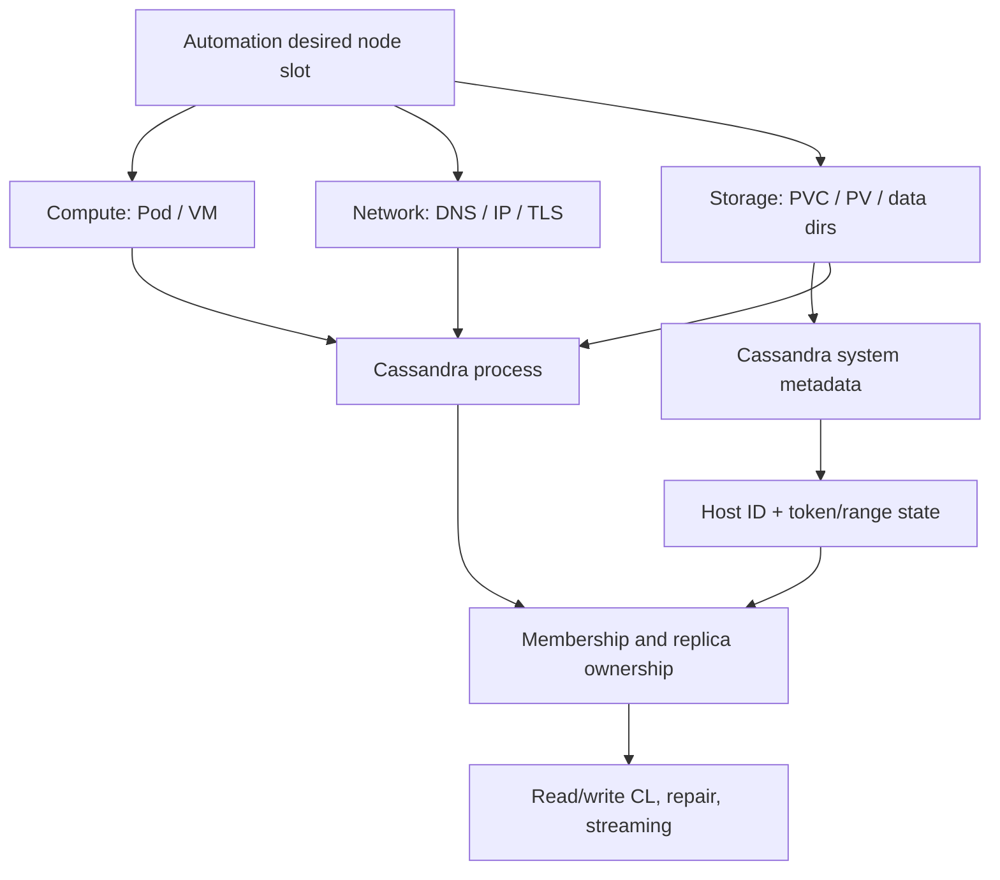
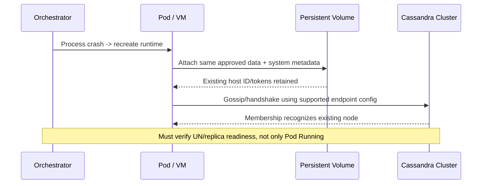
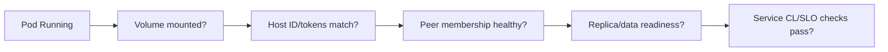
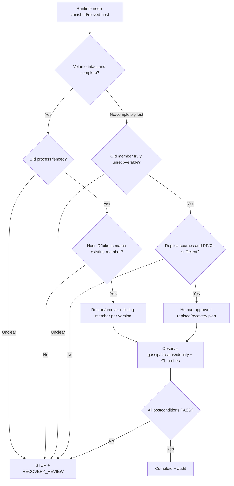
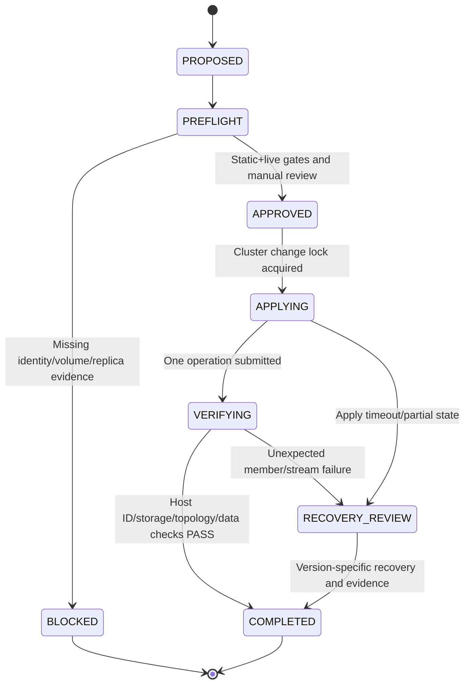

# Separating Node, Address, Volume, and Identity Lifecycles in Apache Cassandra Automation

## 1. Why doesn't "the pod restarted" equal "the Cassandra node recovered"?

In the **DATABASE_ENGINE_WIDE_COLUMN_CASSANDRA** module, Apache Cassandra is a **distributed wide-column** database. **Partition keys** map to tokens; tokens/ranges along with **replication factor (RF)**, datacenter/rack, and placement rules identify which replicas hold the data. Read/write paths follow **consistency level (CL)**, while compaction, repair, streaming, and bootstrap govern how data is stored and moved. Java applications connect via CQL/Java Driver, yet the Java app process does not define Cassandra replica identities.

An automation system can recreate a VM or Kubernetes Pod in seconds. That **does not prove** the corresponding Cassandra node returned with the right identity, token ownership, and data:

- A new Pod may receive a **new IP** while mounting the **exact persistent volume** holding the previous node's data and metadata.
- A Pod may keep the same name and IP while mounting an **empty volume**, causing a critical mismatch between automation assumptions and Cassandra state.
- A volume holding SSTables survives, yet one or more data directories or commitlog directories were not mounted.
- The old node is not truly dead; automation spins up a replacement with competing identity and token ownership.
- The StatefulSet scaled down, yet Cassandra never ran **decommission** and never streamed data to remaining replicas.
- New DNS records/seeds resolve, yet internode TLS or broadcast addresses prevent the node from gossiping or streaming.
- Every Pod is `Running`, yet `nodetool status` shows `UJ`/`DN` or applications hit `Unavailable`/`ReadTimeout`.

The core thesis of **"Separating node, address, volume, and identity lifecycles in automation"** is: **a change at the compute, network, or storage layer must never automatically be interpreted as a valid change to a Cassandra logical node**.

### Learning objectives

After this lesson, you will be able to:

1. Distinguish logical **Cassandra node/host ID**, token/range ownership, process/Pod/VM, network endpoint, and persistent volume.
2. Explain why **IPs, hostnames, Kubernetes ordinals, and seed addresses are not Cassandra identity itself**.
3. Build an inventory linking node IDs, datacenter/rack, token placement, endpoints, disks/PVCs, and running versions.
4. Pick the right workflow when **restarting the same node**, **rotating addresses**, **losing a volume**, **replacing a failed node**, **bootstrapping a new node**, or **decommissioning a healthy node**.
5. Design a controller with a state machine, preflight, locking, approvals, postconditions, and **fail-closed** behavior on unclear identity.
6. Prevent cloned volumes / duplicate host identities, wrong reattachments, split-brain, and destructive operations lacking replica coverage.
7. Inspect actual state via `nodetool`, CQL, and Java Driver 4.x.
8. Apply these patterns to Kubernetes StatefulSets/PVCs or VMs/cloud disks without equating "Pod Ready" with "data Ready."
9. Analyze real-world cases involving IP rotation, volume loss, zone migration, and topology changes.
10. Author runbooks and checklists for safe rollouts, reconciling `UNKNOWN` writes, and verifying data at target CL.

**Boundaries:** examples depict common architectures and observations; configuration names, replace/bootstrap commands, metadata protocols, and recovery prerequisites vary across Cassandra 3.x, 4.x, 5.x, and distributions. Before production operations, check your exact version, official docs, and internal SOPs. This lesson does not advocate running membership-mutating or data-moving commands without review.

## 2. Five identities/lifecycles that must stay separate

| Layer | Examples | What it describes | Must not infer |
| --- | --- | --- | --- |
| **Logical Cassandra node** | Host ID, membership metadata, token assignments, DC/rack | Cluster member and replica storage responsibility | IP or Pod name is the host ID |
| **Compute runtime** | VM, bare-metal host, container, Kubernetes Pod, process PID | Where the Cassandra process runs | Process restarted means data/ownership recovered |
| **Network endpoint** | Internode listen/broadcast, native CQL endpoint, DNS, TLS identity | Path for nodes and clients to connect | Old endpoint can arbitrarily attach to a new data dir |
| **Persistent storage** | PV/PVC, block volume, filesystem, Cassandra data directories | SSTables, system metadata, commitlogs, stored state | Volume is a "blank disk swappable at will" |
| **Orchestrator identity** | StatefulSet ordinal, instance ID, cloud resource ID, labels | Object managed by automation | Ordinal/label always matches Cassandra host ID |

These components can **change or persist independently**:

- The Pod process crashes and restarts while **PVC + host ID + tokens** remain intact.
- The node IP changes upon rescheduling while the data directory and identity persist.
- A VM instance ID changes on host rebuild while the intact disk still holds the old Cassandra identity; follow address/host-change runbooks.
- A volume is completely lost while hostname/ordinal remain; this is **not** a routine restart of the same Cassandra replica.
- A Cassandra node is **replaced** per procedure: token coverage may move to a new logical member rather than forcing retention of the old host ID.
- Membership metadata may retain a `DOWN` node even after its compute instance was deleted.

### 2.1. Relationship diagram



**Checkpoint:** a controller may mark a slot healthy only when the **compute ↔ network ↔ volume ↔ host ID/tokens ↔ cluster membership** chain matches the intended operation.

## 3. Logical node: host ID, token ranges, and datacenter/rack

### 3.1. Host ID is not an IP

Cassandra assigns a **host ID** to identify a node in cluster metadata. In common versions, nodes persist identity/metadata locally in system keyspaces (e.g., `system.local`); peers see the node via gossip/peer metadata. **A network address is a contact attribute** that can change under supported conditions and should never serve as the sole primary inventory key.

Read-only CQL observation on a node:

```sql
SELECT host_id, cluster_name, data_center, rack, release_version, tokens
FROM system.local;
```

**Important:**

- `system.local` represents the coordinator node answering the query; **it does not inspect all cluster nodes**.
- Token sets can be very large with **vnodes**; store via artifacts/hashes and cross-check metadata.
- Newer Cassandra releases may introduce updated placement/metadata models; follow version-specific procedures rather than hardcoding on-disk assumptions from another release.
- When recovering elsewhere, never manually edit `system.local` to "force" a desired host ID.

### 3.2. Tokens and replica placement are operational data, not labels

With `NetworkTopologyStrategy` RF=3 in `dc1`, a partition with token T maps to replicas according to token ranges and DC/rack/snitch placement. One node owns many ranges under vnodes.

```text
partition key = (customer_id, order_day)
             |
             v
           token T
             |
          RF(dc1)=3
          /   |   \
      node A node B node C

Host IDs and token ownership: Cassandra cluster metadata
IP/DNS: endpoints to reach A/B/C
PVC: stores SSTables and system metadata for A/B/C
```

If B's Pod/IP changes while its volume and identity remain intact, the goal is normally **bringing B back**, not adding node D. If B lost its volume and is **replaced** per SOP, the cluster may assign a new owner to B's ranges; that is a **different** topology/recovery operation.

### 3.3. DC/rack are not arbitrary labels either

Datacenter and rack directly control placement. Changing `dc=dc1` to `dc=dc2` or switching racks to match a cloud zone by simply editing a file **does not automatically move data properly**. Moving across failure domains requires a supported migration/rebuild/replace plan and valid RF/CL conditions.

### 3.4. Node ID, process ID, provider instance ID

| Field | Scope | Expected durability |
| --- | --- | --- |
| Cassandra host ID | Logical cluster membership | Retained across same-node/data restarts |
| Token assignments | Data ownership | Changes only via supported topology operations |
| OS process PID | Single process run | Changes on every restart |
| Kubernetes Pod UID | Single Pod instance | Changes whenever Pod is recreated |
| StatefulSet Pod name/ordinal | Controller slot | Can stay stable across Pod recreates |
| Cloud VM instance ID | Compute resource | Changes when VM is replaced |
| IP address | Endpoint | Can change with networking/placement |
| PVC/PV UID or disk UUID | Persistent volume resource | Requires exact binding and actual content |
| Node hostname | Network/inventory label | Never use as sole proxy for host ID |

## 4. Compute lifecycle differs from data lifecycle

### 4.1. Restarting the same node

A valid restart of the same Cassandra logical node generally relies on:

- Data directories and system metadata remaining **accurate, complete, and intact**.
- Zero second Cassandra processes using the same volume or identity.
- Host ID/tokens and DC/rack not getting reset or misconfigured.
- Disks and commitlog paths mounted properly.
- Server/config versions compatible with on-disk data.
- Endpoint networking handled via supported procedures if the IP changed.
- Peers recognizing it as the **same logical member**, not adding another member.

A **new Pod** is a fresh runtime, yet the **logical node** need not be new if identity is preserved. Even so, **changing an IP** is not always harmless: peer discovery/broadcasting, TLS SANs, and address-change commands carry version constraints.

### 4.2. New node

Bootstrapping a new node means the cluster accepts a **new member** with new identity/token/range responsibilities per procedure, streaming data from existing replicas. It is never simply starting Cassandra on an empty volume reusing an old node's IP or hostname.

### 4.3. Failed node and replacement

When an old node dies and its volume/identity cannot be recovered, automation must pick a **replacement or recovery path** for the exact Cassandra version, verifying healthy replica sources, RF/CL, and token placement. Never provision an empty volume and pretend it is the same old node merely because the StatefulSet ordinal stayed identical.

### 4.4. Healthy node leaving

Decommission must finish **data handoff/streaming and topology metadata updates** before reclaiming compute or volumes per policy. Deleting a Pod or VM before decommission leaves the node marked DOWN while the ring still expects it to serve as a replica.

### 4.5. Independent timelines



## 5. Address lifecycle: clients, gossip, and streaming do not share one endpoint

### 5.1. Address groups to verify

| Concept | Where used | Notes |
| --- | --- | --- |
| `listen_address` / listen interface | Address node binds for internode traffic | Can differ from advertised endpoint |
| `broadcast_address` | Address node advertises to peers | Must be peer-reachable; version-dependent semantics |
| `rpc_address` | Native protocol bind address | Can be wildcard inside protected networks |
| `broadcast_rpc_address` | Native/CQL endpoint advertised to clients | Must be driver/topology-reachable |
| Seeds | Contact points for gossip discovery | **Not** a membership or replica list |
| DNS | Maps names to IPs | Working DNS does not guarantee valid TLS/gossip/identity |
| Internode TLS certificates | Authenticate/encrypt peer-to-peer traffic | Cert SANs/trust/expiry can break on IP/DNS changes |
| Java Driver contact points | Client bootstrap/discovery paths | Need not list every node |

A driver can connect cleanly to the native protocol port while **node-to-node streaming** fails because internode address, port, or TLS is wrong.

### 5.2. An IP change does not mean a host ID change

Scenario: pod `cassandra-1` reschedules onto another worker, keeping the exact PVC while Pod IP changes from A to B.

The controller must ask:

1. Does the running Cassandra version support or require a procedure to change the **advertised endpoint**?
2. Are `listen`/`broadcast`/`rpc` re-rendered for the new node?
3. Do peers still hold the old endpoint in gossip or system peer metadata?
4. Have headless Service DNS and driver discovery updated to see the right host ID?
5. Do TLS certificate SANs/identities match the new endpoint?
6. Is any other process still claiming the old endpoint or volume?
7. Post-startup, does the node reach `UN` with valid token ownership and CQL checks?

Without answers, **never swap the volume or host ID** to "fit the new IP." Changing an existing Cassandra node's IP varies across releases and OS/container networks.

### 5.3. DNS is not the source of truth for node ownership

A DNS record like `cassandra-1.svc` updates when a Pod recreates. DNS supplies connection addresses; Cassandra needs identity and token consistency at the metadata layer.

**Never define "node B exists" solely because DNS resolves an IP.** Verify host IDs, replicas, peer views, and native/internode connectivity.

## 6. Volume lifecycle: binding accuracy matters more than mount success

### 6.1. Stateful paths

| Data | Role |
| --- | --- |
| `data_file_directories` | SSTables and keyspace data, including system keyspace/metadata per version layout |
| `commitlog_directory` | Commitlogs for write durability and crash recovery |
| `hints_directory` | Hints for temporarily unavailable replicas per version mechanism |
| `saved_caches_directory` | Cached state (never sole source of truth) per version |
| Snapshot/incremental paths | Retained SSTables, often hard-linked on the volume |
| Config/TLS/secret mounts | Runtime configs and credentials; separate lifecycle from data |

**Never** assume everything resides on one PVC. A cluster may use multiple volumes; mounting only one of several `data_file_directories` leaves the node missing SSTables or system state. Verify the **entire mount set** against inventory.

### 6.2. A persistent volume has two parts to its identity

1. **Resource identity:** PV/PVC/disk ID, storage class, availability zone, attachment, filesystem UUID.
2. **Content identity:** Cassandra system metadata, host ID, tokens, SSTables/commitlogs, and exact data generation.

A PVC named `data-cassandra-1` **does not guarantee** it holds yesterday's volume and bytes. A freshly provisioned disk sharing the same PVC name still has a completely different content identity.

### 6.3. Volume cloning and split-brain

If disk A is snapshotted/cloned onto VM B and both run **concurrently**:

- **Duplicate host identities** and conflicting node endpoints/metadata appear.
- Tokens and replica ownership are duplicated improperly.
- Writes and commitlogs no longer represent a single history.
- Repair/streaming and peers cannot treat the two processes as independent replicas.
- "Fixing" one clone by deleting its system keyspace is not a safe recovery procedure.

**Never attach the same Cassandra data volume to two live processes** (even if storage supports multi-attach/RWX). Protect node identity via **exclusive attachment + fencing**; cloned backups may only be started through an isolated, version-appropriate restore/replacement workflow.

### 6.4. Cross-zone volume movement

Cloud disks/PVs may be pinned to one availability zone. If a Pod/VM reschedules to another zone where the volume cannot attach:

- The Pod stays `Pending` or attach fails; **never auto-provision a blank disk just to get running**.
- If restoring from a snapshot/block copy, explicitly decide whether it is **identity-preserving recovery or new-node replacement**—never mix the two.
- Switching DC/rack/zone can alter replica placement and failure-domain guarantees.
- Stop/fence the source process and verify full disks/metadata before starting the target.

### 6.5. Total disk loss

An empty volume + the same Pod name/IP **never qualifies as the same Cassandra node**. When data and host identity are lost, operations must evaluate rebuilding from surviving replicas, backups, and the replacement runbook. Reusing the same hostname to "trick" the cluster can yield an even harder-to-recover state.

## 7. Matrix: when one component changes, which workflow applies?

| Event | Compute | Address | Storage | Cassandra logical operation |
| --- | --- | --- | --- | --- |
| Process crash, volume intact | New process | May stay same | Exact same volume | Restart existing member; check metadata/readiness |
| Pod recreated, IP changed | New Pod UID | New IP | Same PVC/content | Existing member with endpoint-change procedure if version requires |
| VM died, disk intact | New VM | May change | Old disk intact | Recover existing member per SOP and fencing |
| Volume lost, old node dead | New VM/Pod | May reuse | New/blank disk | **Replacement/bootstrap recovery** per version, never fake restart |
| Adding capacity | New VM/Pod | New endpoint | New empty volume | Bootstrap **new member**, stream data |
| Planned scale-in | VM/Pod removed | Endpoint retired | Retire volume last | Decommission before deleting compute/storage |
| Dead node metadata removal | Dead process | Old endpoint | Unreadable/lost | `removenode` per high-risk SOP / source coverage |
| Moving DC/rack | May keep/change | May change | May keep/change | Topology/data migration, never plain label edit |
| Storage snapshot restore | New compute | New endpoint | Clone of old data | Isolated restore/recovery plan; avoid duplicate live host ID |
| IP reused for different volume | Same net addr | Same | **Different** | **BLOCK** until node identity is verified |

This matrix is a **triage aid**, not a promise that each row maps to one universal command. Whenever two components change together, review against the exact Cassandra version's semantics.

## 8. Identity registry: a historical source of truth

Relying solely on Pod/VM names to link storage and Cassandra membership is insufficient. Maintain a **versioned, auditable registry**:

```yaml
schema_version: 1
cluster_id: "cassandra-lab-a"
cassandra_server_version: "<exact-version>"
observation_time_utc: "2026-11-21T09:00:00Z"

nodes:
  - slot_id: "cassandra-1"
    orchestration_kind: "kubernetes-statefulset"
    pod_name_expected: "cassandra-1"
    pod_uid_observed: "<actual-pod-uid>"
    instance_id_observed: "<worker-or-vm-id>"

    cassandra_host_id_expected: "<uuid>"
    cassandra_host_id_observed: "<uuid>"
    token_map_artifact: "topology/host1-tokens.json"
    membership_state: "UN"

    dc_expected: "dc1"
    rack_expected: "rack2"
    internode_broadcast_endpoint: "<dns-or-ip>"
    native_broadcast_endpoint: "<dns-or-ip>"
    tls_identity_reference: "<nonsecret-cert-ref>"

    pvc_name: "data-cassandra-1"
    pvc_uid_observed: "<uid>"
    pv_uid_observed: "<uid>"
    backing_disk_id: "<provider-disk-id>"
    filesystem_uuid: "<fs-uuid>"
    data_dirs:
      - "/var/lib/cassandra/data"
    commitlog_dir: "/var/lib/cassandra/commitlog"
    mount_integrity_verified: null

    lifecycle_intent: "restart-existing-member"
    replacement_operation_id: null
    approved_change_id: "<approval-id>"
    reconciliation_status: "VERIFYING"
```

This is an **illustrative internal manifest**, not a schema natively understood by Cassandra or Kubernetes.

### 8.1. Three logical columns in the registry

- **Expected:** planned node/slot identity, tokens/rack, volume binding.
- **Observed:** host ID from Cassandra, PVC/PV IDs, and live runtime endpoints.
- **Operation intent:** restart, endpoint migration, replacement, bootstrap, or decommission.

If `expected_host_id != observed_host_id` when intent is **restart existing member**, the controller must **BLOCK / RECOVERY_REVIEW**, never update the expected registry to hide the mismatch.

### 8.2. Never put secrets in inventory

The registry may hold internal IPs, host IDs, and tokens; enforce proper access controls. Store TLS certificate references, never private keys. Do not publish raw topology/endpoints publicly if security policy forbids it.

## 9. Kubernetes StatefulSet: stable slots do not mean stable Cassandra identity

### 9.1. What does a StatefulSet provide?

A StatefulSet provides stable Pod names/ordinals and per-ordinal PVCs when configured properly. However:

- **Pod UID** changes on every recreate.
- **Pod IP** can change.
- **PVC** can keep its name while requiring UID/PV/content checks; retention policies govern PVCs during scale/delete.
- **Headless Service/DNS** aids stable naming, not token ownership checks.
- Readiness/liveness probes do not understand repair/streaming, RF, or CL.
- StatefulSet `replicas` count **does not equal Cassandra cluster membership count** at every moment.

### 9.2. Read a manifest snippet as intent, not a complete solution

```yaml
# Conceptual excerpt only, NOT a complete StatefulSet.
apiVersion: apps/v1
kind: StatefulSet
metadata:
  name: cassandra
spec:
  serviceName: cassandra-headless
  replicas: 3
  podManagementPolicy: OrderedReady
  volumeClaimTemplates:
    - metadata:
        name: data
      spec:
        accessModes: ["ReadWriteOnce"]
        resources:
          requests:
            storage: 200Gi
```

This YAML **omits** selectors, pod templates, images, security contexts, storage classes, resources, topology spread/affinity, probes, init configs, TLS, and more—so **never deploy it directly**. It illustrates only the ordinal-to-PVC relationship.

Warnings:

- `ReadWriteOnce` is a storage/Kubernetes mount mode; it does not replace **process-level fencing** if the storage provider permits multi-process access.
- `OrderedReady` does not replace Cassandra-aware bootstrap, replacement, decommission, and recovery gates.
- Scaling up a StatefulSet does not ensure the new Pod finished streaming data.
- Scaling down a StatefulSet does not execute `decommission` properly.
- Deleting a Pod does not equal deleting a PVC (depending on StatefulSet PVC retention policies and Kubernetes version).
- Deleting a PVC or triggering dynamic re-provisioning wipes data identity even while the ordinal stays identical.

### 9.3. Preconditions before restarting a Pod

1. Record expected host ID and volume/PV UIDs.
2. Confirm no old Cassandra process remains alive on the volume.
3. Validate data directories, commitlog paths, filesystem, and permissions.
4. Pin image, version, and config.
5. Align endpoint advertisement and TLS if Pod IP may change.
6. Treat the node as an **existing member** only with evidence; never auto-bootstrap onto an empty disk.
7. Prevent liveness from killing a node solely because valid bootstrap/streaming takes time.
8. Define readiness per service contract, not TCP open alone.
9. Post-restart, verify host ID, tokens, node state, and CQL probes.
10. Route any anomaly to `RECOVERY_REVIEW`, never an infinite restart loop.

## 10. Node readiness: three distinct signals



| Check | Proves | Does not prove |
| --- | --- | --- |
| Pod Running | Container process is alive | Cassandra joined the cluster |
| TCP 9042 open | Native protocol listener reachable | Peers gossip/stream or RF is valid |
| PVC Bound | Storage claim bound to a resource | Volume holds the right data and host ID |
| `nodetool status = UN` | Node seen Up/Normal | All token ranges hold complete/repaired data |
| Driver schema agreement | Schema views converged per driver | Streaming, compaction, or repair finished |
| Synthetic read `LOCAL_QUORUM` passes | Sample partitions/queries pass at CL | Entire dataset is intact |
| Stream/repair terminal success | Scoped data movement finished | Multi-table business state is always consistent |

Liveness must therefore avoid causing **restart loops** on nodes doing valid long-running work; readiness and canaries belong in separate checks. Never turn full-table `SELECT COUNT(*)` or `nodetool repair` into a periodic health probe.

## 11. Separating service lifecycle from node lifecycle in controllers

A Cassandra-aware controller should track separate state per layer:

```text
compute_state:   PodPending / Running / Terminating / Gone
storage_state:   ClaimPending / Bound / Mounted / Missing / WrongBinding
network_state:   EndpointPending / Reachable / Advertised / Mismatch
identity_state:  Unverified / Match / Mismatch / ReplacementApproved
cluster_state:   DN / UJ / UN / UL / Unknown
operation_state: Proposed / Preflight / Applying / Verifying /
                 RecoveryReview / Completed
```

Never collapse everything into a single boolean `healthy=true`.

### 11.1. Basic reconciliation rules

- **Compute restart + same volume identity:** follow existing-member lifecycle.
- **Endpoint changed:** follow network/metadata update path without touching storage identity.
- **Volume identity changed:** halt and require explicit determination of restart vs. replacement.
- **Host ID changed without replacement approval:** halt.
- **Cluster state = `UJ`/`UL`:** wait for proper operation/streaming phases; never mark ready from TCP alone.
- **Old member still UP while replacement planned:** block duplicate owners; verify fencing.
- **Cluster metadata unconverged:** never auto-delete Pods, PVCs, or host IDs.
- **Data readiness fails after apply:** hold in `VERIFYING`/`RECOVERY_REVIEW` rather than forcing green.

## 12. Warning against overly aggressive "self-healing"

Automation that sees a Pod crash and automatically creates a new node with an empty PVC calls itself "self-healing," yet for Cassandra it is an **uncontrolled data/identity mutation**.

Never:

- Auto-delete PVCs when a node fails liveness.
- Auto-provision a blank disk for the same ordinal when PV attach fails.
- Auto-inject `replace_address`/bootstrap flags while unsure of the old member's state.
- Auto-run `removenode` when peers report `DN` for a few minutes.
- Manually edit `system.local` or delete system keyspaces to bypass host ID mismatches.
- Auto-run `cleanup` to free disk mid-topology move.
- Auto-scale down StatefulSets when RF/capacity cannot support fewer nodes.
- Copy a live node's entire data directory and run two replicas concurrently.
- Lower CL so liveness turns green without reviewing the consistency contract.
- Restart all Cassandra processes simultaneously to clear gossip disagreements.

**Proper self-healing:** halt the next step, preserve data, gather evidence, and run procedures proven **idempotent and safe**. Sometimes the best automated action is **BLOCK** and escalate.

## 13. Flowchart for choosing recovery paths by evidence



This diagram omits specific replacement commands because exact version, rack, DC, and storage state dictate the procedure, and mistakes risk data loss.

## 14. Preflight for an operation changing compute, address, or storage

| Group | Mandatory conditions before apply |
| --- | --- |
| Version | Exact Cassandra Server build per node and compatibility matrix |
| Cluster | Cluster ID/name, expected nodes, DC/rack/snitch, RF/CL |
| Identity | Expected host ID/tokens vs. observed local/peer metadata |
| Compute | Old process fenced; zero dual access to the same identity |
| Network | Listen/broadcast, DNS, internode TLS/ports, native client endpoints |
| Storage | PVC/PV/disk UID, filesystem, data dirs, commitlog, capacity, exclusive attach |
| Topology | No competing bootstrap, replace, decommission, or `removenode` |
| Data safety | Replica coverage, source availability, backup/restore readiness |
| Resources | Disk/IOPS/CPU/network headroom for streaming and compaction |
| Service | Client p95/p99, error rates, retry budgets, `UNKNOWN` write reconciliation |
| Workflow | Change ID, immutable manifest, approvals, cluster lock, rollback/roll-forward plan |

### 14.1. Preflight is not regex checks per bullet

- Matching IP in the manifest does not prove the right volume.
- Bound volume does not prove the right host ID.
- Right host ID on disk does not prove the old process was fenced.
- Node `UN` does not prove all ranges, data, and CL are healthy.
- `nodetool status` can differ across peer views during convergence.
- Having taken a backup does not guarantee restorability; require off-cluster/restore evidence.
- A Pod stuck Pending may be a storage issue, **not** lost Cassandra cluster metadata.

## 15. Gathering evidence with read-only commands

Run across **relevant nodes**, tagged with timestamps and host aliases, not just one coordinator:

```bash
nodetool version
nodetool status
nodetool describecluster
nodetool info
nodetool netstats
nodetool tpstats
nodetool compactionstats
nodetool gossipinfo
```

Commands generally observe via JMX; still enforce permissions and avoid high-frequency polling on overloaded clusters.

CQL on the inspected node:

```sql
SELECT host_id, cluster_name, data_center, rack, release_version, tokens
FROM system.local;

SELECT keyspace_name, replication, durable_writes
FROM system_schema.keyspaces
WHERE keyspace_name = 'commerce';
```

On releases with `system.peers_v2`, cross-check peer metadata; other releases use `system.peers` or version-specific metadata interfaces. **Never assume one peers table exposes all host IDs/tokens in real time.** Pair with logs, join state, and cluster range-ownership views.

### 15.1. Reading membership states

| Common state | Meaning | Must not infer |
| --- | --- | --- |
| `UN` | Up / Normal | All ranges finished streaming/repair |
| `UJ` | Up / Joining | Bootstrap/membership join in progress | Safe to delete volume if waiting feels long |
| `UL` | Up / Leaving | Node departing cluster | Safe to kill process and wipe disk immediately |
| `UM` | Up / Moving, per version/operation | Token movement requiring procedure | Necessarily supported across every release |
| `DN` | Down / Normal per peer view | Node unreachable over gossip | Permanently dead or disk lost |

## 16. Volume and process observation must be permission-separated from node metadata

On VMs or Kubernetes, a storage agent can collect **read-only metadata**:

```text
runtime:
  pod_uid / instance_id / container_id
  process_start_time
  image_digest
network:
  pod_ip / advertised_internode_endpoint / native_endpoint
storage:
  pvc_uid / pv_uid / disk_id
  filesystem_uuid / mountpoint / mount_readonly
  data_dir_and_commitlog_dir_checks
cassandra:
  host_id / tokens / dc / rack / membership
```

**Never** write a production script using PV name as sole proof: a PV can be rebound or restored from a different snapshot. Check **content identity** whenever possible and audit restore operations.

### 16.1. Kubernetes read-only command examples

```bash
# In an environment authorized to view the exact namespace.
kubectl get pod cassandra-1 -n cassandra-lab -o wide
kubectl get pvc data-cassandra-1 -n cassandra-lab -o yaml
kubectl describe pod cassandra-1 -n cassandra-lab
```

Commands illustrate lab usage only. `kubectl describe` can reveal node addresses, hostnames, and internal annotations; redact before sharing. **Never** treat `kubectl delete pod/pvc` as a default troubleshooting step.

### 16.2. Read-only mount diagnostics in Linux

```bash
# On an authorized node/container; never writes or deletes data.
findmnt /var/lib/cassandra/data
findmnt /var/lib/cassandra/commitlog
df -h /var/lib/cassandra/data
df -h /var/lib/cassandra/commitlog
```

Cross-check mount output against inventory/UIDs and all configured directories. `df` showing healthy capacity does not prove SSTables or system keyspaces exist or are intact.

## 17. Operation A — Restarting an existing Cassandra node with its persistent volume

This carries lower risk than a topology mutation **only when every identity precondition holds**.

### 17.1. Before restart

1. Record change/run ID and blast-radius bounds.
2. Confirm expected cluster/node: host ID, token set, DC/rack, and peer views.
3. Read PV/PVC/disk IDs and inspect data directories/commitlog paths.
4. Confirm the **old process is stopped/fenced** with zero duplicate attachments.
5. Confirm Cassandra image/JDK/config/version match or belong to an approved rolling-upgrade plan.
6. If the IP may change, verify whether an endpoint-change procedure is approved for the current version.
7. Confirm replicas and application CL can tolerate the node being briefly unavailable.
8. Lock down gates for p95/p99, `ReadTimeout`/`WriteTimeout`/`Unavailable`, pending streams/compactions, and disk.

### 17.2. After restart

- Verify the **same Cassandra host ID** on the node.
- Compare token/range assignments against baseline (unless intentionally changed).
- Verify DC, rack, snitch, and cluster name.
- Confirm the node returns to expected membership state, typically `UN` once settled.
- Verify zero unexpected bootstrap/replace messages in server logs.
- Verify zero duplicate host IDs, lingering wrong endpoints, or inconsistent peer metadata.
- Pass synthetic partition-key CQL probes at real CL.
- Confirm client p99, error rates, and retries return within thresholds; monitor repair/hints/backlogs as needed.
- Ensure any `UNKNOWN` write outcomes from the outage window have a reconciliation workflow.

**If the volume mounted wrongly or the host ID changed**, halt before serving traffic; never wipe system keyspaces to "recreate it right." Reclassify the event as **replacement/recovery** rather than forcing a restart to succeed.

### 17.3. Failure modes

| Observation | Investigation path | Do not do |
| --- | --- | --- |
| Pod Running, Cassandra process crash-loops | Config/version, permissions, storage, logs | Delete PVC |
| Cassandra runs with a new host ID | Volume/content identity mismatch | Override expected ID |
| Host ID matches, peers see old endpoint | Version-specific gossip/broadcast DNS/TLS | Manually delete cluster membership |
| Mounts exist yet data dirs missing | Partial disk attachment/restore | Ignore because disk has free space |
| Node unexpectedly `UJ` post-restart | Boot flags/identity/bootstrap procedure | Treat as routine restart |
| `UN`, yet quorum reads time out | Replica/data/resource readiness | Lower CL automatically |

## 18. Operation B — Address/DNS rotation without changing storage identity

The goal is changing the **network endpoint** without confusing it with **replacing a logical member**.

### 18.1. Change plan

```yaml
change_id: "CR-CASS-NET-042"
kind: "existing_node_endpoint_rotation"
cluster_id: "cassandra-lab-a"

identity:
  expected_host_id: "<uuid>"
  expected_token_fingerprint: "<sha256>"
  expected_pvc_uid: "<uid>"

network_before:
  internode_broadcast: "node-a.internal.old"
  native_broadcast: "node-a-client.old"

network_after:
  internode_broadcast: "node-a.internal.new"
  native_broadcast: "node-a-client.new"

preflight:
  old_process_fenced: false
  dc_rack_unchanged: true
  tls_new_endpoint_validated: false
  peer_reachability_validated: false
  server_version_support_reviewed: false

decision: "BLOCKED"
```

The form intentionally states `BLOCKED` because fencing, TLS, and endpoint-change support are unproven. Never turn it into runnable config simply by editing `decision=APPROVED`.

### 18.2. Elements to update and reconcile

- Internode listen/broadcast endpoints and native protocol endpoints need not match.
- Execute TLS cert SAN, trust chain, and key rotation per policy.
- Confirm peers see the new endpoint and stop routing to the old endpoint past the transition window.
- Seeds/contact points handle bootstrap/discovery; never edit seed lists trying to "change host ID."
- Java Driver topology refresh and pools may hold stale endpoints briefly; watch retries and timeouts.
- DNS TTLs and negative caching factor into application convergence time.
- With Kubernetes Services, verify endpoint slices/readiness target the right Pod; a healthy Service IP does not prove internode traffic works.
- Verify replica ownership and host IDs before and after.

### 18.3. What must not be inferred

Responding to `ping`, resolving DNS, or accepting TCP 9042 **does not prove** Cassandra peers accepted the new endpoint, nor that streaming/repair works. Cross-check server peer views, internode TLS logs, and CQL metrics.

**Version warning:** no single in-place IP-change procedure fits every Cassandra release and deployment. Some setups require a full node-replacement workflow instead of editing endpoints directly. If version docs/SOPs do not confirm safety, select `RECOVERY_REVIEW`.

## 19. Operation C — VM died while disk remains intact

Cloud platforms can reattach a persistent disk from an old VM onto a fresh VM. This can follow **existing-member recovery** provided **no two processes run concurrently**, volume contents are intact, and the version supports endpoint migration.

### 19.1. Evidence-backed workflow

1. Confirm the old VM is powered off/fenced at the provider layer—not merely "SSH unreachable."
2. Verify disk ID, volume snapshot/generation, filesystem, and expected data directories.
3. Preserve mappings for all data directories and commitlogs, not only the main data volume.
4. Verify disk attachment to the target zone/host without corrupting the filesystem.
5. Pin old host ID, tokens, DC, and rack from pre-failure evidence and on-disk metadata.
6. Verify Cassandra/JDK/OS compatibility with the volume.
7. If the endpoint changes, use a version-specific procedure rather than editing `system.local`.
8. Start under control and observe cluster membership, logs, and driver metadata.
9. Run CQL synthetic reads and sampling across token ranges.
10. Close only after data, readiness, CL, and SLO gates pass.

### 19.2. When is this forbidden?

- Old VM is unfenced and could still boot and accept writes.
- Cloud disk copy/snapshot is incomplete or missing commitlogs/data dirs.
- New host sits in a different DC/rack disallowed by the current procedure.
- On-disk data format is incompatible with the new server.
- Host ID/tokens mismatch expected values or collide with a duplicate member.
- The cluster already completed replacement/`removenode` for the old member; you cannot simply bring the old identity back.
- No owner or rollback/roll-forward plan exists.

**Reattaching an old disk after the cluster replaced that node can be a severe error**: ownership already moved, and the old node must not rejoin as before without a release-specific procedure.

## 20. Operation D — Volume loss: never "self-heal" with a blank disk

A `MountFailed` alert may stem from quotas or zone issues, not data loss. First distinguish:

1. PV/PVC unbound due to scheduler/storage issues; bytes **may still be completely intact**.
2. Disk temporarily detached and reattachable after fencing.
3. Disk partially damaged/corrupted; data source may be inconsistent.
4. Disk deleted or unrecoverable; Cassandra local data/system metadata **genuinely lost**.
5. One of several volumes lost, requiring classification of partial local state.
6. Whether offsite backups or surviving replicas suffice for recovery.

### 20.1. Decision matrix

| Condition | Precondition | Procedure |
| --- | --- | --- |
| Temporary attach error, disk intact | Storage provider confirms disk exists | Fix attach/network; existing-member recovery |
| Disk intact, old compute dead | Old fenced, identity verified | Recover existing member if supported by version |
| One of multiple volumes lost | Partial data/system state | Stop, DBA review, assess recovery; never fake same member |
| Disk completely lost | Valid replica sources and replacement SOP exist | Replace/rebootstrap per version with approval |
| Insufficient replicas/sources | RF/CL coverage unclear | Stop and restore from backup / incident plan |
| Fresh PV auto-provisioned under same PVC name | Different content identity | BLOCK if intent was restarting existing member |

Never run logic like:

```text
if pod crash:
    delete pvc
    recreate pod
    mark node recovered
```

This anti-pattern can destroy recoverability. If a disk is truly lost, **it is a data incident**, no longer a simple container error.

### 20.2. When replacement is genuinely needed

Require:

- Verified death/absence of the old node, ensuring its identity cannot run concurrently.
- Exact logical operation for the Cassandra Server version, such as a replacement procedure supporting token transfer.
- Sufficient surviving replicas and RF/data ranges to serve as sources.
- Matching DC/rack/network/TLS configuration on the new node.
- Properly sized and formatted new disk.
- Observed streaming progress and terminal completion.
- Repair and data correctness checks, especially for pre-outage `UNKNOWN` writes.
- Topology mutation locks and manual approvals for destructive steps.

**Never assume "replace keeps the exact old host ID."** Depending on the Cassandra procedure, the replacement member may get a **new host ID** designed to inherit token/range ownership. Distinguish **token coverage goals** from **the new member's identity**.

## 21. Operation E — Scale up: adding a true logical member

Scaling up Cassandra is a **bootstrap** that streams SSTables by token/range, not merely incrementing a StatefulSet's `replicas` count.

### 21.1. Workflow

1. Inspect current RF, DC/rack, and node count.
2. Select a rack/failure domain preserving replica placement.
3. Provision new compute, endpoint, and an **intentionally new empty volume** for the new member.
4. Never clone a data directory from a live member.
5. Execute bootstrap per the exact Cassandra version/orchestrator procedure.
6. Monitor `UJ`/gossip, `nodetool netstats`, disk/compaction, and stream errors.
7. Wait until the node reaches `UN` with expected token/range ownership.
8. Verify schema, synthetic CQL probes at app CL, and SLOs.
9. Record the new host ID + volume identity + endpoints in the registry **after verification**.
10. Run `cleanup` on existing nodes **only after data movement completes and SOP permits**.

### 21.2. Why not scale up to fix a hot partition immediately?

Adding a node redistributes token ranges, yet a **hot partition key stays mapped to its token's replica group**; Cassandra never splits one oversized partition across multiple partition keys. Redesign tables around queries, apply proper bucketing/sharding, and measure read/write workloads.

### 21.3. RF does not automatically rise with node count

Adding a fourth node to an RF=3 keyspace still keeps **three replicas per partition** per keyspace placement, rather than becoming RF=4. Changing RF is a separate migration requiring planning and data synchronization.

## 22. Operation F — Scale down: decommission before retiring the slot

### 22.1. StatefulSet scale-down differs from Cassandra decommission

Lowering a StatefulSet's `spec.replicas` deletes Pods by ordinal. It **does not** guarantee:

- The node finished handing off SSTables.
- The cluster safely updated token ownership.
- Remaining nodes satisfy RF/CL.
- Peer views converged cleanly.
- Old PVCs follow the intended retention policy.

**Right approach:** run the decommission/leave workflow per SOP while the node is healthy, verify streaming/ownership completion, and only then retire compute. Never reduce Pod counts first hoping "Cassandra will sort it out."

### 22.2. Replica capacity example

A 4-node cluster in `dc1` with RF=3 scaling down to 3 nodes: can plan capacity/placement/streaming checks with enough remaining replicas.

Scaling down further to 2 nodes **while keeping RF=3**: the plan cannot place three independent replicas across two nodes. The controller must **REJECT/BLOCK before apply**, never running one decommission at a time hoping the cluster adjusts RF itself.

### 22.3. Interrupted decommission

- A `UL` node may still be streaming; never delete its volume.
- If source/target hits disk, network, or GC bottlenecks, remediate resources and monitor progress.
- If a leaving node suddenly goes DOWN, distinguish repair, recovery, and decommission states per version.
- Never switch to `removenode` over a single alert; the two procedures carry different assumptions and risks.
- Never run `cleanup` or delete local SSTables before confirming remaining replicas hold full data.

## 23. Operation G — Moving zone/rack/DC is not a routine Pod reschedule

A platform team may want to evacuate compute from an availability zone. Yet Cassandra rack/DC represent **failure domains in replica placement**.

### 23.1. Why is a dedicated runbook needed?

- Persistent volumes have zone affinity; not every disk can move cross-zone.
- New rack placement changes placement expectations.
- Internode TLS, routes, and addresses may change.
- Replica copy counts and dispersion across failure domains can shift.
- Application local DC, network latency, and CL may be affected.
- You may need version-specific replacement, rebuild, decommission, or bootstrap—not just editing `rack=zoneB`.

### 23.2. Staged plan

1. Snapshot topology, RF, and per-range replica placement.
2. Identify nodes/racks moving and target failure domains.
3. Verify surviving replica sources suffice while one node is briefly unavailable.
4. Sequence operations so multiple replicas of the same range never change concurrently.
5. Review storage movement: can disks move or are new volumes + streaming required?
6. Review network, TLS, driver local DC, and capacity.
7. Execute **one node at a time** via supported procedures.
8. Verify host ID/token semantics match recovery/replacement intent.
9. Verify streaming, repair, CL, and application SLOs.
10. Update registry/Git desired state and audit records.

**Never treat topology spread constraints as a data migration tool.** They govern Kubernetes Pod placement only and do not move Cassandra replicas automatically.

## 24. Java Driver 4.x: identifying nodes beyond IP alone

### 24.1. Client-side metadata read-back

Java Driver 4.x exposes node and schema metadata, yet it is a **client-side view** that can lag or need refreshing. Use it as a **cross-check**, never a replacement for server `nodetool` or the identity registry.

```java
import java.net.InetSocketAddress;
import java.util.Map;
import java.util.UUID;

import com.datastax.oss.driver.api.core.CqlSession;
import com.datastax.oss.driver.api.core.metadata.Node;

public final class CassandraNodeIdentityReadback {

    public static void main(String[] args) {
        try (CqlSession session = CqlSession.builder()
                .addContactPoint(
                    new InetSocketAddress("127.0.0.1", 9042))
                .withLocalDatacenter("dc1")
                .build()) {

            boolean schemaAgreed = session.checkSchemaAgreement();
            System.out.println("schemaAgreement=" + schemaAgreed);

            Map<UUID, Node> nodes = session.getMetadata().getNodes();

            for (Map.Entry<UUID, Node> item : nodes.entrySet()) {
                Node node = item.getValue();
                System.out.printf(
                    "hostId=%s endpoint=%s dc=%s rack=%s state=%s%n",
                    item.getKey(),
                    node.getEndPoint(),
                    node.getDatacenter(),
                    node.getRack(),
                    node.getState());
            }
        }
    }

    private CassandraNodeIdentityReadback() { }
}
```

JDK 11+ example using common Java Driver 4.x APIs:

- `127.0.0.1:9042` and `dc1` are **testbed placeholders**.
- Driver metadata is keyed by host ID in this API; **reconcile observed host IDs against the registry** rather than matching nodes by IP strings.
- `getEndPoint()` shows the client connection path, **not proof of the internode broadcast endpoint**.
- `checkSchemaAgreement()` does not prove bootstrap, repair, or streaming completed.
- Rate-limit read-backs; never open a new `CqlSession` on every health tick.
- Verify getters and package names against your exact pinned Driver version.

### 24.2. CQL readiness via synthetic keys

Standard test table:

```sql
CREATE KEYSPACE IF NOT EXISTS lab_it
WITH replication = {
    'class': 'NetworkTopologyStrategy',
    'dc1': 3
};

CREATE TABLE IF NOT EXISTS lab_it.synthetic_orders (
    order_id uuid PRIMARY KEY,
    state text,
    generation int,
    logical_request_id uuid
);
```

**RF=3 and `LOCAL_QUORUM` here apply only to multi-node labs with at least three replicas in `dc1`.** On a single node, use matching topology and CL and never claim RF=3 failover/quorum verification.

```java
import java.time.Duration;
import java.util.UUID;

import com.datastax.oss.driver.api.core.CqlSession;
import com.datastax.oss.driver.api.core.DefaultConsistencyLevel;
import com.datastax.oss.driver.api.core.cql.PreparedStatement;
import com.datastax.oss.driver.api.core.cql.Row;

public final class SyntheticCassandraProbe {

    private final CqlSession session;
    private final PreparedStatement select;

    public SyntheticCassandraProbe(CqlSession session) {
        this.session = session;
        this.select = session.prepare(
            "SELECT order_id, state, generation " +
            "FROM lab_it.synthetic_orders WHERE order_id = ?");
    }

    public boolean verify(UUID syntheticOrderId, int expectedGeneration) {
        try {
            Row row = session.execute(
                select.bind(syntheticOrderId)
                    .setConsistencyLevel(
                        DefaultConsistencyLevel.LOCAL_QUORUM)
                    .setTimeout(Duration.ofSeconds(2))
                    .setIdempotent(true))
                .one();

            return row != null
                && syntheticOrderId.equals(row.getUuid("order_id"))
                && "READY".equals(row.getString("state"))
                && row.getInt("generation") == expectedGeneration;
        } catch (RuntimeException ex) {
            // Production: structured diagnostic by exception type,
            // not fake "row not found" for timeouts.
            return false;
        }
    }
}
```

This probe tests **one pre-seeded key**. It does not guarantee all token ranges are intact; maintain a set of synthetic keys spread across ranges and run within rate/concurrency caps.

**Never use `ALLOW FILTERING` or `COUNT(*)` on wide partitions** as a readiness probe. Never extrapolate one passing probe into a multi-table consistency guarantee.

## 25. Auto-reconciliation must recognize partially executed operations

### 25.1. State machine



### 25.2. Why are command timeouts dangerous?

An operator/controller invokes a replacement or leave operation and the API times out. The operation may already be changing topology. **Immediately retrying the command** can trigger a conflicting operation. Require:

- Unique change ID and immutable operation intent.
- Persisted step/external session ID if available.
- Cluster state read-back before retrying.
- Cluster-scoped fenced lock/lease.
- Never releasing the lock while `VERIFYING` just because an apply API returned success.
- Halting all mutations by an old worker if its lease expires.
- Proceeding only once idempotency, expected state, and source data coverage are confirmed.

### 25.3. Cassandra-aware pseudocode

```text
function reconcileNodeSlot(intent):
    require intent.cluster in APPROVED_CLUSTERS
    require immutable(intent.git_revision, intent.manifest_checksum)
    require approval_for_exact_operation(intent)

    lease = acquire_cluster_topology_lease(intent.cluster)
    if lease is absent:
        return WAITING_FOR_LOCK

    try:
        actual = observe_compute_network_storage_cassandra()

        if not version_policy_supported(intent, actual):
            return BLOCKED

        if exists_conflicting_topology_operation(actual):
            return BLOCKED

        if intent.kind == RESTART_EXISTING:
            require old_process_fenced(actual)
            require same_content_volume_identity(actual)
            require same_cassandra_host_id_and_tokens(actual)

        if intent.kind == REPLACE_LOST:
            require confirmed_old_member_not_running(actual)
            require surviving_replicas_and_backup_evidence(actual)
            require manual_approval_for_replacement(intent)

        if intent.kind == DECOMMISSION:
            require target_node_healthy_and_owned(actual)
            require destination_replica_capacity(actual)
            require manual_approval_for_data_handoff(intent)

        stepId = execute_exact_version_specific_approved_step(intent)
        persist(stepId, current_utc_time())

        result = observe_bounded_postconditions(
            host_id, token_coverage, stream_status, CL_probes, SLO)

        if not result.verified:
            prohibit_new_mutations()
            record(RECOVERY_REVIEW, result)
            return RECOVERY_REVIEW

        return COMPLETED

    finally:
        release_lease_if_owner(lease)
```

**This pseudocode intentionally omits executing dangerous commands.** It is a controller policy design; never run it in Python/Bash/Java without defined states, versions, and permissions.

## 26. Never run two lifecycles on the same node concurrently

Conflicts to block:

| Operation A | Operation B | Risk |
| --- | --- | --- |
| Restart existing member | Replace same member | Competing recovery paths for identity/ownership |
| Pod reschedule | PVC delete/recreate | Volume content identity lost |
| Decommission | Immediate Pod scale-down | Streams not handed off; source lost |
| Bootstrap | `removenode` on source replica | Data source shifts mid-stream |
| Replace | Old VM auto-restarts | Duplicate ownership or endpoint conflicts |
| DC/rack migration | RF reduction | Insufficient replica placement / CL coverage |
| Incremental repair | Uncoordinated node replace/decommission | Conflicting pending repairs, stream load, and scopes |
| Snapshot backup | Volume cleanup | Lost recovery point or broken reconciliation |
| KMS/cert rotation | Endpoint/IP change | Handshakes fail on both clients and internode |

Locks must cover the **entire `APPLYING → VERIFYING` span**, not just the seconds spent submitting the command. Repair and backup require capacity coordination even when they do not hold the same topology lock.

### 26.1. One operation at a time is insufficient if the plan is invalid

If a cluster has only two nodes left in `dc1` while the keyspace requires RF=3, "going step-by-step" does not make the plan valid. **Static checks must reject** invalid topology/replication targets before touching any node.

## 27. Uncertain outcomes: Cassandra write timeouts during node changes

When a node disconnects or streams, the Java Driver may throw:

- `UnavailableException` when live replicas fail to meet CL.
- `ReadTimeoutException` when insufficient replies/data arrive in time.
- `WriteTimeoutException` when insufficient ACKs arrive.
- `DriverTimeoutException` when client deadlines expire.
- `AllNodesFailedException` wrapping per-attempt/per-node errors.

**`WriteTimeout`/`DriverTimeout` do not prove the mutation was not applied.** Never mark the business request `FAILED` and immediately mint a new request.

A workflow must:

1. Keep `logical_request_id` stable.
2. Count retries/attempts separately from successful operations.
3. Use truly idempotent mutations or business dedupe ledgers for external side effects.
4. Read back by partition key at the right CL, checking request ID/version—not just state value.
5. Never blindly retry counters or CAS operations.
6. Hold `UNKNOWN` with a reconciler owner until evidence arrives.
7. When topology transitions reduce availability, cap retries/in-flight requests to avoid retry storms.
8. Alert on count/age of `UNKNOWN`s, not merely timeout rates.

### 27.1. Idempotency ledger example

```sql
CREATE TABLE IF NOT EXISTS lab_it.operations_by_request (
    tenant_id uuid,
    request_id uuid,
    payload_hash text,
    status text,
    generation int,
    PRIMARY KEY ((tenant_id), request_id)
);
```

Concept: if a write request times out, reconcile using `request_id + payload_hash + generation/expected effect`. A `SELECT` returning the desired state is insufficient if another operation could produce the same state. Use ledgers, versions, or business conditional writes with serial consistency contracts as needed.

## 28. Unified change manifest: four lifecycles and gates

```yaml
api_version: "ops.example/v1"
kind: "CassandraNodeLifecycleChange"

metadata:
  change_id: "CR-CASS-NODE-088"
  source_commit: "<immutable-git-sha>"
  environment: "isolated-lab"
  approved_by: []
  created_at_utc: "2026-11-21T09:30:00Z"

intent:
  operation: "restart_existing_member"
  target_slot: "cassandra-1"
  target_host_id: "<uuid>"
  reason: "planned JVM restart"
  expected_token_fingerprint: "<sha256>"
  expected_dc: "dc1"
  expected_rack: "rack2"

compute:
  expected_state_before: "StoppedOrFenced"
  old_pod_uid: "<observed>"
  new_pod_uid: null
  image_digest: "<pinned-sha256>"

network:
  existing_internode_endpoint: "<dns>"
  desired_internode_endpoint: "<dns>"
  existing_native_endpoint: "<dns>"
  desired_native_endpoint: "<dns>"
  tls_cert_reference: "<nonsecret-id>"
  endpoint_change_requires_version_review: true

storage:
  pvc_name: "data-cassandra-1"
  expected_pvc_uid: "<uid>"
  expected_pv_uid: "<uid>"
  expected_disk_id: "<provider-id>"
  expected_filesystem_uuid: "<fs-uuid>"
  expected_data_dirs: ["/var/lib/cassandra/data"]
  expected_commitlog_dir: "/var/lib/cassandra/commitlog"
  allow_blank_volume: false
  require_exclusive_attachment: true

cluster:
  cassandra_server_version: "<exact-version>"
  datacenter: "dc1"
  keyspace_rf_manifest: "evidence/replication.json"
  token_map_artifact: "evidence/tokens-before.json"
  expected_node_count: 3
  require_no_conflicting_topology_change: true
  require_replica_coverage_check: true

preflight_observed:
  old_process_fenced: null
  host_id_matches: null
  volume_content_matches: null
  storage_mount_complete: null
  internode_tls_reachable: null
  schema_agreement: null

postconditions:
  expected_membership: "UN"
  host_id_unchanged: true
  token_fingerprint_unchanged: true
  data_readiness_probe: "synthetic-keys-local-quorum"
  max_client_error_rate: "<approved>"
  require_unknown_writes_reconciled_or_tracked: true

recovery:
  allowed_automatic_actions: ["read_state", "retry_read_only_checks"]
  destructive_actions_require_manual_gate: true
  operation_abort_policy: "stop_new_mutations_and_escalate"
  rollback_strategy: "version-specific"

status: "PROPOSED"
```

**This is a review template, not a Kubernetes CRD or format natively understood by Cassandra operators.** Placeholders must be resolved and checked; never bypass a manual decision by editing `approved_by` locally. SLO thresholds must derive from service contracts.

### 28.1. Variations by operation intent

| Intent | Host ID | Volume | Token ownership | Human gate |
| --- | --- | --- | --- | --- |
| Restart existing | Must preserve expected | Must match content identity | Unchanged unless planned | Per policy |
| Change existing address | Preserve expected if version/SOP supports | Keep intact | Never alter implicitly | Endpoint + version review |
| Bootstrap new | New member | New empty volume | Assigned/streamed by cluster | Approved add-node |
| Replace lost | Per version replacement semantics; may be new member | New/recovered volume per plan | Controlled ownership transfer | **Mandatory** |
| Decommission healthy | Member departs | Retire post-verification | Handoff ranges first | **Mandatory** |
| Recover old VM/disk | If valid, preserve expected | Existing disk intact | Keep intact | Per risk |
| Move DC/rack | Depends on topology migration | Depends on plan | May change | **Mandatory** |

## 29. Drift analysis by layer

### 29.1. Compute drift

```text
Desired: pod cassandra-1 running on worker-A
Observed: pod recreated on worker-B
Storage: same PV/content, host ID unchanged
Interpretation: compute placement drift, NOT automatically node replacement
```

Verify version, network, zone, and PV before declaring ready. If policy pins fixed racks/zones, compute drift can still be **unsafe**, not merely "pod is up."

### 29.2. Network drift

```text
Desired: internode endpoint host-A
Observed: advertised endpoint host-B
Host ID/PVC: unchanged
Interpretation: network endpoint drift, investigate supported migration
```

Never run `removenode` to fix a wrong DNS record while the old member is healthy.

### 29.3. Storage drift

```text
Desired: PVC UID 111, disk ID old-disk
Observed: PVC UID 222, disk ID new-empty-disk
Host ID: new or missing
Interpretation: content identity mismatch — STOP
```

Never edit the expected volume UID to the new UID in Git just to make CI pass when the operation was **restart existing node**.

### 29.4. Cassandra membership drift

```text
Desired: host ID B expected UN
Observed: peer sees DN B and UJ C on same slot
Interpretation: topology identity divergence
```

The controller must preserve the registry, collect peer views and operation history, and **never** auto-delete B so C becomes `UN`.

## 30. Audit trail and versions to retain

An incident/change record includes:

- Exact Cassandra Server version/build per node.
- Relevant Java Driver, JDK, and app versions.
- Image digest, config SHA, and schema migration version.
- Cluster, DC/rack/snitch, and keyspace RF/CL.
- Host ID and token fingerprints before/after.
- Pod UID / VM instance ID, expected vs. observed.
- IPs/DNS/broadcast/native endpoints and TLS cert references.
- PVC/PV UIDs, disk IDs, filesystem UUIDs, mounted data dirs, and commitlogs.
- Action classification (restart, replace, add, decommission, IP rotation).
- Approvals, automation operation/session IDs, and UTC timestamps.
- `nodetool status/netstats/compactionstats` snapshots and logs from both sides.
- CQL data readiness at target CL across sampled partitions/rows.
- p95/p99, error rates, retries, and `UNKNOWN` write reconciliations.
- Outcome `COMPLETED`/`BLOCKED`/`RECOVERY_REVIEW` and rationale.

Never include passwords, TLS private keys, raw customer values, or sensitive internal endpoints in public reports. Store aliases and necessary metadata inside access-controlled vaults.

### 30.1. Sample audit table

| Time UTC | Step | Before | After | Decision |
| --- | --- | --- | --- | --- |
| 09:00 | Preflight | Host B DN, disk UID=X | Old VM confirmed fenced | Continue review |
| 09:02 | Storage verify | PVC UID=X, fs UUID=F | All data dirs present | PASS |
| 09:04 | Endpoint review | IP A old | IP B new, TLS validated | PASS per version SOP |
| 09:10 | Start process | B not responding | Host ID B, expected tokens | VERIFYING |
| 09:17 | Cluster data checks | UJ/peer refresh | UN, synthetic read CL pass | COMPLETED |

**Hypothetical table**, not real events. If endpoint review fails, never advance even if disk and host ID match.

## 31. Lab practice: three independent cases

### 31.1. Lab A — Recreate Pod, preserve PVC

**Objective:** separate changing Pod UID from preserved Cassandra identity.

1. Build a multi-node lab with appropriate RF/CL; record host IDs, tokens, and PVC UIDs.
2. Seed synthetic fixtures and query via prepared statements.
3. Restart one Pod using a **testbed-approved mechanism**.
4. Track Pod UID/IP before/after, PVC/PV IDs, and Cassandra host ID.
5. Capture gossip/stream logs, `nodetool status`, synthetic CL reads, and p99.
6. Verify whether the member preserved identity; if host ID changed unintentionally, the test FAILS.
7. Never delete the PVC or forge host IDs to make the test pass.

**Expected:** runtime ID changes; persistent contents, host ID, and token semantics survive under the right recovery procedure.

### 31.2. Lab B — Simulating unattachable volume

**Objective:** ensure the controller **never creates a blank disk** when PVC mount fails.

1. Use a testbed with an allowlisted storage fault simulator.
2. Induce a temporary attach error or zone mismatch with rollback, without wiping real data.
3. Controller observes PVC Pending / Attach errors.
4. Verify status becomes `BLOCKED`, preserving identity metadata and audit trails.
5. Clear the fault and reattach the right volume per procedure.
6. Verify host ID and data/query correctness post-recovery.

**Expected:** zero automated "replace data volume" logic triggered by a temporary mount failure.

### 31.3. Lab C — Node loss and replacement (supervised only)

**Objective:** verify replica-based recovery without demonstrating destructive commands directly.

1. Multi-node Cassandra testbed with verified snapshot/restore readiness.
2. Seed synthetic data across multiple token ranges.
3. Use an isolation fault tool to make one node **unavailable**; record owner and fencing evidence.
4. Inspect RF/CL and verify surviving replica coverage.
5. Follow the **version-specific runbook** to replace the node with a new one.
6. Record replacement operation/session IDs and stream progress.
7. Verify resulting node/range ownership and test CQL correctness/CL.
8. Confirm the old member cannot rejoin concurrently; tear down the lab cleanly.
9. Review any `UNKNOWN` errors from writes during the fault window.

**Never run `removenode`/`assassinate` on production just to learn**; labs must allow safe recreation.

## 32. Case exercises and suggested hints

### Exercise 1 — Pod UID changes, PVC preserved

Pod `cassandra-1` recreates. Pod UID and IP change, PVC/PV UIDs stay identical, and `system.local.host_id` stays unchanged.

1. Is this a new Cassandra member?
2. What must be verified regarding endpoints/TLS and tokens?
3. When can `COMPLETED` be recorded?
4. Is `Pod Running` sufficient?

**Hint:** likely an existing-node restart/reschedule; verify version-specific address migration, peer views/`UN`/token data, and CL. `Pod Running` is insufficient.

### Exercise 2 — Pod name stays, volume is new

StatefulSet ordinal `1` keeps its name, yet the PVC was recreated empty and Pod startup generates a new host ID.

1. Can this be called a restart of the old node?
2. What should the controller do?
3. If the old node still appears `DN` in the ring, can its metadata be deleted immediately?
4. Which workflow applies when data is genuinely lost?

**Hint:** no; storage/content identity mismatches—BLOCK and execute version-specific replacement/recovery after verifying RF/sources.

### Exercise 3 — Cloud VM IP changes, disk intact

Old VM dies, disk intact; new VM boots in a compatible zone with a new IP.

1. Which fencing condition must be proven?
2. Which host ID/token semantics must be preserved?
3. Can you just update DNS and boot?
4. If the Cassandra version does not support the planned endpoint change, what must happen?

**Hint:** confirm the old VM is fenced, verify disk/content, use a version-specific address or replacement procedure; never manually edit system tables.

### Exercise 4 — Cloning a volume to scale up

A team clones node A's block volume into a disk for node D and runs both simultaneously.

1. What are the host ID and token ownership risks?
2. Why don't you get "two valid replicas"?
3. What does genuine scale-up require?

**Hint:** duplicate identity and stream/repair corruption risks; node D must bootstrap with a **new member identity** and a fresh empty volume per SOP.

### Exercise 5 — StatefulSet scale down

A 4-node RF=3 cluster scales `replicas` down to 3 without running decommission.

1. Does Cassandra automatically hand off data when Kubernetes deletes the Pod?
2. What states may show in `nodetool status`?
3. What must the pipeline do before reducing compute?
4. When is it safe to retire the PVC?

**Hint:** Kubernetes does not perform Cassandra data migration; run decommission/handoff/coverage checks before deleting compute and retiring PVCs.

### Exercise 6 — Only two nodes left under RF=3

A pipeline plans to scale `dc1` down to 2 nodes while keeping RF=3.

1. Can three independent replicas be placed across two nodes?
2. What should static preflight return?
3. Why isn't "one node at a time" enough protection?

**Hint:** no; REJECT/BLOCK the plan before any mutation even if stepping one node at a time.

### Exercise 7 — DNS passes, streaming fails

A new Pod resolves via DNS; Java clients connect to port 9042, yet `nodetool netstats` and logs show internode TLS handshake errors.

1. Why doesn't client success prove peer streaming works?
2. Which addresses and TLS configs must be checked?
3. Should TLS be disabled in production to test?

**Hint:** native protocol and internode use separate paths; check cert SANs/trust, advertised endpoints, and ports—never weaken security casually.

### Exercise 8 — PVC attaches, yet a secondary data dir is missing

The primary data PVC mounts fine, while the commitlog volume and a second data directory are missing.

1. Can volume readiness pass?
2. Which metadata must be inventoried?
3. Why not auto-mount an empty volume as a replacement?

**Hint:** require all data dirs, commitlog paths, and content IDs—never auto-substitute blank volumes.

### Exercise 9 — Running `removenode` on an alert

Node A suffers a 5-minute network partition; peers report `DN`; automation immediately wants to run `removenode`.

1. Is there enough proof the node is permanently dead?
2. What happens if A is still alive and taking writes?
3. What are the safe triage steps?

**Hint:** network partition != dead; verify fencing, RF/replicas, peer views, repair/incident owner, and high-risk approvals.

### Exercise 10 — Replacement finished, old VM auto-reboots

Node B was replaced per SOP. Separate recovery automation reboots old VM B with its old disk.

1. Why can this be a severe identity incident?
2. What compute- and Cassandra-layer locks/fencing are needed?
3. What state should automation enter upon detection?

**Hint:** block the old identity from rejoining, halt further mutations, collect evidence, and enter `RECOVERY_REVIEW`.

### Exercise 11 — Rack migration by editing labels

In an NTS RF=3 cluster, platform engineers change a node's rack label from `rack1` to `rack3` without moving data.

1. Why is this more than a cosmetic label?
2. Which replica placement/range checks are needed?
3. When must version-specific migration/rebuild/replace procedures run?

**Hint:** DC/rack governs placement and failure domains; requires a topology/data migration plan and CL verification.

### Exercise 12 — Java Driver sees two endpoints

Driver client metadata still shows the old endpoint after Pod restart, even though `system.local.host_id` did not change.

1. Is this identity drift or endpoint/refresh lag?
2. What evidence distinguishes the two?
3. Should you change the host ID to "clear the old endpoint"?

**Hint:** compare host ID, tokens, peer views, driver refresh, TLS, and networking; never alter host ID to match an IP.

### Exercise 13 — Read timeouts after restart

The node is `UN`, yet application `LOCAL_QUORUM` reads time out on certain keys.

1. Why isn't `UN` enough?
2. How do you check token ownership and source replicas?
3. Should CL be lowered automatically?
4. Which metrics and business checks are needed?

**Hint:** node health != replica/data readiness; inspect per-range CQL, queues/compaction/streams, and never downgrade CL unreviewed.

### Exercise 14 — Writing an auditable change manifest

You are tasked with replacing a VM while **preserving Cassandra identity via the old disk**.

Fill in:

- Change ID, exact versions, and source/target compute IDs.
- Fencing evidence for the old process.
- PVC/PV/disk/filesystem UUIDs and all data dirs.
- Expected Cassandra host ID, tokens, DC, and rack.
- Old/new internode/native endpoints and TLS plan.
- Preflight RF/CL, replica coverage, and backup readiness.
- Operation approvals/lease and stop conditions.
- Read-back of host ID, `UN`, CQL probes, p99/errors, and `UNKNOWN` write reconciliation.

**Hint:** never mark `COMPLETED` merely because the VM runs; require observed Cassandra state.

## 33. Operational checklist before automating node lifecycles

- [ ] Distinguished Cassandra logical members from VM/Pod instances.
- [ ] Unique change ID, immutable manifest/commit, and approved operation intent exist.
- [ ] Cluster, node, DC, rack, RF, and CL verified from runtime.
- [ ] Expected/observed Cassandra host IDs and token fingerprints stored.
- [ ] Never use IP, hostname, ordinal, or seed address as the sole Cassandra identity.
- [ ] Internode listen/broadcast and native endpoints verified separately.
- [ ] DNS, TLS certs, port reachability, and version-specific address migration reviewed.
- [ ] PVC/PV/disk IDs, filesystem UUIDs, all data dirs, and commitlog paths verified.
- [ ] Volume **content identity** matches expected; never infer solely from PVC name.
- [ ] Exclusive attachment and fencing enforced; zero dual processes on one identity/volume.
- [ ] Never clone a live Cassandra data dir to create a new cluster member.
- [ ] Never auto-delete PVCs on Pod crash or storage attach errors.
- [ ] Never auto-create empty disks for a restart-existing-member intent.
- [ ] Never manually edit `system.local`, host IDs, or tokens to pass preflight.
- [ ] Never treat `Pod Running`, `PVC Bound`, or `TCP 9042 open` as data readiness.
- [ ] Cluster-scoped topology lock and concurrent-mutation guards active.
- [ ] Bootstrap/replace/decommission/`removenode` follow exact version SOPs.
- [ ] Old nodes fenced before recovery; prevent old processes from returning after replacement.
- [ ] Scale-up bootstraps a new member rather than merely bumping StatefulSet `replicas`.
- [ ] Scale-down completes data handoff/decommission before retiring compute/volumes.
- [ ] DC/rack migrations have token/replica placement and data movement plans.
- [ ] Never reduce capacity below RF or failure-domain requirements.
- [ ] Run `cleanup` only after ownership/data transfers are proven safe.
- [ ] Never force metadata/`removenode` solely over brief `DN` alerts.
- [ ] Preflight verifies disk/IOPS/CPU/GC/network headroom and repair/stream state.
- [ ] Backup/restore readiness and surviving replica coverage backed by evidence.
- [ ] Post-restart/recovery reconciles host ID/tokens, membership, and peer views.
- [ ] Synthetic CQL probes test partition keys at target CL across representative ranges.
- [ ] Driver metadata used only as cross-check; schema agreement != data ready.
- [ ] Client p95/p99, error, and retry budgets pass; `UNKNOWN` writes have reconciliation owners.
- [ ] On apply timeouts or partial states, read back before retrying operations.
- [ ] On missing evidence or mismatches, `BLOCK`/`RECOVERY_REVIEW`—no destructive self-healing.
- [ ] Audit versions, endpoints, storage mappings, logs, snapshots, and approvals archived.
- [ ] Run fault/replacement drills only on isolated lab clusters.

## 34. Version-specific references

Before production operations, consult documentation for your **exact Cassandra Server, Java Driver, and Kubernetes/storage provider versions**, as config names and semantics change:

- [Apache Cassandra — Documentation](https://cassandra.apache.org/doc/latest/): distributed architecture, replication, token placement, gossip, storage, and cluster lifecycle.
- [Apache Cassandra — Configuration](https://cassandra.apache.org/doc/latest/cassandra/configuration/cass_yaml_file.html): `listen_address`, `broadcast_address`, `rpc_address`, and data directories by exact version.
- [Apache Cassandra — Operations](https://cassandra.apache.org/doc/latest/cassandra/managing/operating/index.html): bootstrap, decommission, replace, repair, and topology changes.
- [Apache Cassandra — nodetool](https://cassandra.apache.org/doc/latest/cassandra/managing/tools/nodetool/nodetool.html): `status`, `netstats`, `gossipinfo`, `compactionstats`, and available commands.
- [Apache Cassandra — CQL](https://cassandra.apache.org/doc/latest/cassandra/developing/cql/index.html): keyspace NTS RF, partition keys, CL, and schema.
- [Apache Cassandra Java Driver — Metadata](https://apache.github.io/cassandra-java-driver/4.18.1/core/metadata/): client host ID/endpoint/DC/rack views.
- [Apache Cassandra Java Driver — Query Options](https://apache.github.io/cassandra-java-driver/4.18.1/core/query_options/): CL, request timeouts, idempotency, and per-statement properties.
- [Kubernetes — StatefulSet](https://kubernetes.io/docs/concepts/workloads/controllers/statefulset/): stable network identity, ordinals, and PVC lifecycles (not a replacement for a Cassandra operator).
- [Kubernetes — Persistent Volumes](https://kubernetes.io/docs/concepts/storage/persistent-volumes/): PVC/PV binding, retention, access modes, and topology/zone constraints.
- Docs for your **cloud block storage, internode TLS, and Cassandra operator** to verify fencing, PV recovery, host replacement, and upgrade paths.

## 35. Summary

**Separating node, address, volume, and identity lifecycles** means never equating a "new Pod," "new IP," "new disk," and "new Cassandra replica."

Cassandra **host IDs and token ownership** belong to the logical cluster lifecycle; Pods/VMs are compute runtimes, IPs/DNS are network endpoints, and persistent volumes hold the member's SSTables and metadata. A proper restart **preserves identity and volume content**, yet IP changes may still need version-specific procedures. A lost volume cannot be papered over by a new Pod with the same name; replacements require fencing the old member and verifying surviving replicas hold data to recover. Scale-up, scale-down, and DC migrations are **topology and data-movement operations**, not merely editing `replicas` or rack labels in Kubernetes.

Trustworthy automation follows the chain:

**Versioned/approved intent → Preflight host ID + tokens + network + storage → Fencing/lock → One supported operation → Observe membership/streams → Verify data at CL/SLO → Audit**, or hold in **`BLOCK`/`RECOVERY_REVIEW`** whenever information is incomplete.

The key is **verifying live post-change state**, not merely seeing a running VM or a Bound PVC. Whenever Cassandra's state or source data is uncertain, **halting new operations and protecting source replicas** is far safer than any destructive "self-healing" loop.
