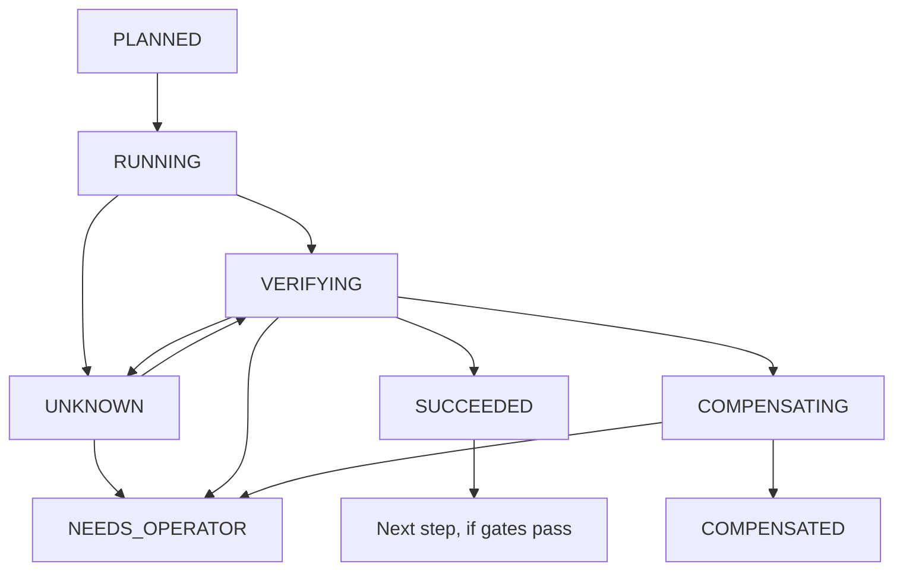

# Verifying Resumable and Rollback-Capable Workflows After Partial Failures

> **Chapter:** Operations Automation  
> **Scope:** `DATABASE_ENGINE_WIDE_COLUMN_CASSANDRA` — operating distributed Apache Cassandra, from partition-key and query-driven data modeling to CQL, replication, read/write consistency levels, compaction, repair, error handling, and Java application connectivity.

A Cassandra operational workflow can succeed on several nodes and then fail on the next. The most dangerous scenario occurs when a command has already produced real side effects, yet the orchestrator loses connectivity before recording the result. In that situation, a "timeout" message does not prove the operation failed, and re-running the entire workflow can disrupt additional replicas or repeat an unsafe action.

This lesson shows how to **design and verify** workflows capable of **resuming from a checkpoint**, **rolling back a genuinely reversible change**, or **executing a compensating step** when failures affect only part of the system. The focus is on verification through observable Cassandra state rather than relying merely on a script's exit code.

## 1. Learning Objectives and Core Concepts

After completing this lesson, learners will be able to:

1. Distinguish orchestrator failures, connectivity failures, command failures, node failures, and unconverged cluster state.
2. Define the unit of work, preconditions, postconditions, and progress-checkpoint boundaries for each step.
3. Explain why retries, logging, and coordination locks alone do not guarantee exactly-once execution.
4. Design rules for **resume / retry / rollback / compensation / halting intervention** across configuration changes, rolling restarts, and repairs.
5. Inject faults at workflow boundaries, collect evidence, and determine PASS/FAIL outcomes.

Key terms to distinguish:

| Term | Meaning in Cassandra Workflows |
| --- | --- |
| **Checkpoint** | A durable record of step, state, attempt count, and verified evidence; enables recovery after worker death. |
| **Resume** | Reading the checkpoint, reconciling against actual cluster state, and continuing from the remaining steps. |
| **Retry** | Re-executing an operation; safe only if the operation is safely repeatable or the prior attempt is verified to have produced no side effects. |
| **Rollback** | Reverting a *reversible* change back to its previous configuration/state after verifying reversibility conditions. |
| **Compensation** | Performing a compensating action to reach an acceptable state; does not necessarily restore every prior byte identically. |
| **Roll-forward** | Continuing with an appropriate corrective change when reversal is infeasible—for example, completing replica synchronization after raising replication factor. |
| **Reconciliation** | Comparing persisted state against actual nodes, schema, data, and active tasks to decide the next step. |

**Core principle:** a `SUCCEEDED` checkpoint must include **postcondition evidence**. An `UNKNOWN` state must be investigated before retrying. "Rollback" is viable only when a defined inverse action exists, its prerequisites still hold, and it has been tested.

## 2. Why Are Partial Failures Especially Challenging in Cassandra?

Cassandra has no single process representing the entire cluster's state. Data is distributed by **partition key** across token ranges and stored on multiple replicas according to replication settings. Nodes can temporarily observe different views of state; an operation affecting node A does not mean the whole cluster has reached the target state.

For instance, in a datacenter with replication factor `RF = 3`, maintenance on one node may still allow `LOCAL_QUORUM` queries to succeed if enough healthy replicas remain. However, this **does not permit** taking a second node offline right away; you must verify availability for every replica set, application error rates, and cluster health before advancing. With `RF = 3`, quorum requires `floor(3/2) + 1 = 2` responses; conditions in other datacenters and specific consistency levels must also be evaluated separately.

Common partial-failure points:

| Failure Timing | What May Have Happened | What to Verify Before Acting |
| --- | --- | --- |
| Before dispatching command | No change yet, though the worker recorded intent to execute | Is an older worker or equivalent task still running? |
| After sending command, before response | The command may not have run, may still be running, may have succeeded, or may have failed | Is the operation still active? Does observed state satisfy postconditions? |
| After command succeeds, before saving checkpoint | Cassandra state changed, yet the journal still reads `RUNNING` | Can success be proven from node/cluster state and recorded in the checkpoint without repeating the command? |
| After processing some nodes | The cluster is in a mixed deployment state | Which nodes converged, which need remediation, and do enough replicas remain for app traffic? |
| During repair or compaction | New SSTables or partial streaming may already exist | Is the prior task still active; is current impact safe to wait on, restart, or intervene? |
| When checkpoint storage itself is unreachable | Completed steps cannot be determined reliably | Stop issuing new commands, restore journal access, and reconstruct state from independent evidence. |

Likewise, a `read timeout` or `write timeout` in a Java application does not necessarily mean the data mutation never occurred. For example, a write may have reached some replicas while the coordinator failed to receive enough acknowledgements in time. Uncontrolled retries are especially dangerous for counters, side effects external to Cassandra, or updates using fresh timestamps that alter write ordering.

## 3. Safety Invariants Required Before Proceeding

An **invariant** is a condition that must hold continuously throughout the workflow, not merely at completion:

- **Stay within error budgets:** do not perform maintenance on another node if doing so removes replicas required for critical workloads' read/write consistency levels.
- **Single valid orchestration authority:** only one actor may issue state-changing commands for the same target and phase. An expired lease does not automatically terminate an already-running `nodetool` command; use versioned/fencing locks plus active-task checks.
- **Never skip unverified checkpoints:** a step is complete only once its postconditions are measured and evidence is stored.
- **Never overlap heavy operations:** do not automatically start overlapping repairs or compactions without knowing prior-run status and I/O, network, and disk headroom.
- **Never speculatively "rollback" data:** schema, data, replica, or SSTable changes may be reversed only with a clear recovery plan, valid backups, and consistency verification.
- **Halt on health signals:** client errors, latency, dropped messages, disk space, pending compactions, or unavailable replicas breaching agreed thresholds must block the next step.

Define **preconditions** and **postconditions** in observable terms. For example:

| Step | Minimum Preconditions | Postconditions That Must Be Proven |
| --- | --- | --- |
| Edit node N config and restart | Other replicas healthy; old config saved; parameters version-compatible; recovery path ready | N returns to `UN`, target config is loaded, application errors stay within thresholds |
| Change schema via CQL | Application, release, and current schema compatibility assessed; rollout plan ready | Schema agreement achieved and representative queries work against the new schema |
| Increase replication factor | Topology/datacenter, disk capacity, and data sync plan verified | Keyspace reflects the new RF **and** affected ranges are repaired/synchronized per plan |
| Repair a range | Relevant replicas available, capacity and bandwidth sufficient, no overlapping repair active | Repair session finishes successfully per session evidence, not merely shell return |
| Create snapshot for recovery | Sufficient disk capacity; keyspace/table/nodes and unique tag identified | Snapshot exists on required nodes, manifest/metadata saved, and backup copy is restorable |

`nodetool status` helps observe membership and `UN`/`DN` status, yet **does not by itself prove** reads/writes succeed at the target consistency level. Pair it with CQL/canary probes from the application, metrics, logs, and task-specific checks.

## 4. Designing Workflows as Checkpointed Durable State Machines

Every run must have a unique `run_id`; every step needs a fixed `step_id`, clear target, plan version (`plan_hash`), actor owner, and attempt tracking. Minimum states:



- `PLANNED`: must not be treated as executed. Record the planned action and check preconditions.
- `RUNNING`: intent persisted **before** dispatching the command. A timeout or worker crash must transition to `UNKNOWN`, never assume failure.
- `VERIFYING`: collect evidence; evaluate postconditions and check whether the operation is still in progress.
- `SUCCEEDED`: postconditions hold and evidence is stored; only then evaluate advancing to the next step.
- `UNKNOWN`: outcome undetermined; transition back to `VERIFYING` only once safe inspection checks are available.
- `COMPENSATING` / `COMPENSATED`: a specific compensating action was chosen and verified.
- `NEEDS_OPERATOR`: insufficient evidence or reversal is too risky; workflow pauses for investigation.

A checkpoint should record at least:

```json
{
  "run_id": "3a55b06e-f0db-42de-83e8-f65208e9e13b",
  "plan_hash": "sha256:<digest-of-approved-plan>",
  "step_id": "restart-node-b",
  "target": "node-b",
  "state": "UNKNOWN",
  "attempt": 1,
  "owner": "ops-runner-2",
  "fencing_token": 17,
  "expected": ["node-b=UN", "schema_agreed", "canary_reads_writes=PASS"],
  "observed": ["restart_dispatched", "control_channel_timeout"],
  "operation_ref": "change-2026-11-21-042",
  "checked_at": "2026-11-21T08:20:00Z"
}
```

These fields represent an **illustrative orchestration data model**, not a built-in Cassandra system schema. Also capture the command/version, node/DC/keyspace/token range, timestamps, redacted stdout/stderr, metrics, log references, repair session ID if applicable, approver, and transition rationale. Any `SUCCEEDED` record lacking verification evidence fails audit standards.

**Durability of the checkpoint store:** if automation must rescue a cluster when Cassandra loses quorum, never place the *sole copy* of orchestration state inside that same cluster. Use an independent coordination store with backups and appropriate synchronization/compare-and-set semantics. If you choose CQL to store checkpoints, explicitly specify consistency levels, failure availability, and lightweight transaction (LWT) limits: an `IF` clause protects row state transitions, **not** atomic coordination across CQL and a `nodetool` command.

**Locks and fencing:** scope locks tightly, such as `(cluster, change_id)` or `(cluster, node, operation_type)`. A new worker takes ownership only after validating the lease/token and verifying the prior worker left no indeterminate task running. Fencing tokens help only if the execution target rejects commands from stale owners; a dispatched `nodetool` invocation typically does not check an orchestrator's token on its own, making real-state **reconciliation** essential.

## 5. Decision Rules When Resuming a Workflow

Never use the rule "if status is not `SUCCEEDED`, run it again." On every resume, proceed in order:

1. Load checkpoints for `run_id`, verifying `plan_hash`, owner, and operation version. If the plan changed, require an explicit plan-migration path.
2. Check cluster-wide preconditions: topology, replicas, active consistency levels, application health, resources, and ongoing maintenance.
3. **Observe target state before acting:** has the command already satisfied postconditions, or is an OS process or repair session still running?
4. If postconditions already hold, save evidence and mark `SUCCEEDED`, even if the prior checkpoint read `RUNNING` or `UNKNOWN`.
5. If the operation is still running—or "running" vs. "stopped" cannot be distinguished—keep `UNKNOWN`, block duplicate commands, and alert an operator.
6. Retry only when certain no conflicting prior action exists **and** retrying is proven safe for observed state; cap attempts and apply backoff.
7. If the goal cannot be reached, evaluate rollback/compensation against preconditions and impact on completed steps; if safety cannot be assured, transition to `NEEDS_OPERATOR`.
8. Before unlocking the next step, re-verify all Section 3 invariants and persist all results.

Illustrative arbiter pseudocode (not a production-ready script):

```python
def reconcile_step(step, checkpoint, cluster):
    actual = step.observe(cluster)            # real state plus evidence

    if step.postcondition(actual):
        checkpoint.record_verified_success(step.id, actual)
        return "CONTINUE"

    if step.operation_still_running(actual) or step.ambiguous(actual):
        checkpoint.record_unknown(step.id, actual)
        return "STOP_AND_INVESTIGATE"

    if not step.cluster_guards_hold(cluster):
        return "STOP_UNSAFE"

    if step.retry_is_proven_safe(checkpoint, actual):
        return "RETRY_WITH_NEW_ATTEMPT"

    if step.compensation_is_proven_safe(checkpoint, actual):
        return "COMPENSATE_AND_VERIFY"

    return "NEEDS_OPERATOR"
```

This pseudocode intentionally **avoids** re-issuing commands solely from timestamps or error codes. `retry_is_proven_safe` must be tailored to each operation class: retrying a read differs fundamentally from retrying schema changes, node replacements, table truncations, or manual compactions.

## 6. Worked Scenario: Rolling Restart Failure on the Second Node

Assume a Cassandra datacenter has three nodes `A`, `B`, `C`, a production keyspace with `RF=3`, and a Java application using `LOCAL_QUORUM`. The task is to update **one configuration parameter confirmed reversible in version docs**, then perform a one-node-at-a-time rolling restart. This is an illustrative model: in production systems, check every datacenter, replica placement, driver config, and traffic load; never mechanically infer "safe" solely from three nodes or RF.

### 6.1. Preparation Runbook

- Finalize `run_id`, node list, execution order, Cassandra version, old/new config files (with checksums), deadlines, and stop thresholds.
- Back up original configuration files **per node**; verify recovery steps and mixed-version config compatibility between nodes.
- Inspect `nodetool status` and `nodetool describecluster`; verify schema agreement, disk headroom, pending compactions, client errors, and a CQL canary at the required consistency level.
- Confirm no conflicting topology changes, heavy repairs, or parallel rolling maintenance exist. Allow sufficient stabilization time for each node.
- Mark a node complete only after it returns to `UN`, loads the target config, matches expected schema state, and passes read/write canary checks, followed by a stability observation window.

Common diagnostic commands (endpoints, JMX flags, auth, and syntax must match your environment/release):

```bash
nodetool status
nodetool describecluster
nodetool netstats
nodetool compactionstats
```

Never infer overall application health from empty `netstats` or `compactionstats`. Each command gives only one slice of visibility.

### 6.2. Simulated Failure and Handling

| Step | Observed Outcome | Trustworthy Checkpoint |
| --- | --- | --- |
| Apply config and restart A | A returns to `UN`; canary PASSES | `A = SUCCEEDED` |
| Apply config and restart B | Control channel times out; no stability confirmation | `B = UNKNOWN` |
| Apply config and restart C | **Not permitted to run** | `C = PLANNED` |

When a replacement worker starts, **do not restart B again and do not touch C yet**:

1. Check whether a restart or maintenance task is still underway on B; inspect OS services, logs, active runtime config, `nodetool status`, and canaries.
2. If B is `UN` and passes all postconditions, transition `B` to `SUCCEEDED` with evidence; re-evaluate cluster health before advancing to C.
3. If B fails to recover due to the new config and the old config is verified compatible, restore **B's original config**, restart B per runbook, and verify B is healthy before deciding whether to proceed or roll back A.
4. If proactively rolling back the whole change, revert A to the old config **only after** B and the remaining replicas satisfy safety checks; verify every node as its own checkpointed workflow.
5. If B's root cause is unclear, other replicas lack availability, or reversibility is unproven: hold at `NEEDS_OPERATOR`. Do not unlock C.

Recovery order here depends on replica liveness; there is no fixed rule to "always roll back A before B." **A compensating step is itself an operational workflow capable of partial failure** and requires its own postconditions, checkpoints, and verification.

### 6.3. Acceptance Criteria

The workflow passes when all in-scope nodes reach the target state **or** an approved restored state; zero operations have unknown ownership; the application remains within thresholds; and logs clearly account for which steps A, B, and C completed. If the only record is "script exit 0" without verifying B and the canary, the result is **FAIL**.

## 7. Cases Where Cassandra Cannot Roll Back in the Traditional Sense

### 7.1. Repair Is Data Synchronization, Not a Reversible Action

`nodetool repair` compares data across replicas within token ranges and synchronizes differences. Per Cassandra documentation, repair defaults to **incremental**; `nodetool repair --full` processes all data in the target scope. Incremental and full repair serve different roles; schedules and options must match your release, repaired-state tracking, and load capacity.

Example per-node repair plan:

```text
Run R
  - node A, keyspace orders: VERIFIED
  - node B, keyspace orders: UNKNOWN (orchestrator disconnected)
  - node C, keyspace orders: PLANNED
```

Before acting on B, check `nodetool netstats`, Cassandra logs, repair/streaming metrics, participating node health, and any repair session ID. Distinguish whether the repair is **still running**, **finished without recording its checkpoint**, **failed**, or **unknown**. Never launch another repair on the same scope merely because the prior worker died.

Illustrative commands from Cassandra documentation:

```bash
# Incremental repair (default per current Cassandra documentation):
nodetool repair orders

# Full repair when required by plan:
nodetool repair --full orders

# Scoped to node's primary ranges; schedule cluster-wide coverage:
nodetool repair -pr orders
```

`-pr` on a single node does not repair the entire cluster. Map nodes, datacenters, and target ranges to avoid duplicate work; official documentation describes running across nodes in each datacenter for full coverage. When retrying an interrupted repair, verify no conflicting session remains active, confirm sufficient resources, and reconcile progress. Never assume byte-exact resumption at a reported percentage unless the tool guarantees it.

Repair-driven data synchronization has no "undo repair" command. An erroneous step must be evaluated for **roll-forward remediation** or restored from a valid backup via a separate procedure.

### 7.2. Compaction, Schema, and Topology Changes

| Operation | Safe Continuation | What Should Not Be Assumed Automatic Rollback |
| --- | --- | --- |
| **Compaction** | Monitor tasks and resources, and confirm stability before further steps | No simple inverse operation exists to restore exact pre-compaction SSTables. |
| **ALTER TABLE / schema change** | Verify schema agreement, app compatibility, and apply a forward migration | Reversing DDL does not necessarily restore lost data; `DROP` and breaking changes require backup/restore strategies. |
| **Increase replication factor** | Verify target RF and complete repair/streaming so new replicas hold data | Simply resetting RF back does not guarantee data and sync state "reverted" cleanly. |
| **Decommission / replace node** | Inspect topology, bootstrap/streaming, membership, and dedicated recovery plans | Never blindly re-add the old node as if the command never ran; risks token/ownership and data inconsistency. |
| **TRUNCATE / DELETE data** | Restore per verified backups and business rules | Issuing an "inverse" write cannot automatically recreate prior values, timestamps, or TTL history. |

Operations capable of irreversible data effects require **approval gates**, recovery plans, and tested restore procedures. Changing a compaction strategy likewise does not "undo" completed compactions.

### 7.3. Snapshots and Backups Are Not Automatic Cluster Rollback

Cassandra creates snapshots from node-local SSTables along with related schema metadata. While vital for backups, **per-node snapshots do not automatically form a cluster-wide point-in-time consistent restore point**. Reliable recovery requires identifying which snapshots correspond across required nodes, storing copies externally, managing commit logs/incremental backups where applicable, matching schema versions, and executing a tested restore runbook.

Documented restore tools include `sstableloader` and `nodetool refresh`, each carrying strict preconditions on schema, version, SSTable contents, and target nodes. **Never execute restores as automatic compensation** without verifying data correctness and query impact.

## 8. Retries at the CQL and Java Application Layer

Runbook resume thinking also applies when Java applications call Cassandra:

- **Separate transport errors from business outcomes.** A write timeout can happen after one or more replicas persisted the write; re-read by partition key at an appropriate consistency level when safe to verify.
- **Key tasks with durable identifiers.** Repeatable business actions should use a stable `operation_id`, partition key, and query-driven table design; avoid inferring "already done" via full-table scans.
- **Mark statements idempotent in the driver only when genuinely idempotent.** Reads or overwrites with identical values/keys and semantics can be safely retried under defined conditions; counter increments, external side effects, or writes generating new timestamps under contention cannot be assumed safe.
- **Evaluate LWT `IF NOT EXISTS` / `IF ...`** when guarding single-row/partition write conditions. Check `[applied]` and monitor Paxos overhead; LWT does not combine multiple nodes, external systems, or multiple partitions into a multi-partition transaction.
- **Evaluate consistency levels per datacenter and RF.** `LOCAL_QUORUM` enforces local-DC quorum responses, yet does not automatically resolve every race condition, latency spike, retry loop, or full-DC failure.

Example CQL for an idempotency marker **scoped to a business key** (assuming keyspace `app_control` already exists and is ready):

```sql
CREATE TABLE IF NOT EXISTS app_control.operations_by_id (
    operation_id uuid PRIMARY KEY,
    operation_type text,
    payload_hash text,
    created_at timestamp
);

INSERT INTO app_control.operations_by_id
    (operation_id, operation_type, payload_hash, created_at)
VALUES (
    3a55b06e-f0db-42de-83e8-f65208e9e13b,
    'reindex-customer',
    'sha256:example',
    toTimestamp(now())
)
IF NOT EXISTS;
```

If `[applied] = false`, the application must read and compare `payload_hash`/job definition rather than treating any ID collision as success. This pattern records only a conditional marker; full lifecycle control still requires a state machine, compare-and-set updates, postcondition verification, and handling failures between "writing the marker" and "performing the side effect." Never use this table as the sole checkpoint store for automation rescuing the very same cluster when that cluster could lose quorum.

## 9. Fault-Injection Scenarios to Prove Recoverability

One "happy-path success" does not prove resume or rollback capability. Intentionally inject faults at workflow boundaries and verify behavior after restarting the orchestrator. Run these tests in a **lab/staging environment** matching representative topology, RF, consistency levels, and load; never break production nodes to test.

| Test | How Fault Is Injected in Test Environment | PASS Criteria |
| --- | --- | --- |
| F1 — Crash before dispatch | Stop worker after saving `RUNNING` but before calling executor | Zero side effects; recovery determines the step can run safely. |
| F2 — Lost response | Allow executor to finish, drop response channel | New worker **probes** and records `SUCCEEDED`; no duplicate side effects. |
| F3 — Crash before checkpoint commit | Let task satisfy postconditions, kill worker before persisting result | Resume recognizes postconditions already hold and advances accurately. |
| F4 — Real command failure | Simulate invalid config on node B | C stays untouched; B is safely remediated/restored or enters `NEEDS_OPERATOR`. |
| F5 — Duplicate workers | Start two orchestrators for the same `run_id` | Only the valid owner issues commands; no conflicting concurrent actions. |
| F6 — Ongoing repair | Drop orchestrator connection while repair is streaming | No duplicate repair launched; state remains `UNKNOWN` until evidence arrives. |
| F7 — Quorum/journal outage | Block checkpoint access or drop replicas in lab | No new operational steps dispatched when authority and progress cannot be confirmed. |
| F8 — Mid-rollback failure | Let B recovery succeed, fail A recovery | Checkpoints reflect mixed state; rollback is not falsely marked complete. |
| F9 — Plan changed before resume | Change target config or node order while keeping `run_id` | `plan_hash` mismatch halts the workflow rather than reusing mismatched checkpoints. |

For every test, capture: command and checkpoint timeline; node/schema snapshots; canary output at target consistency level; latency/error metrics; active repair/streaming/compaction tasks; arbiter decisions; and proof of actual side-effect count.

Re-run tests at **every boundary**: before recording intent, after recording intent, before dispatch, after dispatch, before verification, after verification, and before marking completion. Verify that adverse event orderings still preserve safety invariants.

## 10. Runbook Acceptance Checklist Template

A runbook qualified for automated resume or rollback should answer every question below:

| Acceptance Question | Required Evidence |
| --- | --- |
| Is scope unambiguous? | `run_id`, node/DC/keyspace/token range, plan version, and checksum |
| Can each step be verified independently? | Preconditions, measurable postconditions, probes, and stability window |
| How are post-impact failures handled? | `UNKNOWN → VERIFYING` path; never auto-retry blindly on timeout |
| Could another actor still control the resource? | Leases/fencing, ownership history, active-task inspection |
| Are availability and data protected? | RF, consistency level, replica health, schema agreement, metrics, and stop gates |
| When is retry allowed? | Operation-specific idempotency conditions, attempt history, retry cap |
| When to rollback vs. roll-forward? | Reversibility classification table; tested backup/restore and compensation steps |
| When must automation stop for humans? | Ambiguous state, lost checkpoints, health-gate breaches, or unproven recovery |
| Is the final outcome auditable? | Post-readback checkpoints, log/metric references, canary PASS, and per-node summary |

**Definition of Done:** every step has met its postconditions or been compensated under an approved plan; zero unresolved `UNKNOWN` states remain; no conflicting jobs are running; data and application checks pass; and durable logs let an independent reviewer reconstruct every decision.

## 11. Scenario Exercise and Self-Check Questions

**Exercise:** A Cassandra config rollout follows `A → B → C`. `A` has `SUCCEEDED`. After issuing restart on `B`, the worker times out. Initial `nodetool status` shows `B` as `DN`; 40 seconds later `B` comes up as `UN`. A `LOCAL_QUORUM` CQL probe passes, yet the write canary still breaches error thresholds. `C` remains `PLANNED`.

Decide:

1. Should we send another restart to `B` solely because of the timeout?
2. Can we immediately proceed to `C` once `B` flips to `UN`?
3. If we decide to roll back, what conditions must hold before reverting `A`'s configuration?
4. If the failure came from repair or compaction rather than a restart, could we apply the same rollback command?

**Suggested answers:** (1) No; inspect active tasks and actual postconditions first. (2) No; the canary is still breaching thresholds, so the workflow must pause at `B` and investigate. (3) `B` and required replicas must be healthy, the old config must be verified compatible, error budget must permit intervention, and every rollback step must be checkpointed. (4) No; repair/compaction has no simple inverse, requiring evaluation of continuation, roll-forward remediation, or backup restore per impact type.

**Extension question:** Why does a successful CAS or LWT on a checkpoint row still fail to prove that the corresponding `nodetool` command ran exactly once? Describe the "failure window" between the two systems and design observations that close that gap via reconciliation.

## 12. References

- Apache Cassandra Documentation — [Repair](https://cassandra.apache.org/doc/stable/cassandra/managing/operating/repair.html): full/incremental repair, node scope, primary ranges, scheduling.
- Apache Cassandra Documentation — [nodetool repair](https://cassandra.apache.org/doc/latest/cassandra/managing/tools/nodetool/repair.html): command syntax and flags per release docs.
- Apache Cassandra Documentation — [Backups](https://cassandra.apache.org/doc/latest/cassandra/managing/operating/backups.html): snapshots, incremental backups, and restore paths.
- Apache Cassandra Documentation — [Compaction overview](https://cassandra.apache.org/doc/stable/cassandra/managing/operating/compaction/overview.html): compaction strategies and tasks.

> **Version note:** `nodetool` options, repair behavior, compaction mechanics, and upgrade/downgrade rules vary across Cassandra releases. Before applying any production runbook, check documentation for your **exact cluster version**, test against matching topology, and define explicit stop thresholds.
