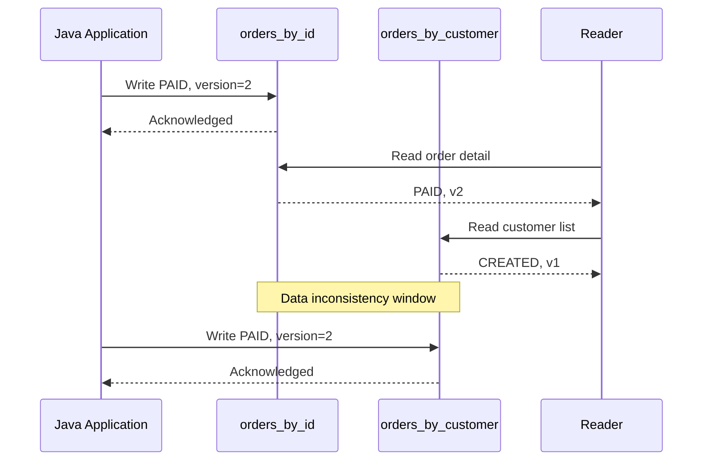
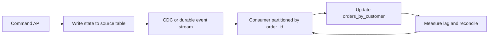

# Multi-Table Synchronization and Data Inconsistency Windows in Apache Cassandra

## 1. The Problem Arising from Query-Driven Table Design

In Apache Cassandra, an application typically stores the same business information across **multiple tables serving different query patterns**. Cassandra lacks `JOIN`s and foreign keys as found in relational databases; the wide-column model encourages choosing partition keys and clustering columns so each critical query reads data directly without scanning the entire cluster. Consequently, data is intentionally denormalized.

For example, an e-commerce system needs to concurrently:

- Look up a single order by `order_id`.
- List a customer's orders chronologically.
- Update order status from `CREATED` to `PAID` and display the accurate status on both screens.

The first two queries suit two tables with different partition keys. The third introduces an architectural problem: **when order status is duplicated across multiple tables, the business copies may not change at the exact same moment**.

> Distinguish two types of "skew": **replica skew** means copies of *the same partition in the same table* are temporarily out of sync; **cross-table skew** means two different read models of the same business entity have not yet been updated together. Consistency levels, hinted handoff, and repair primarily address the first type. They do not automatically maintain business relationships across two tables.

### Learning Objectives

After this lesson, you will be able to explain the origin of data inconsistency windows; identify scenarios where stale state is read; distinguish `LOGGED BATCH`, consistency levels, LWT, and CDC; choose approaches for updating or building projections; and design retries, reconciliation, and lag observability for Java applications using Cassandra.

## 2. Running Example: One Order, Two Read Models

Suppose a Cassandra cluster runs a single data center `dc1`, and the keyspace uses `NetworkTopologyStrategy` with replication factor 3:

```sql
CREATE KEYSPACE IF NOT EXISTS shop
WITH replication = {'class': 'NetworkTopologyStrategy', 'dc1': 3}
AND durable_writes = true;

CREATE TABLE IF NOT EXISTS shop.orders_by_id (
    order_id uuid PRIMARY KEY,
    customer_id uuid,
    created_at timestamp,
    status text,
    version bigint
);

CREATE TABLE IF NOT EXISTS shop.orders_by_customer (
    customer_id uuid,
    created_at timestamp,
    order_id uuid,
    status text,
    version bigint,
    PRIMARY KEY ((customer_id), created_at, order_id)
) WITH CLUSTERING ORDER BY (created_at DESC, order_id ASC);
```

| Table | Partition key | Purpose | Query Pattern |
| --- | --- | --- | --- |
| `orders_by_id` | `order_id` | Authoritative read source for order details | `WHERE order_id = ?` |
| `orders_by_customer` | `customer_id` | Customer's order list, newest first | `WHERE customer_id = ?` with result limit |

The `version` field is an **application-assigned business version number**, not an auto-increment feature or automatic concurrency control mechanism in Cassandra. An order may carry `version = 1` when created and `version = 2` after payment. To update a row in `orders_by_customer`, the application must know the *complete* `customer_id`, `created_at`, and `order_id` forming the primary key; Cassandra does not locate rows solely by `order_id` in that table.

The two update statements below use `?` as **bind markers for a driver prepared statement**:

```sql
UPDATE shop.orders_by_id
SET status = ?, version = ?
WHERE order_id = ?;

UPDATE shop.orders_by_customer
SET status = ?, version = ?
WHERE customer_id = ? AND created_at = ? AND order_id = ?;
```

Both tables hold the same `status`, yet each table represents a distinct set of mutations and partitions. If the application executes the two statements sequentially, no automatic cross-table transaction wraps both.

## 3. How Does a Data Inconsistency Window Form?

Suppose both tables initially store `CREATED` for order `O-17`, version 1. The user pays, and the application updates `orders_by_id` first, then updates `orders_by_customer`.



| Time | `orders_by_id` | `orders_by_customer` | What the User May Observe |
| --- | --- | --- | --- |
| `t0` | `CREATED / v1` | `CREATED / v1` | Both screens agree |
| `t1` | `PAID / v2` | `CREATED / v1` | Details show paid, list still shows pending payment |
| `t2` | `PAID / v2` | `PAID / v2` | Both screens agree again |

The interval from `t1` to `t2` is the **inconsistency window**. It may last only a few milliseconds when all components are healthy, or extend for minutes or indefinitely if the application crashes after the first write and has no recovery mechanism for the second write. One cannot derive a guaranteed lag figure solely from the replication factor or consistency level.

Another window can occur within **the same table**: after a write, a replica may not yet have received the mutation and a low-consistency read may return the old value. These two types of skew have different root causes and mitigations, even though both manifest as "displayed statuses do not match."

## 4. What Happens When the Network or a Process Fails?

| Scenario | Observable Consequence | Architectural Mitigation |
| --- | --- | --- |
| Detail table write succeeds; application crashes before writing list table | New detail, persistently stale list | Authoritative data source with replayable projection pipeline; reconciliation jobs |
| List table written first, then detail table write fails | List displays a state not yet confirmed by the source of truth | Clear ordering, authoritative source, and compensation procedures |
| Client receives a timeout while writing | Unknown whether the write persisted; timeout does **not** prove write failure | Stable `event_id`/version, controlled retries, verification reads when needed |
| Consumer receives an event multiple times | Projection may process duplicates | Idempotent operations and processed-state tracking |
| Event version 11 arrives before version 10 | Older write may overwrite newer state if applied carelessly | Preserve ordering by `order_id` or check version atomically |
| TTL, deletions, or key changes applied unevenly | One table retains the order while the other expires it or keeps "orphaned" rows | Consistent data lifecycle rules, emit delete/expiry events, periodic reconciliation |

**Note on retries:** with Cassandra, a mutation may already have been applied when the client encounters a `WriteTimeoutException` or connection drop. Retries that "increment by 1", add to a balance, or generate a new event ID on each attempt can cause duplicate side effects. Safe retries rely on a durable operation identifier and idempotent semantics; never assume a timeout means the write did not occur.

## 5. How Far Do Built-in Cassandra Mechanisms Go?

### 5.1. `LOGGED BATCH` and `UNLOGGED BATCH`

Cassandra supports grouping mutations via CQL `BATCH`. When a small change must be applied across multiple partitions, `LOGGED BATCH` may be considered:

```sql
BEGIN LOGGED BATCH
    UPDATE shop.orders_by_id
    SET status = 'PAID', version = 2
    WHERE order_id = 11111111-1111-1111-1111-111111111111;

    UPDATE shop.orders_by_customer
    SET status = 'PAID', version = 2
    WHERE customer_id = 22222222-2222-2222-2222-222222222222
      AND created_at = '2026-11-01 10:00:00+0000'
      AND order_id = 11111111-1111-1111-1111-111111111111;
APPLY BATCH;
```

With a multi-partition logged batch, Cassandra uses a **batch log** to ensure mutations in the batch are eventually completed once the batch is accepted, including recovery after failures. However, a batch **does not provide snapshot isolation across multiple partitions**: a reader may see one table updated while the other has not changed yet. `LOGGED BATCH` also adds network, log-write, and coordination overhead; packing many partitions into a large batch can degrade throughput. Do not use batches as a bulk-throughput accelerator for independent writes.

`UNLOGGED BATCH` does not write a batch log to guarantee cross-partition atomicity; it is suitable for certain deliberate mutation groupings, especially within the same partition, but **does not solve business synchronization requirements across partitions**. Batches are a deliberate trade-off for small mutation sets, not a replacement for event pipelines, progress tracking, and reconciliation in multi-projection systems.

### 5.2. Consistency Level: `LOCAL_QUORUM` Is Not a Cross-Table Transaction

With `RF = 3` in the same data center, a `LOCAL_QUORUM` write requires acknowledgments from 2 replicas; a `LOCAL_QUORUM` read also contacts a quorum of replicas. By the overlap rule `R + W > RF`, quorums for **the same data key within the same replication scope** share at least one overlapping replica, supporting reading the acknowledged update under normal operating conditions.

```sql
-- Set in cqlsh before testing reads/writes:
CONSISTENCY LOCAL_QUORUM;

SELECT status, version
FROM shop.orders_by_id
WHERE order_id = 11111111-1111-1111-1111-111111111111;

SELECT order_id, status, version
FROM shop.orders_by_customer
WHERE customer_id = 22222222-2222-2222-2222-222222222222
LIMIT 20;
```

The two `SELECT` statements above read **two different partitions/tables**. Even though both use `LOCAL_QUORUM`, they can still return `PAID` and `CREATED` during the inconsistency window. Moreover, standard quorums do not replace business serialization when multiple concurrent writers update the same object. Across multiple data centers, `LOCAL_QUORUM` scopes the quorum to the local data center; the design must specify where writes occur, where reads occur, and the failover policy.

### 5.3. LWT, Repair, and Materialized Views

- **Lightweight transactions (LWT)** using `IF ...` use consensus for conditional checking/writing within a single partition, useful when state must transition from an expected version. Serial consistency settings (`SERIAL`/`LOCAL_SERIAL`) govern the conditional path; LWT does not extend into an arbitrary multi-table or multi-partition transaction.
- **Hinted handoff, read repair, and `nodetool repair`** focus on converging replicas of data stored within each individual table. They have no awareness that `status` in `orders_by_id` and `orders_by_customer` belong to the same order to reconcile them at the business level.
- **Materialized views** can serve certain query models derived from a base table, but carry key and operational constraints as well as an asynchronous update path; they are not a universal solution for all projections or immediate cross-table read consistency.

Key takeaway: **raising consistency levels, running repair, or enabling batches does not turn multiple tables into an atomically observable transaction**.

## 6. Choosing a Synchronization Model for the Application

| Implementation Approach | Strengths | Trade-offs / Applicability |
| --- | --- | --- |
| Synchronous dual writes from the API | Easy to start; updates read table inline during request | Gap between writes, ambiguous outcomes on timeout, requires retries and reconciliation |
| Small `LOGGED BATCH` | Provides batch log for multi-partition mutations once accepted | No cross-partition isolation, added overhead, hard to scale to many projections or non-Cassandra systems |
| Single source table + CDC/event-driven projection | Clear source of truth, easy replay/rebuild, scales to many read tables | Accepts eventual consistency; requires a reliable pipeline plus backlog and ordering controls |
| Route reads to the source table at decision points | Critical business state has one authoritative answer | Increases lookups, requires endpoint design, and may reduce list-table offloading benefits |

### 6.1. Recommended Model When Multiple Projections Exist

Designate `orders_by_id` as the **source of truth** for order status. All critical decisions such as "is it paid?" or "is shipping allowed?" are verified against this source. `orders_by_customer` is a **projection** for fast list reads and is permitted to lag within product-published bounds.



An execution sequence might be:

1. The API validates a legal state transition and assigns an `event_id` and new version per business rules.
2. Write to the source table and confirm the transition only after the write is acknowledged at the chosen consistency level. If concurrent writers must be prevented from racing, use LWT on the **source partition** or an equivalent arbitration mechanism.
3. Capture mutations via Cassandra **CDC** and normalize them into events, or use a dedicated durable event log. With Cassandra CDC, enable CDC on the relevant table, operate a service that reads CDC logs, and manage checkpoints, storage limits, and slow-consumer scenarios; merely setting `cdc = true` does not create a consumer or guarantee event delivery.
4. The consumer updates `orders_by_customer` using `order_id` and the projection's keys, acknowledging the event only after the projection write succeeds. On failure, the same `event_id` is retried.
5. A reconciliation job detects missing or drifted projections and schedules compensating updates. Critical business reads always fall back to the source table.

**Do not call a "write source table then publish message" sequence a transactional outbox if the two operations are independent.** A crash between them still drops the event. A true outbox requires a durable/atomic write boundary with the source change, or a CDC mechanism guaranteed to capture committed source mutations. If another transactional store serves as the source of truth, the transactional outbox can live inside that store's transaction.

### 6.2. Versioning, Ordering, and Idempotency

Events should carry at least:

```json
{
  "event_id": "33333333-3333-3333-3333-333333333333",
  "order_id": "11111111-1111-1111-1111-111111111111",
  "customer_id": "22222222-2222-2222-2222-222222222222",
  "created_at": "2026-11-01T10:00:00Z",
  "version": 2,
  "status": "PAID"
}
```

`event_id` must remain constant across retries; `version` reflects the update sequence of **the same order**. These two fields address two different failure modes:

- **Duplicate delivery:** a consumer may receive an event multiple times. Writing the same target value for the same version is idempotent in business outcome, provided no side effect such as "increment order count" runs repeatedly. If exactly-once business processing is needed, persist processed markers durably or redesign the operation as a target-state assignment.
- **Out-of-order delivery:** `PAID/v3` may arrive before `CREATED/v2`. Applying `v2` after `v3` risks reverting state. Partition processing sequentially by `order_id`; when database-level enforcement is needed, use LWT with the expected version on the **specific projection row** or park delayed events for ordered processing/reconciliation. Reading `version` and then running a normal `UPDATE` is not an atomic check, because another writer can interleave.

Cassandra resolves write conflicts using mutation timestamps, **not** by comparing an application `version` column. Never assume "the higher version event will always win" if a consumer still writes an older version with a newer timestamp. Version number assignment must also be serialized at the source; multiple Java instances computing `version + 1` from stale reads can issue duplicate versions without an arbitration mechanism.

### 6.3. Java Example: Highlighting Where the Inconsistency Window Appears

The snippet below uses DataStax Java Driver 4.x to illustrate two independent writes. It **intentionally exposes the risk** and is not a complete synchronization pattern for payments:

```java
import com.datastax.oss.driver.api.core.CqlSession;
import com.datastax.oss.driver.api.core.DefaultConsistencyLevel;
import com.datastax.oss.driver.api.core.cql.PreparedStatement;
import java.time.Instant;
import java.util.UUID;

void updateBothTables(CqlSession session, UUID orderId,
                      UUID customerId, Instant createdAt, long version) {
    PreparedStatement main = session.prepare(
        "UPDATE shop.orders_by_id SET status = ?, version = ? " +
        "WHERE order_id = ?");
    PreparedStatement list = session.prepare(
        "UPDATE shop.orders_by_customer SET status = ?, version = ? " +
        "WHERE customer_id = ? AND created_at = ? AND order_id = ?");

    session.execute(main.bind("PAID", version, orderId)
        .setConsistencyLevel(DefaultConsistencyLevel.LOCAL_QUORUM));

    // A crash, timeout, or disconnect here can leave the two tables out of sync.
    session.execute(list.bind("PAID", version, customerId, createdAt, orderId)
        .setConsistencyLevel(DefaultConsistencyLevel.LOCAL_QUORUM));
}
```

In the projection architecture from Section 6.1, the Java endpoint only writes the source table, while a worker updates the list table from a durable event stream. Prepared statements should be initialized once and reused in the data-access layer rather than prepared per request as in this minimal example. `CqlSession` should be reused and connected to the configured local data center; all retry policies must account for idempotency and ambiguous timeout outcomes.

## 7. Consistency Contracts at the API and UI Layers

Document the read contract explicitly for each screen. A pragmatic model:

| Task | Read Table | Expectation |
| --- | --- | --- |
| Confirm an order is paid for fulfillment | `orders_by_id` | Fetch authoritative status with an appropriate consistency level |
| Display a customer's order list | `orders_by_customer` | May lag; show sync status if the product requires it |
| Just completed payment, immediate confirmation needed | `orders_by_id` by `order_id` | Do not rely on a projection awaiting updates |
| Multi-table filters or analytics | Projection / analytics pipeline | Publish last-updated timestamp or expected lag |

A requirement such as "every screen must see the same result immediately" must be treated as an **architectural constraint**: it may require reading from a single source, changing the UI flow, or using a database with appropriate transactional semantics. Never promise stronger guarantees than a denormalized Cassandra model can actually uphold.

## 8. Reconciliation and Lag Observability

When using eventual consistency, the operational mandate is not merely "eventually", but **measurable, detectable, and repairable** skew.

1. **Monitor the pipeline:** unacknowledged event count, oldest event age, retry errors/latency, consumer lag, dead-letter queue entries, and duplicate processing rate.
2. **Monitor convergence:** distribution of `projection_applied_at - source_committed_at` or an equivalent lag metric accounting for clock skew; p95/p99 and alert thresholds must align with business SLAs, e.g., an internal p99 target under 5 seconds if the system actually supports it.
3. **Reconcile by ID/version:** pull changed order IDs from the change stream or audit log, compare `version/status` between source and projection, and replay events or issue idempotent compensating updates.
4. **Manage deleted/expired data:** propagate delete/tombstone events to projections; align TTL policies between source and copies. Maintain replica repair schedules per operational policy, without mistaking repair for business reconciliation.
5. **Bound blast radius:** scanning jobs must use partition keys, token ranges, change logs, or purpose-built distributed processing tools. Full-keyspace `SELECT`s, careless `ALLOW FILTERING`, or reading every partition via API calls can trigger heavy load and timeouts.

Example of a warning indicator: consumer lag remains low, yet the count of orders with `orders_by_id.version > orders_by_customer.version` steadily grows. That suggests the pipeline dropped updates or has a mapping bug; reconciliation is required and cannot be fixed simply by raising `LOCAL_QUORUM`.

## 9. Suggested Hands-On Lab

**Environment:** a test Cassandra cluster, `RF = 3`, the two tables from Section 2, a Java order-creation script, and a simulated consumer. Never run fault-injection or disruption experiments on a production cluster.

1. Create an order `CREATED/v1` in both tables. Query individually by `order_id` and `customer_id` to observe query keys and clustering order.
2. Update only `orders_by_id` to `PAID/v2`. Read both tables at `LOCAL_QUORUM` and observe the differing results. Explain why quorum does not automatically update the projection.
3. Send the `PAID/v2` event to the consumer, update `orders_by_customer`, and re-read. Stop the consumer before another run and observe the inconsistency window grow with downtime.
4. Replay the same `event_id` twice and verify the result remains unchanged. Send `version = 3` followed by `version = 2`; verify the consumer's ordering/version check prevents state regression.
5. Simulate a timeout after a write has likely been applied, retry with the same operation ID, and verify no duplicate side effects occur. Run a reconciliation scan over changed IDs and restore a missing projection.
6. Test a small `LOGGED BATCH` with two mutations, explain what the batch log guarantees, and analyze why a concurrent reader can still observe an intermediate state between the two tables.

**Self-check questions:**

- Why does the same `order_id` often need to appear in two Cassandra tables instead of performing a `JOIN`?
- If both tables read/write at `LOCAL_QUORUM`, what can still cause them to return different statuses?
- Do `LOGGED BATCH`, LWT, and `nodetool repair` share the same scope of effect?
- How do you detect and fix an order with `version = 8` in the source table but `version = 6` in the list table?
- On the payment path, which table must be treated as the authoritative source and why?

## 10. Takeaways for Production System Design

Cassandra optimizes individual read paths through partition keys and denormalized data, while the application bears responsibility for **preserving consistent meaning across read models**. Identify the source of truth, state explicitly which screens tolerate lag, ensure retries and duplicate handling are side-effect free, enforce version ordering, and continuously measure and reconcile skew. For decisions requiring immediate accuracy, read directly from the source of truth with an appropriate consistency policy; for projections, keep recovery mechanisms ready for delayed or missed events.
