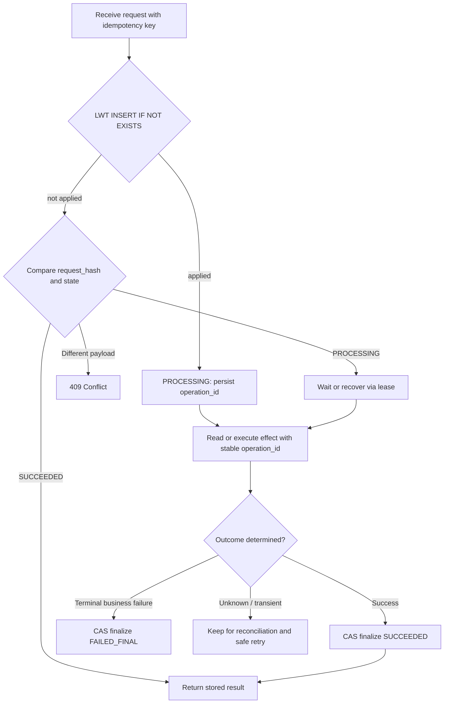
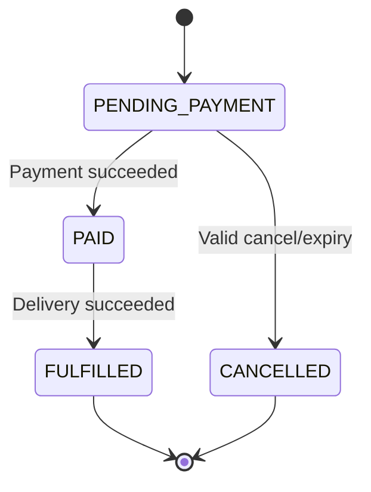

# Idempotency Keys, Business State, and Duplicate-Processing Prevention

> **Chapter:** Application Architecture  
> **Scope:** Apache Cassandra in distributed Java systems; query-driven table design, partition keys, and consistency levels when multiple requests act on the same business operation.

## 1. Why Can an Operation Be Executed Multiple Times?

Suppose the `POST /orders` API created an order in Cassandra, but the HTTP connection dropped before the client received the response. Not knowing whether the request succeeded, the client retries. Similar situations arise when a load balancer retries automatically, a message broker redelivers an event, a worker crashes mid-flight, or Cassandra returns a timeout even though some replicas already persisted the data.

In a distributed system, **receiving a request again does not mean the user wants to perform a second business action**. If each retry generates a new `order_id`, duplicate orders, double charges, or duplicate shipments may occur. Cassandra provides replication and consistency levels, yet merely raising read/write consistency does not automatically make an entire business workflow execute exactly once.

**Idempotency** is the property that executing the same valid operation multiple times for the same business identity yields **a single net effect**. Initial and subsequent responses may differ in metadata (such as response timestamp), but resources and business side effects must never be duplicated.

| Concept | Question Answered | Example |
| --- | --- | --- |
| **Idempotency key** | Which submissions belong to **the same business intent**? | `Idempotency-Key: 7a1d...` bound to a single order creation |
| **Operation ID** | What stable identity does that business action carry? | `order_id`/`payment_attempt_id` preserved across retries |
| **Request processing state** | Is this operation running, succeeded, or ended in failure? | `PROCESSING`, `SUCCEEDED`, `FAILED_FINAL` |
| **Business state** | Which lifecycle step is the entity currently in? | `PENDING_PAYMENT`, `PAID`, `CANCELLED` |
| **LWT / CAS** | Who holds authority to write a conditional change on the same partition? | `INSERT ... IF NOT EXISTS`, `UPDATE ... IF ...` |

Idempotency keys and business state solve **two distinct layers**: the key groups retries of a single intent; the state machine guards valid state transitions of the domain object. An already `PAID` order may still receive a second `PaymentSucceeded` event; the handler must recognize that the transition has already been applied.

## 2. Identifying the Identity of the Same Request

The client generates an unpredictable key (typically a random UUID) **once per business intent**, persists it across retries, and generates a new key only when the user genuinely initiates a new action. On the server, the scoping identity is the tuple `(tenant_id, operation, idempotency_key)` rather than a bare key; requests from different tenants must never collide.

To guard against accidental or intentional reuse of the same key with different payloads, the server computes `request_hash`, such as a SHA-256 digest of a canonical representation containing method, operation type, API version, and meaningful business fields (product, quantity, finalized price, etc.). Do not hash benignly varying fields such as trace IDs or JSON key order. Canonicalization must be **deterministic and versioned** so two equivalent requests yield the same digest. Do not use hashes as a substitute for authentication/authorization.

Example HTTP contract:

```http
POST /orders HTTP/1.1
Authorization: Bearer <token>
Idempotency-Key: 792d3e48-5657-48fa-a41e-17b113e33a0d
Content-Type: application/json

{"sku":"book-01","quantity":2}
```

The server can enforce:

- **New key, valid payload:** accept for processing; generate a stable `operation_id`.
- **Existing key, matching request hash, already succeeded:** return the recorded `order_id` and result without re-executing side effects.
- **Existing key, matching hash, currently processing:** return `202 Accepted` with `Retry-After`, or an in-progress status per the API contract; never spin up a second order.
- **Existing key, different hash:** return `409 Conflict` (or the agreed error code) and require the client to create a new key for a new intent.
- **Missing key:** for non-repeatable operations, the API should reject per contract rather than silently generating a new key on every retry.

**Note:** Do not treat the key value as an access secret; avoid logging raw keys or sensitive payloads, and verify tenant/ownership before returning a stored result.

## 3. Cassandra Table for Idempotency

The deciding query is: *for this tenant, operation type, and key, what has the system recorded?* Model each triple as its own partition so all competing attempts for the same key converge on **the same LWT boundary**:

```sql
CREATE TABLE request_dedup_by_key (
    tenant_id text,
    operation text,
    idempotency_key text,
    request_hash text,
    operation_id uuid,
    state text,
    owner_token uuid,
    lease_until timestamp,
    response_status int,
    result_ref text,
    failure_code text,
    created_at timestamp,
    updated_at timestamp,
    PRIMARY KEY ((tenant_id, operation, idempotency_key))
);
```

Here `operation_id` is generated once when the request is accepted and reused across all downstream steps; `result_ref` is a reference to the outcome (such as `order_id`), generally preferable to storing a large HTTP response inside the row. `owner_token` distinguishes worker attempts owning the operation, while `lease_until` detects when a worker may have lost contact. **A lease is only a recovery signal, not a global lock guaranteeing exactly-once execution outside Cassandra.**

Do not choose `PRIMARY KEY ((tenant_id), idempotency_key)` for all requests of a tenant: it creates an unbounded, hot-prone partition. Placing all three fields in the partition key as shown above produces many small partitions; queries must always supply tenant, operation, and key. Records may be purged per retention policy, but only after retry windows and message redelivery lifetimes are clearly bounded.

### 3.1. Claiming Execution Authority with LWT

```sql
INSERT INTO request_dedup_by_key (
    tenant_id, operation, idempotency_key, request_hash,
    operation_id, state, owner_token, lease_until,
    created_at, updated_at
) VALUES (
    ?, ?, ?, ?, ?, 'PROCESSING', ?, ?, ?, ?
) IF NOT EXISTS;
```

This is a Paxos-based **lightweight transaction (LWT)**. For the same partition, two competing `INSERT ... IF NOT EXISTS` statements cannot **both** report `[applied] = true`; only one attempt is recorded as the initial owner. The other attempt must read the existing row and compare `request_hash`, `state`, and `operation_id` to decide whether to replay, wait, or report a conflict.

```sql
SELECT request_hash, operation_id, state, owner_token,
       lease_until, response_status, result_ref, failure_code
FROM request_dedup_by_key
WHERE tenant_id = ? AND operation = ? AND idempotency_key = ?;
```

In a single-datacenter cluster with replication factor 3, a common choice is `LOCAL_QUORUM` for operation consistency and `LOCAL_SERIAL` for the LWT serial phase, assuming **competing operations are coordinated within the same datacenter**. Multi-datacenter systems may require `SERIAL` and a different global ownership design; `LOCAL_SERIAL` does not automatically protect against cross-region races in all deployment topologies. Configure consistency explicitly in the driver and test against the real topology.

Never replace LWT with the following pattern:

```text
SELECT key -> if absent -> INSERT key
```

Between `SELECT` and `INSERT`, two coordinators can both read "does not exist." `LOCAL_QUORUM` for regular reads and writes reduces stale reads, yet **provides no mutual exclusion** for this read-check-write pattern.

### 3.2. Conditional Completion and Preventing Stale Worker Overwrites

Once the business side effect has been verified, the current worker records the outcome via CAS:

```sql
UPDATE request_dedup_by_key
SET state = 'SUCCEEDED', response_status = 201,
    result_ref = ?, updated_at = ?
WHERE tenant_id = ? AND operation = ? AND idempotency_key = ?
IF state = 'PROCESSING' AND owner_token = ?;
```

If CAS fails, the worker must re-read the row: another worker may have taken over, or the result may already be finalized. Never report "never executed" solely because the status write failed. In particular, **never overwrite with an unconditional `UPDATE`** as a "quick fix"; that breaks ownership checks.

When a lease expires, a recovery worker can read the state and attempt takeover via CAS against the observed previous `owner_token` and `lease_until`:

```sql
UPDATE request_dedup_by_key
SET owner_token = ?, lease_until = ?, updated_at = ?
WHERE tenant_id = ? AND operation = ? AND idempotency_key = ?
IF state = 'PROCESSING' AND owner_token = ? AND lease_until = ?;
```

The application must verify the lease has genuinely expired, accounting for clock skew, before attempting CAS. A "disconnected" worker might still be running, so **both the old and new workers must use the same `operation_id`/idempotency key against downstream effectful systems**. For resources requiring strict ownership, pair with a *fencing* mechanism honored by the downstream target. CAS on this table only prevents a stale worker from finalizing **the idempotency row**; it cannot undo an external payment API call already made.

## 4. Processing State Machine and Business State Machine

An illustrative flow:



**Request states** should stay minimal and operationally meaningful:

| State | Meaning | When the Same Key Arrives Again |
| --- | --- | --- |
| `PROCESSING` | Operation identity reserved; outcome still in flight or unknown | Wait, inspect, or conditionally take over; use the same `operation_id` |
| `SUCCEEDED` | Side effect confirmed and result can be replayed | Return the same reference/result without re-running the side effect |
| `FAILED_FINAL` | Terminal business error, e.g., invalid input finalized per contract | Return the recorded error; do not treat as a new operation |

Network timeouts, replica errors, or missing responses from a payment gateway represent **unknown outcomes**, not automatically `FAILED_FINAL`. An additional `RETRYABLE` state may be used if backed by strict transition and recovery workflows, though `PROCESSING` paired with leases and reconciliation is often sufficient without extra states.

The order state machine is an independent constraint, for example:



A late event may request `PENDING_PAYMENT → PAID` after the order has already become `CANCELLED`. Sharing an idempotency key only detects duplicate requests; **checking current state and transition rules** determines whether transitioning to `PAID` is permitted. For scenarios involving refunds, design explicit transitions or compensating workflows rather than allowing every transition merely because an event exists.

## 5. Business Data Needs a Stable Identity

Table for looking up orders by ID:

```sql
CREATE TABLE orders_by_id (
    tenant_id text,
    order_id uuid,
    state text,
    version int,
    amount_minor bigint,
    created_at timestamp,
    paid_at timestamp,
    PRIMARY KEY ((tenant_id, order_id))
);
```

Keep `order_id = operation_id` (or a fixed one-to-one mapping) so every retry reads/writes **the same row** instead of creating a new row. To create an order at most once:

```sql
INSERT INTO orders_by_id (
    tenant_id, order_id, state, version, amount_minor, created_at
) VALUES (?, ?, 'PENDING_PAYMENT', 0, ?, ?)
IF NOT EXISTS;
```

If `[applied] = false`, read the existing order and inspect business attributes instead of assuming failure or generating a replacement ID. To record payment only once per order:

```sql
UPDATE orders_by_id
SET state = 'PAID', version = 1, paid_at = ?
WHERE tenant_id = ? AND order_id = ?
IF state = 'PENDING_PAYMENT' AND version = 0;
```

Two workers receiving the same payment event contend on a single row; at most one transitions the state from version 0 to 1. A worker receiving `[applied] = false` must re-read: if the order is already `PAID` with the matching `payment_id`/confirmation, it is a valid retry; if the order is `CANCELLED`, route to conflict handling or business compensation. In real applications, store `payment_id` or maintain a payment-by-ID table to compare source event identity so two distinct payments are never conflated.

**Important limitation:** the LWT on `request_dedup_by_key` and the LWT on `orders_by_id` operate on **two separate partitions**. Cassandra does not provide general ACID transactions to atomically update both partitions alongside external payment gateways or message brokers. `BATCH` (even logged batches) does not turn a multi-partition workflow into a relational-style transaction with rollback and isolation. Recovery must tolerate states where *the order was written but the idempotency record was not yet finalized*.

### 5.1. Integrating External Services and Redelivered Events

When calling a payment gateway, pass **the same idempotency key or payment operation ID** to the gateway (if supported), store the provider's transaction ID, and query/reconcile prior transactions when outcomes are uncertain. If the downstream system **does not** support deduplication or fencing, internal CAS alone cannot guarantee an external side effect is never invoked twice across crashes and failovers. In that case, add reconciliation workflows, retry caps, and business-appropriate compensation.

With a message broker providing *at-least-once* delivery, extract a stable `event_id`/`operation_id` from the message. An inbox table keyed by `(consumer_id, event_id)` can track redeliveries; however, marking an event processed **before** the side effect risks losing the effect on crash, while marking **after** risks repeating the effect on crash. Therefore, combine **idempotent target effects**, recoverable state, and/or reconciliation. When emitting events after a Cassandra write, use a durable state source paired with CDC/outbox and republish with a stable `event_id`; consumers must still deduplicate.

## 6. Java Driver: Reserving Keys and Handling CAS Results

Example using DataStax/Apache Cassandra Java Driver 4.x (illustrating part of the service layer). Prepare `PreparedStatement` instances once at application startup and reuse them; the snippet below encapsulates the **key-reservation step**:

```java
import com.datastax.oss.driver.api.core.CqlSession;
import com.datastax.oss.driver.api.core.DefaultConsistencyLevel;
import com.datastax.oss.driver.api.core.cql.BoundStatement;
import com.datastax.oss.driver.api.core.cql.PreparedStatement;
import java.time.Instant;
import java.util.UUID;

final class IdempotencyRepository {
    private final CqlSession session;
    private final PreparedStatement reserveStatement;

    IdempotencyRepository(CqlSession session) {
        this.session = session;
        this.reserveStatement = session.prepare(
            "INSERT INTO request_dedup_by_key " +
            "(tenant_id, operation, idempotency_key, request_hash, " +
            "operation_id, state, owner_token, lease_until, created_at, updated_at) " +
            "VALUES (?, ?, ?, ?, ?, 'PROCESSING', ?, ?, ?, ?) IF NOT EXISTS"
        );
    }

    boolean reserve(String tenantId, String operation, String key,
                    String hash, UUID operationId, UUID ownerToken,
                    Instant leaseUntil) {
        Instant now = Instant.now();
        BoundStatement statement = reserveStatement.bind(
                tenantId, operation, key, hash, operationId,
                ownerToken, leaseUntil, now, now)
            .setConsistencyLevel(DefaultConsistencyLevel.LOCAL_QUORUM)
            .setSerialConsistencyLevel(DefaultConsistencyLevel.LOCAL_SERIAL);

        return session.execute(statement).wasApplied();
    }
}
```

Application orchestration must handle all three cases:

1. **`wasApplied() == true`:** retain `operationId` and `ownerToken`; proceed to act on the business entity identified by `operationId`, then finalize the outcome with CAS.
2. **`wasApplied() == false`:** read the existing record, compare `request_hash`, and branch on `state`; never generate a different operation ID to retry.
3. **LWT timeout/exception:** the outcome may be **unknown**. Do not assume the write failed; look up by key, and if still ambiguous, safely retry with the same key and reconciliation policy.

Production applications also require timeouts, retry budgets, telemetry, and ownership-transfer handling. Never blindly retry an external action with irreversible side effects just because a Cassandra statement returned an error.

## 7. Where Failures Happen and How to Recover

| Failure Point | What May Already Exist | Safe Action |
| --- | --- | --- |
| Lost response to `INSERT ... IF NOT EXISTS` | Reserve row **may have been created** | Read/reconcile by the same key; never treat timeout as "not created" |
| After reserve, before business write | `PROCESSING`, no order yet | After lease expiry, take over via CAS and process using the same `operation_id` |
| Order created, before finalizing `SUCCEEDED` | Order exists, request still `PROCESSING` | Read order by `operation_id`, verify, and finalize/replay; do not create a new order |
| Finalized `SUCCEEDED`, before HTTP 201 | Durable result exists, client unaware | Return stored result for the same key |
| Old worker resumes after new worker takes over | Two workers may execute concurrently | Use CAS with `owner_token` to finalize row; external effects need stable keys/fencing |
| Two requests with same key but different payload | One key carrying two distinct intents | Reject conflict, preserve first record |
| Duplicate or out-of-order event | Business state may have moved forward | Check `event_id` and use state/version CAS |

In Cassandra, `read repair`, `anti-entropy repair`, compaction, and hinted handoff serve replica convergence, healing, and storage organization; they **do not replace** idempotency keys or CAS for protecting business workflows. Timeouts, consistency-level retries, and repair operations must be factored into the design, but cannot prevent duplicate charges in a payment system on their own.

## 8. Cost, TTL, and Operations

- **LWT cost:** Paxos requires more round trips than regular writes. Reserve LWT for exclusivity boundaries (key reservation, sensitive state transitions), and benchmark p95/p99 latency and per-key contention.
- **Consistency:** with RF = 3 in one DC, `LOCAL_QUORUM` typically requires responses from 2 replicas in that DC. Concurrent state-transition guards still require `IF`, even when reading/writing at quorum.
- **TTL/retention:** overly short TTLs erase key records while clients or brokers may still retry. Purge only after the agreed deduplication window and clearly document behavior for requests arriving after key expiry. Expiry creates tombstones; monitor row counts, tombstones, and compaction. Do not enable a table-wide default TTL arbitrarily.
- **Lease/clock:** track stuck `PROCESSING` requests, record age, and takeover rates; synchronize clocks and allow clock-skew margins. Lease expiry does not prove an earlier side effect never occurred.
- **Observability:** track `dedup_hit`, `hash_conflict`, `lwt_contention`, `unknown_outcome`, `processing_stuck`, `takeover`, `replay_success`, LWT latency, and `request`/`business` state mismatches. Attach `operation_id` to traces without logging sensitive details.
- **Load and partitions:** keep partition keys aligned with exact lookups, avoid unbounded per-tenant partitions, bound row sizes and history retention; if a single idempotency key is spammed concurrently, consider API-layer rate limiting.

## 9. Hands-On Lab and Acceptance Criteria

Build a Java `POST /orders` API using `Idempotency-Key`, backed by Cassandra tables `request_dedup_by_key` and `orders_by_id`. Send 50 concurrent requests with the same `(tenant, operation, key, payload)` and simulate timeouts at three points: after reservation, after order creation, and after result finalization. Kill a worker holding a lease and run the recovery workflow. Then modify the request quantity while keeping the same key to test conflict rejection.

Outcomes to prove with queries and logs:

1. For the same key and payload, **only one `operation_id` and one business order exist**; retries return the same order reference.
2. Same key with a different payload **does not** alter the existing order.
3. Between two workers racing on `INSERT ... IF NOT EXISTS`, only one gets `[applied] = true`; state-transition CAS rejects a worker that lost ownership.
4. Ambiguous timeouts are resolved via read/reconciliation, never by recreating the order with a new ID.
5. Redelivering `PaymentSucceeded` does not mark an order `PAID` twice; out-of-state events are clearly detected.
6. Add an integration test with a mock payment gateway supporting idempotency keys where the worker crashes after calling the gateway and before updating Cassandra. Verify the gateway records only one payment for one operation ID.

**Key takeaway:** In Cassandra, duplicate-processing prevention combines **stable business identity**, **LWT admission control**, **CAS-guarded state machines**, **reconciliation after ambiguous outcomes**, and **idempotency across all effectful downstream systems**. No single consistency level or `BATCH` command can replace this complete design.
