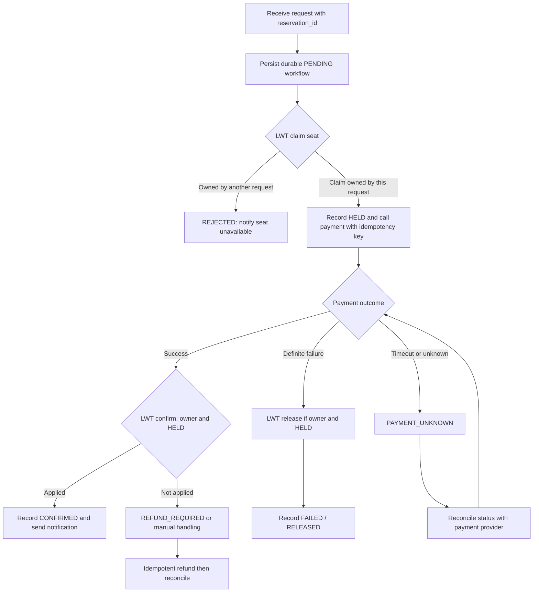

# LWT, Compensating Steps, or Reconciliation When Invariants Span Multiple Operations

## 1. Why Does This Problem Arise in Application Architecture?

In the **`DATABASE_ENGINE_WIDE_COLUMN_CASSANDRA`** module, Apache Cassandra is used as a distributed wide-column database: selecting **partition keys** based on queries, replicating data across replicas, balancing **consistency levels**, and working with CQL/Java operations. The **Application Architecture** chapter asks a further question: when a business rule (business invariant, or simply **invariant**) spans multiple write operations, how do we prevent contention and recover when only part of the work succeeds?

For example, a ticketing system has two invariants:

- **Hard invariant:** a seat for an event can have at most one active owner.
- **Cross-system invariant:** if payment has been collected successfully, either a ticket must be issued or a refund/reconciliation must be processed; ticket state and payment transaction must converge to a valid outcome.

The first invariant can be protected with a **Lightweight Transaction (LWT)** on a single record representing the seat. The second invariant spans Cassandra and a payment gateway, so it **cannot** be committed as a single ACID transaction using LWT alone. It requires a **durable workflow** with compensating steps, idempotency, and reconciliation jobs.

After this lesson, readers will be able to:

1. Choose among standard writes, LWT/CAS, batches, sagas, and reconciliation based on invariant boundaries.
2. Use CQL `IF NOT EXISTS`, `IF`, and `IF EXISTS` clauses within their proper scope.
3. Distinguish **regular consistency** from Paxos **serial consistency**.
4. Design a multi-step workflow that still recovers from timeouts, crashes, retries, state skew, or out-of-order callbacks.
5. Execute LWTs with the Cassandra Java Driver, read `[applied]` results, and avoid treating timeouts as definite failures.

> **Version scope:** Principles and examples focus on Paxos-based LWTs in Apache Cassandra OSS 3.11–5.0. If a deployment uses another transaction mechanism (such as the Accord feature in newer branches/releases), check the documentation and enablement requirements for **the exact version running**; do not conflate that feature's guarantees with LWT.

## 2. Classify Invariants Before Choosing a Mechanism

| Invariant / Scenario | State Scope | Typically Suitable Solution |
| --- | --- | --- |
| Create only a single idempotency key | One partition/row per request ID | `INSERT ... IF NOT EXISTS` (LWT). |
| State allowed to transition from `HELD` to `CONFIRMED` when owner matches | One partition/row | `UPDATE ... IF ...` (LWT). |
| Decrement `available` if stock remains and version has not changed | One inventory record | Read, compute new value, then CAS on expected version and value. |
| Update multiple columns or rows within the same partition in one statement | One partition | Single-partition mutation/batch; use conditional batch when CAS is genuinely needed and supported by the version. |
| Atomically update two accounts in **two partitions**, always preserving total balance | Multiple partitions | Requires a true transactional mechanism with matching guarantees or a model change; a saga alone does not enforce instantaneous invariants. |
| Hold seat, record order, charge via external API, send email | Multiple partitions and services | LWT at the contention point + state machine + saga/compensation + reconciliation. |
| Read data for search/reporting must eventually match source | Multiple tables/projections | Emit durable events + idempotent consumers + backfill/reconciliation. |

**Design principle:** Identify the exact "decision point" of the invariant. If that decision can be represented by **one stable partition key**, try placing the CAS condition there first. Other query-driven projections can update asynchronously and reconcile themselves. Avoid funneling all operations into one giant partition or a "global lock" that becomes a hot partition.

## 3. Why Do Standard Read-Then-Write Flows Still Have Race Conditions?

Suppose an inventory table has `sku='TICKET-01'`, `available=1`:

```text
A: SELECT available -> 1
B: SELECT available -> 1
A: UPDATE available = 0
B: UPDATE available = 0
Both A and B issue a ticket
```

Even if both A and B read/write at `LOCAL_QUORUM` or `QUORUM`, **reading once and then updating once** remains **two independent operations**. Quorum consistency does not automatically combine them into a compare-and-set. The final inventory value of 0 cannot reflect the reality that **two** tickets were sold.

LWT adds the check *write only if the value still matches what was expected*. In the example above, only one request can transition the same state version from `(available=1, version=8)` to `(available=0, version=9)`; the other request must re-read and decide whether to reject or retry with fresh data.

### 3.1. LWT/CAS Uses Paxos

When CQL includes conditions such as `INSERT ... IF NOT EXISTS` or `UPDATE ... IF state = 'HELD'`, Cassandra uses the **Paxos** protocol to agree on the outcome among participating replicas. Logically, this can be pictured as:

1. **Prepare/promise:** participating replicas establish an acceptable proposal number.
2. **Read and evaluate condition:** determine the value to compare, resolving any unfinished proposals if present.
3. **Propose/accept:** agree on the mutation if the condition holds and the round is uncontested.
4. **Commit/learn:** apply the agreed value and return the result.

This is a conceptual model; round trips and implementation details may vary across branches and optimizations. LWT is more expensive than standard writes because it communicates with multiple replicas, may retry under contention, and incurs network latency. Reserve LWT for **contention points requiring strict correctness** rather than every log or analytics record.

### 3.2. Two Consistency Levels in a Single LWT

| Parameter | Purpose | Example |
| --- | --- | --- |
| **Serial consistency** | Quorum participating in the **Paxos/CAS phase**; `SERIAL` spans configured replicas, while `LOCAL_SERIAL` restricts the serial phase to the local DC. | `LOCAL_SERIAL` when rules and write paths are strictly scoped to one DC. |
| **Regular consistency** | Acknowledgment level for the normal write/commit phase after a decision is reached. | `LOCAL_QUORUM` in a DC with RF=3. |

Do not assume `LOCAL_QUORUM` replaces `LOCAL_SERIAL`, or that `LOCAL_SERIAL` creates cross-partition transactions. If multiple datacenters write the same key, choose `SERIAL`/`LOCAL_SERIAL` based on the desired scope and application-wide consistency policy; configuring only one side easily leads to false expectations of global guarantees.

**Critical rule:** every write path mutating *the same data protected by LWT* must follow a compatible protocol/rule. An unconditional regular write path can bypass business checks and overwrite state after CAS. Avoid arbitrarily mixing regular `UPDATE`, regular `DELETE`, and LWT on the same guarded key.

## 4. Practical CQL: Reserving a Seat Using a Single Partition Key

Assume all three replicas are in DC `dc1` with RF=3; adjust DC name, node count, and policy when deploying. The partition key `(event_id, seat_id)` gives each seat **a single decision row**. The `reservations_by_id` table holds per-request workflow state and **is not in the same transaction** as the seat-claims table.

```sql
CREATE KEYSPACE IF NOT EXISTS booking
WITH replication = {'class': 'NetworkTopologyStrategy', 'dc1': 3};

CREATE TABLE IF NOT EXISTS booking.seat_claims (
    event_id uuid,
    seat_id text,
    reservation_id uuid,
    state text,
    PRIMARY KEY ((event_id, seat_id))
);

CREATE TABLE IF NOT EXISTS booking.reservations_by_id (
    reservation_id uuid PRIMARY KEY,
    event_id uuid,
    seat_id text,
    workflow_state text,
    payment_ref text
);
```

Make `event_id` and `seat_id` the key for the **no-double-booking invariant**; do not use `reservation_id` as the claims table key because two requests would use two different keys and both "succeed." If listing seats by event is needed, design a separate query-driven table or projection; never use `ALLOW FILTERING` to enforce uniqueness.

### 4.1. Claim: Create the Record If Unclaimed

```sql
INSERT INTO booking.seat_claims
    (event_id, seat_id, reservation_id, state)
VALUES
    (11111111-1111-4111-8111-111111111111, 'A-12',
     22222222-2222-4222-8222-222222222222, 'HELD')
IF NOT EXISTS;
```

The result includes the `[applied]` column:

- `true`: this request **just** created the claim.
- `false`: condition not met; either another requester claimed it, **or this very request succeeded earlier but its response was lost**. Check the owner and workflow state rather than assuming `false` means a business failure.
- **Timeout/Unavailable/Exception**: commit status is **uncertain**; never conclude no claim exists or initiate a second payment.

### 4.2. Confirm: Only the Right Owner and State May Transition

```sql
UPDATE booking.seat_claims
SET state = 'CONFIRMED'
WHERE event_id = 11111111-1111-4111-8111-111111111111
  AND seat_id = 'A-12'
IF reservation_id = 22222222-2222-4222-8222-222222222222
   AND state = 'HELD';
```

Both conditions must hold. A late payment callback or stale workflow must never "confirm on behalf of" a newer request's claim. Never use an `UPDATE ... SET state = 'CONFIRMED'` without `IF` on this critical path.

### 4.3. Compensation: Release Only If Still Owned by the Request

```sql
DELETE FROM booking.seat_claims
WHERE event_id = 11111111-1111-4111-8111-111111111111
  AND seat_id = 'A-12'
IF reservation_id = 22222222-2222-4222-8222-222222222222
   AND state = 'HELD';
```

If the claim is already confirmed, belongs to another request, or is in another state, the compensating command **must not** delete it. Such a rejection should trigger workflow investigation rather than forced deletion.

> **Do not rely on TTL as the sole mechanism to protect seat holds:** TTL expires cells over time but does not guarantee that payment callbacks, workers, and compensating steps run in order. If a hold has an expiration, model `expires_at`/leases, conditional revocation, late-payment handling, and reconciliation. Choose retention/tombstone behavior deliberately, and never infer from a vanished cell that money has been refunded.

### 4.4. Version-Based CAS for Single-Record State

When only **one** inventory partition is involved, read `available` and `version` and write the new values only if the version is unchanged. For example, after reading `available=8`, `version=10`:

```sql
CREATE TABLE IF NOT EXISTS booking.inventory_by_sku (
    sku text PRIMARY KEY,
    available int,
    version bigint
);

UPDATE booking.inventory_by_sku
SET available = 7,
    version = 11
WHERE sku = 'TICKET-01'
IF available = 8 AND version = 10;
```

If `[applied]=false`, re-read and recompute from the latest state; **do not** blindly increment the version or retry indefinitely with stale values. The guarantee holds only if all writers follow the same CAS rule. Cassandra does not support arbitrary subtraction `available = available - 1` on a regular `int` column like a SQL RDBMS; **counters** have distinct semantics and are not a natural choice for strict inventory guards or monetary transfers.

## 5. LWT, BATCH, and Multi-Partition Transactions: Do Not Equate Them

| Mechanism | What It Does | What It Does Not Guarantee |
| --- | --- | --- |
| Regular CQL write | Fast key-based upsert; tunable consistency level. | Conditional check-and-write as a single CAS action. |
| LWT `IF` | Linearizable CAS decision within **the scope of the guarded object**. | Atomic commit across multiple partitions/external services with shared rollback. |
| **Single-partition** batch | Groups mutations with partition-level isolation; may support conditional batches per Cassandra version limits. | Automatically executing multi-step business read-compute-write logic. |
| **Multi-partition** `LOGGED BATCH` | Batchlog helps accepted mutations eventually complete after failure; suited for certain co-business writes. | Atomic visibility/isolation across partitions; during execution, partial updates may be visible. |
| Saga/compensation | Decomposes a multi-system workflow into retryable steps and compensations. | Cross-system invariants holding **instantaneously**, or automatic ACID rollback. |
| Reconciliation | Detects and repairs drift caused by retries, callbacks, disconnects, or prolonged outages. | Preventing all temporary inconsistent states prior to running. |

A **conditional batch** is not a general SQL transaction: in traditional CQL/Paxos, using `IF` inside a batch is restricted to a single partition and Cassandra version constraints, and cannot provide CAS across distinct partitions. Never use `BEGIN BATCH` to "atomically transfer money" between two accounts in two partitions or to wrap REST API calls.

If an invariant strictly must hold **at every point in time** across multiple partitions (such as preserving ledger balance totals), change how data boundaries/decision points are modeled or choose a tool with true distributed transactions; **do not** merely add compensating steps and claim ACID semantics.

## 6. End-to-End Example: Hold Seat → Pay → Confirm Saga

The system has three components: Java API/worker, Cassandra, and a payment provider. Each ticket purchase request is assigned a stable `reservation_id` (or idempotency key); every retry **reuses this ID**.



**Boundary point:** only the LWT on `seat_claims` guards seat ownership, whereas updating `reservations_by_id`, payment, callbacks, and notifications happen in separate steps. Briefly, the two tables may be out of sync; the workflow must **converge forward toward the right state** rather than pretending all steps occur simultaneously.

### 6.1. Designing a Durable State Machine

A minimal state machine might use these states (names are illustrative, defined at the application layer):

| State | Meaning | Safe Next Step |
| --- | --- | --- |
| `PENDING` | Request recorded; unclear whether a claim exists yet. | Check or perform CAS claim using the original ID. |
| `HELD` | Claim belongs to the current reservation. | Call/check payment using the idempotency key. |
| `PAYMENT_UNKNOWN` | Payment call timed out or no final callback received. | Query provider; never charge again with a new key. |
| `PAID` | Provider confirmed payment. | Confirm claim via CAS; if unsuccessful, initiate refund. |
| `CONFIRMED` | Seat confirmed; business entitlement complete. | Issue ticket/notification idempotently. |
| `RELEASING` | Payment failed and compensating release is underway. | CAS release matching owner and state. |
| `REFUND_REQUIRED` | Payment collected but seat cannot be granted. | Refund with idempotency key, verify with provider. |
| `REJECTED` / `REFUNDED` | Terminal states after rejection/compensation. | Only reconcile or return idempotent response on duplicate requests. |
| `NEEDS_REVIEW` | Retries exhausted or conflicting outcomes detected. | Open an operational ticket with full correlation IDs. |

Persist the **completed step**, `reservation_id`, `payment_ref`, attempt count, next retry time, and last failure reason. Enforce **rule-based monotonic state transitions** using CAS/versioning or writer serialization; a late callback must never revert `CONFIRMED` back to `HELD`.

Do not rely on a bare `status` field and arbitrary regular `UPDATE`s when multiple workers exist: a stale worker can overwrite newer outcomes. Updating the workflow and `seat_claims` spans two partitions, so the state machine still requires **reconciliation** even when individual steps use LWT.

### 6.2. Compensation Is a New Business Action, Not "UNDO"

For instance, payment succeeded, but confirming the seat failed. At that point:

1. Confirm from the payment transaction's **source of truth** (the provider) using the same `payment_ref`/idempotency key.
2. Attempt to verify the current claim; if it no longer belongs to the request, **do not** seize the seat with a regular write.
3. Record `REFUND_REQUIRED` in the workflow and execute an idempotent refund.
4. If the refund times out, query the provider again; do not issue a fresh refund with a different key.
5. Mark `REFUNDED` only once the provider confirms; if indeterminable, keep `NEEDS_REVIEW` and alert.

A refund creates a **new transaction** with fees, latency, and failure modes; it does not erase payment history. Other compensations such as returning stock, canceling shipments, or revoking access follow the same principles of **owner verification, validity checks, and idempotency**.

### 6.3. How Idempotency Differs from LWT

- **Idempotency key** binds to a business intent: retrying the same `reservation_id` must yield **the same final outcome**, even if the first attempt committed and the response was lost. An `IF NOT EXISTS` table keyed by request ID can admit the initial request.
- **LWT** guards a value/condition at the exact moment a decision is made.
- **Outbox/event log/CDC** helps workers and downstream targets process changes with at-least-once semantics; consumers must deduplicate because replays can re-emit events.
- **Reconciliation** repairs drift from prolonged failures or non-transactional multi-step workflows. It does not replace LWT at contention points.

When emitting events in the same partition as the source state, an outbox can be co-located in that partition to shrink the event-loss window. However, this **does not** combine an external payment system or another partition's state into one shared transaction. Validate outbox designs against Cassandra query patterns and retention limits.

## 7. Handling Timeouts, Retries, Node Loss, and Ambiguous Outcomes

A common source of business bugs is equating "request errored" with "mutation was not persisted." With LWT, a timeout can occur **after** consensus was reached but **before** the client received the response. Clients may also face Paxos contention, insufficient replicas, or single-DC network partitions.

| Response from Cassandra | Meaning | How to Handle |
| --- | --- | --- |
| `[applied]=true` | Condition met and request applied per response. | Record workflow milestone and advance to next step. |
| `[applied]=false` | Condition was not met on this execution. | Inspect owner/version and workflow; a previous attempt may already hold the claim. |
| Timeout during CAS | **Uncertain** whether applied or not. | Mark `UNKNOWN`, read/reconcile with serial semantics or re-run the idempotent operation with the exact same ID; never switch owners automatically. |
| Unavailable/cluster error | Likely insufficient replicas to proceed. | Bounded backoff, monitor, do not spawn a new business request. |
| Payment API timeout | Provider-side outcome is **unknown**. | Query by idempotency key; never submit a second charge with a new key. |
| Crash between two steps | Partial state exists. | Worker restarts from durable workflow state and executes the missing step. |

In LWT workflows, understand the difference between a **regular quorum read** and a **serial read** capable of completing an in-flight Paxos proposal. Use the appropriate version/driver API and consistency settings to diagnose state; inspect the owner and external source rather than guessing from a single stale `SELECT` or one node's logs.

Retries must have **strict caps**, exponential backoff with jitter, and escalation of stuck workflows to `NEEDS_REVIEW`. Hammering a hot key with relentless retries worsens both CAS contention and replica unavailability.

## 8. Connecting from Java: Calling CAS and Handling Results

The example below uses **Apache Cassandra Java Driver 4.x**. The service already holds a `CqlSession` configured for the target DC; the code demonstrates two CAS operations on `seat_claims`.

```java
import com.datastax.oss.driver.api.core.CqlSession;
import com.datastax.oss.driver.api.core.DefaultConsistencyLevel;
import com.datastax.oss.driver.api.core.cql.BoundStatement;
import com.datastax.oss.driver.api.core.cql.PreparedStatement;

import java.util.UUID;

public final class SeatClaimRepository {
    private final CqlSession session;
    private final PreparedStatement claim;
    private final PreparedStatement release;

    public SeatClaimRepository(CqlSession session) {
        this.session = session;
        this.claim = session.prepare(
            "INSERT INTO booking.seat_claims " +
            "(event_id, seat_id, reservation_id, state) " +
            "VALUES (?, ?, ?, 'HELD') IF NOT EXISTS");

        this.release = session.prepare(
            "DELETE FROM booking.seat_claims " +
            "WHERE event_id = ? AND seat_id = ? " +
            "IF reservation_id = ? AND state = 'HELD'");
    }

    private BoundStatement withConsistency(BoundStatement statement) {
        return statement
            .setConsistencyLevel(DefaultConsistencyLevel.LOCAL_QUORUM)
            .setSerialConsistencyLevel(DefaultConsistencyLevel.LOCAL_SERIAL);
    }

    public boolean tryClaim(UUID eventId, String seatId, UUID reservationId) {
        BoundStatement statement = withConsistency(
            claim.bind(eventId, seatId, reservationId));
        return session.execute(statement).wasApplied();
    }

    public boolean releaseIfStillOwned(
            UUID eventId, String seatId, UUID reservationId) {
        BoundStatement statement = withConsistency(
            release.bind(eventId, seatId, reservationId));
        return session.execute(statement).wasApplied();
    }
}
```

Inspect `ResultSet.wasApplied()` to detect unmet conditions; **do not treat `session.execute()` returning without an exception as a guaranteed transition**. The code above intentionally lets exceptions propagate: the orchestration layer must record uncertain state, verify before proceeding, and **never blindly retry payment**. Production code also needs correlation-ID logging, timeout/retry policies, session lifecycle management, and real-cluster tests.

Example service-layer orchestration logic (pseudocode, **not runnable Java as-is**):

```text
reserve(request):
    workflow = createOrLoadByIdempotencyKey(request.id)

    if workflow is terminal:
        return samePreviousResult

    ensureClaimBelongsTo(workflow.reservationId)
        // CAS IF NOT EXISTS; if false/timeout, verify owner
    persistTransition(workflow, HELD)

    payment = chargeOrGetStatus(idempotencyKey = workflow.reservationId)
    if payment == SUCCESS:
        persistTransition(workflow, PAID)
        if confirmSeatWithCAS(owner = workflow.reservationId):
            persistTransition(workflow, CONFIRMED)
        else:
            persistTransition(workflow, REFUND_REQUIRED)
    else if payment == DEFINITIVELY_FAILED:
        persistTransition(workflow, RELEASING)
        releaseSeatWithCAS(owner = workflow.reservationId)
        persistTransition(workflow, REJECTED)
    else:
        persistTransition(workflow, PAYMENT_UNKNOWN)
        enqueueReconciliation(workflow)
```

`ensureClaimBelongsTo`, `persistTransition`, and `chargeOrGetStatus` must be implemented with real **idempotency/conditional updates**; never skip contested branches just because the pseudocode reads sequentially.

## 9. Designing Reconciliation Jobs in Cassandra

When an invariant spans multiple mutations, **reconciliation is a first-class architectural component**, not a one-off rescue script. Reconciliation jobs can run periodically and also be triggered directly from a queue upon timeouts.

### 9.1. Sources of Truth to Compare

- **Workflow by request ID:** step state, persisted milestones, retry count, last error.
- **Claim by event + seat:** owner and `HELD`/`CONFIRMED` state. This is the exclusive seat authority.
- **Payment provider:** captured, authorized, voided, refunded, or merely pending.
- **Projections, issued tickets, notifications:** can be repaired/replayed once the authoritative state is established.

Example reconciliation rule set:

| Observation | Conditional Action |
| --- | --- |
| `HELD` past expiration with payment not succeeded | Verify provider, CAS release by owner, update workflow. |
| Payment `SUCCESS`, claim still `HELD` by matching owner | CAS confirm, then update `CONFIRMED`. |
| Payment `SUCCESS`, claim no longer owned by request | Transition to `REFUND_REQUIRED`, refund idempotently; never seize a new seat with a regular write. |
| Claim `CONFIRMED`, workflow not yet `CONFIRMED` | Verify payment, backfill missing workflow step or open investigation. |
| Workflow `CONFIRMED` but projection/ticket missing | Replay event / materialize idempotently. |
| Refund outcome unknown | Query provider with the same key/ref before retrying. |

### 9.2. Do Not Scan the Entire Business Table Every Minute

Cassandra is designed around query access paths. Queries like:

```sql
-- Avoid treating this as a production scheduling mechanism:
-- SELECT * FROM booking.reservations_by_id
-- WHERE workflow_state = 'PAYMENT_UNKNOWN' ALLOW FILTERING;
```

can trigger expensive full scans. Maintain a **durable queue**, or a scheduling table partitioned by `time bucket + next_retry_at` to fetch due workflows; each key is retried idempotently. Scheduling records are **a secondary workflow index**, so pair them with periodic cross-checks from source workflows to catch enqueues missed because two partitions do not update atomically.

Explicitly define **SLAs for unconverged states**: e.g., alert after 2 minutes in unknown payment status, escalate/manual review after 15 minutes. Thresholds are business decisions; calibrate them against measured P95/P99 provider latency and Cassandra load.

## 10. Operations: Key Metrics and Tests

Apache Cassandra exposes coordinator CAS metrics such as `ClientRequest.CASWrite` / `ClientRequest.CASRead` with `Latency`, `Timeouts`, `Failures`, `Unavailables`, `ConditionNotMet`, and `ContentionHistogram`. At the table level there are also `CasPrepare`, `CasPropose`, and `CasCommit`. Collect **per node**, aggregate by cluster/DC, and separate unmet business conditions (often normal) from timeouts/errors (abnormal).

| Test Case | Expected Outcome |
| --- | --- |
| 100 concurrent requests claiming the same `(event_id, seat_id)` | Only **one owner** succeeds in claiming; all other requests receive appropriate rejections. |
| LWT commits successfully, but client times out | Retrying with the same request ID does not issue a second seat or double-charge. |
| Crash after claim, before persisting `HELD` workflow | Reconciler identifies owner and either continues or compensates the right claim. |
| Crash after payment succeeds, before confirm | Re-query provider and confirm or refund per policy. |
| `FAILED` callback arrives after `CONFIRMED` | No state regression; confirmed claim is never deleted. |
| Two workers run compensation concurrently | CAS on owner/state prevents releasing another request's claim. |
| Replica/DC unavailable | App handles timeouts/unavailability with bounds and observability; invariant remains intact. |
| Sink or outbox replays the same event multiple times | Projections and email/tickets are idempotent; no duplicate side effects. |

**Note on replication and repair:** RF=3, `LOCAL_QUORUM`, and `LOCAL_SERIAL` in examples do not eliminate all network failures. Plan repairs, ensure identical schema/config across nodes, and benchmark Paxos under load. Never pick a consistency level on speed alone if it breaks invariant requirements.

## 11. Self-Assessment Exercises

1. Why can two clients using `QUORUM` to read and update `available=1` still oversell a single unit of stock? Rewrite the operation using CAS/versioning.
2. You must enforce unique emails while storing user profiles by `user_id`. Choose the key for the uniqueness-decision table, identify the window during which the two tables can skew, and explain how to compensate if profile creation fails.
3. A user holds a seat successfully, payment times out, and the client retries the API with the original `request_id`. List the checks required before issuing another charge request.
4. Can a `LOGGED BATCH` writing two partitions expose one side before the other? If an invariant must hold instantaneously, what architectural change is needed?
5. If `DELETE ... IF reservation_id = ? AND state = 'HELD'` returns `false`, why must you never replace it with an unconditional `DELETE`?
6. Design metrics and SLAs for workflows stuck in `PAYMENT_UNKNOWN` for over 15 minutes; explain how to pick partition keys for a reconciliation schedule table.

### Suggested Answers

1. `QUORUM` applies per individual operation; CAS is needed so the condition check and write execute as one decision.
2. The normalized email key must be the uniqueness-decision key (e.g., a claim row keyed by email); the user-ID profile is a separate projection requiring a workflow/skew repair.
3. Query the workflow, claim owner, and provider status using the idempotency key; if already paid, proceed to confirm/refund rather than charging again.
4. Yes, the batchlog does not provide cross-partition isolation/atomic visibility; co-locate the decision in one partition, choose a supported transactional mechanism, or relax the invariant to eventual convergence with compensation.
5. `false` may mean it was already confirmed or belongs to another owner; an unconditional delete could wipe out someone else's seat.
6. Track pending workflow count, max age, retry count, provider latency, refund rate, and manual-intervention events; bucket by time and distribute load to prevent hot partitions.

## 12. References

- [Apache Cassandra 5.0 — Guarantees](https://cassandra.apache.org/doc/5.0/cassandra/architecture/guarantees.html): Paxos/LWT, consistency, and batch limitations.
- [Apache Cassandra 5.0 — CQL Data Manipulation](https://cassandra.apache.org/doc/5.0/cassandra/developing/cql/dml.html): `INSERT`, `UPDATE`, `DELETE` with `IF`, and `BATCH` semantics.
- [Apache Cassandra 5.0 — Monitoring metrics](https://cassandra.apache.org/doc/5.0/cassandra/managing/operating/metrics.html): per-node CAS, timeout, and contention metrics.
- [Apache Cassandra Java Driver 4.19 — Statement API](https://apache.github.io/cassandra-java-driver/4.19.0/api/com/datastax/oss/driver/api/core/cql/Statement.html): configuring regular/serial consistency on statements.
- [DataStax Java Driver 4.10 — ResultSet.wasApplied()](https://docs.datastax.com/en/drivers/java/4.10/com/datastax/oss/driver/api/core/cql/ResultSet.html): reading conditional update results.

The references above describe **LWT in Cassandra OSS** and corresponding driver APIs. Before operating or upgrading, verify documentation for the **exact minor/patch version** of your cluster and driver; each saga, payment, and queue component carries its own delivery contract and idempotency requirements.
