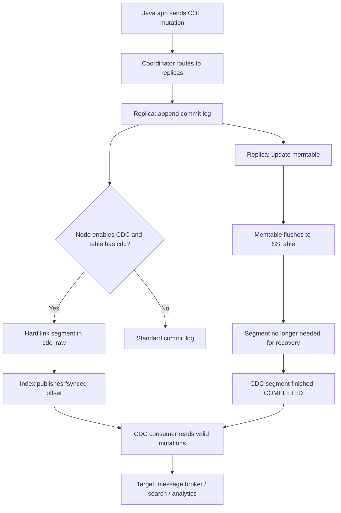

# CDC/Commit Log and Version-Specific Operating Conditions in Apache Cassandra

## 1. Objectives and Architectural Context

In the **Application Architecture** chapter of `DATABASE_ENGINE_WIDE_COLUMN_CASSANDRA`, this lesson explains how Apache Cassandra records data to the **commit log**, how **Change Data Capture (CDC)** leverages that log to expose changes to external systems, and which conditions must be verified prior to deployment across versions. This forms the foundation for designing Java applications, syncing data to search/analytics engines, operational monitoring, and incident response in a distributed wide-column database.

After this lesson, readers will be able to:

1. Distinguish the commit log used for node recovery from CDC used for exporting changes.
2. Explain a mutation's path from the application to replicas, memtables, SSTables, and `cdc_raw`.
3. Enable CDC properly at the **node** and **table** levels, read offsets safely, and recognize capacity exhaustion conditions.
4. Choose configurations suited to Cassandra 3.11, 4.0, 4.1, or 5.0; avoid applying parameter names from another version.
5. Design a CDC consumer with checkpointing, deduplication, recovery, and observability.

> **Scope:** This covers CDC built into **Apache Cassandra OSS**, based on per-node commit log segments. Do not conflate it with CDC from cloud CQL-compatible services or commercial connectors: those products have their own APIs, guarantees, and features.

## 2. What Is the Commit Log, and What Does CDC Add?

Whenever a replica accepts a **mutation** (insert, update, or delete), Cassandra appends the mutation to an append-only **commit log** and applies it to an in-memory **memtable**. The memtable is later **flushed** into immutable SSTables. If the process stops before the memtable flushes, any still-needed commit log segments are **replayed** on restart. Segments no longer holding un-flushed recovery data can be discarded through the normal commit log lifecycle.

CDC is a mechanism for selecting tables to track (`WITH cdc = true`), retaining hard links to relevant commit log segments, and publishing information about bytes safely synced to disk so **an external consumer process** can read and process them. Cassandra OSS does not automatically create a Kafka topic, webhook, or normalized event table for applications. A separate agent or consumer must read, decode, and transform mutations into the target format.

| Component | Responsibility | Lifecycle and Notes |
| --- | --- | --- |
| `commitlog_directory` | Logs mutations ahead of memtable updates for node recovery | Cassandra manages segments for the write path. Never treat this as an application queue. |
| Memtable / SSTable | Updates queryable data state; flushes from RAM to SSTables | Flush/compaction are storage engine operations, not CDC export steps. |
| `cdc_raw_directory` | Exposes hard links to CDC-relevant segments, plus progress indexes | The consumer is responsible for processing and deleting completed CDC files per protocol. |
| `<segment>_cdc.idx` | Records the highest fsynced offset; includes `COMPLETED` when finished | Read only up to the published offset; handle temporarily empty index files. |

**Key distinction:** a node's commit log supports *write durability on that node*, not a cluster-wide event log with global total ordering. Nor does CDC automatically turn Cassandra into an event broker with exactly-once delivery.

## 3. Path of a Mutation



The path above is the logical model **per replica**. Note the distinct milestones:

1. **CQL write acknowledged by coordinator** per the consistency level and commit log sync mode; this does not mean downstream CDC consumers have processed it.
2. **Commit log fsync**: bytes confirmed in the index file may be read by the consumer as durably persisted on disk. With `commitlog_sync: periodic`, the write ACK may precede fsync; with `batch`, ACK waits for fsync per that mode's semantics.
3. **Memtable flush**: moves in-memory state to SSTables; does not imply all CDC events have been delivered downstream.
4. **Consumer writes to target and checkpoints**: a separate operational milestone controlled by the CDC application. If the target slows down or the consumer stops, CDC lag grows even while Cassandra continues accepting writes.

A single segment can contain mutations from **multiple tables**. Therefore, decoding must filter for the right keyspace/table; never assume every mutation in a `cdc_raw` file belongs to the table being synced.

## 4. Enabling CDC via CQL and Node Configuration

### 4.1. Query-Driven Wide-Column Table Example

Suppose an order service looks up orders by `tenant_id` + `order_id` while streaming status changes to a search engine.

```sql
-- Example for a multi-node cluster with actual DC name dc1.
CREATE KEYSPACE IF NOT EXISTS commerce
WITH replication = {'class': 'NetworkTopologyStrategy', 'dc1': 3};

CREATE TABLE IF NOT EXISTS commerce.orders_by_id (
    tenant_id text,
    order_id uuid,
    status text,
    total decimal,
    updated_at timestamp,
    PRIMARY KEY ((tenant_id, order_id))
) WITH cdc = true;

-- If the table already exists, enable CDC for subsequent mutations:
ALTER TABLE commerce.orders_by_id WITH cdc = true;

INSERT INTO commerce.orders_by_id
    (tenant_id, order_id, status, total, updated_at)
VALUES
    ('tenant-01', 11111111-1111-4111-8111-111111111111,
     'CREATED', 120000.00, toTimestamp(now()));

UPDATE commerce.orders_by_id
SET status = 'PAID', updated_at = toTimestamp(now())
WHERE tenant_id = 'tenant-01'
  AND order_id = 11111111-1111-4111-8111-111111111111;

DELETE FROM commerce.orders_by_id
WHERE tenant_id = 'tenant-01'
  AND order_id = 11111111-1111-4111-8111-111111111111;

-- Disable capture for future mutations when genuinely no longer needed:
-- ALTER TABLE commerce.orders_by_id WITH cdc = false;
```

`PRIMARY KEY ((tenant_id, order_id))` creates a **composite partition key**. This is solely an example for order-by-ID lookups; other query patterns need separate tables and partition distribution evaluation. Adjust `dc1`, replication factor, node addresses, and CQL permissions for your real cluster. This example is unsuitable for a single-node cluster configured with RF = 3.

CDC only reflects mutations **from the time it is enabled** on properly configured nodes. `ALTER TABLE ... WITH cdc = true` does not automatically export historical data already stored in SSTables. For full synchronization, perform a one-time **snapshot/backfill** and design the cutover point to CDC tracking to avoid transition gaps or duplicate handling issues.

### 4.2. Per-Node Configuration

In `cassandra.yaml`, set `cdc_enabled: true` on **every relevant node** and restart following the version/cluster procedure. You can set a dedicated CDC directory to avoid unwanted I/O contention and configure capacity thresholds. Capacity parameter names differ across releases:

```yaml
# Cassandra 3.11 / 4.0 (example, units embedded in field names)
cdc_enabled: true
cdc_raw_directory: /var/lib/cassandra/cdc_raw
cdc_free_space_in_mb: 4096
cdc_free_space_check_interval_ms: 250
```

```yaml
# Cassandra 4.1 / 5.0 (example with explicit unit suffixes)
cdc_enabled: true
cdc_raw_directory: /var/lib/cassandra/cdc_raw
cdc_total_space: 4096MiB
cdc_free_space_check_interval: 250ms
```

The values above only illustrate **exact field names** by branch, not production sizing. Per Apache documentation, `cdc_enabled` defaults to `false`; the default CDC space limit is the lesser of **4096 MiB** and **1/8 of the volume capacity** hosting `cdc_raw`. Balance this against per-node write throughput, segment size, maximum consumer downtime, and OS headroom. Never copy a config snippet from another version verbatim into a running cluster.

> **Preconditions for enabling in production:** finish upgrading the entire cluster to a supported version, verify config on every node, confirm the consumer is running, and have a capacity expansion/cleanup plan ready. Cassandra 3.8 documentation warns **against enabling CDC on a mixed-version cluster during an upgrade**.

## 5. Version-Specific Operating Conditions

Apache Cassandra branches do not share identical config names, exposure mechanics, and operational flags. Pin deployment runbooks to a **specific minor/patch version**, as some CDC improvements were backported over time.

| Branch | What You Can Rely On | What Must Be Checked Before Deployment |
| --- | --- | --- |
| **Pre-3.8** | No built-in CDC via `WITH cdc = true` (introduced in 3.8). | Requires another approach (such as application-level dual writes/outbox) or a cluster upgrade. |
| **3.8–3.10** | Newly introduced CDC; retaining segments only after flush was a notable constraint of the initial design. | Do not assume near-real-time tailing as in later patches; verify exact `cdc_raw` behavior and consumer compatibility for the running version. Never enable on a mixed-version cluster. |
| **3.11** | 3.11 docs describe `<segment>_cdc.idx`, fsynced offsets, `COMPLETED` marker, and `cdc_free_space_in_mb`. | Verify patch level and parser compatibility; property names use `_in_mb` / `_ms` suffixes. |
| **4.0** | 4.0 docs continue describing hard links, index files, `COMPLETED`, and reading up to durable offsets. | Still uses `cdc_free_space_in_mb` and `cdc_free_space_check_interval_ms` in 4.0 branch docs. |
| **4.1** | Supports commit-log CDC; configuration uses `cdc_total_space` and `cdc_free_space_check_interval` with explicit units. | Update config when upgrading from 4.0; re-test space limits and agents. |
| **5.0** | Continues commit-log CDC; 5.0 config docs include `cdc_block_writes` and `cdc_on_repair_enabled`. | Define policy for CDC-full scenarios and repair/streaming impact; verify each option on the exact build rather than back-applying to older branches. |

**Specifically in 5.0** (per Apache's `cassandra.yaml` documentation):

- `cdc_block_writes: true` (default) **blocks CDC-enabled writes** when the limit is exceeded to preserve change-stream integrity. If set to `false`, Cassandra may delete older CDC segments to keep accepting writes, meaning consumers **may lose change history**. Choose this only when the business tolerates CDC loss and has a backfill/recovery plan.
- `cdc_on_repair_enabled: true` (default in 5.0 docs) routes streaming/repair mutations through the write path/commit log; setting `false` can speed up streaming, provided you understand potential missing CDC events in certain replica-recovery cases. Repair itself can generate duplicate events; consumers must tolerate them.

Do not assume a connector labeled "supports Cassandra 4.x" automatically handles every segment format/behavior across both 4.0 and 4.1. For every version upgrade, test **upgrade + CDC reader** in staging, covering node restarts, high traffic, schema changes, repairs, and disk-full conditions.

## 6. Reading `cdc_raw` Properly

A consumer reading commit logs directly must understand this is a **version-specific internal binary format**; you cannot `tail -f` and parse it as CQL. Apache Cassandra provides `CommitLogReader`/`CommitLogReadHandler` in Java for reference, but those are server-side internals, not stable Java CQL driver APIs. For production, prefer an agent/connector explicitly supporting your exact version rather than maintaining a custom binary parser.

Safe logical workflow per **node** and per **segment**:

1. Watch segments in `cdc_raw` and their companion index files. If the index does not exist yet or lacks a valid offset, do not guess readable byte positions.
2. Read the `durableEnd` offset from `<segment>_cdc.idx`. Under certain versions/I/O races, reading the index file may briefly yield an empty file; **retry** instead of treating it as offset 0 or a corrupt file.
3. Decode only complete mutations within **checkpoint through `durableEnd`**. Never read bytes beyond the index offset even if the segment file has grown in the OS page cache.
4. Filter for CDC-enabled tables and transform mutations into sink records; preserve necessary metadata (node, segment, position, table, partition key, cell/tombstone timestamp, etc.).
5. After the sink **durably acknowledges**, persist the consumer's checkpoint. If a crash occurs between sink write and checkpoint save, accept replay and deduplicate via idempotency.
6. Only when the index carries `COMPLETED`, **all valid bytes** are processed, and checkpoints are durable, remove the CDC hard link and index file for that segment. Never delete CDC files still in use by the writer or before the consumer has caught up.

Example algorithm (pseudocode, **not runnable Java API**):

```text
for each node and CDC segment in stable order:
    checkpoint = loadCheckpoint(nodeId, segmentId)
    (durableEnd, completed) = readIndexOrRetry(segment.idx)

    for mutation in decodeCompleteMutations(segment, checkpoint, durableEnd):
        if mutation.belongsToWatchedTable():
            event = toSinkRecord(mutation, nodeId, segmentId, mutation.offset)
            publishAndConfirm(event)       # sink has durably acknowledged
        saveCheckpoint(nodeId, segmentId, mutation.nextOffset)

    if completed and checkpointReachesEnd() and sinkIsDurable():
        deleteOwnedCdcFiles(segment)       # only fully processed CDC files
```

A production implementation must also handle checksum validation, atomic checkpoint writes, segment ordering, retries, workload partitioning, and memory bounds. Never delete files merely because they were *read* into RAM.

### 6.1. A Mutation Is Not Necessarily a "Business Event"

- A Cassandra `UPDATE` may contain only **changed cells**, not full before/after row images. A `DELETE` is represented by **tombstones** (row, range, or cell deletions). To produce full *after* images, the sink must maintain materialized state or perform supplementary lookups while accepting race conditions.
- Writes with **TTL** carry per-cell expiration metadata; time-based expiration **should not be assumed** to emit a fresh CDC mutation like an explicit `DELETE` statement. Sink designs must account for TTL via metadata or reconciliation workflows.
- A single write request typically reaches **multiple replicas**, so a consumer aggregating CDC across nodes can encounter data-level duplicates; retries, hinted handoff, and repair/streaming complicate this further. Do not rely on a globally ordered cluster-wide stream.
- Never use `(partition_key, writetime)` alone as a deduplication key, because multiple cells/mutations can share the same timestamp. Use `(nodeId, segmentId, offset)` to deduplicate *replays at the same log position*, and reconcile state at the sink using keys plus Cassandra timestamps/tombstones.

### 6.2. Connecting from a Java Application

Standard Java applications use the **Apache Cassandra Java Driver** to send CQL to Cassandra; they do not read `cdc_raw` via the driver. Example of a producer updating a CDC-enabled table:

```java
import com.datastax.oss.driver.api.core.CqlSession;
import com.datastax.oss.driver.api.core.DefaultConsistencyLevel;
import com.datastax.oss.driver.api.core.cql.PreparedStatement;
import com.datastax.oss.driver.api.core.cql.BoundStatement;

import java.net.InetSocketAddress;
import java.util.UUID;

try (CqlSession session = CqlSession.builder()
        .addContactPoint(new InetSocketAddress("127.0.0.1", 9042))
        .withLocalDatacenter("dc1")
        .build()) {

    PreparedStatement ps = session.prepare(
        "UPDATE commerce.orders_by_id SET status = ?, updated_at = toTimestamp(now()) " +
        "WHERE tenant_id = ? AND order_id = ?");

    BoundStatement write = ps.bind("PAID", "tenant-01",
            UUID.fromString("11111111-1111-4111-8111-111111111111"))
        .setConsistencyLevel(DefaultConsistencyLevel.LOCAL_QUORUM);

    session.execute(write);
}
```

With `RF = 3` in the same datacenter, `LOCAL_QUORUM` requires acknowledgments from a quorum of replicas per the configured consistency level; it **does not mean** the CDC consumer has already received or published the event. Consumers typically run as **separate** processes with read/delete access to each Cassandra node's CDC directory (or node-local agents) forwarding to downstream targets. Align metadata, checkpointing, retry, and security policies for the outbound path.

## 7. Sizing, Monitoring, and Error Handling

### 7.1. CDC Space Is a Bounded Resource

CDC generation rate depends on per-replica mutation rate, serialized mutation size, segment rotation speed, replication factor, and mutations from non-CDC tables retained inside shared segments. Plan capacity **per node**:

```text
CDC_bytes_per_sec_per_node
  ~= cdc_mutations_per_sec_per_node * encoded_mutation_size
     + segment_and_mixed_table_overhead

theoretical_buffer_runway
  ~= available_CDC_space / (CDC_generation_rate - consumption_rate)
```

If consumption rate equals or exceeds generation rate, backlog will not grow continuously, yet headroom is still needed for traffic bursts and outages. `cdc_total_space` / `cdc_free_space_in_mb` accounts for **both active commit log segments containing CDC writes** and completed segments sitting in `cdc_raw`; therefore, safe sizing cannot be judged solely from already-flushed file sizes in the CDC folder.

### 7.2. Operational Checklist

| What to Monitor | Danger Signal | Response |
| --- | --- | --- |
| CDC space/limit **per node** | Approaching threshold; writes to CDC tables rejected | Check consumer health, scale export throughput, revisit sizing; never blindly delete uncheckpointed segments. |
| **Lag** from fsync offset to sink checkpoint | CDC falls behind even while CQL writes succeed | Measure per-node/segment backlog, sink latency, retries, and parser errors. |
| Cassandra log warnings/errors | `Rejecting Mutation containing CDC-enabled table` or write errors on CDC full | Prioritize restoring consumer and draining durably processed segments. |
| Node/consumer restarts or crashes | Partial segment replay, duplicate sink events | Resume from checkpoint; sink must be idempotent and reconcilable. |
| Repair, streaming, upgrades | Changes in CDC mutation volume or reader format | Run compatibility tests; reconcile sink against source snapshots. |
| Commit log/CDC disk capacity | I/O contention, volume full | Provision dedicated/sufficient volumes, monitor per node, enforce directory permissions. |

**When writes are blocked due to CDC full**, the safe response sequence is: confirm root cause in logs and metrics → inspect consumer/sink → drain backlog and advance checkpoints → remove **only** completely processed CDC files → increase limits or capacity as needed. Manually deleting unconsumed segments can restore write availability but creates **event gaps**; require an explicit business decision and backfill plan before doing so.

**Note on consistency:** `ONE`, `LOCAL_QUORUM`, `QUORUM`, etc. control how many replicas acknowledge a CQL operation; they do not confirm all CDC events have been exported. When a replica lags or disconnects and later catches up via distributed mechanisms, CDC streams observed on different nodes may diverge in timing. Separate monitoring metrics for *write availability*, *CDC lag*, *sink completeness*, and *reconciliation latency*.

## 8. When to Use CDC vs. When Another Architecture Is Needed

| Requirement | Implementation Direction | Rationale |
| --- | --- | --- |
| Sync changes **after writes** to search/analytics, accepting eventual consistency | CDC + agent/consumer + idempotent sink | Leverages commit-log mutations while minimizing changes across all write paths. |
| Seed a new data store from a table with millions of existing rows | Snapshot/backfill **combined with** CDC | CDC is not an automatic tool for extracting pre-existing historical data. |
| Require a single canonical business event, stable schema, per-aggregate ordering | Design application-layer event/outbox and dedicated delivery | Storage-level mutations do not carry full domain semantics or global ordering. |
| Need complete `before/after` images for every row | Dedicated materialization/changelog system or supporting pipeline | Commit-log CDC holds mutations, not automatic before/after snapshots. |
| No operational owner for consumers or backlog/disk monitoring | Do not enable production CDC yet | When the CDC area fills up, write availability or CDC completeness will be impacted depending on policy. |

### Architecture Exercise

A 3-node cluster has a keyspace with `RF = 3`, an orders table with CDC enabled, and an analytics sink that may go down for 30 minutes. Draft a design answering all of the following:

1. How must CDC capacity be provisioned **per node** if all 3 replicas record mutations and the sink is down for 30 minutes?
2. Does a CQL ACK at `LOCAL_QUORUM` guarantee the record already exists in Kafka? Why or why not?
3. The consumer is at offset `12000`, the index publishes `15000`, and then the process crashes before saving its checkpoint: how can duplicate exports occur on restart?
4. If enabling CDC on a table holding last year's data, how should backfill/snapshot be handled to avoid missing the transition window?
5. If upgrading from Cassandra 4.0 to 4.1, how must the two CDC capacity-threshold and check-interval settings change?

**Self-check hints:** CQL ACK and sink ACK are distinct; `COMPLETED` is insufficient for file deletion if the sink is not durable; checkpoints per node/segment/offset are the restart anchor; each Cassandra branch has config names and reader compatibility details that must be verified.

## 9. Authoritative References to Consult Before Operating

- [Apache Cassandra 3.11 — Change Data Capture](https://cassandra.apache.org/doc/3.11/cassandra/operating/cdc.html): index files, CDC limits, and 3.11 parameter names.
- [Apache Cassandra 4.0 — Change Data Capture](https://cassandra.apache.org/doc/4.0/cassandra/operating/cdc.html): CDC workflow and 4.0 parameter names.
- [Apache Cassandra 4.1 — Change Data Capture](https://cassandra.apache.org/doc/4.1/cassandra/operating/cdc.html): parameters with explicit units.
- [Apache Cassandra 5.0 — Change Data Capture](https://cassandra.apache.org/doc/5.0/cassandra/managing/operating/cdc.html): reading segments and fsync progress.
- [Apache Cassandra 5.0 — `cassandra.yaml` configuration](https://cassandra.apache.org/doc/5.0/cassandra/managing/configuration/cass_yaml_file.html): `cdc_block_writes`, `cdc_on_repair_enabled`, `cdc_total_space`, defaults, and effects.
- [Apache Cassandra — Learn How CommitLog Works](https://cassandra.apache.org/_/blog/Learn-How-CommitLog-Works-in-Apache-Cassandra.html): write path, segment lifecycle, and relationship to CDC.

URLs are pinned by **release branch** to avoid confusing old and new configurations. Also check documentation/release notes for the **exact patch version** deployed and verify agent/connector compatibility before moving to production.
