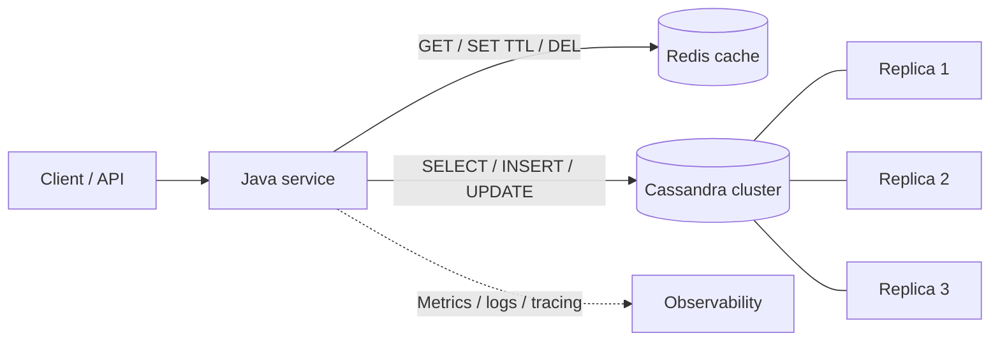
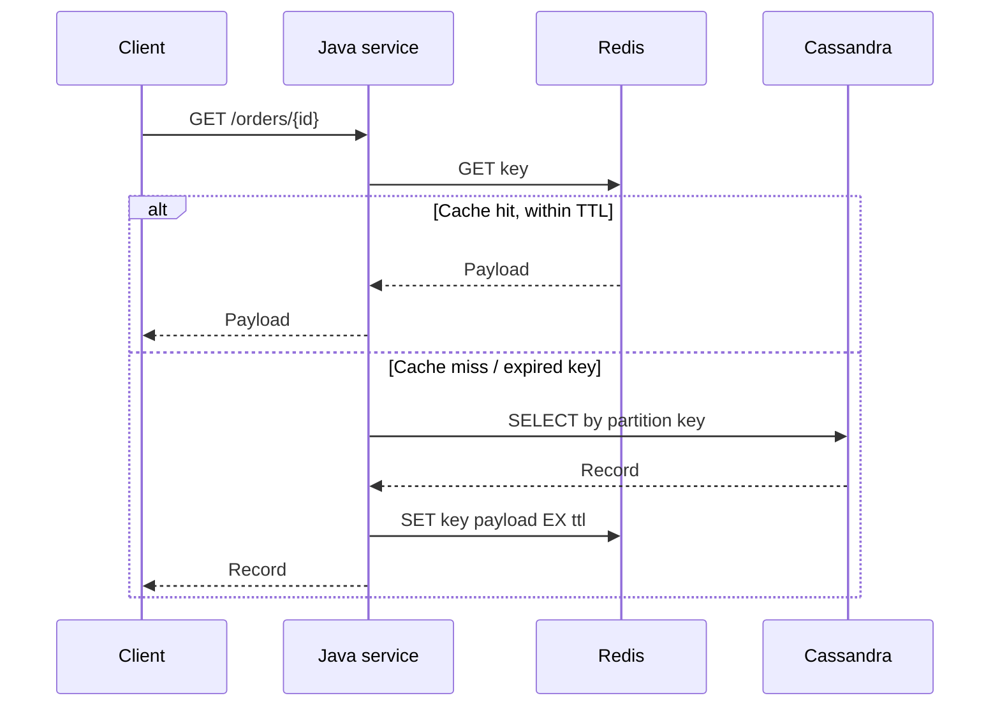
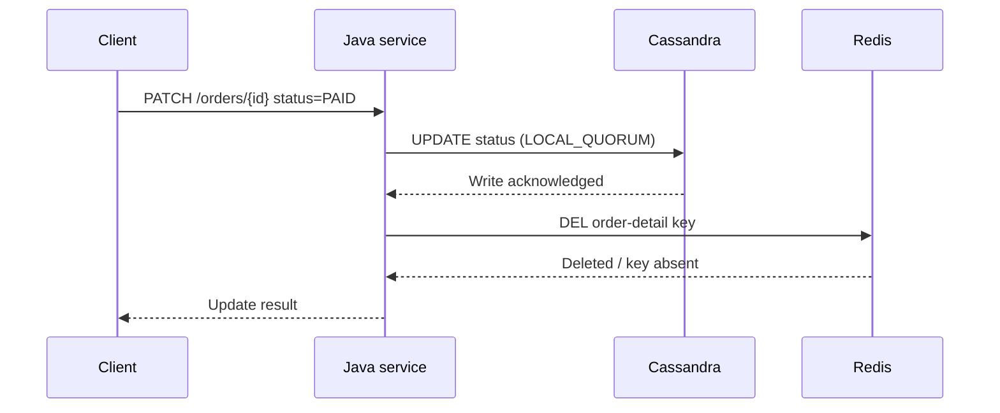

# Caching in Front of Cassandra and Data Freshness Policies

## 1. Objectives and Context

In systems using **Apache Cassandra** as a distributed wide-column datastore, applications often must satisfy two requirements simultaneously: fast reads for thousands of repeated requests and sufficiently fresh data after updates. Placing Redis, Memcached, or an in-process Java cache in front of Cassandra reduces latency and read load, yet creates a data copy outside Cassandra's consistency mechanisms.

This lesson belongs to the **Application Architecture** chapter and focuses on designing caches around Cassandra queries, controlling data staleness, selecting read/write consistency levels, handling race conditions, and addressing operational failures when connecting from a Java application.

After this lesson, you will be able to:

1. Distinguish **Cassandra consistency levels**, **Cassandra storage TTL**, and **application cache TTL**.
2. Choose what data to cache, design keys carrying full query/tenant context, and identify queries unsuitable for caching.
3. Implement **cache-aside** (read from cache; on miss, read Cassandra) and **write Cassandra then invalidate cache** workflows.
4. Define a **freshness budget** grounded in business needs rather than picking arbitrary TTLs.
5. Analyze write failures, missed invalidation events, cache stampedes, concurrent reads, and cross-region access.
6. Structure Java code, testing, and monitoring so caching reduces load without masking data issues.

### 1.1. Running Scenario

An order management service uses Cassandra to store order status. Users repeatedly open the order details page, while the payment system may update status `CREATED → PAID → SHIPPED`.

- The detail query is called frequently and data typically stays unchanged for several seconds: **suitable for short-lived caching**.
- Order status right after a user pays: **should reflect the new status immediately in the confirmation flow**, or have a clear refresh policy and user messaging.
- Deciding whether to charge again: **never rely on a potentially stale cache value**; read/write through a consistency-controlled business path.

Thus, a "cache hit" is a speed outcome, **not automatically proof of fresh data**.

## 2. Where Does Caching Sit in the Architecture?



This is **cache-aside**: the application decides when to read, populate, and evict the cache; Cassandra is the authoritative data source for the records described in this example. The cache does not participate in Cassandra quorums and does not automatically receive notifications when a replica changes value.

| Layer | Responsibility | What Cannot Be Assumed |
|---|---|---|
| Cassandra | Durable storage, partitioning, and replication; reads/writes at chosen consistency levels | Returning values from application cache or deleting Redis keys after a write |
| Distributed cache (e.g., Redis) | Serves keyed copies with TTL and invalidation operations | Always holding Cassandra's latest version |
| Local in-JVM cache (L1) | Eliminates another network hop for ultra-hot data | Other JVMs automatically knowing which keys to evict |
| Java service | Key design, expiration, fallbacks, write policies, and monitoring | Default atomic transactions across Cassandra and Redis |

### 2.1. When Should You Cache?

Prioritize data that is **read repeatedly**, expensive to compute or aggregate, has a working set fitting cache capacity, and tolerates a small staleness window: product display info, infrequently changing config, UI order details, and lists with stable query shapes. Evaluate using expected hit rate, payload size, update frequency, invalidation cost, and maximum acceptable staleness.

Do not automatically cache decisions requiring real-time state such as authorization checks, transaction limits, balance debits, or uniqueness checks. You may cache the **display** representation of those entities if the business sets explicit staleness bounds and critical decisions are validated on a properly consistent write path.

**Do not cache every query.** Cassandra tables are designed around query patterns; caching should accelerate genuinely hot query shapes, not paper over bad partition keys or table scans. If a Cassandra query requires `ALLOW FILTERING` on a hot path, fix the table model and partition key first.

## 3. Design CQL Around Queries Before Designing Cache Keys

Example table serving the query `get order by tenant_id + order_id`:

```sql
-- dc1 is an illustrative datacenter name; substitute your actual DC name.
CREATE KEYSPACE IF NOT EXISTS commerce
WITH replication = {'class': 'NetworkTopologyStrategy', 'dc1': 3};

CREATE TABLE IF NOT EXISTS commerce.orders_by_id (
    tenant_id  uuid,
    order_id   uuid,
    status     text,
    updated_at timestamp,
    PRIMARY KEY ((tenant_id, order_id))
);

-- Full partition key query: no need to scan other partitions.
SELECT status, updated_at
FROM commerce.orders_by_id
WHERE tenant_id = 11111111-1111-1111-1111-111111111111
  AND order_id = 22222222-2222-2222-2222-222222222222;
```

In this table, each `(tenant_id, order_id)` pair is a composite partition key. When needing **orders by customer and month**, design a separate query table, such as partition `(tenant_id, customer_id, year_month)` with time-ordered clustering keys. Avoid lumping all orders for a tenant into one huge partition. Each additional table introduces **an additional set of cache keys and invalidation rules**.

### 3.1. Cache Keys Must Exactly Represent the Query Result

Example for order details:

```text
order-detail:v2:tenant=11111111-1111-1111-1111-111111111111:order=22222222-2222-2222-2222-222222222222
```

Example for a paginated list:

```text
order-list:v3:tenant=<tenant>:customer=<customer>:month=2026-11:page=0:size=20:sort=desc:status=PAID
```

Key rules:

- Include **tenant and access scope** in keys whenever they affect results. Tenant A's data must never be served from tenant B's key. Derive tenant identity from verified auth context rather than blindly trusting client-supplied parameters.
- Include every factor that alters the response: filters, sort order, page/cursor, locale, projection, API version. Canonicalize parameter order so equivalent requests produce identical keys.
- Use version prefixes `v2`, `v3` when payload formats or semantics change. During rollouts, old keys expire naturally.
- Never embed access tokens, passwords, secrets, or sensitive query strings in keys or logs. Enforce access control even on cache hits; encrypt and apply proper retention policies if PII is cached.
- For multi-filter lists, a single order change can affect many keys. Consider **short TTLs for lists** or bounded key-group indexes; never scan all Redis keys on the write path.

## 4. Cache-Aside: The Basic Read Path



Execution steps:

1. Verify authorization and construct the key from normalized query parameters.
2. Read cache; if a hit is valid under the freshness policy, return it.
3. On miss, read Cassandra using an appropriate consistency level.
4. For found results, write the payload with a finite TTL to cache and return to the client. **A cache write failure should not fail the Cassandra read response** on APIs permitted to fall back.
5. For `not found` results, only negative-cache using a sentinel and very short TTL after evaluating impact on creation flows.

Cache-aside saves Cassandra queries when subsequent reads hit the same key. However, step 4 has a race window with concurrent writes, so TTL + `DEL` alone is insufficient for strict real-time policies; see Section 7.

### 4.1. A Cache Miss Does Not Mean the Record Does Not Exist

`cache miss` only indicates **Redis lacks the key**. Cassandra may return different results depending on consistency level and when replicas receive mutations. If `NOT_FOUND` is cached, a newly created record can be masked until the sentinel expires or is deleted. Especially for APIs that create an order and immediately read it:

- Prefer not caching `NOT_FOUND` on paths requiring immediate visibility of new records.
- If defending against lookups for nonexistent IDs, use a short TTL (e.g., 1–3 seconds per SLA) and delete the sentinel after successful creation.
- Distinguish Cassandra errors/timeouts from `record does not exist`: **never cache infrastructure errors as `NOT_FOUND`**.

## 5. Write Path: Update Cassandra Then Invalidate Cache

The default rule for frequently changing state is **write Cassandra first, delete cache after**:



With cache-aside, **deletion** is generally easier to maintain than overwriting every copy or every list variant. A successful `DEL` causes the next read to miss and reload fresh data; `DEL` on a missing key is also a valid outcome. Never treat `SET cache` as part of a Cassandra transaction.

Key clarification: Cassandra and Redis share no atomic commit. Even after Cassandra acknowledges a write, the JVM may crash before `DEL`, or Redis may be unavailable. In that case, stale cache entries remain servable until TTL expiry. Therefore:

- **Bounded staleness acceptable:** use a short cache TTL, record invalidation failures in metrics and a retry queue, letting TTL act as the final safety net.
- **Near-instant freshness required:** emit reliable invalidation commands or bypass cache on post-write reads; with multiple writers, add versioning/synchronization rules.
- **Strict point-in-time accuracy at decision points:** bypass cache for that decision and use appropriate Cassandra operations (potentially LWT or business state orchestration) rather than relying on cache-aside.

When a Cassandra write times out, the outcome is **uncertain as to whether it applied**. Preemptively invalidate the key, re-query, and design idempotent retries; never assume a timeout means the write definitely did not happen.

## 6. Data Freshness Is a Business Contract

**Freshness** answers: "How long may the displayed record diverge from the committed state in Cassandra?" The following time layers do not substitute for one another:

| Mechanism | Configuration/Condition | Meaning |
|---|---|---|
| Cassandra consistency level | e.g., `LOCAL_ONE` or `LOCAL_QUORUM` read, `LOCAL_QUORUM` write | Number of replicas required to respond; affects visibility of committed writes |
| Cassandra TTL | `INSERT/UPDATE ... USING TTL <seconds>` or table default TTL | Lifetime of **stored values**; expiration turns into tombstones |
| Cache TTL | e.g., Redis `SET key value EX 20` | How long cache retains a copy before automatic expiration |
| Invalidation | `DEL key`, writer events, or CDC | Shortens copy lifetime after data changes, if notifications arrive accurately and on time |
| Freshness budget | e.g., UI tolerates up to 30 seconds lag | Business-defined commitment that must be tested across the entire data path |

### 6.1. Why Is TTL Not an Unconditional "At Most N Seconds Old" Promise?

If every cache miss always read current state from Cassandra and TTL was never extended by cache reads, an entry with TTL `T` would live at most `T` from load time. Yet data can be stale **at load time** if `LOCAL_ONE` reads a lagging replica, cross-region replication is delayed, or a read/write race occurs. A subsequent miss could reload the same stale version and set a fresh TTL. Thus, **guaranteeing** staleness bounds requires measuring and controlling both:

```text
Observed staleness = time replica/cache lags behind current source
                   + read/replication/invalidation latency, per actual path

SLO target: P99 (now - response source_updated_at) <= staleness budget
```

`source_updated_at` is meaningful only when system clocks are synchronized and timestamp semantics are well-defined. With multiple writers, use a **monotonically increasing revision or controlled event ordering**; comparing client-supplied timestamps alone cannot prove change order.

### 6.2. Choose Policies Per Query, Not Globally

| Use Case | Required Freshness (Illustrative Examples) | Initial Baseline to Test |
|---|---|---|
| Product catalog, articles | Tolerates minutes of lag | Cache-aside, 1–5 min TTL, invalidate on admin edits |
| Order list on dashboard | Tolerates tens of seconds of lag | 10–30s TTL, full filter/page cache key, refresh on user action |
| Recently updated order details | Needs immediate visibility within session | DC-aligned `LOCAL_QUORUM`, invalidation, client uses write response or bypasses cache on next read |
| Authorization / payment eligibility checks | Cannot decide on stale state | Never decide from cache; use consistency-controlled operations at the data source |

These TTL values are **starting points for measurement**, not mandatory Cassandra/Redis defaults. Choose shorter TTLs when staleness risk is high, longer when queries are stable and load reduction matters; then measure hit rate, miss cost, and observed staleness.

### 6.3. Jitter and Stale-While-Revalidate

Avoid letting millions of keys loaded simultaneously expire together at second 30. Add small random **jitter** around TTL (e.g., 20–30%) to dampen cache stampedes, ensuring the maximum post-jitter lifetime still stays within business bounds.

**Stale-while-revalidate (SWR)** allows returning a copy past its fresh threshold within a bounded window while refreshing asynchronously in the background. When using SWR, store `fresh_until` and `stale_until` separately, meter stale-served responses, and never apply SWR to paths requiring real-time state. SWR intentionally **extends staleness duration**; never enable SWR while claiming freshness equal to the initial fresh TTL.

## 7. Critical Race Conditions

### 7.1. Stale Read Repopulates Cache After `DEL`

```text
T0  Request A: cache miss, SELECT Cassandra returns status=CREATED (A hasn't SET yet)
T1  Request B: UPDATE Cassandra status=PAID succeeds
T2  Request B: DEL cache key succeeds
T3  Request A: SET cache key with status=CREATED, TTL=30s
T4  Request C: GET cache -> CREATED (stale despite B's DEL)
```

This is a real flaw of naive cache-aside, even with `LOCAL_QUORUM`: query A finished before B wrote. Probability can be reduced with **double delete** (delete on write and delete again after a short delay), but an arbitrary delay gives no absolute guarantee.

For tighter SLAs, use one of these explicitly designed strategies:

1. **Versioned cache entries**: writers supply a monotonically increasing revision per aggregate; cache accepts entries only with revision ≥ published watermark. Comparison and write must be atomic (e.g., Redis Lua), and watermarks must arrive in order. This works only when the system reliably assigns revisions.
2. **Bypass cache on read-after-write** within the updating session; return the snapshot from the write result or force a Cassandra read. If multiple devices/services read concurrently, apply a corresponding system-wide policy.
3. **Short TTL + post-write invalidation** when the business tolerates a bounded staleness window with monitoring. This is usually the least complex starting point.

### 7.2. Two Competing Writers

If writers X and Y concurrently update an order, `DEL` ordering does not indicate which change came last. Standard Cassandra resolves conflicts by **per-value timestamp (last-write-wins)**; timestamps do not represent a globally ordered business transaction. For valid state transitions (e.g., preventing `SHIPPED` from reverting to `CREATED`), consider **lightweight transactions** (`UPDATE ... IF ...`) or a per-aggregate serializer, paired with idempotency controls. Caching cannot resolve write conflicts at the source.

### 7.3. Updating One Record Affects Multiple Views

`orders_by_id` may be cached alongside `orders_by_customer_month` lists. A single `status` change affects both the detail key and any list keys filtered by `status`. Common options:

- Details: exact-key invalidation.
- Multi-variant lists/filters: short TTL, or group-level versioning (`customer-month`) to logically invalidate older keys.
- Summary dashboards: invalidate only declared dependent views; never pattern-scan all keys on the request path.

Denormalization in Cassandra requires the application to maintain multiple tables and views. Never assume a multi-partition `BATCH` equals an isolated ACID transaction; when multi-table consistency is needed, design explicit intermediate states and reconciliation.

## 8. Cassandra Consistency Levels and Caching

With replication factor **RF = 3 in one datacenter**, `LOCAL_QUORUM` requires a majority of replicas in that DC, i.e., **2 replicas** responding. When both reads and writes use `LOCAL_QUORUM`, read and write replica sets intersect (`R + W > RF`), supporting visibility of acknowledged writes within the same DC under Cassandra model assumptions. This guarantee **does not apply to cache hits**, since Redis sits outside the replica set.

| Cassandra Write | Post-Write Cassandra Read | Caching Considerations |
|---|---|---|
| `LOCAL_QUORUM` | `LOCAL_QUORUM` same DC | Quorums overlap; still must invalidate/bypass cache; account for concurrent writes and timestamps |
| `LOCAL_ONE` | `LOCAL_ONE` | May read a replica missing the mutation and cache stale data |
| `LOCAL_QUORUM` in DC A | `LOCAL_QUORUM` in DC B | Local quorums per DC do not guarantee immediate cross-DC read visibility; cross-DC replication lags |
| Write timeout / uncertain outcome | Any CL | Never assume source data stayed unchanged; handle retries and preemptive invalidation |

Example setting consistency in `cqlsh` to observe behavior:

```sql
CONSISTENCY LOCAL_QUORUM;

INSERT INTO commerce.orders_by_id
    (tenant_id, order_id, status, updated_at)
VALUES
    (11111111-1111-1111-1111-111111111111,
     22222222-2222-2222-2222-222222222222,
     'CREATED', toTimestamp(now()));

SELECT status, updated_at
FROM commerce.orders_by_id
WHERE tenant_id = 11111111-1111-1111-1111-111111111111
  AND order_id = 22222222-2222-2222-2222-222222222222;
```

`now()` in this example generates a timeuuid used to produce an illustrative timestamp; never use `updated_at` from unsynchronized writer clocks as an absolute revision. For read-after-write after a fresh write, the application must also consider consistency across the **entire read path**, timeouts, region failover, and concurrent writes.

## 9. How Does Cassandra TTL Differ from Redis TTL?

```sql
-- Source data with a 24-hour lifetime (e.g., a temporary snapshot).
INSERT INTO commerce.orders_by_id
    (tenant_id, order_id, status, updated_at)
VALUES
    (11111111-1111-1111-1111-111111111111,
     33333333-3333-3333-3333-333333333333,
     'TEMPORARY', toTimestamp(now()))
USING TTL 86400;

-- Check remaining TTL of the status column (seconds).
SELECT status, TTL(status)
FROM commerce.orders_by_id
WHERE tenant_id = 11111111-1111-1111-1111-111111111111
  AND order_id = 33333333-3333-3333-3333-333333333333;
```

In Cassandra, TTL applies to written cell values; subsequent updates can reset or clear a column's TTL. When data expires, Cassandra represents expiration via **tombstones**, managed through compaction, `gc_grace_seconds`, and repair. Long or varying TTLs within the same partition also affect compaction performance. This is a **source data lifecycle policy**.

In Redis, `SET order-detail:key payload EX 30` only removes the cached copy after roughly 30 seconds. There is **no automatic link** between Redis TTL and Cassandra TTL. If Cassandra has expired a record while cache still holds an entry, the API may still serve data no longer at the source. When source records expire, store `expires_at` in the cached payload or cap cache TTL to the remaining lifetime minus clock skew and lag allowances.

Deleting/expiring Cassandra data produces tombstones; tombstone cleanup depends on compaction and repair operations. **Never substitute Redis deletion for source deletion**, especially under long-term data retention/deletion obligations.

## 10. Connecting from Java: Controllable Structure

The code below uses **Apache Cassandra Java Driver 4.x** for prepared queries and an abstract `CachePort` implementable with Redis/Lettuce/Jedis. It illustrates service-level read-through and invalidation; production code requires driver configuration, serialization, metrics, timeouts, and retries.

```java
import java.time.Duration;
import java.time.Instant;
import java.util.Optional;
import java.util.UUID;

import com.datastax.oss.driver.api.core.CqlSession;
import com.datastax.oss.driver.api.core.DefaultConsistencyLevel;
import com.datastax.oss.driver.api.core.cql.PreparedStatement;
import com.datastax.oss.driver.api.core.cql.Row;

record OrderDetail(UUID tenantId, UUID orderId, String status, Instant updatedAt) {}

interface CachePort {
    Optional<OrderDetail> get(String key);
    void put(String key, OrderDetail detail, Duration ttl);
    void evict(String key);
}

final class OrderService {
    private static final Duration CACHE_TTL = Duration.ofSeconds(20);

    private final CqlSession session;
    private final CachePort cache;
    private final PreparedStatement selectOrder;
    private final PreparedStatement updateStatus;

    OrderService(CqlSession session, CachePort cache) {
        this.session = session;
        this.cache = cache;
        this.selectOrder = session.prepare(
            "SELECT status, updated_at FROM commerce.orders_by_id " +
            "WHERE tenant_id = ? AND order_id = ?"
        );
        this.updateStatus = session.prepare(
            "UPDATE commerce.orders_by_id SET status = ?, updated_at = ? " +
            "WHERE tenant_id = ? AND order_id = ?"
        );
    }

    Optional<OrderDetail> find(UUID tenantId, UUID orderId) {
        // tenantId must come from a verified authentication context.
        String key = cacheKey(tenantId, orderId);
        try {
            Optional<OrderDetail> cached = cache.get(key);
            if (cached.isPresent()) return cached;
        } catch (RuntimeException cacheFailure) {
            // Record metric / trace; fall back to Cassandra if API allows.
        }

        Row row = session.execute(
            selectOrder.bind(tenantId, orderId)
                .setConsistencyLevel(DefaultConsistencyLevel.LOCAL_QUORUM)
        ).one();
        if (row == null) return Optional.empty(); // No negative-caching in this example.

        OrderDetail current = new OrderDetail(
            tenantId, orderId, row.getString("status"), row.getInstant("updated_at")
        );
        try {
            cache.put(key, current, CACHE_TTL);
        } catch (RuntimeException cacheFailure) {
            // Successful source query is still returned to the client.
        }
        return Optional.of(current);
    }

    void changeStatus(UUID tenantId, UUID orderId, String status) {
        String key = cacheKey(tenantId, orderId);
        try {
            session.execute(
                updateStatus.bind(status, Instant.now(), tenantId, orderId)
                    .setConsistencyLevel(DefaultConsistencyLevel.LOCAL_QUORUM)
            );
        } finally {
            // Even on Cassandra timeout, the mutation may already have applied.
            try {
                cache.evict(key);
            } catch (RuntimeException cacheFailure) {
                // Count errors; enqueue durable retry if freshness SLA requires.
                // Finite TTL is only the final backstop.
            }
        }
    }

    private static String cacheKey(UUID tenantId, UUID orderId) {
        return "order-detail:v2:tenant=" + tenantId + ":order=" + orderId;
    }
}
```

**Intentional limitations of the example:** `UPDATE` in Cassandra has upsert semantics; the example assumes the order exists and another business layer authorized the transition. `finally` invalidates the cache even on write failure or uncertainty, yet does not create cross-system atomicity. The `find` read path still has the Section 7 read-refill race; if strict freshness is required, add revisions or bypass per contract. In production, measure and log errors to observability systems rather than treating empty `catch` blocks as an error-handling policy.

### 10.1. Integrating CachePort with Redis

Implementing `CachePort` requires at least three operations: `GET`, `SET` with expiration, and `DEL`. Semantic example via Redis CLI:

```redis
SET order-detail:v2:tenant=demo:order=demo '{"status":"CREATED"}' EX 20
GET order-detail:v2:tenant=demo:order=demo
TTL order-detail:v2:tenant=demo:order=demo
DEL order-detail:v2:tenant=demo:order=demo
```

In production, serializers must validate schema/version, payload size, and missing fields; Redis `GET`/`SET` can time out. With short TTLs, avoid resetting TTL on every **GET** (sliding expiration) when the freshness budget is measured from initial load time, since every cache hit would extend the life of a stale value.

## 11. Extended Invalidation Strategies

| Strategy | When Suitable | Risks / Notes |
|---|---|---|
| Cache-aside + post-write delete | Service controls all writers; small staleness acceptable | Post-commit crash, cache-refill race, multiple views to delete |
| Short TTL, no active deletion | Infrequently changing content; time-bounded staleness acceptable | Higher Cassandra miss load; changes not immediately visible |
| `OrderChanged` events via durable stream | Multiple services read/write the same data | At-least-once delivery, lag, drops/reordering; consumer must be idempotent |
| Cassandra CDC → invalidation consumer | Writers exist outside one Java service | Requires enabling/operating CDC, log consumption, and disk monitoring; not instantaneous sync |
| Version/watermark in cache | Ordered revisions exist, tighter SLA | Requires atomic check-and-update; end-to-end version consistency |
| No cache on critical queries | Decisions cannot tolerate staleness | Higher Cassandra cost; requires throughput control |

If choosing **outbox/event-driven invalidation**, ensure events cannot be lost if the app crashes between write and publish. A **best-effort** event publish cannot guarantee cache deletion. Design durable publication and reconciliation aligned with your infrastructure; never assume a Cassandra multi-partition batch is an isolated ACID transaction.

With **CDC**, Cassandra provides table-level change logging; you must configure and manage consumers reading commit logs/CDC files. If consumers lag or stall, immediate cache invalidation cannot be promised; disk consumption is also an operational risk. Monitor lag and recovery playbooks before relying on CDC for freshness policies.

### 11.1. Two-Tier Caches and Multi-Datacenter Clusters

When combining per-JVM `L1` and shared Redis `L2`, a Redis `DEL` **does not evict L1**. Shorter L1 TTLs, broadcast/invalidation channels, or version checks are needed. If a message is missed, L1 can serve stale data even after Redis is updated.

In multi-datacenter Cassandra clusters, co-locate caches per region/DC and track where users read. `LOCAL_QUORUM` in DC B does not automatically show writes just committed in DC A. If **read-your-writes across regions** is required, sticky-route to the write region, pass the required revision, or use a verified read path. Never confuse Cassandra consistency levels with invalidation event propagation across regional caches.

## 12. Cache Stampedes, Hot Keys, and Fault Tolerance

**Cache stampedes** occur when a very hot key expires and many concurrent misses send identical queries to Cassandra. Layered mitigations:

1. Add TTL jitter and prewarm keys with steady traffic.
2. Per-JVM `singleflight`: only one in-flight request per key loads from Cassandra while peers share the result briefly.
3. If multiple JVMs miss together, use short distributed locks with owner tokens, deadlines, and owner-checked release; never hold locks indefinitely. Never treat a cache lock as a business-integrity lock.
4. Bound concurrent Cassandra queries, set request timeouts, and use circuit breakers and bulkheads so a Redis outage does not topple the cluster.

When **Redis fails** while Cassandra is healthy, read APIs can typically fall back directly to Cassandra under concurrency limits and timeouts. When **Cassandra fails**, serve stale data only if the endpoint/client explicitly permits it and payloads have not passed `stale_until`; paths making financial or authorization decisions must fail clearly rather than falling back to stale copies. When both layers are overloaded, apply backpressure and return controlled errors.

Avoid hot partitions in Cassandra even when hit rates are high: caches can vanish unexpectedly. Partition key design, partition size limits, and miss-load capacity must stand on their own.

## 13. Monitoring and Verifying Freshness

### 13.1. Recommended Metrics

| Metric | Question Answered |
|---|---|
| `cache_hit_rate`, `miss_rate` by endpoint/query | Is caching actually reducing read load? |
| `cache_get/set/del_latency_p95/p99`, `cache_errors` | Is the cache adding latency or creating a new failure mode? |
| `cassandra_read/write_latency`, timeouts, and CL | Can the fallback path sustain miss traffic? |
| `invalidation_failure_count`, `event_consumer_lag` | Do stale copies risk outliving policy bounds? |
| `response_staleness_seconds` by percentiles | How many seconds stale are responses served to users? |
| `stampede_suppressed`, `hot_key_rate`, cache memory/evictions | Are hot keys or memory pressure causing mass misses? |
| `negative_cache_hit`, `stale_served_count` | Are new records being masked or stale responses overserved? |

Measuring freshness requires a trustworthy source timestamp or revision. With multiple writers and clock skew, use business-rule revisions, compare against event-log watermarks, or run controlled reconciliation checks; avoid reading `updated_at` and claiming exact staleness measurement.

### 13.2. Mandatory Pre-Production Test Matrix

| Scenario | Action | Expected Outcome |
|---|---|---|
| Normal hit and miss | Read the same order twice | First hits Cassandra and populates cache; second hits cache, then misses after TTL |
| Successful write | `UPDATE` then `DEL` | Subsequent read loads new version when uncontested |
| Cache outage | Temporarily block Redis | Permitted APIs fall back to Cassandra with load limits; error metrics fire |
| Cassandra write timeout | Inject timeout during update | App avoids guessing write outcome, preemptively invalidates, and retries/reconciles |
| Read-refill race | Delay A after `SELECT`, let B write + `DEL`, then let A `SET` | Observe stale cache; evaluate versioning or TTL per SLA |
| Concurrent misses on same key | Expire hot key under concurrent load | Cassandra queries stay bounded; no stampede |
| New record after negative cache | Read `NOT_FOUND`, then create record | Sentinel does not mask record beyond allowed TTL |
| Multi-DC / L1 | Write DC A, read DC B or via another JVM | Observe replication/invalidation lag and verify regional SLOs |
| Source TTL expiry | Set Cassandra TTL shorter than cache and observe | Expired source data is no longer served past policy limits |

## 14. Comprehensive Hands-On Lab

**Problem:** A Java service serves 2,000 order-detail reads/second, with each order read an average of 10 times within 20 seconds. Order status can change; the UI tolerates up to ~15 seconds of lag on normal views, yet must reflect payment immediately after the user's own checkout action. Never use cache to decide whether to charge.

**Implementation requirements:**

1. Use `commerce.orders_by_id` partitioned by `(tenant_id, order_id)`; read and write the confirmation path within one DC at `LOCAL_QUORUM` with local RF = 3.
2. Define a detailed cache key containing tenant + order + schema version; start with a **10-second** TTL (adding jitter only if max lifetime stays within budget) and `DEL` after writes.
3. Return `PAID` immediately from the payment operation's outcome to the client, or bypass cache on the post-confirmation read; keep payment-decision queries on the authoritative business path.
4. Simulate 100 concurrent requests after cache expiry and observe Cassandra queries; add singleflight if needed.
5. Reproduce the Section 7.1 race timeline and document why a single `DEL` cannot guarantee "never read stale." Pick a mitigation aligned with accepted risk.
6. Track hit rate, P95 latency, P99 staleness, invalidation error count, and Cassandra load when cache is down; tune TTL from measurements.

**Self-check questions:**

1. Why do `LOCAL_QUORUM` reads/writes still not guarantee cache hits return fresh data?
2. On a successful Redis `GET`, why might `expires_at` or a revision still be needed for time-sensitive data?
3. What happens if the JVM crashes after Cassandra `UPDATE` but before cache `DEL`?
4. A user creates an order and gets `NOT_FOUND` from cache for 5 seconds: what are the causes and fixes?
5. When a Cassandra table has a 24-hour TTL, what risk does setting a 48-hour Redis TTL introduce?
6. Is `LOCAL_QUORUM` in DC B after a write in DC A equivalent to same-DC read-after-write?

**Completion criteria:** The solution must explicitly specify read paths, write paths, cache keys, TTLs, allowable staleness bounds, miss/error/race handling, Cassandra consistency, and measurements proving the SLA. A high hit rate without freshness measurements is insufficient to declare the design successful.

## 15. Design Takeaways

- **Cassandra consistency levels** govern how many replicas respond; **cache invalidation** manages copies outside Cassandra. Both mechanisms must be designed together.
- **Cache TTL** is copy lifetime; **Cassandra TTL** is source value lifetime and generates tombstones upon expiry.
- Cache keys must follow **query shape**, tenant, pagination, filters, and payload version; never use cache as a band-aid for a poorly designed Cassandra query.
- The baseline pattern is **cache-aside + write source then delete cache**. It works well for many read-heavy/write-light APIs, yet still has cross-system races and failure modes.
- **Freshness is a business contract**, requiring reliable timestamps/revisions, failure testing, and percentile-based measurement.
- For decisions that cannot tolerate stale data, use a consistency-controlled data path; never trade business state accuracy for low cache latency.

### References

- Apache Cassandra Documentation, *Dynamo architecture and consistency levels*: https://cassandra.apache.org/doc/stable/cassandra/architecture/dynamo
- Apache Cassandra Documentation, *CQL Data Manipulation (`USING TTL`)*: https://cassandra.apache.org/doc/latest/cassandra/developing/cql/dml.html
- Apache Cassandra Documentation, *Tombstones, compaction, `gc_grace_seconds`*: https://cassandra.apache.org/doc/stable/cassandra/managing/operating/compaction/tombstones.html
- Apache Cassandra Documentation, *Change Data Capture*: https://cassandra.apache.org/doc/stable/cassandra/managing/operating/cdc.html
- Redis Documentation, *Cache-aside pattern*: https://redis.io/docs/latest/develop/use-cases/cache-aside/
