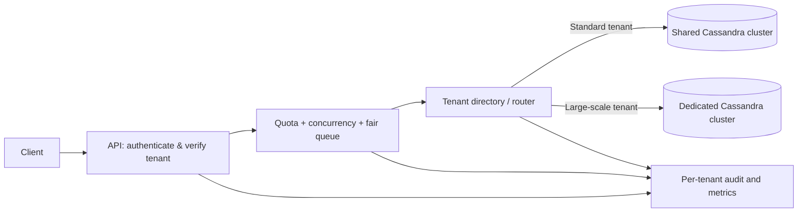

# Tenant Isolation, Resource Quotas, and Large-Scale Tenants in Apache Cassandra

## 1. Context and Objectives

A SaaS platform typically serves multiple **tenants** (organizations, customers, or workspaces) on shared infrastructure. Each tenant has its own users, data, access permissions, traffic profile, and operational requirements. With **Apache Cassandra**, multi-tenancy is more than adding a `tenant_id` column: Cassandra distributes data by **partition key**, and tenants sharing a cluster still contend for CPU, network, disk, compaction, and request-handling capacity.

This lesson belongs to the **Application Architecture** chapter and focuses on Cassandra's distributed architecture and wide-column model, **query-driven** table design, partition/replication organization, read/write consistency trade-offs, along with resource limiting, operations, troubleshooting, and Java integration.

After this lesson, you will be able to:

- Choose a tenant isolation level suited to scale, security, and budget.
- Design partition keys that scope queries to a tenant without creating oversized or hot partitions.
- Build application-layer quotas, admission control, and backpressure to mitigate the *noisy neighbor* effect.
- Recognize when a large tenant should move to its own keyspace, cluster, or dedicated processing pipeline.
- Plan monitoring, data migration, and isolation testing in a Cassandra environment.

**Scope:** Examples use CQL and general principles of self-managed Cassandra. Quota or resource-isolation features offered by a managed Cassandra service may differ; verify the capabilities of your specific product and version.

## 2. Three Dimensions of Isolation to Separate

When discussing "tenant isolation," specify exactly what must be isolated:

| Dimension | Design Question | Common Mitigations |
| --- | --- | --- |
| **Data and access control** | Can tenant A view or modify tenant B's data? | Authentication, authorization, trusted tenant mapping, tenant predicates in every query, appropriate CQL privileges |
| **Performance and resources** | Can a high-traffic tenant inflate latency for others? | Rate limits, concurrency limits, fair queues, dedicated pipelines; dedicated clusters when strong isolation is required |
| **Operations and data lifecycle** | Can retention, backups, restores, schemas, or maintenance schedules differ? | Separate tables/keyspaces/clusters based on requirements and cost |

**Warning:** Having `tenant_id` in the primary key organizes data and routes queries, **it does not automatically enforce access security**. Cassandra has no knowledge of which tenant an API caller belongs to. The application layer must resolve the tenant from a verified session or token; never trust a client-supplied `tenant_id` without authorization checks.

## 3. Choosing a Multi-Tenant Storage Model

### 3.1. Model Comparison

| Model | Description | Strengths | Limitations and When to Use |
| --- | --- | --- | --- |
| **Shared tables, shared keyspace** | Multiple tenants share tables; primary key includes tenant and other partitioning dimensions | Few schemas, simple deployment and monitoring; fits large tenant counts | Requires application-level authorization; shares table load, TTL, compaction, and backups |
| **Per-tenant keyspaces/tables on a shared cluster** | Each tenant gets its own keyspace and table set; replication configured per keyspace | Easier CQL authorization by keyspace, per-tenant schema/retention/replication or operations | Increases schema object count and coordination overhead; still shares nodes, CPU, disk, I/O, and network; creates no hard quotas |
| **Dedicated cluster per tenant or tenant group** | Data and traffic live on dedicated Cassandra infrastructure | Stronger isolation of performance, config changes, and failures; fits specialized contracts/SLOs | Higher operational cost, headroom, monitoring, backups, and minimum per-cluster footprint |
| **Hybrid** | Small tenants share clusters while large/sensitive tenants route to dedicated clusters | Balances cost and isolation; supports tiered service scaling | Requires a tenant directory, router, migration plan, monitoring, and cutover testing |

A **dedicated keyspace** for a tenant is a configuration, authorization, and schema boundary—**not** a physical resource boundary. Conversely, a dedicated cluster provides a stronger infrastructure boundary, though network, IAM, encryption keys, and operational runbooks must still be configured accordingly.

### 3.2. Decision Framework

1. **Tenant count and onboarding velocity:** Thousands of small tenants quickly make "one keyspace and multiple tables per tenant" unwieldy; shared tables are usually simpler.
2. **Traffic skew:** A few tenants with throughput far exceeding the rest may require dedicated ingest pipelines or dedicated clusters.
3. **Security and contractual requirements:** Data residency, backup/restore isolation, and blast-radius containment may mandate dedicated tiers.
4. **Query patterns:** Key structures must serve dominant queries, not merely convenience for tenant separation.
5. **Operational readiness:** Under a hybrid model, the system must reliably track where each tenant lives and migrate tenants safely.

Do not apply an arbitrary threshold such as "over 1 million records requires a dedicated cluster": the decision depends on record size, read/write throughput, partition characteristics, retention, hot keys, replication factor, and SLOs.

## 4. Query-Driven Table Design and Partition Keys

### 4.1. Why `PRIMARY KEY (tenant_id, ...)` Can Be Misleading

Cassandra uses the **partition key** to compute a token and distribute partitions across replicas. With the syntax:

```sql
PRIMARY KEY ((tenant_id, event_hour, shard), event_time, event_id)
```

- `(tenant_id, event_hour, shard)` is the **composite partition key**, determining the partition.
- `(event_time, event_id)` are **clustering columns**, determining row order within the partition.
- Putting `tenant_id` in the partition key **does not** pin all of a tenant's data onto a single node or dedicated node subset. Each key combination is hashed independently.
- Using only `tenant_id` as the partition key for an unbounded event table lets a large tenant create a **wide/hot partition**: expensive to read, heavy to compact, and concentrating traffic on the replicas owning that partition.

Common anti-pattern:

```sql
-- Unsuitable for a continuously growing tenant event stream.
CREATE TABLE events_bad (
    tenant_id uuid,
    event_time timestamp,
    event_id timeuuid,
    payload text,
    PRIMARY KEY ((tenant_id), event_time, event_id)
);
```

The tenant's partition has no natural bound if data is retained long-term. `LIMIT 100` in a `SELECT` only caps returned rows; **it does not make the stored partition smaller**.

### 4.2. Designing for Hourly Event Queries

Suppose the application needs: "Fetch the newest events for tenant X within an hour," with immutable events and 14-day retention. Bucket by **UTC hour** and add a shard key to spread load:

```sql
-- dc1 is an example name; replace with your actual datacenter name.
CREATE KEYSPACE saas_app
WITH replication = {
    'class': 'NetworkTopologyStrategy',
    'dc1': 3
};

CREATE TABLE saas_app.events_by_tenant_hour_shard (
    tenant_id uuid,
    event_hour timestamp,       -- Start of UTC hour: e.g., 2026-11-21T08:00:00Z
    shard smallint,             -- From 0 to N-1
    event_time timestamp,
    event_id timeuuid,
    event_type text,
    payload text,
    PRIMARY KEY (
        (tenant_id, event_hour, shard),
        event_time,
        event_id
    )
) WITH CLUSTERING ORDER BY (event_time DESC, event_id DESC)
  AND default_time_to_live = 1209600; -- 14 days in seconds
```

Query reading an exact partition and clustering range:

```sql
SELECT event_time, event_id, event_type, payload
FROM saas_app.events_by_tenant_hour_shard
WHERE tenant_id = ?
  AND event_hour = ?
  AND shard = ?
  AND event_time >= ?
  AND event_time < ?
LIMIT 100;
```

**Trade-off:** With `N` shards, querying "all events for a tenant in an hour" must read multiple partitions (up to `N`), after which the application **merges chronologically**, paginates, and caps total results. Never use `ALLOW FILTERING` to bypass proper partition-key design. An API pagination token may need to encode per-shard state, sort keys, and query timestamps; protect tokens from tampering.

**Shards must be deterministic at both write and read time:** e.g., `shard = hash(event_id) mod N` using a stable hash function, or derived from `source_id` if queries always specify the source. Never change `N` in-place for existing data, as that breaks routing; version the shard configuration, read both old and new generations during transition, and backfill or wait out TTL.

### 4.3. Do You Also Need a Lookup Table by ID?

If the API also needs "fetch a single event by `event_id`," the table above is insufficient because `event_id` alone does not yield `event_hour` and `shard`. With Cassandra, **denormalize and write multiple tables matching critical queries**:

```sql
CREATE TABLE saas_app.event_by_tenant_id (
    tenant_id uuid,
    event_id timeuuid,
    event_time timestamp,
    event_type text,
    payload text,
    PRIMARY KEY ((tenant_id, event_id))
) WITH default_time_to_live = 1209600;

SELECT event_time, event_type, payload
FROM saas_app.event_by_tenant_id
WHERE tenant_id = ? AND event_id = ?;
```

Both tables store two access paths for the same event. Writes must be **idempotent** using stable IDs, track per-table write failures, and include compensation/reconciliation if one write succeeds partially. Never assume two writes to two partitions form a cross-partition ACID transaction. Avoid large logged batches or multi-partition batches solely for throughput; Cassandra batches do not replace an ingest queue with backpressure.

### 4.4. Controlling Partition Size and Fan-Out

Start design from queries, then estimate:

\[
\text{approximate partition size} =
\frac{\text{events per bucket} \times \text{bytes/event}}{\text{shard count}}
\]

This estimate excludes metadata, indexes, tombstones, compression, on-disk overhead, and skew. Cassandra has no single "optimal" partition size across every workload; for log-style data, aim for partitions small enough for predictable reads and compaction—often targeting **tens of MiB** as an initial test baseline—then validate with real load tests and partition-size/tombstone metrics.

Balance simultaneously:

- **Shorter buckets** → smaller partitions, more partitions, and higher fan-out across long time ranges.
- **More shards** → reduces write concentration on one partition, increases read queries/merges for tenant-wide reads.
- **Sharding by a query dimension** (e.g., `source_id`, `device_id`) → effective when APIs filter by source; unhelpful if every query demands a tenant-wide timeline.
- **Partitions with too many rows/tombstones** → increase read and compaction cost; TTL does not erase data instantaneously at expiry.

If the API demands real-time tenant-wide timelines at very high rates, consider maintaining a dedicated **read model** for timelines/aggregated views alongside raw records; trying to make one partition key serve every query usually causes high fan-out or hot partitions.

## 5. Application Architecture: Identity, Routing, and Access Control



Reliable request flow:

1. The API authenticates the principal, extracts `tenant_id` from verified membership/claims, and authorizes access to the target resource. If the API allows selecting a tenant, verify the selection against membership.
2. Admission control estimates **request cost** and checks quotas before touching Cassandra.
3. The router reads `tenant_directory` (tenant → placement, version, service tier, migration state). Cache with TTL and refresh controls, but prevent stale configs from routing requests to the wrong cluster.
4. Repositories use **tenant-scoped prepared statements** against the right query table. Never interpolate unvalidated client input into dynamic CQL keyspace/table names.
5. Emit metrics/audit logs and return clear errors; every subsequent page or async task must also obey resource budgets.

**Mandatory security rule:** Every query, bulk export, update, and delete API must carry tenant context and enforce authorization. Tests must prove tenant A's principal cannot read or mutate tenant B's data even when supplying B's valid resource ID. With shared tables, CQL privileges typically belong to an application service account and **do not replace** application-level tenant checks.

## 6. Resource Quotas: Where to Enforce Them?

### 6.1. Practical Quotas

| Quota Category | Example | Appropriate Enforcement Point |
| --- | --- | --- |
| **Request rate** | 100 reads/s, 30 writes/s per tenant, short bursts allowed | API gateway / ingest worker, token bucket or leaky bucket |
| **Concurrency** | Max 20 in-flight CQL requests per tenant | Per-tenant semaphore/limiter ahead of the driver |
| **Work unit size** | Payload size, max records/batch, page/filter limits, time-range bounds | API/worker validation layer |
| **Ingest throughput** | Bytes/s or events/s, with queues and backpressure | Kafka/queue partitioning, per-tenant fair scheduler |
| **Storage and retention** | GB or day budget per plan tier | Logical usage tracking, TTL, retention policies, controlled ingest alerts/throttling |
| **Expensive queries** | Cap fan-out, aggregations, or concurrent exports | Query planner, scheduler, job queue |

In Cassandra OSS, hard per-tenant quotas for CPU, RAM, network, or disk in **shared tables** are not a built-in guarantee you can rely on. API limits regulate incoming traffic, yet do not prove two tenants are fully isolated: compaction, repair, GC, disk I/O, and non-API traffic still share cluster resources.

Specifically, **TTL is only a data-retention policy**, not a hard storage-capacity quota. Expired data lingers as tombstones until compacted under safety rules; space reclamation is not instantaneous. If contracts enforce strict storage caps, combine usage tracking with proactive ingest rejection/throttling and provision disk headroom.

### 6.2. Token Buckets and Concurrency Limits

Each tenant has a bucket refilling at `r` tokens/second with capacity `B`. At time `t`:

\[
tokens(t)=\min\big(B,\ tokens(t_0)+r\times(t-t_0)\big)
\]

A request with `cost` is admitted if `tokens ≥ cost`; otherwise return `429 Too Many Requests` or enqueue in a bounded queue with retry/backoff guidance. `cost` can exceed 1 for fan-out queries, exports, or large-payload writes. **Concurrency limits** complement rate limits because low requests/s can still saturate Cassandra queues if each request runs slowly.

Example processing flow (pseudocode):

```text
principal = authenticate(request)
tenant = authorizeTenant(principal, request.resource)
plan = planQuery(request)              # resolve partitions, fan-out, page size
validate(plan.maxPartitions, plan.maxRows, plan.timeRange)
if not tenantRateLimiter.consume(tenant, plan.cost):
    return HTTP 429 with retry hint
permit = tenantConcurrencyLimiter.tryAcquire(tenant, plan.kind)
if permit is absent:
    return HTTP 429 or bounded queue
try:
    placement = tenantDirectory.resolve(tenant)
    return executeWithTimeoutAndPaging(placement, plan)
finally:
    permit.release()
```

Across multiple API instances, distributed quotas must split budgets across instances or use a shared coordinator (e.g., Redis with atomic scripts). Keeping an in-memory map/token bucket per pod multiplies effective limits by pod count. Define **business-appropriate fail-open/fail-closed policies** for quota-store outages; never silently drop quotas across all ingest paths by default.

### 6.3. Preventing Noisy Neighbors from Slowing Down the Cluster

- Separate reads, writes, and exports into appropriate **queues and worker pools**; prioritize interactive requests over bulk jobs.
- Cap in-flight and pending work **per tenant and cluster-wide** to avoid unbounded queues.
- Use weighted fair scheduling when service tiers have different budgets, always backed by a global cluster safety cap.
- Bound page sizes, query time windows, fan-out, and timeouts; never let clients trigger cluster-wide scans.
- Retry with **exponential backoff + jitter**, an overall deadline, and a retry budget. Synchronized retries during cluster saturation amplify overload.
- Keep long-lived Cassandra sessions/pools per cluster; never create a new session per HTTP request or per tenant in a shared-cluster model.

## 7. Large Tenants (*Whale Tenants*): Detecting, Handling, and Migrating

### 7.1. Signals That a Tenant Needs a Dedicated Path

Monitor per tenant at the application layer: requests/s, bytes/s, storage size and growth rate, partitions touched per query, p95/p99 latency, timeouts, retries, quota rejection rate, and ingest backlog. At the Cassandra layer: partition size, hot partitions, read/write latency, dropped messages, pending compactions, tombstone warnings, disk usage, and GC.

If one tenant's traffic spikes elevate p99 for others despite bucketing, sharding, and request caps, consider **dedicated ingest workers**, **a dedicated keyspace/table to separate retention/schema**, and finally **a dedicated cluster** when physical resource/SLO isolation is required.

### 7.2. Sample Capacity Calculation

A tenant generates an average of **120 events/s**, roughly **1 KiB/event**, retained for **14 days**, at replication factor **3**:

- Events over 14 days: `120 × 86,400 × 14 = 145,152,000`.
- Estimated logical data: `145,152,000 × 1 KiB ≈ 138.4 GiB`.
- Three replicas: `≈ 415.3 GiB` before overhead, compaction headroom, snapshots, and safety margin.
- Hourly volume: `120 × 3,600 = 432,000` events, or **~422 MiB** logical data. Split evenly across 16 shards, each hourly partition is **~26.4 MiB** before overhead.

This is only an estimate to kick off load testing. Having 16 shards means a full-hour timeline query may read 16 partitions; a 24-hour query could fan out to 384 partitions. Adding shards shrinks partition size at the cost of more expensive merge reads. Test against realistic load distributions and query mixes; never size clusters solely from logical volume times replication factor.

### 7.3. Tenant Directory and Hybrid Routing

A directory record (stored in a trusted control plane) might include:

```json
{
  "tenantId": "2b28c6f1-2f68-4c90-b76c-baf199e784c3",
  "placement": "shared-ap-southeast",
  "schemaVersion": 3,
  "shardConfigVersion": 2,
  "state": "ACTIVE",
  "routeVersion": 17
}
```

Placement names must resolve via server-side configuration, never concatenated into CQL from requests. Changing placement is an **architectural event**: coordinate route versioning, cache invalidation, draining in-flight requests, and writer/reader consistency.

### 7.4. Procedure to Migrate a Tenant to a Dedicated Cluster

1. **Audit and lock boundaries:** List all query tables, bucket/shard schemes, TTLs, tombstones, secondary indexes/materialized views if any, dependent services, and SLOs. Identify the source of truth per data type.
2. **Provision the target:** Create keyspaces/tables, replica placement, credentials, driver/session configs, backups, metrics, and recovery runbooks. Load-test with a representative tenant workload sample.
3. **Sync historical data:** Backfill from a manifest of the tenant's partitions/buckets in throttled, checkpointed batches. Never assume filtering by `tenant_id` on a shared table works directly if the partition key also requires buckets/shards.
4. **Catch up on deltas:** Use an ordered event log/outbox with idempotent consumers, a properly built CDC pipeline, or reconciled dual writes. Plan for one-sided write failures and repairs; naive dual writes do not guarantee atomicity.
5. **Reconcile:** Compare controlled row counts, per-partition/bucket checksums, sample queries, updates/deletes/TTLs, and recent writes; track sync lag.
6. **Controlled route cutover:** Lock cutover point, fence or drain old writers using fencing/versioning, refresh router caches, switch reads to target, and monitor. Keep rollback criteria and fallback paths ready.
7. **Observe and decommission:** Retire old data only after the observation/rollback window passes and consistency is confirmed. Delete/close old resources via a recoverable procedure.

With immutable events, idempotent writes are generally easier than frequently updated/deleted records. For mutable data, timestamps, TTLs, tombstones, and event ordering can cause backfills to overwrite newer state; apply explicit versioning and stale-write guards.

## 8. Replication, Consistency, and Operations in Multi-Tenant Setups

### 8.1. Replication and Consistency Levels

`NetworkTopologyStrategy` configures per-datacenter replica counts at the **keyspace** level. In a shared keyspace, all tables/tenants share that replication strategy. Separate keyspaces allow independent replication settings, yet keyspaces in the same cluster still share physical infrastructure.

For example, with `RF=3` in `dc1`:

- `LOCAL_ONE`: generally lower latency and higher read/write availability in some failure cases, but may return data missing the latest write.
- `LOCAL_QUORUM`: requires acknowledgments from a local replica majority (2/3); when both reads and writes use `LOCAL_QUORUM` under healthy replica/topology conditions, quorums intersect, giving stronger consistency than `ONE`.
- Consistency levels **do not turn a multi-table operation sequence into a transaction**. When conditional compare-and-set on one entity is required, consider **lightweight transactions (LWT)** within their scope and latency cost.

Choose consistency levels by **business requirements**, not merely tenant tier. A high-write tenant needs throughput, yet choosing `LOCAL_ONE` over `LOCAL_QUORUM` must depend on whether the application tolerates stale reads. Always document read/write CLs, retry policies, and timeouts in the API contract.

### 8.2. TTL, Compaction, Repair, and Backups

| Topic | Multi-Tenant Impact |
| --- | --- |
| **TTL/tombstones** | A tenant generating heavy expirations can slow reads/compaction for other tenants in a shared table; avoid scanning wide partitions through tombstones |
| **Compaction** | Compaction strategies are configured per **table**, not per tenant in shared tables; windowed time-series data with TTL may evaluate TWCS if access patterns fit and late-write effects are tested |
| **Repair** | Anti-entropy repair must run on schedule within version-supported scope; shared tables remain shared resources, so repair adds load across tenants |
| **Backup/restore** | Cassandra snapshots/backups operate per node/keyspace/table; restoring **one tenant in a shared table** requires dedicated filtering/restore tooling and logic checks |
| **Schema changes** | Altering a shared table affects every tenant. Separate keyspaces/tables isolate schemas at the cost of deployment and version-management overhead |

Never use compaction or repair as an instant quota tool. Before major maintenance, verify disk headroom, traffic levels, and I/O throttling; monitor p99 impact per tenant group.

### 8.3. Handling a *Noisy Neighbor* Incident

Suppose cluster-wide p99 read latency spikes right as one tenant runs a bulk export:

1. Use application metrics to identify the tenant, endpoint, fan-out volume, concurrency, and rising retries.
2. Inspect Cassandra latencies, dropped requests, compaction, disk, and GC to locate the true bottleneck; avoid blaming whichever tenant happens to have the highest requests/s.
3. Throttle/downscale the export via rate/concurrency caps; prioritize interactive traffic, enforce bounded queues, and return `429` or appropriate job status.
4. Verify p95/p99 and errors for **other tenants** recover while tracking progress and backlog for the throttled tenant.
5. If recurring, fix the query model, reduce fan-out, assign dedicated workers, or change placement; record alert thresholds and runbooks.

## 9. Connecting from a Java Application

With Cassandra Java Driver 4.x, **reuse a long-lived `CqlSession` per cluster** and reuse `PreparedStatement`s per session. In a hybrid architecture, a session registry can map validated placements to their corresponding sessions. Never initialize a `CqlSession` per HTTP request.

Illustrative query given a known tenant, bucket, and shard (after authorization and quota checks pass):

```java
// Prepare once during repository initialization on the appropriate session.
PreparedStatement findEvents = session.prepare(
    "SELECT event_time, event_id, event_type, payload " +
    "FROM saas_app.events_by_tenant_hour_shard " +
    "WHERE tenant_id = ? AND event_hour = ? AND shard = ? " +
    "AND event_time >= ? AND event_time < ? LIMIT 100"
);

// tenantId must come from a verified AuthContext, never blindly from URL/body.
BoundStatement query = findEvents.bind(
        tenantId, hourStart, shard, fromInclusive, toExclusive)
    .setConsistencyLevel(DefaultConsistencyLevel.LOCAL_QUORUM)
    .setPageSize(100)
    .setTimeout(Duration.ofSeconds(2));

CompletionStage<AsyncResultSet> firstPage = session.executeAsync(query);
// Application maps currentPage() to DTOs; when calling fetchNextPage(),
// continue accounting for cost, deadlines, and concurrency limits.
```

Java types for `hourStart`, `fromInclusive`, and `toExclusive` must match the driver's mapping for CQL `timestamp` (typically `Instant`). `shard` is `short` matching `smallint`; `tenantId` is `UUID`. `session` and prepared statements belong to the same placement; never pass a statement prepared on one cluster to another cluster's session. Note that `setPageSize` paginates driver result fetching, whereas CQL `LIMIT 100` caps the rows returned by **one query**.

**Never return** `AsyncResultSet` directly to the HTTP layer: convert to DTOs and signed page tokens, track total page budgets, propagate cancellation/deadlines, and bound accessed partitions and concurrent requests. Multi-shard read paths require a coordinator performing k-way merge with stable ordering, deduplication, and partial-shard failure handling.

For Java writers, use bounded asynchronous concurrency, idempotent requests keyed by `event_id`, budgeted retries, and per-tenant error metrics. Execute CQL operations only after authentication, authorization, placement resolution, and quota checks.

## 10. Testing and Pre-Deployment Checklists

### 10.1. Mandatory Test Scenarios

| Test Case | What Must Be Proven |
| --- | --- |
| **Cross-tenant access** | Tenant A's principal cannot read/update/delete/export tenant B's records, even knowing B's IDs |
| **Large and small tenants concurrently** | During a large tenant's burst/ingest/export, small tenants' p95/p99 and errors stay within SLO, or throttling engages properly |
| **Partitions and fan-out** | Common queries hit exact partition keys; partition sizes, shard/page counts, and round trips stay within design bounds |
| **Distributed quotas** | Scaling the API from 2 to many instances does not multiply total limits; limiter failures follow configured policy |
| **Replica outages and CL** | Read/write behavior when replicas/nodes disconnect matches published availability/consistency contracts |
| **TTL, compaction, repair** | Reading past expired data/tombstones does not cause timeouts or out-of-budget disk/latency spikes |
| **Migration/rollback** | Backfill + delta, data verification, route cutover, mid-flight failures, and rollback neither drop nor duplicate business effects |
| **Client retries and paging** | Retries do not trigger request storms, page tokens never leak other tenants, and reads halt when exceeding deadlines/quotas |

### 10.2. Design Review Checklist

- [ ] Complete inventory of queries/endpoints with tenant context, partition keys, and estimated cost.
- [ ] No shared-table CQL path bypasses tenant predicates or accepts unverified client tenant IDs.
- [ ] Partitions are bounded with appropriate buckets/shards; fan-out caps and true pagination are designed.
- [ ] Per-tenant rate limits, concurrency caps, storage/retention quotas, retry budgets, and backpressure are in place.
- [ ] Per-tenant application metrics (controlling label cardinality), cluster metrics, and SLO alerts exist.
- [ ] Load tests cover mixed workloads, extreme-volume tenants, replica loss, compaction, and repair.
- [ ] For hybrid setups: versioned tenant directory, plus migration checkpoints, reconciliation, cutover, and rollback.
- [ ] Sensitive data controls, service-account privileges, auditing, backup/restore, and contractual data deletion are verified.

## 11. Common Design Mistakes and Fixes

| Mistake | Consequence | Fix |
| --- | --- | --- |
| Using only `tenant_id` as partition key for an endless log table | Unbounded partition growth, hot partitions | Bucket by time/query key and use controlled sharding |
| Omitting `tenant_id` from keys or trusting unverified tenant input | Cross-tenant data leaks or miswrites | Derive tenant context from auth and enforce checks at every endpoint |
| Using `ALLOW FILTERING` for per-tenant queries | Heavy data scans, unpredictable latency | Design dedicated query tables with full partition keys |
| Assuming a separate keyspace gives hard CPU/I/O quotas | Other tenants still suffer interference | Apply admission control and use dedicated clusters for resource isolation |
| Increasing shard count endlessly to fix write hotspots | Read fan-out, merges, and request counts explode | Co-design query/read models; measure partitions and fan-out |
| Treating TTL or disk usage as exact real-time quotas | Budget overruns and surprise tombstone/compaction pressure | Usage tracking + ingress caps + disk headroom |
| Unbounded retries on `ReadTimeout`/`WriteTimeout` | Amplifies overload; duplicates non-idempotent actions | Deadlines, retry budgets, jitter, idempotency, and circuit breakers/backpressure |
| Migrating a tenant by snapshotting a shared table and cutting over immediately | Missing deltas or duplicate/misrouted writes at cutover | Tenant-aware backfill, delta sync, reconciliation, versioned routing, and rollback |

## 12. Self-Assessment Questions

1. Why does including `tenant_id` in a composite partition key not place all of a tenant's data on a dedicated node?
2. A tenant writes 500 events/s with a query for "the 100 newest events in 1 hour." How would you pick buckets/shards and a merge strategy to balance hot partitions against fan-out?
3. Why can a dedicated keyspace help with schemas and access permissions yet fail to guarantee independent p99 latency?
4. Why are both a token bucket **and** a concurrency limit needed? What goes wrong if limiters live independently inside each API pod?
5. If a tenant migration fails after backfill completes but before route cutover, what state and mechanisms are needed to retry safely?
6. With RF=3 and `LOCAL_ONE` vs. `LOCAL_QUORUM`, what changes in latency, availability, and consistency? Can you infer atomic transactions across two tables?

**Conclusion:** Multi-tenant design in Cassandra must start from **queries and partition keys**, then protect data via **authorization**, protect resources via **admission control**, and escalate to dedicated keyspaces/clusters only when real isolation needs demand it. Large tenants require solving **capacity, hot partitions, fan-out, consistency, migration, and operations**—not merely setting a record-count threshold.
