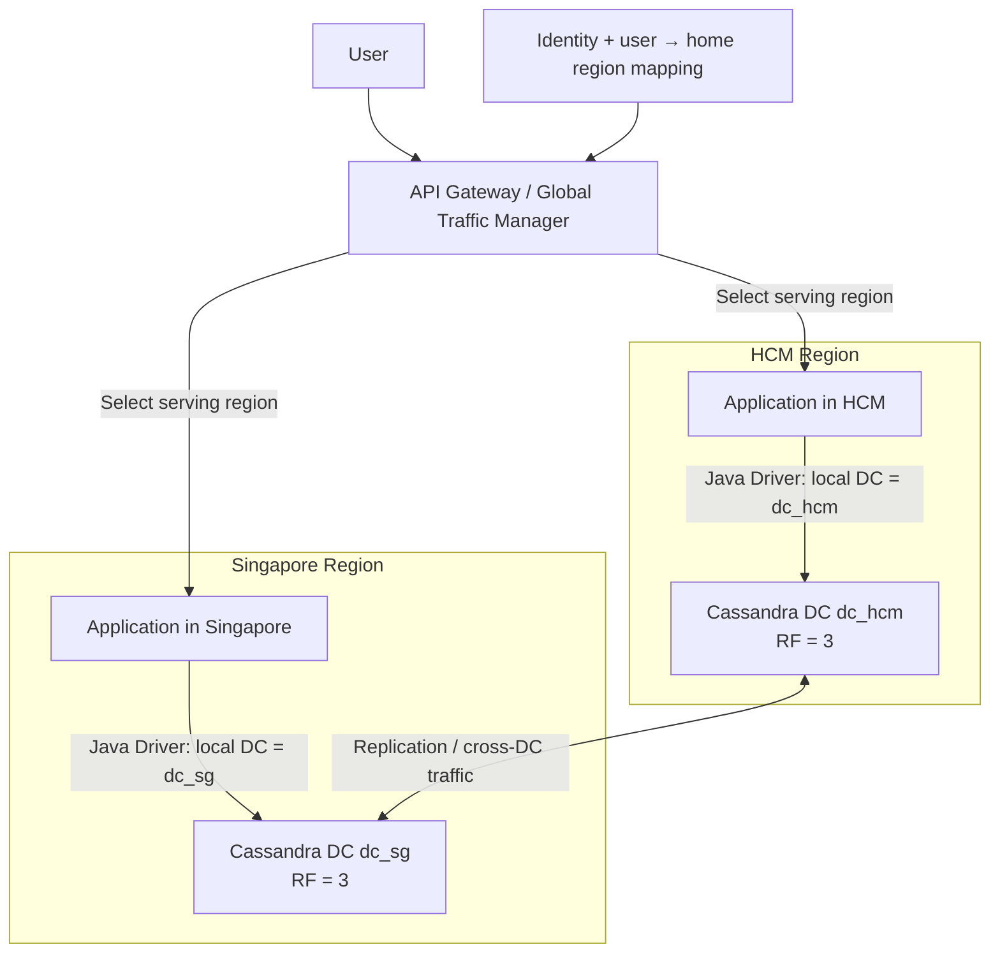

# Designing Multi-Datacenter Access Based on User Requirements

> **Chapter:** Application Architecture  
> **Scope:** Apache Cassandra in distributed systems, the wide-column model, and Java applications. This lesson focuses on choosing which datacenter serves each user, organizing regional data access, deciding consistency levels, and handling cross-region failures.

## Learning Objectives

After this lesson, you will be able to:

1. Translate user requirements for latency, data residency, availability, and data freshness into explicit routing policies.
2. Distinguish **application-serving datacenter (DC)**, **replica-hosting DCs**, **coordinator**, and **consistency level (CL)** in Cassandra.
3. Design a multi-DC system using `NetworkTopologyStrategy`, `LOCAL_QUORUM`, and the Java Driver following regional-locality principles.
4. Explain why shifting a request from DC A to DC B can return stale data even when both DCs belong to the same cluster.
5. Build failover policies, failure-scenario tests, and monitoring to meet business requirements.

## 1. Starting from User Requirements

Suppose an application has users in Vietnam and Singapore, with application deployments in two corresponding nearby regions:

- **`dc_hcm`:** Cassandra DC in the region serving Vietnam users.
- **`dc_sg`:** Cassandra DC in the region serving Singapore users.

The same user may log in while in Vietnam and later travel to Singapore. The requirement is not merely "have two DCs"; the product must define **where this user is served**, **which data resides in which DC**, and **how the system behaves when one DC fails**.

| User / Product Requirement | Architectural Question to Answer | Typical Decision |
| --- | --- | --- |
| Fast responses from current location | Which DC hosts the app and coordinator? | Route requests to the app closest to the user; the app accesses its local-region Cassandra DC. |
| Users bound to a fixed data region | Route by current location or `home region`? | Look up `home region` from a trusted directory and route per product policy. |
| Read fresh updates immediately after roaming | Has the write been acknowledged in the target DC? | Define cross-region consistency requirements; pick suitable CLs and roaming flows. |
| Stay available when one DC is lost | Accept staleness, degraded functionality, or reject writes? | Establish fallback plans and RTO/RPO criteria before deployment. |
| Data must not leave a country | Can it replicate to a DC in another country? | Isolate storage scopes by region; never configure replicas in prohibited DCs. |

**Do not conflate distinct goals:** the nearest DC optimizes latency; the home DC reflects data policy; the surviving DC reflects resilience. Those three choices can point to three different DCs.

Before designing, write down verifiable conditions. For example: "Read user profile in the home region with p95 under 150 ms", "Every acknowledged write must have a replica in the standby region", or "Category X data may reside only in region Y." These numbers are **illustrative assumptions** that must be measured and agreed upon with product owners; Cassandra does not guarantee a specific SLO automatically.

## 2. Understanding How Cassandra Operates Across Multiple DCs

In **a multi-DC Cassandra cluster**, each DC holds topology-assigned nodes; `NetworkTopologyStrategy` configures the replica count **per DC** for each keyspace. With `dc_hcm: 3` and `dc_sg: 3`, each partition is replicated to three nodes in each DC, totaling six replicas (assuming sufficient nodes and valid rack configuration).

The **coordinator** is the node receiving a query from the driver. It contacts replicas and awaits the required responses per the CL. The **driver** decides which coordinator is preferred; the **partition key** determines which replicas hold the data. Therefore, selecting a DC per user **does not change the partition key** and **does not automatically move partitions**.



There are two separate hops:

1. **User → application hop:** the API Gateway or global traffic manager selects the application service instance.
2. **Application → Cassandra hop:** the Java Driver prefers coordinators in the configured `local-datacenter`; Cassandra handles replicas and CL.

An application hosted in HCM that continually connects to a coordinator in Singapore can still function, yet pays WAN round-trip penalties and invalidates the design's latency assumptions. The default model should be **each region runs its own application tier, and each application uses local-region Cassandra coordinators**.

## 3. Choosing Routing Policies That Match Requirements

### 3.1. Three Common Routing Models

| Policy | How Region Is Selected | Best Suited When | Trade-Off |
| --- | --- | --- | --- |
| **By current location** (geo routing) | Pick the app region closest to the user's network | Content is less freshness-sensitive; UX prioritizes low latency | Users moving across regions may observe unconverged data. |
| **By home region** (`home region affinity`) | Each user/tenant has a primary region recorded in a directory | Profile/account writes needing a stable home path | Traveling users incur extra WAN latency back to their home region. |
| **By data constraints** (data residency) | Pick only regions legally/contractually allowed to store/process data | Legal regulations, contracts, data classification | Cannot freely fail over outside approved jurisdictions. |

A product can combine policies: public content uses geo routing; account mutations use `home region`; regulated data stays inside approved regions. **Classify by API and data category before optimizing routing**.

### 3.2. The Region-Lookup Source Must Be Trustworthy

Suggested flow:

1. Authenticate the user at the API Gateway and extract `userId` from the verified session/token.
2. Look up `userId → homeRegion` in a trusted region-mapping service (directory).
3. Validate access permissions and data residency rules before choosing the region.
4. Forward the request to the application cluster in the selected region over TLS, preserving the correlation ID.
5. The application executes CQL via a Java Driver configured with the local DC of **that application's own region**.

Never pull `homeRegion` straight from a client-supplied header and trust it blindly. Directory data can be cached with an appropriate TTL, provided there is cache invalidation when regions change and conflict handling during transitions.

**Note on data residency:** A keyspace with `'dc_hcm': 3, 'dc_sg': 3` places replicas of that keyspace's data in **both** DCs regardless of where users connect. If policy forbids storing data in Singapore, a two-DC replication setup **fails compliance**. Use keyspaces/clusters with approved replication scopes; if opting for independent clusters, the application must explicitly manage permitted data transfers or synchronization between them.

## 4. Topology Configuration and Query-Driven Table Design

### 4.1. Multi-DC Keyspace

CQL example for a keyspace **permitted to replicate to both regions**:

```cql
CREATE KEYSPACE user_app
WITH replication = {
  'class': 'NetworkTopologyStrategy',
  'dc_hcm': 3,
  'dc_sg': 3
}
AND durable_writes = true;
```

The names `dc_hcm` and `dc_sg` must match the exact datacenter names reported by the nodes. Each DC needs enough nodes, properly configured racks, and stable cross-DC connectivity. Never use `SimpleStrategy` for multi-DC production clusters.

Operational verification:

```bash
nodetool status
```

Inspect keyspace definitions with `DESCRIBE KEYSPACE user_app` in `cqlsh`. When **increasing the replication factor** or adding a new DC to existing data, plan data streaming and appropriate full/targeted repairs; altering the keyspace definition does not immediately populate all new replicas.

### 4.2. Designing Tables Around Access Paths

To look up a profile by `userId`:

```cql
CREATE TABLE user_app.profile_by_user (
    user_id uuid PRIMARY KEY,
    display_name text,
    locale text,
    updated_at timestamp
);

SELECT display_name, locale, updated_at
FROM user_app.profile_by_user
WHERE user_id = 8d64d650-cc1a-4a2b-9f1d-920722e7cba1;
```

To read event history by **user and day** while bounding per-partition data:

```cql
CREATE TABLE user_app.events_by_user_day (
    user_id uuid,
    event_day date,
    occurred_at timeuuid,
    event_type text,
    payload text,
    PRIMARY KEY ((user_id, event_day), occurred_at)
) WITH CLUSTERING ORDER BY (occurred_at DESC);

SELECT occurred_at, event_type, payload
FROM user_app.events_by_user_day
WHERE user_id = 8d64d650-cc1a-4a2b-9f1d-920722e7cba1
  AND event_day = '2026-11-21'
LIMIT 50;
```

Both queries supply the full **partition key**; the driver can use token metadata to prefer optimal replicas within the local DC. Daily partitioning prevents an unbounded history partition, though actual sizes and traffic must be measured to tune bucket granularity.

Do not write `WHERE home_region = ?` on a table keyed only by `user_id` and slap `ALLOW FILTERING` on it to find users by region. The directory and Cassandra tables serve different purposes. If querying by region is truly required, design a **dedicated lookup table** with an appropriate partition key and business-consistent updates.

## 5. Deciding Consistency Levels Across Multiple DCs

Suppose `user_app` has `RF(dc_hcm)=3` and `RF(dc_sg)=3`. Within one DC, quorum is `floor(3/2)+1 = 2` replicas. Across total RF of six, cluster-wide quorum is `floor(6/2)+1 = 4` replicas.

| Consistency Level | Response Requirement in Example | Key Characteristics |
| --- | --- | --- |
| `LOCAL_ONE` | 1 replica in the coordinator's DC | Low latency; may read stale versions. |
| `LOCAL_QUORUM` | 2/3 replicas in **the coordinator's DC** | Suited for regional reads/writes; a quorum in DC A does not guarantee immediate fresh reads in DC B. |
| `QUORUM` | 4/6 replicas cluster-wide | When both reads and writes use `QUORUM`, quorums overlap; evaluate WAN cost and availability impact. |
| `EACH_QUORUM` | **Writes:** 2 replicas in *each* DC | Writes only; confirms quorum in both DCs before returning success, but depends on both DCs. |
| `ALL` | All 6 replicas | Depends on every replica; loses availability easily on node failure. |

**Key example:**

1. A user updates their name in HCM using a `LOCAL_QUORUM` write; two HCM replicas acknowledge, and the app returns success.
2. Immediately afterward, the user is routed to Singapore; a `LOCAL_QUORUM` read in Singapore queries two Singapore replicas.
3. If the update has not yet reached the Singapore replicas, the read can return the old name. Both operations satisfied the CL in **their respective DCs**.

Hence **`LOCAL_QUORUM` in two different DCs does not equate to strong cross-DC consistency**. The overlap rule `R + W > RF` applies only when chosen quorums are guaranteed to intersect within the RF scope considered; you cannot combine two separate local quorums in two DCs into a cluster-wide overlap guarantee.

If the business requirement is "writes confirmed in HCM must be immediately readable after switching to Singapore," options exist with different trade-offs:

- **Maintain affinity to the primary write region** for operations requiring immediate read-your-writes while secondary replicas converge.
- **Write with `EACH_QUORUM`**, then read with `LOCAL_QUORUM` in any DC configured with RF=3: the write quorum in that DC intersects the read quorum in the same DC (assuming no concurrent conflicting writes). In exchange, an unavailable DC can cause writes to fail.
- **Use cluster-wide `QUORUM` reads and writes** for flows requiring intersecting quorums, accepting WAN overhead and evaluating DC-loss behavior.
- For linearizable constraints or uniqueness within a partition, **evaluate lightweight transactions (LWT), `SERIAL`/`LOCAL_SERIAL`**, and their limits in distributed designs; standard CLs and timestamps do not provide serializability on their own.

Verify these choices by testing with your real topology and failure modes. Cassandra resolves write conflicts via timestamps and replica reconciliation; "two regions both accept independent writes" does not mean the system understands domain conflicts like balance additions, reservations, or profile versions.

## 6. Java Driver: Each Region Uses Its Own Local Datacenter

In Java Driver 4.x, `DefaultLoadBalancingPolicy` defaults to preferring nodes in the local DC and performs token-aware routing when queries include routing information. In standard deployments, **one application process maintains one long-lived `CqlSession`**, created at startup and closed on shutdown—never creating a new session per user or HTTP request.

Example Java DAO reading a profile (using Driver 4.x's `com.datastax.oss.driver` namespace):

```java
import com.datastax.oss.driver.api.core.CqlSession;
import com.datastax.oss.driver.api.core.DefaultConsistencyLevel;
import com.datastax.oss.driver.api.core.cql.BoundStatement;
import com.datastax.oss.driver.api.core.cql.PreparedStatement;
import com.datastax.oss.driver.api.core.cql.Row;

import java.net.InetSocketAddress;
import java.util.Optional;
import java.util.UUID;

public final class ProfileDao implements AutoCloseable {
    private final CqlSession session;
    private final PreparedStatement findProfile;

    public ProfileDao(String localContactHost, String localDc) {
        this.session = CqlSession.builder()
            .addContactPoint(new InetSocketAddress(localContactHost, 9042))
            .withLocalDatacenter(localDc)
            .build();

        this.findProfile = session.prepare(
            "SELECT display_name FROM user_app.profile_by_user WHERE user_id = ?");
    }

    public Optional<String> findDisplayName(UUID userId) {
        BoundStatement query = findProfile.bind(userId)
            .setConsistencyLevel(DefaultConsistencyLevel.LOCAL_QUORUM)
            .setIdempotent(true);

        Row row = session.execute(query).one();
        return row == null
            ? Optional.empty()
            : Optional.ofNullable(row.getString("display_name"));
    }

    @Override
    public void close() {
        session.close();
    }
}
```

Initialize correspondingly in each region (example addresses must be replaced with valid node addresses in your deployment network):

```java
// Service running in HCM
ProfileDao hcmDao = new ProfileDao("10.10.1.11", "dc_hcm");

// Service running in Singapore (a separate deployment)
ProfileDao sgDao = new ProfileDao("10.20.1.11", "dc_sg");
```

In production, load DC/contact points from environment config or secret/config management, supply multiple local-region contact points, and configure TLS, authentication, timeouts, pooling, and error observability. The snippet above is intentionally concise to emphasize **one local DC per deployment**, not instantiating both DAOs in one request.

Write example when the business only needs local-DC quorum:

```java
PreparedStatement update = session.prepare(
    "UPDATE user_app.profile_by_user " +
    "SET display_name = ?, updated_at = ? WHERE user_id = ?");

BoundStatement write = update.bind(
    newName, java.time.Instant.now(), userId)
    .setConsistencyLevel(DefaultConsistencyLevel.LOCAL_QUORUM);

session.execute(write);
```

This write snippet shows setting CL on a statement inside a DAO holding a `session`; `newName` and `userId` are business variables. If an endpoint requires acknowledgment in **both DCs** before returning success, evaluate `DefaultConsistencyLevel.EACH_QUORUM` for **that write** after assessing latency and availability. Mark a write as idempotent only when its semantics genuinely permit safe retries; for operations with side effects or business conditions, control retries, timeouts, and uncertain write outcomes.

### 6.1. Why Not Switch Local DC Per Request?

`withLocalDatacenter("dc_hcm")` configures the **session/driver policy**, not a per-query ad-hoc option. If an API instance in HCM receives a request for a user with `homeRegion=sg`, forward the HTTP/gRPC call to the Singapore service; that service already holds a session for `dc_sg`. Avoid creating per-request sessions or letting client-provided regions reconfigure driver settings continuously.

Java Driver 4.10+ includes an optional *cross-datacenter failover* feature, disabled by default; enabling remote nodes is an operational decision requiring strict control. When using `LOCAL_ONE`/`LOCAL_QUORUM`, shifting the coordinator to another DC changes **the quorum scope** and applied RF. Therefore, prefer **service/region-layer failover** with explicitly defined read/write policies rather than relying on automatic DC-hopping inside the driver.

## 7. Designing Access Flows and Failover by API Category

A production application should group endpoints by data requirements:

| Flow | Normal Serving Region | Starting CL to Evaluate | Behavior When Primary DC Fails |
| --- | --- | --- | --- |
| Viewing low-sensitivity lists | Region nearest the user | `LOCAL_ONE` or `LOCAL_QUORUM` | Shift region if standby data suffices; surface possible update lag. |
| Reading/updating profile details | `home region` | `LOCAL_QUORUM` read/write | Enable writes in standby only if conflict resolution and RPO permit. |
| Writes requiring presence in both DCs | Home region | `EACH_QUORUM` write; requirement-aligned read | May reject writes while the second DC is disconnected. |
| Strictly residency-bound data | Approved region | CL within valid cluster/region | Fail over only to another approved region; never cross data boundaries automatically. |

These are **design starting points**, not mandatory default CLs for every application. When same-session read-after-write is critical, account for sticky-routing policies, replication state, and operation semantics; Cassandra does not provide a global session token guaranteeing every cross-DC read sees the latest write.

### 7.1. Failure Scenario Matrix

| Scenario | What May Happen | Expected Action |
| --- | --- | --- |
| One node in primary DC is down; DC retains quorum | `LOCAL_QUORUM` continues serving | Driver routes to healthy nodes; monitor repair/hints. |
| WAN is slow or severed; both DCs remain up | `LOCAL_QUORUM` writes succeed in each DC; cross-DC replicas converge slowly | Alert on sync lag, throttle conflicting writes; avoid promising cross-region freshness. |
| Entire primary DC loses connectivity | Local session has no available coordinators; in-flight calls may time out | Global routing shifts traffic to standby app per policy; choose read-only, degraded, or controlled write-enabled mode. |
| Standby DC fails during `EACH_QUORUM` writes | Writes require quorum in every DC and may fail | Return an appropriate business error or follow an approved CL-downgrade runbook acknowledging RPO risk. |
| DC recovers after an offline period | Replicas may lack mutations written while offline | Monitor hints, run scheduled repairs, verify convergence before restoring full traffic. |
| Write returns timeout error | Client cannot be sure which replicas applied the mutation | Never assume "definitely not written"; use idempotency keys or check business state before retrying. |

**RTO** defines service recovery time, whereas **RPO** defines how much data may be lost or absent in the standby region at the moment of failure. Both metrics must be specified per API. For example, confirming a `LOCAL_QUORUM` write in HCM and immediately losing all of HCM may mean Singapore lacks that latest update; you cannot claim RPO = 0 merely because the cluster spans two DCs.

### 7.2. Avoiding Conflicts When Two DCs Write Concurrently

If a user logs in from multiple devices across two regions, concurrent updates to the same column can yield outcomes dictated by write timestamps. Pick one of these approaches based on business semantics:

- Route all writes for a user/aggregate to its `home region`; other regions forward writes there.
- Use explicit versions or conditional updates with proper coordination (evaluate LWT when strong single-partition conditions are needed).
- For non-overwritable events, use event-identity keys and an append-only model; handle deduplication and ordering in the business layer.
- Record conflict resolutions in an audit log for user support traceability.

In particular, balances, quotas, reservations, and unique resources should never rely purely on "last write wins" to preserve business invariants.

## 8. Operations, Security, and Observability

**Topology and Data**

- Check `nodetool status` per DC/rack; monitor node up/down state and load balance.
- Verify RF per keyspace, not just cluster assumptions in general.
- Schedule repairs across all relevant token ranges/DCs. Hinted handoff is *best effort* and **never replaces repair**; align repair schedules with `gc_grace_seconds` to prevent tombstone/data resurrection risks.
- Test backup/restore of data and metadata; cross-DC replication does not replace a backup strategy.

**Application Metrics**

- Ratio of requests routed to the right `home region` vs. routed to standby.
- p50/p95/p99 latency by endpoint, user region, app region, and DC.
- Timeouts, `UnavailableException`, retries, error rates by CL and endpoint; sudden WAN traffic spikes.
- Observed replication lag of an updated record between DC A and DC B using synthetic probes, rather than inferring from up-node counts.
- Failover frequency, failback duration, hints/repair backlogs, and stale-read incidents.

**Security**

- TLS for client–node and node–node connections; restrict inter-region network exposure and enforce service-level authentication/authorization.
- Segment networks and data per legal requirements; audit replicas, backups, logs, and analytics exports alike.
- Never trust client-declared region claims; every `home region` change requires authentication, authorization, and auditing.

**Changing a home region** requires a formal procedure: lock or coordinate related writes, verify data in the target region, update the versioned directory, invalidate caches, and only then shift traffic. If data must *migrate* between isolated clusters, add export/import, verification, and source deletion steps per policy; updating a directory value alone does not move data.

## 9. Sample Design Problem

**Prompt.** A platform serves accounts in HCM and Singapore. Users can travel, edit their profile, and view activity history. Product requirements:

1. Most routine operations use the DC nearest the app to minimize latency.
2. A successful email change must be visible in the standby region if the user immediately switches regions afterward.
3. During a total DC outage, viewing history may lag; changing email must not report success if requirement 2 cannot be met.
4. Certain classified contractual data may only be stored within authorized territory.

**A Sound Solution:**

- Deploy apps in HCM and Singapore with local Java Driver sessions per region; use a `userId → homeRegion` directory and gateway routing per API group.
- For profiles **permitted to replicate across both regions**, the keyspace uses `NetworkTopologyStrategy` with RF=3 per DC. Email is looked up by `userId`; consider a separate uniqueness guard if emails must be globally unique.
- For **changing email**, use `EACH_QUORUM` writes (or another verified consistency design meeting immediate post-roam read requirements) before confirming success; read with `LOCAL_QUORUM` in the serving region. If the standby DC is down, the endpoint reports unavailability rather than returning a false guarantee.
- For **viewing history**, allow `LOCAL_ONE` or `LOCAL_QUORUM` reads in the local DC, noting potential convergence lag during failover; partition by user and day.
- Store contractual data only in clusters/keyspaces whose replication and backups stay strictly within authorized regions; never place prohibited data in a keyspace replicated to Singapore.
- Run failover tests and measure actual cross-DC latency, write rejection behavior, stale reads, and recovery times.

### Guided Lab

1. On a two-DC test cluster, create a `NetworkTopologyStrategy` keyspace with RF matching your node count; verify with `nodetool status` and `DESCRIBE KEYSPACE`.
2. Create `profile_by_user`, write a profile in DC A at `LOCAL_QUORUM`, and read in DC B at `LOCAL_QUORUM`. Measure when the new record appears; **never assume** a fixed delay.
3. Repeat with an `EACH_QUORUM` write and a `LOCAL_QUORUM` read from DC B. Record latency and the impact of severing DC B connectivity.
4. Shut down one node, then simulate losing an entire DC in your test environment; evaluate endpoints against the Section 7 failure matrix.
5. Restore the DC, observe convergence and repair, and complete an empirical RTO/RPO report per operation type.

Never run node-loss simulations, RF alterations, or heavy repairs in production without an operational plan and blast-radius controls.

## 10. Knowledge Self-Check

**Q1.** A user in Singapore is routed by the gateway to the Singapore app. Why might this request fail to read a write just confirmed in HCM?  
**Hint:** `LOCAL_QUORUM` considers replicas in the coordinator's DC; quorums in two separate DCs are not guaranteed to intersect.

**Q2.** Can you force a user's data to reside solely in HCM by putting `homeRegion=hcm` in their JWT while the keyspace has RF=3 in both DCs?  
**Answer:** No. Where data is replicated is determined by keyspace replication topology, not a region claim inside a JWT.

**Q3.** Why does setting `local-datacenter` in the driver not replace global gateway routing for applications?  
**Answer:** The driver picks the Cassandra coordinator, whereas the gateway picks which application instance serves the request; if the app and DC are in different regions, traffic still crosses the WAN.

**Q4.** When DC B is down, `EACH_QUORUM` writes may fail; should the app automatically downgrade to `LOCAL_ONE`?  
**Answer:** Only if the product/data owner has approved the change in RPO, freshness, and business invariants. Silently downgrading CL can violate success guarantees.

**Q5.** Why does repair remain critical when Cassandra already has replication and hinted handoff?  
**Answer:** Hints do not guarantee delivery of every missed mutation. Repair compares token ranges to heal discrepancies, especially after outages and before old data passes tombstone grace periods.

## References

- [Apache Cassandra — Production recommendations](https://cassandra.apache.org/doc/stable/cassandra/getting-started/production.html): recommending `NetworkTopologyStrategy` for production.
- [Apache Cassandra — Dynamo architecture and consistency](https://cassandra.apache.org/doc/stable/cassandra/architecture/dynamo): defining `LOCAL_QUORUM`, `QUORUM`, `EACH_QUORUM`, and coordinator replica waits.
- [Apache Cassandra — CQL Data Definition](https://cassandra.apache.org/doc/stable/cassandra/developing/cql/ddl.html): declaring keyspaces, replication, and tables.
- [Apache Cassandra Java Driver 4.19 — Load balancing](https://apache.github.io/cassandra-java-driver/4.19.0/core/load_balancing/): local DC, token-aware routing, and cross-DC failover.
- [Apache Cassandra — Repair](https://cassandra.apache.org/doc/stable/cassandra/managing/operating/repair.html): repair principles, hints, and post-outage replica convergence.
