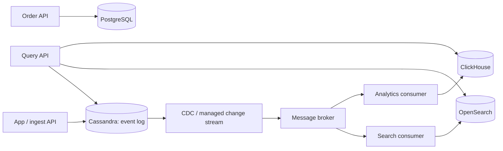

# Limiting Unsuitable Queries and Coordinating with Other Storage Systems

## 1. Context and Objectives

Apache Cassandra is a distributed **wide-column** database built for predictable-latency reads and writes across nodes, horizontal scaling, and continued availability during partial node failures. When designing an application architecture, those strengths only materialize when **table models closely follow the queries they must serve**.

In Cassandra, the **partition key** determines which logical partition holds the data, while **clustering columns** govern row order within that partition. Replication factors and consistency levels control how replicas participate in reads/writes; they do not turn Cassandra into a relational or arbitrary analytics query engine. Therefore, the architectural question is not only "what data should live in Cassandra?" but also "which queries should Cassandra handle, and which should go to another system?"

After this lesson, learners will be able to:

- Recognize CQL limitations around ad-hoc filtering, JOINs, aggregations, full-text search, global sorting, and multi-entity transactions.
- Distinguish queries solvable by **adding another Cassandra table** from queries requiring a specialized storage engine.
- Design data synchronization flows across Cassandra, relational databases, search engines, and analytics systems.
- Explain risks around consistency, sync lag, data deletion, duplicate handling, and post-incident recovery.

## 2. Why Can't One Cassandra Table Serve Every Query Pattern?

Unlike normalizing a relational model and adding indexes later as new SQL queries emerge, Cassandra starts from **known queries** and chooses primary keys, partitioning, and storage order accordingly. A table organized to retrieve one customer's events for a single day in chronological order is not simultaneously optimized for "find all events containing a phrase across all customers."

Practical principles:

1. Efficient queries normally identify the **partition key** (or a small, bounded set of partition keys). Cassandra can then scan a **clustering key** range within those identified partitions.
2. `ORDER BY` in CQL relies on the table's designed clustering order and corresponding query constraints; it is not an arbitrary sort over all rows across all partitions.
3. Cassandra does not provide standard relational `JOIN`s. Multiple data views are modeled via **multiple denormalized tables**, each serving one access path.
4. CQL offers limited aggregate functions, constrained `GROUP BY`, and indexing mechanisms like secondary indexes/Storage-Attached Indexes (SAI) in supported versions and configs. These capabilities **are not equivalent** to an analytical SQL engine or a full-text search engine.
5. `ALLOW FILTERING` permits certain queries outside the optimal access path, but may read and discard vast numbers of rows, causing latency to scale with dataset size. Never treat it as a fix for key design.

A decisive question before writing CQL is: **Can the business request determine the partition key upfront and bound the number of partitions read?** If the answer is frequently no, revisit the design or introduce a specialized system.

## 3. Example: Querying Events by Customer and Day

Suppose an application ingests a large event stream from many customers (*tenants*) and needs to display the 100 most recent events in a day. Suitable table design:

```sql
CREATE TABLE events_by_tenant_day (
    tenant_id uuid,
    day_bucket date,
    occurred_at timestamp,
    event_id uuid,
    event_type text,
    summary text,
    PRIMARY KEY ((tenant_id, day_bucket), occurred_at, event_id)
) WITH CLUSTERING ORDER BY (occurred_at DESC, event_id ASC);
```

- `(tenant_id, day_bucket)` is a **composite partition key**: partitions data by customer and day to prevent an unbounded partition. Bucket granularity must match real traffic: very high-volume customers may need hourly buckets or an additional queryable sub-sharding component.
- `(occurred_at, event_id)` are **clustering columns**: return results in descending chronological order; `event_id` provides deterministic ordering when two events share a timestamp.
- `event_type` and `summary` are payload columns, not automatically optimal filter predicates.

Query aligned with the access path:

```sql
SELECT event_id, occurred_at, event_type, summary
FROM events_by_tenant_day
WHERE tenant_id = ?
  AND day_bucket = ?
  AND occurred_at >= ?
  AND occurred_at < ?
LIMIT 100;
```

A query like "find `PAYMENT_FAILED` events across all customers over 90 days sorted newest-first globally" **is not served efficiently by this table**: there is no direct lookup by `event_type` across partitions, and it requires merging and sorting results globally. Similarly, `WHERE summary LIKE '%timeout%'` is not viable full-text search via the table's primary key.

If the product simply adds a query **by event type within each customer and day**, you can intentionally write an extra table:

```sql
CREATE TABLE events_by_tenant_type_day (
    tenant_id uuid,
    event_type text,
    day_bucket date,
    occurred_at timestamp,
    event_id uuid,
    summary text,
    PRIMARY KEY ((tenant_id, event_type, day_bucket), occurred_at, event_id)
) WITH CLUSTERING ORDER BY (occurred_at DESC, event_id ASC);

SELECT event_id, occurred_at, summary
FROM events_by_tenant_type_day
WHERE tenant_id = ? AND event_type = ? AND day_bucket = ?
LIMIT 100;
```

This is **query-driven denormalization**: trading higher write cost, storage, and cross-table synchronization for predictable read paths. If dozens of arbitrary filter combinations exist, table count explodes rapidly; at that point, a search engine or analytics store is more appropriate than unbounded table duplication.

### Quick Workarounds That Cause Performance Failures

| Workaround | Practical Problem | Better Approach |
| --- | --- | --- |
| Adding `ALLOW FILTERING` to non-keyed queries | May read massive data before filtering; cost escalates sharply as data grows | Redesign keys, add a query table, or use a search engine |
| Reading all partitions into the app and filtering/sorting | Heavy fan-out, high bandwidth and memory use, timeout risk | Narrow queries with partition keys or offload to a specialized engine |
| Placing all events of a customer in one partition | Partition bloats; reads/compaction/repair become hard to control | Use time buckets and balance partition keys |
| Running `COUNT(*)` on huge datasets for real-time dashboards | Aggregations scan vast data; no automatic stats table across arbitrary dimensions | Maintain rollups or stream data to OLAP |
| Using many secondary indexes/SAI to replace query modeling | Outcomes and costs depend on version, selectivity, data size, and query patterns | Benchmark real queries; for flexible search, consider OpenSearch/Elasticsearch |
| Assuming SQL-like arbitrary `OFFSET` and `ORDER BY` | Offset pagination and global sorting do not fit Cassandra's access model | Use driver paging state and stable query keys; or a search engine for global sorts |

> **Note:** Not every query lacking a partition key is strictly unrunnable; indexes and specific CQL constructs may allow execution. What must be evaluated is latency, partition/row touch count, coordinator load, and stability as data grows.

## 4. Separating Responsibilities Across Storage Systems

A **polyglot persistence** architecture employs multiple engines, each responsible for the query shapes it excels at. You do not need every system listed below; pick based on concrete requirements.

| Application Need | Suitable Role | Rationale and Boundaries |
| --- | --- | --- |
| High-volume event writes; reads by tenant, device, time; known queries | **Cassandra** | Distributed writes, replication, and partition/clustering access paths; requires controlling hotspots and partition size |
| Orders, payments, referential integrity, multi-table transactions | **PostgreSQL/MySQL** | Relational constraints and transactions; Cassandra LWT/CAS does not replace arbitrary multi-entity ACID transactions |
| Phrase search, fuzzy matching, multi-filter queries, relevance ranking | **OpenSearch/Elasticsearch** | Inverted indexes and search DSL; results are typically an asynchronously synced projection |
| Historical analytics, `JOIN`s, multi-dimensional `GROUP BY`, ad-hoc reports | **ClickHouse, data warehouse, or Spark/Trino over analytical data** | Optimized for columnar/bulk scans and aggregations; freshness depends on pipeline lag |
| Caching hot keys, sessions, short-lived leaderboards | **Redis** | Low-latency ephemeral state and specialized data structures; requires expiry and cache-recovery rules |
| Images, large files, large raw blobs | **Object storage** | Cost-effective file lifecycle; Cassandra can store metadata, IDs, and reference URIs |

Distinguish two scaling paths:

- **Add a table in Cassandra** when query patterns are few, fixed, clearly partition-keyed, and data duplication remains controllable.
- **Add another storage engine** when requiring full-text search, global relevance sorting, unpredictable analytics, or relational transactions; those needs run counter to Cassandra's primary access model.

For example, an API might split endpoints as: `GET /tenants/{id}/events?day=...` reads Cassandra; `GET /events/search?q=...` reads the search index; `GET /analytics/events?groupBy=...` reads OLAP; `POST /orders` writes the relational DB. The key is **clearly defining the authoritative data source** for each entity type so copies never compete to decide truth.

## 5. Coordination Architecture: Write One Source, Emit Changes, Build Projections

Suppose **Cassandra is the authoritative source for event data**; OpenSearch handles search, ClickHouse handles analytics, and PostgreSQL manages independent order transactions. Reference architecture:



When the API successfully writes an event to Cassandra, the service **must not assume** the event is immediately present in OpenSearch/ClickHouse. CDC or a change stream forwards the event to a message broker, and consumers update each projection. This is **cross-system eventual consistency** and must be stated explicitly in product contracts.

In practice, change capture depends on the source database:

1. **Source is PostgreSQL:** update the business record and an **outbox** in the same transaction; CDC/relay forwards outbox rows to the broker. Common when atomicity between business data and published events is required.
2. **Source is Cassandra:** use CDC/connectors or a durable ingest stream aligned with your version/vendor. Verify CDC configuration, throughput, log retention, disk pressure, and replayability. Never treat two independent steps ("write Cassandra then publish to Kafka") as an atomic transaction.
3. **Source is a message log:** if business rules allow, write events to a durable broker first, then let consumers populate Cassandra, search, and OLAP. Define clearly when the API returns success and which log holds authority.

Do not orchestrate reads across every system inside one request. APIs should **route by capability**: timelines come from Cassandra; search fetches matching keys from OpenSearch and reads details from Cassandra when needed; summary reports come from ClickHouse. When search returns IDs, indexed documents should hold **full Cassandra locating keys** (`tenant_id`, `day_bucket`, `occurred_at`, `event_id`) to avoid scanning for source records.

### Designing the Event Contract

A synchronization event might carry:

```json
{
  "eventId": "bff4b7fa-04ca-4bc7-9cb4-b04ba7f8e923",
  "eventType": "EventRecorded",
  "schemaVersion": 1,
  "tenantId": "8b60dcdb-7ad7-449b-8e6d-68d8dc2aa447",
  "dayBucket": "2026-11-21",
  "occurredAt": "2026-11-21T08:30:00Z",
  "recordVersion": 12,
  "operation": "UPSERT",
  "payload": {"category": "PAYMENT_FAILED", "summary": "Gateway timeout"}
}
```

- `eventId` identifies the message and supports **idempotency**. The full source record key must travel with it so consumers update the exact entity.
- `recordVersion` or a **source-guaranteed** version/total-order mechanism prevents older events from overwriting newer data. Never assume wall-clock timestamps from multiple machines produce reliable global order.
- `schemaVersion` supports evolving payload schemas over a system's long lifespan.
- `operation` must distinguish `UPSERT` and `DELETE`; expiration rules (`TTL`) must also be communicated/designed for projections.

In this example, `recordVersion` is meaningful only if generated monotonically per record by a consistent rule; Cassandra does not automatically provide a global sequence across events.

## 6. Consistency and Failure Problems to Solve

### 6.1. Internal Cassandra Consistency Differs from Search Index Freshness

With replication factor 3 in one datacenter, combining `LOCAL_QUORUM` reads and writes typically requires two replicas to acknowledge each operation in that DC. This governs **Cassandra replicas**, and provides zero guarantee that OpenSearch has received the event. Even after `INSERT` succeeds, immediate search queries may miss the record due to consumer lag.

Suggested API contract: timeline views read Cassandra when newly written keyed data must appear immediately; search views can display "results update with slight lag" or offer direct keyed lookup for newly created items. Never claim *cross-system read-your-writes* without building a concrete mechanism to enforce it.

### 6.2. Duplicate Writes, Out-of-Order Events, and Partial Failures

Brokers/consumers commonly redeliver events after retries. Consumers must handle **at-least-once** delivery using keyed, versioned idempotent operations rather than blindly incrementing counters on each message. When messages for the same record arrive out of order, rely on authoritative versions or well-defined merge rules.

| Incident | Observable Consequence | Recommended Mitigation |
| --- | --- | --- |
| Cassandra write succeeds; pipeline lags | Timeline shows data; search does not yet find it | Monitor lag; expose sync status and latency expectations |
| Consumer receives same event multiple times | Index/counters corrupted if applied twice | Idempotent upserts, event-ID deduplication, or version checks |
| Delete event arrives after a newer create/update | Data wrongly deleted if ordering is missing | Version checks, tombstone strategies, and record locking |
| Search/OLAP outage | Specialized queries fail or go stale | Durable buffering, backoff retries, dead-letter queues, replay support |
| CDC loses data after exceeding log retention | Projection permanently misses records | Early alerts, source backfill, verified reconciliation |

**Deletes and TTL require explicit design.** Cassandra creates tombstones on deletes/expiries and manages them via compaction and replica repair. A row's TTL expiring **does not mean** the search engine automatically receives a delete event on time. Align retention policies in search/OLAP, emit explicit delete commands, or run periodic reconciliation and cleanup. Also note that Cassandra `repair` fixes divergence **among Cassandra replicas**, not projections in OpenSearch/ClickHouse.

### 6.3. Sync Pipeline Availability Targets

Operations must measure: source-to-index latency, message backlog, consumer errors, retry counts, dead-letter queue size, record-count drift, backfill duration, and Cassandra compaction/CDC load. Set concrete goals—such as "95% of events appear in search within 10 seconds"—and verify them under peak traffic, single-node loss, and replays.

Fault-tolerance designs must account for **message loss risk**, **update ordering**, **post-outage recovery**, and **deletions**; measuring steady-state throughput alone is insufficient.

## 7. Connecting from Java Applications and Query Routing

In Java applications, the Cassandra data-access layer should clearly express **query intent**; never build a generic repository accepting `Map<String,Object>` and assembling arbitrary CQL predicates. Example with Java Driver 4.x:

```java
import com.datastax.oss.driver.api.core.CqlSession;
import com.datastax.oss.driver.api.core.cql.BoundStatement;
import com.datastax.oss.driver.api.core.cql.PreparedStatement;
import com.datastax.oss.driver.api.core.cql.ResultSet;
import java.time.Instant;
import java.time.LocalDate;
import java.util.UUID;

// Session should be managed and reused across the application lifecycle.
public ResultSet findTenantEvents(
        CqlSession session, UUID tenantId, LocalDate day,
        Instant fromInclusive, Instant toExclusive) {
    PreparedStatement ps = session.prepare(
        "SELECT event_id, occurred_at, event_type, summary " +
        "FROM events_by_tenant_day " +
        "WHERE tenant_id = ? AND day_bucket = ? " +
        "AND occurred_at >= ? AND occurred_at < ? LIMIT 100");

    BoundStatement statement = ps.bind(tenantId, day, fromInclusive, toExclusive)
                                 .setPageSize(50);
    return session.execute(statement);
}
```

This example highlights **binding the full partition key** and using prepared statements. In production applications, cache `PreparedStatement`s, manage sessions via dependency injection, configure SLA-aligned timeouts/retries, and return DTOs rather than coupling the HTTP layer directly to `ResultSet`. `setPageSize` controls driver fetch page size; if building a paginated API, manage driver paging state carefully and bind tokens to query context. It is not a SQL-style `OFFSET`.

Suggested service-layer routing contract:

```text
TimelineService.listByTenantAndDay(...)  -> Cassandra
EventSearchService.searchTextAndFilters(...) -> Search engine
EventAnalyticsService.aggregateByDimension(...) -> OLAP
OrderService.commitPayment(...) -> RDBMS
```

If a search results page needs full details from Cassandra, the search engine returns **complete locating keys**, and the application runs bounded key lookups while handling deleted or not-yet-synced rows. Never query thousands of partitions concurrently just to render one screen.

## 8. Decision Process for a New Query Requirement

When the product team proposes a new filter or report, follow this order:

1. **State the query in business terms:** who filters what, over what time range, at what frequency, max latency, acceptable staleness, and whether paged records or aggregations are needed.
2. **Check partition addressability:** does the input provide the full partition key; how many partitions are touched at peak; can a time bucket bound it?
3. **Pick the read path:** an existing Cassandra table, a new fixed-pattern Cassandra table, a search index, OLAP, or RDBMS depending on semantics.
4. **Calculate sync cost:** adding a table increases writes and storage; adding another engine adds infrastructure and projection lag. Maintain a single authoritative owner per business fact.
5. **Verify at production-like scale:** partition distribution, largest tenant, rows per bucket, p95/p99 latency, throughput, timeouts, compaction/repair impact, and pipeline lag during faults.
6. **Define out-of-sync behavior:** how much staleness is tolerated, retry/replay mechanics, deletion handling, and post-incident reconciliation.

### Case Study Exercise

A monitoring platform stores 300 million events/day in Cassandra. Product wants to add: (A) fetch the 50 newest logs for a device in 1 hour; (B) fuzzy-search error strings across all 30 days of logs; (C) aggregate error rates by region and app version over 12 months; (D) record an order and decrement inventory in a single transaction.

**Reference solution direction:**

- **A:** Cassandra with a partition key of device and time bucket, clustered by time; bounded reads and key-based pagination.
- **B:** Search engine with full-text indexes and filters; synced asynchronously from the event stream, accepting or compensating for index lag.
- **C:** OLAP/warehouse engine for historical scans and multi-dimensional aggregations; build rollup tables if dimensions are fixed.
- **D:** Relational database for the business transaction boundary; emit post-commit events/outbox to update other read systems.

Do not try to turn `ALLOW FILTERING`, secondary indexes, or `LOCAL_QUORUM` into a universal hammer for all four requirements: each choice solves a **different class of problem**.

## 9. Pre-Deployment Self-Check

- Does every Cassandra read API explicitly know and bound its partition key, clustering range, `LIMIT`, and pagination?
- Are any queries expected to run `ALLOW FILTERING` or whole-dataset aggregations on hot request paths? If so, have they been benchmarked or offloaded to another engine?
- Are the authoritative data source and reliable change-propagation mechanism clearly designated?
- Do consumers enforce idempotency, out-of-order protection, retry/replay, and lag alerting?
- Are deletion, TTL, retention, and reconciliation rules aligned across Cassandra, search, and OLAP?
- Have tests covered skewed partitions, outages, repair/compaction cycles, and projection rebuilds?

**Conclusion:** Cassandra excels when applications access data through pre-designed keys and query shapes. When products require flexible search, ad-hoc analytics, or relational transactions, pair Cassandra with specialized engines via a data pipeline with clear authority, consistency rules, and recovery capabilities. Cassandra's read/write consistency levels protect replicas inside Cassandra; whole-architecture correctness also depends on how the remaining systems are synchronized and operated.
