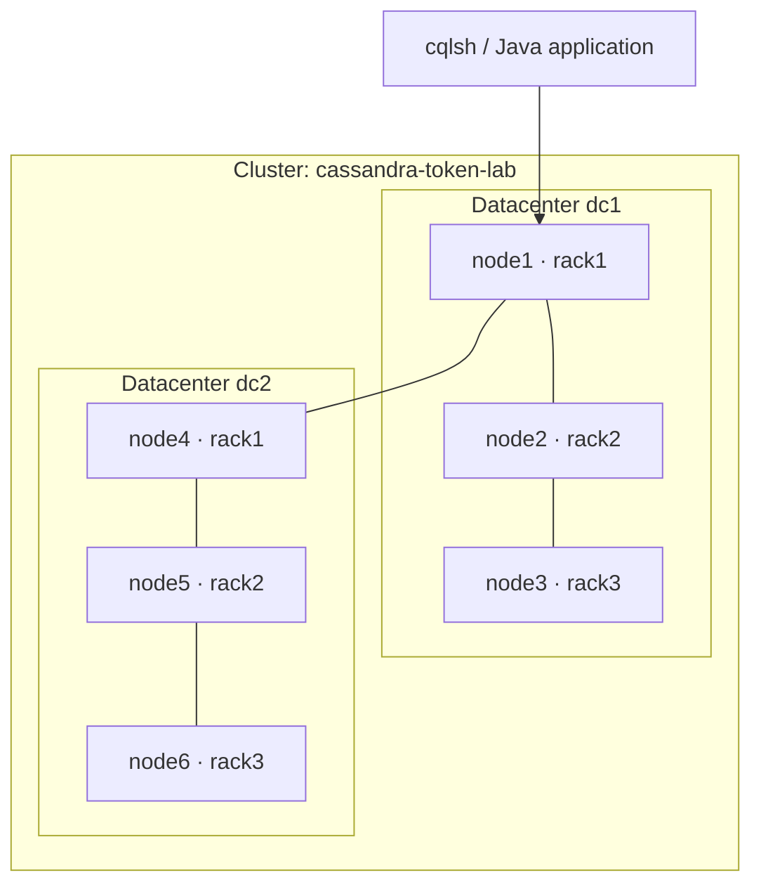
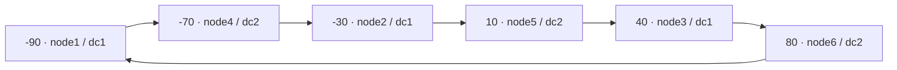
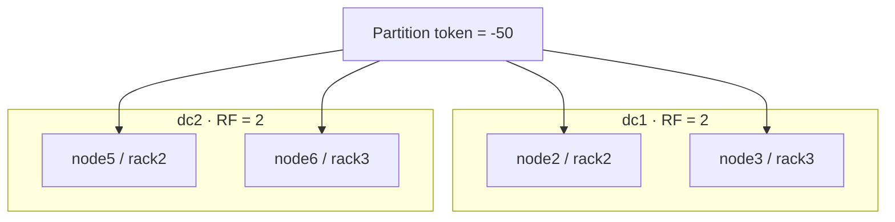

# Building a Test Cluster and Mapping Tokens, Replicas, and Datacenters

> **Chapter:** Integrated Practice  
> **Module:** `DATABASE_ENGINE_WIDE_COLUMN_CASSANDRA`  
> **Problem:** Build a multi-datacenter Apache Cassandra cluster, design a query-driven table, find the partition key's token, identify the actual replicas, and draw an evidence-based diagram from observed outputs.

## 1. Objectives and Deliverables

After completing this lab, you will be able to:

1. Build a **6-node, 2-datacenter, 3-rack-per-datacenter** Cassandra cluster using Docker Compose; distinguish between node, datacenter, rack, and seed.
2. Explain why the **partition key** is hashed into a token and how tokens are used to locate replicas in a distributed wide-column model.
3. Create a keyspace using `NetworkTopologyStrategy`, interpret the replication factor (RF), and distinguish it from the consistency level (CL).
4. Use `nodetool status`, `nodetool ring`, `nodetool getendpoints`, and CQL to **draw a token–replica–datacenter diagram based on real cluster data**.
5. Simulate a single-replica failure, explain its impact on `LOCAL_ONE` and `LOCAL_QUORUM`; and describe key considerations when a node recovers and when a Java application connects.

**Final deliverables:** a `compose.yaml` file, commands and observed outputs, a topology diagram, a token/replica path diagram for key `c001`, and an explanation of the node-failure scenario.

**Lab limitation:** All containers run on **the same Docker host**, so `dc1`, `dc2`, and the racks only simulate a logical topology. This does not provide the fault tolerance of two physical datacenters.

## 2. Background Knowledge Required for the Lab

| Concept | Meaning in this lab |
|---|---|
| Cluster | A collection of Cassandra nodes sharing the same cluster name, exchanging topology state via gossip. |
| Node | A Cassandra instance; any node can act as the **coordinator** for a received query. |
| Datacenter (DC) | A logical grouping of nodes by location/deployment zone; affects replica placement and local consistency. |
| Rack | A placement unit used to distribute replicas across failure domains within a DC. |
| Partition key | One or more leading columns in the primary key that determine where the partition is stored. |
| Token | A value generated by the partitioner from the partition key; with `Murmur3Partitioner`, a token is a 64-bit signed integer. |
| Virtual nodes (vnodes) | A single node owns multiple tokens/ranges; this lab uses `num_tokens = 8` per node. |
| RF | The number of replicas **per partition** in **each DC** when using `NetworkTopologyStrategy`. |
| CL | The number of acknowledgments required for a read/write operation to be considered successful; does not change the number of replicas. |

On the token ring, each node token represents a key range ending at that token (the range `(previous_token, current_token]`, moving clockwise around the ring). Cassandra hashes the **partition key value** using the partitioner; replicas are selected in token-ring order **and according to the topology/rack rules of the replication strategy**. Tokens are not computed from clustering key values, because clustering keys only sort rows **within a partition**.

**Key distinction:** A seed node is only an initial contact point for cluster discovery; a seed is **not** a master, does not automatically hold all data, and is not the sole coordinator.

## 3. Topology Diagram to Build



- `node1` serves as the seed so nodes can discover each other; it is also an ordinary data-storing node.
- The lab keyspace uses `RF = 2` in **dc1** and `RF = 2` in **dc2**. Since each DC has 3 nodes, **one partition has 4 replicas** (2 in each DC), while the third node in each DC does not necessarily store that partition.
- Having three racks per DC lets you observe how replicas are distributed across different racks. The rack assignments here are simulated labels.

## 4. Initializing the Cluster with Docker Compose

**Prerequisites:** Docker Engine/Docker Desktop and Docker Compose v2 must be operational; a machine with roughly **16 GB RAM or more** is recommended to run 6 Cassandra nodes concurrently with a 1 GB heap per node plus off-heap memory. Use a dedicated lab directory, e.g., `cassandra-token-lab`.

Create a `compose.yaml` file with the following content:

```yaml
name: cassandra-token-lab

x-cassandra-base: &cassandra-base
  image: cassandra:5.0
  restart: "no"
  networks:
    - lab
  environment: &common-env
    CASSANDRA_CLUSTER_NAME: cassandra-token-lab
    CASSANDRA_SEEDS: node1
    CASSANDRA_ENDPOINT_SNITCH: GossipingPropertyFileSnitch
    CASSANDRA_NUM_TOKENS: 8
    MAX_HEAP_SIZE: 1G

services:
  node1:
    <<: *cassandra-base
    hostname: node1
    environment:
      <<: *common-env
      CASSANDRA_DC: dc1
      CASSANDRA_RACK: rack1
    volumes:
      - node1_data:/var/lib/cassandra

  node2:
    <<: *cassandra-base
    hostname: node2
    environment:
      <<: *common-env
      CASSANDRA_DC: dc1
      CASSANDRA_RACK: rack2
    volumes:
      - node2_data:/var/lib/cassandra

  node3:
    <<: *cassandra-base
    hostname: node3
    environment:
      <<: *common-env
      CASSANDRA_DC: dc1
      CASSANDRA_RACK: rack3
    volumes:
      - node3_data:/var/lib/cassandra

  node4:
    <<: *cassandra-base
    hostname: node4
    environment:
      <<: *common-env
      CASSANDRA_DC: dc2
      CASSANDRA_RACK: rack1
    volumes:
      - node4_data:/var/lib/cassandra

  node5:
    <<: *cassandra-base
    hostname: node5
    environment:
      <<: *common-env
      CASSANDRA_DC: dc2
      CASSANDRA_RACK: rack2
    volumes:
      - node5_data:/var/lib/cassandra

  node6:
    <<: *cassandra-base
    hostname: node6
    environment:
      <<: *common-env
      CASSANDRA_DC: dc2
      CASSANDRA_RACK: rack3
    volumes:
      - node6_data:/var/lib/cassandra

networks:
  lab:
    name: cassandra-lab-net

volumes:
  node1_data:
  node2_data:
  node3_data:
  node4_data:
  node5_data:
  node6_data:
```

**Configuration explanation:**

- `CASSANDRA_CLUSTER_NAME` is identical across all nodes so they all belong to the same cluster.
- `CASSANDRA_SEEDS=node1` uses Compose's internal DNS so nodes can connect to the seed. The seed hostname must be resolvable from the other containers.
- `GossipingPropertyFileSnitch` reads DC/rack configuration from `CASSANDRA_DC` and `CASSANDRA_RACK` in the official Docker image.
- `CASSANDRA_NUM_TOKENS=8` keeps the number of tokens manageable to inspect in this lab; actual token values are generated at node initialization and will differ from the illustrative diagram later on.
- Separate volumes preserve each node's state across `docker compose stop/start`. Never share the same volume across multiple nodes.

Start the seed node first, then the remaining nodes:

```powershell
docker compose config
docker compose up -d node1
docker compose exec node1 nodetool status
docker compose up -d node2 node3 node4 node5 node6
docker compose exec node1 nodetool status
```

Cassandra starts up more slowly than a typical web service. If `nodetool` reports that it cannot connect yet, check the logs and re-run the status check once the node is ready:

```powershell
docker compose ps
docker compose logs --tail=80 node1
docker compose exec node1 nodetool status
```

**Success criteria:** `nodetool status` lists **2 datacenters**, each DC with **3 nodes in state `UN`** (Up/Normal), with **8 tokens/node**. IP addresses and node ordering are dynamic and must not be hardcoded from documentation.

Record the `nodetool status` output to map each IP to its DC. If you need to verify which IP belongs to which container, run these sequentially:

```powershell
docker compose exec node1 hostname -i
docker compose exec node2 hostname -i
docker compose exec node3 hostname -i
docker compose exec node4 hostname -i
docker compose exec node5 hostname -i
docker compose exec node6 hostname -i
```

## 5. Creating the Keyspace and Query-Driven Table

Scenario: an e-commerce application needs to view **recent orders for a customer**. The primary query knows `customer_id` and retrieves orders in descending chronological order. Because Cassandra tables are designed around queries, we set `customer_id` as the partition key and `order_id` of type `timeuuid` as the clustering key.

Open the CQL shell inside `node1`:

```powershell
docker compose exec node1 cqlsh
```

In `cqlsh`, run:

```sql
CREATE KEYSPACE topology_lab
WITH replication = {
  'class': 'NetworkTopologyStrategy',
  'dc1': 2,
  'dc2': 2
}
AND durable_writes = true;

CREATE TABLE topology_lab.orders_by_customer (
  customer_id text,
  order_id timeuuid,
  total_vnd bigint,
  PRIMARY KEY (customer_id, order_id)
) WITH CLUSTERING ORDER BY (order_id DESC);

DESCRIBE KEYSPACE topology_lab;

CONSISTENCY LOCAL_QUORUM;

INSERT INTO topology_lab.orders_by_customer
  (customer_id, order_id, total_vnd)
VALUES ('c001', now(), 150000);

INSERT INTO topology_lab.orders_by_customer
  (customer_id, order_id, total_vnd)
VALUES ('c001', now(), 275000);

INSERT INTO topology_lab.orders_by_customer
  (customer_id, order_id, total_vnd)
VALUES ('c002', now(), 99000);

SELECT customer_id, order_id, total_vnd
FROM topology_lab.orders_by_customer
WHERE customer_id = 'c001';
```

The final result should show **2 orders for `c001`**, ordered by `order_id DESC`. Querying by the exact partition key does not require `ALLOW FILTERING`. With this demo table, a single customer could create an unboundedly large partition as order count grows indefinitely; in real production systems, you may need to add a time bucket, such as a composite partition key `(customer_id, order_month)`, depending on query patterns and data volume.

**CL explanation:** `LOCAL_QUORUM` in `dc1` with RF=2 requires **2 acknowledgments from replicas in `dc1`**. It does not wait for quorum in `dc2` before returning success, even though Cassandra still forwards write mutations to replicas in the other DC. `LOCAL_ONE` only requires one replica in the local DC. Choosing a CL does not alter the replica placement defined by the keyspace.

## 6. Finding the Actual Token and Replicas

First, retrieve the partition token from the inserted data inside `cqlsh`:

```sql
SELECT token(customer_id) AS partition_token,
       customer_id, order_id, total_vnd
FROM topology_lab.orders_by_customer
WHERE customer_id = 'c001';
```

Both rows for `c001` share **the exact same `partition_token`**, even though `order_id` differs, because the token depends solely on `customer_id`. The row for `c002` will typically have a different token. A token is a hash output, not a sequential customer number, and cannot be predicted accurately without computing the hash.

Exit `cqlsh` with `EXIT;`, then run in the terminal:

```powershell
docker compose exec node1 nodetool status
docker compose exec node1 nodetool ring topology_lab
docker compose exec node1 nodetool getendpoints topology_lab orders_by_customer c001
docker compose exec node1 nodetool getendpoints topology_lab orders_by_customer c002
```

Purpose of each command:

| Tool | Expected output to collect |
|---|---|
| `nodetool status` | DC name, node IP, Up/Down state, token count. |
| `nodetool ring topology_lab` | Actual token ranges and their associated nodes/endpoints. Each node appears multiple times because vnodes are enabled. |
| `nodetool getendpoints ... c001` | **The actual replica endpoints** for the partition with `customer_id='c001'`. |
| `nodetool getendpoints ... c002` | A second key to compare replica placement. |

With all 6 nodes `UN` and keyspace RF=2 in each DC, the `getendpoints` output for **each key** must list **4 distinct IPs: 2 in `dc1` and 2 in `dc2`**. The exact node names and tokens depend on the cluster you initialized. Two partitions may happen to share the same set of replicas; that does not mean their tokens are identical.

**Note:** `getendpoints` describes the **planned replica placement by token/topology**; it does not guarantee that those replicas are `UN` or have the latest data. Combine its output with `nodetool status` when troubleshooting incidents.

## 7. Reading the Token Ring and Drawing the Diagram

Below is a **hypothetical example** where each node has only **one token** to illustrate the algorithm clearly; these numbers are **not** measured from your lab (the lab uses 8 vnodes/node):

| Clockwise order | Illustrative token | Node | Datacenter / rack |
|---:|---:|---|---|
| 1 | -90 | node1 | dc1 / rack1 |
| 2 | -70 | node4 | dc2 / rack1 |
| 3 | -30 | node2 | dc1 / rack2 |
| 4 | 10 | node5 | dc2 / rack2 |
| 5 | 40 | node3 | dc1 / rack3 |
| 6 | 80 | node6 | dc2 / rack3 |



Suppose a partition has token **-50**:

1. Walk the token ring to token **-30** on `node2`, which is the first point greater than or equal to -50.
2. Continue clockwise around the token ring until you find **2 distinct nodes in `dc1`** and **2 distinct nodes in `dc2`**, respecting the rack-awareness rules of `NetworkTopologyStrategy`.
3. In this simplified example: **dc1 → node2, node3**; **dc2 → node5, node6**. Those are the **4 replicas** of the hypothetical partition.
4. Because the ring wraps around, after the largest token it returns to the smallest token. With **vnodes**, each node appears at multiple positions; you cannot accurately draw the real cluster using the six illustrative tokens above.

The diagram below shows the **illustrative** placement path for partition token -50:



**Actual diagramming tasks:**

1. Copy the token of `c001` from CQL and the set of IPs from `getendpoints`.
2. Map IP → node → DC/rack using `nodetool status` and your lab configuration.
3. Use `nodetool ring topology_lab` to locate the partition's token on the actual token ring, recording several adjacent tokens around it. With 8 vnodes/node, you must read **all relevant actual tokens**, without substituting illustrative token numbers.
4. Draw a partition block with **4 arrows** pointing to the exact replica nodes; group the nodes by `dc1`/`dc2` and label their racks.
5. Repeat the process for `c002`, noting which replicas overlap and which differ.

Recording template (fill in from your own commands; do not treat `…` as real values):

| Observed data | Your value |
|---|---|
| Token of `c001` | … |
| Replicas in `dc1` (node/IP/rack) | … and … |
| Replicas in `dc2` (node/IP/rack) | … and … |
| Token of `c002` | … |
| Differences between the two replica sets | … |
| Adjacent tokens/ranges to include in the diagram | … |

**Explanation questions:** If you change `customer_id`, why might the replicas change even though the table definition has not changed? If you only change `total_vnd` or `order_id` while keeping the same `customer_id`, why does the partition token stay the same?

## 8. Simulating a Replica Failure and Observing Consistency

Only perform this step after step 6 works cleanly. To make the scenario meaningful, **pick a node in `dc1` that appears in the `getendpoints ... c001` output and is not `node1`** (since we use `node1` to run `cqlsh`). Among 2 replicas in `dc1` across 3 nodes, there is always at least one such node.

For example, **only if `node2` is actually a replica of `c001`**:

```powershell
docker compose stop node2
docker compose exec node1 nodetool status
docker compose exec node1 cqlsh
```

Wait until `nodetool status` reflects the stopped node. In `cqlsh`:

```sql
CONSISTENCY LOCAL_QUORUM;
SELECT * FROM topology_lab.orders_by_customer
WHERE customer_id = 'c001';

CONSISTENCY LOCAL_ONE;
SELECT * FROM topology_lab.orders_by_customer
WHERE customer_id = 'c001';
```

Expected behavior:

- Since RF in `dc1` is 2, `LOCAL_QUORUM` requires **both `dc1` replicas** to respond. When one replica of `c001` in `dc1` is down, the query at this CL cannot be satisfied; you will see an `Unavailable` error or a timeout depending on when the failure is detected.
- `LOCAL_ONE` requires only **1 surviving replica in `dc1`**, so the query is expected to still read the written data. At weaker consistency levels, if recent writes have not yet converged, the risk of stale reads must still be considered.
- Replicas in `dc2` **do not substitute** for a `dc1` replica in the `LOCAL_QUORUM` calculation. `EACH_QUORUM` requires quorum in **every DC** and therefore cannot rescue a DC that lacks quorum either.

Exit `cqlsh` and restart the stopped node (replace `node2` with the exact node you stopped):

```powershell
docker compose start node2
docker compose exec node1 nodetool status
```

Wait until the node returns to `UN`, then re-run the query with `LOCAL_QUORUM`. Record when the node was stopped, the CL used, the result, and the reason.

**Important caveat:** `UN` means the node is back in Up/Normal state, not a guarantee that all replicas hold identical data versions. In real operations, hints, streaming, and **repair** synchronize replicas after failures; repair schedules must be designed around tombstone retention (`gc_grace_seconds`) and synchronization capacity. `nodetool compactionstats` shows running compaction tasks, but **compaction is not a substitute for repair**. You can observe both statuses on the test cluster:

```powershell
docker compose exec node1 nodetool compactionstats
docker compose exec node1 nodetool netstats
```

## 9. Connecting from a Java Application

A Java application using the Cassandra 4.x driver can specify `node1` as a contact point and **explicitly set the local datacenter to `dc1`**. The minimal example below assumes the application runs inside the **same Docker network `cassandra-lab-net`**, where the DNS name `node1` resolves (an application running directly on a Windows/macOS host will not resolve that internal DNS name automatically):

```java
import com.datastax.oss.driver.api.core.CqlSession;
import com.datastax.oss.driver.api.core.DefaultConsistencyLevel;
import com.datastax.oss.driver.api.core.cql.BoundStatement;
import com.datastax.oss.driver.api.core.cql.PreparedStatement;
import java.net.InetSocketAddress;

try (CqlSession session = CqlSession.builder()
        .addContactPoint(new InetSocketAddress("node1", 9042))
        .withLocalDatacenter("dc1")
        .build()) {
    PreparedStatement statement = session.prepare(
        "SELECT order_id, total_vnd " +
        "FROM topology_lab.orders_by_customer WHERE customer_id = ?");
    BoundStatement query = statement.bind("c001")
        .setConsistencyLevel(DefaultConsistencyLevel.LOCAL_QUORUM);

    session.execute(query).forEach(row ->
        System.out.println(row.getUuid("order_id") + ": "
            + row.getLong("total_vnd")));
}
```

To run this Java snippet, declare the corresponding Java driver dependency in your project. In a real deployment, contact points, TLS/authentication, retry policies, and reachable node addresses must match your network environment. Set `localDatacenter` to match the name configured in Cassandra; this choice governs routing to the local coordinator and the behavior of `LOCAL_*` consistency levels.

## 10. Verification, Common Issues, and Lab Cleanup

| Scenario | Analysis / Resolution |
|---|---|
| `nodetool status` does not show all 6 nodes `UN` yet | Check `docker compose ps` and `docker compose logs --tail=80 <node>`; wait for nodes to finish bootstrapping, then re-check. |
| A node joined the wrong DC or rack | Verify `CASSANDRA_DC`, `CASSANDRA_RACK`, and the snitch **before initializing data**; existing data volumes retain cluster metadata, so changing config on an already-used container does not safely migrate DCs. |
| `LOCAL_QUORUM` fails after stopping a node | Check whether the stopped node is a replica for that partition and what the local DC's RF is; with RF=2, quorum is 2. |
| `getendpoints` returns 4 endpoints, but not all 4 nodes are `UN` | `getendpoints` lists planned replicas; check actual live status via `nodetool status`. |
| Tokens or replicas differ from the illustrative diagram | Normal: actual tokens are assigned by Cassandra at node initialization; the illustrative diagram uses 1 token/node, whereas the lab uses 8 vnodes/node. |
| Data or tokens persist when re-running Compose | Named volumes persist state. Use `docker compose down` to stop and remove containers/networks **while keeping volumes**. |

Finish the lab:

```powershell
docker compose down
```

Only when you **want to wipe all lab data and start fresh**, run from the lab's Compose directory:

```powershell
docker compose down -v
```

**Submission checklist:**

- [ ] 6 nodes are `UN` across 2 DCs (3 nodes/DC), with each node's rack clearly documented.
- [ ] Keyspace `topology_lab` uses `NetworkTopologyStrategy` with `dc1:2` and `dc2:2`.
- [ ] Query retrieving 2 orders for `c001` executes without `ALLOW FILTERING`.
- [ ] Tokens for `c001` and `c002`, the 4 replica addresses per key, and IP → node/DC/rack mappings are recorded.
- [ ] Ring diagram uses tokens **measured from the real cluster**; replica diagram shows 2 nodes in each DC.
- [ ] Includes explanation of the single-replica failure outcome in `dc1` under `LOCAL_QUORUM` and `LOCAL_ONE`.
- [ ] Distinguishes token/replication/consistency, repair/compaction, and seed/coordinator roles.

**Advanced question:** If the requirement is to still support `LOCAL_QUORUM` reads/writes when 1 node fails in a DC, how should you adjust the **node count / RF per DC**? With 3 nodes/DC and RF=3, quorum=2 tolerates losing 1 replica, but every partition is stored on all 3 nodes in that DC, increasing storage and write cost. Analyze this trade-off before deciding which configuration fits production.
