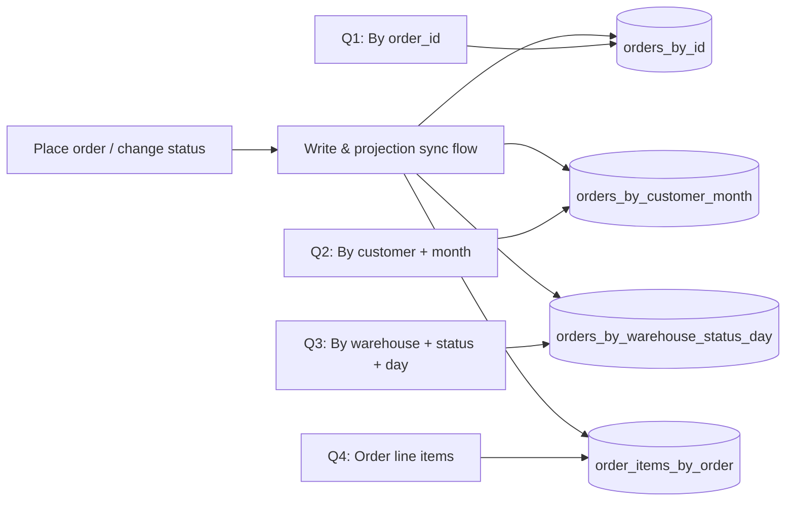

# Integrated Practice: Modeling the Same Domain with Tables Tailored to Different Queries

## 1. Objectives and Context

Apache Cassandra is a **distributed wide-column** database. When designing data models, the first question is not "what entities exist in the domain?" but **"what queries must the application run to read the data?"**. A single order may appear in multiple tables with different partition keys and sort orders. This is a deliberate trade-off of storage space and synchronization effort so that every critical query reads directly from the right partition without `JOIN`s or full-table scans.

In this lab, you act as an engineer building an order management service for a multi-warehouse e-commerce system. After this practice, you will be able to:

1. Translate screen/API requirements into a list of queries and choose an appropriate `partition key` and `clustering key` for each query.
2. Use CQL to create multiple tables representing **the same order**, load data, and verify that the queries behave as expected.
3. Design a multi-table write flow, handle status transitions, and identify risks of temporary data divergence.
4. Explain the impact of replication, read/write consistency levels, large partitions, tombstones, compaction, and repair on the chosen model.
5. Understand how a Java application uses prepared statements and a failure-recoverable update workflow.

### Domain Requirements to Support

An order has the following attributes: `order_id`, `customer_id`, `warehouse_id`, `placed_at`, `status`, `total_minor`, `currency`, and a list of line items. The system must serve these APIs:

| ID | API and query to run | Ordering / conditions |
| --- | --- | --- |
| Q1 | `GET /orders/{orderId}`: fetch order details by ID | One specific order |
| Q2 | `GET /customers/{id}/orders?month=2026-11`: view a customer's order history for a month | Newest first, paginated |
| Q3 | `GET /warehouses/{id}/orders?status=PLACED&day=2026-11-20`: fetch warehouse processing queue | Oldest first, bounded record count |
| Q4 | `GET /orders/{orderId}/items`: view an order's line items | Ascending by `line_no` |

Lab assumptions: `order_id` is immutable; order placement timestamp does not change after creation; status can transition `PLACED → PACKING → SHIPPED`; monetary amounts are stored in the currency's minor unit (e.g., VND in dong, never floating-point). Months and days are computed consistently in **UTC** throughout this lab; when an application uses a business timezone, a single conversion rule must be established before constructing partition keys.

## 2. From Queries to Table Models

### 2.1. Query Map

| Query | Serving table | Partition key | Clustering key | Rationale |
| --- | --- | --- | --- | --- |
| Q1 | `orders_by_id` | `order_id` | None | Direct lookup of a single order |
| Q2 | `orders_by_customer_month` | `(customer_id, order_month)` | `placed_at DESC, order_id DESC` | Groups a customer's orders within a month; returns newest first |
| Q3 | `orders_by_warehouse_status_day` | `(warehouse_id, status, order_day)` | `placed_at ASC, order_id ASC` | Reads a warehouse's queue for one status on one day |
| Q4 | `order_items_by_order` | `order_id` | `line_no ASC` | Fetches all line items of an order in order |

Notes:

- In `PRIMARY KEY ((a, b), c)`, **(a, b) is a composite partition key**, and `c` is a clustering key. Omitting any component of the partition key generally prevents the query from executing as designed.
- Adding `order_id` to the clustering key of Q2/Q3 ensures two orders with the same `placed_at` remain distinct rows; using only the timestamp would cause one record to overwrite the other.
- `order_month` and `order_day` are **bucket** values computed at write time. They bound partition size and are mandatory components in the query, not attributes Cassandra infers from `placed_at`.
- No single table serves all four APIs optimally. Trying to collapse everything into one table and relying on `ALLOW FILTERING` creates expensive queries with unpredictable latency as data grows.



This is **intentional denormalization**: the same order is duplicated across three lookup tables. `order_items_by_order` stores line items and is likewise designed for one specific query. Cassandra does not automatically maintain cross-table business consistency; the application is responsible for it.

## 3. Environment Setup

You need a running Cassandra instance and `cqlsh` connected to the cluster. Check the datacenter name using `nodetool status` on a node (or inspect your cluster config). The example below assumes a datacenter named `datacenter1` and a **single-node lab environment**:

```sql
CREATE KEYSPACE IF NOT EXISTS shop_practice
WITH replication = {
  'class': 'NetworkTopologyStrategy',
  'datacenter1': 1
}
AND durable_writes = true;

USE shop_practice;
```

If using a three-replica cluster in a single datacenter, set that datacenter's replication factor to `3` and ensure enough nodes are running. In a multi-datacenter environment, specify the RF separately for each datacenter. `RF = 1` above keeps the lab simple, **cannot tolerate losing the replica node**, and does not represent a production configuration. If your datacenter name differs, replace `datacenter1` in the CQL with the actual name.

## 4. Creating the Four Tables in CQL

### 4.1. Lookup by Order ID

```sql
CREATE TABLE IF NOT EXISTS orders_by_id (
    order_id uuid PRIMARY KEY,
    customer_id uuid,
    warehouse_id text,
    placed_at timestamp,
    order_month text,
    status text,
    total_minor bigint,
    currency text
);
```

Each `order_id` is a partition key. The fields `customer_id`, `placed_at`, and `order_month` are stored here to serve order details and facilitate reconciliation/updates across the remaining tables.

### 4.2. Customer Order History by Month

```sql
CREATE TABLE IF NOT EXISTS orders_by_customer_month (
    customer_id uuid,
    order_month text,
    placed_at timestamp,
    order_id uuid,
    status text,
    total_minor bigint,
    currency text,
    PRIMARY KEY ((customer_id, order_month), placed_at, order_id)
) WITH CLUSTERING ORDER BY (placed_at DESC, order_id DESC);
```

The history screen query always provides `customer_id` and `month`. Cassandra places orders sharing that key pair into one partition and sorts them by the clustering key. Reading across consecutive months requires running multiple per-bucket queries and merging results in the application.

### 4.3. Order Queue by Warehouse, Status, and Day

```sql
CREATE TABLE IF NOT EXISTS orders_by_warehouse_status_day (
    warehouse_id text,
    status text,
    order_day date,
    placed_at timestamp,
    order_id uuid,
    customer_id uuid,
    total_minor bigint,
    PRIMARY KEY ((warehouse_id, status, order_day), placed_at, order_id)
) WITH CLUSTERING ORDER BY (placed_at ASC, order_id ASC);
```

This is an **application-managed business index table**, allowing warehouse staff to fetch the oldest pending orders. Because `status` is part of the partition key, changing status **cannot be done with a simple `UPDATE status` on this table**. You must insert a row into the new status's partition and delete the old row.

Daily bucketing constrains partition size, though a partition can still grow too large if a warehouse receives too many orders per day. As traffic increases, measure partition size and row counts to decide whether to bucket by hour or add shards. If sharding is added, the application must also query and merge across multiple shards.

### 4.4. Order Line Items

```sql
CREATE TABLE IF NOT EXISTS order_items_by_order (
    order_id uuid,
    line_no int,
    product_id text,
    quantity int,
    unit_price_minor bigint,
    PRIMARY KEY (order_id, line_no)
) WITH CLUSTERING ORDER BY (line_no ASC);
```

An order has multiple line items in the same partition. `line_no` must be unique within an order. The primary key does not enforce positive quantities, non-negative prices, or total-amount accuracy; those rules are validated by the business logic layer.

## 5. Writing an Order Across Query-Serving Tables

In `cqlsh`, execute the following statements in order. Fixed values make it easy to verify results:

| Attribute | Value |
| --- | --- |
| `order_id` | `aaaaaaaa-aaaa-4aaa-8aaa-aaaaaaaaaaaa` |
| `customer_id` | `11111111-1111-4111-8111-111111111111` |
| `warehouse_id` | `WH_HCM_01` |
| `placed_at` | `2026-11-20T09:30:00Z` |
| `order_month` / `order_day` | `2026-11` / `2026-11-20` |
| `status` | `PLACED` |
| `total_minor` / `currency` | `249000` / `VND` |

```sql
-- 1. Detail lookup row
INSERT INTO orders_by_id (
    order_id, customer_id, warehouse_id, placed_at,
    order_month, status, total_minor, currency
) VALUES (
    aaaaaaaa-aaaa-4aaa-8aaa-aaaaaaaaaaaa,
    11111111-1111-4111-8111-111111111111,
    'WH_HCM_01', '2026-11-20T09:30:00Z',
    '2026-11', 'PLACED', 249000, 'VND'
);

-- 2. Customer history row
INSERT INTO orders_by_customer_month (
    customer_id, order_month, placed_at, order_id,
    status, total_minor, currency
) VALUES (
    11111111-1111-4111-8111-111111111111,
    '2026-11', '2026-11-20T09:30:00Z',
    aaaaaaaa-aaaa-4aaa-8aaa-aaaaaaaaaaaa,
    'PLACED', 249000, 'VND'
);

-- 3. Warehouse queue row
INSERT INTO orders_by_warehouse_status_day (
    warehouse_id, status, order_day, placed_at,
    order_id, customer_id, total_minor
) VALUES (
    'WH_HCM_01', 'PLACED', '2026-11-20',
    '2026-11-20T09:30:00Z',
    aaaaaaaa-aaaa-4aaa-8aaa-aaaaaaaaaaaa,
    11111111-1111-4111-8111-111111111111,
    249000
);

-- 4. Two line items: 2 x 99000 + 1 x 51000 = 249000
INSERT INTO order_items_by_order (
    order_id, line_no, product_id, quantity, unit_price_minor
) VALUES (
    aaaaaaaa-aaaa-4aaa-8aaa-aaaaaaaaaaaa, 1, 'BOOK-CAS-01', 2, 99000
);

INSERT INTO order_items_by_order (
    order_id, line_no, product_id, quantity, unit_price_minor
) VALUES (
    aaaaaaaa-aaaa-4aaa-8aaa-aaaaaaaaaaaa, 2, 'BOOK-JAVA-02', 1, 51000
);
```

**Understanding multi-table writes correctly:** the five `INSERT` statements above do not form an atomic transaction across partitions. If a network or process failure occurs midway, only a subset of tables may be updated. `LOGGED BATCH` writes a batch log so mutations in the batch are eventually applied, but it does not provide RDBMS-style transactional isolation and incurs overhead—especially for batches spanning multiple partitions; never use it to mask the need for business-level failure handling. Production systems require a structured write workflow, controlled retries, durable event/record logs, and reconciliation jobs to repair missing projections.

## 6. Running the Actual Queries

### Q1 — Lookup a Single Order

```sql
SELECT order_id, customer_id, warehouse_id, placed_at,
       status, total_minor, currency
FROM orders_by_id
WHERE order_id = aaaaaaaa-aaaa-4aaa-8aaa-aaaaaaaaaaaa;
```

**Expected:** one row with `status = 'PLACED'` and `total_minor = 249000`.

### Q2 — Read a Customer's Orders for a Month, Newest First

```sql
SELECT placed_at, order_id, status, total_minor
FROM orders_by_customer_month
WHERE customer_id = 11111111-1111-4111-8111-111111111111
  AND order_month = '2026-11'
ORDER BY placed_at DESC, order_id DESC
LIMIT 20;
```

**Expected:** the newly created order appears. Add two more orders for the same customer and month with different timestamps to verify descending order. For real pagination, use the Cassandra driver's `pagingState`/page size; `LIMIT` only caps returned rows and does not replace stable pagination. Never use relational SQL `OFFSET` pagination.

### Q3 — Warehouse Queue for a Day, Oldest First

```sql
SELECT placed_at, order_id, customer_id, total_minor
FROM orders_by_warehouse_status_day
WHERE warehouse_id = 'WH_HCM_01'
  AND status = 'PLACED'
  AND order_day = '2026-11-20'
ORDER BY placed_at ASC, order_id ASC
LIMIT 20;
```

**Expected:** the order appears in the `PLACED` queue. An API viewing orders across multiple days must query each bucket, bound the number of buckets, and merge results according to application rules.

### Q4 — Fetch Order Line Items

```sql
SELECT line_no, product_id, quantity, unit_price_minor
FROM order_items_by_order
WHERE order_id = aaaaaaaa-aaaa-4aaa-8aaa-aaaaaaaaaaaa
ORDER BY line_no ASC;
```

**Expected:** two line items in order `1` then `2`. The sum check `2 × 99000 + 1 × 51000 = 249000` is performed and verified by the application; Cassandra does not join the line-items table with the orders table to compute totals.

Try omitting `order_month` in Q2 or `status` in Q3: the query can no longer locate the partition key as designed. **Do not "fix" it by adding `ALLOW FILTERING` just to make the statement run.** If the API genuinely needs filtering by a new condition, re-evaluate requirements and data volume and consider creating a dedicated table for that query.

## 7. Practicing Status Transitions: One Order, Multiple Representations

Suppose the warehouse starts packing the order, transitioning from `PLACED` to `PACKING`. All three projections storing status must reflect the change. Run in the lab:

```sql
-- 1. Update order details
UPDATE orders_by_id
SET status = 'PACKING'
WHERE order_id = aaaaaaaa-aaaa-4aaa-8aaa-aaaaaaaaaaaa;

-- 2. Update customer history view
UPDATE orders_by_customer_month
SET status = 'PACKING'
WHERE customer_id = 11111111-1111-4111-8111-111111111111
  AND order_month = '2026-11'
  AND placed_at = '2026-11-20T09:30:00Z'
  AND order_id = aaaaaaaa-aaaa-4aaa-8aaa-aaaaaaaaaaaa;

-- 3. Insert row into the new status queue
INSERT INTO orders_by_warehouse_status_day (
    warehouse_id, status, order_day, placed_at,
    order_id, customer_id, total_minor
) VALUES (
    'WH_HCM_01', 'PACKING', '2026-11-20',
    '2026-11-20T09:30:00Z',
    aaaaaaaa-aaaa-4aaa-8aaa-aaaaaaaaaaaa,
    11111111-1111-4111-8111-111111111111,
    249000
);

-- 4. Delete row from the old status queue
DELETE FROM orders_by_warehouse_status_day
WHERE warehouse_id = 'WH_HCM_01'
  AND status = 'PLACED'
  AND order_day = '2026-11-20'
  AND placed_at = '2026-11-20T09:30:00Z'
  AND order_id = aaaaaaaa-aaaa-4aaa-8aaa-aaaaaaaaaaaa;
```

Re-run Q1, Q2, and both variants of Q3 (`status = 'PLACED'` and `status = 'PACKING'`). Once all mutations succeed and are read at an appropriate consistency level, the status in the detail and history tables is `PACKING`; the `PLACED` queue no longer contains the order, and the `PACKING` queue has exactly one row.

In practice, **the sequence above is a simplified illustration, insufficient on its own to guarantee atomic business updates**. Between statements, there is a window of inconsistent state; retries and out-of-order events can resurrect old-status rows. A more robust implementation approach:

1. Define a source of truth (e.g., `orders_by_id` or an order event log), while validating state transitions against business rules.
2. Attach an `event_id` and monotonically increasing status version number to each transition. Persist events durably; process events sequentially per `order_id`.
3. Update query-serving tables using exact primary keys; make retries idempotent and check version numbers so stale events cannot overwrite newer states.
4. Run a reconciliation/projection-recovery job when partial failures occur, while monitoring update lag and divergence counts.

There are no foreign-key constraints or multi-table transactions for Cassandra to enforce these steps automatically. If the domain demands strict linearizable concurrency decisions across every query, re-evaluate consistency requirements and architecture before choosing denormalized tables.

## 8. Replication, Consistency, and Node Failures

**Replication** protects multiple copies *of the same table/partition*, whereas the `orders_by_*` tables are **different data representations** for separate queries. These two concepts are independent:

- With `RF = 3` in a datacenter, `LOCAL_ONE` reads/writes at one replica; `LOCAL_QUORUM` requires at least two replicas to respond in that datacenter.
- Choosing `LOCAL_QUORUM` for both reads and writes on **the same keyspace/partition** ensures the replica sets overlap (`R + W > RF`), but it does not turn three-table writes into a single transaction and does not prevent "last write wins" conflicts.
- In an `RF = 1` lab, `LOCAL_QUORUM` only has one replica to contact. To observe replica failure behavior, set up a cluster with sufficient nodes and an appropriate RF before testing.
- If a write succeeds on `orders_by_id` but fails on `orders_by_customer_month`, raising the consistency level will not create the missing row. Application-level retry/reconciliation is required.

You can test in `cqlsh`:

```text
CONSISTENCY LOCAL_ONE
CONSISTENCY LOCAL_QUORUM
```

After each setting, re-run Q1/Q2 and observe results/latency in your test environment. In a three-replica cluster, distinguish replica-unavailability errors from projection-write pipeline failures. Use `nodetool status` to monitor nodes, `nodetool tablestats shop_practice.orders_by_customer_month` to inspect table metrics, and `nodetool compactionstats` to view compaction activity (depending on Cassandra version). Test stopping nodes or altering RF **only in a lab cluster**, following that environment's procedures.

**Repair does not fix every kind of mismatch.** `nodetool repair` synchronizes Cassandra replicas across token ranges; it **does not** read `orders_by_id` and automatically backfill a missing row in `orders_by_customer_month`. Fixing missing projections is the job of business-level reconciliation.

### Operational Consequences of This Design

| Issue | Where it appears | How to monitor / mitigate |
| --- | --- | --- |
| Oversized partitions or hotspots | Customers with too many orders/month; warehouses with too many orders in one status/day | Measure partition size/row count, latency, and load per partition; introduce finer buckets or deliberate sharding |
| Tombstones from deleting old queue entries | `orders_by_warehouse_status_day` on every status transition | Limit transitions, monitor tombstones/read latency; choose a suitable compaction strategy |
| Write amplification | One order placement writes to multiple tables | Account for extra write, storage, replication, retry, and backfill costs |
| Lagging or missing projections | When the application fails after partial writes | Durable events, idempotent reprocessing, periodic reconciliation, lag metrics |
| Asynchronous TTL expiration | Tables configured with different TTLs | Establish a unified retention policy; verify TTL/tombstone impact before applying |

Compaction choices must match data behavior and workload. Queues that update/delete by status generate tombstones, so do not blindly apply `TimeWindowCompactionStrategy` just because a timestamp column exists; TWCS suits nearly immutable data written and expired in aligned time windows with uniform TTLs. When evaluating `LeveledCompactionStrategy` versus `SizeTieredCompactionStrategy`, measure actual read/write amplification, disk headroom, and compaction pressure.

## 9. Connecting from a Java Application

With a compatible Cassandra Java Driver 4.x, the application uses prepared statements and binds the designed keys. The snippet below illustrates writing the Q1 lookup record (assuming driver dependencies, host/DC config, and keyspace already exist):

```java
import com.datastax.oss.driver.api.core.CqlSession;
import com.datastax.oss.driver.api.core.DefaultConsistencyLevel;
import com.datastax.oss.driver.api.core.cql.PreparedStatement;
import java.net.InetSocketAddress;
import java.time.Instant;
import java.util.UUID;

class OrderWriteExample {
    public static void main(String[] args) {
        UUID orderId = UUID.fromString("aaaaaaaa-aaaa-4aaa-8aaa-aaaaaaaaaaaa");
        UUID customerId = UUID.fromString("11111111-1111-4111-8111-111111111111");

        try (CqlSession session = CqlSession.builder()
                .addContactPoint(new InetSocketAddress("127.0.0.1", 9042))
                .withLocalDatacenter("datacenter1")
                .withKeyspace("shop_practice")
                .build()) {
            PreparedStatement insert = session.prepare(
                "INSERT INTO orders_by_id (" +
                "order_id, customer_id, warehouse_id, placed_at, " +
                "order_month, status, total_minor, currency) " +
                "VALUES (?, ?, ?, ?, ?, ?, ?, ?)");

            session.execute(insert.bind(
                    orderId, customerId, "WH_HCM_01",
                    Instant.parse("2026-11-20T09:30:00Z"),
                    "2026-11", "PLACED", 249_000L, "VND")
                .setConsistencyLevel(DefaultConsistencyLevel.LOCAL_QUORUM));
        }
    }
}
```

**Production integration:** implement corresponding prepared statements for Q2, Q3, and Q4; pass `order_month`/`order_day` computed using the exact same rule; use driver paging state for lists; and wrap mutations in a business workflow with retries and reconciliation. Never treat a successful `execute` call on Q1 as proof that all other projections are complete. In production, contact points, authentication, TLS, timeouts, and replication settings must come from deployment configuration rather than hardcoded lab values.

## 10. Extension Exercises and Completion Criteria

Complete the following tasks, recording your CQL statements and observed outputs:

1. **Ordering verification:** create two more orders for the same customer/month at `09:00Z` and `11:00Z`; prove Q2 returns `11:00 → 09:30 → 09:00`, while Q3 for orders sharing warehouse/status/day returns oldest first.
2. **New query requirement:** product requests "view all orders of a customer across all months." Explain why current Q2 cannot satisfy this with a single-partition query; propose time bounds, multi-bucket queries, or another projection given an appropriate SLA.
3. **Status transition:** run section 7, capture/save Q1, Q2, and Q3 results before and after; prove no record remains in `PLACED` after the transition completes.
4. **Partial failure:** on test data, intentionally skip writing `orders_by_customer_month` for a new order. Observe Q1 returning the order while Q2 misses it; write a backfill operation from source data and verify Q2 shows the order. Contrast this failure with replica repair.
5. **Partition size estimation:** suppose a warehouse has 120,000 orders in `PLACED` on one day, and each stored row averages 250 bytes (illustrative estimate). Calculate the raw partition data size before overhead/replication; propose bucket or shard adjustments and explain how the API will merge reads.
6. **Consistency levels:** with RF 3 in a single datacenter, state the required acknowledgments for `LOCAL_ONE` and `LOCAL_QUORUM`; analyze the impact when one replica is unavailable and why multi-table writes can still diverge.

A complete submission must meet these criteria:

| Criterion | Verification evidence |
| --- | --- |
| Query-driven design | Explains partition/clustering keys for all four tables; does not use `ALLOW FILTERING` as a design workaround |
| Working CQL | Creates schema, writes data, Q1–Q4 return expected results |
| Consistent domain data | Same `order_id` and accurate attributes across related projections |
| Status transitions | Updates Q1/Q2, moves Q3 row to `PACKING` partition, explains temporary divergence risk |
| Failure handling | Includes retry/reconciliation for a missing projection; does not confuse replica repair with business backfill |
| Distributed operations | Explains RF, consistency levels, buckets/hot partitions, tombstones, and compaction |

### Self-Check Questions

- Why is `PRIMARY KEY ((customer_id, order_month), placed_at, order_id)` more useful than `PRIMARY KEY (order_id)` for listing a customer's monthly orders?
- When `status` changes, why must the queue table delete the old row and insert a new row?
- If you change Q2's bucket from month to day, how does the number of partitions read change when viewing 90 days of history?
- Why does choosing `LOCAL_QUORUM` not make three-table updates reflect a new status atomically?
- In high daily order-volume scenarios, how does bucket selection affect hotspots, partition size, and read cost?

Core takeaway of this lab: **in Cassandra, one business domain may require multiple tables tailored to distinct query patterns**. Design quality depends simultaneously on direct partition lookup during reads, bounded partition sizes, reliable projection synchronization, and operational cost in a distributed cluster.
