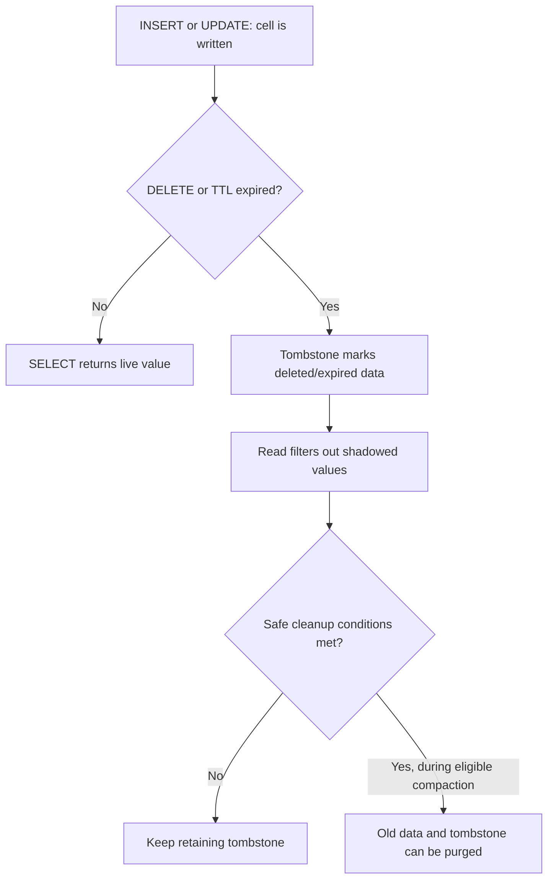

# Integrated Practice: CRUD, TTL, and Observing Deleted/Expired Data in Cassandra

## 1. Problem and Desired Outcomes

Suppose a Java system sends notifications to users. The application needs to look up notifications by `user_id`, mark notifications as read, delete a notification's body or entire entries, and automatically expire temporary notifications. This is an ideal scenario to practice the **wide-column** model, query-driven table design, and distributed write mechanics of **Apache Cassandra**.

After completing this lab, you will be able to:

1. Create a keyspace and table following a query pattern with explicit **partition key** and **clustering key**.
2. Use CQL to execute `INSERT`, `SELECT`, `UPDATE`, and `DELETE` at the column, row, and partition levels.
3. Assign a **TTL** to data, inspect remaining lifetime with `TTL(column)`, and verify that TTL applies at the cell level.
4. Distinguish **logical deletion** from **physical space reclamation**; explain the roles of tombstones, `gc_grace_seconds`, compaction, and repair.
5. Inspect behavior using `cqlsh`, tracing, and `nodetool` statistics without confusing query results with data already purged from SSTables.

**Lab scope:** a single Cassandra node for learning purposes; replication factor `1`, consistency level `ONE`. The end of the lab explains what changes on a multi-node cluster. All CQL commands below are executed sequentially within the same `cqlsh` session.

## 2. Environment Setup

You need a running Cassandra instance and `cqlsh`. If you already have a lab environment, connect with `cqlsh` and skip directly to section 3. If using Docker, you can spin up a dedicated container:

```bash
docker run -d --name cassandra-crud-ttl -p 9042:9042 cassandra:5.0
```

Once Cassandra finishes starting, verify the node reaches `UN` (Up/Normal) status, then open the CQL shell:

```bash
docker exec cassandra-crud-ttl nodetool status
docker exec -it cassandra-crud-ttl cqlsh
```

If `cqlsh` fails to connect right after `docker run`, check container logs with `docker logs cassandra-crud-ttl` and reconnect once the service is ready. The `cqlsh>` prompt indicates you are ready to run the CQL statements in the following sections.

> Use the `practice_crud_ttl` keyspace strictly for this lab. `SimpleStrategy` and replication factor `1` are used here for a single test node; multi-datacenter production clusters typically require `NetworkTopologyStrategy`, appropriate replication, and dedicated consistency/repair policies.

## 3. Query-Driven Table Design

The primary queries are: **fetch a user's notifications**, or **fetch a single notification given `user_id` and `message_id`**. Therefore, choose `user_id` as the partition key and `message_id` as the clustering key. No `ALLOW FILTERING` or full-table scans are needed.

```sql
CREATE KEYSPACE IF NOT EXISTS practice_crud_ttl
WITH replication = {
  'class': 'SimpleStrategy',
  'replication_factor': 1
};

USE practice_crud_ttl;

CREATE TABLE IF NOT EXISTS inbox_by_user (
    user_id text,
    message_id text,
    title text,
    body text,
    status text,
    PRIMARY KEY ((user_id), message_id)
)
WITH CLUSTERING ORDER BY (message_id DESC)
 AND gc_grace_seconds = 864000;

DESCRIBE TABLE inbox_by_user;
```

| Component | Meaning in this model |
|---|---|
| `user_id` | Partition key: identifies the partition holding the user's notifications; required in every lab query. |
| `message_id` | Clustering key: identifies rows within the partition; descending lexicographical order, not chronological order. |
| `title`, `body`, `status` | Regular columns: can be overwritten, deleted individually, or assigned separate TTLs. |
| `gc_grace_seconds = 864000` | 10-day grace period used when evaluating tombstone cleanup/replica synchronization; **not a TTL** and does not guarantee tombstones vanish after exactly 10 days. |

**Query note:** the partition key is mandatory for efficient access in this lab. In real systems, if you need the "10 newest notifications," use a time-based clustering key (`timeuuid` or timestamp paired with a unique key) and design queries before finalizing the schema; do not infer chronological order from the `text` `message_id` in this lab.

## 4. Practicing CRUD

### 4.1. Create — Inserting Data

```sql
INSERT INTO inbox_by_user (user_id, message_id, title, body, status)
VALUES ('user-a', 'msg-001', 'Welcome', 'Long-lived content', 'new');

INSERT INTO inbox_by_user (user_id, message_id, title, body, status)
VALUES ('user-a', 'msg-002', 'Order', 'Order has been received', 'new');

SELECT message_id, title, body, status
FROM inbox_by_user
WHERE user_id = 'user-a';
```

**Expected:** two rows `msg-002` and `msg-001` (ordered by `message_id DESC`). Cassandra uses **upsert** semantics: an `INSERT` with an existing primary key writes new values for the provided columns; there is no "duplicate primary key" error like in relational SQL. Each cell stores a write timestamp for resolving values across replicas.

### 4.2. Read — Reading a Partition or a Row

```sql
SELECT * FROM inbox_by_user WHERE user_id = 'user-a';

SELECT title, body, status
FROM inbox_by_user
WHERE user_id = 'user-a' AND message_id = 'msg-001';
```

Avoid `SELECT *` when the application only needs a few fields; selecting specific columns and filtering by partition key keeps response sizes controlled. Do not run `SELECT * FROM inbox_by_user` to simulate user queries in production, as it can scan across many partitions.

### 4.3. Update — Updating a Single Column

```sql
UPDATE inbox_by_user
SET status = 'read'
WHERE user_id = 'user-a' AND message_id = 'msg-001';

SELECT message_id, status, WRITETIME(status), TTL(status)
FROM inbox_by_user
WHERE user_id = 'user-a' AND message_id = 'msg-001';
```

**Expected:** `status = 'read'`; `WRITETIME(status)` is the write timestamp in **microseconds since epoch**, and `TTL(status)` is `null` because no TTL was set on this record. `UPDATE` also has upsert semantics: if the primary key does not yet exist, Cassandra creates the corresponding row/cell. Columns omitted from `SET` are left untouched.

### 4.4. Delete — Deleting a Column, a Row, and a Partition

First, delete only `body` for `msg-002`:

```sql
DELETE body FROM inbox_by_user
WHERE user_id = 'user-a' AND message_id = 'msg-002';

SELECT message_id, title, body, status
FROM inbox_by_user
WHERE user_id = 'user-a' AND message_id = 'msg-002';
```

**Expected:** row `msg-002` still exists, `title` and `status` remain intact, and `body` returns `null`. Next, delete the entire row:

```sql
DELETE FROM inbox_by_user
WHERE user_id = 'user-a' AND message_id = 'msg-002';

SELECT * FROM inbox_by_user
WHERE user_id = 'user-a' AND message_id = 'msg-002';
```

**Expected:** `0 rows`. To observe partition-level deletion, insert two rows under `user-delete` and delete by partition key:

```sql
INSERT INTO inbox_by_user (user_id, message_id, title, status)
VALUES ('user-delete', 'msg-101', 'Notification A', 'new');

INSERT INTO inbox_by_user (user_id, message_id, title, status)
VALUES ('user-delete', 'msg-102', 'Notification B', 'new');

SELECT * FROM inbox_by_user WHERE user_id = 'user-delete';

DELETE FROM inbox_by_user WHERE user_id = 'user-delete';

SELECT * FROM inbox_by_user WHERE user_id = 'user-delete';
```

The final result is `0 rows` for `user-delete`. `DELETE` does not immediately erase old bytes from every SSTable file. It writes a timestamped **tombstone** so older data on other replicas or SSTables is no longer treated as live.

## 5. Practicing Cell-Level and Row-Level TTL

**TTL (Time To Live)** is the number of seconds data is allowed to live after a write. In Cassandra, TTL applies to the cells written by an `INSERT`/`UPDATE` statement (and the corresponding row marker); **TTL is not set on the partition key or clustering key itself**. `TTL(column)` returns the *remaining* lifetime, so the observed seconds may be lower than the configured value.

### 5.1. Expiring Only the `body` Column

Keep `msg-001` with `status = 'read'` from section 4, but replace `body` with temporary content having a 45-second TTL:

```sql
UPDATE inbox_by_user USING TTL 45
SET body = 'Content expires automatically after 45 seconds'
WHERE user_id = 'user-a' AND message_id = 'msg-001';

SELECT message_id, body, TTL(body), status, TTL(status)
FROM inbox_by_user
WHERE user_id = 'user-a' AND message_id = 'msg-001';
```

**Expected immediately after write:** `body` holds the new text and `TTL(body)` is in `1..45`; `status = 'read'`, `TTL(status) = null`. Now **wait at least 50 seconds outside `cqlsh`**, then run:

```sql
SELECT message_id, body, TTL(body), status, TTL(status)
FROM inbox_by_user
WHERE user_id = 'user-a' AND message_id = 'msg-001';
```

**Expected after TTL:** the row still appears because `status` and `title` are still live; `body` and `TTL(body)` become `null`. The previous `body` value before setting TTL **does not reappear**: the expiration marker shadows older data. If 45 seconds elapsed before you could observe the counting-down TTL, re-run the `UPDATE` to start a new cycle.

### 5.2. Assigning TTL to All Inserted Columns

```sql
INSERT INTO inbox_by_user (user_id, message_id, title, body, status)
VALUES ('user-a', 'msg-003', 'Temporary OTP code', 'Expires soon', 'new')
USING TTL 45;

SELECT message_id, title, TTL(title), body, TTL(body), status, TTL(status)
FROM inbox_by_user
WHERE user_id = 'user-a' AND message_id = 'msg-003';
```

**Expected immediately after write:** `title`, `body`, and `status` all have counting-down TTLs. After more than 45 seconds, verify:

```sql
SELECT * FROM inbox_by_user
WHERE user_id = 'user-a' AND message_id = 'msg-003';
```

**Expected:** `0 rows`, because no live cells or row marker remain to surface a notification row. Do not assume the record has already been freed from disk: expired data still relies on internal cleanup processes.

### 5.3. Overwriting Can Change TTL

A new write creates a new cell with the TTL of **that write**; overwriting does not automatically inherit the previous TTL. Test on `msg-001`:

```sql
UPDATE inbox_by_user USING TTL 60
SET title = 'Temporary title'
WHERE user_id = 'user-a' AND message_id = 'msg-001';

SELECT title, TTL(title)
FROM inbox_by_user
WHERE user_id = 'user-a' AND message_id = 'msg-001';

UPDATE inbox_by_user
SET title = 'Permanent title'
WHERE user_id = 'user-a' AND message_id = 'msg-001';

SELECT title, TTL(title)
FROM inbox_by_user
WHERE user_id = 'user-a' AND message_id = 'msg-001';
```

**Expected:** `TTL(title)` starts around 60 seconds; after the `UPDATE` without TTL, it becomes `null` and `title = 'Permanent title'`. That replaces the cell with non-expiring data. `default_time_to_live` at the table level can also set a default TTL, though the lab table keeps the default `0` so per-statement TTLs are easy to observe. Do not use TTL on counter columns, and do not expect TTL to apply directly to primary key columns.

## 6. Observing Tombstones and the Data Deletion Lifecycle

In Cassandra, **logical read results** and **physical storage state** are two separate concepts:



| Event | What does `SELECT` see? | What may still remain underneath? |
|---|---|---|
| `DELETE body` | `body = null`, row still exists | Tombstone for cell `body`, old data in memtable/SSTable. |
| `DELETE` entire row/partition | Row or partition is not returned | Row/partition tombstone and old data not yet safely compacted. |
| TTL on `body` expires | `body = null`, other columns remain | Expired cell treated as a tombstone. |
| TTL on entire row content expires | No live row returned | Expired cells/row marker and SSTables holding historical data. |

### 6.1. Viewing Read Query Tracing

In `cqlsh`, after deleting `msg-002` and letting `msg-003` expire:

```sql
TRACING ON;

SELECT * FROM inbox_by_user
WHERE user_id = 'user-a' AND message_id = 'msg-002';

SELECT * FROM inbox_by_user
WHERE user_id = 'user-a' AND message_id = 'msg-003';

TRACING OFF;
```

Tracing reveals read execution stages, node hops, and processing times. **Depending on the Cassandra version, whether data is in memtables or SSTables, and the read path**, some trace lines may report the number of tombstones scanned; the absence of such a line **does not prove** no tombstones exist. Tracing also adds overhead, so use it only for diagnostics rather than leaving it enabled in production applications.

### 6.2. Inspecting Node Metrics

Open a terminal **separate from `cqlsh`** and run (if using the container created in section 2):

```bash
docker exec cassandra-crud-ttl nodetool tablestats practice_crud_ttl.inbox_by_user
```

Look for tombstone-related metrics, such as `Average tombstones per slice (last five minutes)` and `Maximum tombstones per slice (last five minutes)` if your version displays them. These are **read-path observation metrics**, not an exact count of every tombstone stored on disk. For small tables or few reads, these numbers may be 0 or unrepresentative. You can also inspect logs/traces to cross-check, but never treat zeroed metrics as proof that physical deletion has completed.

### 6.3. Why Aren't Tombstones Purged Immediately?

1. When `DELETE` is written, Cassandra creates a tombstone with a write timestamp to shadow older data. A cell with a TTL is treated as logically deleted once expired.
2. In a distributed cluster, a replica may be temporarily unreachable and miss the delete; the tombstone must survive long enough for synchronization/repair so that replica does not revive stale data.
3. `gc_grace_seconds` is a condition governing tombstone eligibility for removal. **Compaction** only purges tombstones when safety conditions and SSTable scope permit; passing the grace period does not mean immediate deletion.
4. If a tombstone is purged too early while a replica still holds the old record, the record can reappear (*zombie data*). In multi-replica clusters, design and run **repair** within an appropriate window; never arbitrarily lower `gc_grace_seconds` just to "clean up faster" without analyzing replicas, repair schedules, and compaction strategy.

Practical note: TTL is great for self-expiring data such as short-lived notifications, but setting TTLs or deleting too many cells across large partitions can increase tombstones scanned during reads. Choose partition keys that distribute data evenly, bound partition sizes, stick to key-driven queries, and monitor read latency/tombstone metrics. For fixed-retention data, consider time buckets, TWCS, and workload-aligned TTLs; those are separate operational decisions not required for a small CRUD lab.

## 7. Self-Test Exercise

Complete the following tasks without peeking at the sample commands, then compare with the suggested solution:

| Requirement | How to verify |
|---|---|
| Insert `('user-b', 'msg-201')` with `title = 'Maintenance'`, `status = 'new'`. | `SELECT ... WHERE user_id = 'user-b'` returns one row. |
| Update only `status` to `read`. | `title` unchanged; `status = 'read'`. |
| Set a 30-second TTL on `title` only, keeping `status` non-expiring. | `TTL(title)` counts down, `TTL(status) = null`. |
| Read again after 35 seconds. | `title = null`, `status = 'read'`, row still present. |
| Delete `msg-201` and read again. | `0 rows`, even though tombstones may remain on disk. |

<details>
<summary>Suggested CQL Solution</summary>

```sql
INSERT INTO inbox_by_user (user_id, message_id, title, status)
VALUES ('user-b', 'msg-201', 'Maintenance', 'new');

UPDATE inbox_by_user SET status = 'read'
WHERE user_id = 'user-b' AND message_id = 'msg-201';

UPDATE inbox_by_user USING TTL 30 SET title = 'Maintenance'
WHERE user_id = 'user-b' AND message_id = 'msg-201';

SELECT title, TTL(title), status, TTL(status)
FROM inbox_by_user
WHERE user_id = 'user-b' AND message_id = 'msg-201';

-- Wait more than 35 seconds outside cqlsh, then re-run the SELECT above.

DELETE FROM inbox_by_user
WHERE user_id = 'user-b' AND message_id = 'msg-201';

SELECT * FROM inbox_by_user
WHERE user_id = 'user-b' AND message_id = 'msg-201';
```

</details>

Explain in your own words: (a) Why does deleting only `title` leave `status` intact? (b) Why is `SELECT` returning `0 rows` insufficient to conclude data has been removed from SSTables? (c) Why does `RF=1` in this lab not validate a multi-replica repair workflow? The answers rest on **cell-level TTL**, **tombstones/compaction**, and **replication/repair**, respectively.

## 8. Common Errors and Troubleshooting

| Symptom | Common Cause | How to Check |
|---|---|---|
| `Unable to connect` when running `cqlsh` | Node has not finished starting or port 9042 is not ready yet. | Check `nodetool status`, container logs, then reconnect. |
| `InvalidRequest` when querying only by `status` | `status` is neither the partition key nor an indexed column. | Filter with `WHERE user_id = ...`, or design a separate table for status-based queries. |
| `TTL(body)` returns `null` right after the write | Cell was written without TTL, already expired, or was overwritten without TTL. | Check your `USING TTL` clause; retry with a longer TTL and `SELECT` right after writing. |
| Storage or tombstone metrics remain after `DELETE` | Logical deletion is not equivalent to physical data reclamation. | Distinguish `SELECT` state from metrics/compaction, and leave grace settings intact in the lab. |
| `SELECT` order does not match insertion order | `message_id DESC` sorts lexicographically, not by `INSERT` time. | Use a time-representing clustering key if the application requires chronological ordering. |

## 9. Cleanup and Connecting to a Java Application

Once verified, you can drop the **lab-only keyspace** with the following command in `cqlsh` (this deletes the lab schema and data; never run it on a real keyspace):

```sql
DROP KEYSPACE IF EXISTS practice_crud_ttl;
```

If you created a container in section 2 and no longer need it, stop and remove it:

```bash
docker rm -f cassandra-crud-ttl
```

In a Java application using the Cassandra Java Driver, corresponding `INSERT`/`UPDATE`/`DELETE` operations should use **prepared statements** binding the full partition key and clustering key. The driver only observes live values on reads; `null` after `DELETE`/TTL or missing rows are **logical results**. Never assume a successful Java delete call means all old data bytes were immediately reclaimed across every replica. When moving to a multi-node system, configuring replication, consistency levels, and repair becomes a mandatory part of the data lifecycle design.

**Completion checklist:** executed create/read/update/delete by key; proved TTL expires one column while another stays alive; proved a temporary notification disappears after TTL; inspected tracing/metrics and explained tombstones, grace period, compaction, and repair.
