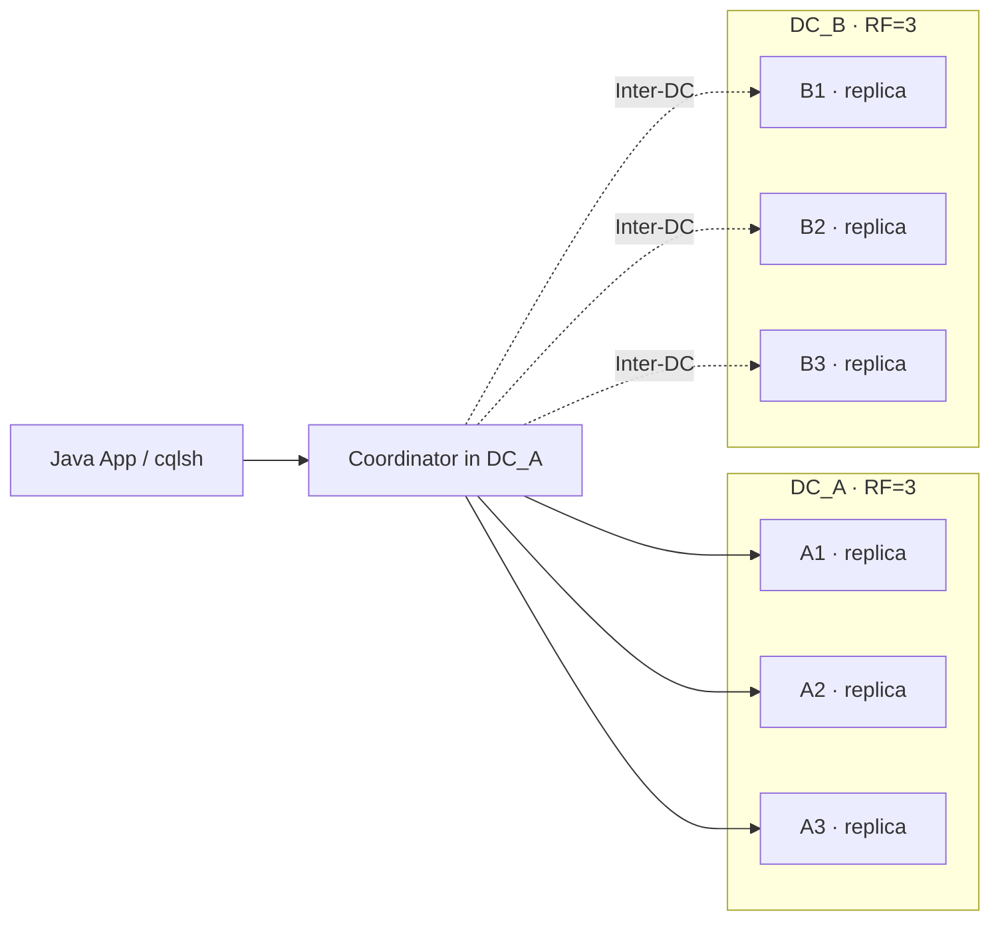

# Integrated Practice: Comparing ONE, QUORUM, and LOCAL_QUORUM in a Cassandra Failure Scenario

## 1. Objectives and Lab Scope

In Apache Cassandra, a read or write operation can succeed even when some replicas fail to respond. The consistency level (**CL**) determines how many replicas must acknowledge **each individual operation** before the coordinator reports success. When a node fails or inter-datacenter (DC) connectivity drops, choosing a CL directly impacts availability, latency, and the risk of reading stale data.

After completing this lab, you should be able to:

1. Compute the acknowledgment thresholds for `ONE`, `QUORUM`, and `LOCAL_QUORUM` from the replication factor (RF) and the coordinator's datacenter.
2. Predict which operations still succeed when a subset of replicas or inter-DC links fail.
3. Explain why a successful write may not immediately be visible in the other DC, and why replica-set intersection matters.
4. Practice in CQL, inspect error symptoms, and configure CL on Java driver statements.

This lesson belongs to module **DATABASE_ENGINE_WIDE_COLUMN_CASSANDRA**: understanding distributed architecture and the wide-column model, query-driven table design, partition keys, replication, consistency levels, repair, and Java connectivity. The focus here is **comparing CLs under the same failure scenario**; compaction and repair are mentioned only when explaining post-incident synchronization.

> **Assumption boundary:** The prompt refers to "the stated failure scenario" without providing a specific failing node list in the metadata. Therefore, a standardized, verifiable two-DC scenario is defined below. When applying this to another cluster, substitute the actual reachable replica counts and recalculate thresholds.

## 2. Cluster Diagram and Verification Data

Suppose keyspace `telemetry` uses `NetworkTopologyStrategy` with **RF = 3 in DC_A and RF = 3 in DC_B**. Each DC has three nodes; for the partition under test, each node in each DC holds one replica. The application and **coordinator** for the main experiments reside in **DC_A**.



**Important distinction:** "Six replicas" is the number of copies of **one partition** according to RF; it does not mean every query must collect six acknowledgments. The coordinator may forward requests to multiple replicas, while CL determines the minimum responses needed to return success. For `LOCAL_QUORUM`, "local" refers to the **coordinator's DC**; your Java driver's local DC setting and routing policy must match where the application runs.

Create sensor data for comparison. The following wide-column table serves the query "view one device's readings for a single day ordered by time"; the composite partition key includes `device_id` and `event_day` to prevent unbounded partition growth:

```sql
CREATE KEYSPACE IF NOT EXISTS telemetry
WITH replication = {
  'class': 'NetworkTopologyStrategy',
  'dc_a': 3,
  'dc_b': 3
};

CREATE TABLE IF NOT EXISTS telemetry.sensor_events (
    device_id text,
    event_day date,
    event_time timestamp,
    temperature_c double,
    PRIMARY KEY ((device_id, event_day), event_time)
) WITH CLUSTERING ORDER BY (event_time DESC);
```

The names `dc_a` and `dc_b` must match **exactly** the actual DC names reported by the snitch/topology; `CREATE KEYSPACE` alone does not create two datacenters. The statements above assume your lab environment already has the nodes and topology described.

To test against a fixed partition, run:

```sql
INSERT INTO telemetry.sensor_events
    (device_id, event_day, event_time, temperature_c)
VALUES
    ('sensor-01', '2026-11-21', '2026-11-21T08:00:00Z', 25.0);

SELECT event_time, temperature_c
FROM telemetry.sensor_events
WHERE device_id = 'sensor-01'
  AND event_day = '2026-11-21';
```

In `cqlsh`, `CONSISTENCY ONE;`, `CONSISTENCY QUORUM;`, or `CONSISTENCY LOCAL_QUORUM;` sets the default CL for subsequent statements in that session. This syntax is a **`cqlsh` shell command**, not part of CQL statements sent directly via the Java driver.

## 3. Calculating Acknowledgment Thresholds: ONE, QUORUM, LOCAL_QUORUM

With the configuration above, let `RF_A = 3`, `RF_B = 3`, so total RF for the partition is `RF_total = 6`:

| CL | Required responses for **read or write** success | Counting scope |
| --- | --- | --- |
| `ONE` | **1** replica | Any eligible replica that responds; typically prefers one close to the coordinator |
| `QUORUM` | **⌊6 / 2⌋ + 1 = 4** replicas | Counted across all six replicas of the partition in both DCs |
| `LOCAL_QUORUM` | **⌊3 / 2⌋ + 1 = 2** replicas | Two replicas in **DC_A**, since the coordinator is in DC_A |

These thresholds share **the same names but apply independently** to reads and writes. For example, writing with `ONE` does not force subsequent reads to use `ONE`; each statement can choose its own CL.

Behavior notes:

- **Writes:** the coordinator reports success once it receives the required write acknowledgments for the chosen CL. Non-responding replicas may still receive the mutation asynchronously; CL does not guarantee writes have completed in every DC.
- **Reads:** the coordinator must collect the required read responses; at multi-replica read levels, Cassandra can compare versions by timestamp and trigger read repair to reconcile discrepancies. A `ONE` read may consult only a single replica and return stale data.
- **Latency:** `ONE` typically has the lowest threshold. In this lab, `QUORUM` may require responses from DC_B, making it sensitive to inter-DC latency/connectivity. `LOCAL_QUORUM` relies on DC_A, which is usually better suited when an application prioritizes single-DC operation.

> With only **one DC and RF=3**, both `QUORUM` and `LOCAL_QUORUM` require **2** acknowledgments. They diverge clearly when **multiple DCs** exist. Do not confuse `QUORUM` (majority across total RF) with `EACH_QUORUM` (quorum in every DC for write operations).

## 4. Decision Matrix Across Six Failure States

Keep the coordinator in DC_A. Each pair `(A, B)` below indicates the **number of partition replicas still able to respond in time** from DC_A and DC_B. Assume no other faults beyond those stated, no overload timeouts, and a healthy coordinator. A ✅ means **enough replicas exist to satisfy the CL**, not a guarantee against network or disk latency spikes.

| State | Responding replicas (A, B) | `ONE`: ≥1 | `QUORUM`: ≥4 total | `LOCAL_QUORUM`: ≥2 in A |
| --- | --- | --- | --- | --- |
| S0 — Normal | (3, 3) | ✅ | ✅ | ✅ |
| S1 — One DC_A node down | (2, 3) | ✅ | ✅ | ✅ |
| S2 — Link broken from DC_A to DC_B | (3, 0) | ✅ | ❌ | ✅ |
| S3 — Inter-DC cut plus one DC_A node down | (2, 0) | ✅ | ❌ | ✅ |
| S4 — Two DC_A nodes down, DC_B still reachable | (1, 3) | ✅ | ✅ | ❌ |
| S5 — Only one DC_A replica reachable | (1, 0) | ✅ | ❌ | ❌ |

Analyzing commonly misunderstood cases:

**S2 — Entire link to DC_B lost:** three replicas remain inside DC_A. `LOCAL_QUORUM` needs only two, so **reads/writes still succeed**. `QUORUM` needs four out of six total, but only three are reachable, so **it fails the threshold**. You cannot infer that "having one intact DC means the whole cluster achieves QUORUM."

**S3 — Inter-DC cut plus A3 down:** the two replicas A1 and A2 still satisfy `LOCAL_QUORUM`; `ONE` also succeeds. Losing **just one more local replica** (moving from S3 to S5) causes `LOCAL_QUORUM` to fail, while `ONE` still has a chance.

**S4 — Only one local replica, but DC_B is healthy:** total reachable replicas equal 1 + 3 = 4, so `QUORUM` **can succeed** if DC_B responses arrive within the timeout; `LOCAL_QUORUM` **cannot succeed** because DC_A has only one response. This proves `QUORUM` does not mean "a majority in every individual DC."

**S5 — Only one local replica left:** `ONE` can still read/write, at a steep trade-off: reads risk returning stale data, and if the sole remaining replica fails, no replicas remain available. Never treat success at `ONE` as proof that data has been safely replicated.

### 4.1. Distinguishing Response Thresholds from Exception Types

When the number of replicas **known by the coordinator to be alive** is insufficient upfront, Cassandra returns an *unavailable* error (e.g., `UnavailableException`). If enough replicas appear alive initially but responses fail to arrive within the CL timeout, you get a *read/write timeout*; execution errors on replicas lead to *read/write failures*. Thus, the table above predicts **whether the CL can be satisfied**, while the exact exception depends on timing and fault type.

A `WriteTimeout` **does not mean the write rolled back**: some replicas may have already applied the mutation. When retrying, consider idempotency, timestamps, and update conflicts; never blindly retry operations with side effects.

## 5. Replica-Set Intersection and Reading Fresh Data

"Is the query reachable?" and "am I guaranteed to read the latest successfully written version?" are two different questions. Under the idealized model of **a single partition with no concurrent writes or timestamp conflicts**, for the write-acknowledging replica set and the read-responding replica set **to be guaranteed to overlap**, the condition is:

```text
R + W > RF

R: read response threshold
W: write acknowledgment threshold
RF: number of replicas within the scope under consideration
```

| Operation pair | Scope | Intersection result |
| --- | --- | --- |
| Write `QUORUM` (4) → read `QUORUM` (4) | Both DCs combined, RF=6 | 4 + 4 = 8 > 6 → guaranteed intersection |
| Write `ONE` (1) → read `QUORUM` (4) | Both DCs combined, RF=6 | 1 + 4 = 5 ≤ 6 → **not guaranteed** |
| Write `LOCAL_QUORUM` (2) in A → read `LOCAL_QUORUM` (2) in A | DC_A, RF_A=3 | 2 + 2 = 4 > 3 → intersects in A |
| Write `ONE` (1) in A → read `LOCAL_QUORUM` (2) in A | Replicas in A only | 1 + 2 = 3 → **not guaranteed**, even when ONE responds from A |
| Write `LOCAL_QUORUM` in A → read `LOCAL_QUORUM` in B | Two local replica sets in different DCs | **No guaranteed intersection** between the two sets |

For example, when S2 occurs and DC_A loses connectivity to DC_B:

1. Before the partition, both DCs already hold `25.0` for the same row.
2. An application connected to a DC_A coordinator writes `26.0` with `LOCAL_QUORUM`. Two replicas in A acknowledge, so the write **succeeds**.
3. Another application connected to a DC_B coordinator reads the same row with `LOCAL_QUORUM` and may still observe `25.0`. Because the two DCs have not exchanged mutations, success in A provides no immediate read guarantee in B.
4. Once the network recovers, missed-write propagation, hinted handoff (if hints are still valid), read repair, and anti-entropy repair help synchronize replicas. **Hinted handoff is only best effort**; an ongoing repair schedule is required to guarantee replicas converge over the long term.

**Important caveat:** The inequality `R + W > RF` reasons about **quorum intersection** for successfully written data without concurrent updates. It **does not automatically make Cassandra a linearizable system**. Cassandra uses timestamps and *last-write-wins* conflict resolution; concurrent writes, clock skew, deletions (tombstones), and timeouts must be handled separately. If you need conditional compare-and-set writes, explore lightweight transactions (LWT) and serial consistency.

## 6. Hands-On Verification and Result Comparison

Only disconnect nodes or network links in a **lab environment**. You may simulate responding replica counts instead of disrupting a live cluster. The commands below run from `cqlsh` connected to a coordinator in DC_A.

### Step 1 — Establish Baseline Data

Check cluster topology and node states using admin tools such as `nodetool status`; ensure three replicas of the partition exist in each DC. Run inside `cqlsh`:

```sql
CONSISTENCY LOCAL_QUORUM;

INSERT INTO telemetry.sensor_events
    (device_id, event_day, event_time, temperature_c)
VALUES
    ('sensor-01', '2026-11-21', '2026-11-21T08:00:00Z', 25.0);

SELECT temperature_c
FROM telemetry.sensor_events
WHERE device_id = 'sensor-01'
  AND event_day = '2026-11-21'
  AND event_time = '2026-11-21T08:00:00Z';
```

To verify cross-DC stale reads reliably, confirm **DC_B also reads `25.0`** before injecting faults. Writing in DC_A with `LOCAL_QUORUM` and immediately cutting the link does not guarantee DC_B has received the baseline row yet.

### Step 2 — Run the Same Query at Three CLs

Create state **S2: DC_A still has A1, A2, A3, but cannot reach DC_B**. In `cqlsh` on DC_A, switch CLs and read the same partition:

```sql
CONSISTENCY ONE;
SELECT temperature_c FROM telemetry.sensor_events
WHERE device_id = 'sensor-01' AND event_day = '2026-11-21';

CONSISTENCY LOCAL_QUORUM;
SELECT temperature_c FROM telemetry.sensor_events
WHERE device_id = 'sensor-01' AND event_day = '2026-11-21';

CONSISTENCY QUORUM;
SELECT temperature_c FROM telemetry.sensor_events
WHERE device_id = 'sensor-01' AND event_day = '2026-11-21';
```

**Threshold expectations:** `ONE` and `LOCAL_QUORUM` should succeed; `QUORUM` cannot reach four acknowledgments. Repeat with an `INSERT` updating the same row's value to verify **write CL**, not just read CL. Record response times and actual error messages.

### Step 3 — Test the "QUORUM Works, LOCAL_QUORUM Fails" Case

Restore inter-DC connectivity, then create state **S4: DC_A has only A1 responding, while DC_B has B1, B2, B3**. With the coordinator in A, predict and re-test:

- `ONE`: needs 1, 4 replicas available cluster-wide → can succeed.
- `QUORUM`: needs 4, exactly 4 available → can succeed if all four respond in time.
- `LOCAL_QUORUM`: needs 2 in A, only 1 available → fails due to insufficient local replicas.

Do not guess CL feasibility solely from total "UP" nodes in `nodetool status`. Always evaluate **the exact replicas of the partition, whether the coordinator can reach them, and which DC the coordinator belongs to**.

### Step 4 — Demonstrate a Stale Read Across Two DCs

Restore all nodes, synchronize, and confirm both DCs read `25.0`. Next, cut the inter-DC link as in S2 and run the following in **DC_A**:

```sql
CONSISTENCY LOCAL_QUORUM;
UPDATE telemetry.sensor_events
SET temperature_c = 26.0
WHERE device_id = 'sensor-01'
  AND event_day = '2026-11-21'
  AND event_time = '2026-11-21T08:00:00Z';
```

While the inter-DC link remains partitioned, read that exact row via a **DC_A coordinator** and a **DC_B coordinator**, both with `LOCAL_QUORUM`. Expect DC_A to see `26.0`, while DC_B **may** still return `25.0`. This serves as a counterexample to the misconception that "LOCAL_QUORUM is always up to date across every DC."

Stale reads do not always show up simply by changing CL, because Cassandra forwards writes to all replicas and synchronization can happen very quickly on a healthy network. In this lab, **the inter-DC link must actually be partitioned** to observe this reliably.

### Step 5 — Result Recording Table

| Trial | Actual (A, B) | Read/Write CL | Threshold prediction | Observed result / exception | Explanation of difference |
| --- | --- | --- | --- | --- | --- |
| 1 | (3, 0) | `ONE` | Sufficient | Fill after running | Count ≥1 |
| 2 | (3, 0) | `LOCAL_QUORUM` | Sufficient | Fill after running | Count A≥2 |
| 3 | (3, 0) | `QUORUM` | Insufficient | Fill after running | Total 3<4 |
| 4 | (1, 3) | `QUORUM` | Sufficient | Fill after running | Total 4≥4, may wait on WAN |
| 5 | (1, 3) | `LOCAL_QUORUM` | Insufficient | Fill after running | A=1<2 |

## 7. Setting Consistency Level Per Statement in Java

With **DataStax/Apache Cassandra Java Driver 4.x**, setting CL per statement lets different APIs choose suitable guarantees. The example below assumes `CqlSession session` is already initialized with the correct local DC:

```java
import com.datastax.oss.driver.api.core.CqlSession;
import com.datastax.oss.driver.api.core.DefaultConsistencyLevel;
import com.datastax.oss.driver.api.core.cql.ResultSet;
import com.datastax.oss.driver.api.core.cql.SimpleStatement;
import java.time.LocalDate;

// Write in the coordinator's DC: requires two local replicas to acknowledge.
SimpleStatement write = SimpleStatement.builder(
        "UPDATE telemetry.sensor_events SET temperature_c = ? " +
        "WHERE device_id = ? AND event_day = ? AND event_time = ?")
    .addPositionalValue(26.0)
    .addPositionalValue("sensor-01")
    .addPositionalValue(LocalDate.parse("2026-11-21"))
    .addPositionalValue(java.time.Instant.parse("2026-11-21T08:00:00Z"))
    .setConsistencyLevel(DefaultConsistencyLevel.LOCAL_QUORUM)
    .build();
session.execute(write);

// Read in the same DC: the two local quorums intersect when RF_local=3.
SimpleStatement read = SimpleStatement.builder(
        "SELECT event_time, temperature_c FROM telemetry.sensor_events " +
        "WHERE device_id = ? AND event_day = ?")
    .addPositionalValue("sensor-01")
    .addPositionalValue(LocalDate.parse("2026-11-21"))
    .setConsistencyLevel(DefaultConsistencyLevel.LOCAL_QUORUM)
    .build();
ResultSet rows = session.execute(read);
```

Swap `DefaultConsistencyLevel.LOCAL_QUORUM` for `ONE` or `QUORUM` to compare behavior. Use prepared statements for frequently executed queries; simple statements are shown here to highlight where CL is attached. If the driver selects a coordinator in DC_B instead of DC_A, the "local" scope shifts to DC_B as well.

## 8. Choosing CL Based on Business Requirements

| Requirement | Option to consider | Trade-offs to accept |
| --- | --- | --- |
| Telemetry dashboard tolerates slightly stale data, prioritizes staying up when multiple replicas fail | `ONE` for reads | May return stale versions; `ONE` writes increase risk of insufficient replication at ack time |
| Service operates primarily in DC_A and needs to read writes acknowledged in the same DC | `LOCAL_QUORUM` for **both reads and writes** in DC_A | No immediate guarantee for readers in DC_B; fails if fewer than two replicas remain in A |
| Query requires read/write quorum intersection across the full RF=6 | `QUORUM` for **both reads and writes** | Requires four responses, potentially spanning WAN; inter-DC cut in S2 fails the query |

There is no single "best" CL for every workload. When choosing, weigh actual RF, the datacenter handling coordination, query type, acceptable latency, tolerance for stale reads, and failure-mode behavior.

**Self-Check Questions**

1. With `RF_A = RF_B = 3`, why does `LOCAL_QUORUM` succeed in S2 while `QUORUM` fails?
2. In S4, why can `QUORUM` succeed even though only one replica in DC_A responds?
3. If you write with `LOCAL_QUORUM` in DC_A and read with `LOCAL_QUORUM` in DC_B, are you guaranteed to see the new data? Why or why not?
4. With a `ONE` write and a `QUORUM` read, does `R + W` exceed `RF_total`?
5. When a `WriteTimeout` occurs, why can't you conclude that no replicas received the write?

**Short answers:** (1) Local needs 2 in A, global needs 4 total while only 3 remain; (2) 1 in A + 3 in B = 4; (3) no, local quorums in different DCs are not guaranteed to intersect; (4) 1 + 4 = 5 ≤ 6; (5) a timeout only means the coordinator did not receive enough acknowledgments in time—some replicas may have already persisted the write.
