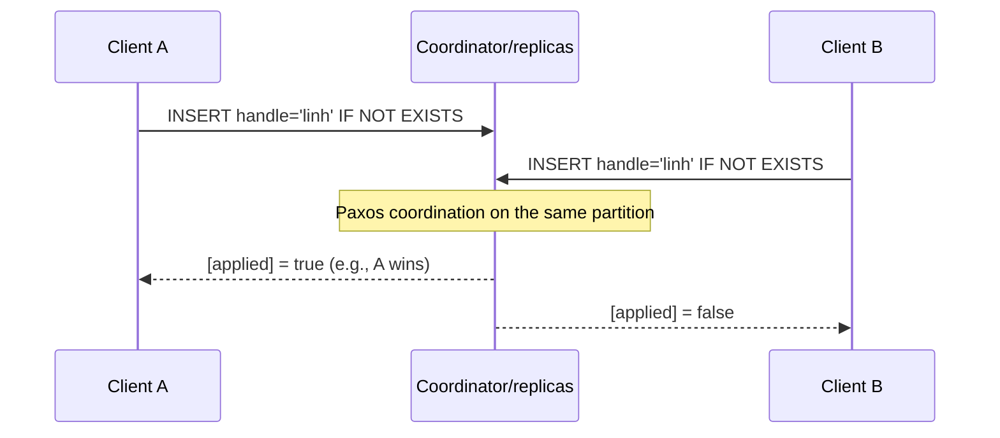

# Protecting an Invariant Within an Appropriate Scope Using LWT

## Objectives and Context

In Apache Cassandra, data is typically denormalized across multiple tables to serve specific queries. Replication ensures data exists on multiple nodes, while the consistency level (CL) tunes how many replicas participate in a read or write operation. However, merely choosing `QUORUM` or `LOCAL_QUORUM` **is not enough to turn a "read-then-check-then-write" sequence into an atomic operation**. Two applications can still concurrently read the same stale value and write results that violate a business rule.

This integrated practice uses **lightweight transactions (LWT)** in CQL to protect an **invariant**: a condition that must remain true before and after every valid state change. The focus is choosing the right partition key, embedding conditions directly in write statements, handling contention and timeouts in Java, and identifying boundaries that LWTs cannot solve.

After this lesson, you will be able to:

- Distinguish replica consistency from concurrency-coordinated conditional writes.
- Design a query-driven Cassandra table so all operations contesting the same invariant meet at **the same partition key**.
- Use `INSERT ... IF NOT EXISTS` and `UPDATE ... IF ...`, inspect the `[applied]` result, and handle retries safely.
- Test two concurrent actors, recognize costs and limits, and identify cases requiring a different design.

## 1. Scenario: One Account Handle Belongs to Only One Person

An account registration system lets users choose a public display handle. The business rule is:

> For every normalized `handle`, at any point in time **at most one** `owner_id` owns that name.

Expressed concisely: `∀ h, count(owner_id owning h) ≤ 1`.

Two requests arrive almost simultaneously: user A and user B both try to claim `linh`. If the application behaves as follows, the invariant can be broken:

```text
A: SELECT owner_id WHERE handle = 'linh'  → not found
B: SELECT owner_id WHERE handle = 'linh'  → not found
A: write handle for A
B: write handle for B
```

Depending on the data model, the later write may overwrite the earlier one, or the application may report registration success to both users. Even reading at `LOCAL_QUORUM` does not place a lock over that read–write sequence.

We choose **one unique row per handle**, using `handle` as the entire partition key, and attach `IF NOT EXISTS` to row creation. All actors contesting `linh` therefore check and write within a single LWT scope.

### Choosing the Invariant Scope Before Writing CQL

| Invariant to protect | Appropriate key / boundary | Is LWT suitable? |
| --- | --- | --- |
| Each `handle` has at most one owner | One partition keyed by `handle` | Yes, `INSERT ... IF NOT EXISTS` |
| Order status transitions `PENDING → PAID` only once | One row/partition keyed by `order_id` | Yes, `UPDATE ... IF state = 'PENDING'` |
| Total quota usage in **one row** does not exceed limit | One partition keyed by `account_id`, checking prior value | Possibly, if check/update share one partition; watch out for hotspots |
| Atomic money transfer between two accounts in **two partitions** | Two distinct partitions | No; individual LWTs do not provide cross-partition ACID transactions |
| Simultaneously create profile and claim handle across two tables/partitions | Two distinct partitions | Does not guarantee all-or-nothing atomicity |

**Key takeaway:** LWT provides linearizable conditional writes within the scope of the relevant partition; it is not a multi-partition transaction or a lock across all tables holding copies of domain data.

## 2. Preparing the Cassandra Environment

This example assumes a test cluster with a datacenter named `dc1` and **at least three nodes** for a replication factor of 3. On a different cluster, adjust the datacenter name and replication factor to match your actual setup; do not use `LOCAL_QUORUM` on a cluster that cannot satisfy the required replica count.

```sql
CREATE KEYSPACE IF NOT EXISTS lwt_lab
WITH replication = {
  'class': 'NetworkTopologyStrategy',
  'dc1': 3
}
AND durable_writes = true;

CREATE TABLE IF NOT EXISTS lwt_lab.handle_claims (
  handle text PRIMARY KEY,
  owner_id uuid,
  claimed_at timestamp
);
```

Here `handle` is the **complete partition key**. The table directly answers "Who currently owns this handle?". Each `handle` has only one row; `owner_id` is the protected value.

Do not change the primary key to `PRIMARY KEY ((handle), owner_id)` and give each user a row. Doing so allows two users to insert two distinct clustering rows into the `handle` partition, so per-row existence checks no longer enforce "at most one owner." Nor should you expect Cassandra to enforce a unique constraint on a non-key column: Cassandra does not provide arbitrary unique constraints like a relational database.

Before writing, every application path must **normalize handles identically** (e.g., `trim`, Unicode normalization per product standard, consistent case folding, character/length validation). If `Linh` and `linh` represent the same logical handle in the business domain but are stored under two different partition keys, LWT cannot protect the intended rule.

## 3. Practicing Handle Claiming with `IF NOT EXISTS`

### Request A Registers

```sql
INSERT INTO lwt_lab.handle_claims (handle, owner_id, claimed_at)
VALUES (
  'linh',
  11111111-1111-4111-8111-111111111111,
  '2026-11-21T08:00:00Z'
)
IF NOT EXISTS;
```

If no row exists for `handle = 'linh'`, LWT accepts the write; the CQL result contains `[applied] = true`.

### Request B Contests the Same Handle

```sql
INSERT INTO lwt_lab.handle_claims (handle, owner_id, claimed_at)
VALUES (
  'linh',
  22222222-2222-4222-8222-222222222222,
  '2026-11-21T08:00:01Z'
)
IF NOT EXISTS;
```

This time, if A already claimed the handle, the result contains `[applied] = false`; Cassandra does not overwrite the owner. When two operations genuinely execute concurrently on the same key, at most one creation from the non-existent state can be accepted. A `false` response usually includes the existing row values, though the application must not assume every error or timeout returns that row.

Verify the final state:

```sql
SELECT handle, owner_id, claimed_at
FROM lwt_lab.handle_claims
WHERE handle = 'linh';
```

The final result must have exactly **one row** for `linh`. If executed sequentially as above, A is the owner; if you run both statements from two concurrent clients, the winner may be A or B, but two owners can never both be confirmed from two row-creation attempts.

### Why Does LWT Protect the Condition?

LWT uses a consensus protocol based on **Paxos** to coordinate the replicas of the target partition before accepting a conditional write. The application sends **a single statement** containing both the condition and the mutation; competing requests on the same partition must pass through this coordination phase. Because it requires additional network round-trips and can suffer contention, LWT typically incurs higher latency and resource cost than regular writes.



The diagram depicts the **logical outcome**, not all internal Paxos phases or messages; actual winner order is not guaranteed.

## 4. Distinguishing the Two Groups of Consistency Levels

When running LWT from an application, you must understand two independent settings:

| Setting | Example | Role |
| --- | --- | --- |
| Regular consistency level | `LOCAL_QUORUM` | Number of replicas participating in regular data read/write and the commit phase of applicable operations |
| Serial consistency level | `LOCAL_SERIAL` or `SERIAL` | Coordination scope for the LWT consensus/condition phase |

In an application reading, writing, and enforcing invariants within **a single datacenter**, pairing `LOCAL_QUORUM` and `LOCAL_SERIAL` is usually appropriate when topology, replication, and availability requirements align. `SERIAL` coordinates more broadly than `LOCAL_SERIAL`; when multiple datacenters can concurrently write to the same key, explicitly determine **system-wide** linearizability requirements, routing paths, and consistency levels rather than defaulting to `LOCAL_SERIAL` everywhere.

Note that `QUORUM` **does not replace** `SERIAL`: an `INSERT` without `IF` remains a regular write regardless of how high regular CL is set. Conversely, LWT does not turn all reads and writes in an application into one giant transaction.

## 5. Integrating into Java Driver 4.x

The example below assumes `CqlSession` is connected to the cluster, table `lwt_lab.handle_claims` exists, and `handle` has already been normalized in the business layer. In real applications, prepare the statement once and reuse it.

```java
import com.datastax.oss.driver.api.core.CqlSession;
import com.datastax.oss.driver.api.core.DefaultConsistencyLevel;
import com.datastax.oss.driver.api.core.cql.BoundStatement;
import com.datastax.oss.driver.api.core.cql.PreparedStatement;
import com.datastax.oss.driver.api.core.cql.ResultSet;
import com.datastax.oss.driver.api.core.cql.Row;
import com.datastax.oss.driver.api.core.cql.SimpleStatement;

import java.time.Instant;
import java.util.UUID;

public final class HandleClaimService {
    public enum ClaimResult { CLAIMED, ALREADY_OWNED, TAKEN }

    private final CqlSession session;
    private final PreparedStatement claimStatement;

    public HandleClaimService(CqlSession session) {
        this.session = session;
        this.claimStatement = session.prepare(
            "INSERT INTO lwt_lab.handle_claims " +
            "(handle, owner_id, claimed_at) VALUES (?, ?, ?) IF NOT EXISTS"
        );
    }

    public ClaimResult claim(String normalizedHandle, UUID ownerId) {
        BoundStatement statement = claimStatement
            .bind(normalizedHandle, ownerId, Instant.now())
            .setConsistencyLevel(DefaultConsistencyLevel.LOCAL_QUORUM)
            .setSerialConsistencyLevel(DefaultConsistencyLevel.LOCAL_SERIAL)
            .setIdempotent(false);

        ResultSet result = session.execute(statement);
        if (result.wasApplied()) {
            return ClaimResult.CLAIMED;
        }

        // Write rejected by condition: read current owner to distinguish
        // another user holding the handle from a retry by the same owner.
        Row current = session.execute(
            SimpleStatement.builder(
                "SELECT owner_id FROM lwt_lab.handle_claims WHERE handle = ?")
                .addPositionalValue(normalizedHandle)
                .setConsistencyLevel(DefaultConsistencyLevel.LOCAL_QUORUM)
                .build()
        ).one();

        if (current != null && ownerId.equals(current.getUuid("owner_id"))) {
            return ClaimResult.ALREADY_OWNED;
        }
        return ClaimResult.TAKEN;
    }
}
```

This sample code assumes **ownership is not concurrently deleted or transferred** when interpreting the follow-up read. If the product supports releasing or reassigning handles, extend the model with a `claim_id`/version and state-transition rules so a stale retry cannot accidentally revoke newer ownership.

The `claim` method only returns `TAKEN` after Cassandra confirms the conditional write **was not applied**. Exceptions such as timeouts or connection drops must be handled separately. In a registration API, `TAKEN` can map to HTTP `409 Conflict`; `ALREADY_OWNED` is a valid outcome for a repeated request from the same owner, depending on your API contract.

### Timeout Does Not Mean `false`

Suppose request A was accepted, but the response was lost on the network. The client sees a timeout, yet the row may already exist. If the application immediately reports "name already taken" or automatically triggers compensating actions, it may return false negatives or delete valid claims.

How a production system should handle this:

1. Bind a stable `owner_id` to the same registration intent; never generate a fresh `owner_id` on each retry.
2. Distinguish `[applied] = false` (a deterministic response from the condition) from network errors/timeouts (an **indeterminate** outcome).
3. On a timeout, verify the current owner with an appropriately consistent read or re-issue the same conditional request with the same `owner_id`; if you are the owner, treat it as completed. If the system allows handle transfers, verify `claim_id`/version as well.
4. Cap retry attempts, apply backoff, and monitor contention. Avoid letting the driver blindly auto-retry an indeterminate CAS statement unless application logic defines how to reconcile it.

Calling `setIdempotent(false)` in the example prevents the driver from automatically retrying the statement under a generic retry policy. We can still **explicitly** retry the same intent once we have designed rules to identify the current owner and final state.

## 6. Second Invariant: One-Time State Transition

`IF` is not limited to row creation. When an order may transition from `PENDING` to `PAID` only once, we can attach the condition to the same row:

```sql
CREATE TABLE IF NOT EXISTS lwt_lab.order_status (
  order_id uuid PRIMARY KEY,
  state text,
  updated_at timestamp
);

INSERT INTO lwt_lab.order_status (order_id, state, updated_at)
VALUES (33333333-3333-4333-8333-333333333333, 'PENDING', '2026-11-21T08:10:00Z')
IF NOT EXISTS;

UPDATE lwt_lab.order_status
SET state = 'PAID', updated_at = '2026-11-21T08:11:00Z'
WHERE order_id = 33333333-3333-4333-8333-333333333333
IF state = 'PENDING';
```

If two workers simultaneously transition **that exact order**, only one operation can move it from the expected value `PENDING`; the other receives `[applied] = false` and must inspect the new state to decide its next step. Here both the checked condition and the updated column reside in the same `order_id` partition.

Do not conclude from this that **charging the payment gateway** also executes exactly once. Actions external to Cassandra require their own idempotency and reconciliation mechanisms; LWT protects only the state modeled inside Cassandra, not external systems.

## 7. When to Use LWT and When to Avoid It

Consider LWT when **a narrow, business-critical invariant** can be expressed as a condition within a single partition: claiming a unique identifier, checking a version, or performing a conditional state transition. Its value lies in stating precisely what is protected and verifying it under contention.

Limits you must accept:

- **Cost:** requires more coordination rounds than regular writes; contention on a hot key increases latency, timeouts, and cluster load. Do not apply LWT indiscriminately to every write.
- **Scope:** two CAS operations across two different partitions do not form a single atomic transaction. `BATCH` does not turn them into a cross-partition LWT.
- **Replication/topology:** choose RF, regular CL, serial CL, and multi-DC strategy based on real requirements; do not treat LWT as a cure for a cluster losing quorum.
- **Denormalized copies:** after claiming a handle, a profile table queried by `owner_id` may be updated afterward. You need retries/reconciliation if the secondary update fails; the "at most one owner per handle" invariant remains anchored on the claims table.
- **Data lifecycle:** never casually attach a TTL to handle-claim rows; expiration could reopen a handle while profiles or external systems still reference the old ownership. If handle release is supported, conditional deletes by owner/version plus reconciliation are mandatory.
- **Key modeling:** LWT cannot fix faulty key normalization, poorly chosen partition keys, or uniqueness requirements spanning independent partitions.

## 8. Test Suite and Acceptance Criteria

Practice in a test environment; prepare two applications or `cqlsh` sessions capable of issuing concurrent commands and a **fresh** handle for each run. Do not modify tables or delete production data.

| Test case | Execution | Expected result |
| --- | --- | --- |
| Claim new handle | A runs `INSERT ... IF NOT EXISTS` for a non-existent handle | `[applied] = true`; subsequent read returns A's `owner_id` |
| Concurrent contention | A and B send conditional claims for the same `handle` with two different `owner_id` values | Exactly one gets `applied = true`; the other is rejected; final read shows one owner |
| Duplicate request by owner | Resend the winner's claim with the same `owner_id` | LWT reports `false` because the row already exists; business layer identifies `ALREADY_OWNED` |
| Distinct partitions | Two users claim two different handles | Both can succeed; no contention on the same invariant |
| State transition | Two workers run `UPDATE ... IF state = 'PENDING'` | At most one transition succeeds from `PENDING` |
| Timeout under fault injection | Drop responses or interrupt connectivity mid-write | Never interpret timeout as "not written"; reconcile before reporting final outcome |

For meaningful concurrency testing, fire both requests simultaneously from **two independent clients**, logging each request's `owner_id`, `applied`, timing, and errors; repeat with fresh handles. If a timeout occurs, classify the test outcome as "indeterminate until reconciled"—never lump timeouts into `applied = false`.

### Self-Assessment Questions

1. Why can't `SELECT` at `LOCAL_QUORUM` followed by `INSERT` normally replace `INSERT ... IF NOT EXISTS`?
2. If each user may have only **one** handle and each handle may belong to only **one** user, does `handle_claims` alone enforce both directions? Explain using the partition key.
3. Why must `LOCAL_SERIAL` be reconsidered if two datacenters can concurrently claim a globally unique handle?
4. When `execute()` throws a timeout, what must the application check before retrying or reporting failure?
5. If profile creation fails after a successful handle claim, what reconciliation step should be designed, and why can't two writes to two partitions be treated as a single transaction?

## Technical Conclusion

LWT is effective when an invariant is **narrowed down to a condition that can be checked and updated within the same partition**, such as "at most one owner per handle" or "transition from `PENDING` at most once." Choosing the right partition key defines the protection boundary; `IF` combines check and write into one Paxos-coordinated operation; `[applied]` and the retry strategy determine whether the application interprets outcomes correctly. For invariants spanning multiple partitions, multiple tables, or services outside Cassandra, build a dedicated business workflow with idempotency and reconciliation rather than expecting LWT to expand its atomicity boundary.
