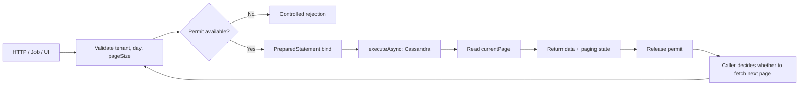

# Building a Java Flow with Parameter Binding, Pagination, and Concurrency Limits

## 1. Problem and Desired Outcomes

An application records user activity across multiple tenants. An admin screen needs to fetch the newest events for **one tenant on one day**, returning only a small page at a time. Meanwhile, multiple read and write requests can arrive concurrently. Build a Java flow using Apache Cassandra that meets three requirements:

1. **Bind CQL parameters** via `PreparedStatement`/`BoundStatement`, never concatenating user values into query strings.
2. **Paginate using Cassandra's paging state**, fetching on demand rather than loading an entire partition and slicing a list in Java.
3. **Limit the number of in-flight queries** at the application layer with explicit behavior when the limit is exceeded.

This is an *Integrated Practice* lab for module `DATABASE_ENGINE_WIDE_COLUMN_CASSANDRA`. It exercises distributed architecture, query-driven wide-column table design, partition keys, clustering keys, replication, and read/write consistency levels. Examples use **Java 17+**, **Apache Cassandra**, **Apache Cassandra Java Driver 4.x** (API illustrated against the 4.19 line), and CQL. Learners need a Cassandra cluster reachable from Java; the steps do not require Spring or a messaging broker.

Processing flow diagram:



> `pageSize` is the target number of rows **per fetch**; the server may return fewer. `LIMIT` caps the total rows of a query and does not replace pagination. Cassandra does not provide an `OFFSET` mechanism suitable for deep paging through large datasets.

## 2. Query-Driven Data Design

**Business query:** "List events for tenant `T` on UTC day `D`, sorted by time descending." We design a table specifically for this query:

```sql
-- Example for a cluster with at least 3 replicas in DC named datacenter1.
-- Check actual DC: SELECT data_center FROM system.local;
CREATE KEYSPACE IF NOT EXISTS cassandra_lab
WITH replication = {'class': 'NetworkTopologyStrategy', 'datacenter1': 3}
AND durable_writes = true;

CREATE TABLE IF NOT EXISTS cassandra_lab.events_by_tenant_day (
    tenant_id    uuid,
    bucket_day   date,
    happened_at  timestamp,
    event_id     uuid,
    event_type   text,
    details      text,
    PRIMARY KEY ((tenant_id, bucket_day), happened_at, event_id)
) WITH CLUSTERING ORDER BY (happened_at DESC, event_id DESC);
```

| Component | Role | Rationale |
| --- | --- | --- |
| `(tenant_id, bucket_day)` | **Composite partition key** | Identifies the partition for query routing and avoids full-table scans; the day acts as a bucket bounding partition size. |
| `happened_at` | First clustering key | Supports newest-first ordering within the partition. |
| `event_id` | Second clustering key | Distinguishes events sharing the same millisecond and provides deterministic ordering. |
| `event_type`, `details` | Regular columns | Display data, not used for filtering or routing. |

Matching valid query for this table design:

```sql
SELECT happened_at, event_id, event_type, details
FROM cassandra_lab.events_by_tenant_day
WHERE tenant_id = ? AND bucket_day = ?;
```

**Why avoid `ALLOW FILTERING`?** The goal is to read a single partition directly using known keys, rather than filtering after reading across many partitions. If the UI needs "all events across all tenants" or "filter by event_type," that is a different query and typically requires a dedicated table or view designed for it.

**Design limits:** A partition can still grow too large if a tenant writes millions of events per day; in that case, use finer buckets (hourly, or deliberate sharding) and design result merging. Avoid making buckets too small if the application frequently has to traverse hundreds of partitions to render one screen. Dates are computed in **UTC** for both writes and reads.

**Environment note:** If you only have a single node for local study, you can use replication factor `1` with that node's exact DC name; `LOCAL_QUORUM` will then require only one replica and cannot demonstrate fault tolerance of a 3-replica cluster. For the rest of this lab, examples assume RF = 3 in `datacenter1`.

## 3. Setting Up the Java Connection

Gradle example (Groovy DSL):

```groovy
dependencies {
    implementation 'org.apache.cassandra:java-driver-core:4.19.4'
}
```

Create `CqlSession` **once at application startup** and share it across requests. Replace `datacenter1` and the contact point address to match your running cluster; authentication/TLS settings can also be configured beyond this example.

```java
try (CqlSession session = CqlSession.builder()
        .addContactPoint(new InetSocketAddress("127.0.0.1", 9042))
        .withLocalDatacenter("datacenter1")
        .withKeyspace("cassandra_lab")
        .build()) {
    // Initialize the repository and invoke asynchronous methods.
}
```

In driver 4.x, `BoundStatement` is **immutable**: `setPageSize`, `setPagingState`, and `setConsistencyLevel` return a new instance. You must capture the returned value. Likewise, do not call `session.prepare(...)` on every request; prepare statements once and reuse them.

## 4. Building the Repository: Binding, Single-Page Reads, and In-Flight Limits

Create `CassandraFlowPractice.java` with the complete program below. `EventStore` acts as the storage adapter: two prepared statements are created at initialization; `Semaphore` is a **shared** concurrency budget across both reads and writes. `tryAcquire()` rejects immediately when capacity is exhausted, avoiding blocking request-handling threads.

```java
import com.datastax.oss.driver.api.core.CqlSession;
import com.datastax.oss.driver.api.core.DefaultConsistencyLevel;
import com.datastax.oss.driver.api.core.cql.BoundStatement;
import com.datastax.oss.driver.api.core.cql.PagingState;
import com.datastax.oss.driver.api.core.cql.PreparedStatement;
import com.datastax.oss.driver.api.core.cql.Row;

import java.net.InetSocketAddress;
import java.time.Instant;
import java.time.LocalDate;
import java.time.ZoneOffset;
import java.util.ArrayList;
import java.util.List;
import java.util.UUID;
import java.util.concurrent.CompletableFuture;
import java.util.concurrent.CompletionStage;
import java.util.concurrent.RejectedExecutionException;
import java.util.concurrent.Semaphore;
import java.util.function.Supplier;

public final class CassandraFlowPractice {

    record Event(UUID tenantId, LocalDate bucketDay, Instant happenedAt,
                 UUID eventId, String eventType, String details) { }

    // nextState == null means there is no more data.
    record EventPage(List<Event> events, PagingState nextState) { }

    static final class EventStore {
        private final CqlSession session;
        private final PreparedStatement insert;
        private final PreparedStatement select;
        private final Semaphore inFlight;

        EventStore(CqlSession session, int maxInFlight) {
            if (maxInFlight <= 0) {
                throw new IllegalArgumentException("maxInFlight must be positive");
            }
            this.session = session;
            this.inFlight = new Semaphore(maxInFlight);
            this.insert = session.prepare(
                "INSERT INTO cassandra_lab.events_by_tenant_day " +
                "(tenant_id, bucket_day, happened_at, event_id, event_type, details) " +
                "VALUES (?, ?, ?, ?, ?, ?)");
            this.select = session.prepare(
                "SELECT happened_at, event_id, event_type, details " +
                "FROM cassandra_lab.events_by_tenant_day " +
                "WHERE tenant_id = ? AND bucket_day = ?");
        }

        CompletionStage<Void> append(Event event) {
            BoundStatement request = insert.bind(
                    event.tenantId(), event.bucketDay(), event.happenedAt(),
                    event.eventId(), event.eventType(), event.details())
                .setConsistencyLevel(DefaultConsistencyLevel.LOCAL_QUORUM)
                .setIdempotent(true);

            return withPermit(() -> session.executeAsync(request)
                .thenApply(ignored -> (Void) null));
        }

        CompletionStage<EventPage> readPage(
                UUID tenantId, LocalDate bucketDay, int pageSize,
                PagingState pagingState) {

            if (pageSize < 1 || pageSize > 200) {
                return CompletableFuture.failedFuture(
                    new IllegalArgumentException("pageSize must be 1..200"));
            }

            BoundStatement first = select.bind(tenantId, bucketDay)
                .setPageSize(pageSize)
                .setConsistencyLevel(DefaultConsistencyLevel.LOCAL_QUORUM)
                .setIdempotent(true);
            BoundStatement request = pagingState == null
                ? first : first.setPagingState(pagingState);

            return withPermit(() -> session.executeAsync(request).thenApply(rs -> {
                List<Event> events = new ArrayList<>();
                for (Row row : rs.currentPage()) {
                    events.add(new Event(
                        tenantId,
                        bucketDay,
                        row.getInstant("happened_at"),
                        row.getUuid("event_id"),
                        row.getString("event_type"),
                        row.getString("details")));
                }

                // Only extract the token AFTER consuming currentPage.
                PagingState next = rs.hasMorePages()
                    ? rs.getExecutionInfo().getSafePagingState()
                    : null;
                return new EventPage(List.copyOf(events), next);
            }));
        }

        private <T> CompletionStage<T> withPermit(
                Supplier<CompletionStage<T>> operation) {
            if (!inFlight.tryAcquire()) {
                return CompletableFuture.failedFuture(
                    new RejectedExecutionException("Cassandra in-flight limit reached"));
            }
            try {
                return operation.get().whenComplete((value, failure) ->
                    inFlight.release());
            } catch (RuntimeException failure) {
                // Covers synchronous exceptions thrown before creating CompletionStage.
                inFlight.release();
                return CompletableFuture.failedFuture(failure);
            }
        }
    }

    public static void main(String[] args) {
        try (CqlSession session = CqlSession.builder()
                .addContactPoint(new InetSocketAddress("127.0.0.1", 9042))
                .withLocalDatacenter("datacenter1")
                .withKeyspace("cassandra_lab")
                .build()) {

            EventStore store = new EventStore(session, 16);
            UUID tenant = UUID.randomUUID();
            LocalDate day = LocalDate.now(ZoneOffset.UTC);
            // Fix base at UTC noon so 23 events do not spill into the next day.
            Instant base = day.atTime(12, 0).toInstant(ZoneOffset.UTC);

            // The producer also throttles itself: at most 8 concurrent writes
            // per batch, below the application-wide budget of 16.
            for (int start = 0; start < 23; start += 8) {
                List<CompletableFuture<Void>> batch = new ArrayList<>();
                for (int i = start; i < Math.min(23, start + 8); i++) {
                    Event event = new Event(tenant, day,
                        base.plusMillis(i), UUID.randomUUID(),
                        "OPEN", "demo-" + i);
                    batch.add(store.append(event).toCompletableFuture());
                }
                CompletableFuture.allOf(
                    batch.toArray(new CompletableFuture[0])).join();
            }

            PagingState cursor = null;
            int total = 0;
            int pageNumber = 0;
            do {
                EventPage page = store.readPage(tenant, day, 5, cursor)
                    .toCompletableFuture().join();
                pageNumber++;
                total += page.events().size();
                System.out.printf("Page %d: %d events%n",
                    pageNumber, page.events().size());
                page.events().forEach(event ->
                    System.out.println("  " + event.happenedAt()
                        + "  " + event.eventId()));
                cursor = page.nextState();
            } while (cursor != null);

            System.out.println("Total events = " + total); // 23
        }
    }
}
```

### Why Do These Three Mechanisms Work Together?

| Mechanism | Problem solved | What is not guaranteed |
| --- | --- | --- |
| `prepare` + `bind` | Exact data typing, prevents CQL injection from string concatenation, reduces repeated query parsing overhead. | Does not fix a query designed with the wrong partition key. |
| `setPageSize(5)` + `PagingState` | Fetches only a slice of results at a time; caller decides when to advance to the next page. | Not a consistent snapshot if the table changes between reads. |
| `Semaphore(16)` | Caps concurrent executing Cassandra operations within **one application instance**. | Not a global limit across all pods/instances; does not create a queue or retry policy by itself. |

In `append`, `setIdempotent(true)` is safe when retries reuse **the same keys and event payload**. If every retry generates a new `event_id`, it writes an extra distinct event; generate the ID once at the business boundary and reuse it. Never mark counter increments or non-idempotent side effects as idempotent.

In `readPage`, `rs.currentPage()` returns the rows **of the current page**. The example extracts `getSafePagingState()` and calls `setPagingState(...)` to issue a new request for the next page. If you want to process pages continuously within *a single call* instead of returning a token to a client, `rs.fetchNextPage()` chains asynchronous `CompletionStage` calls; keep your concurrency budget aligned with that fetching pattern. Never use a synchronous `while` loop blocking on futures inside callbacks running on the driver's I/O threads.

## 5. Passing Paging State Safely Over HTTP

In the example above, `PagingState` is an **internal Java object**. It can be serialized to a string via `page.nextState().toString()` and parsed back with `PagingState.fromString(...)` when needed. However, **never expose this raw string to untrusted clients**: the `safe` check only verifies statement and bind-value compatibility; it is **not a tamper-proof signature**.

In a production API, wrap or encrypt the token with an HMAC signature (or equivalent authenticated mechanism) and bound token size and lifetime. Bind the token to the authenticated `tenantId`, `bucketDay`, `pageSize`, query version, and expiration timestamp. Authorize the tenant on every request before querying Cassandra; map malformed or invalid tokens to HTTP `400`.

Example API contract (illustrative, without real paging state strings):

```http
GET /tenants/{tenantId}/events?day=2026-11-21&pageSize=5
200 OK
{
  "items": ["...5 event objects..."],
  "nextCursor": "<opaque-signed-token>"
}

GET /tenants/{tenantId}/events?day=2026-11-21&pageSize=5&cursor=<opaque-signed-token>
200 OK
{
  "items": ["...next page..."],
  "nextCursor": null
}
```

Keep **the exact CQL query and all bound values** unchanged when resuming with a paging state. A token from tenant `A`/day `D` must never be accepted for tenant `B`/another day; when the query or sort order changes, reject older cursors. Paging state does not provide a snapshot: inserts or deletes during traversal can shift observed results; if you need a "point-in-time at T" report, design a dedicated data-cutoff workflow or watermark.

## 6. Concurrency Budget and Overload Handling

Suppose each instance allows `maxInFlight = 16`. When 16 operations already hold permits, the 17th request immediately receives `RejectedExecutionException` at the application layer. An HTTP adapter can map this to `429 Too Many Requests` or `503 Service Unavailable` per the service contract; a background job can use a **bounded** queue and retry with backoff and jitter. Never create unbounded queues or retry immediately thousands of times.

Key points to master:

- **Do not call** `Semaphore.acquire()` on an event-loop thread to wait for a permit; doing so can stall request-processing threads while CQL calls await responses.
- A permit must only be `release()`d **when the asynchronous stage completes** (including on failure). Placing release inside `whenComplete` prevents permit leaks; the `catch` block handles synchronous exceptions thrown by `operation.get()`.
- Across multiple instances, the theoretical ceiling is roughly `instances × 16`. Size the budget according to actual cluster capacity, throughput, p95/p99 latency, and connection limits; 16 is an educational parameter, not a universal optimum.
- Limiting in-flight requests throttles **concurrent queries**, not partition size, row counts, or long-term write volume. Monitor queue depth (if any), rejected request count, timeouts, latency, error rates, and cluster resources.

With RF = 3, selecting `LOCAL_QUORUM` for both writes and reads typically requires **2 replicas in the local DC** to acknowledge each operation; `R + W > RF` (2 + 2 > 3) gives reads an overlap with acknowledged writes under healthy conditions. It does not replace concurrent-update handling, does not guarantee multi-page snapshots, and fails requests when available replicas drop below quorum. Weigh consistency/latency trade-offs against your real SLA.

## 7. Practice Procedure and Self-Check Criteria

1. **Setup:** Identify the DC name, create the keyspace/table, and configure the driver; the cluster must have enough replicas for the configured RF. Run `CassandraFlowPractice.main()` after creating the schema.
2. **Bound writes:** The program generates 23 fresh `event_id`s for one tenant and one UTC day in three batches (8, 8, 7), awaiting completion of each batch via `allOf`. Confirm no exceptions occur.
3. **Multi-page reads:** The program sets `pageSize = 5`, prints each page, and resumes with `nextState`. Without interleaved writes or deletes, the total count must be **23**; each `event_id` appears once in descending chronological order.
4. **Cursor validation:** Try passing a token obtained from one tenant/day to another tenant/day. Safe `PagingState` rejects mismatches when `setPagingState` disagrees with the query/bindings. In an HTTP layer, catch this and return a client input error without leaking stack traces.
5. **Overload check:** Generate sufficient concurrent load or controlled Cassandra latency to exhaust all 16 permits; verify excess requests fail fast and permits recover after both successes **and** failures. Do not conclude the limiter is broken just because a short benchmark never hit the ceiling.
6. **Replica failure test:** In a multi-node test environment, take down enough replicas to break `LOCAL_QUORUM`. Observe errors/timeouts, restore the nodes, and verify data consistency. Check repair/compaction impact and monitor tombstones in scenarios with deletes or heavy TTLs; never run ad-hoc maintenance operations on production.

Common errors:

| Symptom | Possible cause | How to check / fix |
| --- | --- | --- |
| `UnavailableException`, read/write timeouts | Mismatched RF/CL, insufficient live replicas, or cluster overload | Verify DC, RF, and live nodes; monitor latency and coordinator health. |
| No next page despite remaining data | Dropped/overwritten paging state or repeated first-page fetch | Pass `nextState` unmodified to the next statement with identical query and bindings. |
| `IllegalStateException` when applying cursor | Cursor used with wrong tenant/day/query | Verify query tuple and never reuse tokens across contexts. |
| High memory usage as requests spike | Accumulating all futures in a list or unbounded queue | Batch/throttle upstream and monitor in-flight operations. |
| Duplicate/missing rows across "next page" calls | Data mutated concurrently during pagination | Distinguish cursors from snapshots; use watermarks or historical tables when needed. |
| Slow responses despite small `pageSize` | Oversized partition, hot partition, tombstones, high CL | Inspect partition distribution, tracing, compaction, and bucket design. |

## 8. Extensions After Completion

Upgrade the lab with three verifiable enhancements: (1) expose metrics for `in_flight`, rejection counts, and p95/p99 latency; (2) build an HTTP endpoint wrapping paging tokens with HMAC, supporting cancellation/timeouts and tenant authorization; (3) generate multi-tenant/multi-day datasets to measure hot partitions and evaluate hourly bucketing. When moving to a reactive pipeline or thread pool, preserve the core rules: callers control request emission rate, fetch the next page only on demand, and always enforce resource bounds.

### References

- Apache Cassandra Java Driver — [Paging](https://apache.github.io/cassandra-java-driver/4.19.0/core/paging/) and [Asynchronous programming](https://apache.github.io/cassandra-java-driver/4.19.0/core/async/).
- Apache Cassandra Java Driver — [Prepared statements](https://apache.github.io/cassandra-java-driver/4.19.0/core/statements/prepared/) and [`PagingState` Javadoc](https://apache.github.io/cassandra-java-driver/4.18.1/api/com/datastax/oss/driver/api/core/cql/PagingState.html).
- Apache Cassandra — [Cassandra Java Driver releases and downloads](https://cassandra.apache.org/_/download.html).
