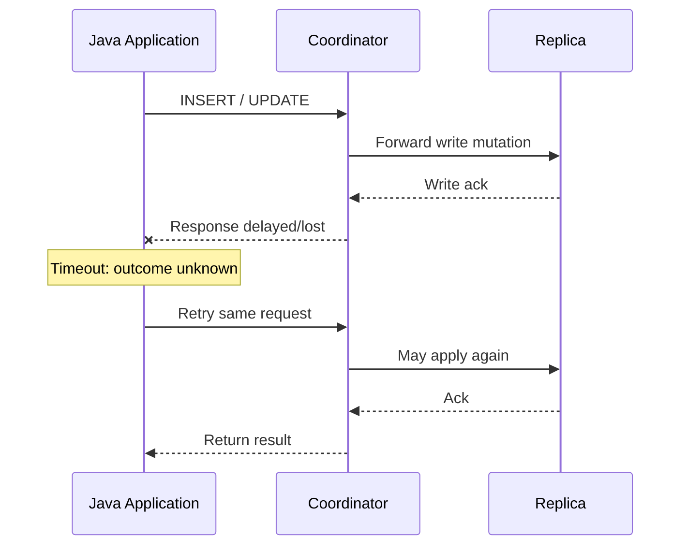
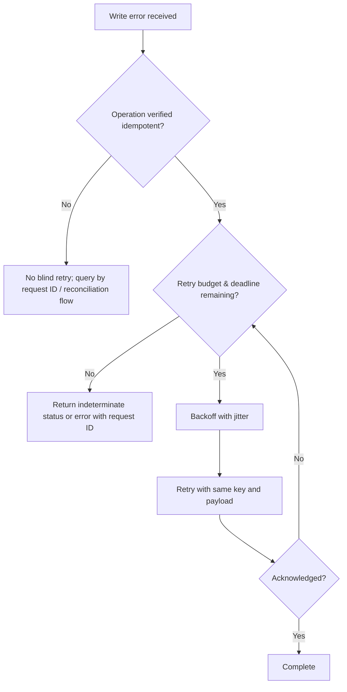

# Reproducing Timeouts, Retries, and Repeatable Write Operations

## 1. Objectives and Practice Scenario

In distributed systems, **a timeout does not mean a write operation definitely failed**. A Java application can send a write command to Apache Cassandra, replicas may persist the data, yet the acknowledgment fails to arrive before the deadline. If the application automatically retries, **the same business request may be executed multiple times**. Depending on the write type, the final state may remain correct or violate business correctness.

This **Integrated Practice** lab falls under `DATABASE_ENGINE_WIDE_COLUMN_CASSANDRA`: applying the wide-column model, partition keys, CQL, replication, and consistency levels while testing timeout/retry behavior from a Java application. The focus is distinguishing **idempotent** operations (repeating yields the same intended state) from **non-idempotent** operations (repeating mutates state an extra time).

Scenario: a service receives requests to record an event and track processing attempts. After sending the write, the client times out. It does not know whether Cassandra never received the request, wrote to a subset of replicas, or succeeded but lost the acknowledgment. We will reproduce observable outcomes and then design safe retries.

Desired outcomes:

1. Explain why `WriteTimeoutException` and driver timeouts do not prove data was not written.
2. Create tables and repeatedly execute identical `INSERT`, `UPDATE counter`, and `UPDATE list` statements, comparing the results.
3. Reproduce a case of **lost acknowledgment after a successful write**, then have the client retry with the same `request_id`.
4. Flag statements accurately as retry-safe or unsafe in the Java Driver and inspect a conditional `IF NOT EXISTS` write pattern.
5. Propose retry budgets, error observability, and validation steps for multi-replica clusters.

> **Experiment boundary:** the core section uses a single Cassandra node to directly demonstrate repeated writes; do not use this setup to draw conclusions about quorum or multi-node fault tolerance. The extension at the end outlines further testing on a three-node cluster.

## 2. Failure Model: Timeout and Write State Are Two Different Questions

When writing through the Java Driver, the typical flow is:



The **Coordinator** is the node receiving the client's request and coordinating replicas. The **Consistency level** specifies how many replicas must acknowledge for an operation to be considered successful at that level. For example, with replication factor 3 in one datacenter, writing at `LOCAL_QUORUM` requires two acknowledgments from replicas in that datacenter. If too few acks arrive within the timeout, the coordinator can raise `WriteTimeoutException` **even though some replicas already persisted the write**. Writes are not rolled back automatically just because the client timed out.

| Client-side outcome | What can be concluded | What must not be inferred |
| --- | --- | --- |
| Write succeeded at chosen consistency level | Coordinator received enough acks for that level | All replicas, search indexes, or other services are already updated |
| `WriteTimeoutException` | Coordinator did not receive enough write acks before server timeout | No replica persisted the write |
| `DriverTimeoutException` | Driver timed out waiting for a response to the request | The request definitely never reached Cassandra |
| Connection dropped after sending request | Client lost visibility into the outcome over that socket | The request definitely failed or definitely succeeded |
| `UnavailableException` | Coordinator saw too few live replicas to satisfy the requested consistency level | All timeout types can share one blanket retry policy |

Key concepts to keep in mind:

- **Client-side timeout**: the driver's deadline expired before receiving a response; provides no certainty about whether Cassandra applied the write.
- **Server-side write timeout**: the coordinator timed out waiting for replica acks; partial writes may have already occurred.
- **Retry**: sending another physical request for the same business intent. Retrying alone does not guarantee "exactly-once execution."
- **Idempotency**: a property of the operation, keys, and payload combined. It cannot be deduced solely from whether a statement uses `INSERT` or `UPDATE` syntax.

Specifically, Cassandra's timestamp-based **last-write-wins** strategy reconciles cell values, but does not ensure every business write can be re-executed safely. A fixed `INSERT` on the same primary key behaves very differently from incrementing a counter, appending to a list, or generating a fresh ID on each attempt.

## 3. Environment Setup

Requirements: Docker, a terminal, `cqlsh`, and—for the Java portion—JDK 17 plus Maven. You may use an existing Cassandra 4.x/5.x instance instead of Docker, provided CQL connectivity works and you know the exact datacenter name.

Start a standalone lab node:

```bash
docker run -d --name cassandra-timeout-lab -p 9042:9042 cassandra:5.0
docker exec cassandra-timeout-lab nodetool status
docker exec -it cassandra-timeout-lab cqlsh
```

If `nodetool` or `cqlsh` cannot connect yet, Cassandra is still starting; proceed only once the node is up. Avoid using production keyspaces.

In `cqlsh`, check the datacenter name:

```sql
SELECT data_center FROM system.local;
```

The examples below use the common default container datacenter name `datacenter1`. **Replace this name with your actual value** if it differs:

```sql
CREATE KEYSPACE IF NOT EXISTS retry_lab
WITH replication = {
    'class': 'NetworkTopologyStrategy',
    'datacenter1': 1
}
AND durable_writes = true;

USE retry_lab;
```

Replication factor 1 fits a **single-node lab**; to examine `LOCAL_QUORUM` with RF=3, use a cluster with at least three appropriate replicas and update replication config. Never bump RF to 3 on a single node and interpret timeout behavior as if it were a three-node distributed system.

### Create the Four Lab Tables

```sql
-- Record events keyed by a stable business request identifier.
CREATE TABLE IF NOT EXISTS events_by_request (
    tenant_id uuid,
    request_id uuid,
    event_at timestamp,
    payload text,
    PRIMARY KEY ((tenant_id, request_id))
);

-- Counter: each +1 represents a new state mutation.
CREATE TABLE IF NOT EXISTS retry_counters (
    tenant_id uuid,
    request_id uuid,
    attempts counter,
    PRIMARY KEY ((tenant_id, request_id))
);

-- List: appending elements can produce duplicate entries.
CREATE TABLE IF NOT EXISTS retry_lists (
    tenant_id uuid,
    request_id uuid,
    steps list<text>,
    PRIMARY KEY ((tenant_id, request_id))
);

-- Allow only one record to be created per request_id.
CREATE TABLE IF NOT EXISTS requests_lwt (
    tenant_id uuid,
    request_id uuid,
    payload_hash text,
    status text,
    PRIMARY KEY ((tenant_id, request_id))
);
```

Across all four tables, `(tenant_id, request_id)` is a **composite partition key**. Each request identifier locates one small partition, suited to demonstrating lookups and deduplication. In real systems, key distribution, partition sizes, and query patterns must be sized from production traffic. These tables are intentionally minimal and do not represent a complete historical event schema for production.

## 4. Experiment A — Repeating a Write with Identical Key and Value

Keep `tenant_id`, `request_id`, `event_at`, and `payload` unchanged when re-running the statement. Never generate UUIDs inside a retry loop.

```sql
USE retry_lab;

INSERT INTO events_by_request
    (tenant_id, request_id, event_at, payload)
VALUES
    (11111111-1111-4111-8111-111111111111,
     22222222-2222-4222-8222-222222222222,
     '2026-11-21T08:30:00Z', 'payment-requested');

-- Simulate the client retrying the exact previous request.
INSERT INTO events_by_request
    (tenant_id, request_id, event_at, payload)
VALUES
    (11111111-1111-4111-8111-111111111111,
     22222222-2222-4222-8222-222222222222,
     '2026-11-21T08:30:00Z', 'payment-requested');

SELECT tenant_id, request_id, event_at, payload
FROM events_by_request
WHERE tenant_id = 11111111-1111-4111-8111-111111111111
  AND request_id = 22222222-2222-4222-8222-222222222222;
```

**Expected:** one row with `payload = 'payment-requested'`. Two requests were sent, yet the table holds **one logical record** because both used the exact same primary key and values. This illustrates the idempotency of a **fixed-state upsert**.

Understand the boundaries of this result:

- If each retry generates a new `request_id`, Cassandra stores **two distinct partitions/rows**; the operation is no longer idempotent at the business level.
- If a retry computes `event_at = now()` or changes the payload, the result no longer converges to the same intended state.
- Rewriting the same primary key with a newer write timestamp can overwrite a concurrent update from another request. Therefore, "retrying an `INSERT` is safe" holds only when **keys and payload semantics are fixed** and concurrent updates are properly handled.
- If `TTL` is used, each rewrite can reset the expiration time; controlling TTL and write timestamps is part of idempotency design, not something to ignore because the row looks identical when read.

## 5. Experiment B — Repeating Non-Idempotent Operations

### B1. Incrementing a Counter

```sql
UPDATE retry_counters
SET attempts = attempts + 1
WHERE tenant_id = 11111111-1111-4111-8111-111111111111
  AND request_id = 33333333-3333-4333-8333-333333333333;

-- Same operation resent after client assumes the first attempt failed.
UPDATE retry_counters
SET attempts = attempts + 1
WHERE tenant_id = 11111111-1111-4111-8111-111111111111
  AND request_id = 33333333-3333-4333-8333-333333333333;

SELECT attempts
FROM retry_counters
WHERE tenant_id = 11111111-1111-4111-8111-111111111111
  AND request_id = 33333333-3333-4333-8333-333333333333;
```

**Expected when run twice on a fresh record and both writes complete:** `attempts = 2`. This differs from the `INSERT` in Experiment A. Counters carry "add one unit" semantics, so repeating performs another increment. Re-running this snippet with the same `request_id` keeps incrementing the value. Use a new `request_id` to observe from zero again.

When a counter update genuinely times out, you cannot deduce the final counter value from client error counts alone. Counter updates **must not be treated as idempotent** for automatic driver retries, nor are they suitable as the sole mechanism for monetary balances, inventory, or financial ledger correctness.

### B2. Appending Elements to a List

```sql
UPDATE retry_lists
SET steps = steps + ['accepted']
WHERE tenant_id = 11111111-1111-4111-8111-111111111111
  AND request_id = 44444444-4444-4444-8444-444444444444;

UPDATE retry_lists
SET steps = steps + ['accepted']
WHERE tenant_id = 11111111-1111-4111-8111-111111111111
  AND request_id = 44444444-4444-4444-8444-444444444444;

SELECT steps
FROM retry_lists
WHERE tenant_id = 11111111-1111-4111-8111-111111111111
  AND request_id = 44444444-4444-4444-8444-444444444444;
```

**Expected:** the list contains two `'accepted'` elements. Cassandra executes an **append**; it does not deduplicate an element simply because it already appeared. Distinguish list append/prepend mutations from assigning a fixed value to a column.

| Mutation type | If re-executed for the same request | Retry assessment |
| --- | --- | --- |
| `INSERT` with same primary key and immutable payload | Final state generally stays identical | Can be idempotent under the analyzed conditions |
| `UPDATE ... SET status = 'DONE'` | Assigns the same state | Can be idempotent if not overwriting concurrent updates |
| `UPDATE counter SET n = n + 1` | Counter may increment again | Not idempotent |
| `UPDATE list SET values = values + [...]` | List may receive duplicate elements | Not idempotent |
| `INSERT ...` with a new UUID each time | Creates another logical record | Business-non-idempotent |
| `INSERT ... IF NOT EXISTS` on a stable key | Creates once; subsequent attempts yield `[applied] = false` | Usable as a key-based dedup gate; must interpret returned status |

## 6. Experiment C — Java Client Loses Acknowledgment After Write

To reliably observe the **server wrote but client saw a timeout** branch, first use a controlled fault-injection point: the application executes the statement successfully, and a simulation wrapper **drops the success response** and throws an exception before business logic sees the result. This reproduces **client uncertainty upon lost acknowledgment**; the simulated exception is not a real `DriverTimeoutException` raised by network or coordinator timeouts.

### Minimal Maven Project Setup

Add the Java Driver 4.x dependency to `pom.xml` (the version below is an example for this lab; in real projects choose an actively supported release):

```xml
<dependencies>
    <dependency>
        <groupId>com.datastax.oss</groupId>
        <artifactId>java-driver-core</artifactId>
        <version>4.17.0</version>
    </dependency>
</dependencies>
```

Create `src/main/java/RetryLab.java` with the class below. This is a self-contained program demonstrating the behavior; use the datacenter name returned by `SELECT data_center FROM system.local` in setup.

```java
import com.datastax.oss.driver.api.core.CqlSession;
import com.datastax.oss.driver.api.core.DefaultConsistencyLevel;
import com.datastax.oss.driver.api.core.cql.BoundStatement;
import com.datastax.oss.driver.api.core.cql.PreparedStatement;
import com.datastax.oss.driver.api.core.cql.Row;
import com.datastax.oss.driver.api.core.cql.SimpleStatement;

import java.net.InetSocketAddress;
import java.time.Instant;
import java.util.UUID;

public final class RetryLab {
    public static void main(String[] args) {
        UUID tenantId = UUID.randomUUID();
        // Each business intent gets one ID, created ONCE before any retries.
        UUID eventRequestId = UUID.randomUUID();
        UUID counterRequestId = UUID.randomUUID();
        Instant eventAt = Instant.parse("2026-11-21T08:30:00Z");

        try (CqlSession session = CqlSession.builder()
                .addContactPoint(new InetSocketAddress("127.0.0.1", 9042))
                .withLocalDatacenter("datacenter1")
                .withKeyspace("retry_lab")
                .build()) {

            PreparedStatement insertEvent = session.prepare(
                "INSERT INTO events_by_request " +
                "(tenant_id, request_id, event_at, payload) " +
                "VALUES (?, ?, ?, ?)");

            // Same key/same payload -> safe to resend in this lab.
            BoundStatement eventWrite = insertEvent
                .bind(tenantId, eventRequestId, eventAt, "payment-requested")
                .setConsistencyLevel(DefaultConsistencyLevel.LOCAL_ONE)
                .setIdempotent(true);

            try {
                executeThenHideResponse(session, eventWrite);
            } catch (SimulatedClientTimeout e) {
                System.out.println("Client saw event timeout; retrying same request_id");
                session.execute(eventWrite);
            }

            Row event = session.execute(SimpleStatement.newInstance(
                "SELECT payload FROM events_by_request " +
                "WHERE tenant_id = ? AND request_id = ?",
                tenantId, eventRequestId)).one();
            System.out.println("Event request_id = " + eventRequestId);
            System.out.println("Event payload = " +
                (event == null ? "<missing>" : event.getString("payload")));

            PreparedStatement increment = session.prepare(
                "UPDATE retry_counters SET attempts = attempts + 1 " +
                "WHERE tenant_id = ? AND request_id = ?");
            BoundStatement incrementWrite = increment
                .bind(tenantId, counterRequestId)
                .setConsistencyLevel(DefaultConsistencyLevel.LOCAL_ONE)
                .setIdempotent(false);

            // INTENTIONALLY retry a non-idempotent operation manually to observe the bug.
            try {
                executeThenHideResponse(session, incrementWrite);
            } catch (SimulatedClientTimeout e) {
                System.out.println("Client saw counter timeout; retrying +1");
                session.execute(incrementWrite);
            }

            Row counter = session.execute(SimpleStatement.newInstance(
                "SELECT attempts FROM retry_counters " +
                "WHERE tenant_id = ? AND request_id = ?",
                tenantId, counterRequestId)).one();
            System.out.println("Counter attempts = " +
                (counter == null ? "<missing>" : counter.getLong("attempts")));
        }
    }

    private static void executeThenHideResponse(
            CqlSession session, BoundStatement statement) {
        session.execute(statement); // Confirmed successful response received.
        // Fault injection point: caller never sees that response.
        throw new SimulatedClientTimeout("Simulated lost acknowledgement");
    }

    private static final class SimulatedClientTimeout extends RuntimeException {
        SimulatedClientTimeout(String message) {
            super(message);
        }
    }
}
```

Run the class from a Maven project configured with Java 17 and an appropriate exec plugin, for example:

```bash
mvn compile exec:java -Dexec.mainClass=RetryLab
```

**Expected output:** `Event payload = payment-requested` and `Counter attempts = 2`. Both write types were sent twice because the caller received a simulated error; only the fixed-key assignment preserved the correct final state. Each execution generates fresh UUIDs so counter values start cleanly.

Technical notes:

- `.setIdempotent(true)` signals to the Java Driver and its retry policy that **the application certifies** the statement is safe to replay; the driver does not infer business correctness from CQL.
- `.setIdempotent(false)` on counters is the right production choice. In the lab, we **intentionally** resend via a second `session.execute` call to observe the consequence; setting the flag to `false` cannot stop application code from calling execute twice manually.
- `CqlSession` should be reused across the application; `PreparedStatement`s should be prepared/cached once rather than per HTTP request.
- `LOCAL_ONE` applies to this single-node lab. Do not extrapolate this durability behavior to an RF=3 cluster.

## 7. Experiment D — Triggering a Real Java Driver Timeout

To test driver timeout behavior, configure a very short deadline on **a write with a stable key**:

```java
import com.datastax.oss.driver.api.core.DriverTimeoutException;
import com.datastax.oss.driver.api.core.servererrors.WriteTimeoutException;
import java.time.Duration;

// requestId created outside retry loop; insertEvent prepared in Experiment C.
BoundStatement shortDeadlineWrite = insertEvent
    .bind(tenantId, requestId, eventAt, "payment-requested")
    .setIdempotent(true)
    .setTimeout(Duration.ofMillis(1));

try {
    session.execute(shortDeadlineWrite);
    System.out.println("Received acknowledgement");
} catch (DriverTimeoutException | WriteTimeoutException e) {
    System.out.println("Outcome is UNKNOWN: " + e.getClass().getSimpleName());
    // Retry ONLY if this operation was designed to be idempotent,
    // preserving key/payload and respecting the retry budget.
}
```

This snippet is an **addition to the Java example**, not a standalone program; create `requestId` once beforehand and use a compatible driver version. A 1 ms timeout only increases the chance of triggering a timeout; on a fast machine it may still succeed immediately or expire **before being sent**, so there is **no guarantee** a timeout will occur or data will be written. Reading back by full primary key afterward only reveals the state visible **at the moment of the read**; it cannot turn a timeout into certainty that the write never occurred.

To reproduce **lost or delayed network acknowledgments** more realistically, place a test proxy such as Toxiproxy between the driver and the node, inject latency exceeding the driver timeout on the **server → client** direction, then remove the fault to inspect stored data. Ensure the driver actually routes through the proxy rather than bypassing it via node discovery; inspect both proxy and coordinator logs. This is an extended exercise, as outcomes depend on network topology, injection timing, and driver retry behavior.

Never use `Thread.sleep` in application code to assume Cassandra has finished writing. In real tests, log the request ID, send timestamp, exception type, consistency level, and read-back state after connectivity recovers.

## 8. Experiment E — Using LWT to Prevent Duplicate Creation by Request ID

When the business rule is **create at most one record per request ID**, Cassandra supports **lightweight transactions (LWT)** via `IF NOT EXISTS`. The condition is coordinated via consensus for that partition; it does not replace a multi-partition ACID transaction or actions outside Cassandra.

```sql
INSERT INTO requests_lwt
    (tenant_id, request_id, payload_hash, status)
VALUES
    (11111111-1111-4111-8111-111111111111,
     55555555-5555-4555-8555-555555555555,
     'sha256:payload-a', 'RECORDED')
IF NOT EXISTS;

-- Simulate retry, preserving all keys and content.
INSERT INTO requests_lwt
    (tenant_id, request_id, payload_hash, status)
VALUES
    (11111111-1111-4111-8111-111111111111,
     55555555-5555-4555-8555-555555555555,
     'sha256:payload-a', 'RECORDED')
IF NOT EXISTS;

SELECT payload_hash, status
FROM requests_lwt
WHERE tenant_id = 11111111-1111-4111-8111-111111111111
  AND request_id = 55555555-5555-4555-8555-555555555555;
```

For a new `request_id` with no contention, the first execution returns `[applied] = true`; the second returns `[applied] = false`; the final data is a single `RECORDED` entry. Interpret results carefully:

1. `[applied] = true`: the current conditional statement created the record.
2. `[applied] = false`: a record already exists for that key, **not automatically success for the same request**. You must compare payload/hash and ownership rules for the request ID; if payloads differ, return a conflict error.
3. Timeout on a conditional write: the state remains **indeterminate**. You may retry with the *same request ID* and inspect the existing record; never generate a new request ID.

Java Driver verification example (suitable inside a service method; `requestsLwt` and `selectByRequest` are prepared upfront):

```java
PreparedStatement requestsLwt = session.prepare(
    "INSERT INTO requests_lwt " +
    "(tenant_id, request_id, payload_hash, status) " +
    "VALUES (?, ?, ?, ?) IF NOT EXISTS");
PreparedStatement selectByRequest = session.prepare(
    "SELECT payload_hash, status FROM requests_lwt " +
    "WHERE tenant_id = ? AND request_id = ?");

String hash = "sha256:payload-a"; // Example; production computes a real hash.
boolean applied = session.execute(requestsLwt.bind(
    tenantId, requestId, hash, "RECORDED")).wasApplied();

if (!applied) {
    Row existing = session.execute(
        selectByRequest.bind(tenantId, requestId)).one();
    if (existing == null || !hash.equals(existing.getString("payload_hash"))) {
        throw new IllegalStateException("Idempotency key conflict");
    }
    // Record for the same request and identical content already exists.
}
```

**Architectural note:** if `request_id` is written into `requests_lwt` first and the application then decrements inventory in a different partition, a crash can happen between those two steps. A subsequent retry will see the key already exists while inventory was never decremented. Thus, `IF NOT EXISTS` **only prevents duplicate record creation within the scope of that conditional write**; it does not make a multi-write sequence or payment-gateway call atomic. For multi-step side effects, use a resumable/compensating state machine, a transactional outbox on an appropriate RDBMS source, or business-level idempotency and reconciliation workflows.

Additional production requirements:

- Retain request IDs longer than the **retry, replay, and message-retention window**; premature TTL expiration allows old requests to re-create records.
- Do not use LWT on every write unnecessarily; consensus coordination adds cost and lowers throughput compared to regular writes.
- Define explicit conflict handling when the payload changes under the same request ID; that is a data conflict and should not be silently overwritten.
- If a conditional write times out, never assume `applied = false`; the outcome becomes clear only upon receiving a definitive result or verifying state through application logic.

## 9. Safe Retry Policy in Applications

Never turn every exception into `while (true) retry`. Relentless retries against an overloaded cluster trigger a **retry storm**, worsening timeouts. Classify errors, write semantics, and retry budgets carefully:



In practice, retries may be triggered by the driver's retry policy, the application layer, or both. You must know the **total effective attempt count**, avoiding stacking driver retries inside an unbounded service-level retry loop.

Controlled retry framework:

| Rule | Why it is needed |
| --- | --- |
| Generate `request_id` and all business values once before retrying | Preserves operation identity |
| Mark `idempotent=true` only after evaluating every side effect | Driver retry policies do not understand business rules |
| Bound attempt count and total deadline; exponential backoff + jitter | Reduces load amplification when nodes are slow or down |
| Distinguish timeouts, unavailable, validation errors, and LWT conflicts | Not every error is retryable |
| Log `request_id`, query type, consistency level, and retry count | Enables diagnosing whether a request persisted |
| Provide a status lookup API by `request_id` and reconciliation job | Supports recovery after indeterminate outcomes |
| Track idempotency-key conflicts and duplicate records | Detects mismatches between physical retries and business logic |

Conceptual retry policy example:

```text
function writeEventSafely(command):
    requestId = command.requestId          # Immutable across all attempts
    payload   = command.immutablePayload
    for attempt in 1..MAX_ATTEMPTS:
        try:
            writeSameKeyAndPayload(requestId, payload)
            return ACKNOWLEDGED
        catch retryableTimeout:
            if deadlineExceeded(): return UNKNOWN_WITH_REQUEST_ID
            backoffWithJitter(attempt)
    return UNKNOWN_WITH_REQUEST_ID
```

This is pseudocode illustrating policy, not production Java code. For non-idempotent workflows, apply deduplication/conditional state gates or redesign the write model **before** wrapping it in a retry loop. When returning `UNKNOWN_WITH_REQUEST_ID`, clients must replay the API call using **the same idempotency key**, never assuming the original request left no trace.

### Impact of Consistency and Replication

In an **RF=3, LOCAL_QUORUM** cluster, two local acknowledgments count as success at that consistency level. When one replica goes down, operations still succeed if the remaining two respond; when two replicas are unavailable or slow, requests hit unavailable or timeout errors. Switching between `LOCAL_ONE`, `LOCAL_QUORUM`, or other levels changes acknowledgment probability, latency, and read freshness, **without preventing a counter increment from being applied twice**.

When reading back after a failure, pick a consistency level matching your SLA and replication topology. Reading "no record found" does not necessarily prove an earlier request was never processed, especially while writes are in flight or when reading at weak consistency. With LWT, follow conditional write semantics and request-ID matching rules.

## 10. Observation, Troubleshooting, and Cleanup

When running the lab, record a results table:

| Experiment | Data to record | Acceptance signal |
| --- | --- | --- |
| A — repeated `INSERT` same key | `request_id`, read-back payload | Single row, payload unchanged |
| B1 — increment counter twice | Counter before/after two calls | Increments by two when both requests succeed |
| B2 — append list twice | `steps` value | Contains two `'accepted'` elements |
| C — simulated lost ack | Exception log, two sends, final values | Event has one row; counter incremented twice |
| D — real timeout (may not trigger every run) | Exception type, timeout, read-back state | Never deduce from timeout that the write did not happen |
| E — conditional `IF NOT EXISTS` | 1st/2nd `[applied]`, stored payload | Single record for same key; payload conflict detected |

When moving to multi-node test environments, add `p95/p99` write latency charts, timeout counts per consistency level, retry attempts, rejected requests, per-partition load skew, LWT latency, disk utilization, compaction backlog, and repair status. **Compaction** and **repair** maintain Cassandra storage and synchronize replicas, but they do not replace idempotency and cannot undo duplicated side effects in the application.

**Common errors and how to interpret results:**

- `Connection refused` on port 9042: the node may still be booting or the port was not published.
- `Cannot connect to any contact point` or datacenter errors: verify node status, contact point address, and that `withLocalDatacenter` matches `system.local.data_center`.
- Retrying `INSERT` produces two rows: check whether the client generates a new UUID, changes the partition key, or alters timestamps/record IDs inside the retry loop.
- Counter exceeds 2: the `request_id` was reused from a prior run or extra operations were sent; pick a fresh `request_id` when retesting.
- `IF NOT EXISTS` returns `[applied] = false`: the key already exists; inspect payload/hash rather than treating it as a network error.
- Timeout does not trigger with a 1 ms deadline: this is an expected possibility; inspect logs or use controlled fault injection on the response path rather than expecting a guaranteed timeout.

**Lab cleanup:** when finished, you can stop and remove **the standalone container created for this lab**:

```bash
docker rm -f cassandra-timeout-lab
```

This command deletes the container and loses lab data if no volume was mounted; run it only against the container created for this experiment, never on an environment holding real data.

## 11. Self-Assessment Questions and Extension

1. A client writing at `LOCAL_QUORUM` receives `WriteTimeoutException` after one replica has acknowledged. Can it conclude the record does not exist? If the retry increments a counter, what discrepancy can occur?
2. Why do two `INSERT`s with the same `request_id` and payload yield one row, while two `UPDATE counter = counter + 1` statements yield an extra increment?
3. Does calling `setIdempotent(true)` on a counter statement make the counter idempotent? Where is the design flaw?
4. An API generates a fresh UUID every time a client retries a POST. Does LWT `IF NOT EXISTS` on that UUID prevent duplicate orders? How must it change?
5. If a dedup key has a 10-minute TTL but a Kafka message is replayed 24 hours later, what can happen?
6. In a payment processing system, why separate request recording, side-effect execution, reconciliation, and status reporting into a recoverable workflow?

**Short answers:** (1) no, a replica may have persisted the write and retrying a counter can double-increment; (2) fixed-key upsert sets state whereas a counter adds to state; (3) no, the flag only informs the retry policy; (4) no, the idempotency key must remain stable per logical request; (5) the old request can be processed a second time; (6) no single CQL statement guarantees atomicity across multiple systems and external side effects.

### Extra Challenge on a Three-Node Cluster

Deploy a test cluster with three replicas in the same datacenter, configure `NetworkTopologyStrategy` with RF=3, and set `LOCAL_QUORUM` for reads and writes. Write an event with a stable `request_id`; intentionally introduce delay or unresponsiveness on one replica and then on multiple replicas, recording driver exceptions and visible data after recovery. Compare `LOCAL_ONE` and `LOCAL_QUORUM` in latency, required acknowledgments, and post-timeout state ambiguity. Finish by running repair according to lab cluster procedures, verifying data, and confirming that repair **cannot undo business increments that were sent twice**.

## 12. Practical Conclusion

A Cassandra write may **have been applied even when the application receives a timeout**. Therefore, retrying is safe only when the application understands the mutation semantics, keeps identifying keys and payloads fixed, and bounds attempt counts. Fixed-key immutable upserts can be idempotent; incrementing counters, appending to lists, or generating fresh UUIDs per attempt are not. LWT `IF NOT EXISTS` prevents duplicate creation under a conditional key, but does not provide atomic transactions across multiple partitions or external services.

Before shipping retry logic in Java production code, verify experimentally: **same request ID, same payload, same business outcome across repeated sends**, paired with a reconciliation path when the final state is indeterminate. This is the foundation for keeping a distributed Cassandra system accurate during timeouts, slow replicas, compactions, and network faults.
