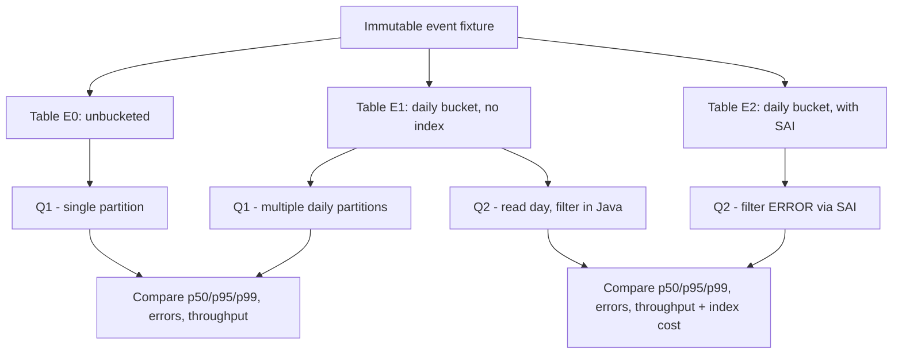

# Measuring Latency Before and After Changing Schemas, Indexes, or Bucketing

## 1. Context and Practice Objectives

A Java system stores activity events in **Apache Cassandra**. Each event belongs to an account, has an occurrence timestamp, and has an event type (`INFO`, `WARN`, `ERROR`). The API must answer two queries:

- **Q1 — Timeline:** fetch up to 100 newest events for an account within a given time range, potentially spanning multiple days.
- **Q2 — Daily Errors:** fetch up to 50 newest `ERROR` events for an account on a single UTC day.

Initially the table is partitioned by account, so accounts with many events can produce oversized partitions. The engineering team proposes **splitting partitions by day** and **adding an index to filter `event_type`**. Both changes carry costs: adding partitions can force Q1 to execute multiple reads, while an index can increase write overhead and disk footprint. We need measurements to decide.

This lab belongs to the **Integrated Practice** chapter of module `DATABASE_ENGINE_WIDE_COLUMN_CASSANDRA`: applying the wide-column model, partition keys, query-driven tables, consistency levels, replication, compaction, repair, failure handling, and the Java Driver to **measure changes fairly**.

After completing this lab, you will be able to:

1. Construct a reproducible dataset and two semantically equivalent business queries across schemas.
2. Design an A/B experiment comparing unbucketed partitions, daily-bucketed partitions, and SAI indexes.
3. Measure **p50/p95/p99**, throughput, errors, partition sizes, fetched pages, and write costs.
4. Separate schema/index effects from cache, consistency level, compaction, and concurrency effects.
5. Verify **identical query results before comparing latency**, analyze outcomes, and make a conditional engineering decision.

> **Rule:** Any numbers mentioned in this guide are illustrative targets or examples, **not measurements taken from a real cluster**. Learners must execute the tests on an authorized environment and fill in their own results table.

## 2. Foundation: Measure the Right Thing to Optimize

In Cassandra, the **partition key** determines which token ranges and replicas store the data; **clustering columns** govern row ordering within a single partition. Consequently, when an account accumulates hundreds of thousands of events in one partition, time-range queries suffer from partition size, SSTable fan-out, tombstones, and compaction activity. Splitting by day creates smaller partitions but increases the number of partitions queried when users view multiple days.

**Secondary Indexes / Storage-Attached Indexes (SAI)** can assist filtering on non-primary-key columns in supported Cassandra versions; indexes do not alter the partition key and cannot salvage a poorly modeled query design. Indexes also incur maintenance overhead during writes, deletes, and compactions.

The latency of **a single CQL query** and the latency of **a single business request** can diverge. For instance, Q1 on a bucketed table might execute 7 `SELECT` statements, merge results, sort, and only then return 100 events. Therefore, primary measurements must encompass **all Cassandra calls, data transfer, decoding, and application processing needed to return accurate Q1/Q2 answers**.

| Metric | Definition in this lab | Why it is needed |
|---|---|---|
| `p50`, `p95`, `p99` (ms) | Per-business-request latency percentiles, measured with a monotonic clock | Shows median latency and tail slowness |
| Throughput (req/s) | **Successful** request count divided by actual measurement duration | Reveals performance under concurrent load |
| Error rate | Timeouts, read failures, decode errors, invalid outputs / total requests | A fast approach with high failure rates fails requirements |
| Rows/pages read | Rows transferred through the driver and CQL pages fetched per request | Exposes scanning/filtering overhead and network volume |
| CPU, I/O, heap/GC, coordinator latency | Cluster/driver metrics over the same measurement window | Checks whether cost was merely shifted from the app to Cassandra |
| Partition size, SSTables/read, tombstones | Operational stats on tested tables | Explains why performance improved or degraded |
| Write p95/p99, index/disk size | Measured separately on an equivalent write workload | Indexes and denormalization are never free |

The p99 percentile means roughly 99% of samples had latency **no greater than** that value under the chosen percentile calculation method; do not infer that every request is faster than p99. Always report sample count, error rate, and percentile method alongside results.

## 3. Controlled Experiment Design



We conduct **two separate comparisons** to isolate root causes accurately:

| Experiment | Before | After | Unchanged logical query |
|---|---|---|---|
| **A — Bucketing** | E0: `events_unbucketed` | E1: `events_day_plain` | Q1: top 100 events of an account within a time range |
| **B — Adding Index** | E1: `events_day_plain`, `ERROR` filtered in Java | E2: `events_day_sai`, `ERROR` filtered via SAI | Q2: top 50 `ERROR` events of an account on the same day |

In Experiment B, E1 and E2 must contain the **exact same row count and content**. Baseline E1 intentionally reads the entire day's partition and filters in Java; that is a valid control producing the **exact same answer**, albeit at higher network and CPU cost. Never compare an indexed Q2 against an arbitrary `ALLOW FILTERING` query and declare the index victorious: the baseline query must be clearly defined and verified for equivalence.

### 3.1. Variables to Hold Constant

- Keep **Cassandra version, topology, node count, datacenter, RF, driver, heap, CPU/RAM, disk, compaction strategy**, and request timeouts identical across each experiment pair.
- Use the same record dataset, hot/cold account distribution, query time windows, request sequence (or fixed random seed), and returned payload sizes.
- Pick one consistent consistency level across queries, e.g., `LOCAL_QUORUM` when the datacenter has RF = 3 and sufficient healthy replicas. Never switch one side to `LOCAL_ONE` and attribute the latency drop to schema changes.
- Complete all data loading before measuring; let background index builds and compactions settle. If compaction runs during a test, note it and re-run under equal conditions.
- Disable Redis, JVM caches, and HTTP caches in Cassandra read tests. **OS page cache, block/key caches, and driver caches** still play a role; report warm-cache and cold-ish cache runs separately, and never claim all caches were flushed unless proven.
- Run identical concurrency and duration, testing multiple load tiers (e.g., 1, 8, 32, and 64 threads) to locate saturation points. Never compare one variant under light load against another under heavy load.
- While measuring one table, never run a concurrent load generator against the control table. Alternate run order **A–B–A** or **B–A–B** to detect time-based drift and thermal/state effects.

## 4. Preparing the Cluster and Dataset

Suitable environment: a test Cassandra cluster (**5.0 or newer to use built-in SAI**), Java 17+, Apache Cassandra Java Driver 4.x, `cqlsh`, `nodetool`, and metrics access. You can use a single test DC with 3 replicas. The example below uses DC name `dc1`; substitute your actual DC name and never copy this configuration blindly into production.

```sql
CREATE KEYSPACE IF NOT EXISTS latency_lab
WITH replication = {'class': 'NetworkTopologyStrategy', 'dc1': 3};

-- E0: all events of an account reside in a single partition.
CREATE TABLE IF NOT EXISTS latency_lab.events_unbucketed (
    tenant_id   uuid,
    account_id  uuid,
    event_time  timestamp,
    event_id    bigint,
    event_type  text,
    payload     text,
    PRIMARY KEY ((tenant_id, account_id), event_time, event_id)
) WITH CLUSTERING ORDER BY (event_time DESC, event_id DESC);

-- E1: each UTC day of each account resides in its own partition.
CREATE TABLE IF NOT EXISTS latency_lab.events_day_plain (
    tenant_id   uuid,
    account_id  uuid,
    bucket_day  date,
    event_time  timestamp,
    event_id    bigint,
    event_type  text,
    payload     text,
    PRIMARY KEY ((tenant_id, account_id, bucket_day), event_time, event_id)
) WITH CLUSTERING ORDER BY (event_time DESC, event_id DESC);

-- E2: same data as E1, plus an index on event_type.
CREATE TABLE IF NOT EXISTS latency_lab.events_day_sai (
    tenant_id   uuid,
    account_id  uuid,
    bucket_day  date,
    event_time  timestamp,
    event_id    bigint,
    event_type  text,
    payload     text,
    PRIMARY KEY ((tenant_id, account_id, bucket_day), event_time, event_id)
) WITH CLUSTERING ORDER BY (event_time DESC, event_id DESC);

-- SAI syntax on Apache Cassandra 5.0+; verify version before creating.
CREATE CUSTOM INDEX IF NOT EXISTS events_day_type_sai
ON latency_lab.events_day_sai (event_type)
USING 'StorageAttachedIndex';
```

**Version note:** SAI support and syntax can vary across Cassandra distributions. If your cluster version does not support SAI, mark Experiment B as `N/A` or design a separate **alternative index** experiment specifying its exact name and version; never silently substitute and mix results. Creating an index does not mean it has finished building across all existing data: begin measurements only after the system reports the index is ready.

### 4.1. Reproducible Dataset

Configure a deterministic fixture with `seed = 20261121`, such as **3 million events**, **5 tenants**, **1,000 accounts**, and **30 UTC days**. Route ~60% of events into 20 "hot" accounts to introduce realistic skew; keep 8% `ERROR`, 12% `WARN`, and the rest `INFO`. Give each payload a fixed-size string (e.g., 256 bytes) so data-type bandwidth stays uniform. These numbers are sizing suggestions: scale down if lab resources are constrained, while keeping both small and large accounts.

Each source record has the shape:

```text
(tenant_id, account_id, event_time_utc, event_id, event_type, payload)
```

In the generator, `event_id` is a unique integer per event, distinguishing events sharing the same millisecond. **Write the exact same event** into all three tables; never regenerate timestamps, IDs, or payloads separately per table. Compute `bucket_day` as the **UTC date** of `event_time`, strictly independent of JVM local timezone. Verify that `event_time` never mismatches its bucket day.

```java
// Data loading pseudocode: all three tables receive the exact same input record.
Instant time = event.eventTime();
LocalDate bucket = time.atZone(ZoneOffset.UTC).toLocalDate();

// Execute via PreparedStatement with bound columns (never concatenate CQL strings).
writeUnbucketed(event.tenant(), event.account(), time,
                event.id(), event.type(), event.payload());
writeDayPlain(event.tenant(), event.account(), bucket, time,
              event.id(), event.type(), event.payload());
writeDaySai(event.tenant(), event.account(), bucket, time,
            event.id(), event.type(), event.payload());
```

The `write...` helpers above are pseudocode; learners must implement them using the Java Driver with bounded concurrent writes and timeout tracking. **Never bundle millions of multi-partition rows into one giant CQL `BATCH`**: batches are not a bulk-import accelerator and can overload the coordinator. Prefer prepared statements + concurrency-bounded asynchronous writes; treat a row as loaded only when the driver acknowledges success at the chosen CL. Reconcile any timed-out writes whose status is indeterminate.

Sample single event for manual schema verification:

```sql
INSERT INTO latency_lab.events_unbucketed
    (tenant_id, account_id, event_time, event_id, event_type, payload)
VALUES
    (11111111-1111-1111-1111-111111111111,
     22222222-2222-4222-8222-222222222222,
     '2026-11-01T10:00:00Z', 1, 'ERROR', 'sample');

INSERT INTO latency_lab.events_day_plain
    (tenant_id, account_id, bucket_day, event_time, event_id, event_type, payload)
VALUES
    (11111111-1111-1111-1111-111111111111,
     22222222-2222-4222-8222-222222222222,
     '2026-11-01', '2026-11-01T10:00:00Z', 1, 'ERROR', 'sample');

INSERT INTO latency_lab.events_day_sai
    (tenant_id, account_id, bucket_day, event_time, event_id, event_type, payload)
VALUES
    (11111111-1111-1111-1111-111111111111,
     22222222-2222-4222-8222-222222222222,
     '2026-11-01', '2026-11-01T10:00:00Z', 1, 'ERROR', 'sample');
```

Do not attach TTLs to events in the primary benchmark: **TTL creates tombstones**, which can skew schema comparisons even for identical live data. If your production workload uses TTL, run a separate sub-experiment with identical TTL/retention policies across all variants, and measure compaction and tombstone scans alongside it.

### 4.2. Pre-Benchmark Data Verification

Given a test set of `(tenant_id, account_id, from, to)` tuples and days, verify:

1. Source event count, acknowledged write count per table, failed/retried records, and actual partition count.
2. For **Q1**, compare the ordered list of `(event_time, event_id, event_type)` between E0 and E1; both must match across up to 100 events.
3. For **Q2**, compare the list of up to 50 `ERROR` events between E1 (Java filter) and E2 (SAI filter). Never compare results by row count alone, because ordering or content could differ.
4. Test day boundaries `23:59:59.999Z` / `00:00:00Z`, empty accounts, accounts with multiple events in the same millisecond, and multi-day ranges.

Proceed to performance benchmarking only when outputs are **identical**. A bucketing bug is never a "successful optimization."

## 5. Experiment A — Unbucketed vs. Daily Bucket

### 5.1. Q1 on the Old Table: Single Partition

```sql
SELECT event_time, event_id, event_type
FROM latency_lab.events_unbucketed
WHERE tenant_id = ? AND account_id = ?
  AND event_time >= ? AND event_time < ?
LIMIT 100;
```

This query specifies the full partition key and filters on the first clustering column. Because the table declares `CLUSTERING ORDER BY (event_time DESC, event_id DESC)`, events in the window are returned newest first. Even when the window spans many days, all data resides in **one logical partition for that account**.

### 5.2. Q1 on the Bucketed Table: Multiple Daily Partitions

```sql
SELECT event_time, event_id, event_type
FROM latency_lab.events_day_plain
WHERE tenant_id = ? AND account_id = ? AND bucket_day = ?
  AND event_time >= ? AND event_time < ?
LIMIT 100;
```

The application must:

1. Convert `[from, to)` into the set of UTC dates covered by the interval. For instance, `[2026-11-01T00:00:00Z, 2026-11-04T00:00:00Z)` reads days 01, 02, and 03, **excluding day 04**.
2. Query each day sequentially or with bounded concurrency using the full partition key. `LIMIT 100` **per day** never drops a global top-100 event, because an event outside a single day's top 100 cannot belong to the multi-day top 100.
3. Merge the lists, sort descending by `(event_time, event_id)`, and take the first 100 items. When paginating, design a cross-bucket cursor to avoid skipping or duplicating rows: Cassandra's `pagingState` applies to a single `SELECT`, not the merged multi-bucket stream.

**Hypothesis to test:** bucketing shrinks hot partitions and lowers single-day read cost; conversely, a 7-day Q1 may become **slower** due to reading 7 partitions and merging results. Test Q1 across 1-day, 7-day, and 30-day windows for small, medium, and large accounts.

### 5.3. Choosing Bucket Granularity from Data, Not Habit

| Bucket | Potential benefit | Risk to measure |
|---|---|---|
| Monthly | Fewer partitions for multi-day queries | Hot accounts still create huge partitions |
| Daily | Balances partition size against query fan-out | A 30-day timeline requires querying 30 partitions |
| Hourly | Caps very hot partitions over time | Large fan-out over multi-day views; higher metadata/key overhead |
| Count-based (`bucket_id`) | Controls rows/partition when event density spikes | Harder time-based lookup; requires bucket metadata mapping and stable assignment |

Do not automatically pick the smallest possible bucket. The aim is reasonably sized partitions **while allowing business queries to determine which buckets to read**. If one account generates a thousand times more traffic than another, an adaptive bucketing policy may be warranted, provided you maintain reliable bucket mappings, a stable write path, and clear read rules.

## 6. Experiment B — Filtering in Java vs. Filtering via SAI

Q2 requests the **50 newest `ERROR` events on a single day**. Both variants operate on identically populated daily-bucket tables.

**E1 — No index:** read all events for the account/day from Cassandra, iterate through all driver pages, filter for `ERROR`, sort descending by `(event_time, event_id)`, and take 50:

```sql
SELECT event_time, event_id, event_type
FROM latency_lab.events_day_plain
WHERE tenant_id = ? AND account_id = ? AND bucket_day = ?;
```

**E2 — With SAI:** let Cassandra filter `event_type` through the index, then still sort/cap at 50 in Java for logical equivalence:

```sql
SELECT event_time, event_id, event_type
FROM latency_lab.events_day_sai
WHERE tenant_id = ? AND account_id = ? AND bucket_day = ?
  AND event_type = 'ERROR';
```

SAI enables querying on the indexed column where supported by your version/distribution. Before benchmarking, run Q2 directly against the target cluster to confirm validity; **never force `ALLOW FILTERING` to bypass an unready index error**. To optimize further by pushing `LIMIT 50` directly onto the SAI query, verify sort order and equivalence on your exact Cassandra version.

**Hypothesis:** if `ERROR` events are rare and an account/day holds many events, SAI can drastically cut the rows transferred to the application. Conversely, if a day has few events or `ERROR` is the majority, scanning a small partition may be equally fast or faster, while SAI adds write and index-maintenance overhead. Measure ingest throughput, write p95/p99, disk footprint, and index rebuild/recovery times as well.

If Q2 is critical and always filters by `event_type`, an additional option to evaluate is a **dedicated query-driven table**:

```sql
-- Extension option, NOT part of the primary A/B comparison.
CREATE TABLE latency_lab.events_day_by_type (
    tenant_id  uuid,
    account_id uuid,
    bucket_day date,
    event_type text,
    event_time timestamp,
    event_id   bigint,
    PRIMARY KEY ((tenant_id, account_id, bucket_day, event_type),
                 event_time, event_id)
) WITH CLUSTERING ORDER BY (event_time DESC, event_id DESC);
```

This table serves Q2 via full partition key and `LIMIT 50`, at the cost of writing an extra copy and handling multi-table synchronization failures. **Cassandra batches do not provide general ACID isolation** across multi-partition updates. Introduce this option only as an independent Experiment C if product requirements justify it.

## 7. Building a Fixed Query Workload Fixture

Generate a CSV fixture file `requests.csv` using your preferred tool, kept outside the lesson files and **free of any secrets**. Example format:

```csv
tenant_id,account_id,from,to,day
11111111-1111-1111-1111-111111111111,22222222-2222-2222-2222-222222222222,2026-11-01T00:00:00Z,2026-11-04T00:00:00Z,2026-11-02
11111111-1111-1111-1111-111111111111,33333333-3333-3333-3333-333333333333,2026-11-02T12:00:00Z,2026-11-03T12:00:00Z,2026-11-02
```

Each line supplies inputs for both queries: `from/to` for Q1 and `day` for Q2. Include rows covering 1/7/30-day windows, hot/cold accounts, empty days, busy days, and sparse/dense `ERROR` distributions. **Keep the exact same request list, ordering, and seed** across E0/E1/E2 runs. Exclude CSV generation or account-selection time from query execution timing.

To surface query-specific differences, slice results into groups:

- `recent_1d`, `recent_7d`, `recent_30d` for Q1;
- `error_sparse`, `error_dense`, and actual event count per partition for Q2;
- normal vs. hot accounts; cold-ish vs. warm cache; concurrency 1/8/32/64.

Never collapse everything into one overall p99 when your goal is explaining why bucketing helps 1-day reads while hurting 30-day reads.

## 8. Minimal Java Benchmark: End-to-End Business Query Timing

The example below uses **Apache Cassandra Java Driver 4.x** and Java 17. Add the matching `com.datastax.oss:java-driver-core` dependency. Environment variables `CASSANDRA_HOST`, `CASSANDRA_PORT`, and `CASSANDRA_DC` target your test cluster, defaulting to `127.0.0.1:9042` and `dc1`. The program reads `requests.csv` from section 7, warms up, and executes concurrently across a fixed worker pool.

```java
import com.datastax.oss.driver.api.core.CqlSession;
import com.datastax.oss.driver.api.core.DefaultConsistencyLevel;
import com.datastax.oss.driver.api.core.cql.*;

import java.net.InetSocketAddress;
import java.nio.charset.StandardCharsets;
import java.nio.file.*;
import java.time.*;
import java.util.*;
import java.util.concurrent.*;
import java.util.concurrent.atomic.*;
import java.util.stream.Stream;

public final class CassandraLatencyLab {
    record Request(UUID tenant, UUID account, Instant from, Instant to, LocalDate day) {}
    record Event(Instant time, long id, String type) {}
    record Result(long[] durationsNs, int failures, long rowsReturned, long wallNs) {}

    enum Variant { OLD, BUCKET, PLAIN_FILTER, SAI_FILTER }

    static final Comparator<Event> NEWEST =
        Comparator.comparing(Event::time).thenComparingLong(Event::id).reversed();

    static String env(String key, String defaultValue) {
        return System.getenv().getOrDefault(key, defaultValue);
    }

    static List<Request> loadRequests(Path csv) throws Exception {
        try (Stream<String> lines = Files.lines(csv, StandardCharsets.UTF_8)) {
            return lines.skip(1).filter(s -> !s.isBlank()).map(line -> {
                String[] c = line.split(",", -1); // Lab CSV: five columns, no quoted commas.
                if (c.length != 5) throw new IllegalArgumentException("Invalid request row");
                Request r = new Request(UUID.fromString(c[0]), UUID.fromString(c[1]),
                    Instant.parse(c[2]), Instant.parse(c[3]), LocalDate.parse(c[4]));
                if (!r.from().isBefore(r.to())) throw new IllegalArgumentException("from >= to");
                return r;
            }).toList();
        }
    }

    static final class Queries {
        private final CqlSession session;
        private final PreparedStatement oldQuery, bucketQuery, plainFilter, saiFilter;

        Queries(CqlSession session) {
            this.session = session;
            oldQuery = session.prepare(
                "SELECT event_time,event_id,event_type FROM latency_lab.events_unbucketed " +
                "WHERE tenant_id=? AND account_id=? AND event_time>=? AND event_time<? LIMIT 100");
            bucketQuery = session.prepare(
                "SELECT event_time,event_id,event_type FROM latency_lab.events_day_plain " +
                "WHERE tenant_id=? AND account_id=? AND bucket_day=? " +
                "AND event_time>=? AND event_time<? LIMIT 100");
            plainFilter = session.prepare(
                "SELECT event_time,event_id,event_type FROM latency_lab.events_day_plain " +
                "WHERE tenant_id=? AND account_id=? AND bucket_day=?");
            saiFilter = session.prepare(
                "SELECT event_time,event_id,event_type FROM latency_lab.events_day_sai " +
                "WHERE tenant_id=? AND account_id=? AND bucket_day=? AND event_type=?");
        }

        List<Event> select(PreparedStatement ps, Object... args) {
            BoundStatement bound = ps.bind(args)
                .setConsistencyLevel(DefaultConsistencyLevel.LOCAL_QUORUM)
                .setPageSize(500);
            List<Event> result = new ArrayList<>();
            for (Row row : session.execute(bound)) { // Fetch all pages, including decoding.
                result.add(new Event(row.getInstant("event_time"),
                    row.getLong("event_id"), row.getString("event_type")));
            }
            return result;
        }

        static List<Event> top(List<Event> events, int limit) {
            events.sort(NEWEST);
            return events.size() <= limit ? events :
                new ArrayList<>(events.subList(0, limit));
        }

        List<Event> execute(Variant variant, Request r) {
            return switch (variant) {
                case OLD -> top(select(oldQuery, r.tenant(), r.account(),
                    r.from(), r.to()), 100);

                case BUCKET -> {
                    List<Event> merged = new ArrayList<>();
                    LocalDate first = r.from().atZone(ZoneOffset.UTC).toLocalDate();
                    LocalDate last = r.to().minusNanos(1)
                        .atZone(ZoneOffset.UTC).toLocalDate();
                    for (LocalDate day = first; !day.isAfter(last); day = day.plusDays(1)) {
                        merged.addAll(select(bucketQuery, r.tenant(), r.account(),
                            day, r.from(), r.to()));
                    }
                    yield top(merged, 100);
                }

                case PLAIN_FILTER -> {
                    List<Event> all = select(plainFilter, r.tenant(), r.account(), r.day());
                    all.removeIf(e -> !"ERROR".equals(e.type()));
                    yield top(all, 50);
                }

                case SAI_FILTER -> top(select(saiFilter, r.tenant(),
                    r.account(), r.day(), "ERROR"), 50);
            };
        }
    }

    static Result run(Queries queries, Variant variant, List<Request> cases,
                      int attempts, int threads) throws Exception {
        long[] durations = new long[attempts];
        boolean[] success = new boolean[attempts];
        AtomicInteger cursor = new AtomicInteger();
        AtomicLong consumed = new AtomicLong();
        CountDownLatch ready = new CountDownLatch(threads);
        CountDownLatch startSignal = new CountDownLatch(1);
        ExecutorService pool = Executors.newFixedThreadPool(threads);
        List<Future<?>> workers = new ArrayList<>();

        try {
            for (int t = 0; t < threads; t++) {
                workers.add(pool.submit(() -> {
                    ready.countDown();
                    startSignal.await();
                    int index;
                    while ((index = cursor.getAndIncrement()) < attempts) {
                        Request request = cases.get(index % cases.size());
                        long begin = System.nanoTime();
                        try {
                            List<Event> rows = queries.execute(variant, request);
                            durations[index] = System.nanoTime() - begin;
                            success[index] = true;
                            consumed.addAndGet(rows.size()); // Prevent dead-code elimination.
                        } catch (RuntimeException error) {
                            durations[index] = System.nanoTime() - begin;
                            // Benchmark: count errors, never convert errors into "empty".
                        }
                    }
                    return null;
                }));
            }
            ready.await();
            long wallStart = System.nanoTime();
            startSignal.countDown();
            for (Future<?> worker : workers) worker.get();
            long wallNs = System.nanoTime() - wallStart;
            int failures = 0;
            for (boolean ok : success) if (!ok) failures++;
            return new Result(durations, failures, consumed.get(), wallNs);
        } finally {
            pool.shutdownNow();
        }
    }

    static double percentileMs(long[] sortedNs, double percentile) {
        int index = Math.max(0, (int) Math.ceil(percentile * sortedNs.length) - 1);
        return sortedNs[index] / 1_000_000.0;
    }

    public static void main(String[] args) throws Exception {
        if (args.length != 5) {
            System.err.println("Usage: OLD|BUCKET|PLAIN_FILTER|SAI_FILTER " +
                "requests.csv warmup measured threads");
            System.exit(2);
        }
        Variant variant = Variant.valueOf(args[0]);
        List<Request> requests = loadRequests(Path.of(args[1]));
        int warmup = Integer.parseInt(args[2]);
        int count = Integer.parseInt(args[3]);
        int threads = Integer.parseInt(args[4]);
        if (requests.isEmpty() || warmup < 0 || count <= 0 || threads <= 0)
            throw new IllegalArgumentException("Invalid workload parameters");

        try (CqlSession session = CqlSession.builder()
                .addContactPoint(new InetSocketAddress(
                    env("CASSANDRA_HOST", "127.0.0.1"),
                    Integer.parseInt(env("CASSANDRA_PORT", "9042"))))
                .withLocalDatacenter(env("CASSANDRA_DC", "dc1"))
                .build()) {
            Queries q = new Queries(session);
            Result warm = run(q, variant, requests, warmup, threads);
            if (warm.failures() > 0)
                throw new IllegalStateException("Warmup failed: " + warm.failures());

            Result measured = run(q, variant, requests, count, threads);
            long[] ns = measured.durationsNs().clone();
            Arrays.sort(ns);
            int successful = count - measured.failures();
            double sec = measured.wallNs() / 1_000_000_000.0;
            System.out.printf(Locale.ROOT,
                "variant=%s threads=%d attempts=%d failures=%d " +
                "success_rps=%.1f p50=%.2fms p95=%.2fms p99=%.2fms rows=%d%n",
                variant, threads, count, measured.failures(), successful / sec,
                percentileMs(ns, 0.50), percentileMs(ns, 0.95),
                percentileMs(ns, 0.99), measured.rowsReturned());
        }
    }
}
```

**Harness scope and limitations:**

- Measures from just before invoking the driver until all pages are consumed and top-N merged, including subsequent page fetch round-trips. `p50/p95/p99` in this sample are computed across **all attempts**, including failures; always inspect `failures` alongside latency. In a full report, separate percentiles for successful requests and break down errors/timeouts by type.
- This uses **closed-loop load**: each worker sends a new request only after the previous one completes. When latency climbs, arrival rate drops automatically, causing **coordinated omission**. To measure SLOs under fixed arrival rates, add an open-loop / fixed-arrival load generator and compute latency from scheduled request start times.
- The harness does not generate fixtures, verify equivalence, count fetched pages, or collect CPU/disk telemetry. Perform those tasks as described in sections 4, 9, and 10. Do not mistake `rows` in the output for the number of rows Cassandra scanned; it is merely **the event count after filtering/top-N**.
- `BUCKET` in the sample reads days **sequentially**. If production uses bounded-concurrency fan-out, benchmark the parallel implementation as a distinct variant and account for the extra concurrent load placed on Cassandra.
- Keep the exact same driver profile, connection/pool settings, consistency level, and fetch size across runs. Never alter `requests.csv` between comparison rounds.

### 8.1. Illustrative Run Commands

After installing dependencies, compile the Java class on **your test machine** and pass arguments such as:

```text
OLD          requests.csv 3000 10000 8
BUCKET       requests.csv 3000 10000 8
PLAIN_FILTER requests.csv 3000 10000 8
SAI_FILTER   requests.csv 3000 10000 8
```

Alternate `OLD → BUCKET → OLD` to check for drift, then `PLAIN_FILTER → SAI_FILTER → PLAIN_FILTER`. Repeat at least 3 rounds after warmup. Increase sample count when estimating p99 stably; at 10,000 samples, the p99 tail reflects only the slowest ~100 samples. Keep run durations long enough to avoid startup effects dominating. **Run Q1 and Q2 as two separate workloads**, since mixing queries with vastly different page/row profiles obscures interpretation.

## 9. Observing Cassandra During the Same Measurement Window

Before, during, and after each benchmark round, log UTC timestamps alongside cluster metrics. Useful commands:

```bash
nodetool status
nodetool tablestats latency_lab.events_unbucketed
nodetool tablestats latency_lab.events_day_plain
nodetool tablestats latency_lab.events_day_sai
nodetool tablehistograms latency_lab events_unbucketed
nodetool tablehistograms latency_lab events_day_plain
nodetool tablehistograms latency_lab events_day_sai
nodetool compactionstats
nodetool tpstats
```

Exact output formats vary by Cassandra version, but the goal is tracking node `UN/DN` state, SSTables per read, read/write latency, partition sizes, tombstone counts, active compactions, thread-pool queues, dropped messages, and hardware utilization. Collect metrics from **all involved replicas and coordinators**, not solely the node where `cqlsh` runs.

Example read with tracing to inspect the query path:

```sql
CONSISTENCY LOCAL_QUORUM;
TRACING ON;
SELECT event_time, event_id, event_type
FROM latency_lab.events_unbucketed
WHERE tenant_id = 11111111-1111-1111-1111-111111111111
  AND account_id = 22222222-2222-4222-8222-222222222222
  AND event_time >= '2026-11-01T00:00:00Z'
  AND event_time < '2026-11-04T00:00:00Z'
LIMIT 100;
TRACING OFF;
```

Tracing reveals the coordinator, involved replicas, SSTable read times, tombstones examined, and execution steps. **Tracing adds overhead**, so run it only on a few representative requests **outside** the main benchmark window. Never compare a trace-enabled variant against a trace-disabled variant.

### 9.1. Measuring Write Cost and Disk Usage

SAI affects more than the read path; table E2 must maintain index structures on every write. Run a dedicated write workload with the same batch of 100,000 new events and identical concurrency, writing to E1 and E2 in **two separate runs**. Measure write p50/p95/p99, successes/timeouts, throughput, disk bytes, CPU, and compaction/index build activity. Never write to both E1 and E2 simultaneously if your goal is isolating each table's write cost.

For E0/E1, also measure **partitions per account**, partition size histograms, SSTable disk space, and compaction pressure. Never declare a design superior solely because read p99 dropped if write p99 or disk consumption exceeds operational budgets.

## 10. Recording Results Using a Template

Keep one row **per query group, concurrency tier, and run**. The blank table below serves as a template for recording real measurements:

| Workload | Variant | Threads | Samples | p50 (ms) | p95 (ms) | p99 (ms) | Success req/s | Errors | Rows/pages read (if tracked) |
|---|---|---:|---:|---:|---:|---:|---:|---:|---|
| Q1, 1 day | E0 unbucketed | 8 | — | — | — | — | — | — | — |
| Q1, 1 day | E1 daily bucket | 8 | — | — | — | — | — | — | — |
| Q1, 7 days | E0 unbucketed | 8 | — | — | — | — | — | — | — |
| Q1, 7 days | E1 daily bucket | 8 | — | — | — | — | — | — | — |
| Q2, hot account | E1 Java filter | 8 | — | — | — | — | — | — | — |
| Q2, hot account | E2 SAI filter | 8 | — | — | — | — | — | — | — |

Also record configuration metadata: date/time, application commit/version, Cassandra/driver versions, node count, RF, CL, DC, compaction strategy, `concurrency`, `fetch size`, dataset size, account skew, payload size, cache state, timeouts, and index build status. When comparing results in reports, use consistent units and formulas:

```text
p99 reduction (%) = (p99_before - p99_after) / p99_before * 100
p99 speedup (x)   = p99_before / p99_after
Error rate (%)    = failures / attempts * 100
```

Example **simulated numbers for practicing chart interpretation—not real measurements**:

| Simulated scenario | p99 before | p99 after | Preliminary interpretation |
|---|---:|---:|---|
| Q1, hot account, 1-day window, E0 → E1 | 160 ms | 95 ms | ~40.6% reduction; must still check write/partition costs and cross-run stability |
| Q1, hot account, 30-day window, E0 → E1 | 180 ms | 330 ms | Bucketing increased latency due to fan-out; cannot claim E1 wins in every case |
| Q2, busy day, E1 → E2 | 240 ms | 100 ms | SAI may reduce scan cost; continue checking write cost and index size |

In the first example, `p99 speedup = 160 / 95 ≈ 1.68x`. Yet these three rows **prove nothing** about your cluster until you run real measurements. Every comparison needs multiple runs and variance bounds to tell genuine improvements from noise.

### 10.1. Decision-Making When Metrics Conflict

A schema might improve p50 while hurting p99: inspect tombstone scans, compaction, GC, partition/round-trip counts, and concurrent coordinator load. An index might cut bytes transferred while degrading write throughput: decide whether Q2 or the write path is the higher priority.

Example acceptance criteria **set by a project team**:

- Q1 1-day: p99 <= 150 ms; Q1 7-day: p99 <= 300 ms at target load.
- Q2 `ERROR`: p99 <= 200 ms, error rate below the agreed SLO threshold.
- Write p99 stays within its allocated budget, index/partition sizes remain monitored, and repair/compaction stay healthy.

These are **illustrative SLOs for practice**. If measurements miss targets, optimize the query model, bucketing, fan-out, paging, replica locality, or resource bottlenecks before blindly throwing hardware at the cluster. Different queries may warrant different tables rather than forcing one table to solve every problem.

## 11. Sources of Experimental Bias

| Bias | Symptom | Mitigation |
|---|---|---|
| Comparing queries returning different results | Bucketed query drops events at day boundaries; index misses rows | Compare ordered event IDs before benchmarking; fix query or data |
| Cluster running compaction/repair/index build | p99 spikes erratically across runs | Record state and re-measure once steady; optionally test deliberate background maintenance separately |
| Mismatched dataset or account distribution | Smaller table appears "faster" | Use one fixture, same seed, and verify row/partition counts |
| Differing consistency levels | One variant uses `LOCAL_ONE`, the other `LOCAL_QUORUM` | Pin CL and document RF/DC explicitly |
| Timing individual CQL calls instead of total Q1 | E1 shows low per-`SELECT` p99 while the API is slow | Measure from before the first query until merging finishes |
| Measuring a single request or cold-started JVM | Numbers look great or wildly unstable | Warm up, run multiple rounds with adequate samples, test concurrency, and reverse run order |
| Caching on only one side | Hit rates differ; Cassandra handles unequal load | Disable app caches in the lab; report warm/cold runs separately |
| Writing data concurrently during read benchmarks | Read/compaction times shift across runs | Separate read-only and mixed read/write workloads |
| Filtering in Java but stopping on page 1 | Q2 misses `ERROR` events on later pages | Fetch all required pages and verify output equivalence |
| Wrong time units | p99 of 900 assumed to be ms when actually µs | Convert `ns / 1e6 = ms`, using `System.nanoTime()` for elapsed intervals |

### 11.1. Impact of Repair, Replication, and Consistency

In an RF = 3 cluster, `LOCAL_QUORUM` requires responses from a majority of replicas in the local DC. If one replica stalls due to GC, disk I/O, or compaction, p99 can fluctuate even when schemas and queries remain unchanged. Repair keeps replicas synchronized over time; always record whether repair ran during tests. Never raise or lower `gc_grace_seconds` just to flatter benchmark numbers without evaluating repair/tombstone safety and zombie-data risks.

Multi-DC experiments must document which DC receives requests, where `LOCAL_QUORUM` applies, and cross-DC replication lag. Comparing across two different DCs may measure network geography and hardware differences rather than schema behavior.

### 11.2. TTL, Tombstones, and Compaction

If event data carries a 30-day TTL, Cassandra represents expired values as tombstones; reads near expiration windows can exhibit very different tail latency from fresh data. For append-mostly time-series data with uniform TTLs, **TimeWindowCompactionStrategy (TWCS)** may be worth evaluating, only after understanding how late writes, updates to old rows, heterogeneous TTLs, and retention affect SSTable purging. Never switch STCS to TWCS **at the same time** as changing the partition key and credit the entire gain to bucketing.

### 11.3. Java Driver Errors and Timeouts

Distinguish queries returning zero events (an empty list) from `ReadTimeoutException`, `UnavailableException`, connection errors, or decode failures. Bound timeouts, retries, and idempotency; automatic retries can amplify cluster load and skew measurements. Log error types, retry counts, and whether requests eventually succeeded. Never discard failed requests from your sample pool and report only clean latency numbers.

## 12. Extension Exercises with Guiding Answers

1. **Bucket analysis:** On a hot account, measure Q1 for 1/7/30 days. Why can 1-day p99 drop while 30-day p99 rises? *Guiding answer:* smaller partitions reduce per-read cost, but multi-day queries incur more partition reads and round-trips; measure pages/partitions read and merge time.
2. **Choosing bucket type:** If an account emits 3 million events/day, is daily bucketing still appropriate? *Guiding answer:* measure partition size and hot-query behavior, evaluate hourly or count-based buckets, and consider bucket lookup metadata.
3. **Index evaluation:** SAI speeds up Q2 reads when `ERROR` is only 1%, yet write p99 rises by 35%. Should you enable it? *Guiding answer:* depends on read/write ratio, SLOs, disk, compaction, and whether a dedicated query-driven table is better.
4. **Result equivalence:** Two variants return 50 events, but the top two elements appear in opposite order. Is this acceptable? *Guiding answer:* no, unless the contract explicitly declares order unimportant; in this lab, newest-first by `(event_time, event_id)` is mandatory.
5. **Statistical rigor:** You run five A–B–A rounds and per-round p99 swings wildly. What should you do? *Guiding answer:* check cluster load, caches, GC/compaction, and sample size; inspect full distributions and cross-round variance/confidence intervals before concluding.
6. **Fixed arrival-rate testing:** Why might a 32-worker test miss terrible p99 latency when the service receives 2,000 requests/second? *Guiding answer:* closed-loop workers throttle their arrival rate when the system slows down; add open-loop testing at a fixed arrival rate and include queueing time in latency.

## 13. Lab Acceptance Checklist

- [ ] A **single source event dataset** populates E0/E1/E2 with identical logical data.
- [ ] Verified Q1(E0) = Q1(E1) and Q2(E1) = Q2(E2) for event IDs, ordering, and empty results.
- [ ] Documented topology, Cassandra/driver versions, RF, DC, CL, compaction strategy, timeouts, dataset, seed, and workload.
- [ ] Measured p50/p95/p99, success req/s, and error rate per query group and concurrency across at least three rounds with warmup.
- [ ] Measured **end-to-end multi-bucket Q1 time**, including all `SELECT`s and Java merging.
- [ ] Inspected SSTables/read, partition sizes, compaction, and CPU/disk/GC during the same benchmark window.
- [ ] Benchmarked write throughput/latency of the SAI table against the non-SAI table.
- [ ] Accounted for confounding factors: caches, index builds, repair, compaction, GC, and networking.
- [ ] Report states pros/cons of each option, SLO pass criteria, decision, and next experiments needed.

## 14. Technical Conclusion

**Query-driven schemas** are the foundation of Cassandra; indexes and bucketing are useful tools with explicit trade-offs. When changing a partition key, measure both partition size and query fan-out. When adding an index, measure both the read path **and** the write path, disk usage, index build time, and compaction behavior. A trustworthy benchmark starts with **identical logical answers** and **equal experimental conditions**, and only then evaluates p99, throughput, and stability. Choosing E0, E1, or E2 depends on real query patterns and measurements from your target cluster.

### References

- Apache Cassandra Documentation — *Data modeling*: https://cassandra.apache.org/doc/stable/cassandra/developing/data-modeling/intro.html
- Apache Cassandra Documentation — *CQL reference*: https://cassandra.apache.org/doc/stable/cassandra/developing/cql/index.html
- Apache Cassandra Documentation — *Storage-Attached Indexing*: https://cassandra.apache.org/doc/stable/cassandra/developing/cql/indexing/sai/sai-overview.html
- Apache Cassandra Documentation — *Compaction*: https://cassandra.apache.org/doc/stable/cassandra/managing/operating/compaction/overview.html
- Apache Cassandra Documentation — *Repair*: https://cassandra.apache.org/doc/stable/cassandra/managing/operating/repair.html
- Apache Cassandra Java Driver documentation: https://docs.datastax.com/en/developer/java-driver/4.17/
