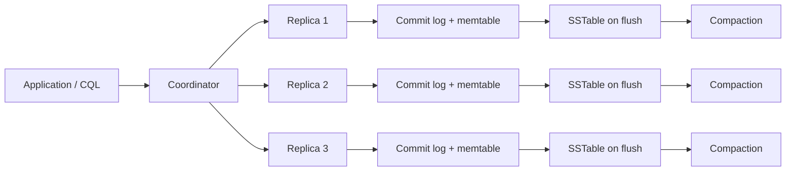

# Observing Compaction, Tombstones, and Post-Failure Replica Synchronization

## 1. Objectives and Practice Scenario

In the **Integrated Practice** chapter of module **DATABASE_ENGINE_WIDE_COLUMN_CASSANDRA**, we operate a three-node Apache Cassandra cluster, write data with CQL, generate multiple SSTables, observe compaction and tombstones, intentionally cause one replica to miss a write, and then use **anti-entropy repair** to synchronize it. This exercise connects distributed/wide-column architecture, partition keys, query-driven table design, read/write consistency levels, replication, compaction, repair, failure handling, and Java connectivity.

Upon completion, you will be able to:

1. Explain why a `DELETE`d or TTL-expired record can still occupy space in SSTables.
2. Use `nodetool tablestats`, `compactionstats`, `compactionhistory`, `status`, and logs to collect evidence of compaction and replica state.
3. Distinguish **an UP node** from **a synchronized replica**.
4. Reproduce a controlled missing-data scenario and compare state before and after `nodetool repair --full`.
5. Choose consistency levels and handle timeouts/retries at the Java layer based on application requirements.

**Safety scope:** All node-stopping, hint-disabling, forced flushing, and full repair actions in this lab apply strictly to an **isolated test cluster**; never run them directly on production. Observation commands can be used in live operations, mindful of cluster load and Cassandra version.

## 2. Background Knowledge Before Running the Lab

### 2.1. Path of a Write



- The **Partition key** determines the token and which replicas own the partition; the clustering key orders rows within the partition.
- Writes into Cassandra first hit the **commit log and memtable** on responding replicas. Flushing produces **immutable SSTables**. Compaction merges/filters SSTables, resolves cell versions, and can purge expired data once safety conditions are met.
- A **Tombstone** is a logical deletion marker propagated like a write; it is created after `DELETE` or TTL expiration. `SELECT` not returning a row **does not prove** bytes on disk have been reclaimed.
- **Hinted handoff** can help a replica catch up after brief outages, subject to configuration and the hint window; it **never replaces repair**.
- **Read repair** can also heal certain discrepancies during reads at appropriate consistency levels; therefore, to prove an impaired replica is missing data, avoid running queries that trigger read repair before collecting evidence.
- **Anti-entropy repair** compares data across replicas, detects differences, and streams missing ranges. A node showing `UN` (*Up/Normal*) on the ring only proves cluster membership, not that all records have converged.

### 2.2. Distinctions to Observe

| Phenomenon | Observable symptom | What **must not** be inferred |
| --- | --- | --- |
| Flush | New SSTables appear on disk; SSTable metrics update | Flushing does not synchronize data across replicas |
| Compaction | SSTables merge; `compactionhistory` logs a completed task | Not all tombstones are removed after a single compaction |
| TTL expiration | CQL stops returning expired cells/rows | Does not mean disk space immediately shrinks |
| Replica restart | `nodetool status` returns to `UN` | The replica may still be missing writes that occurred while it was down |
| Repair completion | Repair/streaming logs finish cleanly; probes converge | Does not replace ongoing monitoring or backup strategies |

## 3. Three-Node Lab Environment

**Requirements:** Docker Engine and Docker Compose v2; a host with enough RAM and disk for three Cassandra processes (recommend **8 GiB RAM or more** for the lab environment). Port `9042` must be free on the host if you plan to connect `cqlsh` or applications from outside the containers. Examples use **Apache Cassandra 4.1** via Docker image `cassandra:4.1`; exact messages and options may vary on 5.x or managed distributions.

Create a dedicated lab directory on your workstation and save the following as `compose.yaml`:

```yaml
services:
  node1:
    image: cassandra:4.1
    hostname: node1
    environment:
      CASSANDRA_CLUSTER_NAME: operations-lab
      CASSANDRA_DC: dc1
      CASSANDRA_RACK: rack1
      CASSANDRA_ENDPOINT_SNITCH: GossipingPropertyFileSnitch
      CASSANDRA_SEEDS: node1
      CASSANDRA_NUM_TOKENS: 16
    ports:
      - "9042:9042"
    volumes:
      - node1data:/var/lib/cassandra

  node2:
    image: cassandra:4.1
    hostname: node2
    environment:
      CASSANDRA_CLUSTER_NAME: operations-lab
      CASSANDRA_DC: dc1
      CASSANDRA_RACK: rack1
      CASSANDRA_ENDPOINT_SNITCH: GossipingPropertyFileSnitch
      CASSANDRA_SEEDS: node1
      CASSANDRA_NUM_TOKENS: 16
    volumes:
      - node2data:/var/lib/cassandra

  node3:
    image: cassandra:4.1
    hostname: node3
    environment:
      CASSANDRA_CLUSTER_NAME: operations-lab
      CASSANDRA_DC: dc1
      CASSANDRA_RACK: rack1
      CASSANDRA_ENDPOINT_SNITCH: GossipingPropertyFileSnitch
      CASSANDRA_SEEDS: node1
      CASSANDRA_NUM_TOKENS: 16
    volumes:
      - node3data:/var/lib/cassandra

volumes:
  node1data:
  node2data:
  node3data:
```

Start the seed node first, wait for it to become ready, then start the remaining two nodes:

```bash
docker compose up -d node1
docker compose exec -T node1 nodetool status

# Run only after node1 reports UN:
docker compose up -d node2 node3
docker compose exec -T node1 nodetool status
```

Repeat `nodetool status` while Cassandra boots; the cluster is ready for subsequent steps once all **three nodes show `UN` in `dc1`**. Bootstrapping can take noticeable time depending on host resources. On errors, inspect `docker compose logs --tail=100 node1` (or the relevant node).

Expected `nodetool status` shape:

```text
Datacenter: dc1
Status=Up/Down
|/ State=Normal/Leaving/Joining/Moving
--  Address          Load       Tokens  Owns (effective)  Host ID  Rack
UN  <IP-node1>       ...        16      ...               ...      rack1
UN  <IP-node2>       ...        16      ...               ...      rack1
UN  <IP-node3>       ...        16      ...               ...      rack1
```

`UN` is the live state at measurement time; confirm no nodes remain `UJ` (*joining*) before using `CONSISTENCY ALL`.

## 4. Creating the Keyspace and Query-Driven Tables

Open a `cqlsh` session **inside** the container:

```bash
docker compose exec node1 cqlsh
```

At the `cqlsh>` prompt, run:

```sql
CREATE KEYSPACE IF NOT EXISTS lab_ops
WITH replication = {
  'class': 'NetworkTopologyStrategy',
  'dc1': 3
}
AND durable_writes = true;

-- Table 1: tenant/day data using STCS for the experiment.
CREATE TABLE IF NOT EXISTS lab_ops.events_by_tenant_day (
  tenant_id text,
  event_day date,
  event_id int,
  payload text,
  PRIMARY KEY ((tenant_id, event_day), event_id)
) WITH CLUSTERING ORDER BY (event_id ASC)
  AND compaction = {
    'class': 'SizeTieredCompactionStrategy',
    'min_threshold': '4',
    'max_threshold': '32'
  }
  AND gc_grace_seconds = 86400;

-- Table 2: small, long-lived dataset to observe a replica missing a write.
CREATE TABLE IF NOT EXISTS lab_ops.replica_probe (
  tenant_id text,
  probe_id text,
  description text,
  PRIMARY KEY ((tenant_id), probe_id)
) WITH gc_grace_seconds = 86400;

DESCRIBE KEYSPACE lab_ops;
```

**Why two tables?** `events_by_tenant_day` lets us test SSTables, deletes, and TTLs without disturbing the replica-probe dataset. `replica_probe` holds just a few rows with no TTL so post-failure reconciliation is crystal clear.

`PRIMARY KEY ((tenant_id, event_day), event_id)` supports:

```sql
SELECT event_id, payload
FROM lab_ops.events_by_tenant_day
WHERE tenant_id = 'shop-a'
  AND event_day = '2026-11-21';
```

This query targets **a single partition** and scans clustering rows by `event_id`. If real traffic grows steadily within one day, measure partition size and add finer buckets or sharding as needed; never treat a short-term lab schema as a blanket production default. Here, `NetworkTopologyStrategy` with `RF=3` across **three nodes in one DC** places replicas on all three nodes for every partition in the keyspace.

## 5. Practice A — Flushing and Compaction

### 5.1. Creating Multiple SSTable Versions

Keep `cqlsh` open and set the consistency level so all replicas receive the baseline write:

```sql
CONSISTENCY ALL;

INSERT INTO lab_ops.events_by_tenant_day
  (tenant_id, event_day, event_id, payload)
VALUES ('shop-a', '2026-11-21', 1, 'version-1');
```

Open another terminal in the `compose.yaml` directory and force-flush the table's memtable on `node1`:

```bash
docker compose exec -T node1 nodetool flush lab_ops events_by_tenant_day
docker compose exec -T node1 nodetool tablestats lab_ops.events_by_tenant_day
```

Repeat the write → flush cycle for the next three mutations, **running each mutation in `cqlsh` first, then flushing in the terminal**:

```sql
-- Change 2: insert a new row.
INSERT INTO lab_ops.events_by_tenant_day
  (tenant_id, event_day, event_id, payload)
VALUES ('shop-a', '2026-11-21', 2, 'to-be-deleted');
```

```bash
docker compose exec -T node1 nodetool flush lab_ops events_by_tenant_day
```

```sql
-- Change 3: write a newer version of row 1.
UPDATE lab_ops.events_by_tenant_day
SET payload = 'version-2'
WHERE tenant_id = 'shop-a' AND event_day = '2026-11-21' AND event_id = 1;
```

```bash
docker compose exec -T node1 nodetool flush lab_ops events_by_tenant_day
```

```sql
-- Change 4: delete row 2; Cassandra writes a tombstone.
DELETE FROM lab_ops.events_by_tenant_day
WHERE tenant_id = 'shop-a' AND event_day = '2026-11-21' AND event_id = 2;
```

```bash
docker compose exec -T node1 nodetool flush lab_ops events_by_tenant_day
```

Expected CQL result after the cycle:

```sql
SELECT event_id, payload
FROM lab_ops.events_by_tenant_day
WHERE tenant_id = 'shop-a' AND event_day = '2026-11-21';
```

```text
 event_id | payload
----------+-----------
        1 | version-2
(1 rows)
```

Each flush writes an immutable SSTable. Once SSTable counts and sizes satisfy **SizeTieredCompactionStrategy (STCS)** thresholds, compaction triggers automatically. With only a few rows, compaction runs so fast that the active compaction status may finish before you observe it.

### 5.2. Observing Compaction and Interpreting Metrics

Run in the terminal:

```bash
docker compose exec -T node1 nodetool tablestats lab_ops.events_by_tenant_day
docker compose exec -T node1 nodetool compactionstats
docker compose exec -T node1 nodetool compactionhistory
docker compose logs --tail=100 node1
```

Depending on version, `tablestats` reports metrics like `SSTable count`, `Space used (live)`, `Space used (total)`, read/write counts, read latencies, partition stats, and tombstones. `compactionstats` shows **active or pending** tasks; `compactionhistory` records **completed** tasks. Because the dataset is tiny, **seeing a live task in `compactionstats` is not required** to succeed.

If no compaction event appeared yet, you may run **strictly in the lab**:

```bash
docker compose exec -T node1 nodetool compact lab_ops events_by_tenant_day
docker compose exec -T node1 nodetool compactionhistory
docker compose exec -T node1 nodetool tablestats lab_ops.events_by_tenant_day
```

`nodetool compact` forces a major compaction; in production this can cause heavy disk/I/O spikes and temporary disk exhaustion, so never schedule it as routine "garbage collection." SSTable count may drop, though **not necessarily** to 1; new flushes, compaction policies, and concurrency all affect the count.

**Record in your lab notes:** SSTable count before/after, `live/total` space used, one line from `compactionhistory` if present, and an explanation of why CQL returns only `version-2` even though `version-1` was previously written.

## 6. Practice B — Tombstones from DELETE and TTL

### 6.1. Explicit Tombstone Creation

In the previous step, `DELETE` on `event_id=2` wrote a tombstone. Cassandra must retain deletion markers long enough so an offline replica does not revive the old record upon recovery (*zombie data*). `gc_grace_seconds=86400` sets a **24-hour grace period** on the lab table; this is not an exact deletion timer firing at second 86,400.

Re-read the partition:

```sql
TRACING ON;
CONSISTENCY ALL;
SELECT event_id, payload
FROM lab_ops.events_by_tenant_day
WHERE tenant_id = 'shop-a' AND event_day = '2026-11-21';
TRACING OFF;
```

`TRACING ON` lets you inspect the query execution path; exact trace events depend on Cassandra version, replica placement, and caches. Reading a tiny partition demonstrates logical deletion, not production-scale tombstone performance degradation.

### 6.2. Tombstones from Data Expiration

Insert a row with a short TTL:

```sql
INSERT INTO lab_ops.events_by_tenant_day
  (tenant_id, event_day, event_id, payload)
VALUES ('shop-a', '2026-11-21', 3, 'temporary')
USING TTL 30;

SELECT event_id, payload, TTL(payload)
FROM lab_ops.events_by_tenant_day
WHERE tenant_id = 'shop-a' AND event_day = '2026-11-21';
```

`TTL(payload)` for row 3 shows remaining seconds, counting down over time (typically close to 30 if queried immediately). **Flush before the TTL expires** so the TTL-tagged data is persisted into an SSTable:

```bash
docker compose exec -T node1 nodetool flush lab_ops events_by_tenant_day
```

After 30 seconds have elapsed since the write, query again:

```sql
SELECT event_id, payload, TTL(payload)
FROM lab_ops.events_by_tenant_day
WHERE tenant_id = 'shop-a' AND event_day = '2026-11-21';
```

Typically only `event_id=1` remains. Cassandra treats the TTL-expired `payload` cell as logically deleted; physical byte reclamation still waits on compaction and tombstone safety checks.

### 6.3. Inspecting Tombstone Metrics

```bash
docker compose exec -T node1 nodetool tablestats lab_ops.events_by_tenant_day
docker compose exec -T node1 nodetool compactionstats
```

Look for metrics such as `Average tombstones per slice`, `Maximum tombstones per slice`, or tombstone warnings in logs. These metrics reflect **completed read scans**, not an absolute inventory of tombstones on disk. With just a few lab rows, metrics may read 0 or stay negligible due to caches, timing, and sampling; that is **not an error**. Reproducing severe tombstone-scan warnings requires substantial data volume, tuning `tombstone_warn_threshold`, partition sizing, and query patterns—never run stress scans against live user environments.

| Question | Expectation | Reason |
| --- | --- | --- |
| Disk usage didn't drop after `DELETE`? | Completely normal | Tombstones must persist to shadow older values on replicas/SSTables |
| `SELECT` hides the row after TTL? | Correct | TTL expiration makes the data logically invisible |
| Compaction ran, yet tombstones remain? | Possible | Grace period, overlapping SSTables, or purge safety rules were not yet satisfied |
| Can we set `gc_grace_seconds` to 0 for faster cleanup? | Not safe when replicas can suffer outages | Stale replicas can resurrect deleted data if tombstones are purged too early |

**Architecture connection:** For event tables with TTLs where records share similar lifetimes, **TimeWindowCompactionStrategy (TWCS)** is often worth evaluating. This lab uses **STCS** so compaction behavior is easy to trigger and observe; adopting TWCS in real systems requires analyzing write patterns, window sizes, late-arriving updates, SSTable overlaps, and repair schedules. Changing compaction strategy alone never fixes a bad partition key or tombstone-heavy scan queries.

## 7. Practice C — Replica Missing a Record After Failure

This is the core exercise: intentionally create a record that **exists on only two replicas**. We temporarily disable **hinted handoff** on the two surviving nodes so the outage is not healed automatically before we inspect it; afterward, we use repair to verify convergence. Do not change replication factor or `gc_grace_seconds` mid-lab.

### 7.1. Create Baseline Data and Verify the Cluster

Ensure `node1`, `node2`, and `node3` are all `UN`:

```bash
docker compose exec -T node1 nodetool status
```

In `cqlsh` on `node1`:

```sql
CONSISTENCY ALL;

INSERT INTO lab_ops.replica_probe
  (tenant_id, probe_id, description)
VALUES ('tenant-lab', 'baseline', 'created-before-failure');

SELECT probe_id, description FROM lab_ops.replica_probe
WHERE tenant_id = 'tenant-lab';
```

`ALL` in an RF=3, DC=`dc1` lab cluster requires all three replicas to respond, so the `baseline` record proves `node3` received the write prior to the outage. If `ALL` times out, inspect the ring and retry **after diagnosing**; never proceed while the cluster is unstable.

### 7.2. Temporarily Disable Hinted Handoff and Stop node3

In the terminal:

```bash
# Intentionally disable an automatic catch-up mechanism to demonstrate repair.
docker compose exec -T node1 nodetool disablehints
docker compose exec -T node2 nodetool disablehints

docker compose stop node3
docker compose exec -T node1 nodetool status
```

Wait until `node1` reports `node3` as `DN` (*Down/Normal*). `docker compose stop` preserves `node3`'s volume for restart; **never run** `down -v` at this stage.

### 7.3. Writing While One Replica Is Absent

In `cqlsh` on `node1`:

```sql
CONSISTENCY LOCAL_QUORUM;

INSERT INTO lab_ops.replica_probe
  (tenant_id, probe_id, description)
VALUES ('tenant-lab', 'written-during-outage', 'node3-missed-this-write');

SELECT probe_id, description
FROM lab_ops.replica_probe
WHERE tenant_id = 'tenant-lab';
```

With `RF=3` in one DC, `LOCAL_QUORUM=2`: `node1` and `node2` suffice to acknowledge the write even while `node3` is stopped. Because hints were disabled before the outage, `node3` missed the write while offline and no normal hinted handoff will replay it on startup.

Imagine running `CONSISTENCY ALL` for this write instead: it requires all three replicas, so the write **cannot be confirmed while `node3` is down**. Remember that a write timeout does not guarantee no replica persisted the mutation; applications must design idempotent retries and state verification.

### 7.4. Restart node3 and Observe the Missing Data

```bash
docker compose start node3
docker compose exec -T node1 nodetool status
```

Wait until `node3` returns to `UN`. Do not read the probe with `LOCAL_QUORUM` or `ALL` before collecting evidence, because the read path could trigger version reconciliation / read repair.

**Decisive measurement in the lab cluster:** Temporarily stop `node1` and `node2`, leaving only `node3` up. Now any `LOCAL_ONE` query can complete only against `node3`'s replica, since the other two replicas are down:

```bash
docker compose stop node1 node2
docker compose exec node3 cqlsh
```

In the new `cqlsh` session on `node3`:

```sql
CONSISTENCY LOCAL_ONE;

SELECT probe_id, description
FROM lab_ops.replica_probe
WHERE tenant_id = 'tenant-lab';
```

**Expected before repair:** Only `baseline` appears; `written-during-outage` is **missing**. This setup isolates **node3's replica** directly; if all three nodes were UP, a `LOCAL_ONE` query via coordinator `node3` **would not guarantee** reading from `node3` alone because the coordinator could pick another replica.

If the query times out even though `node3` is `UN`, check `node3`'s logs, wait for gossip to mark `node1`/`node2` down, and re-run. If the outage-era row unexpectedly appears, check whether hints were truly disabled beforehand or whether read repair ran earlier; never claim "replica missing data" if observed output contradicts it.

Exit `cqlsh` on `node3`:

```text
exit
```

Restart `node1` and `node2`:

```bash
docker compose start node1 node2
docker compose exec -T node1 nodetool status
```

Continue once all three nodes are `UN` again.

## 8. Practice D — Anti-Entropy Repair and Post-Failure Verification

### 8.1. Running Full Repair on the Probe Table

Because the lab has three nodes and `RF=3`, all three nodes store replicas for the keyspace's partitions. Run repair from `node1`, requesting **full repair** so the experiment does not depend on incremental repair history:

```bash
docker compose exec -T node1 nodetool repair --full -j 1 lab_ops replica_probe
```

`-j 1` limits concurrent repair jobs to keep lab behavior easy to follow. Wait for the command to finish cleanly; any `nodetool` errors or timeouts must be investigated in the logs rather than assuming repair succeeded. Also inspect:

```bash
docker compose exec -T node1 nodetool netstats
docker compose exec -T node1 nodetool status
docker compose logs --tail=150 node1
docker compose logs --tail=150 node3
```

Repair runs anti-entropy comparison across replicas and streams differing ranges. Exact log lines and transferred bytes vary by SSTable layout, compression, and version; **confirmation requires exit status, clean logs, and data verification**.

In multi-node production clusters where RF is smaller than the total node count, running repair from a single node **does not cover all token ranges across the cluster**. Repair must be scheduled across appropriate token/replica scopes using incremental or full repair strategies aligned with your version, topology, and tooling. Never treat this three-node `RF=3` lab command as a complete production repair strategy.

### 8.2. Proving node3 Has Caught Up

Repeat the isolation step so `LOCAL_ONE` is forced to read from `node3`:

```bash
docker compose stop node1 node2
docker compose exec node3 cqlsh
```

```sql
CONSISTENCY LOCAL_ONE;

SELECT probe_id, description
FROM lab_ops.replica_probe
WHERE tenant_id = 'tenant-lab';
```

**Expected after repair:** Both `baseline` and `written-during-outage` are present on `node3`. If anything is still missing, inspect repair logs; never assume data converged solely because `nodetool repair` exited.

Exit `cqlsh`, restore the full cluster, and re-enable hints:

```bash
docker compose start node1 node2
docker compose exec -T node1 nodetool status

# Re-enable only after all three nodes are UN.
docker compose exec -T node1 nodetool enablehints
docker compose exec -T node2 nodetool enablehints
```

Finally, in `cqlsh` with all three nodes `UN`:

```sql
CONSISTENCY ALL;

SELECT probe_id, description
FROM lab_ops.replica_probe
WHERE tenant_id = 'tenant-lab';
```

### 8.3. Before-and-After Repair Evidence Table

| Milestone | Available replicas | Consistency level | Expected data |
| --- | --- | --- | --- |
| Before failure | node1, node2, node3 | `ALL` | Contains `baseline` |
| While node3 is down | node1, node2 | `LOCAL_QUORUM` write | `written-during-outage` succeeds |
| node3 back, before repair, only node3 UP | node3 | `LOCAL_ONE` read | Contains `baseline`, missing `written-during-outage` |
| After repair, only node3 UP | node3 | `LOCAL_ONE` read | Contains both rows |
| End of lab, all three UP | node1, node2, node3 | `ALL` read | Contains both rows |

**Core insight:** `LOCAL_QUORUM` during `node3`'s outage provides a quorum consistency guarantee for that write, **not immediate delivery to every replica**. Repair restores convergence via anti-entropy streaming. `ALL` at the end of the lab requires all three replicas to respond, though a single passing query does not substitute for large-scale repair verification and monitoring.

## 9. Testing Failures and Consistency Levels

Run one more read-only pass **without writing new data** purely to observe availability:

1. Stop `node3` while `node1`/`node2` stay `UN`.
2. On `node1`, set `CONSISTENCY LOCAL_ONE`, then `LOCAL_QUORUM`, then `ALL`, reading the `baseline` key each time.
3. Record which queries succeed and which raise `Unavailable` or timeout.
4. Restart `node3`, wait for all three nodes to reach `UN`, and confirm with `nodetool status`.

With `RF=3` and a single DC, expected thresholds are:

| Consistency level | Required responding replicas | With one node down |
| --- | ---: | --- |
| `LOCAL_ONE` | 1 | Can succeed, but risks reading stale versions |
| `LOCAL_QUORUM` | 2 | Can succeed if the remaining two replicas are healthy |
| `ALL` | 3 | Cannot complete while one replica is genuinely unavailable |

Required replica count is not an absolute guarantee of low latency or fresh reads: network latency, read repair, request timeouts, coordinator failures, and retries all influence outcomes. For LWTs, Cassandra also uses dedicated serial consistency levels with additional consensus cost.

**Failure handling lesson:** On `WriteTimeout`, never infer "no replica persisted the data." For APIs, assign stable operation IDs, enforce deadlines, retry with backoff/jitter, and retry **only idempotent** operations; never mint a fresh ID for the same business action during retries.

## 10. Java Integration: Consistency and Result Handling

The example below illustrates **Java Driver 4.x** (`com.datastax.oss.driver`). Run the Java app on the same Docker network as the cluster, or configure Cassandra's advertised addresses so external clients can reach every discovered peer. Publishing port `9042` from `node1` alone **does not guarantee** an external driver can reach all auto-discovered peers.

```java
import java.net.InetSocketAddress;
import java.time.Duration;

import com.datastax.oss.driver.api.core.CqlSession;
import com.datastax.oss.driver.api.core.cql.BoundStatement;
import com.datastax.oss.driver.api.core.cql.PreparedStatement;
import com.datastax.oss.driver.api.core.cql.Row;
import com.datastax.oss.driver.api.core.DefaultConsistencyLevel;

public final class ReplicaProbeExample {
    public static void main(String[] args) {
        // Host "node1" resolves only when the app shares the Docker network.
        try (CqlSession session = CqlSession.builder()
                .addContactPoint(new InetSocketAddress("node1", 9042))
                .withLocalDatacenter("dc1")
                .build()) {

            PreparedStatement find = session.prepare(
                "SELECT description FROM lab_ops.replica_probe " +
                "WHERE tenant_id = ? AND probe_id = ?"
            );

            BoundStatement statement = find.bind(
                    "tenant-lab", "written-during-outage")
                .setConsistencyLevel(DefaultConsistencyLevel.LOCAL_QUORUM)
                .setTimeout(Duration.ofSeconds(3));

            Row row = session.execute(statement).one();
            System.out.println(row == null
                    ? "Probe not found"
                    : row.getString("description"));
        }
    }
}
```

In real applications, create one long-lived `CqlSession` per cluster and reuse prepared statements; never open a new session per request. Measure `p95/p99`, timeouts, retries, in-flight request counts, and read/write throughput. Distinguish **unavailable** (`Unavailable`), **timeout**, connection failures, and empty query results; each requires a different response.

Extension suggestion: Change `LOCAL_QUORUM` to `LOCAL_ONE` for reads, stop one replica, and observe results and latency. Do not expect every `LOCAL_ONE` read sent to a coordinator to read strictly from that coordinator's local disk; to verify a specific physical replica, use isolation testing like sections 7–8 or dedicated verification tools.

## 11. Lab Experiment Log Sheet

Replace `...` with your actual observed values. Never copy sample numbers from another machine, as results depend on timing and workload.

| Checkpoint | Metrics to record | Result |
| --- | --- | --- |
| Initial three nodes | `nodetool status` | `...` |
| SSTables before flush/compaction | `SSTable count`, `Space used (live/total)` | `...` |
| After four flushes | SSTable count, compaction history | `...` |
| After `DELETE event_id=2` | SELECT output and tombstone metrics if shown | `...` |
| After TTL of `event_id=3` | `TTL(payload)` before expiry, result after expiry | `...` |
| While node3 is down | `DN` state, `LOCAL_QUORUM` write | `...` |
| node3 UP before repair, isolated | `LOCAL_ONE` SELECT missing new row | `...` |
| Repair | Exit status, logs, runtime/streaming if shown | `...` |
| node3 isolated after repair | `LOCAL_ONE` SELECT shows both rows | `...` |
| Cluster at end of lab | All three `UN`, hints re-enabled | `...` |

Every conclusion must cite the command run, timestamp, and observed data. If you fail to reproduce an expected result, record **the actual output** and analyze why rather than discarding evidence or fabricating matching output.

## 12. Common Issues and Investigation Steps

| Symptom | How to investigate |
| --- | --- |
| `nodetool status` shows fewer than three `UN` nodes | Check Docker RAM, node logs, seed `node1`, `dc1`, gossip, and whether schema/topology stabilized |
| `CONSISTENCY ALL` fails during baseline write | Wait for all three replicas `UN`; distinguish `Unavailable` from timeouts; inspect network/disk errors |
| `compactionstats` is empty | Compaction may have finished quickly; inspect `compactionhistory` and `tablestats`; only force `nodetool compact` in the lab |
| SSTable count has not dropped | Check flush timing, pending compactions, size-tiered thresholds, compaction history, and actual disk size |
| Tombstone metrics remain zero | Small dataset, read-based sampling, caching, or compaction timing; never infer tombstones vanished |
| node3 has outage row **before** repair | Verify when `disablehints` ran, whether `QUORUM/ALL` reads or repair ran earlier, and whether isolation truly happened |
| node3 still missing row **after** repair | Inspect repair exit code/logs, node status, keyspace RF, token range coverage, and streaming errors |
| Java outside Docker only reaches node1 | Check address translation and Cassandra broadcast addresses; run the app inside the Docker network or align network/driver config |
| Stopping two nodes causes `LOCAL_ONE` on node3 to time out | Verify gossip, `node3` `UN`, `cqlsh` connected directly to `node3`, and logs; do not jump to data loss |

## 13. From Lab to Production Operational Principles

1. **Scheduled repairs:** Establish a repair strategy tailored to topology, version, `gc_grace_seconds`, and maximum node downtime. Repair is not an emergency tool run only after major outages.
2. **Never lower `gc_grace_seconds` carelessly:** If tombstones are purged while an impaired replica still holds older data, subsequent synchronization risks resurrecting deleted rows (*zombie data*).
3. **Match compaction to workload:** STCS differs markedly from LCS and TWCS in write amplification, read amplification, SSTable counts, and TTL handling. Load-test against realistic partition shapes.
4. **Correlate multiple telemetry layers:** Place Cassandra metrics (SSTables, tombstones, compaction backlog, repair/streaming, disk headroom, read/write timeouts) alongside API latency and error rates.
5. **Restore replicas methodically:** `UN` is a topology signal, not proof of full data convergence. Follow repair policies and verify critical data after extended outages.
6. **Throttle maintenance I/O:** Flushes, compactions, and repairs all stress disk, network, and CPU. Schedule and throttle maintenance work instead of launching heavy operations simultaneously.
7. **Bound fault-injection tests:** Design kill/restart drills with test workloads, proper snapshots/backups, and clear rollback criteria; never run destructive drills where real user data could be lost.

### Self-Assessment Questions

1. Once CQL stops returning a deleted row, why can't you conclude SSTables have already been cleaned up?
2. What is the difference between `compactionstats` and `compactionhistory`? Why can an empty `compactionstats` be completely normal?
3. In the RF=3 lab, why does `LOCAL_QUORUM` still accept writes when `node3` is down?
4. Why disable hints and isolate `node3` to prove pre-repair divergence? If you read at `LOCAL_ONE` on `node3` while `node1`/`node2` are UP, are you guaranteed to read from `node3`?
5. Why is running `nodetool repair` on one node sufficient in a three-node `RF=3` lab, yet invalid as a general rule for large production clusters?
6. Under what conditions can deleted data reappear after a prolonged outage, and how do you prevent it?
7. What should a Java application do when a write times out even though the coordinator may have succeeded on some replicas?

## 14. Lab Cleanup

Once all results are recorded and you no longer need the cluster running:

```bash
docker compose down
```

This stops and removes containers/networks while **preserving named volumes**, so data remains available on restart. Only when you truly want to **erase all lab data** to start fresh—and strictly inside the dedicated lab compose directory after confirming nothing else is needed—run:

```bash
docker compose down -v
```

**Practice conclusion:** Flushing turns memtables into SSTables; compaction merges files and safely purges shadowed versions; `DELETE`/TTL write tombstones to preserve distributed correctness. When an offline replica rejoins, `UN` alone does not prove convergence. Hinted handoff and read repair help, yet anti-entropy repair paired with explicit verification remains essential in Cassandra operations.
