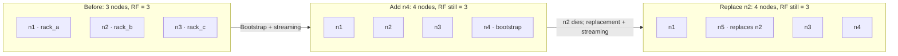

# Practicing Node Addition/Replacement and Data Verification in Apache Cassandra

> **Chapter:** Integrated Practice  
> **Module:** `DATABASE_ENGINE_WIDE_COLUMN_CASSANDRA` — applying distributed architecture, the wide-column model, partition keys, query-driven table design, consistency levels, CQL, replication, compaction, repair, failure handling, and Java connectivity.  
> **Environment:** Isolated test Cassandra cluster; never perform node-stopping, node-replacement, or data-deletion steps on production.

## 1. Problem and Handover Deliverables

An order service running on Apache Cassandra starts with three nodes in the same datacenter. As traffic grows, the system needs to **add a node** to expand data and load distribution. Later, an older node suffers total hardware failure; the operations team must **replace the node** with a new machine while ensuring the application continues reading and writing at the chosen consistency level. Finally, the team must **verify data consistency** rather than declaring success solely because nodes report `UN`.

After completing this lab, learners must demonstrate:

1. The new node joins the cluster via **bootstrap** and receives token ranges and data from existing replicas.
2. **Adding a node** differs from **replacing a dead node**: an added node claims new token ranges; a replacement node assumes the dead node's responsibilities.
3. Replication factor (RF) and consistency level (`LOCAL_QUORUM`) are interpreted accurately as node count changes.
4. Sample data remains intact and **partition-key** queries continue working before, during, and after topology changes.
5. When to use `cleanup` and `repair`, how to monitor streaming, handle errors, and produce an evidence-backed verification report.

**Mandatory deliverables:** a topology-change log; before/after outputs of `nodetool status` and `nodetool netstats`; CQL read/write verification records; Java program output checking expected values; repair/cleanup status; and a PASS/FAIL conclusion.

## 2. Lab Architecture

Practice with Cassandra 4.1 or 5.0, Java 11+, and a compatible Java Driver 4.x. Service startup commands, configuration file paths, permissions, and how JVM flags are passed depend on your OS/installation method; the examples below are not cross-platform deployment scripts.

| Role | Illustrative address | DC | Rack | Initial state |
| --- | --- | --- | --- | --- |
| `n1` | `10.0.0.11` | `dc_lab` | `rack_a` | Up, Normal |
| `n2` | `10.0.0.12` | `dc_lab` | `rack_b` | Up, Normal |
| `n3` | `10.0.0.13` | `dc_lab` | `rack_c` | Up, Normal |
| `n4` | `10.0.0.14` | `dc_lab` | `rack_a` | New machine, not yet joined |
| `n5` | `10.0.0.15` | `dc_lab` | `rack_b` | Replacement for `n2`, not yet joined |

These are illustrative private IP addresses; replace them with your test network's actual addresses. The first three nodes are already initialized as **a single cluster** running the same compatible release. New nodes must have valid network reachability, storage capacity, and inter-node bandwidth.



**Distinguishing node count from RF:** once four nodes are present, `RF(dc_lab)=3` means each partition still has three replicas placed across three eligible nodes in the DC, **not** four copies. After replacing `n2` with `n5`, the final healthy node count remains four.

### 2.1. Preconditions

- `nodetool status` on a live node shows `n1`, `n2`, and `n3` in `UN` (Up/Normal) state; no other bootstrap or replacement is currently running.
- The cluster has one lab DC, consistent snitch/rack settings, mutual node reachability, reasonably synchronized system clocks, and sufficient disk, RAM, and network capacity for streaming.
- Use synthetic test data only. Back up current configs, take an appropriate snapshot/backup, and record schema state and host IDs for recovery; topology operations can affect live data.
- The application uses `LOCAL_QUORUM`: with RF=3, at least **2 replicas of the partition** must respond in `dc_lab`. Transient errors can still occur as token ranges shift or a node fails; never assume every request always succeeds.
- Designate a note-taker. Pause unrelated topology edits, RF changes, or ad-hoc compactions/repairs throughout the drill.

### 2.2. Node States, Tokens, and Indicators to Understand

| Term / state | Meaning when checking |
| --- | --- |
| `UN` | Node is seen as Up and its ring state is Normal. Not proof that every row across all replicas matches. |
| `UJ` | Node is Up and Joining/bootstrapping; observe streaming before treating it as healthy. |
| `DN` | Node is Down while still part of topology metadata, distinct from a decommissioned/removed node. |
| Token / vnode | Distributes ownership of token ranges; partition keys hash to tokens. |
| Host ID | Node identity in cluster metadata; record before/after to tell the old node apart from its replacement. |
| `nodetool netstats` | Tracks data send/receive progress during streaming. |
| `nodetool repair` | Anti-entropy process comparing and synchronizing replicas owning the same token range. |
| `nodetool cleanup` | Deletes data stored on a node that it **no longer owns** under the new topology. Not a substitute for repair. |

## 3. Initializing the Keyspace, Wide-Column Table, and Baseline Data

From `cqlsh` on a healthy node, create the lab-only keyspace:

```sql
CREATE KEYSPACE IF NOT EXISTS topology_lab
WITH replication = {
    'class': 'NetworkTopologyStrategy',
    'dc_lab': 3
}
AND durable_writes = true;

CREATE TABLE IF NOT EXISTS topology_lab.orders_by_customer_day (
    customer_id uuid,
    order_day date,
    order_no int,
    amount_cents bigint,
    state text,
    PRIMARY KEY ((customer_id, order_day), order_no)
) WITH CLUSTERING ORDER BY (order_no ASC);
```

This table serves the query **fetch a customer's orders on a given day**. `(customer_id, order_day)` is the **composite partition key**; `order_no` is the clustering key. This lets queries hit the exact partition without cluster-wide scans or `ALLOW FILTERING`. In real systems, monitor daily order volume, partition sizes, and bucketing strategies.

Set the consistency level in `cqlsh`:

```sql
CONSISTENCY LOCAL_QUORUM;
```

Insert synthetic baseline records with **fixed** keys and payloads for verification:

```sql
INSERT INTO topology_lab.orders_by_customer_day
(customer_id, order_day, order_no, amount_cents, state)
VALUES (11111111-1111-4111-8111-111111111111, '2026-11-21', 1001, 150000, 'CREATED');

INSERT INTO topology_lab.orders_by_customer_day
(customer_id, order_day, order_no, amount_cents, state)
VALUES (11111111-1111-4111-8111-111111111111, '2026-11-21', 1002, 220000, 'CREATED');

INSERT INTO topology_lab.orders_by_customer_day
(customer_id, order_day, order_no, amount_cents, state)
VALUES (22222222-2222-4222-8222-222222222222, '2026-11-21', 2001, 350000, 'PAID');

INSERT INTO topology_lab.orders_by_customer_day
(customer_id, order_day, order_no, amount_cents, state)
VALUES (33333333-3333-4333-8333-333333333333, '2026-11-21', 3001, 90000, 'CREATED');
```

Expected dataset prior to node changes:

| Customer (abbreviated) | `order_no` | `amount_cents` | `state` |
| --- | ---: | ---: | --- |
| `1111…` | 1001 | 150000 | CREATED |
| `1111…` | 1002 | 220000 | CREATED |
| `2222…` | 2001 | 350000 | PAID |
| `3333…` | 3001 | 90000 | CREATED |

Verify by partition key:

```sql
SELECT order_no, amount_cents, state
FROM topology_lab.orders_by_customer_day
WHERE customer_id = 11111111-1111-4111-8111-111111111111
  AND order_day = '2026-11-21';
```

The result must contain exactly two rows in ascending `order_no` order. Check the remaining two partitions by substituting `customer_id` while keeping `order_day`.

**Record baseline T0:** capture the timestamp, schema, list of four rows, and query output. These rows serve as an independent source of expected truth; never read from an arbitrary node later and assume it is authoritative for every check.

## 4. Runbook A — Adding New Node `n4` (Bootstrap)

### Step A1 — Capture Pre-Change State

On `n1`, record the outputs of:

```bash
nodetool status
nodetool ring
nodetool tablestats topology_lab
nodetool netstats
```

Record: `UN` node count (=3), host IDs, token counts, load, DCs/racks, SSTable counts, and any active streaming errors. If any node is `DN`, schemas disagree, or another topology operation is underway, **halt the drill** and resolve the root cause first.

### Step A2 — Configure `n4` with a Fresh Identity

Install a matching Cassandra version and configure `n4` as a **brand-new** node:

- `cluster_name` matches `n1–n3`; snitch matches the cluster, e.g., `GossipingPropertyFileSnitch`.
- `listen_address` / `broadcast_address` and `rpc_address`/client listen address point to valid addresses for `n4`, per version configuration.
- `seed_provider` lists at least one live seed (e.g., `n1`, `n3`); **seeds exist solely for cluster discovery**, not as exclusive data owners.
- In `n4`'s `cassandra-rackdc.properties`, set `dc=dc_lab` and `rack=rack_a`.
- Keep **auto bootstrap** enabled when joining an already-populated cluster. Never set `auto_bootstrap: false` merely to skip streaming time.
- Because the node has never joined before, its state directories must belong to a **fresh instance**; never copy data/system keyspaces, commit logs, or host IDs from `n1–n3`.

Example **values to align** (not a replacement for your installed version's full `cassandra.yaml`):

```yaml
cluster_name: 'cassandra-node-lab'
endpoint_snitch: GossipingPropertyFileSnitch
listen_address: 10.0.0.14
rpc_address: 10.0.0.14
# seed_provider: configure using your version's syntax,
# pointing to live nodes such as 10.0.0.11 and 10.0.0.13
```

### Step A3 — Start Node and Monitor Streaming

Start the Cassandra service on `n4` only after verifying configuration. On `n4` and `n1`:

```bash
nodetool status
nodetool netstats
nodetool tpstats
```

Expected indicators:

1. `n4` appears in joining state (typically `UJ`) and then transitions to `UN`.
2. `nodetool netstats` shows active streaming and later completion, with no stalled send/receive sessions.
3. All four nodes end up `UN`, schemas remain in agreement, and logs show no fatal bootstrap errors.
4. Keyspace `topology_lab` still has `RF(dc_lab)=3`. Do not raise RF to four simply because a fourth machine was added.

**If bootstrap fails or hangs:** save Cassandra logs, `netstats` output, and error messages; consult `nodetool bootstrap resume` for your exact version. Never delete data directories, set `consistent.rangemovement=false`, or reinitialize a node without understanding the interrupted streaming state. An incomplete bootstrap can leave missing replica data.

### Step A4 — Post-Addition Verification

On healthy coordinators, re-read all four rows at `LOCAL_QUORUM` and run the Java audit tool in section 7 in `before` mode. Expected:

- All four rows have exact keys, amounts, and states; no missing or extra rows in sample partitions.
- `n4` is `UN`, token ranges are assigned, and streaming has finished.
- `nodetool tablestats topology_lab` and metrics may show gradual data redistribution; **per-node disk size is not a correctness criterion**.
- No sustained rise in read/write errors, timeouts, or abnormal compaction/streaming backlogs.

### Step A5 — Conditional Cleanup

Once `n4` is confirmed healthy and no range movements remain active, you may run:

```bash
nodetool cleanup topology_lab
```

Execute **one node at a time on older nodes that lost ownership of some token ranges** (typically `n1`, `n2`, `n3`); record reclaimed bytes and monitor `nodetool compactionstats`. `cleanup` can be I/O-intensive, so run it only after stability is confirmed and inside a suitable maintenance window. It removes data a node no longer owns under the new ring; it **does not guarantee** owned replicas are synchronized. To verify and sync divergence, run `repair` as covered in section 6.

## 5. Runbook B — Replacing Failed Node `n2` with `n5`

Scenario B starts **after** Runbook A completes and the cluster has `n1`, `n2`, `n3`, and `n4` all `UN`. Simulate `n2`'s disk/host failing permanently, unable to restart with its existing data. Use **replacement**—do not run `decommission` or `removenode` on `n2` beforehand.

### Step B1 — Record the Failed Node and Isolate the Old Instance

Before stopping `n2`, record `nodetool status`, address `10.0.0.12`, host ID, DC, rack, and baseline data state. Stop `n2` in the **lab**, ensuring the old instance cannot accidentally restart and rejoin the ring. Check from `n1`:

```bash
nodetool status
```

Expect `n2` to show `DN`, while `n1`, `n3`, and `n4` remain `UN`. Because RF=3, most partitions still have at least two healthy replicas after a single node failure, so `LOCAL_QUORUM` generally keeps working; actual outcomes depend on replica and network health at test time.

**Issue a write while `n2` is down** so there is a mutation to verify after recovery:

```sql
CONSISTENCY LOCAL_QUORUM;

UPDATE topology_lab.orders_by_customer_day
SET state = 'PAID'
WHERE customer_id = 11111111-1111-4111-8111-111111111111
  AND order_day = '2026-11-21'
  AND order_no = 1001;
```

Expected after write acknowledgment: order `1001` changes to `PAID`; all other rows stay unchanged. Capture T1 along with success/failure status, timestamp, and coordinator host. On a write timeout, **never** assume the mutation never reached a replica; verify business state before retrying.

### Step B2 — Prepare `n5` as the Replacement Node

Configure `n5` to match the existing cluster:

- Same `cluster_name`, snitch, DC `dc_lab`, and rack `rack_b` as the replaced node; new network address is `10.0.0.15`.
- Seeds point to live nodes (`n1`, `n3`, or `n4`); do not list only the dead `n2`.
- The new node starts with clean data directories—never copy `n2`'s system keyspace or host ID. Provision storage sufficient for the incoming token ranges.
- `n2` must remain truly down and unable to return before replacement completes, avoiding two instances contesting the same identity/token ranges.

Start Cassandra on `n5` **on its first boot** with the illustrative JVM property:

```text
-Dcassandra.replace_address_first_boot=10.0.0.12
```

This is a **JVM flag passed when starting the replacement node**, not a `cqlsh` command or `nodetool` subcommand. How you pass the flag in your service manager, container image, or `cassandra-env.sh` depends on your Cassandra release. Versions may offer additional flags; inspect logs to verify the node entered replacement mode rather than bootstrapping as an independent fifth node.

### Step B3 — Monitor Replacement and Completion

Monitor continuously from `n5` and `n1`:

```bash
nodetool netstats
nodetool status
nodetool tpstats
```

During replacement, status views on peer nodes can lag behind actual transfer progress; **`netstats` and streaming logs are more reliable than watching `UN/DN` alone**. Completion criteria:

- `n5` finishes bootstrapping/streaming and has taken over `n2`'s token ranges.
- `n5` is `UN`, `n1`, `n3`, and `n4` remain `UN`; old `n2` is no longer an active member.
- No unexpected extra node joined; final active member count is four and RF remains three.
- `LOCAL_QUORUM` queries read the updated state of `1001` and all three remaining rows.

**When is repair mandatory?** Cassandra documentation requires repair after replacement if the old node was down longer than `max_hint_window` before replacement, or if replacing at the same IP took longer than the hint window. Regardless, hints are *best effort*; successful streaming alone does not prove zero divergence across replicas. In this lab, proceed to full repair in section 6 to practice verification.

### Step B4 — Do Not Confuse Topology Operations

| Operation | Scenario | Logical outcome |
| --- | --- | --- |
| **Bootstrap new node** | Scaling the cluster with `n4` | Adds a node with new token ranges; replicas per partition remain governed by RF. |
| **Replace dead node** | `n2` died permanently, `n5` replaces it | `n5` assumes `n2`'s ranges without increasing expected node count. |
| `nodetool decommission` | A **live** node leaves the cluster gracefully | Streams data to remaining replicas and leaves the ring; not for directly replacing a dead node. |
| `nodetool removenode` | A **dead** node must be purged permanently from topology | Reassigns ownership to surviving nodes; do not run before replacement if using replacement mode. |
| `nodetool cleanup` | Ownership shifted and stale data remains on a non-owning node | Reclaims excess data on that node; does not fix replicas missing data. |
| `nodetool repair` | Replicas need comparison and synchronization | Detects/repairs divergence across token ranges; consumes CPU/I/O/network and must be scheduled. |

Choosing conflicting procedures (such as running `removenode` on `n2` and also using `replace_address_first_boot`) corrupts identity/ownership assumptions. Stop and plan recovery from actual cluster topology rather than firing destructive admin commands sequentially.

## 6. Replica Verification: Repair, Compaction, and Evidence

### 6.1. Three Distinct Verification Layers

**Layer 1 — topology:** `nodetool status`/`ring` confirms node membership, token counts, DC/rack placement, and completed ownership transfers. It does not prove data correctness.

**Layer 2 — replica:** `repair` compares replicas per token range using Merkle trees and streams missing fragments. Hinted handoff does not guarantee catching every missed mutation after an outage. `repair` does not run automatically just because a node was added (unless separate automation is enabled and configured).

**Layer 3 — business data:** checks keys and values against expected truth from T0/T1 using CQL/Java. A single `SELECT` at `LOCAL_QUORUM` reflects a quorum read outcome; **it does not prove every replica on disk holds identical data**. Thus Layer 2 and Layer 3 complement each other.

### 6.2. Running Controlled Repair

Once replacement stabilizes, pick a maintenance window and monitor I/O, disk, and network. Run preview to estimate divergence and work required:

```bash
nodetool repair --full --preview topology_lab
```

`--preview` builds Merkle trees and estimates streaming without **writing repair data**. Next, run full repair across the planned scope. In a single DC with four nodes, a clean way to cover the whole cluster while minimizing redundant overlap is running **sequentially on each live node**:

```bash
nodetool repair --full -pr topology_lab
```

Run this on `n1`, wait for clean completion, then run sequentially on `n3`, `n4`, and `n5`; record logs, exit codes, and streamed byte counts for **each node**. `-pr` restricts repair to the invoking node's primary token ranges; **running it once on one node is not a cluster-wide full repair**. Adjust concurrency and maintenance windows based on your version, repair schedule, DC topology, and disk capacity.

After repair, you can re-run:

```bash
nodetool repair --full --preview topology_lab
nodetool netstats
nodetool compactionstats
```

Expect zero remaining differences requiring streaming within the preview scope once settled. `--validate`, if used, only checks **data already marked repaired** under your version's mechanism; never treat it as an absolute guarantee that all rows match. If preview still reports differences, read logs, check for concurrent writes or disk/network errors, and isolate affected token ranges instead of running repair in an infinite loop.

### 6.3. Cleanup and Compaction Do Not Replace Repair

- `cleanup` uses **updated token ownership** to drop data no longer owned by older nodes after bootstrap/range movement; typically run after ring expansion.
- `compaction` merges SSTables per the compaction strategy and removes shadowed data/tombstones when safe; it never compares replicas across different nodes.
- `repair` performs **replica comparison and synchronization**. Full repair inspects both repaired and unrepaired SSTables in scope; incremental repair processes only data not yet marked repaired since the previous run.

Always repair within the table's `gc_grace_seconds` window to avoid deleted data resurrecting if a tombstone fails to reach a long-absent replica. Lowering `gc_grace_seconds` just to make a lab run faster is unnecessary and invites misleading conclusions.

## 7. Verification from Java Driver 4.x

The Java application uses `CqlSession` and prepared statements to verify **all sample partitions by primary key**, comparing directly against predefined expected records. The program avoids `SELECT COUNT(*)` on large tables because counting requires scanning and fails to verify individual column values.

### 7.1. Sample Data Audit Program

Create `LabAudit.java` in a Java project configured with the Cassandra Java Driver 4.x dependency:

```java
import com.datastax.oss.driver.api.core.CqlSession;
import com.datastax.oss.driver.api.core.DefaultConsistencyLevel;
import com.datastax.oss.driver.api.core.cql.BoundStatement;
import com.datastax.oss.driver.api.core.cql.PreparedStatement;
import com.datastax.oss.driver.api.core.cql.Row;

import java.net.InetSocketAddress;
import java.nio.charset.StandardCharsets;
import java.security.MessageDigest;
import java.time.LocalDate;
import java.util.ArrayList;
import java.util.Arrays;
import java.util.LinkedHashMap;
import java.util.List;
import java.util.Map;
import java.util.UUID;

public final class LabAudit {
    public static void main(String[] args) throws Exception {
        if (args.length != 2 || (!args[1].equals("before")
                                 && !args[1].equals("after"))) {
            throw new IllegalArgumentException(
                "Usage: LabAudit <contact-point-ip> <before|after>");
        }

        String expected1001State = args[1].equals("after") ? "PAID" : "CREATED";
        Map<UUID, List<String>> expected = new LinkedHashMap<>();
        expected.put(UUID.fromString("11111111-1111-4111-8111-111111111111"),
            Arrays.asList("1001|150000|" + expected1001State,
                          "1002|220000|CREATED"));
        expected.put(UUID.fromString("22222222-2222-4222-8222-222222222222"),
            Arrays.asList("2001|350000|PAID"));
        expected.put(UUID.fromString("33333333-3333-4333-8333-333333333333"),
            Arrays.asList("3001|90000|CREATED"));

        MessageDigest sha256 = MessageDigest.getInstance("SHA-256");
        int checkedRows = 0;
        try (CqlSession session = CqlSession.builder()
                .addContactPoint(new InetSocketAddress(args[0], 9042))
                .withLocalDatacenter("dc_lab")
                .build()) {
            PreparedStatement read = session.prepare(
                "SELECT order_no, amount_cents, state " +
                "FROM topology_lab.orders_by_customer_day " +
                "WHERE customer_id = ? AND order_day = ?");

            for (Map.Entry<UUID, List<String>> fixture : expected.entrySet()) {
                BoundStatement statement = read.bind(
                        fixture.getKey(), LocalDate.of(2026, 11, 21))
                    .setConsistencyLevel(DefaultConsistencyLevel.LOCAL_QUORUM)
                    .setIdempotent(true);

                List<String> actual = new ArrayList<>();
                for (Row row : session.execute(statement)) {
                    actual.add(row.getInt("order_no") + "|" +
                        row.getLong("amount_cents") + "|" +
                        row.getString("state"));
                }

                if (!actual.equals(fixture.getValue())) {
                    throw new IllegalStateException(
                        "MISMATCH customer=" + fixture.getKey() +
                        " expected=" + fixture.getValue() +
                        " actual=" + actual);
                }

                // Includes partition key and verified values;
                // independent of returned timestamps or partition iteration order.
                String canonical = fixture.getKey() + "|" +
                    String.join(";", actual) + "\n";
                sha256.update(canonical.getBytes(StandardCharsets.UTF_8));
                checkedRows += actual.size();
            }
        }

        StringBuilder hex = new StringBuilder();
        for (byte b : sha256.digest()) {
            hex.append(String.format("%02x", b & 0xff));
        }
        System.out.println("PASS mode=" + args[1] +
            " partitions=" + expected.size() +
            " rows=" + checkedRows +
            " sha256=" + hex);
    }
}
```

Run against a live contact point, for example:

```text
LabAudit 10.0.0.11 before
LabAudit 10.0.0.13 after
```

Here `before` applies **before** Step B1 transitions order `1001`; `after` applies **after** that update is confirmed. Execute the class according to how your Java project manages classpaths/dependencies, TLS, and authentication; the two lines above are **program arguments**, not full shell commands.

Expected output: `PASS`, `partitions=3`, `rows=4`, and a 64-character hex SHA-256 digest. The hashes in `before` and `after` modes **properly differ because expected data changed**; only compare hashes across runs when using the same mode, source dataset, and quiesced workload.

If `MISMATCH` occurs, preserve `expected`, `actual`, contact point, timestamp, CL, logs, and node status. Never edit expectations to "match" output without verifying the business meaning of the values.

**Limitation to understand:** The Java Driver discovers multiple nodes from one contact point and picks coordinators using load-balancing and token-awareness policies. Passing `10.0.0.11` or `10.0.0.13` does not pin every query to that exact node, and a quorum read can mask one stale replica. Use Java output to verify **application-facing read correctness**, paired with repair/streaming to verify replica health.

### 7.2. Reconciliation Log Table

Fill in actual observed figures; never mark PASS without running the step:

| Metric | Before adding node (T0) | After adding n4 | After replacing n2→n5 (T1) | PASS criterion |
| --- | --- | --- | --- | --- |
| `UN` node count | 3 | 4 | 4 | Matches expected topology |
| `DN` node count | 0 | 0 | 0 after completion | No stale node misbehaving |
| `topology_lab` RF | 3 | 3 | 3 | No unplanned changes |
| Streaming | None | Bootstrap complete | Replacement complete | No failed or stalled jobs |
| Java `before` | 3 partitions, 4 rows | 3 partitions, 4 rows | — | Matches baseline fixture |
| Java `after` | — | — | 3 partitions, 4 rows | Order 1001 is PAID; all other rows unchanged |
| Full repair | Per baseline schedule | Evaluated for new topology | Executed and completed per plan | Logs captured, no unresolved sync errors |
| Quorum read/write | Succeeded | Succeeded | Succeeded or analyzed errors | No unexplained failures |

Also log `UJ→UN` transition duration, streamed bytes, CPU/disk pressure, timeout counts, error logs, prep/recovery duration, and abort thresholds if impact exceeds acceptable limits. Only **empirical measurements** support conclusions about recovery time objectives (RTO); RF alone does not prove RTO.

## 8. Failure Scenarios and Troubleshooting

| Drill failure | Symptoms | Resolution path |
| --- | --- | --- |
| `n4` never appears in the ring | Mismatched cluster name/seed, network, snitch, node address, or permissions | Check config, connectivity, and startup logs before retrying. |
| Bootstrap fails when source replica is unavailable | `netstats` reports stream failures / insufficient sources | Restore source replica or use version-specific resume; never disable consistent bootstrap to force join. |
| `n5` joins as a fifth node while `n2` stays `DN` | Missing/wrong replacement JVM flag or wrong old IP | Stop the replacement process, inspect host IDs/tokens/ring and logs; recover topology via formal procedures. |
| Quorum read/write timeouts while `n2` is down | Coordinator fails to collect enough responses in time | Inspect replica health, GC/CPU/network, and timeouts; never lower CL during verification. |
| Recent write missing after replacement | Hint window expired or stream missed recent mutations | Reconcile records, run repair over the target scope, and investigate disk/WAN or data-preservation faults. |
| Old disk usage does not shrink after adding node | Token ownership shifted but excess SSTables remain on older nodes | Run `cleanup` only after bootstrap and stability checks pass. |
| `nodetool repair` consumes excessive resources | High disk I/O, compaction backlog, slow queries | Throttle concurrency, pick appropriate scope/windows; monitor and document before continuing. |
| Mismatch affects only one field | Concurrent writes, timestamp/TTL skew, or wrong fixture | Pin write checkpoints, verify source of truth, inspect mutation logs; never use hashes to hide root causes. |

### 8.1. Abort / Rollback Criteria

Halt the drill if another node fails unexpectedly, quorum can no longer be met, unexplained baseline data loss appears, streaming hangs indefinitely, or replicas report disk errors. Record the last successful checkpoint and collect logs. On test clusters, restore from previously captured snapshots/backups and topology diagrams if needed; never manually edit `system.local`, `system.peers`, or commit logs, or delete SSTables to "force" `UN` status.

If `n2` actually suffered only a transient network outage and can safely return with its original data intact, evaluate **recovering the old node** instead of starting replacement. Never allow both the old node and a replacement node to join the ring simultaneously with competing identities or token ranges.

## 9. Questions Explaining the Results

**1. Why doesn't scaling from three to four nodes give every partition four replicas?**  
Because RF is defined by the keyspace; `RF(dc_lab)=3` means three replicas per partition in the DC, independent of how many eligible physical nodes exist.

**2. Why check both `UN` *and* run data reconciliation?**  
`UN` indicates a node is present in the ring and considered healthy at that moment, not that missed mutations were replayed or that replicas have converged.

**3. When should you use `replace_address_first_boot` instead of `removenode`?**  
When replacing a dead node with a fresh instance taking over its old responsibilities. `removenode` permanently removes a dead node and redistributes its ranges—it is not a prerequisite for replacement.

**4. Why can't `cleanup` fix missing data?**  
Cleanup only deletes data a node no longer owns under the updated token ring; fixing missing or divergent replicas requires repair or an appropriate recovery process.

**5. If Java returns all four rows at `LOCAL_QUORUM`, can you declare all three replicas of every partition identical?**  
No. A quorum read validates only the CL read outcome within that read's scope. Proving replica convergence requires repair/streaming evidence and error monitoring.

**6. If the same record is written across two nodes while another is down, is the result guaranteed to be business-correct?**  
Not automatically. Cassandra reconciles values by timestamp and mutation semantics; concurrent updates may require business preconditions, idempotency, and additional consistency design.

## 10. Drill Handover Report Template

```text
PRACTICE: Node Addition/Replacement and Data Verification Drill
Date / Time:
Cassandra / Java Driver Version:
Cluster / DC / Rack:
Operator:

T0 - Before Changes:
- N1/N2/N3 host ID, status, load:
- RF, keyspace, table:
- Fixture verified: 3 partitions / 4 rows
- Java BEFORE / SHA-256:
- Backup/snapshot reference:

A - Add n4:
- Bootstrap start and completion timestamps:
- Netstats / bytes streamed / errors:
- Final nodes: n1, n2, n3, n4 = UN
- Java BEFORE / SHA-256:
- Nodes where cleanup ran and results:

B - Replace n2 with n5:
- N2 down since:
- N2 old IP/host ID:
- Write order 1001 CREATED -> PAID, CL, result:
- JVM replacement flag on n5:
- Streaming completion time:
- Final nodes: n1, n3, n4, n5 = UN
- Java AFTER / SHA-256:

RECONCILIATION:
- Repair preview:
- Full repair -pr per node, logs/exit codes:
- Post-repair preview:
- Unresolved mismatches / timeouts:
- Data residency / backup check (if applicable):

CONCLUSION: PASS / FAIL / BLOCKED
Attached evidence (logs, CQL outputs, nodetool, Java):
Root cause and next actions if not PASS:
```

Conclude **PASS** only when topology is right, streaming and repair succeeded across the planned scope, fixture data matches post-change expectations, and no unexplained errors remain. A drill with three clean `nodetool status` outputs but no key/value reconciliation counts as only **partially** complete.

## Official References

- [Apache Cassandra — Adding, replacing, moving and removing nodes](https://cassandra.apache.org/doc/latest/cassandra/managing/operating/topo_changes.html): bootstrap, replacement, netstats, and post-range-movement cleanup.
- [Apache Cassandra — Repair](https://cassandra.apache.org/doc/stable/cassandra/managing/operating/repair.html): Merkle trees, full/incremental repair, `-pr`, preview, and operational recommendations.
- [Apache Cassandra — nodetool repair](https://cassandra.apache.org/doc/latest/cassandra/managing/tools/nodetool/repair.html): syntax for repair options.
- [Apache Cassandra — nodetool cleanup](https://cassandra.apache.org/doc/latest/cassandra/managing/tools/nodetool/cleanup.html): scope and purpose of cleanup.
- [Apache Cassandra — netstats](https://cassandra.apache.org/doc/stable/cassandra/managing/tools/nodetool/netstats.html): monitoring streaming progress.
- [Apache Cassandra Java Driver — Core documentation](https://apache.github.io/cassandra-java-driver/): sessions, prepared statements, and consistency levels.

> **Practice scope limit:** This guide covers technical procedures in a controlled lab cluster. Production changes require scheduled maintenance windows, capacity and SLA impact assessments, verified backups/restores, version-specific monitoring, and operations team approval.
