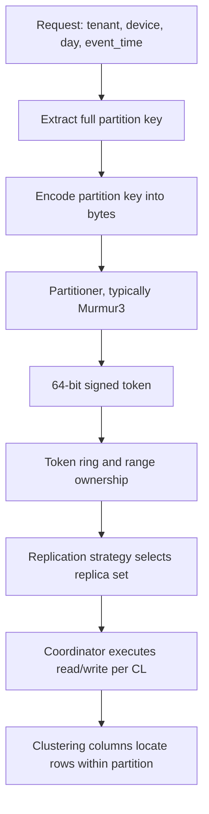
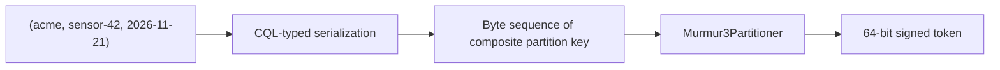
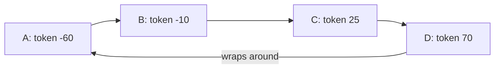
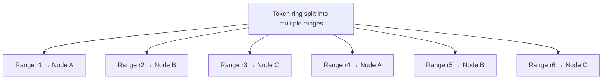
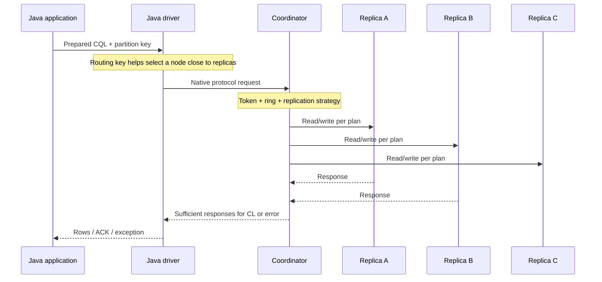
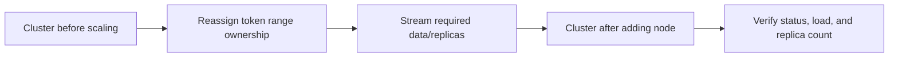

# Partitioner and Mapping Partition Keys to Tokens

> **Chapter:** Tokens and Replication  
> **Scope:** Apache Cassandra is a distributed NoSQL database following the *wide-column* model. This lesson focuses on the chain **partition key → binary representation → partitioner → token → token range → replica**, explaining how data is placed across the cluster and why partition key decisions affect scalability, consistency, and the query path from Java. CQL, replication, compaction, repair, and failure handling are included as practical consequences of the token mechanism.

## 1. Learning Objectives

After this lesson, you will be able to:

1. Distinguish **partition key**, **clustering columns**, **token**, **token range**, **the node owning a token range**, and **replicas of a partition**.
2. Explain the role of the **partitioner**, especially `Murmur3Partitioner` commonly used in Apache Cassandra, and the characteristics of 64-bit signed tokens.
3. Describe how a composite partition key is encoded into bytes for hashing, rather than arbitrarily concatenating strings.
4. Read a token ring diagram using the **`(previous_token, current_token]`** range rule, including the segment that wraps around the end of the ring.
5. Explain why **vnodes** allow a single node to hold multiple token ranges, and why the **replication strategy** is a separate step from computing tokens.
6. Write CQL tables driven by queries, use `token(...)` to observe a partition's token, and know when not to query by token range.
7. Use the Java driver 4.x with prepared statements and the full partition key to support token-aware routing, without rolling your own hash function on the client.
8. Analyze hot partitions, data movement when scaling nodes, and the limits of consistency levels, compaction, and repair for load distribution.

## 2. Opening Problem: Which Node Stores an Event?

Suppose an IoT service receives events from device `sensor-42` belonging to tenant `acme`. Each request contains:

```text
tenant_id  = acme
device_id  = sensor-42
event_day  = 2026-11-21
event_time = 2026-11-21T08:05:00Z
event_id   = 11111111-1111-1111-1111-111111111111
```

The application needs to read the 100 latest events for the device on a given day. To do so, Cassandra must answer these questions in order:

1. **Which partition contains this row?** The combination `(tenant_id, device_id, event_day)`.
2. **What is the partition's token?** The partitioner hashes the binary representation of the entire partition key into a token.
3. **Which node manages the token range containing that token?** Read the token ring metadata and topology.
4. **Which replicas store copies of the partition?** The replication strategy along with RF, data centers, and racks determine the replica set.
5. **Within the partition, which rows are read first?** Clustering columns such as `event_time` and `event_id` determine the order.



**Key point:** a token is not computed per individual row if those rows share the same partition key. Every row belonging to a partition has **the same token and the same replica set**, even when `event_time` or `event_id` differs.

## 3. Understanding `PRIMARY KEY` Properly Before Finding the Token

Cassandra does not shard data by "table name" or "each row's ID" by default; it uses the **partition key** portion declared in the primary key.

For example:

```sql
PRIMARY KEY ((tenant_id, device_id, event_day), event_time, event_id)
```

| Component | Role | Directly affects the token? |
| --- | --- | --- |
| `tenant_id` | First component of the composite partition key | **Yes** |
| `device_id` | Second component of the composite partition key | **Yes** |
| `event_day` | Third component of the composite partition key; daily bucket | **Yes** |
| `event_time` | First clustering column | **No** |
| `event_id` | Second clustering column, distinguishes rows with identical timestamps | **No** |
| `temperature_c` | Regular column holding a value | **No** |

### 3.1. One Partition Can Contain Multiple Clustering Rows

The following two events:

```text
(acme, sensor-42, 2026-11-21, 08:05, event-A)
(acme, sensor-42, 2026-11-21, 08:06, event-B)
```

share the partition key `(acme, sensor-42, 2026-11-21)`. They are stored in **the same logical partition**, under different clustering keys.

Changing `event_time` or `event_id` while keeping the three partition key components the same **does not change** the token. Changing `event_day` to the next day creates a new partition key; the token is usually different, though **there is no mathematical guarantee that every distinct partition key produces a distinct token**, because the input space is larger than the token space.

### 3.2. Simple vs. Composite Keys

Both forms are valid:

```sql
-- Single partition key component, no clustering column:
PRIMARY KEY (device_id)

-- Three partition key components, two clustering columns:
PRIMARY KEY ((tenant_id, device_id, event_day), event_time, event_id)
```

In the second form, the inner parentheses `((...))` distinguish the **multi-component partition key** from the clustering columns that follow. Do not confuse `PRIMARY KEY (tenant_id, device_id, event_day)` with `PRIMARY KEY ((tenant_id, device_id, event_day))`: the first uses `tenant_id` as the partition key and the remaining columns as clustering columns; the second uses all three columns as the partition key.

## 4. What Does the Partitioner Actually Do?

The **partitioner** is the component that maps the **binary representation of the partition key** to a **token**. Tokens create a logical ordering so Cassandra can divide the keyspace into regions and determine storage responsibility.

In many modern Apache Cassandra clusters, the common choice is **`Murmur3Partitioner`**, based on the MurmurHash3 hash function. It is a *non-cryptographic hash* function intended for distribution, not for protecting secrets.

### 4.1. Four Steps from Key to Token

1. **The CQL schema defines the partition key:** For example, `(tenant_id text, device_id text, event_day date)`.
2. **Cassandra encodes values according to CQL types:** The components are serialized into bytes following the partition key format used by the server.
3. **The partitioner hashes the bytes:** With `Murmur3Partitioner`, the result is mapped to a 64-bit signed integer token.
4. **The cluster uses the token to locate the range:** The token is compared against the token boundaries of nodes/vnodes to find the corresponding token range.



Do not do this yourself:

```text
token = hash("acme" + "sensor-42" + "2026-11-21")
```

because naive string concatenation can be ambiguous, ignoring component boundaries, data types, and Cassandra's canonical byte representation. For example, the pairs `("ab", "c")` and `("a", "bc")` would produce the same text `"abc"` if concatenated directly, yet they must be treated as two distinct composite keys.

**Practical rule:** to verify the token of a row, prefer Cassandra's `token(...)` function or compatible driver metadata/routing; do not implement Murmur3 over strings yourself to infer production tokens.

### 4.2. Important Properties of Tokens

| Property | Meaning |
| --- | --- |
| **Deterministic** | The same encoded partition key and the same partitioner always produce the same token |
| **Hash-distributed** | Different partition keys are generally spread across the token space |
| **Does not preserve business order** | `device_id = 100` does not necessarily have a smaller token than `device_id = 101` |
| **Not a unique ID** | Two distinct partition keys can theoretically collide on the same token; the full partition key must be kept to distinguish them |
| **Not security data** | Tokens are not used to encrypt or hide key values |
| **Does not contain the replica list** | A token is only an input for placement; the replication strategy determines the replicas |
| **Does not dictate row ordering** | Clustering columns order rows inside a partition |

## 5. What Kind of Number Is a Murmur3 Token?

With `Murmur3Partitioner`, a Cassandra token is represented as a 64-bit signed integer, typically described over the range:

\[
-2^{63}\;\text{to}\;2^{63}-1
\]

The concrete token values for a key **must be retrieved from the cluster**, not guessed by inspecting `tenant_id` or `device_id`. A negative token does not mean the data sits on a "left-side" node, a failed node, or a lower-priority node. The sign is simply part of the numeric ordering around the token ring.

### 5.1. Tokens Differ from Security Hashing

Murmur3 is chosen for efficient key distribution—it is **not** a password hash, digital signature, or anti-tampering mechanism. Do not use tokens in place of per-tenant authorization. A Java API must still authenticate and verify access to `tenant_id` before querying.

### 5.2. Tokens Do Not Replace the Primary Key

Suppose two different partition keys collide onto the same token in a theoretical scenario. Cassandra can still distinguish them using the **full key bytes** and appropriate storage/comparison mechanisms. The token only helps locate the target **region**, not the complete row identity.

Similarly, if an application stores only a token as a "device ID," it may:

- Lose the original partition key when needed for queries or tenant authorization.
- Create coupling to a specific partitioner or data type.
- Fail to rely on token uniqueness for business uniqueness.

**Use the business key/primary key for identification, and tokens for understanding distribution and routing.**

## 6. The Token Ring: Turning Integers into Range Ownership

Let us temporarily set aside vnodes and imagine a four-node cluster where each node holds one boundary token on an **illustrative token ring** from `-100` to `100`:

| Node | Illustrative boundary token | Token range primarily owned by node |
| --- | ---: | --- |
| A | `-60` | `(70, 100] ∪ [-100, -60]` — wrap-around segment |
| B | `-10` | `(-60, -10]` |
| C | `25` | `(-10, 25]` |
| D | `70` | `(25, 70]` |

These numbers **only illustrate range partitioning**, not real Murmur3 tokens or Cassandra's default configuration. The rule reads: **a node takes responsibility for the interval `(previous boundary token, its own boundary token]` on the ring**, under the single-token-per-node model shown here.



### 6.1. Locating a Token in the Example

- Token `-37` falls in `(-60, -10]` → **B** owns the range.
- Token `24` falls in `(-10, 25]` → **C** owns the range.
- Token `50` falls in `(25, 70]` → **D** owns the range.
- Token `90` exceeds the highest boundary token and wraps around → **A** owns the range.

When a token equals the boundary `-10`, it belongs to the range ending at `-10` under the **left-open, right-closed** rule.

In the real Murmur3 space, tokens span the 64-bit signed range; do not equate the numeric width of illustrative intervals with actual data volume or request traffic. Distribution depends on **partition key values and workload**.

### 6.2. The Ring Has No Fixed "First Node" for All Requests

The token ring is a circular logical structure. It does not designate a single master. A node acts as coordinator **per request**, while token ranges and the replication strategy determine the replicas.

A request can arrive at node D as coordinator even when the partition key hashes to token `-37` belonging to B's range; the coordinator contacts the appropriate replicas. Thus, **the node receiving the request** and **the node owning the token range** are two distinct roles.

## 7. Virtual Nodes (vnodes): One Node Can Own Multiple Ranges

Cassandra clusters commonly use **virtual nodes**, abbreviated `vnodes`. Instead of each node holding a single contiguous boundary token as in the simplified example, one node can hold **multiple token positions/token ranges** around the ring.



### 7.1. Why Use vnodes?

Vnodes help distribute ownership of many ranges across nodes and can make scaling, node replacement, and load balancing more flexible in certain deployment models.

However, vnodes also introduce trade-offs:

- **More ranges** can increase peer relationships and streaming/repair work during topology changes.
- **The right number of vnodes** depends on Cassandra version, node capacity, data distribution, and cluster operational guidelines.
- **Having many vnodes does not cure a hot partition**: a single partition key still hashes to **one token** and is placed on its corresponding replica set.

Do not copy an arbitrary `num_tokens` value from an old example and treat it as the best configuration for every Cassandra version. Choosing tokens per node is a **cluster operations** decision, not a per-Java-query choice.

### 7.2. Token Range ≠ One Partition

A single token range can contain **many partitions** whose tokens fall within that interval. Conversely, a single partition has one token but can contain **many clustering rows**. Therefore, these three quantities:

1. Number of token ranges a node manages.
2. Number of partitions belonging to those ranges.
3. Number of rows and traffic volume of each partition.

**are different**. Balancing the number of token ranges does not guarantee every node has the same storage usage or throughput if a few partitions are huge or very hot.

## 8. The Partitioner Determines Tokens; the Replication Strategy Chooses Replicas

This is the single most important distinction in the **Tokens and Replication** chapter:

| Mechanism | Primary input | Question it answers |
| --- | --- | --- |
| **Partitioner** | Partition key bytes | "What token does this partition have?" |
| **Token metadata/ring** | Partition token and node-owned token ranges | "Which token range contains this token?" |
| **Replication strategy** | Token ring, DC/rack topology, replication factor | "Which nodes hold replicas of this partition?" |
| **Consistency level (CL)** | Client requirement, RF, and replica scope | "How many responses are needed for the request to complete?" |
| **Driver load balancing** | Topology, routing key, node state, policy | "Which coordinator does the client send the request to?" |

For example, token `-37` falls in the range primarily managed by node B in the four-node example. With RF = 3, **not only B stores the data**: the replication strategy chooses two additional nodes according to topology rules, such as B/C/D in a very simple single-DC model. In a real cluster with multiple racks/DCs and vnodes, **do not** reason by a naive rule like "just pick three adjacent physical machines" while ignoring the strategy.

### 8.1. NetworkTopologyStrategy and Topology

An illustrative configuration in a cluster with data center `dc1`:

```sql
CREATE KEYSPACE IF NOT EXISTS telemetry_tokens
WITH replication = {
    'class': 'NetworkTopologyStrategy',
    'dc1': 3
};
```

Meaning: Cassandra attempts to place **three copies of each partition in `dc1`** following `NetworkTopologyStrategy` rules and the available topology. To genuinely achieve RF = 3, there must be **three suitable nodes**, ideally distributed across appropriate racks/fault domains.

In a single-node lab, use `'dc1': 1` and `LOCAL_ONE`; you can declare an RF higher than the node count, but **it will not create missing nodes or replicas**. On CQL-compatible managed services, replication configuration may be handled differently by the service; the examples here target Apache Cassandra with matching topology.

### 8.2. Why Local and Global Consistency Differ

If a keyspace has RF = 3 in `dc1` and RF = 3 in `dc2`:

```sql
CREATE KEYSPACE IF NOT EXISTS telemetry_two_dc
WITH replication = {
    'class': 'NetworkTopologyStrategy',
    'dc1': 3,
    'dc2': 3
};
```

each partition has replicas in **both DCs**, placed according to the replication strategy. `LOCAL_QUORUM` in `dc1` typically requires responses from **2 of 3 local replicas**; global `QUORUM` is computed over the total replica count across the corresponding scope, e.g., 4 of 6.

A partition's token does not change when only RF or CL changes. **Changing RF alters the replica set and copy count; changing CL alters the acknowledgment requirement; neither recalculates the token value.**

## 9. Read/Write Path Once the Token Is Known

A `SELECT` or `INSERT` request with the full partition key can be routed purposefully.



The diagram only illustrates the roles; Cassandra may optimize replica count/read response types, read reconciliation, and retry behavior depending on the request and version.

### 9.1. Token-Aware Routing in the Driver

The Java driver knows the cluster's schema and topology metadata and can extract the **routing key** from a statement when the full partition key is present. With a token-aware policy, the driver can **prefer a coordinator aligned with the replica set and local data center**, reducing extra network hops.

However:

- If a query lacks partition key values, the driver may be unable to compute the routing key.
- If the policy, topology, or metadata is not ready, the driver can still pick a node via its fallback strategy.
- **Token-aware routing does not decide where data is stored**; replica placement is the server's responsibility.
- A prepared statement does not automatically turn a broad scan into an efficient single-partition query.

### 9.2. Tokens Do Not Control ACK Counts

With RF = 3 in `dc1` and CL = `LOCAL_QUORUM`, **two local replicas** are typically required to respond. For another token, the **set of nodes** may differ, but the **number of responses required to satisfy CL** still follows that RF and consistency condition.

If one replica fails, a quorum request can still succeed when the remaining two replicas respond in time. If two replicas fail to respond, a quorum request may fail. This relates to availability and failure handling, **not to a token suddenly changing or a partition being rehashed when a node goes down**.

## 10. CQL Lab: Observing `token(...)` on Real Data

This section only requires an Apache Cassandra lab environment with `cqlsh` and native CQL available. If your cluster has one node, adjust RF to 1 and use an appropriate CL; there is no need to stop nodes or change topology to observe tokens.

### 10.1. Create the Table

```sql
-- Assumes keyspace telemetry_tokens was created in section 8.1.
CREATE TABLE IF NOT EXISTS telemetry_tokens.events_by_device_day (
    tenant_id text,
    device_id text,
    event_day date,
    event_time timestamp,
    event_id uuid,
    event_type text,
    temperature_c double,
    PRIMARY KEY ((tenant_id, device_id, event_day), event_time, event_id)
) WITH CLUSTERING ORDER BY (event_time DESC, event_id ASC);
```

The schema has three partition key components and two clustering columns. Two rows from the same day and device will have the same token even if their timestamps differ.

### 10.2. Write Three Events

```sql
INSERT INTO telemetry_tokens.events_by_device_day (
    tenant_id, device_id, event_day, event_time,
    event_id, event_type, temperature_c
) VALUES (
    'acme', 'sensor-42', '2026-11-21',
    '2026-11-21T08:05:00Z',
    11111111-1111-1111-1111-111111111111,
    'READING', 27.4
);

INSERT INTO telemetry_tokens.events_by_device_day (
    tenant_id, device_id, event_day, event_time,
    event_id, event_type, temperature_c
) VALUES (
    'acme', 'sensor-42', '2026-11-21',
    '2026-11-21T08:06:00Z',
    22222222-2222-2222-2222-222222222222,
    'READING', 27.8
);

INSERT INTO telemetry_tokens.events_by_device_day (
    tenant_id, device_id, event_day, event_time,
    event_id, event_type, temperature_c
) VALUES (
    'acme', 'sensor-42', '2026-11-22',
    '2026-11-22T08:05:00Z',
    33333333-3333-3333-3333-333333333333,
    'READING', 28.1
);
```

### 10.3. Read the Partition's Token Value

```sql
SELECT token(tenant_id, device_id, event_day) AS partition_token,
       event_time, event_id, temperature_c
FROM telemetry_tokens.events_by_device_day
WHERE tenant_id = 'acme'
  AND device_id = 'sensor-42'
  AND event_day = '2026-11-21';

SELECT token(tenant_id, device_id, event_day) AS partition_token,
       event_time, event_id
FROM telemetry_tokens.events_by_device_day
WHERE tenant_id = 'acme'
  AND device_id = 'sensor-42'
  AND event_day = '2026-11-22';
```

**Observations to record:**

1. Both rows on `2026-11-21` return **the exact same `partition_token` value**.
2. The row on `2026-11-22` has a different partition key; its token is **typically** different.
3. The token is a signed integer under Murmur3; do not infer which node stores the data solely from the sign or magnitude of the number.
4. Both rows in the same partition are sorted by clustering columns, not by token.

**Do not guess concrete numeric token values.** Record the output from your real cluster, because the token depends on the exact key encoding and partitioner.

### 10.4. Use `token(...)` to Prove the Two Concepts Differ

Try this query:

```sql
SELECT event_time, event_id, temperature_c
FROM telemetry_tokens.events_by_device_day
WHERE tenant_id = 'acme'
  AND device_id = 'sensor-42'
  AND event_day = '2026-11-21'
  AND event_time >= '2026-11-21T08:05:00Z'
LIMIT 100;
```

Here, the `WHERE` predicates on the partition key **locate** the partition; the `event_time` condition **filters along clustering order inside the partition**. Cassandra does not recompute the token for each `event_time` value.

## 11. Token-Range Queries: Useful but Commonly Misunderstood

CQL allows `token(partition_key_columns)` in certain range predicates to inspect partitions whose tokens fall within an interval. For example:

```sql
-- Only illustrates a lab token-range query.
-- This is NOT the pattern for reading the 100 latest events of a device.
SELECT tenant_id, device_id, event_day, event_time
FROM telemetry_tokens.events_by_device_day
WHERE token(tenant_id, device_id, event_day) > -1000000
  AND token(tenant_id, device_id, event_day) <= 1000000
LIMIT 100;
```

Do not mistake `LIMIT 100` here for a cheap point lookup:

- A token-range predicate can touch **many partitions**, many nodes, and many rows.
- Tokens are not ordered by `device_id`, `event_day`, or `event_time`.
- A small numeric range is not "one day of data" or "one group of tenants."
- The number of rows returned depends on hash distribution and actual data; the example above may return very few or zero rows.
- `LIMIT` caps the result size; it **does not promise** low lookup/scan cost or global chronological order.

Token ranges are better suited for tasks such as work splitting, data validation/distribution checks, migrations, or controlled tooling; they do **not** replace query-first partition keys for regular APIs.

### 11.1. Never Use Tokens as a Business Pagination Key

If an API needs "the 100 latest events of sensor-42," pagination must rely on the query contract, buckets, and clustering columns—not ascending tokens. Token order is the hash order of partition keys, **not time**.

When reading across multiple daily buckets, the application determines the partitions, executes bounded queries, and merges results by `event_time` with `event_id` as tie-breaker. The driver's paging state for a single CQL query does not automatically become a global cursor across multiple partitions.

## 12. Java Driver 4.x: Let the Driver Handle Routing

A Java application does not need to compute tokens from device names manually. What matters is designing the right schema and always binding **the full partition key values**, allowing the driver and server to determine the routing key and correct replicas.

### 12.1. Example: Reading Tokens and Rows from Java

The Java 11+ example below uses Java driver 4.x with the lab keyspace and table. Replace `dc1` and `127.0.0.1` for your environment; `LOCAL_QUORUM` requires enough local replicas for the configured RF.

```java
import java.net.InetSocketAddress;
import java.time.LocalDate;

import com.datastax.oss.driver.api.core.CqlSession;
import com.datastax.oss.driver.api.core.DefaultConsistencyLevel;
import com.datastax.oss.driver.api.core.cql.PreparedStatement;
import com.datastax.oss.driver.api.core.cql.ResultSet;
import com.datastax.oss.driver.api.core.cql.Row;

public final class CassandraTokenDemo {
    public static void main(String[] args) {
        try (CqlSession session = CqlSession.builder()
                .addContactPoint(new InetSocketAddress("127.0.0.1", 9042))
                .withLocalDatacenter("dc1")
                .build()) {

            PreparedStatement query = session.prepare(
                "SELECT token(tenant_id, device_id, event_day) " +
                "AS partition_token, event_time, event_id " +
                "FROM telemetry_tokens.events_by_device_day " +
                "WHERE tenant_id = ? AND device_id = ? " +
                "AND event_day = ? LIMIT 100"
            );

            ResultSet rows = session.execute(
                query.bind(
                    "acme",
                    "sensor-42",
                    LocalDate.of(2026, 11, 21)
                ).setConsistencyLevel(DefaultConsistencyLevel.LOCAL_QUORUM)
                 .setIdempotent(true)
            );

            for (Row row : rows) {
                // Murmur3Partitioner returns a 64-bit integer token.
                long token = row.getLong("partition_token");
                System.out.printf(
                    "token=%d event=%s id=%s%n",
                    token,
                    row.getInstant("event_time"),
                    row.getUuid("event_id")
                );
            }
        }
    }
}
```

In a single-node lab with RF = 1, replace `LOCAL_QUORUM` with `LOCAL_ONE`. On CQL-compatible services that use a different partitioner, **never assume `token(...)` is always a Murmur3 `long`**; check the token data type supported by the backend before calling `getLong`.

### 12.2. What the Driver Can and Cannot Do

| The driver can | The driver cannot |
| --- | --- |
| Bind `text`, `date`, `timestamp`, and CQL types supported by the driver | Fix a poorly designed partition key |
| Use schema metadata and routing keys when available | Override the server's replication strategy |
| Prefer an appropriate coordinator via token-aware policy | Guarantee that the coordinator will always be a replica |
| Set consistency level and timeout on a statement or profile | Make all replicas instantly consistent just by calling `setConsistencyLevel` |
| Throw an exception on timeout/unavailable | Know for sure that a mutation was not applied just because the client timed out |

Preparing a statement with the full partition key also helps explain **why the same query pattern typically hits the same replica set**, even though the actual coordinator may vary due to load balancing, node failures, or local DC policies.

## 13. Hot Partitions: Tokens Distribute Partitions, Not Individual Requests

This is the most common misconception when learning consistent hashing: "If the hash is uniform enough, the system automatically balances all load."

Suppose:

- 99,999 devices send 1 event/minute.
- One malfunctioning device sends 20,000 events/second.
- The partition key is `(tenant_id, device_id, event_day)`.

Murmur3 spreads **different partition keys** across the token space, yet **all events from the malfunctioning device on the same day** still share **one token** and the same replica set. That replica set can overload even while other nodes have spare capacity.

### 13.1. Distinguish Three Kinds of "Even Distribution"

| What you want to balance | Does token hashing help directly? | What else is needed? |
| --- | --- | --- |
| Number of partition keys spread around the ring | **Usually helpful** when key diversity is high enough | Check cardinality and actual hash skew |
| Storage bytes across nodes | Not strictly guaranteed | Measure partition sizes, RF, streaming, and compaction |
| Requests/second per replica | **Not guaranteed** under skewed workloads | Design buckets/shards, write rate limits, and backpressure |

### 13.2. Keys Prone to Creating Hotspots

| Partition key | Problem |
| --- | --- |
| `(event_day)` | All events for an entire day may pour into one giant partition |
| `(tenant_id)` | Large tenants grow into unbounded partitions |
| `(device_id)` for perpetual history | A single device's partition grows indefinitely over years |
| `(tenant_id, device_id, event_day)` | Works well for many devices, but one extremely hot device can still bottleneck |
| `(tenant_id, device_id, event_hour)` | Splits history into hourly partitions; increases the number of partitions to read |
| `(tenant_id, device_id, event_day, shard_id)` | Can spread load further, but reading "latest" requires fan-out across shards |

### 13.3. When Logical Sharding Is Needed

One approach is deriving `shard_id` from a stable event attribute, such as hashing `event_id` modulo a bounded shard count. Events are spread across multiple logical partitions:

```sql
-- Primary key concept with logical sharding:
PRIMARY KEY (
    (tenant_id, device_id, event_day, shard_id),
    event_time,
    event_id
)
```

**Trade-off:** to read the 100 latest events for a device on that day, the application must read across multiple shards, merge by timestamp/ID, and handle pagination. Do not add shards just because "more hashing means faster": measure peak QPS, partition size, shard count, and fan-out cost.

**A higher RF does not split a partition into multiple keys.** RF increases the number of replicas of **that same partition**; it does not alter token generation or partition boundaries.

## 14. Adding Nodes, Losing Nodes, and Token Movement

The token ring plays a central role during topology changes. Conceptually:

1. **Bootstrapping a new node:** the cluster determines which token ranges the new node will own; required data is **streamed** from existing nodes to establish replicas according to the new topology.
2. **Replacing a node:** restores ownership and data via the appropriate procedure, not merely changing an IP address in Java.
3. **Decommissioning/moving a node:** the cluster streams and redistributes ownership; you must verify sufficient replicas, capacity, and stability.
4. **Temporarily unresponsive node:** a partition's token **does not change on its own**; the coordinator/driver handles replica availability according to CL and policies.



### 14.1. Not Every Node Addition Yields the Same Gain

Adding nodes can improve capacity and distribute **many partitions**, however:

- Bootstrap/streaming can consume substantial network bandwidth and disk I/O.
- If a single hot partition drives most of the traffic, adding nodes does not automatically split that partition.
- Vnode count, disk characteristics, rack/DC layout, and data skew can make rebalancing complex.
- Adding a node in another DC affects replication according to the replication strategy and per-DC RF, not just the global token ring.

This is why capacity planning must measure **partition size, QPS, p95/p99 latency, disk usage, and background work** before and after scaling.

### 14.2. Repair and Compaction Do Not Recompute Tokens

- **Compaction** merges SSTables on a node, reconciling versions and removing eligible tombstones; it does not move a partition to another token.
- **Repair** compares and synchronizes data across replicas for the relevant ranges; it does not change partition keys or rehash data to cure a hot partition.
- **Backup/restore** is for data recovery; replication and repair do not replace backups, especially when accidental deletes have already propagated to replicas.

When migrating to a different partition key, you must intentionally **rewrite data under the new key**, rather than merely running repair or compaction.

## 15. Observing the Token Ring with Administrative Tools

On a self-managed Apache Cassandra cluster, you can observe the ring in a lab environment using common commands:

```bash
nodetool status
nodetool ring
```

`nodetool status` shows nodes across data centers, cluster membership state, and load information. `nodetool ring` can display many token ranges, especially when vnodes are enabled, so the output can be long.

### 15.1. Safe Observation Workflow

1. Record the number of nodes, data centers, and their states.
2. Inspect the ring output and check whether a node appears at multiple token positions/ranges.
3. Run CQL `token(...)` on two lab partition keys to obtain real tokens.
4. Compare the tokens against the ranges and explain which node holds primary responsibility under current metadata.
5. Cross-check against the replication strategy and RF to identify the replica set—**do not** look at a single boundary token and conclude all replicas reside on the same node.

Do not run topology-changing operations like bootstrap, decommission, replace, or repair in production just to "inspect tokens." Read-only metadata commands are sufficient for learning the concepts first.

### 15.2. Tracing Is Helpful, Not a Default Load Test

In `cqlsh`, you can enable tracing for a lab query:

```sql
TRACING ON;

SELECT event_time, event_id
FROM telemetry_tokens.events_by_device_day
WHERE tenant_id = 'acme'
  AND device_id = 'sensor-42'
  AND event_day = '2026-11-21'
LIMIT 5;

TRACING OFF;
```

Tracing can help observe coordinator/replica flow depending on version and permissions; it incurs overhead and does not replace application metrics or distributed tracing. Do not assume tracing always exposes all engine internals or should stay enabled continuously.

## 16. Changing the Partition Key or Partitioner: What Actually Changes?

### 16.1. Changing the Partition Key Changes Data Placement

Suppose the initial table uses:

```sql
PRIMARY KEY ((tenant_id, device_id, event_day), event_time, event_id)
```

After measuring, you want:

```sql
PRIMARY KEY ((tenant_id, device_id, event_hour), event_time, event_id)
```

This is not "renaming a column"—it **changes the key → token mapping**, altering which partition holds each row. Cassandra does not allow arbitrarily changing an existing table's primary key structure with a simple `ALTER TABLE`.

The workflow typically requires:

1. Designing the new table with the new key and defining how `event_hour` is derived.
2. Backfilling historical data into the new table under the proper bucket/ID.
3. Catching up with new writes and reconciling data during the transition window.
4. Shifting read/write traffic in a controlled manner; monitoring errors, p99 latency, and rollback readiness.
5. Decommissioning the old table only after verifying completeness, retention, and recovery paths.

### 16.2. Changing the Partitioner Is Even Broader Than Changing a Partition Key

Apache Cassandra has historically had or mentioned partitioners other than `Murmur3Partitioner`, such as `RandomPartitioner` in legacy contexts. Different partitioners can change **the token space and key distribution**; you cannot simply change a configuration setting on a populated cluster and expect existing data to immediately sit in the right place.

Switching partitioners, where supported by a specific version and environment, requires a **data migration/rebuild plan following official documentation**, checking schemas, routing, downtime, and recovery. For new systems, understand `Murmur3Partitioner` first and avoid changing the partitioner to work around a hot-partition workload.

### 16.3. Do Clustering Column Changes Alter the Token?

If you only change a clustering column value for a row within the same partition, **the token still belongs to the same partition key**. However, changing a row's clustering key creates a **new row identity** under the primary key; the application must handle writing the new row and deleting the old one rather than assuming all primary key columns update like regular columns.

## 17. Token and Replica Reasoning Exercises

### Exercise A — Identify the Range Owner

Given the illustrative token ring A = `-60`, B = `-10`, C = `25`, D = `70`, identify the range owner for tokens `-37`, `25`, `50`, and `90`.

**Answer hint:** B, C, D, and A respectively. Token `25` sits on the **right-closed** boundary of C's range. Token `90` wraps past the end of the ring into A's range.

### Exercise B — Same Partition or Different Partition?

Given the primary key:

```sql
PRIMARY KEY ((tenant_id, device_id, event_day), event_time, event_id)
```

Compare:

1. Two rows with different `event_time` values but the same `tenant_id/device_id/event_day`.
2. Two rows with the same `event_time` but different `event_day`.
3. Two rows with the same `device_id` but different `tenant_id`.

**Hint:** (1) same partition and same token; (2), (3) different partition keys, so usually different tokens. For distinct keys, avoid claiming "guaranteed different tokens" because hash collisions are theoretically possible.

### Exercise C — RF, CL, and Tokens

A keyspace uses `NetworkTopologyStrategy` with RF = 3 in `dc1`. If RF is increased to 4 with enough suitable nodes, does the token of `(acme, sensor-42, 2026-11-21)` change?

**Hint:** **No**, because neither the partition key nor the partitioner changed. The replica count, the set of nodes storing the data, and replication cost can change. Changing `LOCAL_QUORUM` does not change the token either; it changes the acknowledgment condition.

### Exercise D — With 10,000 Nodes, Will One Partition Scale Infinitely?

One device receives all reads in the system within a single daily bucket. Why might adding nodes fail to fix p99 latency?

**Hint:** One partition has one token and a finite replica set. Adding nodes helps distribute **other partitions**; it does not automatically split traffic on a single partition across multiple partitions. You need to evaluate bucketing/sharding, caching, request distribution, and consistency goals.

### Exercise E — Token-Aware Routing

Consider this query:

```sql
SELECT event_time
FROM telemetry_tokens.events_by_device_day
WHERE tenant_id = 'acme'
  AND device_id = 'sensor-42'
  AND event_day = '2026-11-21'
LIMIT 10;
```

How can the driver leverage the partition key? What happens if `event_day` is omitted?

**Hint:** With all three components present, the driver can determine the routing key/token and prefer an appropriate coordinator. Without `event_day`, the query no longer targets a single partition; CQL may reject it or require a different access pattern. Do not treat fallback routing or `ALLOW FILTERING` as a schema fix.

### Exercise F — Adding Nodes and Repair

An operations team just added a node. Can running `nodetool repair` replace all bootstrap streaming and token-range ownership decisions?

**Hint:** No. Bootstrap/streaming and ownership metadata handle topology-driven data distribution; repair is a mechanism for synchronizing replica differences within appropriate scopes. You must follow the cluster/version-specific operational procedure.

## 18. Misconceptions to Avoid

| Misconception | Accurate understanding |
| --- | --- |
| "Tokens are calculated from each row's `event_time`." | Tokens are derived from the **partition key**, not clustering columns. |
| "A negative token means the node is unhealthy." | Negative values are normal in Murmur3's signed integer space. |
| "A token is a unique ID replacing the partition key." | Hash collisions are possible; identification requires the full key. |
| "The token of `device-1` must be smaller than `device-2`." | Murmur3 does not preserve the original key's sort order. |
| "Knowing the token immediately tells you all three replicas for RF = 3." | You also need token-range metadata, replication strategy, DC/rack topology, and RF. |
| "The coordinator node is always the token owner." | Coordinator is the role of the node receiving the request; it might not be a replica. |
| "Each node only has one token range." | With vnodes, one node typically manages multiple ranges. |
| "Vnodes spread individual rows of a single partition across every node." | A partition still has one token and is replicated to its replica set. |
| "A higher RF changes tokens and eliminates hot partitions." | RF increases replica count; it does not change the partition key or token value. |
| "`LOCAL_QUORUM` automatically changes where data is stored." | CL changes the required response count, not data placement. |
| "`token(...)` is a way to paginate a timeline chronologically." | Token order is partition hash order, not event time. |
| "Just concatenate strings and run Murmur3 in Java." | You must match the exact byte encoding of the composite partition key and cluster metadata/version. |
| "Compaction or repair will rehash data when changing the partition key." | Changing schemas/keys requires deliberate migration/backfill. |
| "Adding nodes guarantees linear throughput scaling." | Hot partitions, I/O, streaming, and skew can limit gains. |

## 19. Practical Checklist Before Concluding You Understand

- [ ] Identify which part of `PRIMARY KEY` is the partition key in a composite key example.
- [ ] Distinguish partition key from clustering key and regular columns.
- [ ] Explain why Cassandra hashes **encoded key bytes**, not ad-hoc concatenated strings.
- [ ] Know that `Murmur3Partitioner` produces 64-bit signed integer tokens and that tokens are not security values.
- [ ] Determine the range-owning node using `(previous_token, current_token]`, including wrap-around intervals.
- [ ] Explain vnodes and why one node can hold multiple token ranges.
- [ ] Clearly separate partitioner, token metadata, replication strategy, RF, CL, and driver routing.
- [ ] Write CQL `token(tenant_id, device_id, event_day)` and observe that two rows in the same partition share the same token.
- [ ] Know why a token-range scan does not replace a partition-key point lookup.
- [ ] Use a Java prepared statement with all three partition key columns.
- [ ] Avoid treating uniform token hashing as a promise of balanced QPS or immunity to hot partitions.
- [ ] Distinguish bootstrap/streaming, compaction, repair, and partition-key migration.
- [ ] Only claim to have verified RF/CL or node failure if the lab actually had a matching topology.

## 20. Summary: Tokens Are the Bridge, Not the Whole Answer

The chain to remember from the **Tokens and Replication** chapter is:

**Query-driven partition key → key byte encoding → partitioner (typically Murmur3) → 64-bit signed token → token ring/vnode ranges → replication strategy selects replicas → coordinator reads/writes per CL.**

From a token, Cassandra knows **which region of the ring to look at**, yet it cannot determine where all copies live without considering the **replication strategy and topology**. Nor can you judge load distribution quality without measuring **partition count, partition size, and actual traffic**.

That is why query-driven partition key design is tightly coupled to Apache Cassandra's distributed architecture. Understanding this mechanism prepares you for the next topics in **DATABASE_ENGINE_WIDE_COLUMN_CASSANDRA**: replication and read/write consistency, CQL, compaction, repair, failure handling, and Java application routing—without confusing tokens with replicas or business keys.
