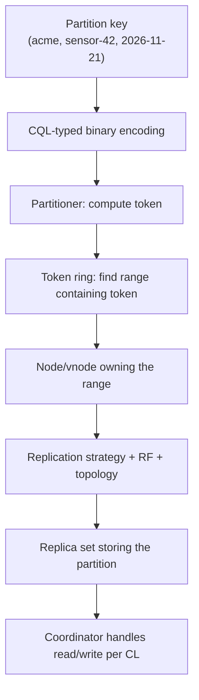
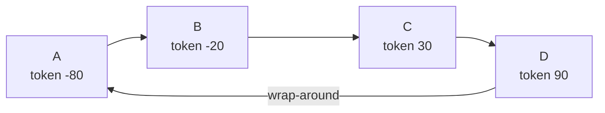
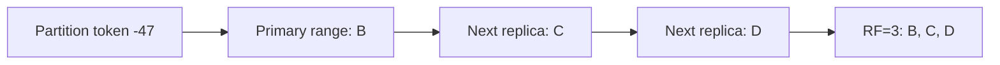
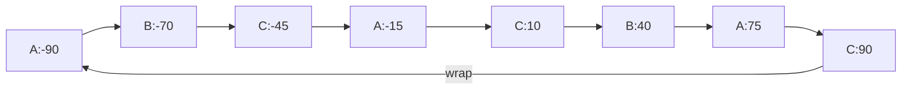
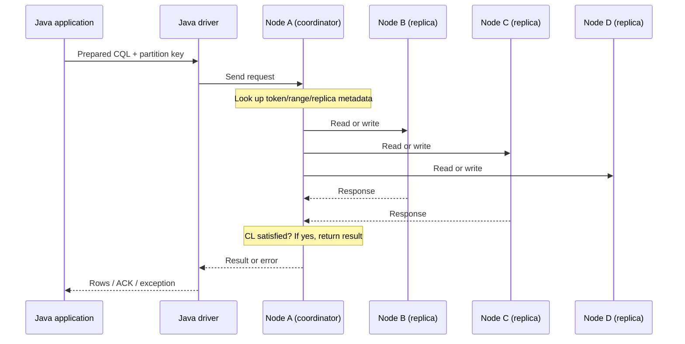
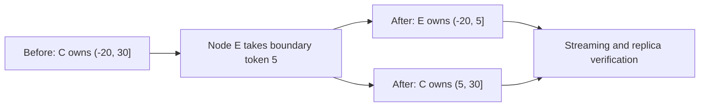

# Token Ring, Token Ranges, and Data Ownership

> **Chapter:** Tokens and Replication  
> **Scope:** This lesson explains how Apache Cassandra organizes the token space into a **logical ring**, maps tokens into **token ranges**, assigns ownership to nodes/vnodes, and selects **replicas** to store partitions. The material connects distributed cluster architecture, the wide-column model, and partition keys with CQL, read/write consistency, the Java driver, cluster scaling, repair, and failure handling.

## 1. Learning Objectives

After this lesson, you will be able to:

1. Explain why the token ring is a **circular logical space**, not a network cabling diagram or a list of nodes with a master.
2. Accurately read the `(previous_token, current_token]` interval convention, including **start boundary, end boundary**, and the **wrap-around** case.
3. Use an illustrative table of boundary tokens to determine which node manages a token, and distinguish **primary range ownership** from **replica ownership**.
4. Explain vnodes: how a physical node can own multiple non-contiguous token ranges.
5. Analyze how `Murmur3Partitioner`, token ring metadata, replication strategy, RF, DC/rack topology, and CL work together without **conflating their responsibilities**.
6. Predict the effects of bootstrap, decommission, node failure, or RF changes on token ranges and replicas.
7. Use `token(...)` in CQL, cluster observation tools, and the Java driver to inspect the routing path for a workload with a composite partition key.
8. Identify load skew, hot partitions, and the limits of balancing token ranges; propose safe experiments prior to production operations.

## 2. Start from a Row, Not from a Circle Diagram

Suppose an IoT system stores event history by tenant, device, and day:

```sql
PRIMARY KEY ((tenant_id, device_id, event_day), event_time, event_id)
```

One row has:

```text
tenant_id = acme
device_id = sensor-42
event_day = 2026-11-21
event_time = 2026-11-21T08:05:00Z
event_id = 11111111-1111-1111-1111-111111111111
```

In Cassandra, the three columns `tenant_id`, `device_id`, and `event_day` form a **composite partition key**. The two columns `event_time` and `event_id` are **clustering columns**. Rows with different `event_time` values but the same three partition key values belong to **the same partition** and therefore have **the same token**.

The data location process can be summarized as:



Looking at the diagram, keep two questions separate:

- **What is the partition's token?** Depends on the **encoded partition key and the partitioner**.
- **Which nodes hold the partition?** Depends on the **token, ownership metadata, replication strategy, RF, and topology**.

Do not jump straight from "token = X" to "surely only node Y holds all the data"; Cassandra normally **replicates partitions**.

## 3. From Partitioner to an Ordered Token Ring

The **partitioner** computes a token from the partition key bytes. In many modern Apache Cassandra clusters, `Murmur3Partitioner` is the common choice. With this partitioner, tokens are represented as 64-bit signed integers over the space:

\[
[-2^{63},\,2^{63}-1]
\]

When treated as a logical ring, token order **does not simply end** at the maximum value: after the upper end, it wraps around back to the minimum value. This partitions the entire token space into intervals without leaving an unowned gap "before the first node."

### 3.1. The Token Ring Is Not a Physical Network Ring

A cluster may be deployed on machines connected via switches, cloud networks, multiple racks, or multiple DCs. The token ring **does not** force nodes to forward packets sequentially from physical neighbor to neighbor like a daisy chain.

"Moving clockwise" in Cassandra diagrams is a way of expressing **ascending order around the token ring** for reasoning about ownership and replica placement. A coordinator can send requests directly to the required replicas over the actual network.

### 3.2. A Token Is Not a Primary Key

A token is a hash value; it does not contain the original `tenant_id`, `device_id`, or `event_day`. Two distinct partition keys **can** collide on the same token due to the finite 64-bit space; Cassandra still uses the full partition key to tell them apart.

Do not use a token as a unique business key, security access token, or tenant authorization mechanism. Nor should you compare tokens to determine which event is newer: Murmur3 does not preserve the ordering of dates, device IDs, or timestamps.

## 4. Token Range Rule: Left-Open, Right-Closed

In a single-boundary-token-per-node ring model, the rule is commonly expressed as:

\[
(\text{previous\_token},\,\text{current\_token}]
\]

This means:

- **Left-open:** a token equal to `previous_token` is **not** inside the interval under consideration.
- **Right-closed:** a token equal to `current_token` **is** inside the interval under consideration.
- When an interval crosses the maximum value of the token space, it **wraps around** to the minimum value side.

In the simplified diagram, the node at `current_token` holds primary responsibility (*primary range owner*) for the interval ending at its boundary token. Keep this rule within the proper distribution/token metadata model; the **replica** set also depends on the replication strategy.

### 4.1. Why Exact Boundaries Matter

Suppose two nodes have boundary tokens `-20` and `30`. For the interval `(-20, 30]`:

| Candidate token | Inside `(-20, 30]`? | Reason |
| ---: | --- | --- |
| `-20` | No | Equals the left-open boundary |
| `-19` | Yes | Greater than -20 |
| `0` | Yes | Lies between both boundaries |
| `30` | Yes | Equals the right-closed boundary |
| `31` | No | Exceeds the right boundary |

Altering which ends are open or closed could cause a boundary token to be counted in **two** ranges or in **none** in a theoretical model. In CQL practice, rely on cluster metadata and appropriate APIs rather than writing your own code to guess ownership from potentially stale boundary lists.

## 5. Four-Node Token Ring Example

To make mental math easier, let us use an **illustrative space from -100 to 100**, not real Murmur3 tokens. There are four nodes, each with one boundary token:

| Node | Illustrative boundary token | Primary managed token range |
| --- | ---: | --- |
| **A** | `-80` | `(90, 100] ∪ [-100, -80]` |
| **B** | `-20` | `(-80, -20]` |
| **C** | `30` | `(-20, 30]` |
| **D** | `90` | `(30, 90]` |

Here, `-100` and `100` are just notation for **the two ends of the illustrative range** for clarity; in a real token ring, bounds are defined by the partitioner.



### 5.1. Identify the Range Owner

| Partition token | Falls within range | Primary range owner node |
| ---: | --- | --- |
| `-95` | `(90,100] ∪ [-100,-80]` | A |
| `-80` | Exact right-closed boundary of A | A |
| `-47` | `(-80,-20]` | B |
| `-20` | Exact right-closed boundary of B | B |
| `15` | `(-20,30]` | C |
| `30` | Exact right-closed boundary of C | C |
| `65` | `(30,90]` | D |
| `99` | Tail segment wrapping around | A |

**Takeaway:** the largest token does not necessarily land on the "last node" as in a linear list. Node A, despite having a negative boundary token, owns the portion **after** boundary 90 and **up to or equal to** -80.

### 5.2. A Token Cannot Be Read by Looking at the Partition Key

You cannot look at `device_id = sensor-42` and guess its token is `-47`. The values `-95`, `-47`, `15`, etc. in this table **are given to practice range reasoning**, not the hash output of any CQL key in the example.

On a real cluster, tokens must be obtained through server/driver mechanisms compatible with the data types and partitioner.

## 6. Wrap-Around: Two Numeric Segments, One Continuous Interval on the Ring

Node A's range above is:

\[
(90,100]\;\cup\;[-100,-80]
\]

Viewed on a number line, it splits into two segments. Viewed on the **ring**, it is **one continuous interval** running from boundary token 90 across the ring boundary to token -80.

### 6.1. Common Pitfall When Writing Token-Scanning Tools

A custom tool scanning a wrap-around interval cannot simply issue a standard numeric condition:

```text
token > 90 AND token <= -80
```

because on a linear number line no value is both greater than 90 and less than or equal to -80. Conceptually, you must handle **two interval branches**:

```text
(token > 90) OR (token <= -80)
```

This **does not mean** CQL lets you freely combine `OR` over partition-token predicates. When building tooling, split the wrap-around range into supported requests, manage non-overlapping boundaries, paging, retries, and topology updates.

### 6.2. Watch Out for the Minimum Token

In the real Murmur3 space, the minimum token value and modulo boundaries have specific rules/special values depending on the token-range API. Do not assume every library represents ranges as `[min,max]` or `(min,max]` identically.

Use the metadata and range representations documented for **the Cassandra/driver version you run**, especially for full-ring scan, restore, or migration tools. Small-number diagrams in this lesson are for practicing **principles**.

## 7. "Ownership" Has at Least Three Meanings to Separate

The term *ownership* appears in documentation, `nodetool`, and monitoring dashboards. It **does not always refer to the same percentage**.

| Concept | Meaning in Cassandra's model | Easily mistaken for |
| --- | --- | --- |
| **Primary range ownership** | Token intervals primarily managed by a node/boundary token per ring structure | All replicas stored on the node |
| **Replica ownership/effective ownership** | Set of ranges/partitions a node holds **due to RF and replication strategy** | Only intervals ending at the node's own tokens |
| **Actual stored data volume** | Bytes held on disk by the node, affected by data size, compression, SSTables, RF, repair, etc. | Proportion of token-range length |
| **Actual request traffic** | Reads/writes/compactions on the node driven by queries and skew | Proportion of token ranges owned |

### 7.1. Token Range Ratio Is Geometry, Not Bytes

In the 200-unit illustrative space from section 5, the interval lengths are:

| Node | Range length | Illustrative geometric share |
| --- | ---: | ---: |
| A | `(90→100) + (-100→-80) = 10 + 20 = 30` | 15% |
| B | `-80→-20 = 60` | 30% |
| C | `-20→30 = 50` | 25% |
| D | `30→90 = 60` | 30% |
| **Total** | **200** | **100%** |

These numbers only measure **illustrative token ring length** under the single-token-per-node model without replicas. You cannot conclude Node A definitely holds 15% of bytes, 15% of rows, or 15% of QPS; a hot partition in A's range can generate load far exceeding its geometric share.

### 7.2. With RF > 1, Effective Ownership Can Sum Above 100%

One partition can exist on multiple nodes. In a four-node cluster with RF = 3, when data is fully replicated, each partition has **three copies** on three distinct physical nodes. Summing the percentages of data held across nodes will not default to **100%** the way summing primary token ranges does.

When reading "Owns" or "Owns (effective)" columns in tools, inspect **the specific keyspace, RF, strategy, and tool version definition**. Never use a single ownership percentage alone to judge whether node load is well balanced.

## 8. How Does Primary Owner Differ from the Replica Set?

Suppose we use the four-node illustrative ring A/B/C/D above, one DC, **one boundary token per node**, and a simple replication strategy walking around the ring to pick **distinct physical nodes**.

If a partition has token `-47`:

1. Token `-47` falls in `(-80,-20]`.
2. **B** is the primary range owner in this model.
3. With **RF = 1**, only B holds a copy under this model.
4. With **RF = 3** and walking successive nodes around the ring, the replica set can be illustrated as **B, C, D**.



**Scope warning:** this is a simplified example for understanding "walking the ring to pick multiple replicas." With `NetworkTopologyStrategy`, multiple racks, multiple DCs, and vnodes, placement must obey topology rules; **do not** compute production replicas by just taking "the next three boundary tokens regardless of rack/DC."

### 8.1. Changing RF Does Not Change Tokens

If the partition key and partitioner remain unchanged, raising RF from 1 to 3 **does not recompute** the partition's token. What changes is **the set of nodes responsible for holding replicas**, replication storage/traffic, the operational procedure to synchronize new replicas, and CL choices.

Altering RF on a keyspace does not mean data is instantly present on all new replicas. You must follow the **version's operational procedure** to ensure additional replicas receive complete data and are verified.

### 8.2. Consistency Level Does Not Define Ownership

`LOCAL_ONE`, `LOCAL_QUORUM`, and `ALL` set **response requirements** for reads/writes; they do not change tokens, token ranges, or partition definitions. For the same partition and same RF, requests may choose different CLs while **the configured replica set remains unchanged**.

## 9. Virtual Nodes (vnodes): One Node Can Sit in Many Places on the Ring

The one-node/one-token model in section 5 is great for learning, but real Cassandra deployments commonly use **virtual nodes**.

With vnodes, a physical node can hold multiple boundary tokens and multiple non-contiguous ranges. Illustrative example:

```text
Boundary tokens in ring order:
  -90: Node A
  -70: Node B
  -45: Node C
  -15: Node A
   10: Node C
   40: Node B
   75: Node A
   90: Node C

=> A appears three times, B twice, C three times.
=> Each occurrence is one boundary/range in the simplified diagram.
```



### 9.1. What Do Vnodes Help With?

- Distributing many token ranges across nodes, helping balance keyspace coverage.
- Making node addition/replacement and range movement across topology more convenient.
- Reducing reliance on a single physical node owning one huge contiguous arc of the ring.

However, more vnodes **are not automatically better**:

- They can increase streaming jobs/streams, ranges requiring repair, and coordination overhead.
- The appropriate vnode count per node depends on Cassandra version, node capacity, data characteristics, and token allocation method.
- A **partition** still has one token even when a node holds many vnodes; it is not sliced into pieces per clustering row.

### 9.2. RF = 3 Means Three Suitable Physical Nodes, Not Three Vnodes on One Node

If Node A has ten boundary tokens, it does **not** count as ten independent replicas of the same partition. Cassandra selects replicas by **physical node** and topology/strategy, avoiding counting multiple vnodes on the same host as independent fault-tolerant copies.

Thus, a cluster with only **one physical node** does not become a true three-replica cluster simply by setting `num_tokens = 3` or declaring RF = 3.

## 10. Replication Strategy and Rack/DC Topology

### 10.1. NetworkTopologyStrategy

In an Apache Cassandra cluster with a DC named `dc1` and enough suitable nodes, for example:

```sql
CREATE KEYSPACE IF NOT EXISTS telemetry_ring
WITH replication = {
    'class': 'NetworkTopologyStrategy',
    'dc1': 3
};
```

`NetworkTopologyStrategy` chooses replicas using DC/rack-aware rules; the goal is to spread copies across appropriate fault domains when topology allows. In a DC with multiple racks, placement is designed to distribute replicas across racks according to the strategy's policy.

**Do not** read this example as a guarantee that "three replicas will always sit in three separate racks" if only one or two racks actually exist or topology is misconfigured. Verify the snitch, DC/rack settings, and cluster metadata.

### 10.2. SimpleStrategy Is for Learning Principles, Not Multi-DC Production Defaults

`SimpleStrategy` helps illustrate ring-order replica selection in simple scenarios. However, in environments with multiple DCs or racks, use `NetworkTopologyStrategy` for topology-aware replication; blindly applying `SimpleStrategy` to multi-DC production keyspaces is not recommended.

### 10.3. Multiple Data Centers

Example keyspace across two DCs, with three suitable nodes in each DC:

```sql
CREATE KEYSPACE IF NOT EXISTS telemetry_multi_dc
WITH replication = {
    'class': 'NetworkTopologyStrategy',
    'dc1': 3,
    'dc2': 3
};
```

Each partition has the same token computed by the partitioner as before, but the topology has **per-DC replica sets**. With local RF = 3:

- `LOCAL_ONE` in `dc1` requires one local replica response.
- `LOCAL_QUORUM` in `dc1` typically requires two local replicas.
- Global `QUORUM`, with total RF = 6 in this example, typically requires four replicas across the corresponding quorum scope.

A write acknowledged at `LOCAL_QUORUM` in `dc1` **does not prove** every replica in `dc2` has received the data. When planning for full-DC loss, measure **RPO/RTO**, failover/failback, and data convergence procedures—do not just stare at the token ring.

## 11. Coordinator, Driver, and Storage Nodes Are Three Distinct Roles

A Java application may connect to Node A, while the partition token falls in B's primary range and its illustrative replica set is B/C/D. Node A can still act as **coordinator**: receiving the request, locating replicas, and awaiting responses per CL.



This diagram is illustrative; actual read/write requests and response optimizations vary by version, CL, replica state, and configuration. Not every request sends to or waits on the exact same response set as drawn.

### 11.1. Driver Token-Aware Routing

The Java driver can compute/extract the routing key and token from a **fully bound partition key**, combining it with topology metadata to prefer an appropriate coordinator—usually an available local replica.

Token-aware routing reduces extra network hops in many cases, yet:

- The coordinator is **not required** to be the primary range owner.
- Choosing a coordinator **does not** alter replica placement.
- Fallback can occur when the driver lacks metadata, nodes fail, or another policy applies.
- A prepared statement does not fix a `SELECT` that omits the partition key or performs a broad scan.

## 12. Node Failure: Do Tokens Change Immediately?

Suppose a partition has RF = 3 in `dc1` with replicas B/C/D. Node C temporarily stops responding. What happens:

1. **The partition key and token do not change.** Cassandra does not rehash keys just because a node goes down.
2. Topology/membership marks C unavailable; the coordinator and driver adjust request dispatch within permitted limits.
3. If B and D respond in time, a `LOCAL_QUORUM` request can typically still succeed (2 of 3 local replicas).
4. If only B responds, `LOCAL_QUORUM` fails; `LOCAL_ONE` may still succeed if other conditions permit.
5. When C returns, data may require convergence/reconciliation mechanisms such as hinted handoff (within supported bounds) and anti-entropy repair.

| Scenario | Token / partition key | Configured replica placement | Can RF = 3, `LOCAL_QUORUM` succeed? |
| --- | --- | --- | --- |
| B/C/D healthy | Unchanged | B/C/D | Can succeed |
| C unresponsive, B/D healthy | Unchanged | Still B/C/D per topology, with C temporarily down | Can succeed |
| C/D unresponsive, only B healthy | Unchanged | Does not instantly become a new three-replica set | Not enough (fewer than 2 local replicas) |
| Planned node replacement/reconfiguration | Key token unchanged | Replica metadata/ownership may change | Must observe after transition |

**Note:** "can succeed by replica count" is not a guarantee every request will pass; network issues, queues, compaction, disk I/O, and deadlines can still cause timeouts.

## 13. Adding a Node: Token Ranges Change, Keys Do Not

Suppose before scaling, Node C owns the interval `(-20, 30]` in section 5's example. We add Node E with boundary token **`5`**:

| Before adding E | After E joins and ownership stabilizes |
| --- | --- |
| C: `(-20,30]` | E: `(-20,5]` |
| — | C: `(5,30]` |

A partition with token `-7` **keeps the same token**, but the interval containing it now belongs to Node E under primary ownership. Token `24` still belongs to C.



### 13.1. Bootstrap Is More Than Adding a Name to a Diagram

In a real cluster, adding a node can involve:

- Metadata/token ownership entering a transitional state.
- Computing which ranges/replicas the new node will assume under the replication strategy.
- **Data streaming** of required data between nodes.
- Waiting for the new node to join normally and verifying data/metrics.
- Managing impact on streaming sources, disk I/O, network bandwidth, and tail latency.

With RF > 1, changing a primary owner can shift **multiple replica placements**, not just transfer one range from C to E. With vnodes, a new node can receive multiple ranges from many existing nodes.

### 13.2. Pending Ranges and Consistency During Transitions

During topology changes, metadata can represent intervals/placements **awaiting ownership** (*pending ranges*) so mutations are handled safely according to Cassandra's mechanisms and version. Never treat static "before" or "after" diagrams as an exact snapshot at every instant of bootstrap.

Good monitoring must distinguish:

- **Expected final ownership** once the operation finishes.
- **Current replicas and replicas receiving data** during transition.
- **Cluster state and ongoing streaming operations** not yet finished.

To know whether a node can serve data accurately, check **live metadata/topology and streaming state**, not a boundary token list saved yesterday.

## 14. Decommission, Replace, Permanent Node Loss, and Cleanup

Different operations should not be lumped together as generic "data owner change":

| Situation | Effect on ownership | Operational requirement |
| --- | --- | --- |
| **Bootstrap** | New node assumes ownership of token ranges/replicas | Streaming, capacity, and status verification |
| **Controlled decommission** | Node leaves cluster; data responsibility shifts to remaining nodes | Sufficient capacity/replicas, streaming, and post-change verification |
| **Replace failed node** | Restores node function following version's replace workflow | Replace procedure and data sync, do not assign arbitrary tokens |
| **Temporarily down node** | Node remains in topology, but fails to serve in time | CL, monitor surviving replicas, bring node back and converge |
| **Cleanup when appropriate** | After ownership changes, data a node no longer owns may need cleanup | Verify topology/streaming first; consider tooling and version |
| **Change replication factor** | Target replica count changes; key tokens stay unchanged | Sync new/additional replicas, verify CL and capacity |

Never run `nodetool decommission`, `replace`, `cleanup`, `repair`, or alter `num_tokens` on production just to experiment. All of these can affect data, disk usage, throughput, or availability.

### 14.1. The Token Ring Does Not Guarantee Spare Cluster Capacity

Suppose the original four nodes are already nearly full on disk. If one node leaves the cluster, data/replicas must move to the remaining nodes; the token diagram may look neat yet **lack capacity** to hold the required copies.

Capacity planning must account for actual data size, RF, compression, compaction headroom, network/streaming, and node-loss scenarios. Never use token-range percentage alone to justify node changes.

## 15. CQL Lab: Observing Partition Tokens

The goal of this lab is to prove **same partition key → same token** and compare against ranges in a real cluster. No failure injection or topology changes are needed.

### 15.1. Prepare the Keyspace

Assuming a **self-managed Apache Cassandra** cluster where the data center is actually named `dc1` and three suitable nodes exist for RF = 3:

```sql
CREATE KEYSPACE IF NOT EXISTS telemetry_ring
WITH replication = {
    'class': 'NetworkTopologyStrategy',
    'dc1': 3
};
```

If your lab has only **one node**, use `'dc1': 1` and `LOCAL_ONE`; do not enter RF = 3 and claim you verified three replicas.

### 15.2. Create the Query-Driven Table

```sql
CREATE TABLE IF NOT EXISTS telemetry_ring.events_by_device_day (
    tenant_id text,
    device_id text,
    event_day date,
    event_time timestamp,
    event_id uuid,
    temperature_c double,
    event_type text,
    PRIMARY KEY ((tenant_id, device_id, event_day), event_time, event_id)
) WITH CLUSTERING ORDER BY (event_time DESC, event_id ASC);
```

The table uses three columns as a composite partition key and two clustering columns. `CLUSTERING ORDER BY` only affects ordering **inside the partition**, not the partition's token.

### 15.3. Insert Data into Two Partitions

```sql
INSERT INTO telemetry_ring.events_by_device_day (
    tenant_id, device_id, event_day, event_time,
    event_id, temperature_c, event_type
) VALUES (
    'acme', 'sensor-42', '2026-11-21',
    '2026-11-21T08:05:00Z',
    11111111-1111-1111-1111-111111111111,
    27.4, 'READING'
);

INSERT INTO telemetry_ring.events_by_device_day (
    tenant_id, device_id, event_day, event_time,
    event_id, temperature_c, event_type
) VALUES (
    'acme', 'sensor-42', '2026-11-21',
    '2026-11-21T08:06:00Z',
    22222222-2222-2222-2222-222222222222,
    27.8, 'READING'
);

INSERT INTO telemetry_ring.events_by_device_day (
    tenant_id, device_id, event_day, event_time,
    event_id, temperature_c, event_type
) VALUES (
    'acme', 'sensor-42', '2026-11-22',
    '2026-11-22T08:05:00Z',
    33333333-3333-3333-3333-333333333333,
    28.1, 'READING'
);
```

### 15.4. Use the `token(...)` Function

```sql
SELECT token(tenant_id, device_id, event_day) AS partition_token,
       event_time, event_id, temperature_c
FROM telemetry_ring.events_by_device_day
WHERE tenant_id = 'acme'
  AND device_id = 'sensor-42'
  AND event_day = '2026-11-21';

SELECT token(tenant_id, device_id, event_day) AS partition_token,
       event_time, event_id
FROM telemetry_ring.events_by_device_day
WHERE tenant_id = 'acme'
  AND device_id = 'sensor-42'
  AND event_day = '2026-11-22';
```

**Expected observations:**

1. Both rows for `2026-11-21` have the same `partition_token`.
2. The row for `2026-11-22` has a different partition key and **typically** produces a different token.
3. The token result is a signed integer if the cluster uses `Murmur3Partitioner`.
4. No fixed numeric token is predicted in advance by this lesson; **record the exact value returned by your cluster**.

Note: the `token(...)` function accepts the **partition key columns matching the schema**; it does not include the clustering column `event_time` in the hash.

## 16. Cross-Checking the Ring with Admin Tools and Tracing

In a self-managed Apache Cassandra lab environment, common inspection commands are:

```bash
nodetool status
nodetool ring
nodetool describering telemetry_ring
nodetool netstats
```

Command names, flags, output format, and permissions vary by version. `nodetool ring` can be very long when vnodes are enabled; `nodetool describering` or equivalent metadata tools can help inspect ranges/endpoints per keyspace. `nodetool netstats` is useful for observing **streaming** during topology changes.

### 16.1. Step-by-Step Observation Plan

1. **Verify DC/rack and node states** using `nodetool status` or an equivalent monitoring interface.
2. **Inspect boundary tokens** and ring ranges using `ring`/`describering` as supported by your tools.
3. **Fetch the real token** of `(acme, sensor-42, 2026-11-21)` using the CQL in section 15.
4. **Identify the range containing the token** from metadata, paying attention to boundaries and wrap-around.
5. **Determine the actual replicas** for keyspace `telemetry_ring` and its topology; do not rely solely on a single "Owns" column.
6. **Record evidence:** token, range bounds, RF, CL, node/DC names, and observation timestamp.

There is no need—and it is not advisable—to perform live topology changes just to complete an ownership observation lab.

### 16.2. Tracing in `cqlsh`

```sql
TRACING ON;

SELECT event_time, event_id, temperature_c
FROM telemetry_ring.events_by_device_day
WHERE tenant_id = 'acme'
  AND device_id = 'sensor-42'
  AND event_day = '2026-11-21'
LIMIT 5;

TRACING OFF;
```

Tracing helps inspect coordination steps depending on version and settings; it **incurs overhead** and is not a complete snapshot of every internal step. Never leave tracing permanently enabled in production just to observe tokens.

## 17. Java Driver 4.x: Use Routing Keys Instead of Guessing Nodes

A Java application should prepare CQL statements with the full partition key and let the driver use schema/topology metadata when applicable. Never hardcode lists like "device X lives on node Y" in application code, because membership and ownership change during bootstrap, replace, or decommission.

### 17.1. Example: Reading Data and Partition Tokens

The Java 11+ snippet demonstrates Java driver 4.x for Apache Cassandra against the lab keyspace and table. `dc1`, `127.0.0.1`, RF, and CL must match your actual environment:

```java
import java.net.InetSocketAddress;
import java.time.LocalDate;

import com.datastax.oss.driver.api.core.CqlSession;
import com.datastax.oss.driver.api.core.DefaultConsistencyLevel;
import com.datastax.oss.driver.api.core.cql.PreparedStatement;
import com.datastax.oss.driver.api.core.cql.ResultSet;
import com.datastax.oss.driver.api.core.cql.Row;

public final class RingOwnershipDemo {
    public static void main(String[] args) {
        try (CqlSession session = CqlSession.builder()
                .addContactPoint(new InetSocketAddress("127.0.0.1", 9042))
                .withLocalDatacenter("dc1")
                .build()) {

            PreparedStatement read = session.prepare(
                "SELECT token(tenant_id, device_id, event_day) " +
                "AS partition_token, event_time, event_id, temperature_c " +
                "FROM telemetry_ring.events_by_device_day " +
                "WHERE tenant_id = ? AND device_id = ? " +
                "AND event_day = ? LIMIT 100"
            );

            ResultSet result = session.execute(
                read.bind(
                    "acme", "sensor-42", LocalDate.of(2026, 11, 21)
                ).setConsistencyLevel(DefaultConsistencyLevel.LOCAL_QUORUM)
                 .setIdempotent(true)
            );

            for (Row row : result) {
                // BIGINT token type corresponds to Murmur3Partitioner.
                long token = row.getLong("partition_token");
                System.out.printf(
                    "token=%d time=%s event=%s%n",
                    token,
                    row.getInstant("event_time"),
                    row.getUuid("event_id")
                );
            }
        }
    }
}
```

In a single-node/RF = 1 lab, switch `LOCAL_QUORUM` to `LOCAL_ONE`. Do not assume the Java driver will accept identical TLS/auth/CL settings or token types across **every Cassandra-compatible service**, as backends may use different models.

### 17.2. What the Driver Knows and Does Not Know

| The driver can | The driver cannot |
| --- | --- |
| Bind `text`/`date`/`timestamp` and corresponding CQL types | Fix a partition key that creates a hot partition |
| Derive a routing key from an eligible prepared statement | Turn a query missing the partition key into a point lookup |
| Receive topology metadata and prefer an appropriate coordinator | Override server-side RF or replica placement |
| Detect node failures and switch coordinators per policy | Change the token of an existing partition |
| Return timeout/unavailable errors | Guarantee a mutation was never written to any replica upon timeout |

Driver token-aware routing helps **choose where to send**. The server remains responsible for maintaining token ranges, topology, and executing reads/writes.

## 18. Token-Range Reads Do Not Replace Key-Based Queries

Some tools need to scan data by token range, such as migrations or parallel scan splitting. CQL can support predicates like:

```sql
-- Illustrates a token-range query structure, NOT the
-- primary query for an API fetching "100 latest events of a device".
SELECT tenant_id, device_id, event_day, event_time
FROM telemetry_ring.events_by_device_day
WHERE token(tenant_id, device_id, event_day) > -1000000
  AND token(tenant_id, device_id, event_day) <= 1000000
LIMIT 100;
```

Distinguish these clearly:

| Query | Scope served | Risk |
| --- | --- | --- |
| `WHERE tenant_id=? AND device_id=? AND event_day=?` | **One known partition** | Can be hot/large, but target is exact |
| `WHERE token(...) > a AND token(...) <= b` | **Multiple partitions** within token range | Scans many rows/nodes; bounds and pagination are complex |
| `WHERE event_time > ...` without partition key | No targeting path like Q1/Q2 | May not be directly supported by CQL or is prohibitively expensive |

Token order is hash order, not **event-time order** or tenant order. Adding `LIMIT 100` does not turn a token-range scan into "the 100 latest events system-wide."

### 18.1. Full-Ring Scanning Must Handle Boundaries and Membership

A safe full-ring scanning tool must handle:

- Wrap-around boundary intervals.
- Left-open/right-closed boundaries to avoid skipping or duplicating partitions.
- Retries, paging, and new rows written during the scan.
- Cluster metadata changes while adding or removing nodes.
- Rate limiting/backpressure so replicas are not overloaded.
- Deduplication and reconciliation when exact data is required.

Therefore, tasks like backups, exports/migrations, or full-dataset analytics require proper tooling and procedures, not just a CQL token loop running against production.

## 19. How Does Ownership Relate to Compaction, Repair, and Hot Partitions?

These questions are easily mixed up:

| Mechanism | Purpose | Automatically changes a partition's token? |
| --- | --- | --- |
| **Token ownership / bootstrap** | Determines and transfers ranges a node must serve/store | Does not change the key's hash value; can change the responsible node |
| **Replication strategy / RF** | Chooses the count and placement of replicas | No |
| **Compaction** | Merges local SSTables, versions, and tombstones | No |
| **Repair** | Synchronizes differences across replicas within appropriate scopes | No |
| **TTL / DELETE** | Defines data expiration or deletion state | No |
| **Changing the partition key** | Repartitions logical data under a new key | **Can produce new tokens**; requires schema creation and migration |

### 19.1. Why Can Balanced Ownership Percentages Still Be Slow?

Suppose Nodes A and B have nearly equal token ranges, yet a single `tenant_id/device_id` generates 20,000 events/second in the same daily bucket. Those writes hit the replica set of **one partition/token** and are not spread out merely because the two nodes have equal ring percentages.

A **hot partition** is about **load per key and its replica set**, which is different from **skewed token-range allocation**.

Options to evaluate:

- Smaller buckets, such as hourly instead of daily, if query semantics allow.
- Logical sharding derived from a stable event ID to split writes across multiple partitions, accepting fan-out/merge on reads.
- Backpressure, appropriate batching, and application-side concurrency limits.
- Measuring actual partition size/QPS distribution, compaction backlog, and p95/p99 latency.

**Do not** raise RF, run repair, or change CL as a default fix to "split one partition" into multiple keys; those mechanisms solve different problems.

### 19.2. When Does Ownership Change While Data on Disk Has Not Fully Changed?

During bootstrap/decommission and streaming, metadata transitions, data exists temporarily on involved nodes, and old replica cleanup may occur via post-change procedures. Therefore:

- Do not treat disk byte counts mid-stream as final proof of ownership.
- Do not run cleanup before verifying topology and confirming data has been transferred/replicated properly.
- Monitor streaming status metrics, replica availability, request errors, and disk headroom.

## 20. Practice Scenarios and Suggested Answers

### Exercise A — Identify the Range

Given the illustrative token ring `A=-80`, `B=-20`, `C=30`, `D=90`, which node is the primary owner of tokens `-80`, `-47`, `30`, `99`?

**Hint:** Under the `(previous,current]` range rule, A, B, C, and A respectively. Token `99` lies in A's wrap-around segment; a token equal to a right boundary belongs to the range ending at that boundary.

### Exercise B — Replica Selection in the Simple Model

Token `-47` has primary range owner B. In a single-DC, one-token-per-node ring model with a strategy placing three replicas on consecutive nodes, where might RF = 3 place replicas?

**Hint:** B/C/D in the simple example. However, in production with NTS, racks, DCs, and vnodes, inspect actual metadata and strategy rather than assuming simple example placement holds in practice.

### Exercise C — Compute Illustrative Ownership %

In the illustrative -100 to 100 space, A's range comprises `(90,100]` and `[-100,-80]`. What is its geometric length share?

**Hint:** `(10+20)/200 = 15%`. This is **not** necessarily 15% of stored bytes or 15% of QPS, especially with RF > 1 or hot partitions.

### Exercise D — Adding E Between B and C

Before the change, C owns `(-20,30]`. Adding E with token `5`, which primary owners hold tokens `-7` and `24` once topology stabilizes?

**Hint:** `-7` belongs to E and `24` belongs to C. The partitions' tokens **do not change**; the node responsible for the new range changes.

### Exercise E — Losing One Replica

RF = 3 in `dc1`, partition replica set B/C/D. C is temporarily down while B and D are healthy. How many replicas does `LOCAL_QUORUM` require and what outcomes are possible?

**Hint:** Requires two local replicas, so it **can** succeed; requests could still time out due to load, network, or disk issues. If B also fails and only D responds, quorum is not met.

### Exercise F — Token-Aware Routing and Topology Changes

A Java app hardcodes `sensor-42 → node C` because yesterday the device's token fell in C's range. Today the cluster bootstrapped Node E into part of that range. Why is this brittle?

**Hint:** Ownership can change while the key's token remains the same. You need a driver with up-to-date metadata and routing policy, not hardcoded `device → node` mappings in application code.

### Exercise G — One Node with Six Vnodes

Node A manages six disjoint ranges, and the cluster has two other physical nodes. Can A's six vnodes count as six independent replicas to run RF = 6?

**Hint:** No. Fault-tolerant replicas must reside on distinct suitable **physical nodes** per topology/strategy, not six token positions on the same node.

### Exercise H — Why a Token-Range Scan Does Not Return a Timeline

An analyst wants "the 100 latest events company-wide" using `WHERE token(...) > X LIMIT 100`.

**Hint:** Tokens represent partition key hash order, not `event_time`. A dedicated read model, stream aggregation, OLAP store, or appropriate pipeline is needed.

## 21. Understanding Verification Checklist

- [ ] Distinguish partition key from clustering columns and know only the partition key generates the token.
- [ ] Explain that the token ring is a logical ring, not a physical network path.
- [ ] Read `(previous_token,current_token]` intervals, including exact left/right boundary cases.
- [ ] Correctly identify the primary owner of a token in the wrap-around segment.
- [ ] Avoid confusing primary token-range ownership with replica lists or actual stored bytes.
- [ ] Know that vnodes give one node multiple ranges without creating additional physical nodes.
- [ ] Distinguish partitioner, metadata, replication strategy, RF, CL, and coordinator.
- [ ] Explain the difference between `LOCAL_QUORUM` in one DC and global `QUORUM` across two DCs.
- [ ] Explain why a node going down does not automatically change a partition's token.
- [ ] Understand that bootstrap/decommission/replace require streaming/metadata and capacity checks.
- [ ] Observe `token(...)` of two rows in the same partition via CQL in a lab.
- [ ] Know how to use `nodetool status/ring/describering` or equivalent tools depending on environment.
- [ ] Never hardcode `partition key → node` in Java; rely on driver routing metadata.
- [ ] Never use a token-range scan as a chronologically sorted query.
- [ ] Recognize hot partitions even when token-range percentages across nodes appear balanced.
- [ ] Only claim failure-test results if actually executed on an appropriate lab cluster.

## 22. Summary: The Token Ring Is a Logical Ownership Map

The chain to remember in Apache Cassandra:

**Partition key → partitioner → token → token range on ring → node/vnode owning range → replication strategy and RF select replica set → coordinator reads/writes per CL.**

Three statements prevent most confusion:

1. **Tokens are fixed by key and partitioner; ownership changes with topology.** Adding a node can shift a partition's primary owner without changing its token value.
2. **Primary owner does not mean sole copy.** RF and the replication strategy determine additional replicas by DC/rack, and one physical node holding many vnodes is still not multiple independent replicas.
3. **Token-range percentage does not mean balanced data or load.** Large/hot partitions, varying row sizes, and query skew can dominate reality.

Understanding the token ring enables you to design query-driven partition keys, read cluster metadata, analyze the impact of replication/consistency, bootstrap, repair, and compaction, and connect Java applications with a properly routing driver. That forms the foundation for upcoming lessons on replication factor, replication strategies, failure handling, and operations in **DATABASE_ENGINE_WIDE_COLUMN_CASSANDRA**.
