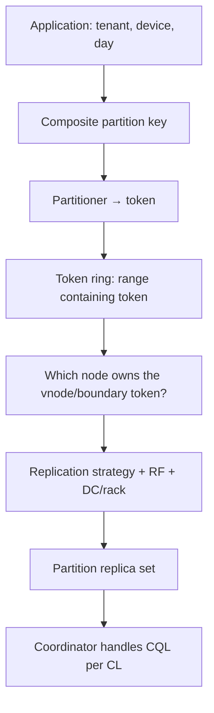
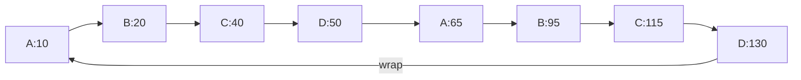
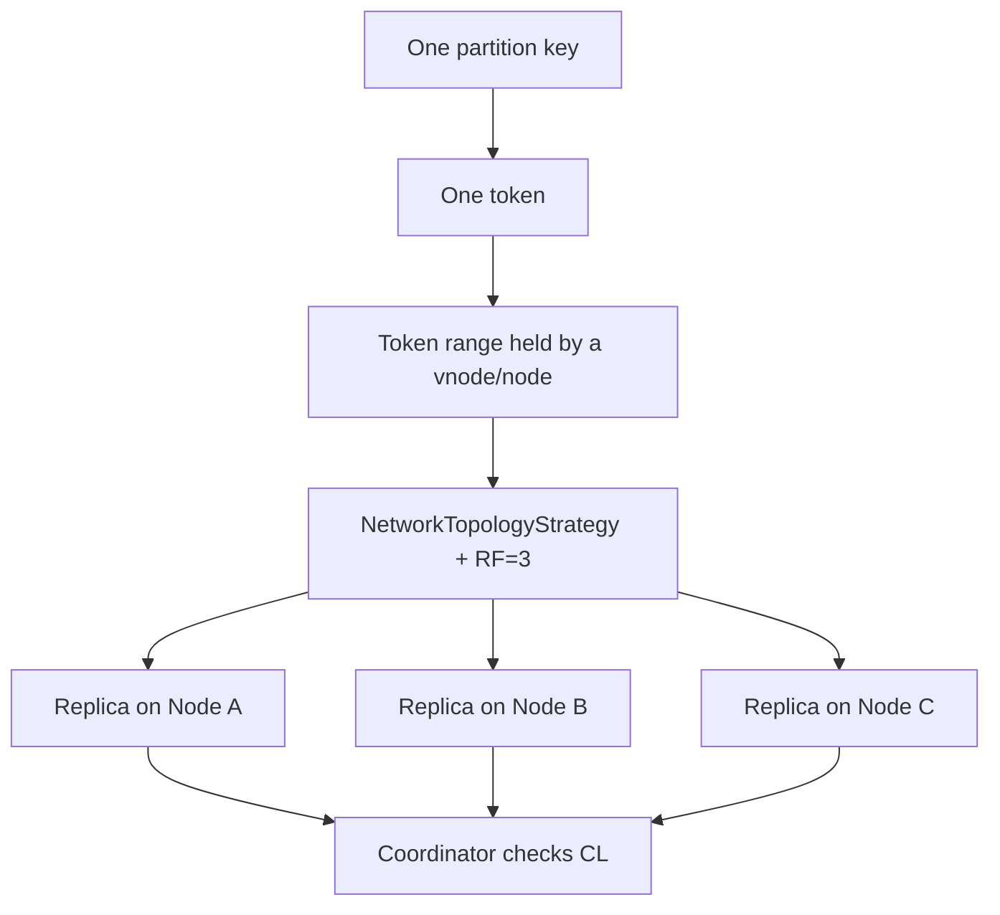
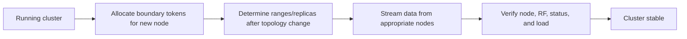

# Virtual Nodes and Trade-Offs in Distribution and Balancing

> **Chapter:** Tokens and Replication  
> **Scope:** Apache Cassandra organizes data by partition key, token, and replica. A **virtual node (vnode)** allows a physical node to hold multiple positions on the token ring. This lesson focuses on **why vnodes are used, how they change token range ownership, and the trade-offs in data balancing, adding/removing nodes, repair, and failure handling**. CQL and the Java driver are used to observe the mechanism, not to replace cluster operational procedures.

## 1. Learning Objectives

After this lesson, you will be able to:

1. Distinguish **physical node/Cassandra process**, **virtual node**, **token**, **token range**, and **replica**; explain why multiple vnodes on one node do not constitute multiple independent fault-tolerant nodes.
2. Compare the **single token per node** model with **multiple tokens per node**, including the impact on data ranges when adding or removing nodes.
3. Calculate **primary token-range ownership** percentages using an illustrative token ring, without equating those percentages with actual bytes, partitions, or requests.
4. Explain vnode-count trade-offs: initial distribution, rebalancing, bootstrap, replace, decommission, streaming, repair, metadata, and operational complexity.
5. Describe the role of `num_tokens` and token selection/allocation based on Cassandra version capabilities, avoiding treating any default value as a universal optimum.
6. Separate the effects of **partition key**, vnodes, replication strategy, RF, DC/rack, and consistency level on load distribution and reliability.
7. Use CQL `token(...)`, `nodetool status`, `nodetool ring`, and Java driver 4.x to observe data distribution.
8. Build a balance evaluation approach grounded in real metrics: hot partitions, disk usage, p95/p99 latency, streaming, repair, and capacity headroom.

## 2. Problem: Does Adding a Node Automatically Balance Data?

An IoT system runs 4 Cassandra nodes. Many devices generate daily event histories. The operations team notices one node stores more bytes than the others and wants to add a node to increase capacity.

Two questions must be separated:

- Is **token range allocation** balanced across nodes?
- Are **actual partitions and query load** evenly distributed?

If just one extremely hot device sends 20,000 events/second into the same partition, whether each node has 1 or 100 vnodes, **that partition still has one partition key and one token**. Vnodes help distribute **many partitions**, not split a single partition into independent pieces.

### 2.1. Chain of Responsibility Model



**Vnodes appear at the token-range ownership step**, not when generating event IDs, computing clustering order, or deciding replica counts.

## 3. Distinguishing Five Concepts Often Lumped Together as "Node"

| Concept | Essence | Example |
| --- | --- | --- |
| **Cassandra node** | A cluster member with real CPU, RAM, disk, network, and fault domain | Node A running Cassandra on a VM |
| **Token** | Hash value of a partition key, or a boundary marker in token ring metadata | Illustrative token `-20` |
| **Token range** | An interval in the token space following ring convention | `(-80, -20]` |
| **Virtual node (vnode)** | One of multiple token positions/ranges assigned to a Cassandra node | Node A owns ranges r1, r4, r7 |
| **Replica** | A data copy of a partition on a suitable node, per replication strategy and RF | RF = 3 produces three replicas of the partition |

A vnode is a **logical unit of token ownership**, not a separate container, JVM, disk, or network interface. If Node A holds 16 vnodes and host A loses power, **all 16 of A's vnodes become unavailable**.

### 3.1. A Vnode Is Not a Clustering Row

Consider the table:

```sql
PRIMARY KEY ((tenant_id, device_id, event_day), event_time, event_id)
```

The three columns inside the inner parentheses form the **partition key**. The two following columns are **clustering columns**. All rows with the same `tenant_id/device_id/event_day` share the same token regardless of `event_time`.

One vnode holds **a token range containing many partitions**, while one partition can hold **many clustering rows**. There is no mechanism where "each row gets placed on a different vnode" as clustering timestamps advance.

## 4. Why Is the Single-Token-Per-Node Model Harder to Balance?

Suppose the token ring is divided using **one boundary token per node**, and each node manages `(previous_token, current_token]`. If boundary tokens are unevenly spaced, one node may cover a larger fraction of the token space than another.

Under a well-distributed hash, sufficiently diverse partition keys spread across ranges. When one interval is twice as wide as another, the **expected number of partitions** in the wider range can be larger, though actual results still depend on data and skew.

### 4.1. Two Contrasting Scenarios

**Scenario A — Roughly even boundary tokens:** each node holds comparable intervals; primary ownership over the token space looks balanced.

**Scenario B — Skewed boundary tokens:** Node A owns much more token space than Node B. If partitions distribute fairly evenly by hash, A may hold more data even before considering RF.

With one token per node, changing distribution typically requires **moving one or a few large intervals**. Vnodes create smaller intervals so nodes can hold ownership across multiple positions.

**Do not infer:** "one token per node is always wrong." Certain configurations or controlled token allocation methods can still meet operational goals; the choice depends on version, cluster size, and workload.

## 5. How Do Vnodes Change the Token Ring?

With vnodes, each node can be assigned **multiple boundary tokens** scattered at different positions around the ring. Example of a logical ring with 8 boundary tokens where each node appears twice:

```text
Boundary token order (not real Murmur3 tokens):

  A: 10 → B: 20 → C: 40 → D: 50 →
  A: 65 → B: 95 → C: 115 → D: 130 → wraps to A: 10
```



In this example, **A has two boundary tokens**, yet remains **one physical node**. Likewise for B, C, and D. The intervals A owns are `(130,10]` across the wrap-around and `(50,65]`.

### 5.1. Why Does This Create Better Balancing Options?

With multiple independent token ranges:

- Ranges belonging to the same node can be separated around the ring.
- When adding a node, the new node's data can stream from **multiple source nodes**, rather than one giant range.
- When replacing/decommissioning a node, affected ranges can be distributed to multiple target nodes under new metadata.
- There are more degrees of freedom to optimize allocation, though it **does not promise** perfectly equal bytes or QPS.

### 5.2. Vnodes Do Not Create Extra Physical Replicas

In a keyspace with RF = 3, three replicas must be placed on **distinct suitable Cassandra nodes**, according to placement rules and capability. Two vnodes on Node A do **not** count as two independent copies of a partition.

A single-node lab with `num_tokens = 16` is still **one node**. You cannot claim that lab verified three-node fault tolerance merely because it has 16 positions on the token ring.

## 6. Quantitative Exercise: How Much of the Ring Does a Node Own?

For mental calculation, let us use an **illustrative** token space from `0` to `140`, wrapping from 140 back to 0. This is not the real 64-bit token range. Eight boundary tokens are chosen:

| Order | Boundary token | Node |
| ---: | ---: | --- |
| 1 | `10` | A |
| 2 | `20` | B |
| 3 | `40` | C |
| 4 | `50` | D |
| 5 | `65` | A |
| 6 | `95` | B |
| 7 | `115` | C |
| 8 | `130` | D |

Simple ownership rule: the node at boundary `t` owns `(previous_boundary, t]`. For boundary `10`, the preceding interval is `(130,10]` crossing the wrap-around point.

### 6.1. Compute Each Interval Length

| Node | First interval | Second interval | Total length | Illustrative primary range share |
| --- | --- | --- | ---: | ---: |
| A | `(130,10]` of length `20` | `(50,65]` of length `15` | **35** | **25.00%** |
| B | `(10,20]` of length `10` | `(65,95]` of length `30` | **40** | **28.57%** |
| C | `(20,40]` of length `20` | `(95,115]` of length `20` | **40** | **28.57%** |
| D | `(40,50]` of length `10` | `(115,130]` of length `15` | **25** | **17.86%** |
| **Total** | | | **140** | **100%** |

For example, A's share is:

\[
\frac{20+15}{140}\times 100\% =25\%
\]

D only holds about `17.86%` of the token ring space **despite also having two vnodes**, showing that **equal vnode counts do not guarantee equal token-space shares**.

### 6.2. Two Warnings When Reading Percentages

**First:** this is **primary token-range ownership** in a single logical ring model, not share of bytes, row count, QPS, or CPU. One extremely hot device can cause a node with fewer ranges to carry heavier load.

**Second:** when RF > 1, nodes also store **replicas** for partitions whose primary ranges are managed by other nodes. *Effective ownership* percentages per keyspace/replication strategy differ from primary ring percentages; effective shares across all nodes can sum to **more than 100%** due to multiple copies of each partition.

### 6.3. Check Understanding with a Token

If a partition is given token `72` in this model:

1. `72` lies inside `(65,95]`.
2. B is the **primary range owner**.
3. With RF = 1 in the simplified model, B is the sole replica.
4. With RF = 3, you must use **the replication strategy, topology, and physical nodes** to determine all three replicas; do not count "B has two vnodes" as two of the three replicas.

## 7. Token Ownership Differs from Storage Balance and Load Balance

Three metrics are easily conflated:

| Metric | Computed from | What it leaves unsaid |
| --- | --- | --- |
| **Primary token ownership** | Portion of token space covered by a node's boundary tokens | Partition size/hotness and RF |
| **Replica/effective ownership** | Partition ranges where the node serves as replica per keyspace, RF, strategy | Exact disk bytes or latency |
| **Data/load balance** | Actual data bytes, read/write QPS, p95/p99, disk/CPU/network | Cannot be derived from token-range count alone |

When checking `Owns` metrics in tools, confirm **which type of ownership** is shown, for **which keyspace**, tool version, and exact RF. Never treat a percentage in `nodetool status` as proof that disk bytes are perfectly balanced.

### 7.1. Skew Arises for Many Reasons

- **Partition key skew:** too few distinct keys or highly uneven traffic per key.
- **Partition size skew:** a few abnormally large partitions due to retention or row sizes.
- **Read/write traffic skew:** many clients hitting one hot key.
- **Topology skew:** heterogeneous node capacities or differing RF/rack/DC layouts.
- **Operational skew:** streaming, repair, compaction, and disk I/O creating varying latencies per node.

Vnode count only helps **one part** of token distribution; it does not replace partition key design, capacity planning, or monitoring.

## 8. What Is `num_tokens` and Why Handle It Carefully?

In Apache Cassandra configurations supporting vnodes, the `num_tokens` parameter controls the number of token positions allocated to a node. When configured with multiple tokens per node, it helps determine how finely token ranges are divided around the ring.

**Important:** default values, **token allocation** algorithms, and tuning guidance vary across Cassandra versions and deployments. There is no single magic number—like "always pick 256"—that fits every system.

### 8.1. Do Not Equate Token Count with Business Shard Count

| Setting / solution | Who decides? | What does it change? |
| --- | --- | --- |
| **`num_tokens`/token allocation** | Cluster administration per version | Number and positions of token ranges owned by a node |
| **Partition key** | Schema/CQL design | Which values hash into a single token |
| **Time bucket** | Schema and read/write logic | Partition count by day/hour/month |
| **Application `shard_id`** | Application design | Intentionally splits one logical entity across multiple partitions |
| **Replication factor** | Keyspace/replication strategy | Number of copies per DC/topology |

If one device is too hot, increasing `num_tokens` on nodes will not split that device's rows across different tokens. To split it, you generally must **change the partition key** and accept fan-out on reads.

### 8.2. Token Configuration Is Not an Instant Tuning Knob

Never edit `num_tokens` on a live running cluster and casually restart expecting Cassandra to rebalance immediately. Token ownership is directly tied to **data placement and streaming**. Changing token configuration or allocation strategies requires a **version-supported topology/migration or node-replacement workflow**, with rollback plans, maintenance windows, and replica verification.

In some versions or environments, the system may provide **keyspace/replica-aware token allocation** instead of naive random selection. Option names and support must be verified in the configuration documentation for your exact Cassandra version. Do not assume all existing clusters use the same algorithm.

### 8.3. Choose Vnode Counts by Goal, Not by Trend

Ask these questions:

1. How many nodes are in the cluster, and how is node count expected to grow?
2. Do nodes share uniform CPU/disk/network capacity?
3. What are the actual RF and DC/rack layouts?
4. Does the workload consist of many small partitions or a few very large/hot partitions?
5. What are the target bootstrap/replace/repair times and recovery objectives?
6. Can operational tooling effectively track a large number of token ranges?

**Evidence beats defaults:** measure byte distribution, token ownership, streaming/repair duration, p95/p99 latency, and disk headroom in a representative environment.

## 9. Vnode Count Trade-Offs: Few vs. Many

| Aspect | Fewer vnodes/node | More vnodes/node |
| --- | --- | --- |
| **Token range count** | Fewer, larger ranges | More, smaller ranges |
| **Ownership granularity** | Fewer boundary tokens to distribute | More boundaries, greater flexibility |
| **Bootstrap/rebalance** | May rely on fewer sources/large ranges | Can distribute sources/targets across many ranges |
| **Streaming** | Fewer ranges to manage, though each may be large | Potentially more streams/ranges/coordination sessions |
| **Repair** | Fewer ranges at metadata level, potentially larger each | Can increase range/task count or operational fragmentation |
| **Metadata/monitoring** | Simpler ring inspection | More complex token maps, output, and tooling |
| **Single physical node fault tolerance** | Depends on RF and topology | **Does not increase automatically** with more vnodes |
| **Hot partitions** | Not automatically solved | **Also not automatically solved** |

Not every cell under "more vnodes" is an absolute pro or con. Actual timings depend on **node count, token selection strategy, streaming limits, repair tooling, and version**. Some workloads benefit in balance; others incur extra coordination overhead.

### 9.1. Why Can More Ranges Help Node Replacement?

With one token per node and large nodes, a replacement or new node might pull mainly from one relatively large region. With vnodes, it can pull smaller regions from **multiple source nodes**, spreading the transfer load.

However, parallelism has limits:

- More sources and ranges increase streaming coordination overhead.
- The **new** node's disk, network, and CPU remain finite.
- Existing source nodes are concurrently serving production traffic.
- Headroom is needed for compaction, repair, and transient data.

Thus "more vnodes → faster bootstrap" **is not a law**; you must measure it.

### 9.2. Why Are Fewer Vnodes Sometimes Easier to Operate?

Fewer token ranges can simplify repair planning and metadata inspection, reducing complexity for certain maintenance tasks. In return, you need a solid token allocation method and topology to prevent a few nodes from getting skewed ownership shares.

**Rule:** evaluate both **post-allocation balance quality** and **operational cost to achieve and maintain that balance**.

## 10. Replication Factor Is Not Vnode Count

Suppose a keyspace sets RF = 3 in data center `dc1`. For partition key `(acme, sensor-42, 2026-11-21)`:

1. The partitioner hashes the key to **one token**.
2. Ring metadata identifies the matching token region and the node/vnode owning the range.
3. `NetworkTopologyStrategy` selects **three suitable replica nodes** per DC/rack/topology.
4. The coordinator awaits responses according to the request's **consistency level**.



Having 8 or 16 vnodes on Node A **does not mean A holds 8 or 16 copies of the same partition**. Replicas intended to survive node loss must reside on **distinct suitable physical nodes**, within topology constraints.

### 10.1. RF/CL Examples

| Scenario: RF = 3 in one DC | Typical response requirement | Note |
| --- | --- | --- |
| `LOCAL_ONE` | One local replica | Can read stale data if replicas have not converged |
| `LOCAL_QUORUM` | Two of three local replicas | Does not magically become a multi-partition ACID transaction |
| `ALL` | Three replicas | Any single unresponsive replica causes the request to fail |

If a node failure temporarily takes down one replica, **the partition's token does not change**. Topology marks the node unavailable, and it does not conjure a fourth physical replica simply because surviving nodes hold multiple vnodes.

## 11. Data Centers and Racks Matter More Than Vnode Count for Fault Domains

`NetworkTopologyStrategy` in Apache Cassandra places replicas with DC and rack awareness. Its goal is to distribute copies across appropriate fault domains when the cluster has sufficient nodes and racks.

For instance, with `dc1` having three racks and RF = 3, replicas can be placed one per rack **when topology and token positions allow under strategy rules**. If all three nodes actually run on the same physical hypervisor, declaring three distinct racks in metadata **does not create three independent physical fault domains**.

### 11.1. A Counterexample

Cluster A:

- Three Cassandra nodes, 64 vnodes each.
- All running on one physical host.
- RF = 3.

Cluster B:

- Three Cassandra nodes on three separate hosts and fault domains, 8 vnodes each.
- RF = 3.

Regarding **host fault tolerance**, you cannot claim A is better than B because A has more vnodes. What decides resilience is physical replica placement, real fault domains, and deployment/recovery design.

### 11.2. Multiple DCs Do Not Change Key Hashing

With RF = 3 in `dc1` and RF = 3 in `dc2`, a partition key still generates **one token** under the cluster partitioner. Nodes are selected as replicas within each DC by the replication strategy.

`LOCAL_QUORUM` in `dc1` typically only requires a local quorum. It does not confirm that every replica in `dc2` has received the mutation. Vnodes do not eliminate inter-region latency or create zero RPO.

## 12. Bootstrapping a New Node: Strengths and Costs of Vnodes

**Bootstrap** is the process where a new node joins the cluster and assumes responsibility for data ranges determined by metadata and the replication strategy. Vnodes influence **the count and placement of ranges** the new node must receive.



### 12.1. During Streaming, Who Owns the Data?

Do not picture moving a range as an instant atomic "delete on A, appear on E." During topology changes, the cluster enters a transitional state, potentially tracking **pending ranges** and coordinating writes to relevant replicas according to Cassandra's mechanisms and version.

Therefore, distinguish:

- **Expected ownership after bootstrap completes.**
- **Existing replicas and replicas currently receiving streams.**
- **Replicas ready to serve per CL at the live moment.**

Never use an old token map snapshot to hardcode request routing after cluster membership changes.

### 12.2. What to Measure When Adding a Node

| Metric | Why measure it |
| --- | --- |
| Bytes to stream and streaming throughput | Impacts time to add capacity |
| Number of source/destination peers and token ranges involved | Predicts coordination load and network bottlenecks |
| Disk headroom on source and destination nodes | Prevents running out of disk mid-transition |
| p95/p99 latency and client timeouts | Detects impact on serving traffic |
| Pending compactions and repair backlog | Streaming competes for I/O with background tasks |
| Replica status, DC/rack, and CL | Verifies applications still meet acknowledgment requirements |

**Do not judge bootstrap solely by "the node appeared in `nodetool status`."** Check streaming, data completeness, resource usage, and real query paths.

## 13. Replace, Decommission, and Cleanup with Multiple Token Ranges

### 13.1. Replacing a Failed Node

When physical Node A fails, all of A's vnodes are affected. The **replace** procedure must restore data responsibility per token metadata/topology and perform the streaming/repair required by your Cassandra version. Multiple small ranges may need recovery instead of one large range.

### 13.2. Controlled Decommission

When removing Node A from the cluster, its ranges and replicas must shift to remaining nodes. With vnodes, A may own many disjoint ranges, so leaving the cluster affects multiple positions around the ring.

**Decommission is not "shut down the node and call it done."** You need sufficient target nodes/capacity/replicas, and must verify streaming and metadata status before and after the change.

### 13.3. Cleanup and Repair Do Not Replace Bootstrap

**Cleanup** is used in appropriate workflows to remove data a node is no longer responsible for after token range/topology changes. **Repair** compares and synchronizes replicas. **Compaction** merges local SSTables.

These operations serve distinct goals:

| Operation | Purpose | What not to assume |
| --- | --- | --- |
| **Bootstrap/streaming** | Establish complete replicas under new ownership | Not merely editing a config file |
| **Cleanup** | Remove out-of-range data under appropriate conditions | Does not decide token allocation |
| **Repair** | Reconcile replicas to synchronize data | Does not change partition keys to balance load |
| **Compaction** | Merge local SSTables and tombstones | Does not create additional replica nodes |

Never run `decommission`, `cleanup`, `repair`, `replace`, or modify `num_tokens` in production just to practice. This lesson emphasizes **read-only observation in a lab** and rehearsing procedures beforehand.

## 14. Repair and Vnode Count: Fragmentation Has Its Own Cost

Anti-entropy repair in Cassandra operates on data/replicas over appropriate ranges. More token ranges can increase **the number of ranges that must be scheduled or tracked**, even when total data volume stays the same.

Consequences to evaluate:

- Number of ranges, repair sessions, and coordination overhead.
- Granularity of repair tasks and bounded parallelism.
- Disk/network/I/O headroom while serving live traffic during repair.
- Ability to track which repairs succeeded and which ranges remain pending.
- Relationship between repair cadence, tombstone retention, and consistency goals.

Do not conclude "more vnodes definitely makes repair N times slower." Tooling, range grouping, incremental repair, and version improvements heavily affect outcomes. **What is certain is that you must measure**, rather than using token count as the sole proxy for repair duration.

### 14.1. Tombstones and Compaction

TTL/DELETE operations create tombstones so replicas know data was deleted. Compaction collects SSTables and purges tombstones once safety conditions are satisfied. Vnodes **do not alter deletion semantics** and do not justify arbitrarily lowering `gc_grace_seconds`.

Repair and tombstone retention policies must be designed together to prevent deleted data from resurrecting when replicas fail to converge for too long; never skip repair schedules on the assumption that "vnodes are balanced."

## 15. CQL Lab: Seeing One Token per Partition, Not "One Token per Row"

This lab only requires an Apache Cassandra cluster and `cqlsh`. You do not need to actually add or remove nodes to observe the difference between tokens and vnodes.

### 15.1. Prepare the Keyspace per Topology

If you have three nodes in a DC named `dc1`:

```sql
CREATE KEYSPACE IF NOT EXISTS vnode_lab
WITH replication = {
    'class': 'NetworkTopologyStrategy',
    'dc1': 3
};
```

If you only have one node, use `'dc1': 1` and `LOCAL_ONE`. One node cannot produce three physical replicas merely by configuring RF = 3 or adding more vnodes.

### 15.2. Create the History Table per Query Contract

Requirement: read the 100 latest events for a device on a given day, knowing the full tenant, device, and day.

```sql
CREATE TABLE IF NOT EXISTS vnode_lab.events_by_device_day (
    tenant_id text,
    device_id text,
    event_day date,
    event_time timestamp,
    event_id uuid,
    event_type text,
    temperature_c double,
    PRIMARY KEY ((tenant_id, device_id, event_day), event_time, event_id)
) WITH CLUSTERING ORDER BY (event_time DESC, event_id ASC);
```

`(tenant_id, device_id, event_day)` is the composite partition key. `event_time` and `event_id` identify rows and ordering **inside the partition**; they do not generate new tokens per event.

### 15.3. Write Two Events on the Same Day and One on Another Day

```sql
INSERT INTO vnode_lab.events_by_device_day (
    tenant_id, device_id, event_day, event_time,
    event_id, event_type, temperature_c
) VALUES (
    'acme', 'sensor-42', '2026-11-21',
    '2026-11-21T08:05:00Z',
    11111111-1111-1111-1111-111111111111,
    'READING', 27.4
);

INSERT INTO vnode_lab.events_by_device_day (
    tenant_id, device_id, event_day, event_time,
    event_id, event_type, temperature_c
) VALUES (
    'acme', 'sensor-42', '2026-11-21',
    '2026-11-21T08:06:00Z',
    22222222-2222-2222-2222-222222222222,
    'READING', 27.8
);

INSERT INTO vnode_lab.events_by_device_day (
    tenant_id, device_id, event_day, event_time,
    event_id, event_type, temperature_c
) VALUES (
    'acme', 'sensor-42', '2026-11-22',
    '2026-11-22T08:05:00Z',
    33333333-3333-3333-3333-333333333333,
    'READING', 28.1
);
```

### 15.4. Observe the Partition's Token

```sql
SELECT token(tenant_id, device_id, event_day) AS partition_token,
       event_time, event_id, temperature_c
FROM vnode_lab.events_by_device_day
WHERE tenant_id = 'acme'
  AND device_id = 'sensor-42'
  AND event_day = '2026-11-21';

SELECT token(tenant_id, device_id, event_day) AS partition_token,
       event_time, event_id
FROM vnode_lab.events_by_device_day
WHERE tenant_id = 'acme'
  AND device_id = 'sensor-42'
  AND event_day = '2026-11-22';
```

**Expected:** both rows on the 21st have the same token; the row on the 22nd has a different partition key and **typically** a different token. Do not invent concrete numeric tokens: the value must come from your cluster's server and partitioner.

**Token collisions are theoretically possible.** Distinct partition keys do not guarantee distinct tokens with 100% certainty, and Cassandra still identifies rows by the full key.

### 15.5. Production-Style Queries Must Provide the Full Key

```sql
SELECT event_time, event_id, temperature_c
FROM vnode_lab.events_by_device_day
WHERE tenant_id = 'acme'
  AND device_id = 'sensor-42'
  AND event_day = '2026-11-21'
LIMIT 100;
```

`LIMIT 100` only caps returned rows; if a partition is huge or packed with tombstones, latency can still be high. Never add `ALLOW FILTERING` to "fix" a query missing its partition key and then assume increasing vnodes will make it efficient.

## 16. Observing Vnodes and Ownership with Admin Tools

On a self-managed Apache Cassandra cluster, you can use these **read-only status commands** in a lab:

```bash
nodetool status
nodetool ring
nodetool describering vnode_lab
nodetool netstats
nodetool compactionstats
```

Flag names, output formats, and access vary by version/distribution. Some Cassandra-compatible or managed services may not grant access to `nodetool`.

### 16.1. Reading `status` and `ring` Correctly

- `status` shows nodes/DCs, health state, and partial load/ownership info.
- `ring` lists token ranges, and can be very long if the cluster uses many vnodes.
- `describering` provides range/endpoint details per keyspace depending on version.
- `netstats` helps monitor streaming activity during topology changes.
- `compactionstats` shows background compaction tasks, not replica counts or absolute partition balance.

**Do not confuse:** "one node appearing multiple times in the ring" means **multiple vnodes**, not a host duplicated onto multiple physical machines.

### 16.2. Read-Only Checklist

1. Record the number of **physical nodes**, DCs/racks, and keyspace RF.
2. Read the count of boundary tokens/ranges per node from tool metadata.
3. Measure/compute primary vs. effective ownership ratios per the tool's output definition.
4. Cross-check with bytes/node, partition count/size, read/write QPS, and p95/p99 latency.
5. Flag any node with balanced ownership yet anomalous disk/QPS usage, if present.
6. Record version, observation timestamp, and streaming/repair/compaction status.

A single `nodetool status` snapshot is insufficient to conclude a cluster is optimally balanced; you need multiple signals and context.

## 17. Java Driver 4.x: Token-Aware Routing Does Not Replace Vnode Allocation

A Java application does not need to know whether Node A has two or twelve vnodes to build a valid `SELECT`. It needs to **bind the full partition key**; the driver can then use schema/topology metadata to prefer an appropriate coordinator via its token-aware policy.

### 17.1. Example: Reading History and Tokens

Java 11+ and Java driver 4.x example using keyspace `vnode_lab` on Apache Cassandra. `dc1`, contact point, and CL must match your actual cluster:

```java
import java.net.InetSocketAddress;
import java.time.LocalDate;

import com.datastax.oss.driver.api.core.CqlSession;
import com.datastax.oss.driver.api.core.DefaultConsistencyLevel;
import com.datastax.oss.driver.api.core.cql.PreparedStatement;
import com.datastax.oss.driver.api.core.cql.ResultSet;
import com.datastax.oss.driver.api.core.cql.Row;

public final class VnodeRoutingExample {
    public static void main(String[] args) {
        try (CqlSession session = CqlSession.builder()
                .addContactPoint(new InetSocketAddress("127.0.0.1", 9042))
                .withLocalDatacenter("dc1")
                .build()) {

            PreparedStatement recent = session.prepare(
                "SELECT token(tenant_id, device_id, event_day) " +
                "AS partition_token, event_time, event_id " +
                "FROM vnode_lab.events_by_device_day " +
                "WHERE tenant_id = ? AND device_id = ? " +
                "AND event_day = ? LIMIT 100"
            );

            ResultSet rows = session.execute(
                recent.bind(
                    "acme",
                    "sensor-42",
                    LocalDate.of(2026, 11, 21)
                ).setConsistencyLevel(DefaultConsistencyLevel.LOCAL_QUORUM)
                 .setIdempotent(true)
            );

            for (Row row : rows) {
                // Example assumes Murmur3Partitioner (bigint token type).
                long token = row.getLong("partition_token");
                System.out.printf(
                    "token=%d at=%s event=%s%n",
                    token,
                    row.getInstant("event_time"),
                    row.getUuid("event_id")
                );
            }
        }
    }
}
```

In a single-node/RF = 1 lab, replace `LOCAL_QUORUM` with `LOCAL_ONE`. On compatible services that do not use Murmur3 or use another token type, do not assume `getLong(...)` works across every backend.

### 17.2. Layer Responsibilities

| Layer | Responsible for |
| --- | --- |
| **Java application** | Choosing query contract, tenant, partition key, bucketing, idempotency, and retries |
| **Driver** | Binding, schema/topology metadata, routing key, coordinator selection, connection management |
| **Partitioner/server** | Encoding/hashing keys into tokens per version |
| **Token allocation/cluster metadata** | Managing boundary tokens and ranges per node/vnode |
| **Replication strategy** | Selecting replicas based on RF and DC/rack |
| **Operations** | Capacity, repair, streaming, backup/restore, observability |

Driver token-aware routing must not be misunderstood as "the client creates vnodes" or "the client redefines partition ownership."

## 18. When Does Increasing Vnodes Fail to Solve the Problem?

### 18.1. One Device Creates a Hot Partition

Suppose `PRIMARY KEY ((tenant_id, device_id, event_day), event_time, event_id)`, and one device sends 20,000 events/second during the day.

Every row for that device/day shares **one token**. More vnodes can spread **other partitions** more evenly, but they will not disperse those 20,000 requests/second across multiple independent partitions.

Options to evaluate:

- **Smaller buckets**, such as hourly instead of daily, to reduce partition size over time; within an extremely hot hour it can still bottleneck.
- **Logical sharding** by a stable `shard_id`, accepting multi-partition reads and chronological merging.
- **Backpressure/rate limiting** and throttling faulty emitters.
- **Appropriate read model/cache** if most load comes from repeatedly reading the same data.

### 18.2. Huge Partitions Despite Low Request Rates

A partition holding millions of rows and tombstones can turn a cheap-looking `SELECT` into an expensive operation. This is a **partition size, TTL, and compaction** issue, not "too few vnodes." Adjusting buckets, retention, or query design usually matters far more than raising `num_tokens`.

### 18.3. A Slower DC or Rack

If one DC has slow I/O, replica placement per RF still relies on the capacity of nodes in that DC. Vnode count does not turn slow disks into fast ones, remove CL requirements, or substitute for placing replicas in real fault domains.

### 18.4. Cluster-Wide OLAP Scan Workloads

If the application demands a `GROUP BY` over 90 days of all events, more vnodes will not turn Cassandra into a columnar analytics engine. Consider an aggregation pipeline or OLAP warehouse while keeping Cassandra for partition-key serving.

## 19. Evaluating Vnode Changes with a Verification Plan

Instead of starting with "set `num_tokens = N`," write an operational decision document:

### 19.1. Pre-Change Baseline

| Attribute | Information to record |
| --- | --- |
| Cluster | Cassandra version, node count, DC/rack layout, instance types |
| Token metadata | Tokens per node and allocation method |
| Keyspace | RF/strategy of each critical keyspace |
| Data | Total bytes, bytes/node, partition size distribution, TTL/tombstones |
| Workload | Read/write QPS, p50/p95/p99 latency, hot keys/partitions |
| Operations | Repair/compaction/streaming duration, backlog, disk headroom |
| Reliability | SLOs, tolerable node losses, RPO/RTO, backup/restore |

### 19.2. Hypothesis and Acceptance Criteria

For example, a goal to "reduce byte skew across nodes after adding capacity" needs measurable criteria:

- Skew in **post-compaction bytes among nodes of the same capacity tier** drops to an acceptable threshold.
- Read/write p95/p99 latency does not violate SLO thresholds during transition or after stabilization.
- Streaming/repair completes within the allowed operational window.
- Replicas meet RF/CL requirements with zero data loss after fault scenarios.
- Nodes retain sufficient free space for subsequent compactions and repairs.

If evidence shows a **hot partition** is the root cause, the hypothesis "adding vnodes will fix QPS" is rejected; pivot to improving the partition key, sharding, or write throttling.

### 19.3. Safe Testing Method

1. Set up a lab/staging environment with representative topology and workload.
2. Measure the baseline under current settings.
3. Use **version-supported token allocation and topology-change procedures**, rather than ad-hoc production config edits.
4. Replay the same load and observe data balance, latency, streaming/repair, errors, and cost.
5. Practice failure modes on the isolated lab cluster.
6. Document test limitations: sample data, hardware, node count, and measurement duration.

**Never claim an optimal vnode value** without testing it on the corresponding workload and cluster.

## 20. Practice Scenarios with Solutions

### Scenario A — Two Vnodes on One Node Equal Two Replicas?

A cluster has three nodes A/B/C, each with two vnodes. Keyspace RF = 3. A colleague claims "A's two vnodes already cover two of the three replicas."

**Solution:** False. Vnodes are logical token positions. Cassandra needs three replicas on distinct suitable nodes, never counting two vnodes on the same physical node as two independent replicas.

### Scenario B — Compute Primary Token-Range Ownership

In the `0..140` ring from section 6, Node D holds `(40,50]` and `(115,130]`. What percentage of the ring does D own?

**Solution:** Total length `10+15=25`. Share `25/140 ≈ 17.86%`. This is a token-range share, **not** a QPS or byte share.

### Scenario C — Equal Vnode Count, Different Bytes

A and B have the same number of vnodes. A holds 1.5 TB; B holds 1.0 TB. Can you conclude Cassandra's token algorithm is broken?

**Solution:** No. Check token range positions/lengths, effective RF, partition sizes and data skew, compaction, streaming/repair, and actual capacities. Equal vnode counts do not force equal bytes.

### Scenario D — Losing a Host with Many Vnodes

Node A has 32 vnodes and loses power. How many fault domains were lost?

**Solution:** **One node/host** was lost, though serving responsibility for all its vnode ranges is simultaneously affected. Partition availability depends on surviving replicas on other hosts and CL, not on how many boundary tokens A held.

### Scenario E — Adding a Node to the Cluster

After bootstrap, some partitions change primary range ownership, yet device IDs and CQL token values stay the same. Is that a contradiction?

**Solution:** No. Tokens are a function of partition key and partitioner; **token metadata and range-owning nodes** change when topology changes. Data must be streamed according to new replica responsibilities.

### Scenario F — `LOCAL_QUORUM` When One Replica Fails

Keyspace RF = 3 in `dc1`; one replica is temporarily down while the other two respond. Can `LOCAL_QUORUM` writes succeed?

**Solution:** By replica count, **yes** (two of three). Still, network/queues/disk/timeouts could cause failures. Vnode count does not alter quorum math.

### Scenario G — Slower Repair After Increasing Vnodes

Operations increased range count and noticed some repair runs spawn more ranges/tasks. Can you conclude vnode count is the sole cause?

**Solution:** No. Examine Cassandra version, range grouping, repair tooling, data volume, replica health, network/I/O, and background tasks. Vnode count is a **potential contributing factor**, not the only explanation.

### Scenario H — One Extremely Hot Device

A single `device_id` drives most requests. Will raising `num_tokens` from low to high spread that device's requests evenly?

**Solution:** No. The same partition key still maps to one token. Evaluate bucketing/logical sharding plus application-side merging, or throttle the emitter.

### Scenario I — Java App Hardcodes a Node

A Java service stores the mapping `sensor-42 → node B`. After decommissioning B, requests fail.

**Solution:** The application mistook mutable ownership for an invariant. Use the driver's topology metadata and prepared statements with the full partition key; never maintain hardcoded device-to-node mappings.

### Scenario J — Managed Cassandra

A vendor says "the service automatically balances vnodes." Can you skip checking partition keys and quotas?

**Solution:** No. A managed service may hide token/repair administration, yet throughput limits, hot partitions, latency, and costs still apply. Verify CQL capabilities, CL behavior, monitoring, and quotas for the exact service.

## 21. Review Checklist Before Choosing Vnode Configuration

- [ ] Correctly distinguish physical node, vnode, token, token range, partition, and replica.
- [ ] Understand the `(previous_token, current_token]` interval rule and wrap-around boundary.
- [ ] Compute primary ownership from an illustrative boundary token table.
- [ ] Avoid confusing vnode count with node count, replication factor, or business shard count.
- [ ] Recognize that **token-range length, bytes, and QPS are three separate metrics**.
- [ ] Know that tokens/node and token allocation vary by version and deployment strategy.
- [ ] Never edit `num_tokens` directly on a live production cluster.
- [ ] Identify DCs/racks and real fault domains, not just logical metadata.
- [ ] Configure appropriate RF/CL and verify sufficient physical replica nodes.
- [ ] Measure partition sizes, hot keys, bytes/node, latency, and I/O.
- [ ] Account for bootstrap/replace/decommission, streaming, and repair costs.
- [ ] Have backup/restore plans and sufficient disk headroom before topology changes.
- [ ] Know how to inspect `nodetool status/ring/describering` or equivalent APIs.
- [ ] Practice CQL `token(...)` and Java prepared statements with the full partition key.
- [ ] Define **post-change** acceptance criteria, not just a desired `num_tokens` value.
- [ ] If the issue is a hot partition, evaluate bucketing/sharding and read-side trade-offs.

## 22. Summary: Vnodes Are a Distribution Choice, Not Infinite Capacity Multiplication

Remember the chain of responsibility:

**Partition key → token from partitioner → token range owned by vnode/node → replication strategy + RF select real replicas → coordinator handles reads/writes per CL.**

Vnodes allow one node to hold **multiple positions on the token ring**, making ownership distribution more flexible when scaling, replacing, or removing nodes. In exchange, more ranges can create additional coordination work for **streaming, repair, metadata, and monitoring**; actual benefits must be measured on your specific workload and version.

**A vnode is not a machine, multiple vnodes do not mean multiple replicas, and many token ranges do not cure a hot partition.** To balance a system reliably, examine partition key distribution, partition sizes, RF/topology, latency, disk resources, compaction, repair, and actual read/write traffic together.

That mindset is essential for mastering **DATABASE_ENGINE_WIDE_COLUMN_CASSANDRA**: not just running CQL and the Java driver, but understanding how data is placed and replicated, why clusters skew, and how to evolve topology and operations without incidents.
