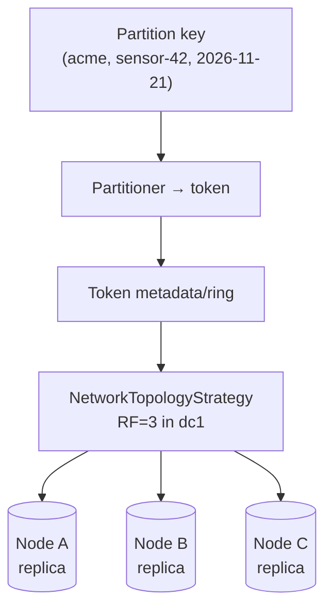
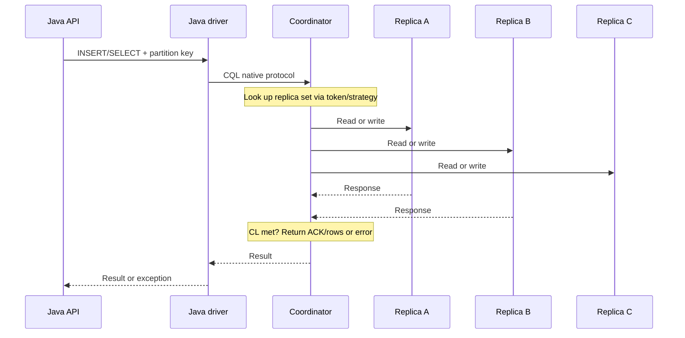
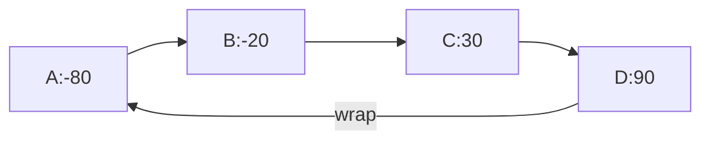
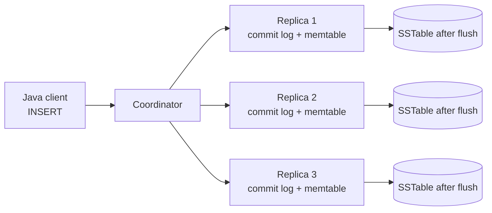

# Replication Factor and a Partition's Replica Set

> **Chapter:** Tokens and Replication  
> **Scope:** Apache Cassandra is a distributed NoSQL database following the *wide-column* model, placing data according to partition key, token, and replication strategy. This lesson dives into the **replication factor (RF)** and the **actual replica set storing a partition**, including multiple data centers, racks, and virtual nodes. It connects read/write consistency, CQL, the Java driver, repair, compaction, RF changes, and failure handling without conflating those mechanisms.

## 1. Learning Objectives

After this lesson, you will be able to:

1. Distinguish **RF**, **partition key**, **token**, **token range**, **primary range owner**, **replica set**, and **consistency level**.
2. Explain how Cassandra selects a replica set from the token ring, replication strategy, and topology rather than treating RF as a row count or shard count.
3. Configure `NetworkTopologyStrategy` for one or multiple data centers in a suitable Apache Cassandra environment.
4. Distinguish **per-data-center** RF from total RF; calculate quorum for `LOCAL_QUORUM`, `QUORUM`, and understand how they differ from `EACH_QUORUM`.
5. Analyze how one, two, or more failed nodes affect the ability to satisfy different CLs, while avoiding the false claim that a request timeout means data was not written.
6. Understand the roles of rack awareness, vnodes, membership, and metadata when determining replicas; avoid treating one node with many vnodes as multiple independent physical replicas.
7. Design and practice CQL tables with composite partition keys, using Java driver 4.x to query by key and choose an appropriate CL.
8. Plan controlled RF changes, verify replicas after bootstrap/repair, and distinguish **replication**, **repair**, **compaction**, and **backup**.

## 2. Problem: How Many Replicas Does a Partition Have?

An IoT application writes an event:

```text
tenant_id  = acme
device_id  = sensor-42
event_day  = 2026-11-21
event_time = 2026-11-21T08:05:00Z
event_id   = 11111111-1111-1111-1111-111111111111
```

Suppose the table is defined with:

```sql
PRIMARY KEY ((tenant_id, device_id, event_day), event_time, event_id)
```

The three components inside the inner parentheses form the **partition key**. They are encoded and hashed by the partitioner to produce **one token**. Rows with different `event_time` or `event_id` values but the same three partition key components stay in **one logical partition**.

If the keyspace sets RF = 3 in data center `dc1`, Cassandra selects **three suitable replica nodes** for that partition based on the token ring and replication strategy. It **does not** create three different partition keys and does not split rows within the partition into three pieces. Each replica holds the partition's data per Cassandra semantics.



**Core question:** which nodes are replicas of this partition, and how many nodes must respond for a specific request to be considered successful?

The two halves have different answers:

- **RF + strategy + topology:** the set of nodes that **should hold** the data.
- **Consistency level (CL):** the number of responses **required** for a read/write request.

## 3. Five Layers Never to Confuse

| Layer | Primary input | Output | What it does not decide |
| --- | --- | --- | --- |
| **Partition key** | Values in the partition part of `PRIMARY KEY` | Logical partition identity | Does not directly set RF or CL |
| **Partitioner** | Byte representation of the partition key | Partition token | Does not choose replica count |
| **Token ring/metadata** | Token and node/vnode-managed token ranges | Token region and logical ownership | Does not itself prove a node is healthy |
| **Replication strategy + RF** | Token ring, DC/rack, keyspace replication | Target replica node set | Does not dictate request ACK count |
| **Consistency level** | Request type, RF, DC scope, node state | Acknowledgment condition to return result | Does not change token or partition placement |

For example, the same token for `sensor-42` can receive two different replica sets **before and after adding a node**. Changing only CL from `LOCAL_ONE` to `LOCAL_QUORUM` leaves **the target replica set unchanged**, while requiring more responses per request.

### 3.1. A Replica Is Not the Coordinator

The **coordinator** is the node that receives and orchestrates a request. It may or may not be a replica of the partition. The Java driver generally tries to pick a suitable coordinator using routing metadata, yet the server still determines replica placement.



This diagram is a conceptual model; read optimizations, request dispatch timing, and response types across replicas vary by version, CL, and cluster state.

## 4. What Is Replication Factor?

**Replication factor (RF)** describes the target number of copies of each partition according to the **keyspace's replication configuration**, which can be set per data center with `NetworkTopologyStrategy`.

### 4.1. What Does RF Not Measure?

| Statement | Evaluation |
| --- | --- |
| "RF = 3 means each partition is replicated to three suitable nodes within the configured scope." | True as the **placement target**, provided topology has enough nodes and copies are synced |
| "RF = 3 means the application must wait for three ACKs on every write." | False; depends on CL |
| "RF = 3 means a partition is split into three shards." | False; it means three copies, not three different pieces |
| "RF = 3 means you can lose three nodes and still read/write normally." | False; depends on which replicas are lost, CL, DC, and load |
| "RF = 3 means backups are unnecessary." | False; accidental deletes or app bugs can propagate to every replica |
| "RF = 3 means a single-node server automatically creates two virtual nodes." | False; vnodes are not independent fault-tolerant nodes |
| "A higher RF gives partition keys new tokens." | False; tokens depend on key and partitioner |

### 4.2. RF Is a Keyspace-Level Configuration

In Cassandra CQL, the replication strategy is configured at the **keyspace** level—never treat it as a per-row property or a per-Java-statement setting.

```sql
CREATE KEYSPACE IF NOT EXISTS telemetry_rf
WITH replication = {
    'class': 'NetworkTopologyStrategy',
    'dc1': 3
};
```

This configuration targets **Apache Cassandra** with an actual data center named `dc1` and enough suitable nodes. A single-node lab should use RF = 1 for basic CQL practice; typing `'dc1': 3` does not conjure two extra copies on nonexistent nodes.

### 4.3. RF Differs from Vnode Count and Partition Count

Suppose a node owns 16 vnodes, a table has 1 million partitions, and the keyspace has RF = 3:

- **16 vnodes:** number of logical token positions/ranges that node participates in owning.
- **1 million partitions:** number of data groups by partition key in the table.
- **RF = 3:** each partition is placed on **three suitable replica nodes** per the strategy within the DC scope.

The three numbers **are not interchangeable**.

## 5. From Token Ring to Replica Set: Hand-Worked Example

Consider an **illustrative** token ring with one boundary token per node in ascending token order:

| Node | Boundary token | Primary token range |
| --- | ---: | --- |
| A | `-80` | `(90,100] ∪ [-100,-80]` |
| B | `-20` | `(-80,-20]` |
| C | `30` | `(-20,30]` |
| D | `90` | `(30,90]` |

The illustrative `-100` to `100` ring is solely for practicing reasoning; it is **not** the real Murmur3 space. The `(previous_token,current_token]` rule uses a **left-open, right-closed** boundary, with wrap-around past the highest token.



### 5.1. RF = 1

Suppose a partition has token `-47`:

1. `-47` falls in `(-80,-20]`.
2. Node B owns that **primary token range**.
3. Under the simple RF = 1 replication model, B is the node storing the single copy.

### 5.2. RF = 3 in a Simple Single-DC Model

If we illustrate replication by selecting consecutive nodes around the ring, the replica set for token `-47` can be **B, C, D**:

```text
Token -47 → primary range B
RF = 1 → {B}
RF = 2 → {B, C}
RF = 3 → {B, C, D}
```

This is an **illustrative model** close to ring-order replication in simple setups. With `NetworkTopologyStrategy`, racks, multiple data centers, and vnodes, do not deduce replicas by "just taking three adjacent node names." You must rely on the actual strategy and topology metadata.

### 5.3. Another Token Can Have a Different Replica Set

In the same model, a partition with token `15` belongs to C's primary range; RF = 3 illustrates replicas as **C, D, A**. Each partition key hashes to its own token, so different partitions typically map to different replica sets.

**Note:** multiple clustering rows in the same partition still share the same replica set; clustering keys do not move rows to different nodes.

## 6. Replication Strategy: Not Just Counting Around the Ring

Cassandra supports multiple replication strategies depending on version. Two names you routinely encounter when studying architecture are **`SimpleStrategy`** and **`NetworkTopologyStrategy`**.

| Strategy | Core idea | Usage guidance |
| --- | --- | --- |
| **SimpleStrategy** | Replicates in token-ring order without DC/rack-aware modeling like NTS | Mainly for learning principles or very simple/legacy setups; avoid as a multi-DC production default |
| **NetworkTopologyStrategy (NTS)** | Configures RF per DC and uses rack/topology info to select replicas | Usually the right choice for production clusters, especially with multiple DCs or racks |

### 6.1. Why Does NTS Matter?

Suppose `dc1` has 6 nodes across 3 racks. With RF = 3, we want copies spread across fault domains rather than landing all three nodes in the same rack if avoidable.

NTS uses DC/rack metadata to prioritize proper placement. Given enough racks and nodes, replicas can sit in distinct racks. However:

- With **fewer racks than RF**, the strategy must place extra replicas in existing racks.
- If DC/rack metadata is misconfigured, placement may not reflect physical fault domains.
- If three VMs sit in three logical racks on the same physical host, they do **not** provide three true hardware fault domains.
- When node/vnode ownership changes, a partition's replica set can change according to topology.

### 6.2. Vnodes Cannot Make Two Copies on One Host Independent

One node may own multiple vnodes/token ranges, but Cassandra never counts two vnodes on the same physical node as two distinct replicas of **the same partition**. If RF = 3 requires three independent node-level replicas, there must be three **distinct nodes** in the eligible scope.

Vnodes primarily help **divide token-range ownership**; they do not replace RF or failure-domain planning.

## 7. Single-DC RF: The Baseline Model

Suppose `dc1` has exactly three nodes A, B, and C participating in an NTS keyspace with RF = 3. Each partition needs a copy placed on all three nodes, provided they are healthy, available, and synchronized.

```sql
CREATE KEYSPACE IF NOT EXISTS telemetry_single_dc
WITH replication = {
    'class': 'NetworkTopologyStrategy',
    'dc1': 3
};
```

To avoid confusing **target** with **actual state**, distinguish:

1. **Declared RF:** three target replicas.
2. **Replica placement metadata:** which specific nodes belong to the partition's replica set.
3. **Live replicas:** how many nodes currently respond to requests.
4. **Up-to-date replicas:** also depends on consistency, convergence time, repair, and prior writes.

A node in the replica set may remain in metadata while currently down. RF = 3 **does not** mean the application automatically has three healthy, up-to-date copies at every instant.

## 8. Multi-DC RF: Total RF vs. Local RF

In a two-data-center cluster, NTS can be configured as:

```sql
CREATE KEYSPACE IF NOT EXISTS telemetry_multi_dc
WITH replication = {
    'class': 'NetworkTopologyStrategy',
    'dc1': 3,
    'dc2': 2
};
```

Assuming `dc1` has at least three suitable nodes and `dc2` has at least two, the replication target for **each partition** is:

- **3 replicas in `dc1`**.
- **2 replicas in `dc2`**.
- **5 total replicas** across the entire cluster for that partition.

### 8.1. Calculations with Total RF = 5

| Consistency level | Scope | Typical required responses in example |
| --- | --- | ---: |
| `LOCAL_ONE` from dc1 | One local replica in dc1 | 1 |
| `LOCAL_QUORUM` from dc1 | Quorum within local RF 3 | 2 |
| `LOCAL_QUORUM` from dc2 | Quorum within local RF 2 | 2 |
| `QUORUM` | Quorum of total RF = 5 | 3 |
| `ALL` | All replicas across keyspace per CL scope | 5 |
| `EACH_QUORUM` *(applies to writes when supported)* | Quorum **in each DC** | dc1: 2 and dc2: 2 |

Whenever someone says "Cassandra quorum is 2," ask immediately: **Which RF? Which DC? Local or global CL?** The example above simultaneously has a local quorum of 2, a global quorum of 3, and per-DC requirements under `EACH_QUORUM`.

### 8.2. Two Data Centers Do Not Mean Two Independent Datasets

The same partition key is hashed into a token by the cluster partitioner. The replication strategy uses the token and topology to place **replicas of the same partition** on nodes within each data center.

Writing with `LOCAL_QUORUM` in `dc1` **does not prove** both replicas in `dc2` have acknowledged the data. When planning failover for total loss of `dc1`, operations must verify data freshness in `dc2`, RPO/RTO, and recovery procedures—not rely solely on total RF.

## 9. CL and the Quorum Formula: Reading Context Correctly

For a replica set with RF = \(N\), the quorum count is typically computed as:

\[
Q = \left\lfloor \frac{N}{2} \right\rfloor + 1
\]

Examples:

| RF within calculation scope | Required quorum |
| ---: | ---: |
| 1 | 1 |
| 2 | 2 |
| 3 | 2 |
| 4 | 3 |
| 5 | 3 |
| 6 | 4 |

### 9.1. Overlap Between Read and Write Sets

An important intuition for required replica acknowledgments is:

\[
W + R > RF
\]

With RF = 3 in one DC, `W = 2` and `R = 2` satisfy `2+2>3`. If a write is acknowledged by a local quorum and a read queries a local quorum **over the same replica set**, the acknowledgment sets must overlap.

Yet this **is not a theorem that every operation is linearizable**. You must account for failure timing, reconciliation mechanisms, concurrent writes, write timestamps, changing topology, and operation types. Overlap does not turn two ordinary read-modify-write operations into a version-checked transaction.

### 9.2. `LOCAL_QUORUM` and `QUORUM` Are Not Always Equivalent

With a single DC at RF = 3, the two levels can require the same numeric response count over the keyspace's effective scope. With multiple DCs, however, `LOCAL_QUORUM` is calculated over the RF **in the coordinator/client policy's local DC**, while `QUORUM` is calculated over **total RF**.

Never hardcode "`LOCAL_QUORUM` = 2 nodes" in code when DCs may have an RF other than 3 or topology may change.

### 9.3. `EACH_QUORUM` Differs from Total Quorum

With `dc1:3` and `dc2:2`:

- Global `QUORUM` requires **3 of 5** replicas per CL rules.
- `EACH_QUORUM` for writes requires **2 of 3** in `dc1` **and** **2 of 2** in `dc2`.

This can raise cost/latency and reduce availability when one DC experiences failures. Do not select `EACH_QUORUM` just to "get as many ACKs as possible" without weighing business requirements and cross-region outages.

## 10. Same RF = 3, Different Fault Tolerance by CL

Consider a partition with replicas **A, B, C** in one data center. The table below evaluates only the **sufficient responding replicas** condition, assuming surviving nodes are free of network/I/O saturation:

| Available replicas | `LOCAL_ONE` | `LOCAL_QUORUM` | `ALL` |
| --- | --- | --- | --- |
| A, B, C | Can succeed | Can succeed | Can succeed |
| A, B (C down) | Can succeed | Can succeed | Fails |
| A (B/C down) | Can succeed | Fails | Fails |
| No replicas left | Fails | Fails | Fails |

**RF does not override CL:** Cassandra storing three copies in metadata does not force clients to wait for three nodes. **CL does not increase RF:** using `ALL` on an RF = 1 keyspace does not create extra copies.

### 10.1. "Can Succeed" Does Not Guarantee Every Request Succeeds

Even when enough replicas are alive, a request can still:

- Slow down due to queues, compaction, disk I/O, or network delays.
- Time out at the driver or coordinator.
- Be impacted by nodes undergoing topology changes.
- Return stale data depending on CL and convergence state.

Replica count is **one condition**, not the entire SLO.

### 10.2. Local Data Loss on a Replica Differs from a Temporary Outage

A node may briefly lose connectivity and return with its SSTables/commit logs intact, or suffer disk failure and require data rebuild. These two scenarios **are not equivalent**. Hinted handoff, streaming, repair, replace, and backup/restore are chosen per scenario—not deduced from RF alone.

## 11. RF, Durability, and the Limits of "Successfully Written"

Cassandra's typical write path has the coordinator forward mutations to replicas, where data is written to the **commit log and memtable**, then later flushed to SSTables. Durability against power loss or hardware faults also depends on commit log settings, storage configuration, and failure type.



### 11.1. A Write Timeout Does Not Prove No Replica Wrote the Data

Suppose RF = 3 and write CL = `LOCAL_QUORUM`. The coordinator receives an ACK from A in time; B may have written the mutation with a late ACK; C may not have written yet.

The client receives a timeout because **fewer than two ACKs arrived in time**, yet at least one replica may have persisted the mutation. If the client generates a fresh `event_id` and retries, the application may create **two business rows** instead of retrying the same row.

For immutable events, keeping the **partition key and event ID stable** across retries avoids logical duplicates. For counters, LWTs, TTLs, client timestamps, or external side effects, analyze idempotency separately; never enable blind retries for every mutation.

### 11.2. RF Does Not Protect Against Accidental Deletion

A valid `DELETE` can be replicated to every replica. Once converged, all copies reflect the deletion. Therefore:

**Replication protects against certain node/replica failures; backups and restores protect against other data incidents**, such as accidental deletes or faulty code deployments.

## 12. Replication Scope: Each Partition Has Its Own Replica Set

Do not draw a cluster-wide "Node A is master, Nodes B/C are slaves" diagram for Cassandra. One node can simultaneously:

- Be primary range owner/replica for partition P1.
- Be an additional replica for partition P2.
- Not belong to the replica set of partition P3.
- Serve as coordinator for a request to P3 even though it does not store P3.

### 12.1. Three-Partition Example

Assume the simple four-node ring with RF = 3, one boundary token per node:

| Partition | Illustrative token | Primary range owner | Illustrative replica set |
| --- | ---: | --- | --- |
| P1 | `-47` | B | B, C, D |
| P2 | `15` | C | C, D, A |
| P3 | `65` | D | D, A, B |

The replica sets **are not identical** across partitions, even within the same RF = 3 keyspace. In a real cluster, placement follows NTS/DC/rack metadata rather than just this illustrative order.

### 12.2. Theoretical Token Collisions Do Not Break Identity

Partitioners like Murmur3 derive tokens from **partition key bytes**, without making tokens absolute unique IDs. Two distinct keys can theoretically collide on a token. Cassandra still uses the full key when storing and comparing partitions, so never use tokens as business IDs or authentication credentials.

## 13. CQL Practice: Creating an RF = 3 Keyspace

This section is a lab exercise **for learners to run themselves** on Apache Cassandra, not a claim that a cluster is already running. To test RF = 3 and single-replica failure, you need a cluster of at least three suitable nodes in the same data center.

### 13.1. Inspect Topology Before Creating the Keyspace

On a self-managed cluster, start with:

```bash
nodetool status
nodetool ring
```

Note the actual data center/rack names and node count. Using `dc1` in examples is only valid when topology reports that exact name. If your lab has only one node, change RF to 1 and use CL `LOCAL_ONE` in the CQL exercises; **do not** treat that as a quorum fault-tolerance test.

### 13.2. Create the Keyspace and History Table

```sql
CREATE KEYSPACE IF NOT EXISTS telemetry_rf
WITH replication = {
    'class': 'NetworkTopologyStrategy',
    'dc1': 3
};

CREATE TABLE IF NOT EXISTS telemetry_rf.events_by_device_day (
    tenant_id text,
    device_id text,
    event_day date,
    event_time timestamp,
    event_id uuid,
    event_type text,
    temperature_c double,
    PRIMARY KEY ((tenant_id, device_id, event_day), event_time, event_id)
) WITH CLUSTERING ORDER BY (event_time DESC, event_id ASC);
```

In this schema, the partition key is `(tenant_id, device_id, event_day)`. `event_time` and `event_id` identify rows inside the partition; they **do not** assign each row a different replica set.

### 13.3. Write Events

```sql
INSERT INTO telemetry_rf.events_by_device_day (
    tenant_id, device_id, event_day, event_time,
    event_id, event_type, temperature_c
) VALUES (
    'acme', 'sensor-42', '2026-11-21',
    '2026-11-21T08:05:00Z',
    11111111-1111-1111-1111-111111111111,
    'READING', 27.4
);

INSERT INTO telemetry_rf.events_by_device_day (
    tenant_id, device_id, event_day, event_time,
    event_id, event_type, temperature_c
) VALUES (
    'acme', 'sensor-42', '2026-11-21',
    '2026-11-21T08:06:00Z',
    22222222-2222-2222-2222-222222222222,
    'READING', 27.8
);
```

Both rows share the same partition key, hence **the same token and the same replica set** under the topology at read/write time. These statements can be tested in your lab; they use the session's default CL unless overridden.

### 13.4. Query with the Full Partition Key

```sql
SELECT event_time, event_id, temperature_c
FROM telemetry_rf.events_by_device_day
WHERE tenant_id = 'acme'
  AND device_id = 'sensor-42'
  AND event_day = '2026-11-21'
LIMIT 100;
```

Results are ordered by clustering columns inside the partition. The query targets the partition without scanning the whole table. `LIMIT 100` will not cure an oversized or tombstone-heavy partition.

## 14. Observing Tokens and Replica Sets from Metadata

### 14.1. Use `token(...)` to Identify the Partition

```sql
SELECT token(tenant_id, device_id, event_day) AS partition_token,
       event_time, event_id
FROM telemetry_rf.events_by_device_day
WHERE tenant_id = 'acme'
  AND device_id = 'sensor-42'
  AND event_day = '2026-11-21';
```

Both rows on the 21st will return the same `partition_token`. The exact numeric value depends on the partitioner and key encoding; **do not guess the token value** just by looking at `'sensor-42'`.

### 14.2. Cross-Check Against the Ring and Replication Strategy

On a self-managed Apache Cassandra cluster you can run:

```bash
nodetool status
nodetool ring
nodetool describering telemetry_rf
```

Combine these sources:

1. The partition's actual token from CQL.
2. Token ranges and endpoints in cluster metadata.
3. The keyspace's replication strategy and RF.
4. Each node's DC/rack, node health, and whether topology is currently transitioning.

**Do not** take an `Owns` percentage in `nodetool status` and conclude it lists a partition's three replicas. Ownership percentages measure range/data distribution per the tool's definition, not the endpoint list for one specific partition.

### 14.3. Replica Sets Can Change When Topology Changes

During bootstrap, replace, or decommission, metadata may show transitional states/pending ranges and active data streaming. Therefore, observations made mid-transition **do not necessarily match** snapshots taken before or after the cluster stabilizes.

Record observation time, version, keyspace, CL, node count, and streaming status when analyzing a replica set.

## 15. Java Driver 4.x: Querying One Partition with the Right CL

The Java driver does not choose RF. RF comes from the cluster's **keyspace replication strategy**. The driver can bind the partition key, read topology/schema metadata, and prefer coordinators aligned with replicas, yet it **does not replace server-side placement**.

### 15.1. Example: Querying History with a Prepared Statement

Java 11+ example using Java driver 4.x. Assumes the lab keyspace/table and a data center named `dc1` actually exist:

```java
import java.net.InetSocketAddress;
import java.time.LocalDate;

import com.datastax.oss.driver.api.core.CqlSession;
import com.datastax.oss.driver.api.core.DefaultConsistencyLevel;
import com.datastax.oss.driver.api.core.cql.PreparedStatement;
import com.datastax.oss.driver.api.core.cql.ResultSet;
import com.datastax.oss.driver.api.core.cql.Row;

public final class ReplicaSetReadExample {
    public static void main(String[] args) {
        try (CqlSession session = CqlSession.builder()
                .addContactPoint(new InetSocketAddress("127.0.0.1", 9042))
                .withLocalDatacenter("dc1")
                .build()) {

            PreparedStatement query = session.prepare(
                "SELECT event_time, event_id, event_type, temperature_c " +
                "FROM telemetry_rf.events_by_device_day " +
                "WHERE tenant_id = ? AND device_id = ? " +
                "AND event_day = ? LIMIT 100"
            );

            ResultSet rows = session.execute(
                query.bind(
                    "acme", "sensor-42",
                    LocalDate.of(2026, 11, 21)
                ).setConsistencyLevel(
                    DefaultConsistencyLevel.LOCAL_QUORUM)
                 .setIdempotent(true)
            );

            for (Row row : rows) {
                Double temperature = row.isNull("temperature_c")
                    ? null
                    : row.getDouble("temperature_c");
                System.out.printf(
                    "%s id=%s type=%s temp=%s%n",
                    row.getInstant("event_time"),
                    row.getUuid("event_id"),
                    row.getString("event_type"),
                    temperature
                );
            }
        }
    }
}
```

In a **single-node, RF = 1** lab, switch `LOCAL_QUORUM` to `LOCAL_ONE`. With RF = 3 in `dc1`, `LOCAL_QUORUM` typically requires two of the three local replicas.

### 15.2. Separating Java and Cassandra Responsibilities

| Layer | Controls |
| --- | --- |
| **Java service** | Choosing tenant, daily bucket, authorization, event IDs, and timeout/retry policies |
| **Java driver** | Session, CQL binding, routing key, local DC, load balancing, and request CL |
| **Partitioner/ring** | Partition tokens and node-owned ranges |
| **Replication strategy** | Which nodes hold replicas per keyspace and topology |
| **Coordinator/replicas** | Reads/writes, reconciliation, and responses per CL |
| **Operations** | Maintaining actual RF, node health, capacity, repair, backup, and restore |

Never open a new `CqlSession` per HTTP request; applications should reuse the session and monitor driver metrics. TLS, authentication, contact points, and DC names must match your environment, especially on managed or CQL-compatible services.

## 16. Consistency Lab: Predict First, Observe After

Perform this section only in a suitable **isolated three-node lab cluster**; never shut down production nodes to demonstrate concepts.

### 16.1. Setting CL in `cqlsh`

```sql
-- cqlsh tool command, not a CQL DML statement.
CONSISTENCY LOCAL_QUORUM;

SELECT event_time, event_id
FROM telemetry_rf.events_by_device_day
WHERE tenant_id = 'acme'
  AND device_id = 'sensor-42'
  AND event_day = '2026-11-21'
LIMIT 100;
```

You can also use controlled tracing in the lab to observe coordination:

```sql
TRACING ON;

SELECT event_time, event_id
FROM telemetry_rf.events_by_device_day
WHERE tenant_id = 'acme'
  AND device_id = 'sensor-42'
  AND event_day = '2026-11-21'
LIMIT 5;

TRACING OFF;
```

Tracing adds overhead; do not leave it enabled permanently under heavy traffic. Tracing also does not guarantee showing every internal detail of your Cassandra version.

### 16.2. Prediction Table Before a Failure Drill

| Scenario: RF = 3, one DC | `LOCAL_ONE` read path | `LOCAL_QUORUM` | `ALL` |
| --- | --- | --- | --- |
| All three replicas healthy | Expected to succeed | Expected to succeed | Expected to succeed |
| One replica unresponsive | Can succeed | Can succeed | Requirement not met |
| Two replicas unresponsive | Can succeed | Requirement not met | Requirement not met |

Record **failure timestamp, node states, CL, query, actual outcome, timeouts, and logs/metrics**. Never claim you proved fault tolerance just by filling out a prediction table.

### 16.3. When Does `Unavailable` Differ from Timeout?

- **Unavailable:** at the moment the coordinator evaluates the request, insufficient replicas are available to satisfy the requested CL.
- **Timeout:** not enough responses arrived before the deadline. Some replicas may already have completed the work.

In practice, drivers and servers throw specific exception subtypes. Base retry logic on **mutation semantics and consistency guarantees**, rather than collapsing every error into "just send it again."

## 17. Changing RF: From Configuration to Actual Data Copies

Suppose a keyspace initially has RF = 2 in `dc1` and needs to increase to RF = 3. Editing the replication option **changes the placement target**; it does not mean the new replicas immediately hold complete data.

### 17.1. Example Keyspace Alteration Syntax

```sql
-- Example for an approved plan and suitable lab.
-- Do not run casually on production.
ALTER KEYSPACE telemetry_rf
WITH replication = {
    'class': 'NetworkTopologyStrategy',
    'dc1': 3
};
```

**Do not** apply this migration when `dc1` has only two nodes and assume three replicas now exist. Verify topology, admin privileges, version capabilities, and cluster health beforehand.

### 17.2. Design-Level Workflow for Changing RF

1. **Verify topology/fault domains:** are there enough nodes in the DCs where RF is increasing?
2. **Assess source state:** are there missing replicas, pending repairs, active streaming, disk pressure, or unresolved incidents?
3. **Plan capacity:** increasing RF increases stored copies, replication traffic, and synchronization I/O.
4. **Update replication metadata using the version-appropriate procedure.**
5. **Synchronize data to new replicas** following your exact version's admin guide, usually involving repair/streaming/reconciliation steps; never treat `ALTER KEYSPACE` alone as sufficient.
6. **Verify metadata and data:** target RF, replica endpoints, node health, and read/write queries at expected CL.
7. **Monitor post-change:** disk usage, compaction/repair backlog, p95/p99 latency, request errors, and disk headroom.
8. **Prepare rollback criteria:** if reverting RF is needed, handle data/ownership cleanup and CL impact safely; never lower RF casually to mask an incident.

**Warning:** exact commands and operational order vary by Cassandra version, topology, and direction of RF change. For production, rely on a verified runbook rather than copying textbook steps directly into automated scripts.

### 17.3. Lowering RF Is Not the Same as Raising RF

Lowering RF reduces the target copy count and **reduces potential fault tolerance**. Removing data on nodes no longer responsible must follow a safe procedure after verifying placement, backups, and recoverability.

Never lower RF merely to free disk space while ignoring availability requirements, RPO/RTO, and remaining node count.

## 18. Replication, Hinted Handoff, Repair, Compaction, and Backup

These mechanisms often appear together in runbooks, yet they solve **different problems**.

| Mechanism | Goal | Changes a partition's token? |
| --- | --- | --- |
| **Replication/RF** | Sets target replica count across nodes per strategy/topology | No |
| **Hinted handoff** | Helps deliver missed mutations to temporarily unresponsive replicas within supported conditions/limits | No |
| **Read reconciliation / read repair** | Reconciles replica differences during reads per mechanism/version | No |
| **Anti-entropy repair** | Compares and synchronizes data across replicas within a scope | No |
| **Compaction** | Merges SSTables and processes tombstones/versions locally when safe | No |
| **Bootstrap/streaming** | Moves required copies when topology/ownership changes | Hash unchanged, though storage nodes may change |
| **Backup/restore** | Enables recovery when data is lost, corrupted, or wrongly deleted | Not a normal CL or placement mechanism |

### 18.1. Hinted Handoff Does Not Replace Repair

Hints are subject to storage conditions and time/configuration limits. If a replica stays offline too long, or if discrepancies arise that hints do not cover, dedicated synchronization/repair and monitoring are required.

### 18.2. Repair Does Not Undo Accidental Deletes Propagated Cluster-Wide

If every replica has recorded a valid `DELETE`, repair converges them toward the deleted state—it does not recreate data an operator wants back. Recovering from accidental deletion requires **backups and tested restore procedures**.

### 18.3. Higher RF Has Costs

Raising RF can increase:

- Stored data copies on disk.
- Network traffic and I/O for mutations and streaming.
- Repair, compaction, and backup workloads depending on architecture.
- Number of failure domains to monitor and maintain.

RF is not a "higher is always better" knob regardless of budget, SLOs, and operational capacity.

## 19. Estimating Storage Cost by RF

Suppose a system ingests **10 million events/day** with an average logical payload size of **250 bytes/event** (illustrative assumption):

\[
10{,}000{,}000 \times 250 = 2.5\ \text{GB of logical data/day}
\]

| Total target RF | Raw copy-count estimate, excluding overhead |
| ---: | ---: |
| 1 | 2.5 GB/day |
| 2 | 5.0 GB/day |
| 3 | 7.5 GB/day |
| 5 | 12.5 GB/day |

With 30-day retention and RF = 3, the raw multiplication is:

\[
2.5 \times 3 \times 30 = 225\ \text{GB}
\]

This is **not an exact Cassandra disk forecast**. You must account for compression, metadata, index/storage overhead, tombstones, updates, actual replication, compaction headroom, snapshots/backups, and per-node distribution. In particular, disk headroom must suffice when a node leaves the cluster or during streaming/repair.

### 19.1. Large Storage Volume Does Not Mean Balanced Load

Even when stored data per replica scales closely with RF, a single hot partition can dominate QPS and latency. **RF does not split one partition into multiple partition keys**; spreading writes or hot keys requires revisiting time buckets, logical sharding, or ingest architecture.

## 20. Business Scenarios Requiring RF/CL Decisions

### Scenario A — Telemetry History Surviving One Node Loss

Requirement: the system must keep accepting event writes when one local replica temporarily fails.

**Hint:** With RF = 3 and `LOCAL_QUORUM`, as long as two replicas respond in time, requests can succeed. Add monitoring, repair, and timeout testing; never promise 100% of requests succeed.

### Scenario B — Single-Node Lab Declaring RF = 3

Requirement: a learner wants to test quorum on a laptop with one Cassandra node.

**Hint:** Not enough independent nodes for three replicas. Use RF = 1 + `LOCAL_ONE` to learn CQL; to test fault tolerance and quorum, build a lab cluster with at least three suitable nodes.

### Scenario C — Multi-DC RF = 3 + 2

Requirement: an API in `dc1` writes with `LOCAL_QUORUM` and wants certainty that `dc2` received the mutation.

**Hint:** `LOCAL_QUORUM` in `dc1` only requires two local replicas; it does not prove replicas in `dc2` are updated. Define cross-region consistency requirements, supported CLs, and failover verification plans.

### Scenario D — Requiring Unique Order Numbers

Requirement: concurrent writers generate order IDs. The dev team wants to rely solely on RF = 3 and quorum CL.

**Hint:** RF/CL do not enforce cross-key business uniqueness or prevent all races. You can use `IF NOT EXISTS`/LWT on a single key within supported bounds, or an RDBMS/transaction if multi-entity invariants require strong guarantees.

### Scenario E — Write Timeout Followed by Retry

Requirement: a client sends an event, fails to get enough ACKs for CL, and then generates a new UUID to retry.

**Hint:** This can create logical duplicate records if the original mutation reached some replicas. Keep event ID/partition key stable and design idempotency/reconciliation.

### Scenario F — Raising RF from 2 to 3

Requirement: an admin runs `ALTER KEYSPACE` and immediately raises write CL.

**Hint:** Ensure enough nodes exist, synchronize data to new replicas per the version's workflow, and verify metadata/health/capacity before relying on the new RF; changing the option alone does not prove new replicas contain full data.

### Scenario G — Losing a Rack

Requirement: RF = 3 and the DC has three logical racks, yet nodes in two racks actually run on the same hypervisor.

**Hint:** True fault tolerance depends on **physical fault domains**, not just metadata. Inspect placement and infrastructure design rather than assuming each logical rack is an independent failure domain.

### Scenario H — Trying to Lower p99 by Raising RF

Requirement: one device generates 15,000 requests/second into the same partition; the app suffers from a hot key.

**Hint:** Higher RF changes replica count and read paths, but does not split a partition into multiple keys. Measure the bottleneck, caching, sharding/bucketing, write path, and replica cost.

### Scenario I — Repair After Accidental Delete

Requirement: a bad delete propagated to all replicas, and an operator runs repair to "restore the data."

**Hint:** Repair does not reverse a valid converged delete; recovery requires backups and a restore workflow.

## 21. Pre-Deployment Evaluation Checklist

- [ ] Correctly identify the **partition key** portion of a table's `PRIMARY KEY`.
- [ ] Explain that the same partition shares the same token and replica set under topology at a given time.
- [ ] Distinguish primary token range owner, coordinator, and replicas.
- [ ] Know that RF is configured per keyspace and per DC when using NTS.
- [ ] Know that a vnode is not an independent physical node or replica.
- [ ] Verify sufficient nodes and proper fault domains for the target RF.
- [ ] Calculate quorum accurately for RF = 1, 2, 3, 4, 5, and 6.
- [ ] Distinguish `LOCAL_QUORUM` (local DC RF) from `QUORUM` (total RF).
- [ ] Understand that `EACH_QUORUM` for writes per DC differs from cluster-wide `QUORUM`.
- [ ] Avoid inferring that RF = 3 means waiting for three ACKs on every request.
- [ ] Prepare a prediction table for one or two lost replicas per chosen CL.
- [ ] Know that write timeouts can follow partial ACKs; use stable IDs and safe retries.
- [ ] Create CQL keyspaces/tables and query by full partition key.
- [ ] Observe tokens via `token(...)` and topology/replica metadata with proper tools.
- [ ] Configure the Java driver with prepared statements, local DC, and CL matching actual RF.
- [ ] Have a data synchronization and verification plan when changing RF.
- [ ] Maintain repair/compaction schedules and backup/restore policies; never treat replication as backup.
- [ ] Gather disk/network/latency/capacity metrics to assess RF cost.
- [ ] Never inject failures in production merely to verify exercise tables.
- [ ] Separate what was actually executed in a lab from purely inferred conclusions.

## 22. Self-Check Knowledge Quiz

1. **Do partition key and RF answer the same question?** No. Partition key identifies the partition/token; RF specifies target copy count per keyspace/DC.
2. **Is a partition with RF = 3 split into three different data pieces?** No. Those are three copies of the same partition placed on replicas.
3. **Does clustering column `event_time` send rows of the same partition to different nodes?** No; it orders rows within the partition.
4. **Does a node with 32 vnodes count as 32 independent replicas?** No. Vnodes are logical token ranges on the same node.
5. **With RF = 3, how many local replicas does `LOCAL_QUORUM` require?** Two, within a DC having local RF = 3.
6. **With RF = 2, what is the quorum?** Two.
7. **NTS has `dc1:3, dc2:2`. What is the total RF?** Five.
8. **With total RF = 5, what is `QUORUM`?** Three.
9. **How many ACKs does `LOCAL_QUORUM` from `dc2` need when `dc2` RF = 2?** Two.
10. **What does `EACH_QUORUM` for writes require in the 3 + 2 example?** Quorum in each DC: two in `dc1` and two in `dc2`.
11. **Does changing CL from `ONE` to `QUORUM` change the token?** No.
12. **Does raising RF from 2 to 3 automatically prove new replicas hold full data?** No; synchronization and verification are required.
13. **Why does quorum not replace CAS?** It checks how many replicas respond, not application-level versions or invariants.
14. **Why does a timeout not prove an operation was unapplied?** Some replicas may have persisted the mutation before the deadline expired.
15. **How does repair differ from compaction and backup?** Repair synchronizes replicas, compaction merges local SSTables, and backups provide data recovery sources.

## 23. Summary: Replica Count and Acknowledgment Conditions Are Two Distinct Decisions

Core chain of reasoning:

**Partition key → partitioner → token → token ring → replication strategy + RF + DC/rack → partition replica set → coordinator executes requests per CL.**

Keep three rules in mind:

1. **RF determines target replica count**, not mandatory ACK count, vnode count, or shard count.
2. **The replica set depends on token and topology**; as nodes join/leave or RF changes, the replica set can change while the token for the same partition key remains fixed.
3. **CL determines response conditions**, whereas real durability, replica convergence, repair, and backups require dedicated design and operations. Quorum does not replace business transactions; replication does not replace backups.

Mastering RF and replica sets helps you reason accurately about CQL, query-driven partitioning, read/write consistency, compaction, repair, failure handling, and Java application routing in **DATABASE_ENGINE_WIDE_COLUMN_CASSANDRA**—instead of merely memorizing "RF = 3" without knowing which nodes hold the three copies, whether they are healthy, or whom the client must wait for.
