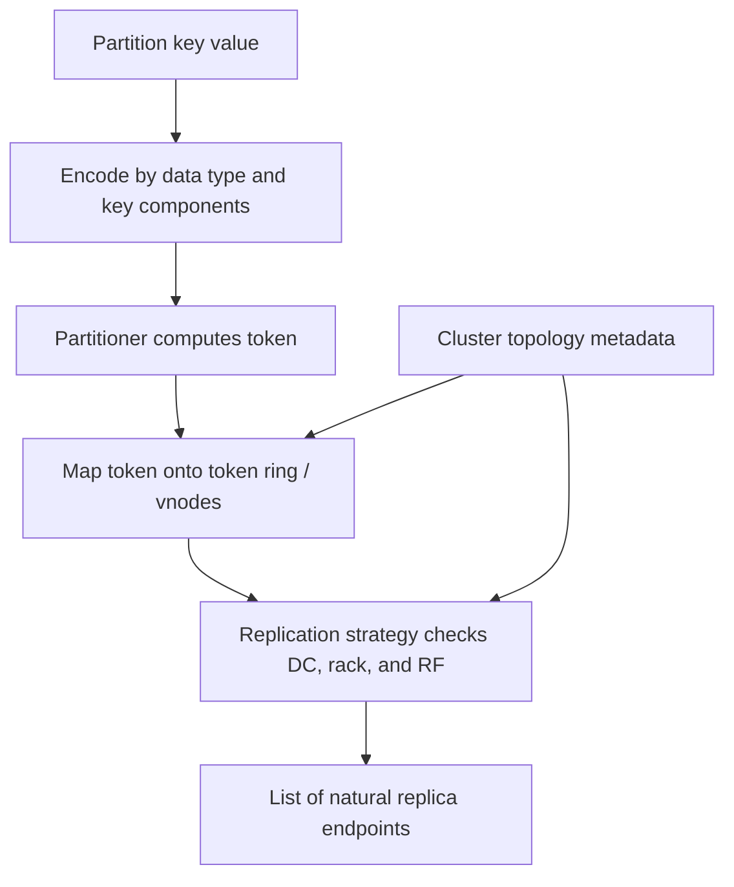

# Determining Endpoints for a Key Using Operational Tools

## 1. Purpose and Context

In Apache Cassandra, a row's data is not pinned to a single machine by table name or IP ordering. Cassandra distributes **partitions** across a token ring and replicates each partition to multiple nodes according to the keyspace's replication configuration. When investigating latency, read/write failures, topology changes, or suspecting which node holds data, an operator must answer:

> For **a specific partition key value**, which nodes are the **natural replicas** (the endpoints responsible for storing that partition) according to the cluster's current topology?

This lesson belongs to the **Tokens and Replication** chapter, covering Cassandra's distributed architecture, query-driven wide-column design, partition keys, and read/write consistency levels. The focus is on using **CQL to verify schemas** and **`nodetool getendpoints` to inspect endpoints**, then cross-referencing replication settings, node states, and Java application behavior. Examples assume a Cassandra cluster using `Murmur3Partitioner` with access to `cqlsh` and `nodetool`; keyspace, DC, table, and address names are illustrative.

After this lesson, you will be able to identify the exact partition key from `PRIMARY KEY`, run replica lookup commands, distinguish replicas from coordinators, explain why results change when topology changes, and know what to check when `getendpoints` differs from expectations.

## 2. From Partition Key to Endpoints

| Concept | Meaning when determining endpoints |
| --- | --- |
| **Partition key** | One or more columns in the partition key portion of `PRIMARY KEY`; all rows with the same partition key belong to one partition. |
| **Token** | Value computed by the partitioner from the **binary encoding of the entire partition key**; with `Murmur3Partitioner`, it is a 64-bit signed integer. |
| **Token ring / vnodes** | Token intervals owned by nodes. With virtual nodes (vnodes), a single node typically owns multiple disjoint intervals. |
| **Replication strategy** | Rules for selecting additional replicas from token, replication factor, and topology, such as `NetworkTopologyStrategy` per data center. |
| **Natural replica / endpoint** | A node selected by the placement strategy to store a copy of the partition. Endpoints are typically printed as IP addresses. |
| **Coordinator** | The node receiving a read/write request from a client and coordinating replicas per consistency level. The coordinator does not have to be among the natural replicas. |



For example, a table declared `PRIMARY KEY ((tenant_id), event_time, event_id)`: **only `tenant_id`** is the partition key; `event_time` and `event_id` are clustering columns. Changing `event_time` within the same `tenant_id` does not change the replica set. If declared `PRIMARY KEY ((tenant_id, bucket_day), event_time)`, the partition key includes **both `tenant_id` and `bucket_day`**. Never pass only `tenant_id` to look up endpoints for the second table.

In essence, `getendpoints` answers *where the cluster intends to place this partition under current placement metadata*. It does not inspect actual disk contents and does not prove the record exists, replicas are synchronized, or a query read from that exact node.

## 3. Gather the Right Inputs Before Querying

Suppose an application stores events by tenant in `app_ks.events_by_tenant`:

```sql
CREATE TABLE app_ks.events_by_tenant (
    tenant_id text,
    event_time timestamp,
    event_id timeuuid,
    payload text,
    PRIMARY KEY ((tenant_id), event_time, event_id)
);
```

You need the **keyspace, table name, data types, and full partition key**. In `cqlsh`, inspect DDL and replication as follows:

```sql
DESCRIBE TABLE app_ks.events_by_tenant;

SELECT keyspace_name, replication
FROM system_schema.keyspaces
WHERE keyspace_name = 'app_ks';

SELECT column_name, kind, position, type
FROM system_schema.columns
WHERE keyspace_name = 'app_ks'
  AND table_name = 'events_by_tenant';
```

For example, the keyspace's `replication` column returns a map with `class: NetworkTopologyStrategy` and `dc1: '3'`. Cassandra therefore tries to select **three replicas in `dc1`** per partition; multi-DC keyspaces define separate RFs per DC. Never infer replica counts solely from running node count or keyspace name.

Distinguish how key values are written in the two tools:

- In **CQL**, `text` keys use single-quoted literals, e.g., `WHERE tenant_id = 'tenant-42'`.
- In the **shell**, `nodetool getendpoints` takes the key as a **command-line argument**, e.g., `tenant-42` (without CQL single quotes). If the key contains spaces, quote it for the shell, e.g., `"tenant 42"`.
- Keys of type `uuid`, numbers, timestamps, `blob`, or composite keys require formatting compatible with the CQL type and input parsing of **your exact `nodetool` version**. Never arbitrarily join components with commas and assume that forms a valid composite key.

## 4. Direct Lookup with `nodetool getendpoints`

On a machine with `nodetool` and administrative access to a cluster node, run:

```bash
# General syntax: nodetool getendpoints <keyspace> <table> <partition-key>
nodetool getendpoints app_ks events_by_tenant tenant-42

# When targeting a specific node's admin interface:
nodetool -h cassandra-node-1 getendpoints app_ks events_by_tenant tenant-42
```

`-h` targets the **Cassandra node exposing the admin interface for `nodetool`** (typically via JMX, depending on configuration/version), not the application's CQL endpoint. For clusters requiring authentication, use the credentials and admin options provisioned for that environment.

Illustrative output:

```text
192.0.2.11
192.0.2.12
192.0.2.13
```

The three `192.0.2.x` addresses here are documentation examples only. The command lists the three **natural replica endpoints** for the partition `tenant_id = 'tenant-42'` according to metadata known by the queried node at runtime. They carry no default read/write priority order and are not guaranteed to be the exact nodes responding to any single query.

Lookup results depend simultaneously on **keyspace**, **table/partition key types**, **key value**, and **current topology/replication**. The same value `'tenant-42'` in a different keyspace or table can yield different endpoints; even identical tokens are insufficient to infer placement if keyspaces use different replication strategies.

### Cross-Check with Token Ring and Node Status

```bash
nodetool status
nodetool ring app_ks
nodetool describecluster
```

- `nodetool status` displays nodes, data centers, status, and overall token/load info. `UN` typically stands for **Up/Normal**, while `DN` stands for **Down/Normal**. A `DN` node can still appear in `getendpoints` because it **remains an assigned replica** even while unavailable to serve.
- `nodetool ring app_ks` shows token ranges and owning nodes; helpful for inspecting placement, though in clusters with vnodes the output can be huge. Do not rely on one token or a single ring line to deduce the entire replica list.
- `nodetool describecluster` helps identify cluster name, partitioner, and schema/topology info when comparing environments.

To check a **different partition key**, re-run `getendpoints` with the new value. Never generalize one key's IPs to all tenants; hashing produces different tokens and potentially different replica sets.

## 5. Connecting Tokens, Replication, and Consistency Level

Suppose a keyspace uses `NetworkTopologyStrategy` with `dc1: 3`. `getendpoints` can list three nodes in `dc1` for a key. When the keyspace also sets `dc2: 2`, the natural replicas list can include **three nodes in `dc1` and two nodes in `dc2`**. Always interpret output per DC and actual configuration; the count of *live* nodes does not alter configured RF.

The token decides the logical starting point for placement; the replication strategy decides **which nodes** hold copies, typically considering DC/rack. Simple calculations like `hash(key) % node_count` therefore do not model Cassandra, especially with vnodes or multi-DC clusters. `nodetool getendpoints` is the right tool to obtain real placement from a running node.

Consistency level (CL) specifies **how many responses/acknowledgments an operation needs**, not a filter altering the replica list returned by `getendpoints`:

| Situation | Interpretation |
| --- | --- |
| RF = 3 in `dc1`, `LOCAL_ONE` | For normal operations, the coordinator needs a suitable response from at least one replica in the local DC. |
| RF = 3 in `dc1`, `LOCAL_QUORUM` | Local quorum threshold is `floor(3/2) + 1 = 2` suitable responses. |
| One natural replica is `DN` | It can still appear in `getendpoints`. Whether reads/writes succeed depends on CL, remaining available replicas, and operational state. |
| App connects to a node outside the replica set | That node can still act as coordinator and forward requests to the proper replicas. |

Do not conclude from `getendpoints` printing three IPs that `LOCAL_QUORUM` will definitely succeed. Timeouts, network errors, un-converged schemas, or out-of-sync replica data can still affect queries. During bootstrap, decommission, replace, or move operations, pending replicas and streaming must also be evaluated for your exact Cassandra version and operational state.

## 6. Verifying Token Values in CQL When Data Exists

For a table with single partition key `tenant_id`, you can view the token of an **existing row** with:

```sql
SELECT token(tenant_id) AS partition_token
FROM app_ks.events_by_tenant
WHERE tenant_id = 'tenant-42'
LIMIT 1;
```

If the query returns a row, the token helps correlate partition key hashing with the token ring. If **no rows exist**, CQL returns no token value in results; that **does not mean the partition lacks endpoints**. Cassandra still computes placement for any partition from its key even before any data is written.

For tables with a composite partition key like `PRIMARY KEY ((tenant_id, bucket_day), event_time)`, pass **all partition columns** into `token(tenant_id, bucket_day)` and matching query predicates. Values are encoded into a composite routing key before computing the token, so `token(tenant_id, bucket_day)` is not equivalent to `token(tenant_id)` or `token('tenant-42,2026-11-21')`.

**Important limitation:** `getendpoints` takes one key argument per admin-tool convention; Cassandra versions differ in how they parse composite keys or complex types. For composite keys, verify the exact syntax of your `nodetool` version and cross-check against routing key/token info from the driver or supported admin tools. Never enter an arbitrary formatted string and blindly trust the returned endpoint list.

## 7. When Output Differs from Expectations

| Symptom | First check | Interpretation / action |
| --- | --- | --- |
| Endpoint count differs from expected RF | `system_schema.keyspaces`, DCs, and `nodetool status` | RF is defined per DC; check for wrong keyspace, wrong DC, insufficient nodes, or active topology changes. |
| Returned endpoints are not the expected node list | Right cluster, right host running `nodetool`, broadcast addresses, `describecluster` | Broadcast addresses used internode may differ from hostnames or the addresses Java apps connect to. |
| Two nodes return different lists for the same key | Bootstrap/decommission status, gossip, schema/topology convergence | Two nodes may observe differing metadata during cluster transitions; log timestamps and wait for convergence before concluding. |
| A `DN` address still appears | `nodetool status` and connectivity | `DN` reflects liveness; `getendpoints` reflects replica placement. They do not contradict each other. |
| `getendpoints` errors or returns nonsense for a key | DDL, partition key types, shell quoting, tool version | Check `partition_key` columns, exact characters, `uuid`/numeric formatting, and composite key syntax; never pass a whole CQL query as argument. |
| Endpoints look right, yet reads find no data | CL, TTL, tombstones, write errors, timestamps, repair, logs | Placement does not guarantee data exists or all replicas converged. Investigate consistency/repair separately; never treat `getendpoints` as a data check. |

During real incidents, record the **command execution timestamp**, keyspace/table, partition key used (masked or hashed if sensitive), endpoint list, per-DC RF, and `nodetool status` output. These records let you compare two runs across topology changes without mistaking placement shifts for data loss.

## 8. Repeatable Practice Scenario

**Problem:** A team reports that queries for `tenant-42` events occasionally time out. The cluster has three nodes in `dc1`, keyspace `app_ks` uses `NetworkTopologyStrategy` with RF = 3 in `dc1`, and the events table has partition key `tenant_id text`.

1. Verify `PRIMARY KEY` of `app_ks.events_by_tenant` via `DESCRIBE TABLE`, confirming `tenant_id` is the entire partition key. Check RF via `system_schema.keyspaces`.
2. Run `nodetool getendpoints app_ks events_by_tenant tenant-42` on a node with stable metadata. Record the listed IPs.
3. Run `nodetool status`; match each IP against its DC and `UN`/`DN` state. If a replica is `DN`, note it as an angle for checking CL satisfaction—**do not remove that IP from the natural replicas list**.
4. Check the client's consistency level. With `LOCAL_QUORUM` and RF = 3 in `dc1`, quorum needs two local replicas. If only one node is unavailable, the remaining two *can* satisfy quorum; still verify actual timeouts and errors.
5. Look up another partition key, e.g., `tenant-99`, and compare endpoints. After the cluster adds or replaces a node and topology converges, re-run both commands to observe potential placement shifts.

**Completion criteria:** You must be able to state (a) what the exact partition key is, (b) the current endpoint list for a key, (c) the matching RF and DC, (d) whether any endpoint is `DN`, and (e) why the endpoint list does not directly confirm read/write query outcomes.

## 9. Connection to Java Applications

In a Java application using the Cassandra Java Driver, queries providing full partition key predicates—and especially **prepared statements with bound parameters**—allow the driver to compute the routing key when metadata is complete. Token-aware routing policies can prefer a suitable coordinator, saving a network hop in supported cases. However:

- Never hardcode IP lists from `getendpoints` in application code: topology changes, and the driver manages metadata, connections, retries, and request routing.
- Endpoints reported by `getendpoints` are **the partition's natural replicas**, whereas the IP the driver picks to send a request is **the coordinator for that execution**; the two sets do not have to be identical.
- When debugging a timed-out Java query, compare **routing key, keyspace, consistency level, local data center, and actual coordinator** against the natural replicas list to pinpoint the cause. Driver logging/metrics cover the coordinator side; `nodetool` covers placement.

Determining endpoints is a key diagnostic step in Cassandra, while partition placement itself depends on **encoded keys, tokens, replication strategy, and topology state**. Use `getendpoints` to identify copy ownership; use other tools to verify availability, consistency, and actual query execution paths.
