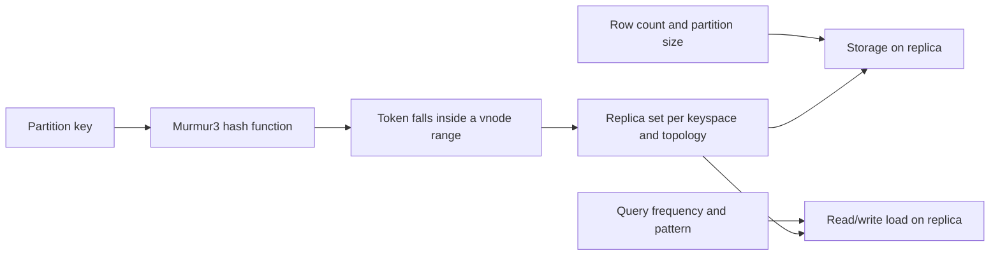

# Storage or Load Imbalance Despite Equal Token Counts in Apache Cassandra

## 1. The Problem: Nodes Have the Same Token Count Yet Are Not Equally "Balanced"

In Apache Cassandra, data is distributed via **partition keys**, **tokens**, and **replicas**. When virtual nodes (vnodes) are used, each physical node typically manages multiple token positions around the hash ring. Seeing `Tokens = 16` on every node, operators easily expect them to store equal data volumes and handle equal query traffic. That expectation does not always hold.

Suppose a four-node cluster sits in one data center, and a keyspace uses `NetworkTopologyStrategy` with replication factor (RF) = 2. The numbers below are **illustrative**, not ratios guaranteed by Cassandra:

| Node | Tokens / vnodes | Keyspace `Owns (effective)` | Displayed `Load` | Observed requests/sec |
| --- | ---: | ---: | ---: | ---: |
| `node-a` | 16 | 49% | 690 GB | 12,000 |
| `node-b` | 16 | 51% | 650 GB | 11,000 |
| `node-c` | 16 | 50% | 320 GB | 3,000 |
| `node-d` | 16 | 50% | 340 GB | 3,500 |

**All four nodes hold the same number of tokens; effective ownership percentages are nearly identical, yet storage volume and load differ dramatically.** This is not necessarily a partitioning or replication bug. First, identify which metrics are being compared, because each metric measures a different aspect.

Within Cassandra's **wide-column** model, one partition can hold a huge number of clustering rows. Every row sharing the same partition key uses **one token** and lives on the same replica set. That is the fundamental root cause of many data and load skew incidents.

## 2. Distinguish Five Easily Confused Concepts

| Metric | Meaning | What it does not tell you directly |
| --- | --- | --- |
| **Token count** (`Tokens`, `num_tokens`) | Number of token/vnode positions a node manages on the ring | Data bytes, partition count, request count |
| **Token range** | Hash value interval mapped to a vnode, typically `(previous_token, current_token]` | How much data each token value holds |
| **Effective ownership** (`Owns (effective)`) | Fraction of token space a node is responsible for as a replica, under the keyspace's replication strategy | Actual bytes of a specific table; QPS, CPU, latency |
| **Actual storage** (`Load`, SSTable/disk usage) | Volume of data/files occupying space per the respective measurement | Query traffic or partition hotness |
| **Operational load** | Read/write rate, CPU, disk I/O, compaction, streaming, latency, etc. | Token count or ownership; these metrics also depend on query patterns |

With the common `Murmur3Partitioner`, Cassandra hashes the **encoded partition key values** into a token. One partition key maps to one token; changing clustering keys does not move a partition to another token. Vnodes divide the ring into smaller intervals to ease data distribution and movement. **Equal vnode counts do not guarantee equal token interval lengths**; even when interval lengths are close, bytes and access frequencies inside those intervals can still differ sharply.

Visualizing the mapping flow:



You can express an approximation for each node `n`:

```text
logical_data_on(n) ≈ sum of size(partition p) for all p with n in replica_set(p)
replica_work_on(n) ≈ sum of work(requests to p) that n actually helps process
disk_used_on(n)    ≈ logical_data_on(n) + storage overhead and temporary/extra files
```

This is an **explanatory model**, not an exact measurement formula: in practice you also have multiple keyspaces, compression, tombstones, SSTable layouts, coordinator work, caching, and background tasks. Knowing `num_tokens` alone tells you none of the terms in these three expressions.

## 3. Why Does Storage Still Differ Across Nodes?

### 3.1. Partition Key Value Distribution Is Not Byte Distribution

A good hash function spreads **many independent partition keys** fairly evenly around the ring. Yet Cassandra **never splits one large partition across multiple tokens**. Suppose a table stores events by `tenant_id`, where one tenant has 80 million rows and thousands of other tenants have a few hundred rows each. The giant tenant still has just one token; RF = 3 puts the entire giant partition on the three replicas chosen for that token.

Consequences:

- Token counts can be equal while nodes in the giant tenant's replica set accumulate far more bytes.
- If total partition count is small, or partition sizes vary wildly, statistical uniformity of the hash is not enough to balance bytes.
- Data partitioned on sequential keys does not automatically skew just because keys are sequential, provided the partitioner hashes well and keys are diverse enough. Inspect **the size and concentration of individual partitions**, not just the visual shape of key strings.

### 3.2. Similar Ownership, Different Data Inside Each Range

A token range covering 1% of the hash space may contain 1% of partitions yet hold 10% of total bytes if partitions inside it are huge. `Owns (effective)` is the fraction of **token space assigned after accounting for replication**, not a sum of actual partition sizes. Hence two nodes both showing `Owns = 50%` can still differ by hundreds of gigabytes.

When comparing nodes, remember `nodetool status <keyspace>` shows `Owns (effective)` for the **specified keyspace**, whereas `Load` reflects data measured by `nodetool` on the node across all keyspaces, not restricted to that single keyspace. If the cluster has multiple keyspaces, do not treat those two columns as an apples-to-apples byte comparison over the same scope.

### 3.3. Replication and Topology Alter Each Node's Dataset

In Cassandra, mapping tokens to replicas depends on the **replication strategy**, per-data-center RF, and DC/rack topology. With `NetworkTopologyStrategy`, RF is typically configured separately per DC. Comparing two DCs—or two keyspaces with different RFs—can show differing bytes per node even with identical token counts.

Also check whether the cluster is currently **bootstrapping**, adding/removing nodes, moving data, or changing RF. Ongoing streaming, transitional topology, or incomplete cleanup can temporarily unbalance storage. Never conclude misconfiguration from token count alone.

### 3.4. On-Disk Usage Is Also Affected by SSTable Lifecycle

Two replicas storing nearly identical logical data can still temporarily occupy different disk space due to:

- **Compaction:** old and new SSTables coexist during compaction/merging; write pressure and compaction schedules vary across nodes.
- **TTLs, tombstones, and compaction timing:** expired or deleted records do not necessarily reclaim disk space immediately; tombstone eviction depends on safety conditions and compaction strategy.
- **Compression and SSTable counts:** compressed sizes, SSTable counts, and storage overhead are not identical at every instant.
- **Snapshots/backups, commit logs, temporary files:** filesystem utilities may count files that do not represent live logical data. Distinguish `nodetool` load, `tablestats` metrics, and filesystem disk usage (`df`/`du`).

Do not rush to conclude tokens must change when differences only appear mid-compaction or due to leftover snapshots.

## 4. Why Does Read/Write Load Differ Despite Nearly Equal Storage?

**Storage (GB) and load (QPS/CPU/I/O) are two distinct problems.** A small partition can occupy tiny disk space yet receive most of the read requests. With RF = 3, the replicas serving reads/writes for that hot partition can saturate while other nodes sit idle.

Common drivers:

| Phenomenon | Mechanism | Signals to look for |
| --- | --- | --- |
| **Hot partition / hot key** | One or a few partition keys receive heavy reads/writes; load concentrates on their replicas | QPS/I/O/latency skew despite roughly equal table storage |
| **Overly wide partition** | One query reads many clustering rows, scanning huge bytes, deserializing, paging, or scanning tombstones | High read latency, large partition sizes and high rows/partition |
| **Coordinator imbalance** | Clients/drivers send disproportionately more requests to certain nodes as coordinators | Coordinator request count skewed; replica I/O may not match |
| **Consistency level and retries** | `LOCAL_ONE`, `LOCAL_QUORUM`, retries, and speculative execution involve different replica counts and costs | Request/latency shifts with CL, retry rates, or timeouts |
| **Compaction / repair / streaming** | Background tasks compete for CPU, network, and disk I/O against queries | Pending compactions, streaming bytes, active repairs |
| **Uneven infrastructure capacity** | Differing disk, CPU, RAM, network, GC pauses, or cache hit rates | High node load even without higher data or request counts |

**Crucially:** a driver with token-aware routing only helps pick an appropriate coordinator under supported conditions; it **cannot** redirect a hot partition key to replicas of another token. Increasing RF changes replica counts available for reads and fault tolerance, yet does not split one partition into multiple partitions and increases storage/write cost. Lowering consistency level to reduce latency alters consistency guarantees without solving underlying key skew.

## 5. Repeatable Diagnostic Workflow

Investigate in order: **confirm the symptom → isolate table/partition → separate logical data from overhead → inspect replica vs. background load → choose intervention**. Collect data over the same time window across all nodes, preferring comparisons among nodes in the **same DC** with equivalent roles.

### Step 1 — Confirm Tokens, Ownership, DC, and Node State

```bash
# Run on a node with nodetool access.
nodetool status app_ks
nodetool describering app_ks
```

In `nodetool status app_ks`, examine `Status/State` (`UN` means Up/Normal), `DC`, `Rack`, `Tokens`, `Owns (effective)`, and `Load`. `describering` shows token ranges and corresponding endpoints/replicas for the keyspace. With multiple DCs, verify keyspace configuration before comparing load across DCs:

```sql
SELECT keyspace_name, replication
FROM system_schema.keyspaces
WHERE keyspace_name = 'app_ks';
```

Do not treat a `Joining`, `Leaving`, `Moving`, or actively streaming node as steady-state. If nodes with identical token counts have markedly skewed ownership, inspect actual token positions, topology, and replication. If ownership is roughly equal while storage or load differs, move on to data and query distribution analysis.

### Step 2 — Identify Which Keyspace/Table Drives Byte Skew

On **each node** being compared, run:

```bash
nodetool tablestats app_ks.events_by_tenant
nodetool tablehistograms app_ks events_by_tenant
```

Focus on SSTable space used, estimated partition count, SSTable count, partition size distribution, tombstones, and read/write latencies. Metric names, layout, and flags vary by Cassandra version; check `nodetool help <command>` on your exact running version.

If one table accounts for most of the skew, inspect its real queries and partition key design. A table differing between two nodes in **bytes per partition** points to a different root cause than one with many small partitions distributed unevenly. Avoid running `SELECT COUNT(*)` on large production tables to estimate distribution: that can scan massive data and spike cluster load.

### Step 3 — Check Hot Partitions and Load Origin

From application, driver, and Cassandra metrics, compare per node and per table:

- Read/write request counts, bytes read/written, read/write latency (p95/p99), timeouts, and retries.
- Largest partition sizes, rows per partition distribution, and unusually frequent partition keys (using observability/tracing or hot-partition tooling appropriate to your version and operational policy).
- Which coordinators receive requests vs. which replicas actually perform disk/read/write work, along with CPU, disk I/O, network, cache, and GC metrics.

If Node A receives heavy traffic as coordinator while B/C suffer disk I/O bottlenecks as replicas, address the cause at the corresponding layer. Tracing a few representative requests helps separate the two roles; never enable widespread tracing while the cluster is already overloaded.

### Step 4 — Rule Out Background Tasks and Storage Overhead

```bash
nodetool compactionstats
nodetool netstats
nodetool tpstats
```

`compactionstats` shows active/pending compactions, `netstats` helps inspect streaming, and `tpstats` exposes internal thread-pool queues/tasks. Combine these with disk/CPU metrics, relevant logs, and repair, bootstrap, snapshot, and backup schedules. If filesystem disk usage is skewed while `tablestats` is not, inspect snapshots, commit logs, and non-SSTable files before deciding to rebalance data.

### Step 5 — Record Conclusions by Evidence, Not Token Count

| Post-inspection observation | Primary hypothesis | Initial remediation direction |
| --- | --- | --- |
| Ownership roughly equal; some nodes hold giant partitions | **Partition size skew** | Redesign partition key/bucketing/sharding around query patterns |
| Bytes roughly equal; one replica set has high read QPS and p99 | **Hot partition or expensive query** | Analyze top keys, read patterns, pagination, caching, and sharding |
| `tablestats` fairly balanced, yet `df`/`du` skewed | **Disk overhead / snapshots / temp files** | Check file lifecycle, snapshots, and compaction |
| Load spiked right during node addition or repair | **Streaming / repair / compaction resource contention** | Throttle/reschedule background tasks and monitor until stable |
| Skew concentrated by DC or keyspace | **Differing RF, topology, or per-DC workload** | Inspect `NetworkTopologyStrategy`, racks, local DC, and client routing |
| Coordinator QPS skewed while replica/table load is balanced | **Client/coordinator distribution** | Inspect contact points, driver load balancing, latency, and retries |

## 6. CQL Example: One Large Tenant Causing Byte and Load Skew

Initial design:

```sql
CREATE TABLE app_ks.events_by_tenant (
    tenant_id text,
    event_id timeuuid,
    payload text,
    PRIMARY KEY (tenant_id, event_id)
) WITH CLUSTERING ORDER BY (event_id DESC);

-- Valid query by partition key, yet potentially very heavy for a large tenant.
SELECT event_id, payload
FROM app_ks.events_by_tenant
WHERE tenant_id = 'tenant-vip'
LIMIT 100;
```

`tenant_id` is the sole partition key. Each tenant creates **one partition**, even if it holds millions of rows. All events for `tenant-vip` hash to one token. If that tenant holds most of the dataset or is read constantly, the replicas owning that token absorb most of the bytes and I/O. Every node having the same `num_tokens` does nothing to split this partition automatically.

One option for event workloads queried by day is **time bucketing**; if a single tenant/day is still too hot, add a bounded **shard**:

```sql
CREATE TABLE app_ks.events_by_tenant_day_shard (
    tenant_id text,
    event_day date,
    shard smallint,
    event_ts timestamp,
    event_id uuid,
    payload text,
    PRIMARY KEY ((tenant_id, event_day, shard), event_ts, event_id)
) WITH CLUSTERING ORDER BY (event_ts DESC, event_id ASC);

-- Application computed a deterministic shard for the event; example reading one shard.
SELECT event_ts, event_id, payload
FROM app_ks.events_by_tenant_day_shard
WHERE tenant_id = 'tenant-vip'
  AND event_day = '2026-11-21'
  AND shard = 3
LIMIT 100;
```

For example, using a write rule `shard = positiveHash(event_id) % 16`: for each `(tenant_id, event_day)` pair, the application creates up to 16 distinct partitions instead of one monolithic partition. Here `positiveHash` is an **application-defined** hash function that produces deterministic outputs across runs; it is neither a CQL function nor a Cassandra vnode setting. You must preserve/recompute the exact same shard rule when reading or updating the same event.

**Unavoidable trade-off:** to fetch all events for a tenant on a given day, the application must query the relevant shards and merge/sort the results; a single partition only guarantees clustering order **within itself**. Choose shard count, bucket width, pagination limits, and concurrency based on QPS, partition size, SLAs, and actual query patterns. Never casually increase from 16 to 32 shards over existing data without a compatible read and data-migration strategy.

If your primary goal is capping partition size, daily/hourly bucketing may suffice; if your goal is spreading write/read load of an extremely hot tenant within the same bucket, sharding adds value. Sharding cannot rescue queries that attempt unbounded scans over all events.

### Connection to Java Applications

With Java Driver 4.x, use prepared statements containing **all partition key components** so the driver can derive the token for routing, while configuring the proper local data center. Example (assuming `CqlSession session` is connected and `local-datacenter` is configured):

```java
PreparedStatement statement = session.prepare("""
    SELECT event_ts, event_id, payload
    FROM app_ks.events_by_tenant_day_shard
    WHERE tenant_id = ? AND event_day = ? AND shard = ?
    LIMIT ?
    """);

BoundStatement bound = statement.bind(
    "tenant-vip",
    java.time.LocalDate.of(2026, 11, 21),
    (short) 3,
    100
);

ResultSet result = session.execute(bound);
// result.getExecutionInfo().getCoordinator() shows the coordinator that served the request.
```

The coordinator picked by the driver is not necessarily the only node involved in the read: consistency level and replica health determine work across other nodes. When investigating load incidents, collect both client-side metrics (requests, timeouts, retries, coordinator) and server-side metrics (replica reads, disk I/O). Never mistake `getCoordinator()` for the full replica set.

## 7. Address Root Causes and Avoid Harmful Interventions

1. **Large partitions or hot partitions:** prioritize fixing the query-driven data model: add controlled bucketing/sharding, bound queries and pagination, and design merge-read flows. For populated systems, plan backfill/migration and dual-read/write cutover.
2. **Genuine token/replica space skew:** inspect vnode distribution and topology; consider scaling out or adjusting token allocation via a procedure compatible with **your exact Cassandra version**, inside a monitored maintenance window. Simply editing `num_tokens` in config on a running node **does not** automatically rebalance existing data. Never apply single-token move procedures to vnodes without verifying support.
3. **Physical disk skew:** manage snapshots/backups/temp files per retention policy; check compaction backlogs, TTLs, and tombstones. Only consider cleanup once topology and data transfers have stabilized and the node truly no longer owns the relevant ranges. Understand the I/O impact before triggering manual compaction on large tables.
4. **Coordinator or traffic skew:** inspect driver load-balancing and local DC settings, retry/speculative execution policies, contact points, timeouts, and client distribution. If a single partition remains hot, tweaking routing cannot substitute for splitting the partition.
5. **Repair, RF, and consistency:** repair ensures replica convergence and post-failure recovery—it is **not** a load-balancing command. Changing RF or consistency level affects disk capacity, participating replicas, and consistency guarantees; evaluate those separately and execute full operational procedures.

After any intervention, re-measure **across an equivalent load window**: byte distribution per table/node, partition sizes, QPS and p95/p99 latency, timeouts/retries, disk I/O, compaction backlog, node health, and replication. A cleaner `Owns` percentage alone is not proof of cluster stability.

## 8. Key Takeaways When Reading Cassandra Dashboards

- `Tokens = 16` on every node only means equal vnode counts; it does **not** mean equal GB or equal requests.
- `Owns (effective)` shows the share of token space under replication for **one keyspace**; it is **not** actual disk share or CPU usage.
- One partition key—even with millions of clustering rows—has one token and one replica set under the replication strategy.
- **Byte** skew typically points to partition sizes, replication, compaction, and storage files; **load** skew typically points to hot keys, query patterns, coordinator/replica behavior, and background tasks.
- Proper remediation starts from **query patterns and partition keys**; reflexively adding tokens, altering RF, or running repair wastes resources without fixing the root cause.

For *Tokens and Replication*, the golden operational rule is: **Cassandra distributes partitions by token and places replicas by topology; Cassandra never promises uniform bytes or uniform request load merely because nodes share the same token count.**
