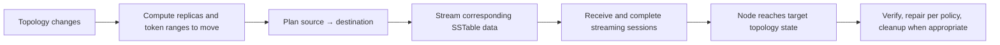

# Data Streaming Flows When Adding, Removing, or Replacing a Node

> **Chapter:** Tokens and Replication  
> **Module:** `DATABASE_ENGINE_WIDE_COLUMN_CASSANDRA` — Apache Cassandra, a distributed wide-column database.  
> **Focus:** Why data must move during topology changes, how Cassandra picks streaming sources/targets, and how to operate safely.

In Cassandra, adding a machine is not simply plugging it into the cluster; removing or replacing a machine is not merely deleting an IP address. **Every topology change can alter which set of nodes is responsible for storing replicas of each partition.** Cassandra must stream data between nodes so stored state matches the new token ownership and replication strategy.

This lesson directly connects **partition key, token, replication, and consistency level** with SSTable streaming during node addition, decommissioning, and replacement. It also shows the impact on CQL, compaction, repair, troubleshooting, and Java applications using the Cassandra Driver.

## 1. Learning Outcomes

After this lesson, you will be able to:

1. Explain why membership changes alter token-range ownership even though partition keys and CQL data do not change.
2. Distinguish the three flows: **bootstrap** (adding a node), **decommission** (removing a live node), and **replace** (replacing a dead node).
3. Identify sources, destinations, data to stream, and prerequisites for each flow.
4. Monitor progress via `nodetool status`, `nodetool netstats`, and logs; understand when to use `cleanup`, `repair`, or `removenode`.
5. Assess risks involving replication factor (RF), consistency level (CL), disk capacity, and impact on Java application queries.

## 2. Foundation: Tokens Determine Data Placement

### 2.1. From Partition Key to Replica Set

In a CQL table, the **partition key** is the primary key component that defines how rows are grouped into partitions. The partitioner (typically `Murmur3Partitioner`) hashes the partition key into a **token**; tokens define intervals on the token ring.

An interval is typically written `(t_previous, t_current]`. The node owning the token at the end of the interval is a primary anchor in determining data ownership. However, actual **replica** locations also depend on the keyspace's replication strategy, copy count, and datacenter/rack layout.

- **RF = 3**: Cassandra aims to place three copies of each partition according to the keyspace's replication rules. RF does not mean copies sit on any three arbitrary machines.
- **`NetworkTopologyStrategy`**: selects replicas per datacenter RF and tries to honor rack distribution; essential for multi-datacenter clusters.
- **Virtual nodes (vnodes)**: one node can own many tokens and many non-contiguous ranges. When adding, removing, or replacing a node, movement therefore usually spans **multiple token ranges**, not a single contiguous dataset.
- **Token range vs. partition**: streaming selects data by range, while all rows sharing a partition key still share one partition key and token.

Example keyspace with RF = 3 in datacenter `dc1`:

```sql
CREATE KEYSPACE shop
WITH replication = {
  'class': 'NetworkTopologyStrategy',
  'dc1': 3
};

CREATE TABLE shop.events_by_account (
  account_id uuid,
  event_time timestamp,
  event_id timeuuid,
  event_type text,
  PRIMARY KEY ((account_id), event_time, event_id)
) WITH CLUSTERING ORDER BY (event_time DESC, event_id ASC);
```

Here `account_id` determines the token; `event_time` and `event_id` are clustering columns that **do not** change which nodes store the partition. When topology changes, the application keeps querying by `account_id` as before while Cassandra updates the replica set serving that partition.

### 2.2. Example of a Replica Set Change

Suppose a token range `R` in `dc1` shifts as follows (**illustrative example**, not a fixed rule for every ring/rack):

| Moment | Replicas of range R | Meaning |
|---|---|---|
| Before adding node D | A, B, C | A/B/C hold copies of R |
| After adding D | B, C, D | D must receive data for R |
| After completion and cleaning stale data | B, C, D | A no longer needs to keep R if A does not own R for another reason |

```text
                  Streaming data for range R
  Before: [A] [B] [C]      ─────────────────────▶ [D] new
            │   │   │        sources: replicas    │
            └───┴───┘        holding valid R      │
  After:        [B] [C] [D]  (RF remains 3)
```

Not all of A, B, and C necessarily transmit a redundant full copy to D: Cassandra plans and picks eligible sources carrying the needed data to assemble the target dataset. With vnodes, D's different ranges can pull data from different source nodes.

**Adding a node does not automatically raise RF.** It redistributes responsibility among nodes; raising RF is a separate keyspace configuration change requiring data synchronization to new replicas.

## 3. What Does Streaming Actually Transfer?

**Streaming** is the mechanism for transferring data between Cassandra nodes, primarily based on **SSTable** data and the token ranges requiring synchronization. Each task has sources, destinations, a range set, and transfer sessions; data moves directly node-to-node, not via client CQL `SELECT` followed by row-by-row `INSERT`.

High-level flow:



Distinguish four aspects:

1. **SSTables and memtables:** data is streamed from durable storage structures; the system may flush data not yet in SSTables as required by the procedure and version.
2. **Ranges and replicas:** Cassandra computes what data must exist at the destination based on post-change ownership. A new node does not copy all data from every old node.
3. **Concurrent writes:** during transition, topology/replica management and pending-range tracking help route new writes. Applications must still handle timeouts and enforce proper CL; streaming does not turn a cluster lacking quorum into one with quorum.
4. **Repair vs. topology streaming:** repair compares replicas (typically via Merkle trees and syncs differences), whereas bootstrap/decommission/replace primarily moves data to **newly assigned owners**. Successful streaming does not prove every prior copy was already 100% consistent.

Streaming consumes network, disk I/O, and CPU; it can contend with flushes, compactions, repairs, and CQL queries. Data with tombstones, TTLs, or large partitions can also increase transfer and compaction cost.

## 4. Adding a Node: Bootstrap and Inbound Data Flow

### 4.1. Scenario and Prerequisites

Cluster `dc1` runs with nodes A/B/C and needs D to expand capacity or distribute load. D must have compatible settings: exact cluster name, datacenter/rack, seed/address configuration, supported version, and adequate disk/network capacity. Verify RF, source replica availability, and compaction pressure before starting.

**Bootstrap** is the process where D joins the cluster and receives data for the token ranges D will own. With vnodes, D may be allocated many tokens.

### 4.2. Sequence

1. **Join registration:** D contacts the cluster, receives matching topology/schema metadata, and enters the join workflow supported by your Cassandra version. The cluster determines the tokens/ranges assigned to D.
2. **Compute new replicas:** for each keyspace, the replication strategy computes new replica sets; Cassandra identifies the ranges D must receive.
3. **Select sources:** one or more live replicas holding data for each range supply streaming data to D.
4. **Stream data:** transfer sessions send required SSTable slices over the network while the cluster continues serving requests under transitional topology semantics.
5. **Completion:** once bootstrap succeeds, D becomes a normal member (typically shown as `UN` in `nodetool status`). Old nodes may retain data they no longer own; handle that with `cleanup` once topology stability is confirmed.

```text
D begins JOIN
    │
    ├─ Receive assigned tokens/ranges
    ├─ Locate source replicas for each range
    ├─ Incoming streams from A/B/C... to D
    ├─ Complete sessions and transition to NORMAL
    └─ Verify data, monitor stability, run cleanup on old nodes if needed
```

During this process, `UJ` typically denotes **Up/Joining**; upon completion, `UN` is **Up/Normal**. Displayed states and startup steps vary by version and configuration, so cross-check your cluster's runbook.

### 4.3. Observation Commands

Run from a host authorized for `nodetool`:

```bash
nodetool status
nodetool netstats
nodetool compactionstats
```

- `status`: check whether D is Joining or Normal; verify datacenter, rack, and host ID.
- `netstats`: inspect outbound/inbound streaming sessions, transferred bytes, and progress; each range may pull from a distinct source.
- `compactionstats` and system dashboards: watch I/O and background queues competing with streaming.

**Do not run `cleanup` before bootstrap finishes.** After D runs stably and new replicas are verified, schedule `nodetool cleanup` on old nodes to reclaim data they no longer own. Cleanup is I/O-intensive and must be run in a controlled manner.

## 5. Removing a Live Node: Decommission and Outbound Data Flow

### 5.1. When to Use Decommission

Use **`nodetool decommission`** when the node to remove **is still running and able to participate in streaming**. For example, shrinking a five-node cluster to four nodes when RF can still be satisfied by the remaining topology.

Decommission is not an abrupt power-off. Cassandra must transfer the data held by the departing node to the replicas taking over those token ranges.

### 5.2. Sequence

1. **Compute post-departure topology:** the cluster knows which node is leaving and identifies affected ranges and destination replicas.
2. **Plan transfers:** the departing node (alongside other sources when needed, per range/mechanism) streams corresponding data to nodes assuming the new replicas.
3. **State transition:** the departing node enters Leaving state (typically `UL` while still up); receiving nodes continue processing streaming tasks.
4. **Completion and membership removal:** once transfers and topology changes complete, the decommissioned node exits the cluster; apps and monitoring no longer rely on that endpoint.

```bash
# Run on the live node itself that has been chosen for removal
nodetool decommission

# Monitor from remaining healthy nodes
nodetool status
nodetool netstats
```

Before running, verify destination nodes have enough disk headroom and live replicas for current RF/CL. If another node is already down, decommission can fail or degrade availability; never shrink a cluster solely because aggregate free disk looks sufficient.

**After decommission:** update host inventories, monitoring, app/seed lists as needed; confirm the old node disappeared from membership before reclaiming hardware. Avoid overlapping multiple topology changes unless your runbook and version explicitly support safe coordination.

## 6. Dead Node: How Does Replace Differ from Removenode?

### 6.1. Replace: Substitute a Dead Node with a New Node

Suppose C dies permanently and cannot boot to stream outbound data. We want node D to **take C's place**. In the replace flow, D joins as a replacement for the dead member and streams matching data/token ranges from **surviving replicas**, since C cannot serve as a source.

Conceptual workflow:

1. **Confirm C is genuinely dead and cannot rejoin.** Fence or isolate the old machine/config so two processes never claim the same old node identity.
2. **Check recoverability:** for every range C held, sufficient copies must exist on other nodes or valid recovery sources. If RF = 1 and data lived only on C, replace cannot conjure lost data.
3. **Prepare D:** configure matching cluster, DC/rack, addresses, and replacement flags for **your exact Cassandra version**. Some versions support a startup option such as `-Dcassandra.replace_address_first_boot=<old-address>`; that is a startup JVM flag, **not a `nodetool` command**. Verify documentation and runbooks for your exact version, especially when reusing IPs/disks or using newer topology mechanisms.
4. **D receives data:** healthy replicas stream the ranges C held to D; monitor `nodetool netstats` and join status.
5. **Verification:** D becomes a normal member; verify queries/CL, logs, and run repair per cluster policy if needed to reconcile replicas.

```text
C dies (cannot stream)
       X
       │       RF for range R before incident: {A, B, C}
       └─────► recovery sources: A/B (if sufficient data remains)
                                      │
                                      └── stream R ──► D replaces C
                After recovery: {A, B, D}
```

**Never restart old C with its previous identity/topology after D has successfully replaced it.** Handling old disks, IPs, host IDs, and seeds must strictly follow your Cassandra version's node-replacement procedure.

### 6.2. Removenode: Evict a Dead Node from Membership

If C is dead and the goal is simply **removing C from the cluster**, run `nodetool removenode` from a live node. Data must still exist on surviving replicas; the system cannot stream from dead C.

```bash
# Grab the exact Host ID from cluster status; do not pass an IP address in place of Host ID
nodetool status

# Execute from a live node using the dead node's Host ID
nodetool removenode <host-id>
```

Choose explicitly between **replace** or **remove then rebalance topology** according to your goal; never run `removenode` impulsively before attempting a replace, because replace mechanisms may depend on the old node's metadata still existing. If a node only had a brief network blip and is not confirmed permanently dead, never use removal commands as a quick fix for timeouts.

### 6.3. Quick Comparison of the Three Scenarios

| Criterion | Add node — bootstrap | Remove live node — decommission | Replace dead node — replace |
|---|---|---|---|
| Trigger | Cluster expansion | Scale down / retire healthy host | Permanent host failure |
| Primary participating node | New node | Departing node | Replacement node |
| Streaming source | Existing replicas | Departing node and/or other valid sources | Surviving replicas; not the dead host |
| Streaming target | New node for assigned ranges | Nodes becoming new replicas | Replacement node taking over |
| Token ownership | Reallocated | Redistributed across remaining nodes | Typically inherits replaced node's responsibility |
| What to avoid | Running cleanup too early; overloading sources/disks | Shutting down node before streaming finishes | Old node rejoining; missing recovery copies |
| Primary command/mechanism | Boot with bootstrap config | `nodetool decommission` | Version-specific replace config/startup |

## 7. Consistency Level During Topology Transitions

Cassandra derives replicas from partition key, topology, and replication strategy. While replica sets shift, ongoing read/write requests must still satisfy their chosen CL; streaming is only part of maintaining data placement.

Example with RF = 3 in `dc1`:

| CL | Practical meaning during topology change |
|---|---|
| `ONE` / `LOCAL_ONE` | Can succeed with one suitable replica confirming; higher availability, but does not guarantee newest data under every failure |
| `LOCAL_QUORUM` | With three full replicas in `dc1`, needs quorum = 2 confirmations in the DC; verify enough healthy replicas remain before removing/replacing a host |
| `ALL` | Requires all replicas in CL scope; far more sensitive to unavailable nodes or active transitions |
| `QUORUM` | Quorum over total RF per CL semantics; in multi-DC clusters, never equate with `LOCAL_QUORUM` |

The quorum threshold for three full replicas is `floor(3 / 2) + 1 = 2`. Yet this arithmetic alone **is not enough** to prove the cluster is safe: rack/DC placement, transitioning replicas, timeouts, and node health all matter. Avoid changing RF, removing multiple nodes simultaneously, or blasting heavy streaming while applications require tight tail latency.

Commonly confused mechanisms:

- **Hinted handoff:** temporarily stores missed mutations for an unreachable replica within configured limits. Hints **never replace bootstrap or repair** and do not guarantee recovery for long-dead nodes.
- **Read repair:** can fix discrepancies spotted along certain read paths, but does not replace full-range anti-entropy repair.
- **Anti-entropy repair:** compares replicas and reconciles divergent data; requires dedicated policies and schedules.
- **Topology streaming:** places data where ownership shifts require it. Completing a stream does not itself prove source copies were already consistent.

## 8. Monitoring a Controlled Streaming Operation

Before acting, capture baseline status snapshots and metrics. These read-only commands aid observation:

```bash
nodetool status
nodetool describecluster
nodetool netstats
nodetool compactionstats
nodetool tpstats
```

| Signal | What to inspect | Warning signs to investigate |
|---|---|---|
| `nodetool status` | Nodes in expected DC/rack; Joining/Leaving/Normal states; Down nodes | Required source node Down; new node stuck out of Normal |
| `nodetool netstats` | Send/receive streams, peers, bytes transferred, pending sessions | Stalled progress for extended time; failed/retrying streams |
| Cassandra system logs | Stream session errors, schema, auth, timeouts, addresses, disk errors | Stream aborts, checksum/I/O errors, internode connection errors |
| Disk space | Free space on target node and compaction headroom | Disk nearly full; streaming/compaction blocked |
| Network and CPU/I/O | Bandwidth, network latency, disk IOPS, load | Bottlenecks driving read/write timeouts |
| Client error rates | Timeouts/unavailables, retries, p95/p99 latency, connection count | Application losing quorum or unstable topology transition |
| Repair/compaction | Queues and post-change backlog | Stream finished yet data diverges or heavy compaction backlog |

Some versions allow inspecting/tuning throughput with `nodetool getstreamthroughput` and `nodetool setstreamthroughput`. **Units, flags, and scope vary by version**; inspect `nodetool help` and current config before setting values. Never crank up bandwidth limits to mask network drops or disk saturation.

### Operational Checklist

**Before the change**

1. Confirm whether the task is adding a node, removing a **live node**, or replacing a **dead node**; follow one clear workflow.
2. Record per-DC RF, tokens/vnodes, replica states, racks, Cassandra version, and estimated bytes to transfer.
3. Verify backups/snapshots and restore readiness; keep ample disk headroom for incoming data and compaction.
4. Confirm apps handle timeouts/retries properly and active CLs remain satisfiable during the transition.
5. Pick an appropriate traffic window and record baseline metrics before starting.

**During the change**

1. Monitor source/target nodes with `nodetool status` and `nodetool netstats`.
2. Watch logs, disk, network, compaction, latency, and read/write errors.
3. Avoid launching another topology change concurrently unless your cluster and version explicitly permit safe overlap.
4. If progress stalls or another replica fails, investigate root cause and recovery guides before intervening in membership.

**After the change**

1. Confirm target members are Normal, streaming sessions completed, and no unexpected nodes remain Joining/Leaving.
2. Run representative CQL data checks at the expected CL; cross-check application query metrics.
3. Run repair if required by procedure and data state; never treat streaming alone as a consistency certificate.
4. After **bootstrap**, consider `nodetool cleanup` on old nodes to drop unowned data—only once topology is stable. Do not treat cleanup as mandatory for every replace.
5. Update monitoring, contact points, infrastructure records, and topology documentation.

## 9. CQL and Java Application Practice Example

### 9.1. Experimenting in a Lab Environment

Assume the test cluster has the `shop` keyspace from section 2. Write a batch of events across multiple `account_id` values to spread across tokens. In `cqlsh`, set consistency while testing:

```sql
CONSISTENCY LOCAL_QUORUM;

INSERT INTO shop.events_by_account
(account_id, event_time, event_id, event_type)
VALUES (
  11111111-1111-1111-1111-111111111111,
  '2026-11-20 10:00:00+0000',
  11111111-1111-1111-8111-111111111111,
  'created'
);

SELECT account_id, event_time, event_type
FROM shop.events_by_account
WHERE account_id = 11111111-1111-1111-1111-111111111111
LIMIT 10;
```

Next, in the **lab**, execute independent scenarios one at a time:

- **Add node:** join a Cassandra instance configured for the same cluster/DC, observe Joining → Normal transition and inbound streams. Re-run queries before and after.
- **Remove live node:** pick an eligible node for decommission; observe outbound streams and membership afterward.
- **Replace dead node:** simulate failure per lab runbook; ensure the old instance cannot rejoin, apply version-appropriate replace config, and monitor streams from surviving copies.

Compare record counts and sample partitions, remembering that a few `SELECT` checks only prove **sample** queries work; cluster-wide consistency still relies on monitoring and repair policies.

### 9.2. Impact on the Java Driver

The Java application does not manually move rows between nodes. The Cassandra driver discovers topology changes, manages connections, and performs token-aware routing using cluster metadata. Still, transitions can surface timeouts, unavailability, and latency shifts.

Illustrative configuration with **DataStax/Apache Cassandra Java Driver 4.x** (adapt for your version management and application config):

```java
try (CqlSession session = CqlSession.builder()
        .addContactPoint(new InetSocketAddress("127.0.0.1", 9042))
        .withLocalDatacenter("dc1")
        .build()) {
    PreparedStatement ps = session.prepare(
        "SELECT event_time, event_type " +
        "FROM shop.events_by_account " +
        "WHERE account_id = ? LIMIT 10"
    );

    ResultSet rs = session.execute(
        ps.bind(UUID.fromString("11111111-1111-1111-1111-111111111111"))
          .setConsistencyLevel(DefaultConsistencyLevel.LOCAL_QUORUM)
    );
    rs.forEach(row -> System.out.println(row.getString("event_type")));
}
```

Imports used in the example include `java.net.InetSocketAddress`, `java.util.UUID`, and the Java Driver 4.x classes `CqlSession`, `PreparedStatement`, `ResultSet`, and `DefaultConsistencyLevel`.

In real applications:

- Configure the exact **local datacenter** and multiple contact points for bootstrap discovery; never couple business logic to a single node.
- Use prepared statements with proper partition keys so the driver can route efficiently; never manually rewrite data just because node token ownership shifted.
- Set appropriate timeouts and retries; auto-retry only when operations are safe/idempotent per business rules. Avoid duplicating non-idempotent side effects during node transitions.
- Monitor timeout rates, unavailables, p95/p99 latency, and connection recovery when nodes are decommissioned or replaced.

## 10. Failure Scenarios and Reasoning

**Scenario A: D joins the cluster, yet `netstats` makes no progress.**  
First check whether source nodes are Up and internode communication is allowed; then inspect firewalls, endpoints, broadcast addresses, disk space, stream/timeout logs, and I/O saturation. Never assume data is safe just because D appears in the node list.

**Scenario B: Can you decommission C while C is Down?**  
Do not use standard decommission because C cannot actively stream outbound data. Confirm C is permanently dead, then choose **replace** or **removenode** based on your goal and surviving replicas.

**Scenario C: RF = 1, and the sole node holding range R dies.**  
No healthy copy exists to stream R to a replacement. Topology repair or replacement cannot recreate un-replicated data; rely on valid backups or accept data loss per recovery policy.

**Scenario D: After bootstrap, Node A's disk remains full.**  
A may still retain SSTables for ranges handed over to D. Verify D is Normal, no streams remain, and replica placement is valid, then schedule appropriate `cleanup` to reclaim space. Also check compactions, tombstones, and TTLs, as full disks can have multiple causes.

**Scenario E: After a replace, old Node C unexpectedly boots back up.**  
This is a severe identity and membership hazard. Isolate C, protect the cluster from two nodes contesting the same position, and follow your version's recovery runbook. Never allow old C to rejoin automatically and accept writes.

**Scenario F: Is adding a node the same as raising RF to 3?**  
No. Adding a node redistributes tokens/ranges across members. Raising RF changes the **required replica count** per partition and requires syncing/repairing data onto the extra copies.

## 11. Self-Check Questions

1. With `PRIMARY KEY ((account_id), event_time)`, which column determines the token and why?
2. When a bootstrapping node receives 40 token ranges, must every range stream from the exact same source node?
3. A node is permanently Down: when do you choose replace vs. removenode?
4. Why are `status = UN` and zero active streams insufficient to claim all replicas are consistent?
5. With RF = 3 in one DC and `LOCAL_QUORUM`, how many replicas must normally acknowledge? What factors can still cause a query to fail?
6. Why should `cleanup` wait until data sits safely on the new replicas?

**Answer hints:** (1) `account_id`, because it is the partition key; (2) no, sources vary by range/replica; (3) replace substitutes for a dead node directly, removenode removes a dead member without direct substitution; (4) replicas may still diverge and require verification and appropriate repair; (5) normally 2 full replicas, yet it still depends on node/topology/rack state and timeouts; (6) deleting data from sources before confirming destinations hold complete copies increases data-loss risk.

## 12. Key Takeaways

- **Tokens + replication strategy** dictate where data must live; node changes alter replica sets per range.
- **Bootstrap** pulls data from existing replicas **into a new node**; **decommission** pushes required data **off a live node**; **replace** rebuilds a dead node's responsibility from **surviving replicas**.
- Streaming moves SSTable data by token range; it differs from CQL copying, hinted handoff, and anti-entropy repair.
- Monitor **membership state, `netstats`, logs, disk space, and application CL** throughout the entire operation.
- Every step depends on Cassandra version and actual topology; in production, declare success only after verifying membership, streaming, queries, and consistency per your cluster's runbook.
