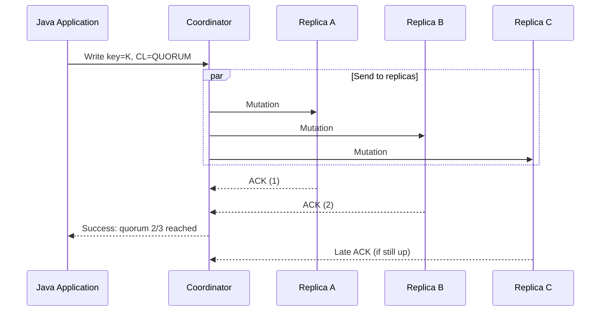

# Consistency Levels Control Required Responses per Operation

In Apache Cassandra, the **consistency level (CL)** specifies how many valid responses a read or write operation must receive from replicas before the **coordinator** returns the result to the application. This decision is made **per request**, so the same table can be written at `LOCAL_QUORUM` but read at `LOCAL_ONE`, depending on data freshness, latency, and fault-tolerance requirements.

This lesson belongs to the **Read/Write Consistency** section of the `DATABASE_ENGINE_WIDE_COLUMN_CASSANDRA` module. To understand and apply CL effectively, you must clearly distinguish it from replication, partition keys, query-driven table design, and Cassandra's background data synchronization mechanisms.

## Learning Objectives

After this lesson, you will be able to:

1. Explain the roles of the coordinator, replicas, replication factor (RF), and the number of responses required by a CL.
2. Calculate quorum for single-datacenter and multi-datacenter deployments; choose an appropriate CL for each query.
3. Analyze scenarios where stale reads, timeouts, or unavailability can occur when replicas fail.
4. Apply CL using `cqlsh` and the Apache Cassandra Java Driver; distinguish normal CL from `SERIAL`/`LOCAL_SERIAL` in lightweight transactions (LWT).
5. Understand the limitations of quorum and how it combines with repair, retry handling, and application design.

## 1. Replicas, Coordinator, and Consistency Level

A row in Cassandra resides in a **partition** identified by the partition key. The data distribution mechanism determines which nodes own copies of that partition, based on the replication strategy and **replication factor**. For example, RF=3 means each partition has three assigned replicas within the corresponding replication scope; it does **not** mean the entire cluster only has three nodes.

The client sends a request to a node acting as the **coordinator**. The coordinator identifies the relevant replicas, sends/coordinates the work, and waits for enough responses to satisfy the request's CL. The coordinator does not have to be one of the replicas for the queried partition.



The diagram illustrates a successful write with RF=3. **The coordinator does not need to wait for the third ACK to respond**, though Cassandra still attempts to deliver the mutation to the remaining replicas. In practice, ACKs may arrive in a different order, an unresponsive replica may need to be updated later via recovery mechanisms, and exact handling details depend on the Cassandra version.

**Distinguish three commonly confused settings:**

| Concept | What does it control? | Example |
| --- | --- | --- |
| **Partition key** | Selects the partition, affecting data placement and distribution, as well as which queries are efficient. | `PRIMARY KEY ((account_id), occurred_at)` |
| **Replication factor (RF)** | Number of replicas configured per partition, usually per datacenter. | `dc1: 3`, `dc2: 3` |
| **Consistency level (CL)** | Response threshold required for **a single read/write** to be considered successful. | `ONE`, `LOCAL_QUORUM`, `ALL` |

Increasing CL does **not** create more replicas, change the partition key, or alter how data is stored in the wide-column model. Nor does CL mean only that exact number of replicas receives the request: the actual number of requests sent may exceed the response threshold, especially during digest reads, speculative retries, or when a node is slow.

## 2. Write Consistency Levels

For a normal mutation (`INSERT`, `UPDATE`, `DELETE`), the coordinator sends the work to the relevant replicas. The write CL determines **how many write acknowledgments must be waited for** before the client receives a success response.

Assume a **single datacenter, RF=3**:

| Write CL | Success Threshold | Consequence |
| --- | --- | --- |
| `ANY` | Can succeed even if **no target replica** ACKs, provided the system accepts storing a suitable hint. | High write availability, but minimal guarantee that data reached a replica. **Writes only**; not used normally for counters/LWT. |
| `ONE` | 1 replica ACK. | Typically low latency; the other two replicas may not be updated yet. |
| `TWO` | 2 replica ACKs. | With RF=3, numerically equivalent to quorum. |
| `THREE` | 3 replica ACKs. | Every replica in RF=3 must respond. |
| `QUORUM` | `floor(RF / 2) + 1` = 2 ACKs. | Requires a majority of replicas across the global RF scope. |
| `LOCAL_ONE` | 1 replica in the **local** datacenter ACKs. | Avoids requiring ACKs from remote datacenters. |
| `LOCAL_QUORUM` | Majority of replicas in the local datacenter ACK; with local RF = 3, requires 2. | Usually suited for applications running within a single datacenter. |
| `ALL` | All 3 replicas ACK. | Highest threshold, but worst replica fault tolerance. |

`ANY` is an important exception: an ACK may be based on a **hint** stored for later forwarding, not yet an ACK that data was written to a target replica. Therefore, `ANY` is unsuitable when you require confirmation that the record is already on a replica for immediate querying.

In multi-datacenter systems, there is also `EACH_QUORUM` for **writes**: quorum must be reached **in every datacenter**. If `dc1` has RF=3 and `dc2` has RF=3, it requires 2 ACKs from `dc1` **and** 2 ACKs from `dc2`; simply getting any 4 ACKs with the wrong distribution is not enough. Do not use `EACH_QUORUM` for normal read operations.

A successful `CL=ONE` write **does not mean only one copy is written**. The coordinator attempts to perform the write on all appropriate replicas; it simply does not force the application to wait for the remaining acknowledgments. Even after returning success, a slow or temporarily disconnected replica might still not contain the new value.

## 3. Read Consistency Levels

On a read, the coordinator must receive enough responses from replicas to satisfy the read CL. To verify consistency, Cassandra can request **one full data response and digest responses** (data checksums) from the others, then compare them. If a mismatch is detected, the coordinator may need to fetch additional full data and reconcile the value before returning. The actual number of requests and participating replicas is not necessarily equal to the minimum response count.

Example with RF=3:

- `ONE` or `LOCAL_ONE`: only one eligible replica needs to answer; latency is typically low, but you may receive a **stale value** if that replica has not been updated yet.
- `QUORUM` or `LOCAL_QUORUM` (local RF = 3): requires two eligible responses; the result has an opportunity to detect and reconcile differences between replicas.
- `ALL`: requires all three replicas to respond; if even one replica is unavailable or too slow, the query can fail.

`ANY` is **not** a valid read CL. `SERIAL`/`LOCAL_SERIAL` relate to LWT's Paxos protocol, so they are covered separately later.

### Why are quorum write + quorum read often chosen?

Across a set of **N identical replicas** with no concurrent writes, if the write response count is **W** and the read response count is **R**, the condition:

\[
R + W > N
\]

ensures that the set of replicas acknowledging the write and the set of replicas responding to the read have **at least one overlapping replica**.

With RF=3:

| Write `W` | Read `R` | Sum | Guaranteed overlap? |
| --- | --- | --- | --- |
| `ONE` (1) | `ONE` (1) | 2 | No. May read stale data. |
| `QUORUM` (2) | `QUORUM` (2) | 4 | Yes, if using the same replica set and assumptions hold. |
| `ALL` (3) | `ONE` (1) | 4 | Yes, but writes fail easily when one replica is down. |
| `ONE` (1) | `ALL` (3) | 4 | Yes, but reads fail easily when one replica is down. |

This is an argument about **replica set intersection**, not a promise that all Cassandra operations are **linearizable**. Cassandra resolves normal data conflicts by timestamp (last-write-wins), allows concurrent operations, and does not automatically turn a quorum write/read pair into an atomic transaction across multiple partitions. If you need guarantees like "create only if not exists" or conditional compare-and-set, you must evaluate using **LWT/Paxos**.

Additionally, the formula `R + W > N` must not be applied mechanically across multiple datacenters if writes and reads are counting **different replica groups**.

## 4. Calculating Quorum in Multiple Datacenters

Suppose we use `NetworkTopologyStrategy`:

```text
dc1: RF = 3    [A1] [A2] [A3]
dc2: RF = 3    [B1] [B2] [B3]
Total replicas per partition: 6
```

| CL | Required Responses | Scope |
| --- | --- | --- |
| `QUORUM` | `floor(6/2)+1` = **4** | All replicas of the partition, with no fixed ratio between the two DCs. |
| `LOCAL_QUORUM` at `dc1` | `floor(3/2)+1` = **2** | Counts only replicas in `dc1`. |
| `LOCAL_ONE` at `dc1` | **1** | Counts only replicas in `dc1`. |
| `EACH_QUORUM` on write | **2 in dc1 and 2 in dc2** | Reaches independent quorum in **each DC**. |
| `ALL` | **6** | All replicas in both DCs. |

**Important example:** An application in `dc1` writes with `LOCAL_QUORUM` and receives two ACKs from `dc1`. Immediately afterward, an application in `dc2` reads the same key with `LOCAL_QUORUM` and receives two responses in `dc2`. If cross-datacenter replication has not caught up yet, the read in `dc2` **can still see a stale value**. Those two quorums are not guaranteed to overlap because they belong to different datacenters.

`LOCAL_QUORUM` typically helps avoid WAN latency on the operation's response path, but it does not replace an explicit strategy for cross-region reads and writes. If you need cross-datacenter freshness guarantees, you must analyze the read/write paths and consider global levels, application-level protocols, or LWT where appropriate for the business logic.

## 5. Trade-offs Between Latency, Freshness, and Availability

CL is a **per-request** choice. Increasing the number of required responses generally increases the likelihood of observing the latest written value, while also increasing latency and the risk of failure when some replicas are slow or down. There is no single "best" CL for all queries.

| Need | Common Choice | Caveats |
| --- | --- | --- |
| Fast reads of event data, occasional staleness acceptable | Write `LOCAL_ONE`, read `LOCAL_ONE`. | May read stale values; must accept eventual consistency and recovery mechanisms. |
| Immediate read-after-write in the same DC, higher freshness needed | Write `LOCAL_QUORUM`, read `LOCAL_QUORUM`. | With suitable local RF, the two ACK sets overlap; tolerates at least one failed replica if RF=3 and two replicas still respond. |
| Writes requiring independent quorum in both DCs | Write `EACH_QUORUM`. | Latency and availability depend on both DCs; not a read level. |
| Enforce create-if-absent / conditional update rules | LWT (`IF NOT EXISTS`, `IF ...`) with appropriate serial CL. | Normal quorum does not substitute for atomic compare-and-swap. |

If RF=3 in a DC and one replica fails, `LOCAL_QUORUM` (needs 2) can still succeed; `ALL` (needs 3) cannot. If another replica fails leaving only one responding, `LOCAL_ONE` can succeed, whereas `LOCAL_QUORUM` will fail to meet its threshold.

Common errors have distinct meanings:

- **`Unavailable`**: the coordinator determines there are not enough available replicas to satisfy the CL at check time.
- **`ReadTimeout` / `WriteTimeout`**: the request was sent/being processed, but did not receive enough required responses before the deadline; some replicas **may** have already read/written successfully.
- **`ReadFailure` / `WriteFailure`**: error responses during execution caused the CL not to be met, not merely a lack of time.

In particular, **a write timeout does not prove the operation was not applied**. When retrying, applications should design keys and operations to be idempotent if possible, be cautious with counters, quantity modifications, and operations with side effects, and avoid unbounded retries when many nodes are slow.

## 6. CQL Practice with Replication and Consistency

Consider a wide-column table designed for the query "fetch the most recent events for an account." Here the partition key is `account_id`; `occurred_at` and `event_id` are clustering columns:

```sql
-- dc1/dc2 names are just examples; replace with actual datacenter names.
CREATE KEYSPACE IF NOT EXISTS app_events
WITH replication = {
  'class': 'NetworkTopologyStrategy',
  'dc1': 3,
  'dc2': 3
};

CREATE TABLE IF NOT EXISTS app_events.account_event_by_account (
  account_id uuid,
  occurred_at timestamp,
  event_id uuid,
  event_type text,
  payload text,
  PRIMARY KEY ((account_id), occurred_at, event_id)
) WITH CLUSTERING ORDER BY (occurred_at DESC, event_id ASC);
```

In **`cqlsh`**, the `CONSISTENCY` command sets the default CL for subsequent operations run in that shell session. This is a **cqlsh** command, not part of standard `INSERT` or `SELECT` syntax:

```sql
CONSISTENCY LOCAL_QUORUM;

INSERT INTO app_events.account_event_by_account
  (account_id, occurred_at, event_id, event_type, payload)
VALUES (
  11111111-1111-4111-8111-111111111111,
  '2026-11-01 09:00:00+0000',
  22222222-2222-4222-8222-222222222222,
  'LOGIN',
  '{"source":"web"}'
);

SELECT occurred_at, event_id, event_type
FROM app_events.account_event_by_account
WHERE account_id = 11111111-1111-4111-8111-111111111111
LIMIT 10;

-- Change CL for subsequent queries, if stale data is acceptable.
CONSISTENCY LOCAL_ONE;

SELECT occurred_at, event_id, event_type
FROM app_events.account_event_by_account
WHERE account_id = 11111111-1111-4111-8111-111111111111
LIMIT 10;
```

Changing `CONSISTENCY` **does not alter already-written data**, create additional replicas, or change the table design. If you only have **one datacenter**, configure the keyspace with the actual DC and an appropriate RF instead of copying `dc1`/`dc2` verbatim. Nor can RF exceed the number of eligible physical nodes in a DC if you still expect to achieve high consistency levels.

## 7. Specifying CL per Request with the Java Driver

With the **Apache Cassandra Java Driver 4.x**, an application can attach a CL to each statement. This allows one business flow to use a stricter CL while a less sensitive query flow chooses a faster CL without changing application-wide configuration.

```java
import com.datastax.oss.driver.api.core.CqlSession;
import com.datastax.oss.driver.api.core.DefaultConsistencyLevel;
import com.datastax.oss.driver.api.core.cql.BoundStatement;
import com.datastax.oss.driver.api.core.cql.PreparedStatement;
import com.datastax.oss.driver.api.core.cql.ResultSet;

import java.time.Instant;
import java.util.UUID;

public class EventRepository {
    public static ResultSet addAndFind(
            CqlSession session, UUID accountId, UUID eventId) {

        PreparedStatement writeQuery = session.prepare(
            "INSERT INTO app_events.account_event_by_account " +
            "(account_id, occurred_at, event_id, event_type, payload) " +
            "VALUES (?, ?, ?, ?, ?)");

        BoundStatement write = writeQuery.bind(
                accountId, Instant.now(), eventId, "LOGIN", "{}")
            .setConsistencyLevel(DefaultConsistencyLevel.LOCAL_QUORUM);

        session.execute(write); // Wait for LOCAL_QUORUM ACKs on write.

        PreparedStatement readQuery = session.prepare(
            "SELECT occurred_at, event_id, event_type " +
            "FROM app_events.account_event_by_account " +
            "WHERE account_id = ? LIMIT 10");

        BoundStatement read = readQuery.bind(accountId)
            .setConsistencyLevel(DefaultConsistencyLevel.LOCAL_ONE);

        return session.execute(read); // Fast read; may observe stale data.
    }
}
```

In production applications, you should **prepare each `PreparedStatement` once and reuse it** rather than calling `prepare()` on every request; the example places two `prepare` calls inside the method solely to clearly illustrate CL on each `BoundStatement`. When you need to read the latest data immediately after a write in the same DC, change the read CL to `LOCAL_QUORUM` and evaluate your concurrency assumptions.

`CqlSession` must be configured with the appropriate contact points, local datacenter, and authentication credentials. Default CL and timeouts can also be configured via driver execution profiles, while `setConsistencyLevel(...)` on the statement lets you select them per business operation.

### Conditional Writes: Different from Normal Quorum

For example, `INSERT ... IF NOT EXISTS` is a **lightweight transaction (LWT)**, which uses Paxos to evaluate the condition. It has a **serial consistency level** (`SERIAL` or `LOCAL_SERIAL`) separate from the request's normal CL. With Java Driver 4.x:

```java
BoundStatement conditionalInsert = session.prepare(
    "INSERT INTO app_events.account_event_by_account " +
    "(account_id, occurred_at, event_id, event_type, payload) " +
    "VALUES (?, ?, ?, ?, ?) IF NOT EXISTS")
    .bind(accountId, Instant.now(), eventId, "LOGIN", "{}")
    .setConsistencyLevel(DefaultConsistencyLevel.LOCAL_QUORUM)
    .setSerialConsistencyLevel(DefaultConsistencyLevel.LOCAL_SERIAL);

boolean applied = session.execute(conditionalInsert)
    .one().getBoolean("[applied]");
```

`LOCAL_SERIAL` restricts the serial consensus phase to the local DC; when accessing and concurrently writing across multiple DCs, you must clearly understand the scope before choosing this level. LWTs are more expensive than normal writes due to the extra consensus rounds. **Do not use `SERIAL`/`LOCAL_SERIAL` to replace `ONE`, `QUORUM`, or `ALL` for everyday reads and writes.**

## 8. Commonly Misunderstood Limitations

1. **"Writing at `ONE` means only one replica is updated."** False. `ONE` is only the number of ACKs to wait for; other replicas may already receive the mutation or be updated later.
2. **"Reading at `QUORUM` always returns completely fresh data."** Not enough information to assert this. You must consider the write CL, replica set overlap, concurrency, timestamps, and datacenter placement.
3. **"`LOCAL_QUORUM` in two DCs equals a cluster-wide quorum."** False. Each `LOCAL_QUORUM` counts only within its local DC; quorums in different DCs are not guaranteed to overlap.
4. **"A high CL keeps all replicas permanently synchronized."** False. CL governs the responses for a single operation. **Hinted handoff, repair, reconciliation, and compaction** are separate mechanisms: repair reconciles replicas; compaction manages SSTables and tombstones and does not replace repair by itself.
5. **"`QUORUM` resolves all update conflicts."** False. Quorum does not replace atomic conditions, application locks, or LWT when concurrent updates must enforce strict business rules.
6. **"On a timeout, just retry unconditionally."** False. A write may have been partially or sufficiently applied on the server even if the client did not receive a success response; only retry according to a policy that accounts for idempotency and operation type.

## 9. Self-Check Exercises

**Scenario A:** A DC has RF=5. How many ACKs does `QUORUM` require? If two replicas do not respond, can `QUORUM` reads and writes still succeed?

**Answer:** `floor(5/2)+1 = 3`. If the remaining three replicas are healthy and respond in time, both `QUORUM` reads and writes can still succeed.

**Scenario B:** `dc1` has RF=3 and `dc2` has RF=3. A write in `dc1` with `LOCAL_QUORUM` succeeds, and a read immediately follows in `dc2` with `LOCAL_QUORUM`. Is it guaranteed to read the new value?

**Answer:** No. The two replica sets being counted belong to different DCs, and forwarding the mutation to `dc2` may not have completed yet.

**Scenario C:** A business rule requires ensuring a row is created only if the key does not already exist. Is writing with `ALL` enough?

**Answer:** No. `ALL` only increases the ACK threshold for a write; you must use a conditional operation such as `INSERT ... IF NOT EXISTS` (LWT) to handle conditional contention.

## Key Takeaways

When designing Cassandra queries, define your **RF and replica placement**, then select the **write CL** and **read CL** for each business flow. Across the same replica set, a quorum read/write pair creates an intersection that reduces the chance of stale reads under the right conditions. Across multiple datacenters, remember that `LOCAL_*` counts only local replicas. Always verify behavior under timeouts, retries, failed replicas, and concurrent writes; CL is a tool for tuning response thresholds, not a substitute for data modeling, replication, repair, or transactions.
