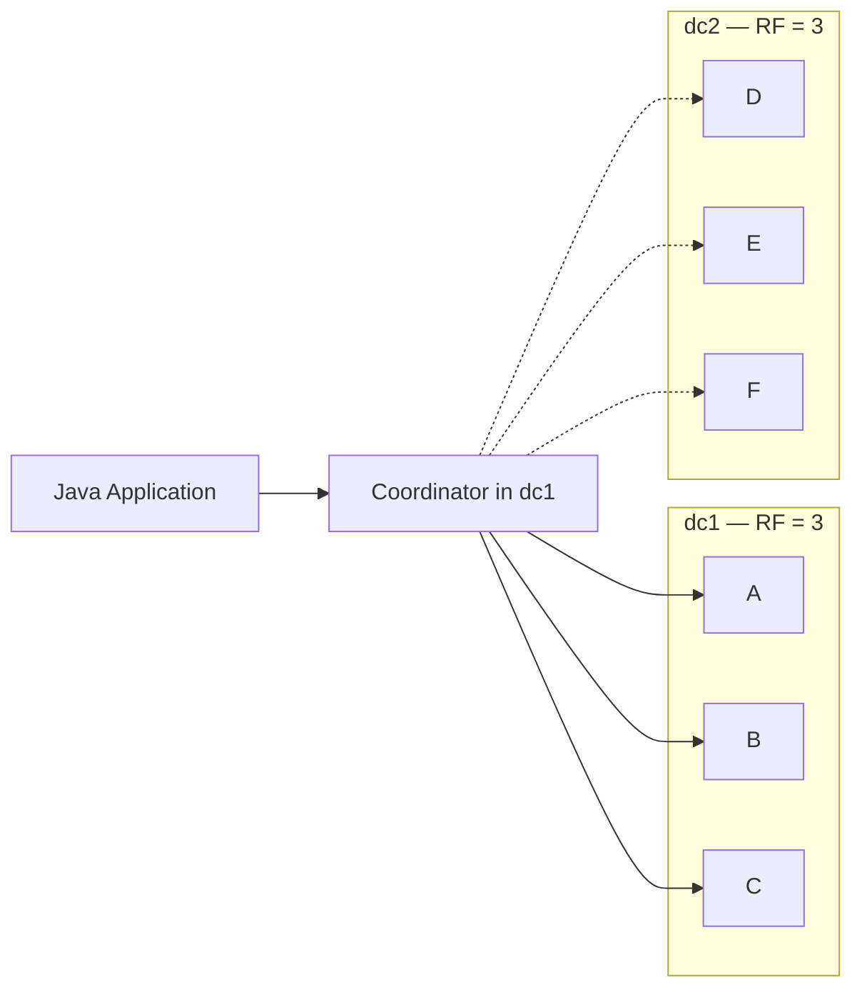
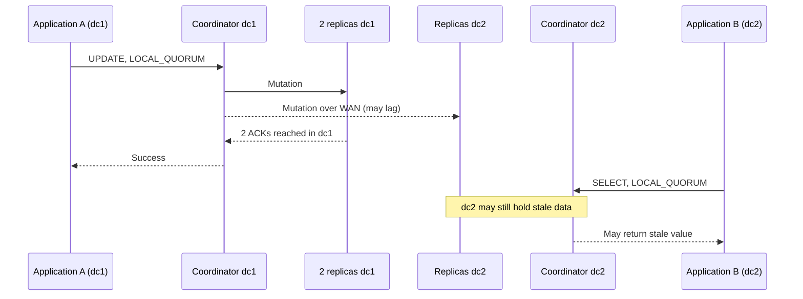

# LOCAL_ONE, LOCAL_QUORUM, and EACH_QUORUM by Supported Scope

In an Apache Cassandra cluster spanning multiple **datacenters (DCs)**, asking "how many replicas must respond?" is no longer enough. We must also ask **which datacenter those replicas belong to**. The three consistency levels `LOCAL_ONE`, `LOCAL_QUORUM`, and `EACH_QUORUM` address this in different ways: one or a majority of **local** replicas, or a majority of replicas **within each DC**.

This lesson belongs to the **Read/Write Consistency** chapter of the `DATABASE_ENGINE_WIDE_COLUMN_CASSANDRA` module. In the learning path covering distributed architecture, the wide-column model, partition keys, query-driven table design, CQL, replication, compaction, repair, error handling, and Java integration, this is an essential step to avoid setting a consistency level (CL) that is right in **count** yet wrong in **replica scope**.

> **Most important point:** In Apache Cassandra OSS, `LOCAL_ONE` and `LOCAL_QUORUM` apply to both **normal reads and writes**; `EACH_QUORUM` applies to **writes** and **does not support normal reads**. Cassandra-compatible products or other distributions may have different behavior; when deploying, always verify against the exact product and version.

## 1. Learning Objectives

After this lesson, you will be able to:

1. Distinguish **local DC** from **remote DC** from the coordinator's perspective.
2. Calculate the ACK counts for `LOCAL_ONE`, `LOCAL_QUORUM`, and `EACH_QUORUM` based on each DC's replication factor.
3. Choose a CL for applications reading/writing within one region or spanning multiple regions.
4. Explain why `LOCAL_QUORUM` in one DC does not automatically guarantee fresh reads in another DC.
5. Identify valid and invalid operations for each CL, especially `EACH_QUORUM` on `SELECT`.
6. Experiment with `cqlsh` and the Java Driver, and analyze scenarios where replicas or an entire DC fail.

## 2. Datacenters, Replicas, and the Coordinator

Cassandra replicates data by partition. With `NetworkTopologyStrategy`, each datacenter is configured with its own **replication factor (RF)** on the keyspace; RF is the expected number of replicas of **each partition** in that DC.

Suppose a keyspace has this topology:

```text
                   Cassandra Cluster

    dc1 (RF = 3)                    dc2 (RF = 3)
    +-----------+                   +-----------+
    | Replica A |                   | Replica D |
    | Replica B |                   | Replica E |
    | Replica C |                   | Replica F |
    +-----------+                   +-----------+

               Six replicas for the same partition
```

When a client sends a request to a node in `dc1`, that node acts as the **coordinator** and `dc1` is the request's **local datacenter**. If the coordinator is in `dc2`, then `dc2` is the local DC. The word "local" is **not** inferred solely from where the user sits, where the application runs, or a string in a hostname.

In the Java Driver, the local datacenter setting and load-balancing policy help select a coordinator in the intended DC. With `cqlsh`, the node receiving the connection is typically the coordinator. Thus, an application in Vietnam might accidentally use a coordinator in a remote DC if routing is misconfigured.

| Concept | What does it govern? |
| --- | --- |
| **Partition key** | Identifies the partition, influencing data placement and efficient query patterns. |
| **RF per DC** | Number of replicas per partition assigned to each datacenter. |
| **Coordinator / local DC** | Where the request is coordinated and the corresponding "local" scope. |
| **Consistency level** | Which replicas must respond and how many responses are needed for the operation to succeed. |

CL **does not create extra replicas**. When writing at `LOCAL_ONE` or `LOCAL_QUORUM`, Cassandra still attempts to send the mutation to all configured replicas, including remote DCs; CL only dictates which **ACKs must be waited for before reporting success**.

## 3. Definitions of the Three Consistency Levels

Assume the coordinator is in `dc1`; `RF_local` is `dc1`'s RF. Denote:

\[
Q(dc) = \left\lfloor \frac{RF(dc)}{2} \right\rfloor + 1
\]

as the **quorum of each DC**.

| Consistency Level | Required Responses | Scope | Support in Apache Cassandra OSS |
| --- | --- | --- | --- |
| `LOCAL_ONE` | **1** replica in local DC | Local DC only | **Reads and writes** |
| `LOCAL_QUORUM` | **`Q(local DC)`** replicas in local DC | Local DC only | **Reads and writes** |
| `EACH_QUORUM` | **`Q(dc)` in every DC** holding partition replicas | **All involved DCs** | **Normal writes; does not support normal reads** |

### 3.1. `LOCAL_ONE`: Just One Local Replica

With a coordinator in `dc1`, the request needs only **one valid response from a replica in `dc1`**.

- **Write `LOCAL_ONE`:** Succeeds when one replica of the partition in `dc1` confirms the write.
- **Read `LOCAL_ONE`:** Can return data when one replica in `dc1` responds; if that replica has not yet caught up with recent mutations, it may **read stale data**.
- **Availability:** Can reach the threshold even when replicas in other DCs do not respond. However, if no eligible replica is up in the local DC, the operation still fails, even if remote DCs have all the data.

`LOCAL_ONE` is close to `ONE` in **ACK count** but differs in **locality constraint**: `ONE` does not require the responding replica to be in the local DC; `LOCAL_ONE` enforces a response within the local DC.

### 3.2. `LOCAL_QUORUM`: Majority of Replicas in the Local DC

Quorum is calculated from the **RF of the coordinator's DC**, not from the cluster-wide RF total.

| RF in Local DC | Responses for `LOCAL_QUORUM` |
| ---: | ---: |
| 1 | 1 |
| 2 | 2 |
| 3 | 2 |
| 4 | 3 |
| 5 | 3 |

If the local DC has RF = 3, the request needs **2/3 replicas in that DC**; having three healthy replicas in a remote DC cannot compensate for a local quorum shortfall.

`LOCAL_QUORUM` is typically useful for applications **reading and writing within the same DC** that want overlap between the write-acknowledging replica set and the read-responding replica set without waiting for WAN responses. In return, compared to `LOCAL_ONE`, it requires more local replicas to be healthy.

### 3.3. `EACH_QUORUM`: Writes Must Achieve Quorum in Every DC

`EACH_QUORUM` is a **write** level requiring the coordinator to receive quorum ACKs **in every DC** holding replicas:

```text
dc1: RF = 3  -> quorum(dc1) = 2 ACKs
dc2: RF = 3  -> quorum(dc2) = 2 ACKs

EACH_QUORUM write -> requires 2 ACKs from dc1 AND 2 ACKs from dc2
```

If `dc2` returns only **one** ACK while `dc1` returns three ACKs, the total is still four, yet the `EACH_QUORUM` write **has not succeeded**: `dc2` lacks its own quorum.

In Apache Cassandra OSS, `EACH_QUORUM` is not a valid CL for normal `SELECT` queries. To read with quorum in the local DC, choose `LOCAL_QUORUM`; to read with cluster-wide quorum, choose `QUORUM`. They have **different scopes**, not a direct substitute for "quorum in every DC."

> When setting `EACH_QUORUM` on a `SELECT`, the driver may pass this level to the server, but the read request will be rejected as invalid in Cassandra OSS. This is an **unsupported operation type** error, not a "not enough nodes" message.

## 4. Comparison on a 2-DC Topology, RF = 3 Each

Suppose the coordinator is in `dc1`; the partition's six replicas are placed as shown:



| CL | Success Threshold | Must Wait for ACKs from `dc2`? | Allowed for Reads? |
| --- | --- | --- | --- |
| `LOCAL_ONE` | **1 ACK from dc1** | No | Yes |
| `LOCAL_QUORUM` | **2 ACKs from dc1** | No | Yes |
| `EACH_QUORUM` | **2 from dc1 + 2 from dc2** | **Yes** | **No** |
| `QUORUM` (comparison) | **Any 4 ACKs across both DCs** | In this topology, yes | Yes |
| `ALL` (comparison) | **6 ACKs** | Yes | Yes |

Looking at the "Success Threshold" column makes it immediately clear that **`EACH_QUORUM` is not the same as `QUORUM`**:

- `QUORUM` with total RF = 6 only needs **4 responses** in any valid distribution, such as `3 + 1`.
- `EACH_QUORUM` with RF = `3 + 3` needs **at least `2 + 2`**. A `3 + 1` distribution, despite totaling four ACKs, **does not satisfy it**.

### A Failure Scenario

Suppose all three `dc1` replicas are healthy, while `dc2` only has **one** replica returning ACKs:

| Request from `dc1` coordinator | Can it succeed threshold-wise? | Why? |
| --- | --- | --- |
| Read `LOCAL_ONE` | **Yes** | `dc1` has at least one replica. |
| Read `LOCAL_QUORUM` | **Yes** | `dc1` has at least two replicas. |
| Write `LOCAL_QUORUM` | **Yes** | Only waits for two ACKs in `dc1`. |
| Write `QUORUM` | **Yes** | Can collect three ACKs in `dc1` and one in `dc2`, reaching four. |
| Write `EACH_QUORUM` | **No** | `dc2` needs two ACKs but only has one. |

This conclusion applies to the **CL threshold**; in practice, even a request that "can succeed" may still time out due to network, load, disk, or coordinator failures.

## 5. When Replication Factors Differ Between DCs

DCs do not always have equal RFs. Suppose:

```text
dc1: RF = 3   -> quorum 2
dc2: RF = 5   -> quorum 3
Total RF = 8
```

| CL | Required ACKs |
| --- | --- |
| `LOCAL_ONE` at `dc1` | **1 in dc1** |
| `LOCAL_QUORUM` at `dc1` | **2 in dc1** |
| `LOCAL_QUORUM` at `dc2` | **3 in dc2** |
| `EACH_QUORUM` write | **2 in dc1 and 3 in dc2** |
| Cluster-wide `QUORUM` | **`floor(8/2)+1 = 5`** responses total |

An ACK distribution of **`3 in dc1 + 2 in dc2`** totals five and thus satisfies `QUORUM`, yet **fails `EACH_QUORUM`** because `dc2` requires three ACKs. You must not simply sum the `EACH_QUORUM` thresholds and ignore the **per-DC** condition.

In clusters with more than two datacenters, the calculation is analogous: compute the quorum for **each DC holding replicas**, and verify quorum **individually per DC**. For instance, RF = `3 + 3 + 3` requires three ACK groups of `2 + 2 + 2`, not any six responses.

## 6. Cross-DC Consistency: Guarantees and Limitations

### 6.1. `LOCAL_QUORUM` Write and Read in the Same DC

In `dc1` with RF = 3:

```text
Write LOCAL_QUORUM in dc1 ->  2 dc1 replicas ACK
Read LOCAL_QUORUM in dc1  ->  2 dc1 replicas respond

2 + 2 > 3, so the two dc1 replica sets must intersect.
```

If the write succeeded, the read begins afterward on the same partition and same replica set, **there are no concurrent writes**, and timestamp reconciliation does not alter the expected ordering, the intersection helps the read observe the newly written value. This is the core rationale for the `LOCAL_QUORUM`/`LOCAL_QUORUM` pair **within a single DC**.

### 6.2. Writing in `dc1` and Reading `LOCAL_QUORUM` in `dc2`

Suppose a write mutation in `dc1` reaches `LOCAL_QUORUM` with two ACKs from `dc1`. The coordinator may have sent the mutation to `dc2`, but **does not wait for ACKs from `dc2`** before reporting success.

Another application immediately reads using `LOCAL_QUORUM` with a coordinator in `dc2`. The two replicas queried in `dc2` may **not have received the update yet**, so the read **can return a stale value**.



You cannot apply `R + W > N` by taking `W = 2` in `dc1` and `R = 2` in `dc2` with `N = 3`. Those two groups **do not lie on the same replica set**.

### 6.3. Writing `EACH_QUORUM`, Then Reading `LOCAL_QUORUM`

In an RF = `3 + 3` model, a successful `EACH_QUORUM` write has at least **two ACKs in each DC**. A subsequent `LOCAL_QUORUM` read in **either `dc1` or `dc2`** requires two responses in that DC.

Within each DC, `2 + 2 > 3`, so the read replica set **overlaps** with the write-acknowledging replica set. Therefore, assuming no concurrent writes and normal consistency conditions hold, this CL pair is worth considering when you need **writes confirmed in both DCs before the client receives success**.

The trade-off is that `EACH_QUORUM` increases dependence on the WAN link and the availability of **all DCs**. If you only need consistency within the request-handling DC and can tolerate lagged cross-DC synchronization, `LOCAL_QUORUM` usually lowers latency.

### 6.4. `LOCAL_ONE` Does Not Guarantee "Read Your Writes"

Even when both read and write happen in the same DC with RF = 3:

```text
Write LOCAL_ONE: W = 1
Read LOCAL_ONE:  R = 1
R + W = 2 <= RF = 3
```

The two chosen replicas may differ. A successful `LOCAL_ONE` write followed immediately by a `LOCAL_ONE` read **can still see stale data**. For data requiring "read your writes," evaluate appropriate CLs and application session mechanisms.

> The intersection condition is a **reasoning tool** about responding replicas; it does not turn Cassandra into linearizable transactions for all operations. Concurrent writes, clocks/timestamps, last-write-wins, and lightweight transactions (LWT) are separate aspects requiring analysis.

## 7. Keyspace Configuration and Trying with `cqlsh`

An example with two datacenters actually named `dc1` and `dc2`, each needing enough nodes for RF = 3:

```sql
CREATE KEYSPACE IF NOT EXISTS shipment_lab
WITH replication = {
  'class': 'NetworkTopologyStrategy',
  'dc1': 3,
  'dc2': 3
};

CREATE TABLE IF NOT EXISTS shipment_lab.shipment_by_id (
  shipment_id uuid PRIMARY KEY,
  status text,
  updated_at timestamp
);
```

**Preparation:** Verify the actual DC names recognized by Cassandra (e.g., via the appropriate admin tool). `dc1` and `dc2` are illustrative names only. RF = 3 requires enough available nodes in each DC; this example cannot be deployed properly on a single-node Cassandra instance.

When `cqlsh` connects to a node in `dc1`, the `CONSISTENCY` command sets the CL for subsequent statements:

```sql
-- Write: requires 1 replica in dc1 to acknowledge.
CONSISTENCY LOCAL_ONE;

INSERT INTO shipment_lab.shipment_by_id
  (shipment_id, status, updated_at)
VALUES (
  11111111-1111-4111-8111-111111111111,
  'CREATED',
  '2026-11-21 00:00:00+0000'
);

-- Read: requires quorum of dc1 (RF=3 -> 2 responses).
CONSISTENCY LOCAL_QUORUM;

SELECT shipment_id, status, updated_at
FROM shipment_lab.shipment_by_id
WHERE shipment_id = 11111111-1111-4111-8111-111111111111;

-- Write: requires quorum in both dc1 and dc2.
CONSISTENCY EACH_QUORUM;

UPDATE shipment_lab.shipment_by_id
SET status = 'IN_TRANSIT',
    updated_at = '2026-11-21 01:00:00+0000'
WHERE shipment_id = 11111111-1111-4111-8111-111111111111;

-- Must change CL before SELECT: EACH_QUORUM is unsupported for OSS reads.
CONSISTENCY LOCAL_QUORUM;

SELECT status, updated_at
FROM shipment_lab.shipment_by_id
WHERE shipment_id = 11111111-1111-4111-8111-111111111111;
```

Notes:

1. `CONSISTENCY` is a **`cqlsh` command**, not part of standard `INSERT`/`UPDATE`/`SELECT` syntax. It affects statements executed **subsequently in the same shell session**.
2. The "local" scope is determined by the **coordinator**, so make sure the shell connects to the right DC before comparing results.
3. Check `HELP CONSISTENCY;` in your `cqlsh` version; supported levels and help output may vary by version. If a client rejects `EACH_QUORUM`, use a driver that supports this CL and verify server capabilities.
4. Do not run `SELECT` while the shell is still set to `EACH_QUORUM` against Apache Cassandra OSS; the server will reject it as an invalid read CL.

## 8. Selecting CL per Statement in Java Driver 4.x

Assume a `CqlSession` has already been created and configured with **local datacenter** `dc1` in the application's initialization layer. This example uses the `DefaultConsistencyLevel` API to set CL directly on each statement.

```java
import com.datastax.oss.driver.api.core.CqlSession;
import com.datastax.oss.driver.api.core.DefaultConsistencyLevel;
import com.datastax.oss.driver.api.core.cql.Row;
import com.datastax.oss.driver.api.core.cql.SimpleStatement;

import java.time.Instant;
import java.util.UUID;

public final class ShipmentRepository {
    // Latency-prioritized read: one local replica.
    public String findStatusFast(CqlSession session, UUID shipmentId) {
        SimpleStatement read = SimpleStatement.newInstance(
                "SELECT status FROM shipment_lab.shipment_by_id " +
                "WHERE shipment_id = ?",
                shipmentId)
            .setConsistencyLevel(DefaultConsistencyLevel.LOCAL_ONE);

        Row row = session.execute(read).one();
        return row == null ? null : row.getString("status");
    }

    // Read requiring a majority of replicas in the coordinator's DC.
    public String findStatusLocalQuorum(CqlSession session, UUID shipmentId) {
        SimpleStatement read = SimpleStatement.newInstance(
                "SELECT status FROM shipment_lab.shipment_by_id " +
                "WHERE shipment_id = ?",
                shipmentId)
            .setConsistencyLevel(DefaultConsistencyLevel.LOCAL_QUORUM);

        Row row = session.execute(read).one();
        return row == null ? null : row.getString("status");
    }

    // Write requiring quorum in every DC configured with replicas.
    public void updateAcrossDatacenters(
            CqlSession session, UUID shipmentId, String newStatus) {
        SimpleStatement write = SimpleStatement.newInstance(
                "UPDATE shipment_lab.shipment_by_id " +
                "SET status = ?, updated_at = ? WHERE shipment_id = ?",
                newStatus, Instant.now(), shipmentId)
            .setConsistencyLevel(DefaultConsistencyLevel.EACH_QUORUM);

        session.execute(write);
    }
}
```

In production applications, you should use **reusable `PreparedStatement`s** prepared once, execution profiles for query paths sharing a CL, and appropriate timeouts/retries. Do not reuse `EACH_QUORUM` on a `SELECT` path merely because the enum exists in the Java Driver: **a recognized enum does not prove the server supports that level for every request type**.

When building a session, `withLocalDatacenter("dc1")` must match the real DC name and routing policy:

```java
// Illustrative example; contact points and security must match your real environment.
// CqlSession session = CqlSession.builder()
//     .addContactPoint(new InetSocketAddress("127.0.0.1", 9042))
//     .withLocalDatacenter("dc1")
//     .build();
```

This snippet only illustrates the role of the local DC configuration, not a complete configuration for connecting to a real two-datacenter cluster.

## 9. Availability, Latency, and Error Handling

### When Local Replicas Are Lost

With local DC RF = 3:

| Healthy Local Replicas | Read/Write `LOCAL_ONE` | Read/Write `LOCAL_QUORUM` |
| ---: | --- | --- |
| 3 | Can succeed | Can succeed |
| 2 | Can succeed | Can succeed |
| 1 | Can succeed | Not enough for quorum |
| 0 | Not enough responses | Not enough for quorum |

Healthy replicas in another DC **are not counted** toward these two local thresholds.

### When a Remote DC Is Disrupted

With RF = `3 + 3` and the coordinator in the healthy DC, `LOCAL_ONE`/`LOCAL_QUORUM` can continue operating using local replicas. `EACH_QUORUM` writes will fail if the remote DC cannot achieve quorum, even if the entire local DC is healthy.

**Latency:** `LOCAL_ONE` generally has a lower response threshold than `LOCAL_QUORUM`; `EACH_QUORUM` must wait on remote DCs, which can increase latency due to inter-DC networking and slow replicas. Exact latency cannot be predicted from CL name alone, since it also depends on load, placement, coordinator, speculative reads, and node state.

### Timeout Does Not Mean the Mutation Was Definitely Not Written

An `UPDATE` at `EACH_QUORUM` may have already been applied by multiple replicas while the client still receives a `WriteTimeoutException` because one DC lacked a timely ACK.

- **Unavailable:** Coordinator determines available replicas are insufficient to meet CL.
- **WriteTimeout / ReadTimeout:** Failed to complete response threshold/processing path within deadline; partial work may have occurred.
- **WriteFailure / ReadFailure:** Replicas reported processing errors causing the operation to fail CL.

Applications must not automatically conclude that failure means "nothing was written." Design **idempotent** updates where appropriate, enforce bounded retry policies, and be careful with counters and operations with side effects. Outages in a remote DC can cause `EACH_QUORUM` to time out even while local services remain healthy.

Mechanisms like **hinted handoff** and **repair** help synchronize or reconcile replicas over time. **Compaction** handles SSTables and tombstones. They do not change the per-request ACK conditions of `LOCAL_*`/`EACH_QUORUM` and do not replace running proper periodic repairs.

## 10. Distinguishing `EACH_QUORUM` from Other Mechanisms

| Mechanism | Purpose | Key Difference to Remember |
| --- | --- | --- |
| `QUORUM` | Majority of replicas **cluster-wide** respond | Does not enforce quorum in **each** DC. |
| `LOCAL_QUORUM` | Majority of replicas in the **coordinator's DC** | Supports reads/writes; requires no ACKs from remote DCs. |
| `EACH_QUORUM` | Write with quorum in **every DC holding replicas** | Not used for normal reads in Cassandra OSS. |
| `SERIAL` / `LOCAL_SERIAL` | Serial level for the Paxos phase in lightweight transactions | Used with conditional operations; not an alias for `EACH_QUORUM`. |
| `ALL` | Wait for **every replica** to respond | Stronger count threshold, but loses availability easily when one replica fails. |

An `INSERT ... IF NOT EXISTS` requirement needs **LWT** to enforce the precondition before writing; a normal `EACH_QUORUM` write **does not automatically provide** atomic compare-and-set. Choosing serial consistency for LWT is a separate topic from counting quorum ACKs on normal writes.

## 11. Verification Exercises

**Exercise 1 — Two-DC Quorum Calculation:** `dc1` RF = 3, `dc2` RF = 5. Coordinator in `dc1`. How many responses do `LOCAL_ONE`, `LOCAL_QUORUM`, and an `EACH_QUORUM` write require?

**Answer:** `LOCAL_ONE` needs 1 in `dc1`; `LOCAL_QUORUM` needs 2 in `dc1`; `EACH_QUORUM` needs **2 in dc1 and 3 in dc2**.

**Exercise 2 — ACK Distribution:** RF = `3 + 3`. A write receives 3 ACKs from `dc1` and 1 ACK from `dc2`. Does it satisfy `QUORUM`? What about `EACH_QUORUM`?

**Answer:** Total 4/6, so it can satisfy global `QUORUM`. It does not satisfy `EACH_QUORUM` because `dc2` needs at least 2 ACKs.

**Exercise 3 — Choosing Read CL:** A client sends a `SELECT` with `EACH_QUORUM` to Cassandra OSS and receives an invalid consistency level error. Is this caused by insufficient nodes? Which CL should be used for a local-DC quorum read?

**Answer:** No. `EACH_QUORUM` **does not support normal reads** in Cassandra OSS. Choose `LOCAL_QUORUM` if you want a quorum read in the local DC.

**Exercise 4 — Cross-DC Read:** A `LOCAL_QUORUM` write in `dc1` succeeds, followed immediately by a `LOCAL_QUORUM` read in `dc2`. Is it guaranteed to see the new value?

**Answer:** No. ACKs for the write were only required from `dc1`, so data in `dc2` may not be updated yet.

**Exercise 5 — Fault Tolerance:** `dc1` RF = 3 has two healthy replicas; `dc2` RF = 3 has only one healthy replica. Coordinator in `dc1`. Can `LOCAL_QUORUM` and `EACH_QUORUM` writes succeed?

**Answer:** `LOCAL_QUORUM` can succeed because it reaches 2/3 in `dc1`. `EACH_QUORUM` fails because `dc2` only has 1/3, below its 2/3 quorum.

**Exercise 6 — Business Rule:** You must create a single unique shipment only when the ID does not already exist. Does using `EACH_QUORUM` on a normal `INSERT` eliminate the race condition?

**Answer:** No. `EACH_QUORUM` adjusts the acknowledgment threshold; it does not check uniqueness under concurrent writes. Consider `IF NOT EXISTS` and LWT as required.

## 12. Key Takeaways and References

To pick the right CL in a multi-DC cluster, always answer four questions: **which DC is the coordinator in**, **what is each DC's RF**, **is this a read or a write**, and **does the application need local confirmation or confirmation across every DC**.

- **`LOCAL_ONE`:** 1 ACK in the coordinator's DC; supports reads and writes; prioritizes low latency, may read stale data.
- **`LOCAL_QUORUM`:** majority of ACKs in the coordinator's DC; supports reads and writes; suitable when you need quorum overlap **within the same DC**.
- **`EACH_QUORUM`:** quorum ACKs **in every DC**; used for **normal writes** in Apache Cassandra OSS; adds latency and availability dependence on remote DCs.

CL-based reads and writes must still be paired with partition keys, replication strategy, replica repair, and Java-side error handling. Choosing the right threshold solves only part of the consistency problem in a distributed system.

Further reading:

1. [Apache Cassandra Documentation — Dynamo / Tunable Consistency](https://cassandra.apache.org/doc/stable/cassandra/architecture/dynamo.html).
2. [Apache Cassandra Documentation — cqlsh, CONSISTENCY command](https://cassandra.apache.org/doc/stable/cassandra/managing/tools/cqlsh.html).
3. [DataStax Cassandra OSS — Configuring Consistency Levels](https://docs.datastax.com/en/cassandra-oss/3.x/cassandra/dml/dmlConfigConsistency.html), specifically the section listing valid CLs for reads and writes.
